# AI 人像摄影库 · 姿势大全 + 写真配方组装

**200 组写真姿势（20 种风格，每组一张写真照 + 一张照着它画的白模）、24 套人像写真配方（216 张样片）、62 个摄影姿势（39 个带多机位白模图和 3D 数据）、436 个可自由组合的人像元素（光影、场景、胶片质感、服装、景别、机位、镜头……），每张图都有可复制的提示词。** 图片和数据按 CC BY 4.0 开放，可以免费商用，注明来自 [Promicat](https://promicat.app?ref=github) 即可。

这个库的核心是一套**人像提示词组件**：把一张写真拆成「质感 + 光 + 场景 + 服装 + 姿势 + 表情 + 景别 + 机位 + 镜头」等 20 个槽位，每个槽位都有一批写好的英文短句。挑几个组件一拼，就是一条完整的写真提示词；换掉其中一个，就是一套新写真。下面 24 套配方全部是这样拼出来的。

由 [Promicat](https://promicat.app?ref=github) 制作和维护。在线浏览姿势、**在 3D 里微调姿势**、上传自己的照片一键生成同款写真：<https://promicat.app/zh/poses?ref=github>

## 能用来做什么

- **按风格找写真姿势**：20 种写真风格（街拍、港风、哥特、老钱风、Y2K、新中式……）各 10 组自然不僵的姿势，每组都有写真照和对应白模，白模直接拿来当姿势参考图。
- **直接套用写真配方**：24 套主题写真，每套 9 张（远景、全身、中景、特写、细节都有），每张都有两版提示词：虚构模特版，以及「用你的照片」版。
- **自己组装人像配方**：从 436 个组件里挑，几行 JSON 就是一套新配方，脚本帮你拼成提示词。
- **给 AI 生图当姿势参考**：你的照片作为第一张参考图，白模图作为第二张。GPT Image、Nano Banana、Seedream、即梦等都能用。
- **拍照前找姿势、学光影**：姿势按站、坐、跪、卧、蹲、半身分类；每种光都有示例照和一句能直接用的描述。
- **给 Agent 用**：自带两个 Agent Skill（`skills/`），其中「照片配姿势」能看用户的照片自动推荐姿势并生成写真；另有结构化 JSON（`data/`）和组装脚本（`scripts/`）。

## 写真姿势

200 组，20 种风格。每组是一张写真照和一张照着它画的木头白模：白模当姿势参考图，配上你的照片和风格描述，就能拍出同款。点风格名看这个风格的全部 10 组和提示词。

| 风格 | 写真照（点风格名看全部 10 组） |
|---|---|
| [**街拍时尚**](styles/street.md)<br><sub>Street fashion</sub> | 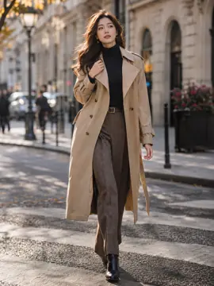  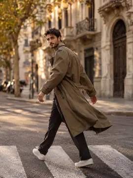 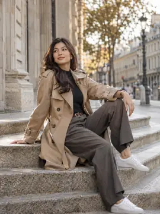 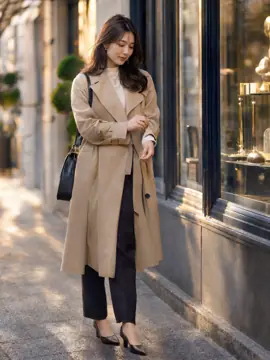 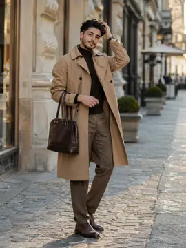 |
| [**咖啡馆文艺**](styles/cafe.md)<br><sub>Cafe & bookshop</sub> |       |
| [**海边度假**](styles/beach.md)<br><sub>Seaside holiday</sub> |       |
| [**森系花田**](styles/flower.md)<br><sub>Forest & flower field</sub> |  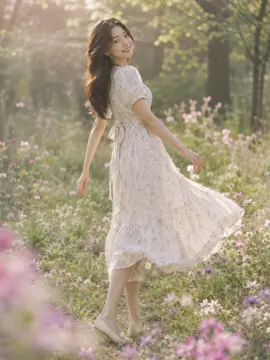 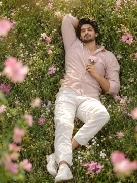  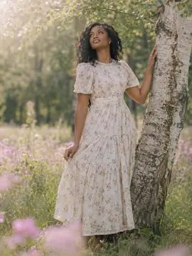  |
| [**日系清新**](styles/jfilm.md)<br><sub>Japanese fresh film</sub> | 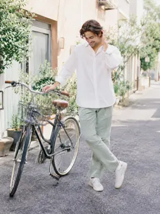 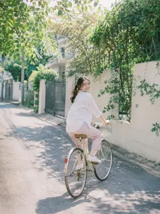  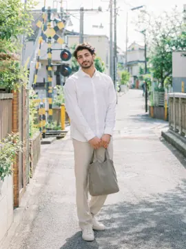 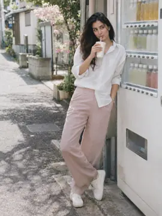 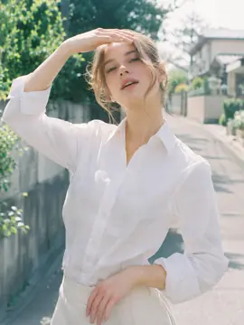 |
| [**港风复古**](styles/hkretro.md)<br><sub>HK retro neon</sub> | 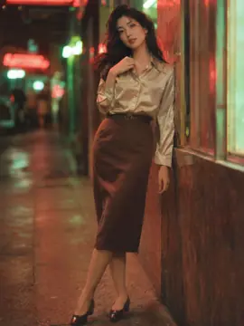 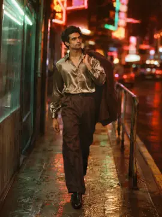  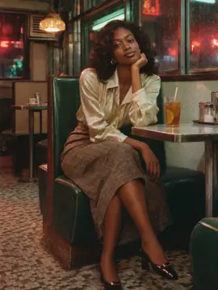 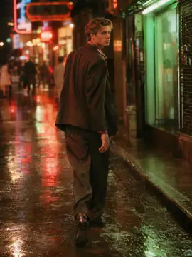  |
| [**居家慵懒**](styles/home.md)<br><sub>Cosy at home</sub> | 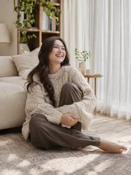 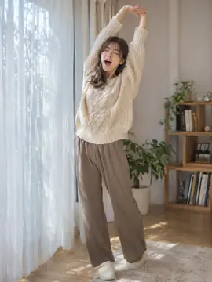 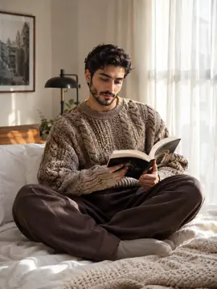 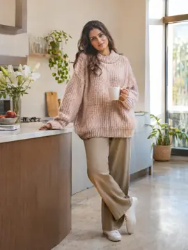   |
| [**校园青春**](styles/campus.md)<br><sub>Campus youth</sub> |    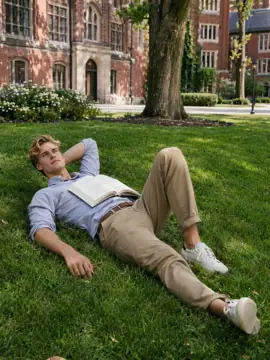   |
| [**情绪棚拍**](styles/mood.md)<br><sub>Moody studio</sub> |   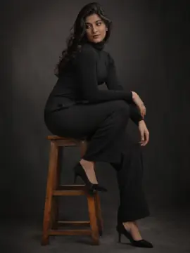 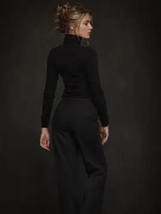 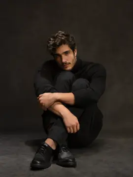  |
| [**新中式**](styles/chinese.md)<br><sub>New Chinese style</sub> | 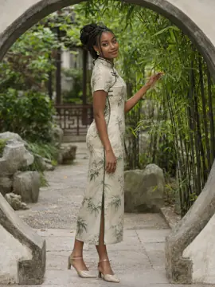 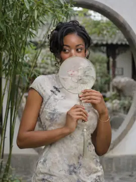 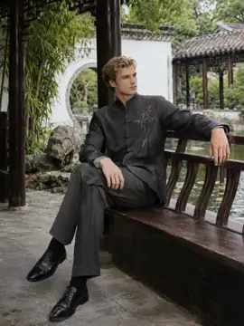   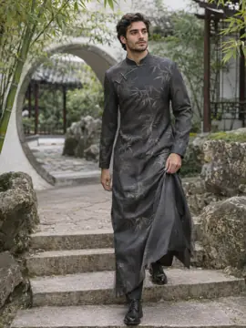 |
| [**暗黑哥特**](styles/gothic.md)<br><sub>Gothic</sub> | 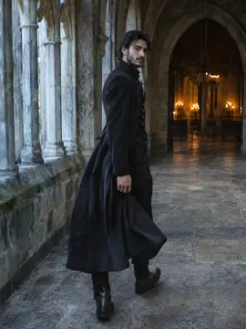      |
| [**学院风**](styles/darkacad.md)<br><sub>Dark academia</sub> |   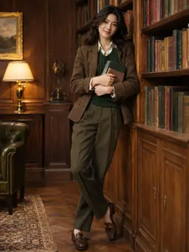    |
| [**老钱风**](styles/oldmoney.md)<br><sub>Old money</sub> |     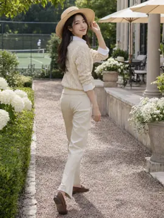 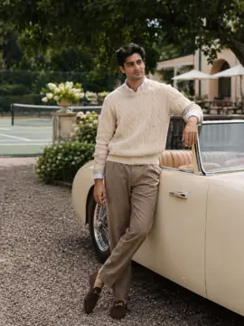 |
| [**西部牛仔**](styles/western.md)<br><sub>Western cowboy</sub> |  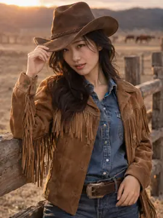   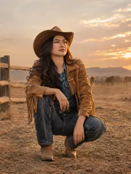 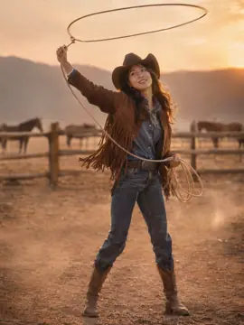 |
| [**波西米亚**](styles/boho.md)<br><sub>Boho desert</sub> | 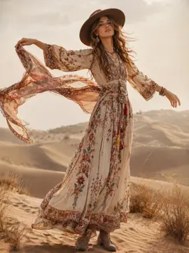   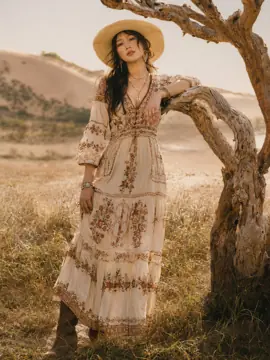 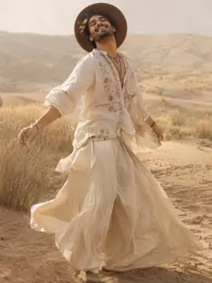 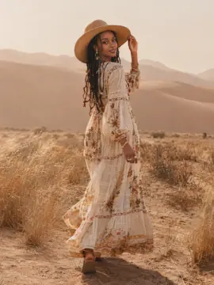 |
| [**Y2K 千禧辣妹**](styles/y2k.md)<br><sub>Y2K flash</sub> | 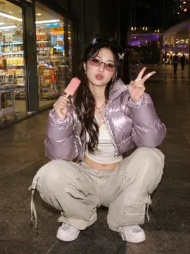 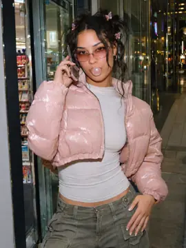 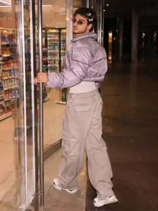 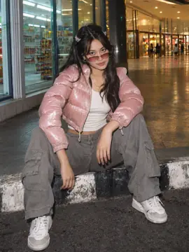 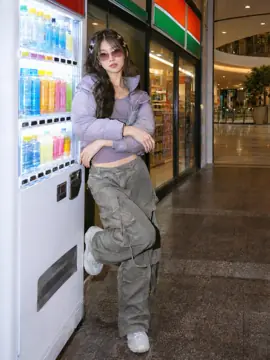 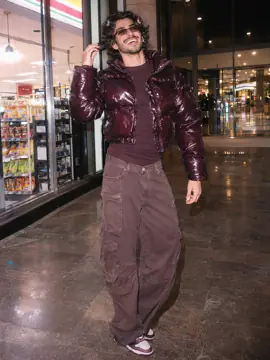 |
| [**街头朋克**](styles/punk.md)<br><sub>Street punk</sub> | 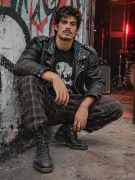 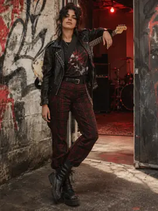 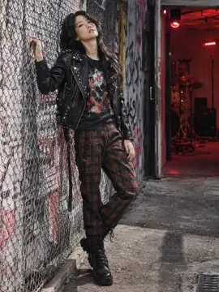 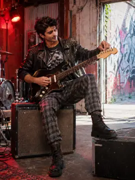   |
| [**赛博霓虹**](styles/cyber.md)<br><sub>Cyberpunk neon</sub> |       |
| [**好莱坞复古**](styles/hollywood.md)<br><sub>1950s Hollywood</sub> |       |
| [**北欧极简**](styles/nordic.md)<br><sub>Nordic minimal</sub> |       |

## 人像写真配方（24 套）

每套 9 张共用同一组质感、光影、场景、服装和人物，只换姿势、表情、景别、机位和镜头。完整提示词在 `data/portrait-recipes.json`，也可以用脚本生成：

```bash
python3 scripts/assemble.py --list                       # 列出全部配方
python3 scripts/assemble.py tokyo-rain-night             # 9 张的提示词（虚构模特）
python3 scripts/assemble.py tokyo-rain-night --shot 3 --with-photo   # 第 3 张，用你的照片
```

带 `--with-photo` 时，参考图顺序是：你的照片在前，脚本列出的白模图在后。

|  |  |  |
|---|---|---|
| <br><b>东京雨夜·霓虹小巷</b><br><code>tokyo-rain-night</code><br><sub>霓虹夜景 · 东京雨夜小巷 · CineStill 800T 夜景胶片</sub> | <br><b>巴黎咖啡馆·清晨露台</b><br><code>paris-cafe-morning</code><br><sub>清晨斜阳 · 巴黎咖啡馆露台 · 胶片 Portra 400 随拍</sub> | <br><b>雪夜木屋·壁炉边</b><br><code>snowy-cabin-fireside</code><br><sub>壁炉火光 · 雪夜木屋 · 胶片 Portra 400 随拍</sub> |
| <br><b>海边日落·风中白裙</b><br><code>beach-sunset-wind</code><br><sub>黄金时刻 · 海边沙滩 · 褪色逆光胶片</sub> | <br><b>老图书馆·光柱浮尘</b><br><code>old-library-dust-beam</code><br><sub>窗口硬光斑 · 老图书馆 · 中画幅艺术肖像</sub> | <br><b>黑棚硬闪·男士礼服</b><br><code>black-studio-strobe-menswear</code><br><sub>棚拍硬闪 · 纯黑背景 · 清透杂志感</sub> |
| <br><b>黑色电影·百叶窗</b><br><code>film-noir-blinds</code><br><sub>百叶窗光影 · 旧式侦探办公室 · 黑色电影</sub> | <br><b>金色麦田·逆光剪影</b><br><code>wheat-field-backlight</code><br><sub>逆光剪影 · 金色麦田 · 日系青春电影</sub> | <br><b>深夜地铁站台·黑白</b><br><code>subway-platform-bw</code><br><sub>顶部荧光灯 · 地铁站台 · 黑白 Tri-X 颗粒</sub> |
| <br><b>天台蓝调·廓形西装</b><br><code>rooftop-blue-hour-suit</code><br><sub>蓝调时刻 · 城市天台 · 35mm 电影级时尚</sub> | <br><b>玻璃温室·植物午后</b><br><code>greenhouse-pastel</code><br><sub>阴天散射光 · 玻璃温室 · 宝丽来拍立得</sub> | <br><b>复古敞篷车·海岸公路</b><br><code>vintage-convertible-road-trip</code><br><sub>金色逆光加环境补 · 复古敞篷车公路 · Ektachrome 反转片</sub> |
| <br><b>雨天旧书店·午后</b><br><code>rainy-bookshop-afternoon</code><br><sub>窗边柔光 · 旧书店 · 居家纪实胶片</sub> | <br><b>湖边栈道·清晨薄雾</b><br><code>lakeside-dock-mist</code><br><sub>清晨薄雾光 · 湖边木栈道 · 北欧冷淡哑光</sub> | <br><b>古典雕塑馆·天窗光</b><br><code>sculpture-museum</code><br><sub>天窗顶光 · 古典雕塑馆 · 杂志美妆大片</sub> |
| <br><b>雪地松林·红大衣</b><br><code>snowy-pine-forest</code><br><sub>雪地漫反射 · 雪地松林 · 富士 400H 淡彩</sub> | <br><b>美式复古餐厅·深夜</b><br><code>retro-diner-night</code><br><sub>室内暖钨丝灯 · 美式复古餐厅 · 港风电影色调</sub> | <br><b>老城夜巷·钠灯</b><br><code>old-town-sodium-night</code><br><sub>钠灯路灯 · 老城夜巷 · CineStill 800T 夜景胶片</sub> |
| <br><b>秋日公园·落叶树影</b><br><code>autumn-park-dappled</code><br><sub>树影斑驳光 · 秋日公园 · 胶片 Portra 400 随拍</sub> | <br><b>沙漠沙丘·亚麻长袍</b><br><code>desert-dunes-linen</code><br><sub>低角度侧硬光 · 沙漠沙丘 · 清透杂志感</sub> | <br><b>夜行列车·卧铺车厢</b><br><code>night-train-compartment</code><br><sub>室内暖钨丝灯 · 夜行列车 · 港风电影色调</sub> |
| <br><b>老式网球场·夏日正午</b><br><code>vintage-tennis-court</code><br><sub>正午硬光 · 老式网球场 · Ektachrome 反转片</sub> | <br><b>古堡烛光·丝绒长裙</b><br><code>candlelit-manor-hall</code><br><sub>烛光 · 古堡烛光大厅 · 35mm 电影级时尚</sub> | <br><b>伦勃朗光·素墙经典肖像</b><br><code>rembrandt-plaster-portrait</code><br><sub>伦勃朗光 · 暖色素墙影棚 · 中画幅艺术肖像</sub> |

## 自己组装人像配方

`data/components.json` 是全部组件，按槽位分组；每个组件有 `id`、中英文名和真正拼进提示词的 `text`。一套配方只写组件 id：

| 槽位 | 中文 | 层级 | 内容 | 数量 |
|---|---|---|---|---|
| `look` | 质感 | 整组 | 胶片型号、调色、颗粒 | 17 |
| `skin` | 皮肤 | 整组 | 皮肤真实感 | 5 |
| `light` | 主光 | 整组 | 一套只用一种主光 | 34 |
| `light_mod` | 光的细节 | 整组·多选 | 投影、眩光、高光晕染、金边 | 26 |
| `scene` | 场景 | 整组 | 地点，只写环境 | 45 |
| `outfit` | 服装 | 整组 | 全部得体不透 | 39 |
| `hair` | 发型 | 整组 | 发型和状态 | 17 |
| `makeup` | 妆容 | 整组 | 妆容程度和唇色 | 9 |
| `motion` | 动态 | 整组·可空 | 风、动作中、拖影 | 5 |
| `props` | 道具 | 整组·多选 | 伞、书、胶片相机、老爷车…… | 27 |
| `negative` | 避免项 | 整组·多选 | 无文字、手部正常、得体、拒绝塑料皮 | 15 |
| `gaze_rule` | 看镜规则 | 整组 | 九张里几张看镜头（只用来排片） | 3 |
| `pose` | 姿势 | 逐张 | 身体姿势，带白模参考图 | 62 |
| `action` | 动作 | 逐张·可空 | 手在做什么 | 39 |
| `expression` | 表情 | 逐张 | 表情和视线 | 30 |
| `shot_size` | 景别 | 逐张 | 大远景到微距 | 11 |
| `angle` | 机位 | 逐张 | 平视、仰拍、顶拍、过肩…… | 12 |
| `placement` | 构图位置 | 逐张·可空 | 三分、居中、留白 | 8 |
| `foreground` | 前景 | 逐张·可空 | 虚化的花、雨滴玻璃、书架边 | 16 |
| `camera` | 镜头 | 逐张 | 焦段、光圈、拍法 | 16 |

「整组」的槽位一套配方只选一次，9 张共用，保证整套像同一场拍摄；「逐张」的槽位每张单独选。一个最小的配方长这样（以「东京雨夜·霓虹小巷」的第 2 张为例）：

```json
{
 "id": "my-recipe",
 "subject": "a young East Asian woman in her late twenties with long straight black hair",
 "set": {
  "look": "cinestill-800t-night",
  "skin": "real-skin-full",
  "light": "neon",
  "light_mod": [
   "wet-reflections",
   "neon-spill",
   "backlit-rain",
   "halation"
  ],
  "scene": "tokyo-rain-alley",
  "outfit": "belted-trench",
  "hair": "damp-from-rain",
  "makeup": "natural-editorial",
  "gaze_rule": "two-of-nine-glance",
  "motion": "none-sharp",
  "props": [
   "black-umbrella"
  ],
  "negative": [
   "no-text",
   "hands-ok",
   "modest",
   "anti-plastic",
   "anti-ai-illustration",
   "no-extra-people"
  ]
 },
 "shots": [
  {
   "pose": "classic-contrapposto",
   "action": "hold-umbrella",
   "expression": "gaze-out-of-frame",
   "shot_size": "full-body",
   "angle": "low-angle",
   "placement": "right-third",
   "foreground": null,
   "camera": "35mm-f2.8"
  }
 ]
}
```

存成 `my-recipe.json` 后运行 `python3 scripts/assemble.py --recipe my-recipe.json`。想换一套：把 `scene` 换成 `rooftop`、`light` 换成 `blue-hour`，同样的 9 个镜头就变成了天台蓝调时刻。写错 id 会直接报错并告诉你去 `data/components.json` 里查。

小技巧：

- 姿势里有 `pose_ref` 的会自动带上白模参考图，姿势最稳；补充姿势只有一张正面白模图，靠文字描述。
- 一套 9 张建议覆盖：1 张远景、2 张不同机位的全身、2 张中景（其中一张正侧面）、1 张中近景、1 张特写、1 张手部或道具细节、1 张过肩或遮挡的创意镜头。
- `gaze_rule` 不进提示词，只提醒你九张里安排几张看镜头。

## 姿势大全（39）

点图片打开在线页面，可以看所有机位、在 3D 里微调、直接生成。

### 站姿（9）

|  |  |  |  |  |  |
|---|---|---|---|---|---|
| <a href="https://promicat.app/zh/poses/classic-contrapposto?ref=github"></a><br>经典站姿 | <a href="https://promicat.app/zh/poses/both-hands-in-hair?ref=github"></a><br>双手撩发 | <a href="https://promicat.app/zh/poses/hand-behind-head?ref=github"></a><br>扶头站 | <a href="https://promicat.app/zh/poses/hand-to-brow-gaze-away?ref=github"></a><br>抚额远望 | <a href="https://promicat.app/zh/poses/arm-up-hip-out?ref=github"></a><br>扬臂扭腰 | <a href="https://promicat.app/zh/poses/mid-step-hand-to-hair?ref=github"></a><br>迈步抚发 |
| <a href="https://promicat.app/zh/poses/both-arms-high?ref=github"></a><br>双臂高举 | <a href="https://promicat.app/zh/poses/arms-spread-wide?ref=github"></a><br>双臂舒展 | <a href="https://promicat.app/zh/poses/playful-forward-lean?ref=github"></a><br>前倾俏皮 |  |  |  |

### 坐姿（12）

|  |  |  |  |  |  |
|---|---|---|---|---|---|
| <a href="https://promicat.app/zh/poses/relaxed-lean-back-sit?ref=github"></a><br>慵懒后仰坐 | <a href="https://promicat.app/zh/poses/side-lean-on-one-hand?ref=github"></a><br>侧身撑手坐 | <a href="https://promicat.app/zh/poses/knee-up-hand-to-hair?ref=github"></a><br>屈膝抚发 | <a href="https://promicat.app/zh/poses/legs-swept-to-one-side?ref=github"></a><br>斜伸长腿 | <a href="https://promicat.app/zh/poses/folded-forward-hand-at-ankle?ref=github"></a><br>低头抱踝 | <a href="https://promicat.app/zh/poses/chin-on-hand-thinking?ref=github"></a><br>托腮沉思 |
| <a href="https://promicat.app/zh/poses/leaning-back-knees-to-one-side?ref=github"></a><br>侧身仰坐 | <a href="https://promicat.app/zh/poses/knees-drawn-side-sit?ref=github"></a><br>抱膝侧坐 | <a href="https://promicat.app/zh/poses/side-sit-cheek-in-hand?ref=github"></a><br>侧坐托腮 | <a href="https://promicat.app/zh/poses/seated-one-arm-raised?ref=github"></a><br>坐姿扬臂 | <a href="https://promicat.app/zh/poses/cross-legged-hand-at-neck?ref=github"></a><br>盘坐抚颈 | <a href="https://promicat.app/zh/poses/seated-twist-hand-on-floor?ref=github"></a><br>撑地回身 |

### 跪姿（6）

|  |  |  |  |  |  |
|---|---|---|---|---|---|
| <a href="https://promicat.app/zh/poses/half-kneel-hand-on-knee?ref=github"></a><br>单膝跪 | <a href="https://promicat.app/zh/poses/kneeling-arms-raised?ref=github"></a><br>跪姿举臂 | <a href="https://promicat.app/zh/poses/kneeling-hand-to-brow?ref=github"></a><br>跪姿抚额 | <a href="https://promicat.app/zh/poses/kneeling-one-arm-up?ref=github"></a><br>跪姿扬臂 | <a href="https://promicat.app/zh/poses/quiet-kneel?ref=github"></a><br>静坐 | <a href="https://promicat.app/zh/poses/kneeling-twist?ref=github"></a><br>跪坐回身 |

### 卧姿（2）

|  |  |  |  |  |  |
|---|---|---|---|---|---|
| <a href="https://promicat.app/zh/poses/reclining-on-one-elbow?ref=github"></a><br>侧卧倚肘 | <a href="https://promicat.app/zh/poses/lying-stretched-on-one-side?ref=github"></a><br>侧卧舒展 |  |  |  |  |

### 蹲姿（2）

|  |  |  |  |  |  |
|---|---|---|---|---|---|
| <a href="https://promicat.app/zh/poses/crouch-chin-on-hand?ref=github"></a><br>蹲坐托腮 | <a href="https://promicat.app/zh/poses/street-style-crouch?ref=github"></a><br>街拍蹲姿 |  |  |  |  |

### 半身（8）

|  |  |  |  |  |  |
|---|---|---|---|---|---|
| <a href="https://promicat.app/zh/poses/finger-to-lips?ref=github"></a><br>竖指轻嘘 | <a href="https://promicat.app/zh/poses/reaching-out?ref=github"></a><br>伸手邀请 | <a href="https://promicat.app/zh/poses/chin-in-cupped-hands?ref=github"></a><br>花朵托腮 | <a href="https://promicat.app/zh/poses/self-embrace?ref=github"></a><br>交叠环抱 | <a href="https://promicat.app/zh/poses/hand-to-hair-at-the-ear?ref=github"></a><br>抚发侧颜 | <a href="https://promicat.app/zh/poses/cheeks-in-both-hands?ref=github"></a><br>双手捧脸 |
| <a href="https://promicat.app/zh/poses/shading-eyes-arm-out?ref=github"></a><br>遮光伸展 | <a href="https://promicat.app/zh/poses/peeking-through-fingers?ref=github"></a><br>指缝偷看 |  |  |  |  |

### 补充姿势（23）

配方里常用、但还没有 3D 数据的姿势：靠墙、坐椅子、坐台阶、走路、倚栏杆、捧杯……每个只有一张正面白模图（`images/poses-extra/`），用法和上面一样。

|  |  |  |  |  |  |
|---|---|---|---|---|---|
| <br>过肩回眸 | <br>背影站立 | <br>靠墙站 | <br>侧肩倚墙 | <br>端坐椅上 | <br>反坐椅子 |
| <br>坐床边 | <br>坐台阶 | <br>倚桌而坐 | <br>坐窗台 | <br>靠墙席地坐 | <br>迎面走来 |
| <br>背身走远 | <br>插兜漫步 | <br>平躺仰卧 | <br>插兜站 | <br>抱臂站 | <br>倚栏杆 |
| <br>捧杯站 | <br>倚车 | <br>侧身站立 | <br>原地转圈 | <br>上楼回眸 |  |

### 只用一个姿势：你的照片 + 白模图

不想拼整套配方的话，挑一个姿势，参考图顺序是你的照片在前、白模图在后，提示词：

```text
Image 1 is the person. Image 2 is a faceless grey mannequin that shows only the pose. Make a photograph of the person from image 1: keep their exact face, facial features, skin tone, hairstyle and any distinctive features. Copy the body pose from image 2 exactly: the same position of the head, torso, arms, hands, legs and feet, and the same camera angle. Do not copy the mannequin itself: no grey skin, no bald head, no mannequin joints. They wear an elegant, modest, fully opaque ivory silk dress with long flowing fabric. Fine-art portrait photography, soft window light from the left, warm neutral plaster studio backdrop, 85 mm lens, natural skin texture, calm and graceful mood. Tasteful and fully clothed, no sheer or see-through fabric, no nudity, no text, no logo.
```

觉得白模不完全合适？到 [Promicat 姿势库](https://promicat.app/zh/poses?ref=github) 点「在 3D 里微调这个姿势」，直接拖动白模的手臂和腿，调好后一键用你的照片生成。

## 示例写真（78）

每张都用对应的白模图作为姿势参考生成，完整提示词在 `data/cases.json` 的 `prompt` 字段。

|  |  |  |  |  |  |
|---|---|---|---|---|---|
| <a href="https://promicat.app/zh/poses/relaxed-lean-back-sit?ref=github"></a><br>慵懒后仰坐<br><sub>环形光 · 森林空地</sub> | <a href="https://promicat.app/zh/poses/relaxed-lean-back-sit?ref=github"></a><br>慵懒后仰坐<br><sub>黄金时刻 · 老图书馆</sub> | <a href="https://promicat.app/zh/poses/side-lean-on-one-hand?ref=github"></a><br>侧身撑手坐<br><sub>霓虹夜景 · 美术馆</sub> | <a href="https://promicat.app/zh/poses/side-lean-on-one-hand?ref=github"></a><br>侧身撑手坐<br><sub>百叶窗光影 · 大理石楼梯</sub> | <a href="https://promicat.app/zh/poses/knee-up-hand-to-hair?ref=github"></a><br>屈膝抚发<br><sub>蝴蝶光 · 暖色素墙影棚</sub> | <a href="https://promicat.app/zh/poses/knee-up-hand-to-hair?ref=github"></a><br>屈膝抚发<br><sub>轮廓逆光 · 森林空地</sub> |
| <a href="https://promicat.app/zh/poses/legs-swept-to-one-side?ref=github"></a><br>斜伸长腿<br><sub>阴天散射光 · 城市天台</sub> | <a href="https://promicat.app/zh/poses/legs-swept-to-one-side?ref=github"></a><br>斜伸长腿<br><sub>烛光 · 美术馆</sub> | <a href="https://promicat.app/zh/poses/folded-forward-hand-at-ankle?ref=github"></a><br>低头抱踝<br><sub>低调暗光 · 沙漠沙丘</sub> | <a href="https://promicat.app/zh/poses/folded-forward-hand-at-ankle?ref=github"></a><br>低头抱踝<br><sub>分割光 · 暖色素墙影棚</sub> | <a href="https://promicat.app/zh/poses/chin-on-hand-thinking?ref=github"></a><br>托腮沉思<br><sub>黄金时刻 · 海边沙滩</sub> | <a href="https://promicat.app/zh/poses/chin-on-hand-thinking?ref=github"></a><br>托腮沉思<br><sub>正午硬光 · 城市天台</sub> |
| <a href="https://promicat.app/zh/poses/leaning-back-knees-to-one-side?ref=github"></a><br>侧身仰坐<br><sub>百叶窗光影 · 花田</sub> | <a href="https://promicat.app/zh/poses/leaning-back-knees-to-one-side?ref=github"></a><br>侧身仰坐<br><sub>伦勃朗光 · 沙漠沙丘</sub> | <a href="https://promicat.app/zh/poses/knees-drawn-side-sit?ref=github"></a><br>抱膝侧坐<br><sub>轮廓逆光 · 雨夜街头</sub> | <a href="https://promicat.app/zh/poses/knees-drawn-side-sit?ref=github"></a><br>抱膝侧坐<br><sub>蓝调时刻 · 海边沙滩</sub> | <a href="https://promicat.app/zh/poses/side-sit-cheek-in-hand?ref=github"></a><br>侧坐托腮<br><sub>烛光 · 城市街道</sub> | <a href="https://promicat.app/zh/poses/side-sit-cheek-in-hand?ref=github"></a><br>侧坐托腮<br><sub>高调白光 · 花田</sub> |
| <a href="https://promicat.app/zh/poses/seated-one-arm-raised?ref=github"></a><br>坐姿扬臂<br><sub>分割光 · 极简公寓</sub> | <a href="https://promicat.app/zh/poses/seated-one-arm-raised?ref=github"></a><br>坐姿扬臂<br><sub>窗边柔光 · 雨夜街头</sub> | <a href="https://promicat.app/zh/poses/cross-legged-hand-at-neck?ref=github"></a><br>盘坐抚颈<br><sub>正午硬光 · 庭院花园</sub> | <a href="https://promicat.app/zh/poses/cross-legged-hand-at-neck?ref=github"></a><br>盘坐抚颈<br><sub>树影斑驳光 · 城市街道</sub> | <a href="https://promicat.app/zh/poses/seated-twist-hand-on-floor?ref=github"></a><br>撑地回身<br><sub>伦勃朗光 · 咖啡馆窗边</sub> | <a href="https://promicat.app/zh/poses/seated-twist-hand-on-floor?ref=github"></a><br>撑地回身<br><sub>环形光 · 极简公寓</sub> |
| <a href="https://promicat.app/zh/poses/half-kneel-hand-on-knee?ref=github"></a><br>单膝跪<br><sub>蓝调时刻 · 老图书馆</sub> | <a href="https://promicat.app/zh/poses/half-kneel-hand-on-knee?ref=github"></a><br>单膝跪<br><sub>霓虹夜景 · 庭院花园</sub> | <a href="https://promicat.app/zh/poses/kneeling-arms-raised?ref=github"></a><br>跪姿举臂<br><sub>高调白光 · 大理石楼梯</sub> | <a href="https://promicat.app/zh/poses/kneeling-arms-raised?ref=github"></a><br>跪姿举臂<br><sub>蝴蝶光 · 咖啡馆窗边</sub> | <a href="https://promicat.app/zh/poses/kneeling-hand-to-brow?ref=github"></a><br>跪姿抚额<br><sub>窗边柔光 · 森林空地</sub> | <a href="https://promicat.app/zh/poses/kneeling-hand-to-brow?ref=github"></a><br>跪姿抚额<br><sub>阴天散射光 · 老图书馆</sub> |
| <a href="https://promicat.app/zh/poses/kneeling-one-arm-up?ref=github"></a><br>跪姿扬臂<br><sub>树影斑驳光 · 美术馆</sub> | <a href="https://promicat.app/zh/poses/kneeling-one-arm-up?ref=github"></a><br>跪姿扬臂<br><sub>低调暗光 · 大理石楼梯</sub> | <a href="https://promicat.app/zh/poses/quiet-kneel?ref=github"></a><br>静坐<br><sub>环形光 · 暖色素墙影棚</sub> | <a href="https://promicat.app/zh/poses/quiet-kneel?ref=github"></a><br>静坐<br><sub>黄金时刻 · 森林空地</sub> | <a href="https://promicat.app/zh/poses/kneeling-twist?ref=github"></a><br>跪坐回身<br><sub>霓虹夜景 · 城市天台</sub> | <a href="https://promicat.app/zh/poses/kneeling-twist?ref=github"></a><br>跪坐回身<br><sub>百叶窗光影 · 美术馆</sub> |
| <a href="https://promicat.app/zh/poses/classic-contrapposto?ref=github"></a><br>经典站姿<br><sub>蝴蝶光 · 沙漠沙丘</sub> | <a href="https://promicat.app/zh/poses/classic-contrapposto?ref=github"></a><br>经典站姿<br><sub>轮廓逆光 · 暖色素墙影棚</sub> | <a href="https://promicat.app/zh/poses/both-hands-in-hair?ref=github"></a><br>双手撩发<br><sub>阴天散射光 · 海边沙滩</sub> | <a href="https://promicat.app/zh/poses/both-hands-in-hair?ref=github"></a><br>双手撩发<br><sub>烛光 · 城市天台</sub> | <a href="https://promicat.app/zh/poses/hand-behind-head?ref=github"></a><br>扶头站<br><sub>低调暗光 · 花田</sub> | <a href="https://promicat.app/zh/poses/hand-behind-head?ref=github"></a><br>扶头站<br><sub>分割光 · 沙漠沙丘</sub> |
| <a href="https://promicat.app/zh/poses/hand-to-brow-gaze-away?ref=github"></a><br>抚额远望<br><sub>黄金时刻 · 雨夜街头</sub> | <a href="https://promicat.app/zh/poses/hand-to-brow-gaze-away?ref=github"></a><br>抚额远望<br><sub>正午硬光 · 海边沙滩</sub> | <a href="https://promicat.app/zh/poses/arm-up-hip-out?ref=github"></a><br>扬臂扭腰<br><sub>百叶窗光影 · 城市街道</sub> | <a href="https://promicat.app/zh/poses/arm-up-hip-out?ref=github"></a><br>扬臂扭腰<br><sub>伦勃朗光 · 花田</sub> | <a href="https://promicat.app/zh/poses/mid-step-hand-to-hair?ref=github"></a><br>迈步抚发<br><sub>轮廓逆光 · 极简公寓</sub> | <a href="https://promicat.app/zh/poses/mid-step-hand-to-hair?ref=github"></a><br>迈步抚发<br><sub>蓝调时刻 · 雨夜街头</sub> |
| <a href="https://promicat.app/zh/poses/both-arms-high?ref=github"></a><br>双臂高举<br><sub>烛光 · 庭院花园</sub> | <a href="https://promicat.app/zh/poses/both-arms-high?ref=github"></a><br>双臂高举<br><sub>高调白光 · 城市街道</sub> | <a href="https://promicat.app/zh/poses/arms-spread-wide?ref=github"></a><br>双臂舒展<br><sub>分割光 · 咖啡馆窗边</sub> | <a href="https://promicat.app/zh/poses/arms-spread-wide?ref=github"></a><br>双臂舒展<br><sub>窗边柔光 · 极简公寓</sub> | <a href="https://promicat.app/zh/poses/playful-forward-lean?ref=github"></a><br>前倾俏皮<br><sub>正午硬光 · 老图书馆</sub> | <a href="https://promicat.app/zh/poses/playful-forward-lean?ref=github"></a><br>前倾俏皮<br><sub>树影斑驳光 · 庭院花园</sub> |
| <a href="https://promicat.app/zh/poses/reclining-on-one-elbow?ref=github"></a><br>侧卧倚肘<br><sub>伦勃朗光 · 大理石楼梯</sub> | <a href="https://promicat.app/zh/poses/reclining-on-one-elbow?ref=github"></a><br>侧卧倚肘<br><sub>环形光 · 咖啡馆窗边</sub> | <a href="https://promicat.app/zh/poses/lying-stretched-on-one-side?ref=github"></a><br>侧卧舒展<br><sub>蓝调时刻 · 森林空地</sub> | <a href="https://promicat.app/zh/poses/lying-stretched-on-one-side?ref=github"></a><br>侧卧舒展<br><sub>霓虹夜景 · 老图书馆</sub> | <a href="https://promicat.app/zh/poses/crouch-chin-on-hand?ref=github"></a><br>蹲坐托腮<br><sub>高调白光 · 美术馆</sub> | <a href="https://promicat.app/zh/poses/crouch-chin-on-hand?ref=github"></a><br>蹲坐托腮<br><sub>蝴蝶光 · 大理石楼梯</sub> |
| <a href="https://promicat.app/zh/poses/street-style-crouch?ref=github"></a><br>街拍蹲姿<br><sub>窗边柔光 · 暖色素墙影棚</sub> | <a href="https://promicat.app/zh/poses/street-style-crouch?ref=github"></a><br>街拍蹲姿<br><sub>阴天散射光 · 森林空地</sub> | <a href="https://promicat.app/zh/poses/finger-to-lips?ref=github"></a><br>竖指轻嘘<br><sub>树影斑驳光 · 城市天台</sub> | <a href="https://promicat.app/zh/poses/finger-to-lips?ref=github"></a><br>竖指轻嘘<br><sub>低调暗光 · 美术馆</sub> | <a href="https://promicat.app/zh/poses/reaching-out?ref=github"></a><br>伸手邀请<br><sub>环形光 · 沙漠沙丘</sub> | <a href="https://promicat.app/zh/poses/reaching-out?ref=github"></a><br>伸手邀请<br><sub>黄金时刻 · 暖色素墙影棚</sub> |
| <a href="https://promicat.app/zh/poses/chin-in-cupped-hands?ref=github"></a><br>花朵托腮<br><sub>霓虹夜景 · 海边沙滩</sub> | <a href="https://promicat.app/zh/poses/chin-in-cupped-hands?ref=github"></a><br>花朵托腮<br><sub>百叶窗光影 · 城市天台</sub> | <a href="https://promicat.app/zh/poses/self-embrace?ref=github"></a><br>交叠环抱<br><sub>蝴蝶光 · 花田</sub> | <a href="https://promicat.app/zh/poses/self-embrace?ref=github"></a><br>交叠环抱<br><sub>轮廓逆光 · 沙漠沙丘</sub> | <a href="https://promicat.app/zh/poses/hand-to-hair-at-the-ear?ref=github"></a><br>抚发侧颜<br><sub>阴天散射光 · 雨夜街头</sub> | <a href="https://promicat.app/zh/poses/hand-to-hair-at-the-ear?ref=github"></a><br>抚发侧颜<br><sub>烛光 · 海边沙滩</sub> |
| <a href="https://promicat.app/zh/poses/cheeks-in-both-hands?ref=github"></a><br>双手捧脸<br><sub>低调暗光 · 城市街道</sub> | <a href="https://promicat.app/zh/poses/cheeks-in-both-hands?ref=github"></a><br>双手捧脸<br><sub>分割光 · 花田</sub> | <a href="https://promicat.app/zh/poses/shading-eyes-arm-out?ref=github"></a><br>遮光伸展<br><sub>黄金时刻 · 极简公寓</sub> | <a href="https://promicat.app/zh/poses/shading-eyes-arm-out?ref=github"></a><br>遮光伸展<br><sub>正午硬光 · 雨夜街头</sub> | <a href="https://promicat.app/zh/poses/peeking-through-fingers?ref=github"></a><br>指缝偷看<br><sub>百叶窗光影 · 庭院花园</sub> | <a href="https://promicat.app/zh/poses/peeking-through-fingers?ref=github"></a><br>指缝偷看<br><sub>伦勃朗光 · 城市街道</sub> |

## 光影（16）

把「提示词」一栏直接放进你的提示词。

| 示例 | 光影 | 提示词 |
|---|---|---|
|  | **伦勃朗光**<br>Rembrandt light | `one soft key light high at 45 degrees to the side, a small triangle of light on the shadow-side cheek, dark moody background` |
|  | **蝴蝶光**<br>Butterfly light | `key light high and straight in front of the face, a small butterfly-shaped shadow under the nose, even glamorous light` |
|  | **分割光**<br>Split light | `hard light from exactly 90 degrees to one side, half of the face lit and half in shadow, dramatic` |
|  | **环形光**<br>Loop light | `key light slightly above and 30 degrees to the side, a small loop shadow from the nose on the cheek, natural flattering light` |
|  | **轮廓逆光**<br>Rim backlight | `strong light from behind outlining the hair and shoulders with a glowing rim, face softly filled, dark background` |
|  | **窗边柔光**<br>Window light | `large soft daylight from a window on one side, gentle falloff into shadow, calm indoor mood` |
|  | **黄金时刻**<br>Golden hour | `low warm sunset sun from behind and to the side, golden glow and lens flare, warm outdoor mood` |
|  | **蓝调时刻**<br>Blue hour | `deep blue twilight sky after sunset, cool ambient light with warm city lights in the background` |
|  | **阴天散射光**<br>Overcast soft light | `soft shadowless light from a cloudy sky, natural muted colours, outdoors` |
|  | **正午硬光**<br>Hard midday sun | `bright high midday sun, crisp hard shadows, saturated summer colours, outdoors` |
|  | **霓虹夜景**<br>Neon night | `magenta and cyan neon signs lighting her from both sides at night, wet reflective street, cinematic` |
|  | **烛光**<br>Candlelight | `warm flickering candlelight from below and in front, deep dark surroundings, intimate mood` |
|  | **树影斑驳光**<br>Dappled light | `sunlight through tree leaves making dappled spots of light and shadow on her and the ground` |
|  | **百叶窗光影**<br>Venetian blind shadows | `hard sunlight through venetian blinds casting striped shadows across her and the wall` |
|  | **高调白光**<br>High key | `bright, even, almost shadowless light on a pure white background, airy and clean` |
|  | **低调暗光**<br>Low key | `a single narrow light on a black background, most of the frame in deep shadow, chiaroscuro` |

## 场景（14）

|  |  |  |  |  |  |  |
|---|---|---|---|---|---|---|
| <br>暖色素墙影棚<br><sub>warm neutral plaster studio backdrop</sub> | <br>海边沙滩<br><sub>an empty sunlit beach with soft waves</sub> | <br>城市街道<br><sub>a quiet European city street</sub> | <br>咖啡馆窗边<br><sub>a cosy café by the window</sub> | <br>森林空地<br><sub>a green forest clearing</sub> | <br>城市天台<br><sub>a city rooftop with a skyline view</sub> | <br>花田<br><sub>a wide field of wildflowers</sub> |
| <br>极简公寓<br><sub>a minimal bright apartment with linen curtains</sub> | <br>老图书馆<br><sub>an old library with tall wooden bookshelves</sub> | <br>美术馆<br><sub>a white art gallery with large paintings</sub> | <br>沙漠沙丘<br><sub>golden sand dunes in a desert</sub> | <br>雨夜街头<br><sub>a rainy street with reflections on the pavement</sub> | <br>庭院花园<br><sub>a formal garden with stone paths and hedges</sub> | <br>大理石楼梯<br><sub>a sweeping marble staircase</sub> |

## Promicat 配方案例

这些写真玩法在 Promicat 上有现成的配方，上传照片就能做。

|  |  |  |  |  |  |
|---|---|---|---|---|---|
| <a href="https://promicat.app/zh/recipes/professional-headshot?ref=github"></a><br>自拍变职业头像 | <a href="https://promicat.app/zh/recipes/lifestyle-profile-photo?ref=github"></a><br>生活感头像照 | <a href="https://promicat.app/zh/recipes/animated-family-portrait?ref=github"></a><br>3D 动画全家福 | <a href="https://promicat.app/zh/recipes/royal-pet-portrait?ref=github"></a><br>皇家宠物肖像 | <a href="https://promicat.app/zh/recipes/holiday-pet-photo?ref=github"></a><br>节日宠物照 | <a href="https://promicat.app/zh/recipes/product-lifestyle-scene?ref=github"></a><br>产品生活场景图 |

## Promi 特别篇

Promicat 的吉祥物 Promi 也把这些姿势和光影拍了一遍（55 张），在 `images/promi/`。

## 数据格式

| 文件 | 内容 |
| --- | --- |
| `data/photo-poses.json` | 200 组写真姿势：风格、姿势名和分类、动作描述（`pose_text`）、全身或半身（`framing`）、写真照（`photo`）、白模（`pose`）、在线页面（`url`）、示例提示词、「用你的照片」提示词 |
| `data/portrait-recipes.json` | 24 套人像写真配方：用了哪些组件、每张的组件 id、样片、两版完整提示词、姿势参考图 |
| `data/components.json` | 人像组件库：20 个槽位、436 个组件，姿势组件带白模图 |
| `data/poses.json` | 姿势：中英文名、分类、各机位白模图、3D 姿势数据（`pose3d`）、在线页面 |
| `data/lights.json` | 光影：中英文名、提示词描述、示例图和示例提示词 |
| `data/scenes.json` | 场景：中英文名、示例图和示例提示词 |
| `data/cases.json` | 示例写真：用了哪个姿势、光影、场景、服装，完整提示词和姿势参考图 |
| `data/recipes.json` | Promicat 上相关的配方 |
| `data/templates.json` | 「你的照片 + 白模图」通用提示词 |

`pose3d` 是 Promicat 3D 白模的姿势格式 v1：`{"v": 1, "rot": {"关节": [x, y, z]}}`，单位是度，XYZ 顺序，相对站立静止姿势；没写的关节保持静止。

## Agent Skill

两个技能，复制到你的 Agent（Claude Code、Codex 等）的技能目录即可：

- **`skills/photo-pose-match`：照片配姿势**。用户发来自己的照片，Agent 看照片的穿着、气质和画面风格，从 200 组写真姿势里挑出适合的几组并说明理由，再用「用户照片 + 白模」直接生成写真；没有生图工具时给出 Promicat 页面链接，可以一键生成。只装这个技能、不克隆仓库也能用（`recommend.py --remote` 会从 GitHub 读取数据）。

  

  <sub>左：用户照片（示例人物为 AI 生成的虚构人物）　中：技能挑出的白模　右：生成结果。上面一组换成了港风复古的服装，下面一组用 `--keep-outfit` 保留了原来的衣服。</sub>

  ```bash
  python3 skills/photo-pose-match/recommend.py --list-styles
  python3 skills/photo-pose-match/recommend.py --style street,hkretro --group stand,lean --limit 6
  python3 skills/photo-pose-match/recommend.py --id sp101 --keep-outfit   # 保留用户自己的衣服
  ```
- **`skills/ai-photo-poses`：写真配方和姿势大全**。按需求套用或组装整套写真配方、挑姿势、拼好提示词，并给出参考图路径。

## 协议与来源

- 代码（`scripts/`、Skill）：MIT。
- 图片和数据：[CC BY 4.0](https://creativecommons.org/licenses/by/4.0/deed.zh-hans)。使用时请注明「来自 Promicat（promicat.app）」。
- 白模姿势图大部分来自 [Shisei](https://github.com/wquguru/shisei) 的 CC0 素材，部分机位由 Promicat 重绘；写真姿势的写真照和白模、补充姿势白模图、配方样片、示例写真、光影和场景图由 Promicat 用 AI 生成，人物均为虚构。
- 请不要用这些素材冒充他人或制作误导性内容。

## 关于 Promicat

[Promicat](https://promicat.app?ref=github) 是 AI 创作配方平台：把好看的 AI 作品做成能一键复刻的配方。姿势库、3D 微调、写真生成都在这里。
