# AI Photo Poses: portrait poses, white models and prompts

English · [简体中文](README.zh-CN.md)

<a href="https://promicat.app/poses?utm_source=github&utm_medium=readme&utm_campaign=ai-photo-poses">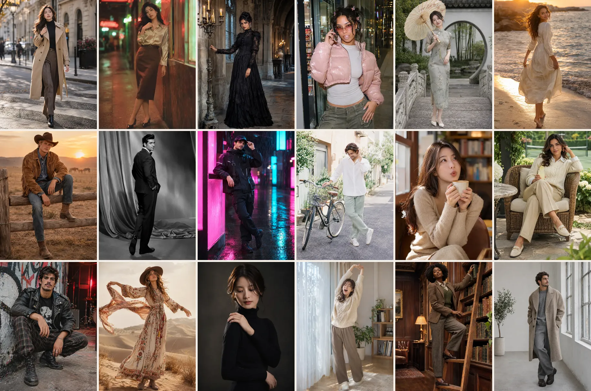</a>

**200 natural portrait poses in 20 styles**, each a photo-shoot photo plus the wooden white model drawn from it. Give an AI image model your own photo and a white model, and it shoots you in that exact pose.

**[▶ Try any pose with your own photo on Promicat](https://promicat.app/poses?utm_source=github&utm_medium=readme&utm_campaign=ai-photo-poses)**

<a href="https://promicat.app/poses/styles/sp051?utm_source=github&utm_medium=readme&utm_campaign=ai-photo-poses">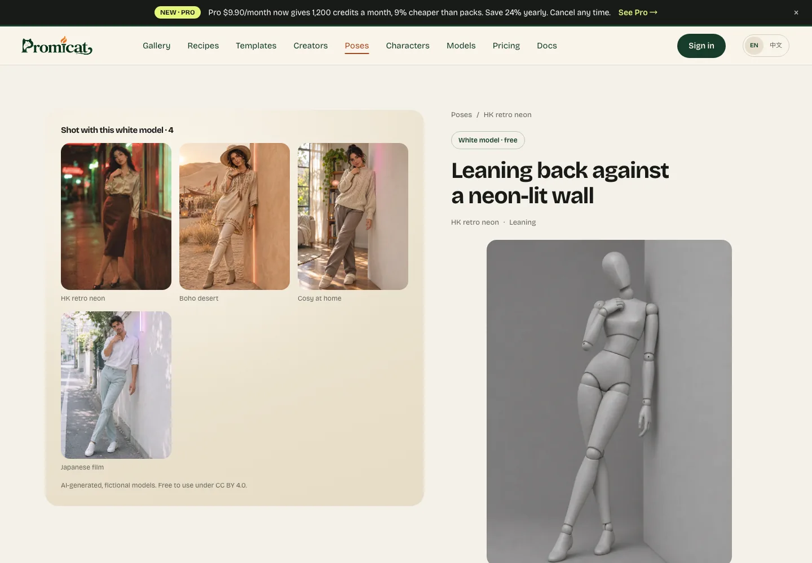</a>

- **200 photo poses** in 20 styles, from street fashion and HK retro to gothic, Y2K and new Chinese style
- **39 white models with 3D data** you can fine-tune in the browser, plus 23 extra pose references
- **24 portrait recipes** (216 sample shots) assembled from 436 prompt components
- **2 Agent Skills**: one looks at a user photo, recommends poses and generates the portrait
- Images and data under CC BY 4.0, code under MIT. All people are AI-generated and fictional.
- Latest update (2026-11-26): English README by default with a Simplified Chinese version; every style page in both languages; repo renamed to `ai-photo-poses` · [Changelog](CHANGELOG.md)

## Contents

- [Photo poses by style](#photo-poses) (200)
- [Agent Skills](#skills) (2)
- [Portrait recipes](#recipes) (24)
- [Build your own recipe](#build) (436)
- [3D white models](#white-models) (62)
- [Lighting](#lights) (16)
- [Scenes](#scenes) (14)
- [Data format](#data) · [License](#license)

<a id="photo-poses"></a>
## Photo poses by style

Each pose is a sample photo and a white model drawn from it. The white model is the pose reference: attach your photo first and the white model second, then use the prompt on the style page. Open a style for all 10 poses with both prompts.

| Style | Photos (open the style for white models and prompts) |
|---|---|
| [**Street fashion**](styles/street.md)<br><sub>街拍时尚</sub> |       |
| [**Cafe & bookshop**](styles/cafe.md)<br><sub>咖啡馆文艺</sub> |       |
| [**Seaside holiday**](styles/beach.md)<br><sub>海边度假</sub> |       |
| [**Forest & flower field**](styles/flower.md)<br><sub>森系花田</sub> |       |
| [**Japanese fresh film**](styles/jfilm.md)<br><sub>日系清新</sub> |       |
| [**HK retro neon**](styles/hkretro.md)<br><sub>港风复古</sub> |       |
| [**Cosy at home**](styles/home.md)<br><sub>居家慵懒</sub> |       |
| [**Campus youth**](styles/campus.md)<br><sub>校园青春</sub> |       |
| [**Moody studio**](styles/mood.md)<br><sub>情绪棚拍</sub> |       |
| [**New Chinese style**](styles/chinese.md)<br><sub>新中式</sub> |       |
| [**Gothic**](styles/gothic.md)<br><sub>暗黑哥特</sub> |       |
| [**Dark academia**](styles/darkacad.md)<br><sub>学院风</sub> |       |
| [**Old money**](styles/oldmoney.md)<br><sub>老钱风</sub> |       |
| [**Western cowboy**](styles/western.md)<br><sub>西部牛仔</sub> |       |
| [**Boho desert**](styles/boho.md)<br><sub>波西米亚</sub> |       |
| [**Y2K flash**](styles/y2k.md)<br><sub>Y2K 千禧辣妹</sub> |       |
| [**Street punk**](styles/punk.md)<br><sub>街头朋克</sub> |       |
| [**Cyberpunk neon**](styles/cyber.md)<br><sub>赛博霓虹</sub> |       |
| [**1950s Hollywood**](styles/hollywood.md)<br><sub>好莱坞复古</sub> |       |
| [**Nordic minimal**](styles/nordic.md)<br><sub>北欧极简</sub> |       |

<a id="skills"></a>
## Agent Skills

Copy a folder from `skills/` into your agent's skills directory (Claude Code, Codex and others).

**`skills/photo-pose-match`: match poses to a photo.** The user sends a photo; the agent reads the outfit, mood and setting, picks a few of the 200 photo poses with a reason for each, then generates the portrait from "user photo + white model". Without an image tool it hands over the Promicat link instead. Works without cloning: `recommend.py --remote` reads the data from GitHub.


<sub>Left: the user photo (an AI-generated, fictional person). Middle: the white model the skill picked. Right: the result. The top row switches to the HK retro outfit; the bottom row keeps the original clothes with `--keep-outfit`.</sub>

```bash
python3 skills/photo-pose-match/recommend.py --list-styles
python3 skills/photo-pose-match/recommend.py --style street,hkretro --group stand,lean --limit 6
python3 skills/photo-pose-match/recommend.py --id sp101 --keep-outfit
```

**`skills/ai-photo-poses`: portrait recipes and the pose library.** Apply or assemble a full 9-shot recipe, pick poses, and get finished prompts with the reference images to attach.

<a id="recipes"></a>
## Portrait recipes (24)

Each recipe is 9 shots that share one look, light, scene, outfit and model, and change only pose, expression, framing, angle and lens. Full prompts are in `data/portrait-recipes.json`, or print them with the script:

```bash
python3 scripts/assemble.py --list
python3 scripts/assemble.py tokyo-rain-night
python3 scripts/assemble.py tokyo-rain-night --shot 3 --with-photo
```

With `--with-photo`, attach your photo first and the listed white model second.

|  |  |  |
|---|---|---|
| <br><b>Tokyo Rain Night</b><br><code>tokyo-rain-night</code><br><sub>Neon night · Tokyo rainy alley · CineStill 800T night</sub> | <br><b>Paris Café Morning</b><br><code>paris-cafe-morning</code><br><sub>Soft morning sun · Paris café terrace · Portra 400 snapshot</sub> | 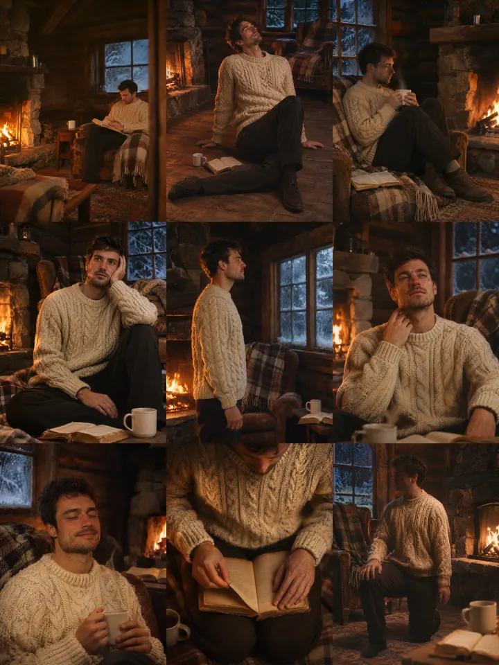<br><b>Snowy Cabin Fireside</b><br><code>snowy-cabin-fireside</code><br><sub>Fireplace glow · Snowy cabin interior · Portra 400 snapshot</sub> |
| <br><b>Beach Sunset in the Wind</b><br><code>beach-sunset-wind</code><br><sub>Golden hour · Sunlit beach · Faded backlit film</sub> | <br><b>Old Library Dust Beam</b><br><code>old-library-dust-beam</code><br><sub>Hard window sunbeam · Old library · Medium-format fine art</sub> | 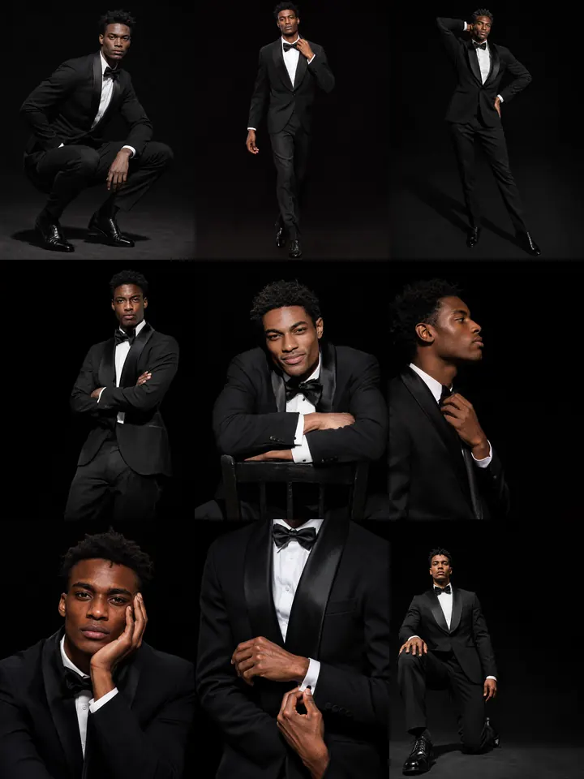<br><b>Black Studio Strobe Menswear</b><br><code>black-studio-strobe-menswear</code><br><sub>Hard fashion strobe · Black seamless · Crisp filmic editorial</sub> |
| <br><b>Film Noir Blinds</b><br><code>film-noir-blinds</code><br><sub>Venetian blind light · Noir office · Film noir</sub> | 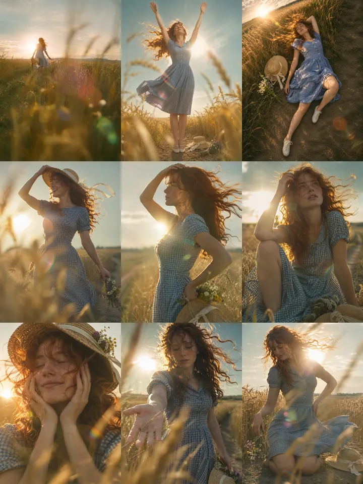<br><b>Wheat Field Backlight</b><br><code>wheat-field-backlight</code><br><sub>Backlit silhouette · Wheat field · Japanese youth film still</sub> | 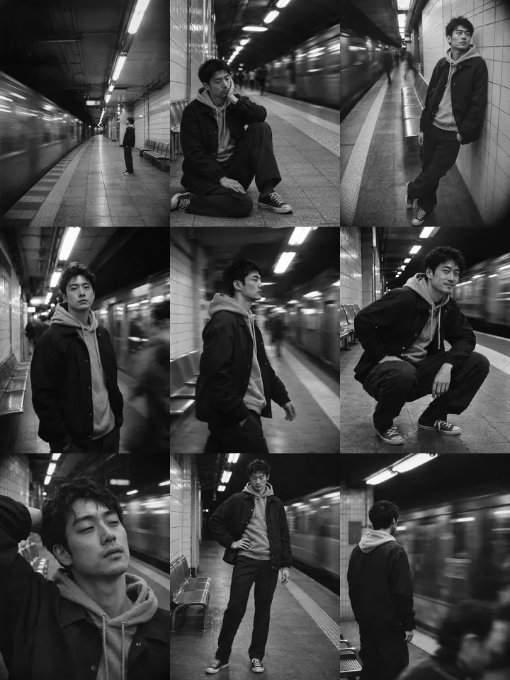<br><b>Late-Night Subway, B&W</b><br><code>subway-platform-bw</code><br><sub>Overhead fluorescent · Subway platform · Tri-X black and white</sub> |
| <br><b>Rooftop Blue Hour Suit</b><br><code>rooftop-blue-hour-suit</code><br><sub>Blue hour · City rooftop · 35mm cinematic glamour</sub> | 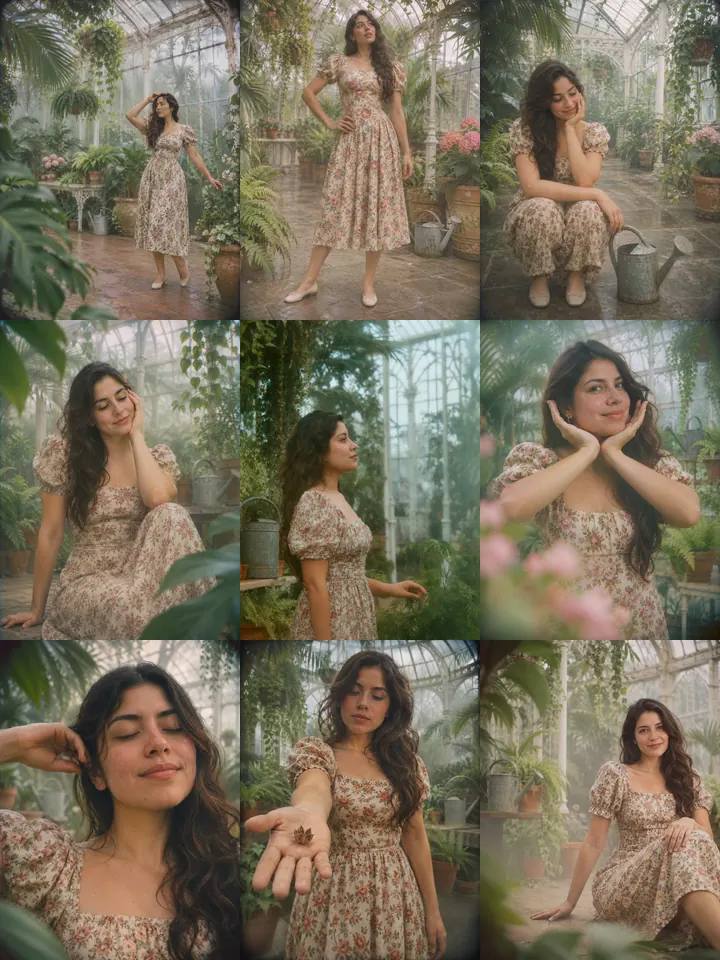<br><b>Greenhouse Afternoon</b><br><code>greenhouse-pastel</code><br><sub>Overcast soft light · Glass greenhouse · Instant film</sub> | <br><b>Vintage Convertible Road Trip</b><br><code>vintage-convertible-road-trip</code><br><sub>Golden backlight with ambient fill · Vintage car roadside · Ektachrome slide film</sub> |
| 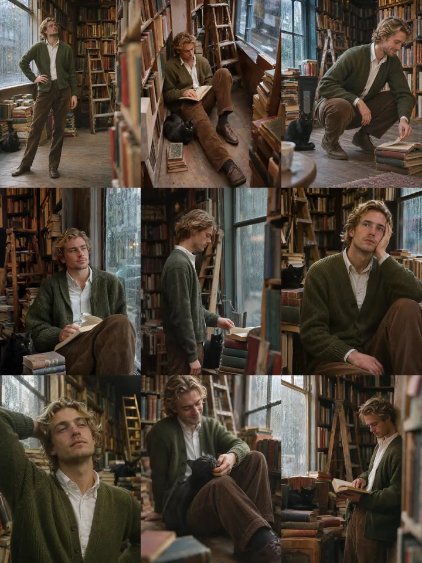<br><b>Rainy Bookshop Afternoon</b><br><code>rainy-bookshop-afternoon</code><br><sub>Soft window light · Old bookshop · Home documentary film</sub> | <br><b>Lakeside Dock at Dawn</b><br><code>lakeside-dock-mist</code><br><sub>Misty dawn · Lakeside dock · Nordic matte</sub> | <br><b>Sculpture Hall Skylight</b><br><code>sculpture-museum</code><br><sub>Skylight top light · Sculpture hall · Clean beauty editorial</sub> |
| <br><b>Snowy Pines, Red Coat</b><br><code>snowy-pine-forest</code><br><sub>Snow daylight · Snowy pine forest · Fuji 400H pastel</sub> | <br><b>Retro Diner After Midnight</b><br><code>retro-diner-night</code><br><sub>Warm tungsten practicals · Retro diner · Hong Kong cinema tones</sub> | 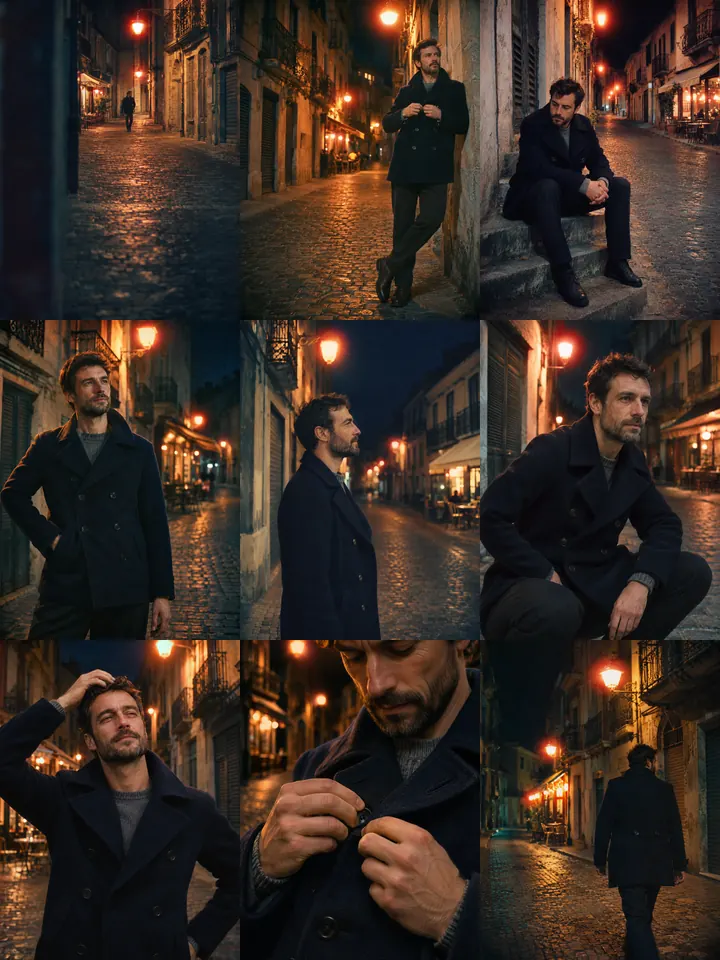<br><b>Old Town under Sodium Lamps</b><br><code>old-town-sodium-night</code><br><sub>Sodium streetlight · Old town at night · CineStill 800T night</sub> |
| <br><b>Autumn Park Dapple</b><br><code>autumn-park-dappled</code><br><sub>Dappled light · Autumn park · Portra 400 snapshot</sub> | <br><b>Desert Dunes in Linen</b><br><code>desert-dunes-linen</code><br><sub>Low hard side sun · Desert dunes · Crisp filmic editorial</sub> | <br><b>Night Train Compartment</b><br><code>night-train-compartment</code><br><sub>Warm tungsten practicals · Night train compartment · Hong Kong cinema tones</sub> |
| <br><b>Vintage Tennis Court</b><br><code>vintage-tennis-court</code><br><sub>Hard midday sun · Vintage tennis court · Ektachrome slide film</sub> | <br><b>Candlelit Manor Hall</b><br><code>candlelit-manor-hall</code><br><sub>Candlelight · Candlelit stone hall · 35mm cinematic glamour</sub> | <br><b>Rembrandt Classic Portrait</b><br><code>rembrandt-plaster-portrait</code><br><sub>Rembrandt light · Warm plaster studio · Medium-format fine art</sub> |

<a id="build"></a>
## Build your own recipe

`data/components.json` holds every component, grouped by slot; each has an `id`, English and Chinese names, and the `text` that goes into the prompt. A recipe only lists component ids:

| Slot | Name | Level | Count |
|---|---|---|---|
| `look` | Look & film stock | set | 17 |
| `skin` | Skin realism | set | 5 |
| `light` | Key light | set | 34 |
| `light_mod` | Light details | set, multi | 26 |
| `scene` | Scene | set | 45 |
| `outfit` | Outfit | set | 39 |
| `hair` | Hair | set | 17 |
| `makeup` | Makeup | set | 9 |
| `motion` | Motion | set, optional | 5 |
| `props` | Props | set, multi | 27 |
| `negative` | Avoid | set, multi | 15 |
| `gaze_rule` | Gaze rule | set | 3 |
| `pose` | Pose | per shot | 62 |
| `action` | Action | per shot, optional | 39 |
| `expression` | Expression | per shot | 30 |
| `shot_size` | Shot size | per shot | 11 |
| `angle` | Camera angle | per shot | 12 |
| `placement` | Placement | per shot, optional | 8 |
| `foreground` | Foreground | per shot, optional | 16 |
| `camera` | Lens & camera | per shot | 16 |

"Set" slots are chosen once and shared by all 9 shots; "per shot" slots change shot by shot. A minimal recipe (shot 2 of "Tokyo Rain Night"):

```json
{
 "id": "my-recipe",
 "subject": "a young East Asian woman in her late twenties with long straight black hair",
 "set": {
  "look": "cinestill-800t-night",
  "skin": "real-skin-full",
  "light": "neon",
  "light_mod": [
   "wet-reflections",
   "neon-spill",
   "backlit-rain",
   "halation"
  ],
  "scene": "tokyo-rain-alley",
  "outfit": "belted-trench",
  "hair": "damp-from-rain",
  "makeup": "natural-editorial",
  "gaze_rule": "two-of-nine-glance",
  "motion": "none-sharp",
  "props": [
   "black-umbrella"
  ],
  "negative": [
   "no-text",
   "hands-ok",
   "modest",
   "anti-plastic",
   "anti-ai-illustration",
   "no-extra-people"
  ]
 },
 "shots": [
  {
   "pose": "classic-contrapposto",
   "action": "hold-umbrella",
   "expression": "gaze-out-of-frame",
   "shot_size": "full-body",
   "angle": "low-angle",
   "placement": "right-third",
   "foreground": null,
   "camera": "35mm-f2.8"
  }
 ]
}
```

Save it as `my-recipe.json` and run `python3 scripts/assemble.py --recipe my-recipe.json`. An unknown id is an error that tells you where to look.

<a id="white-models"></a>
## 3D white models (39 + 23)

Open one on Promicat to see every camera angle, drag its arms and legs in 3D, and generate with your photo. `pose3d` in `data/poses.json` holds the 3D pose.

### Standing (9)

|  |  |  |  |  |  |
|---|---|---|---|---|---|
| <a href="https://promicat.app/poses/classic-contrapposto?utm_source=github&utm_medium=readme&utm_campaign=ai-photo-poses">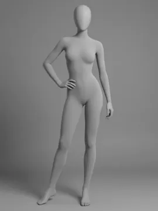</a><br>Classic contrapposto | <a href="https://promicat.app/poses/both-hands-in-hair?utm_source=github&utm_medium=readme&utm_campaign=ai-photo-poses"></a><br>Both hands in hair | <a href="https://promicat.app/poses/hand-behind-head?utm_source=github&utm_medium=readme&utm_campaign=ai-photo-poses"></a><br>Hand behind head | <a href="https://promicat.app/poses/hand-to-brow-gaze-away?utm_source=github&utm_medium=readme&utm_campaign=ai-photo-poses">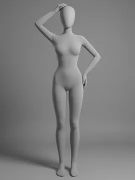</a><br>Hand to brow, gaze away | <a href="https://promicat.app/poses/arm-up-hip-out?utm_source=github&utm_medium=readme&utm_campaign=ai-photo-poses"></a><br>Arm up, hip out | <a href="https://promicat.app/poses/mid-step-hand-to-hair?utm_source=github&utm_medium=readme&utm_campaign=ai-photo-poses">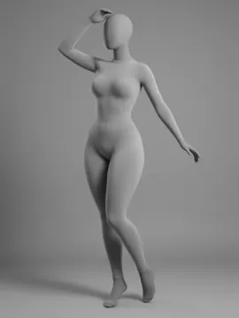</a><br>Mid-step, hand to hair |
| <a href="https://promicat.app/poses/both-arms-high?utm_source=github&utm_medium=readme&utm_campaign=ai-photo-poses"></a><br>Both arms high | <a href="https://promicat.app/poses/arms-spread-wide?utm_source=github&utm_medium=readme&utm_campaign=ai-photo-poses"></a><br>Arms spread wide | <a href="https://promicat.app/poses/playful-forward-lean?utm_source=github&utm_medium=readme&utm_campaign=ai-photo-poses">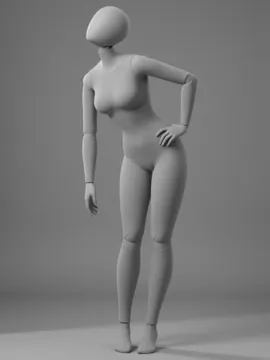</a><br>Playful forward lean |  |  |  |

### Sitting (12)

|  |  |  |  |  |  |
|---|---|---|---|---|---|
| <a href="https://promicat.app/poses/relaxed-lean-back-sit?utm_source=github&utm_medium=readme&utm_campaign=ai-photo-poses"></a><br>Relaxed lean-back sit | <a href="https://promicat.app/poses/side-lean-on-one-hand?utm_source=github&utm_medium=readme&utm_campaign=ai-photo-poses"></a><br>Side lean on one hand | <a href="https://promicat.app/poses/knee-up-hand-to-hair?utm_source=github&utm_medium=readme&utm_campaign=ai-photo-poses">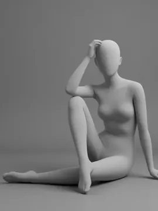</a><br>Knee up, hand to hair | <a href="https://promicat.app/poses/legs-swept-to-one-side?utm_source=github&utm_medium=readme&utm_campaign=ai-photo-poses"></a><br>Legs swept to one side | <a href="https://promicat.app/poses/folded-forward-hand-at-ankle?utm_source=github&utm_medium=readme&utm_campaign=ai-photo-poses">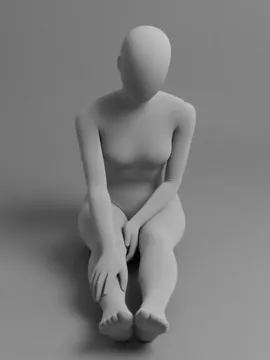</a><br>Folded forward, hand at ankle | <a href="https://promicat.app/poses/chin-on-hand-thinking?utm_source=github&utm_medium=readme&utm_campaign=ai-photo-poses"></a><br>Chin on hand, thinking |
| <a href="https://promicat.app/poses/leaning-back-knees-to-one-side?utm_source=github&utm_medium=readme&utm_campaign=ai-photo-poses"></a><br>Leaning back, knees to one side | <a href="https://promicat.app/poses/knees-drawn-side-sit?utm_source=github&utm_medium=readme&utm_campaign=ai-photo-poses">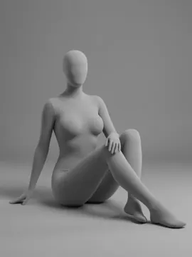</a><br>Knees drawn, side sit | <a href="https://promicat.app/poses/side-sit-cheek-in-hand?utm_source=github&utm_medium=readme&utm_campaign=ai-photo-poses"></a><br>Side sit, cheek in hand | <a href="https://promicat.app/poses/seated-one-arm-raised?utm_source=github&utm_medium=readme&utm_campaign=ai-photo-poses"></a><br>Seated, one arm raised | <a href="https://promicat.app/poses/cross-legged-hand-at-neck?utm_source=github&utm_medium=readme&utm_campaign=ai-photo-poses">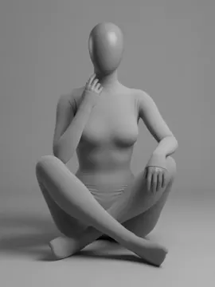</a><br>Cross-legged, hand at neck | <a href="https://promicat.app/poses/seated-twist-hand-on-floor?utm_source=github&utm_medium=readme&utm_campaign=ai-photo-poses">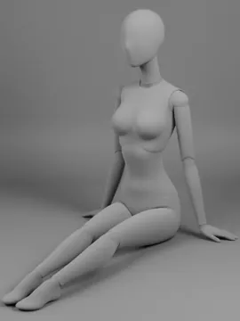</a><br>Seated twist, hand on floor |

### Kneeling (6)

|  |  |  |  |  |  |
|---|---|---|---|---|---|
| <a href="https://promicat.app/poses/half-kneel-hand-on-knee?utm_source=github&utm_medium=readme&utm_campaign=ai-photo-poses"></a><br>Half-kneel, hand on knee | <a href="https://promicat.app/poses/kneeling-arms-raised?utm_source=github&utm_medium=readme&utm_campaign=ai-photo-poses"></a><br>Kneeling, arms raised | <a href="https://promicat.app/poses/kneeling-hand-to-brow?utm_source=github&utm_medium=readme&utm_campaign=ai-photo-poses"></a><br>Kneeling, hand to brow | <a href="https://promicat.app/poses/kneeling-one-arm-up?utm_source=github&utm_medium=readme&utm_campaign=ai-photo-poses">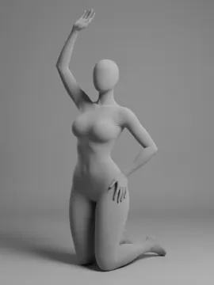</a><br>Kneeling, one arm up | <a href="https://promicat.app/poses/quiet-kneel?utm_source=github&utm_medium=readme&utm_campaign=ai-photo-poses"></a><br>Quiet kneel | <a href="https://promicat.app/poses/kneeling-twist?utm_source=github&utm_medium=readme&utm_campaign=ai-photo-poses"></a><br>Kneeling twist |

### Lying (2)

|  |  |  |  |  |  |
|---|---|---|---|---|---|
| <a href="https://promicat.app/poses/reclining-on-one-elbow?utm_source=github&utm_medium=readme&utm_campaign=ai-photo-poses"></a><br>Reclining on one elbow | <a href="https://promicat.app/poses/lying-stretched-on-one-side?utm_source=github&utm_medium=readme&utm_campaign=ai-photo-poses">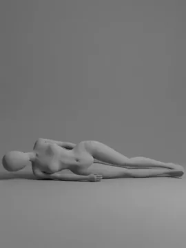</a><br>Lying stretched on one side |  |  |  |  |

### Crouching (2)

|  |  |  |  |  |  |
|---|---|---|---|---|---|
| <a href="https://promicat.app/poses/crouch-chin-on-hand?utm_source=github&utm_medium=readme&utm_campaign=ai-photo-poses"></a><br>Crouch, chin on hand | <a href="https://promicat.app/poses/street-style-crouch?utm_source=github&utm_medium=readme&utm_campaign=ai-photo-poses"></a><br>Street-style crouch |  |  |  |  |

### Upper body (8)

|  |  |  |  |  |  |
|---|---|---|---|---|---|
| <a href="https://promicat.app/poses/finger-to-lips?utm_source=github&utm_medium=readme&utm_campaign=ai-photo-poses"></a><br>Finger to lips | <a href="https://promicat.app/poses/reaching-out?utm_source=github&utm_medium=readme&utm_campaign=ai-photo-poses"></a><br>Reaching out | <a href="https://promicat.app/poses/chin-in-cupped-hands?utm_source=github&utm_medium=readme&utm_campaign=ai-photo-poses">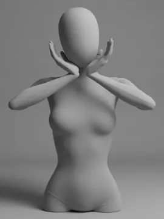</a><br>Chin in cupped hands | <a href="https://promicat.app/poses/self-embrace?utm_source=github&utm_medium=readme&utm_campaign=ai-photo-poses">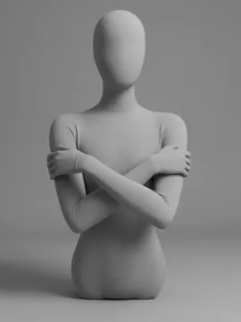</a><br>Self-embrace | <a href="https://promicat.app/poses/hand-to-hair-at-the-ear?utm_source=github&utm_medium=readme&utm_campaign=ai-photo-poses"></a><br>Hand to hair at the ear | <a href="https://promicat.app/poses/cheeks-in-both-hands?utm_source=github&utm_medium=readme&utm_campaign=ai-photo-poses">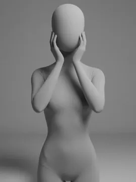</a><br>Cheeks in both hands |
| <a href="https://promicat.app/poses/shading-eyes-arm-out?utm_source=github&utm_medium=readme&utm_campaign=ai-photo-poses"></a><br>Shading eyes, arm out | <a href="https://promicat.app/poses/peeking-through-fingers?utm_source=github&utm_medium=readme&utm_campaign=ai-photo-poses"></a><br>Peeking through fingers |  |  |  |  |

### Extra pose references (23)

Common poses without 3D data yet, one front view each, in `images/poses-extra/`.

|  |  |  |  |  |  |
|---|---|---|---|---|---|
| 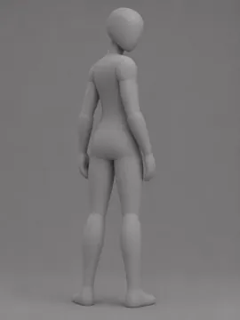<br>Look back over shoulder | <br>Back turned | 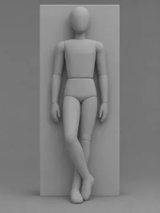<br>Lean back on wall | 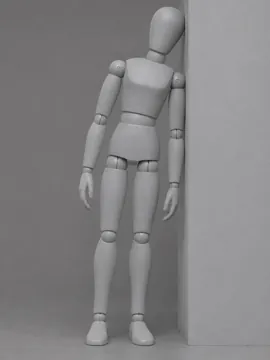<br>Shoulder against wall | <br>Sit on a chair | <br>Straddle chair backwards |
| 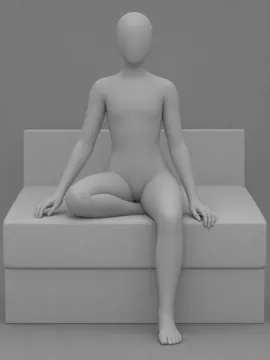<br>Sit on bed edge | 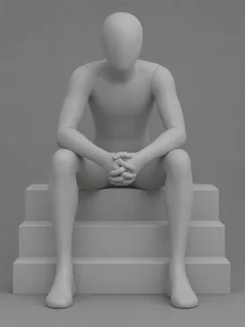<br>Sit on steps | <br>Seated at a table | <br>Sit on window sill | <br>Sit on floor against wall | 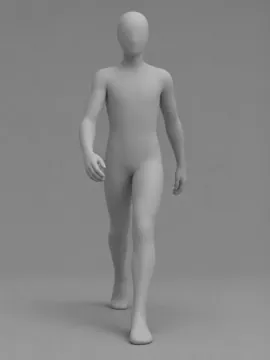<br>Walking toward camera |
| <br>Walking away | 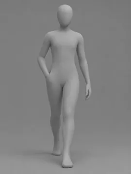<br>Walk, hand in pocket | 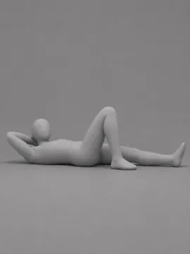<br>Lying on back | 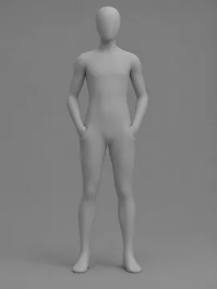<br>Hands in pockets | 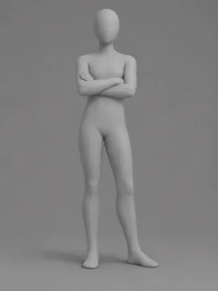<br>Arms crossed | 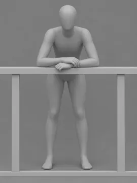<br>Lean on railing |
| 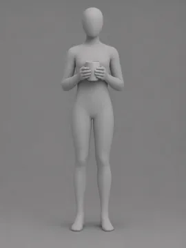<br>Standing with a cup | <br>Lean on a car | <br>Standing in profile | 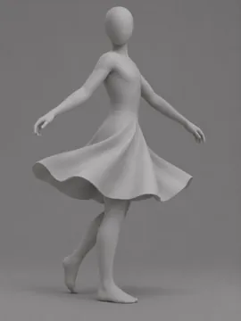<br>Spin | 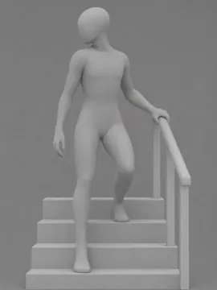<br>Stairs, look back |  |

### One pose with your photo

Attach your photo first and the white model second, with this prompt:

```text
Image 1 is the person. Image 2 is a faceless grey mannequin that shows only the pose. Make a photograph of the person from image 1: keep their exact face, facial features, skin tone, hairstyle and any distinctive features. Copy the body pose from image 2 exactly: the same position of the head, torso, arms, hands, legs and feet, and the same camera angle. Do not copy the mannequin itself: no grey skin, no bald head, no mannequin joints. They wear an elegant, modest, fully opaque ivory silk dress with long flowing fabric. Fine-art portrait photography, soft window light from the left, warm neutral plaster studio backdrop, 85 mm lens, natural skin texture, calm and graceful mood. Tasteful and fully clothed, no sheer or see-through fabric, no nudity, no text, no logo.
```

### Sample portraits (78)

|  |  |  |  |  |  |
|---|---|---|---|---|---|
| <a href="https://promicat.app/poses/relaxed-lean-back-sit?utm_source=github&utm_medium=readme&utm_campaign=ai-photo-poses"></a><br>Relaxed lean-back sit<br><sub>Loop light · a green forest clearing</sub> | <a href="https://promicat.app/poses/relaxed-lean-back-sit?utm_source=github&utm_medium=readme&utm_campaign=ai-photo-poses"></a><br>Relaxed lean-back sit<br><sub>Golden hour · an old library with tall wooden bookshelves</sub> | <a href="https://promicat.app/poses/side-lean-on-one-hand?utm_source=github&utm_medium=readme&utm_campaign=ai-photo-poses"></a><br>Side lean on one hand<br><sub>Neon night · a white art gallery with large paintings</sub> | <a href="https://promicat.app/poses/side-lean-on-one-hand?utm_source=github&utm_medium=readme&utm_campaign=ai-photo-poses"></a><br>Side lean on one hand<br><sub>Venetian blind shadows · a sweeping marble staircase</sub> | <a href="https://promicat.app/poses/knee-up-hand-to-hair?utm_source=github&utm_medium=readme&utm_campaign=ai-photo-poses"></a><br>Knee up, hand to hair<br><sub>Butterfly light · warm neutral plaster studio backdrop</sub> | <a href="https://promicat.app/poses/knee-up-hand-to-hair?utm_source=github&utm_medium=readme&utm_campaign=ai-photo-poses"></a><br>Knee up, hand to hair<br><sub>Rim backlight · a green forest clearing</sub> |
| <a href="https://promicat.app/poses/legs-swept-to-one-side?utm_source=github&utm_medium=readme&utm_campaign=ai-photo-poses">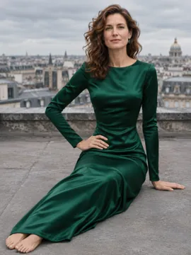</a><br>Legs swept to one side<br><sub>Overcast soft light · a city rooftop with a skyline view</sub> | <a href="https://promicat.app/poses/legs-swept-to-one-side?utm_source=github&utm_medium=readme&utm_campaign=ai-photo-poses"></a><br>Legs swept to one side<br><sub>Candlelight · a white art gallery with large paintings</sub> | <a href="https://promicat.app/poses/folded-forward-hand-at-ankle?utm_source=github&utm_medium=readme&utm_campaign=ai-photo-poses"></a><br>Folded forward, hand at ankle<br><sub>Low key · golden sand dunes in a desert</sub> | <a href="https://promicat.app/poses/folded-forward-hand-at-ankle?utm_source=github&utm_medium=readme&utm_campaign=ai-photo-poses">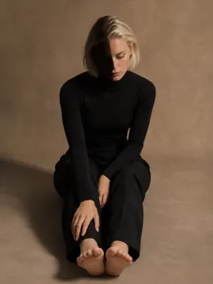</a><br>Folded forward, hand at ankle<br><sub>Split light · warm neutral plaster studio backdrop</sub> | <a href="https://promicat.app/poses/chin-on-hand-thinking?utm_source=github&utm_medium=readme&utm_campaign=ai-photo-poses"></a><br>Chin on hand, thinking<br><sub>Golden hour · an empty sunlit beach with soft waves</sub> | <a href="https://promicat.app/poses/chin-on-hand-thinking?utm_source=github&utm_medium=readme&utm_campaign=ai-photo-poses">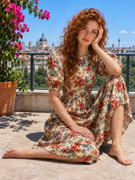</a><br>Chin on hand, thinking<br><sub>Hard midday sun · a city rooftop with a skyline view</sub> |
| <a href="https://promicat.app/poses/leaning-back-knees-to-one-side?utm_source=github&utm_medium=readme&utm_campaign=ai-photo-poses">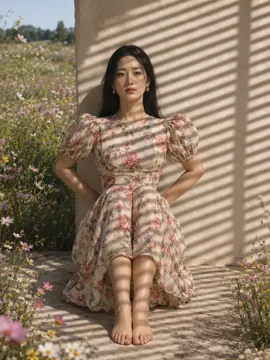</a><br>Leaning back, knees to one side<br><sub>Venetian blind shadows · a wide field of wildflowers</sub> | <a href="https://promicat.app/poses/leaning-back-knees-to-one-side?utm_source=github&utm_medium=readme&utm_campaign=ai-photo-poses">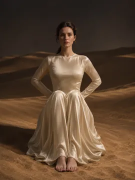</a><br>Leaning back, knees to one side<br><sub>Rembrandt light · golden sand dunes in a desert</sub> | <a href="https://promicat.app/poses/knees-drawn-side-sit?utm_source=github&utm_medium=readme&utm_campaign=ai-photo-poses"></a><br>Knees drawn, side sit<br><sub>Rim backlight · a rainy street with reflections on the pavement</sub> | <a href="https://promicat.app/poses/knees-drawn-side-sit?utm_source=github&utm_medium=readme&utm_campaign=ai-photo-poses"></a><br>Knees drawn, side sit<br><sub>Blue hour · an empty sunlit beach with soft waves</sub> | <a href="https://promicat.app/poses/side-sit-cheek-in-hand?utm_source=github&utm_medium=readme&utm_campaign=ai-photo-poses"></a><br>Side sit, cheek in hand<br><sub>Candlelight · a quiet European city street</sub> | <a href="https://promicat.app/poses/side-sit-cheek-in-hand?utm_source=github&utm_medium=readme&utm_campaign=ai-photo-poses"></a><br>Side sit, cheek in hand<br><sub>High key · a wide field of wildflowers</sub> |
| <a href="https://promicat.app/poses/seated-one-arm-raised?utm_source=github&utm_medium=readme&utm_campaign=ai-photo-poses">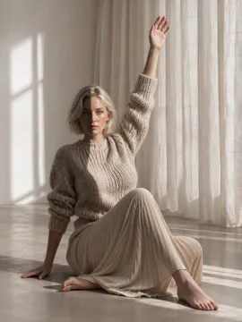</a><br>Seated, one arm raised<br><sub>Split light · a minimal bright apartment with linen curtains</sub> | <a href="https://promicat.app/poses/seated-one-arm-raised?utm_source=github&utm_medium=readme&utm_campaign=ai-photo-poses">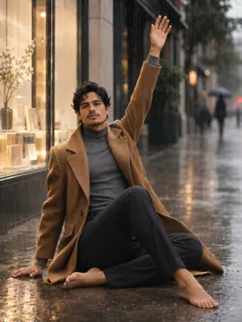</a><br>Seated, one arm raised<br><sub>Window light · a rainy street with reflections on the pavement</sub> | <a href="https://promicat.app/poses/cross-legged-hand-at-neck?utm_source=github&utm_medium=readme&utm_campaign=ai-photo-poses">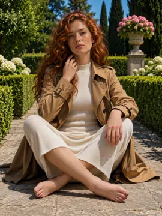</a><br>Cross-legged, hand at neck<br><sub>Hard midday sun · a formal garden with stone paths and hedges</sub> | <a href="https://promicat.app/poses/cross-legged-hand-at-neck?utm_source=github&utm_medium=readme&utm_campaign=ai-photo-poses"></a><br>Cross-legged, hand at neck<br><sub>Dappled light · a quiet European city street</sub> | <a href="https://promicat.app/poses/seated-twist-hand-on-floor?utm_source=github&utm_medium=readme&utm_campaign=ai-photo-poses">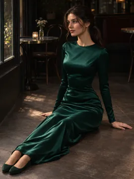</a><br>Seated twist, hand on floor<br><sub>Rembrandt light · a cosy café by the window</sub> | <a href="https://promicat.app/poses/seated-twist-hand-on-floor?utm_source=github&utm_medium=readme&utm_campaign=ai-photo-poses"></a><br>Seated twist, hand on floor<br><sub>Loop light · a minimal bright apartment with linen curtains</sub> |
| <a href="https://promicat.app/poses/half-kneel-hand-on-knee?utm_source=github&utm_medium=readme&utm_campaign=ai-photo-poses"></a><br>Half-kneel, hand on knee<br><sub>Blue hour · an old library with tall wooden bookshelves</sub> | <a href="https://promicat.app/poses/half-kneel-hand-on-knee?utm_source=github&utm_medium=readme&utm_campaign=ai-photo-poses">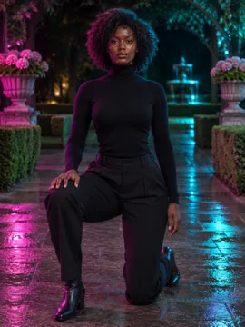</a><br>Half-kneel, hand on knee<br><sub>Neon night · a formal garden with stone paths and hedges</sub> | <a href="https://promicat.app/poses/kneeling-arms-raised?utm_source=github&utm_medium=readme&utm_campaign=ai-photo-poses"></a><br>Kneeling, arms raised<br><sub>High key · a sweeping marble staircase</sub> | <a href="https://promicat.app/poses/kneeling-arms-raised?utm_source=github&utm_medium=readme&utm_campaign=ai-photo-poses"></a><br>Kneeling, arms raised<br><sub>Butterfly light · a cosy café by the window</sub> | <a href="https://promicat.app/poses/kneeling-hand-to-brow?utm_source=github&utm_medium=readme&utm_campaign=ai-photo-poses">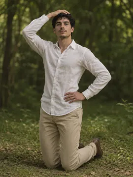</a><br>Kneeling, hand to brow<br><sub>Window light · a green forest clearing</sub> | <a href="https://promicat.app/poses/kneeling-hand-to-brow?utm_source=github&utm_medium=readme&utm_campaign=ai-photo-poses">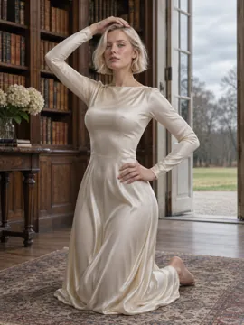</a><br>Kneeling, hand to brow<br><sub>Overcast soft light · an old library with tall wooden bookshelves</sub> |
| <a href="https://promicat.app/poses/kneeling-one-arm-up?utm_source=github&utm_medium=readme&utm_campaign=ai-photo-poses"></a><br>Kneeling, one arm up<br><sub>Dappled light · a white art gallery with large paintings</sub> | <a href="https://promicat.app/poses/kneeling-one-arm-up?utm_source=github&utm_medium=readme&utm_campaign=ai-photo-poses">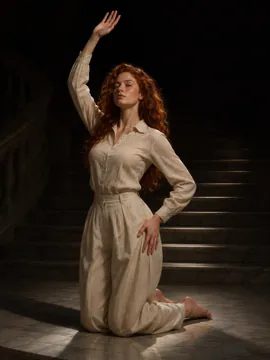</a><br>Kneeling, one arm up<br><sub>Low key · a sweeping marble staircase</sub> | <a href="https://promicat.app/poses/quiet-kneel?utm_source=github&utm_medium=readme&utm_campaign=ai-photo-poses"></a><br>Quiet kneel<br><sub>Loop light · warm neutral plaster studio backdrop</sub> | <a href="https://promicat.app/poses/quiet-kneel?utm_source=github&utm_medium=readme&utm_campaign=ai-photo-poses"></a><br>Quiet kneel<br><sub>Golden hour · a green forest clearing</sub> | <a href="https://promicat.app/poses/kneeling-twist?utm_source=github&utm_medium=readme&utm_campaign=ai-photo-poses"></a><br>Kneeling twist<br><sub>Neon night · a city rooftop with a skyline view</sub> | <a href="https://promicat.app/poses/kneeling-twist?utm_source=github&utm_medium=readme&utm_campaign=ai-photo-poses"></a><br>Kneeling twist<br><sub>Venetian blind shadows · a white art gallery with large paintings</sub> |
| <a href="https://promicat.app/poses/classic-contrapposto?utm_source=github&utm_medium=readme&utm_campaign=ai-photo-poses"></a><br>Classic contrapposto<br><sub>Butterfly light · golden sand dunes in a desert</sub> | <a href="https://promicat.app/poses/classic-contrapposto?utm_source=github&utm_medium=readme&utm_campaign=ai-photo-poses"></a><br>Classic contrapposto<br><sub>Rim backlight · warm neutral plaster studio backdrop</sub> | <a href="https://promicat.app/poses/both-hands-in-hair?utm_source=github&utm_medium=readme&utm_campaign=ai-photo-poses"></a><br>Both hands in hair<br><sub>Overcast soft light · an empty sunlit beach with soft waves</sub> | <a href="https://promicat.app/poses/both-hands-in-hair?utm_source=github&utm_medium=readme&utm_campaign=ai-photo-poses"></a><br>Both hands in hair<br><sub>Candlelight · a city rooftop with a skyline view</sub> | <a href="https://promicat.app/poses/hand-behind-head?utm_source=github&utm_medium=readme&utm_campaign=ai-photo-poses"></a><br>Hand behind head<br><sub>Low key · a wide field of wildflowers</sub> | <a href="https://promicat.app/poses/hand-behind-head?utm_source=github&utm_medium=readme&utm_campaign=ai-photo-poses"></a><br>Hand behind head<br><sub>Split light · golden sand dunes in a desert</sub> |
| <a href="https://promicat.app/poses/hand-to-brow-gaze-away?utm_source=github&utm_medium=readme&utm_campaign=ai-photo-poses"></a><br>Hand to brow, gaze away<br><sub>Golden hour · a rainy street with reflections on the pavement</sub> | <a href="https://promicat.app/poses/hand-to-brow-gaze-away?utm_source=github&utm_medium=readme&utm_campaign=ai-photo-poses"></a><br>Hand to brow, gaze away<br><sub>Hard midday sun · an empty sunlit beach with soft waves</sub> | <a href="https://promicat.app/poses/arm-up-hip-out?utm_source=github&utm_medium=readme&utm_campaign=ai-photo-poses"></a><br>Arm up, hip out<br><sub>Venetian blind shadows · a quiet European city street</sub> | <a href="https://promicat.app/poses/arm-up-hip-out?utm_source=github&utm_medium=readme&utm_campaign=ai-photo-poses"></a><br>Arm up, hip out<br><sub>Rembrandt light · a wide field of wildflowers</sub> | <a href="https://promicat.app/poses/mid-step-hand-to-hair?utm_source=github&utm_medium=readme&utm_campaign=ai-photo-poses"></a><br>Mid-step, hand to hair<br><sub>Rim backlight · a minimal bright apartment with linen curtains</sub> | <a href="https://promicat.app/poses/mid-step-hand-to-hair?utm_source=github&utm_medium=readme&utm_campaign=ai-photo-poses"></a><br>Mid-step, hand to hair<br><sub>Blue hour · a rainy street with reflections on the pavement</sub> |
| <a href="https://promicat.app/poses/both-arms-high?utm_source=github&utm_medium=readme&utm_campaign=ai-photo-poses"></a><br>Both arms high<br><sub>Candlelight · a formal garden with stone paths and hedges</sub> | <a href="https://promicat.app/poses/both-arms-high?utm_source=github&utm_medium=readme&utm_campaign=ai-photo-poses"></a><br>Both arms high<br><sub>High key · a quiet European city street</sub> | <a href="https://promicat.app/poses/arms-spread-wide?utm_source=github&utm_medium=readme&utm_campaign=ai-photo-poses"></a><br>Arms spread wide<br><sub>Split light · a cosy café by the window</sub> | <a href="https://promicat.app/poses/arms-spread-wide?utm_source=github&utm_medium=readme&utm_campaign=ai-photo-poses"></a><br>Arms spread wide<br><sub>Window light · a minimal bright apartment with linen curtains</sub> | <a href="https://promicat.app/poses/playful-forward-lean?utm_source=github&utm_medium=readme&utm_campaign=ai-photo-poses"></a><br>Playful forward lean<br><sub>Hard midday sun · an old library with tall wooden bookshelves</sub> | <a href="https://promicat.app/poses/playful-forward-lean?utm_source=github&utm_medium=readme&utm_campaign=ai-photo-poses"></a><br>Playful forward lean<br><sub>Dappled light · a formal garden with stone paths and hedges</sub> |
| <a href="https://promicat.app/poses/reclining-on-one-elbow?utm_source=github&utm_medium=readme&utm_campaign=ai-photo-poses"></a><br>Reclining on one elbow<br><sub>Rembrandt light · a sweeping marble staircase</sub> | <a href="https://promicat.app/poses/reclining-on-one-elbow?utm_source=github&utm_medium=readme&utm_campaign=ai-photo-poses"></a><br>Reclining on one elbow<br><sub>Loop light · a cosy café by the window</sub> | <a href="https://promicat.app/poses/lying-stretched-on-one-side?utm_source=github&utm_medium=readme&utm_campaign=ai-photo-poses"></a><br>Lying stretched on one side<br><sub>Blue hour · a green forest clearing</sub> | <a href="https://promicat.app/poses/lying-stretched-on-one-side?utm_source=github&utm_medium=readme&utm_campaign=ai-photo-poses"></a><br>Lying stretched on one side<br><sub>Neon night · an old library with tall wooden bookshelves</sub> | <a href="https://promicat.app/poses/crouch-chin-on-hand?utm_source=github&utm_medium=readme&utm_campaign=ai-photo-poses"></a><br>Crouch, chin on hand<br><sub>High key · a white art gallery with large paintings</sub> | <a href="https://promicat.app/poses/crouch-chin-on-hand?utm_source=github&utm_medium=readme&utm_campaign=ai-photo-poses"></a><br>Crouch, chin on hand<br><sub>Butterfly light · a sweeping marble staircase</sub> |
| <a href="https://promicat.app/poses/street-style-crouch?utm_source=github&utm_medium=readme&utm_campaign=ai-photo-poses"></a><br>Street-style crouch<br><sub>Window light · warm neutral plaster studio backdrop</sub> | <a href="https://promicat.app/poses/street-style-crouch?utm_source=github&utm_medium=readme&utm_campaign=ai-photo-poses"></a><br>Street-style crouch<br><sub>Overcast soft light · a green forest clearing</sub> | <a href="https://promicat.app/poses/finger-to-lips?utm_source=github&utm_medium=readme&utm_campaign=ai-photo-poses"></a><br>Finger to lips<br><sub>Dappled light · a city rooftop with a skyline view</sub> | <a href="https://promicat.app/poses/finger-to-lips?utm_source=github&utm_medium=readme&utm_campaign=ai-photo-poses"></a><br>Finger to lips<br><sub>Low key · a white art gallery with large paintings</sub> | <a href="https://promicat.app/poses/reaching-out?utm_source=github&utm_medium=readme&utm_campaign=ai-photo-poses"></a><br>Reaching out<br><sub>Loop light · golden sand dunes in a desert</sub> | <a href="https://promicat.app/poses/reaching-out?utm_source=github&utm_medium=readme&utm_campaign=ai-photo-poses"></a><br>Reaching out<br><sub>Golden hour · warm neutral plaster studio backdrop</sub> |
| <a href="https://promicat.app/poses/chin-in-cupped-hands?utm_source=github&utm_medium=readme&utm_campaign=ai-photo-poses"></a><br>Chin in cupped hands<br><sub>Neon night · an empty sunlit beach with soft waves</sub> | <a href="https://promicat.app/poses/chin-in-cupped-hands?utm_source=github&utm_medium=readme&utm_campaign=ai-photo-poses"></a><br>Chin in cupped hands<br><sub>Venetian blind shadows · a city rooftop with a skyline view</sub> | <a href="https://promicat.app/poses/self-embrace?utm_source=github&utm_medium=readme&utm_campaign=ai-photo-poses"></a><br>Self-embrace<br><sub>Butterfly light · a wide field of wildflowers</sub> | <a href="https://promicat.app/poses/self-embrace?utm_source=github&utm_medium=readme&utm_campaign=ai-photo-poses"></a><br>Self-embrace<br><sub>Rim backlight · golden sand dunes in a desert</sub> | <a href="https://promicat.app/poses/hand-to-hair-at-the-ear?utm_source=github&utm_medium=readme&utm_campaign=ai-photo-poses"></a><br>Hand to hair at the ear<br><sub>Overcast soft light · a rainy street with reflections on the pavement</sub> | <a href="https://promicat.app/poses/hand-to-hair-at-the-ear?utm_source=github&utm_medium=readme&utm_campaign=ai-photo-poses"></a><br>Hand to hair at the ear<br><sub>Candlelight · an empty sunlit beach with soft waves</sub> |
| <a href="https://promicat.app/poses/cheeks-in-both-hands?utm_source=github&utm_medium=readme&utm_campaign=ai-photo-poses"></a><br>Cheeks in both hands<br><sub>Low key · a quiet European city street</sub> | <a href="https://promicat.app/poses/cheeks-in-both-hands?utm_source=github&utm_medium=readme&utm_campaign=ai-photo-poses"></a><br>Cheeks in both hands<br><sub>Split light · a wide field of wildflowers</sub> | <a href="https://promicat.app/poses/shading-eyes-arm-out?utm_source=github&utm_medium=readme&utm_campaign=ai-photo-poses"></a><br>Shading eyes, arm out<br><sub>Golden hour · a minimal bright apartment with linen curtains</sub> | <a href="https://promicat.app/poses/shading-eyes-arm-out?utm_source=github&utm_medium=readme&utm_campaign=ai-photo-poses"></a><br>Shading eyes, arm out<br><sub>Hard midday sun · a rainy street with reflections on the pavement</sub> | <a href="https://promicat.app/poses/peeking-through-fingers?utm_source=github&utm_medium=readme&utm_campaign=ai-photo-poses"></a><br>Peeking through fingers<br><sub>Venetian blind shadows · a formal garden with stone paths and hedges</sub> | <a href="https://promicat.app/poses/peeking-through-fingers?utm_source=github&utm_medium=readme&utm_campaign=ai-photo-poses"></a><br>Peeking through fingers<br><sub>Rembrandt light · a quiet European city street</sub> |

<a id="lights"></a>
## Lighting (16)

Paste the prompt column straight into your prompt.

| Example | Light | Prompt |
|---|---|---|
|  | **Rembrandt light** | `one soft key light high at 45 degrees to the side, a small triangle of light on the shadow-side cheek, dark moody background` |
|  | **Butterfly light** | `key light high and straight in front of the face, a small butterfly-shaped shadow under the nose, even glamorous light` |
|  | **Split light** | `hard light from exactly 90 degrees to one side, half of the face lit and half in shadow, dramatic` |
|  | **Loop light** | `key light slightly above and 30 degrees to the side, a small loop shadow from the nose on the cheek, natural flattering light` |
|  | **Rim backlight** | `strong light from behind outlining the hair and shoulders with a glowing rim, face softly filled, dark background` |
|  | **Window light** | `large soft daylight from a window on one side, gentle falloff into shadow, calm indoor mood` |
|  | **Golden hour** | `low warm sunset sun from behind and to the side, golden glow and lens flare, warm outdoor mood` |
|  | **Blue hour** | `deep blue twilight sky after sunset, cool ambient light with warm city lights in the background` |
|  | **Overcast soft light** | `soft shadowless light from a cloudy sky, natural muted colours, outdoors` |
|  | **Hard midday sun** | `bright high midday sun, crisp hard shadows, saturated summer colours, outdoors` |
|  | **Neon night** | `magenta and cyan neon signs lighting her from both sides at night, wet reflective street, cinematic` |
|  | **Candlelight** | `warm flickering candlelight from below and in front, deep dark surroundings, intimate mood` |
|  | **Dappled light** | `sunlight through tree leaves making dappled spots of light and shadow on her and the ground` |
|  | **Venetian blind shadows** | `hard sunlight through venetian blinds casting striped shadows across her and the wall` |
|  | **High key** | `bright, even, almost shadowless light on a pure white background, airy and clean` |
|  | **Low key** | `a single narrow light on a black background, most of the frame in deep shadow, chiaroscuro` |

<a id="scenes"></a>
## Scenes (14)

|  |  |  |  |  |  |  |
|---|---|---|---|---|---|---|
| <br>warm neutral plaster studio backdrop | <br>an empty sunlit beach with soft waves | <br>a quiet European city street | <br>a cosy café by the window | <br>a green forest clearing | <br>a city rooftop with a skyline view | <br>a wide field of wildflowers |
| <br>a minimal bright apartment with linen curtains | <br>an old library with tall wooden bookshelves | <br>a white art gallery with large paintings | <br>golden sand dunes in a desert | <br>a rainy street with reflections on the pavement | <br>a formal garden with stone paths and hedges | <br>a sweeping marble staircase |

## More on Promicat

|  |  |  |  |  |  |
|---|---|---|---|---|---|
| <a href="https://promicat.app/recipes/professional-headshot?utm_source=github&utm_medium=readme&utm_campaign=ai-photo-poses"></a><br>Selfie to professional headshot | <a href="https://promicat.app/recipes/lifestyle-profile-photo?utm_source=github&utm_medium=readme&utm_campaign=ai-photo-poses"></a><br>Lifestyle profile photo | <a href="https://promicat.app/recipes/animated-family-portrait?utm_source=github&utm_medium=readme&utm_campaign=ai-photo-poses"></a><br>3D animated family portrait | <a href="https://promicat.app/recipes/royal-pet-portrait?utm_source=github&utm_medium=readme&utm_campaign=ai-photo-poses"></a><br>Royal pet portrait | <a href="https://promicat.app/recipes/holiday-pet-photo?utm_source=github&utm_medium=readme&utm_campaign=ai-photo-poses"></a><br>Holiday pet photo | <a href="https://promicat.app/recipes/product-lifestyle-scene?utm_source=github&utm_medium=readme&utm_campaign=ai-photo-poses"></a><br>Product lifestyle scene |

## Promi edition

Promi, the Promicat mascot, shot these poses and lights too (55 images in `images/promi/`).

<a id="data"></a>
## Data format

| File | Contents |
|---|---|
| `data/photo-poses.json` | 200 photo poses: style, pose name, group, `pose_text`, `framing`, `photo`, white model (`pose`), `url`, sample prompt, `prompt_with_your_photo` |
| `data/portrait-recipes.json` | 24 recipes: component ids, shots, samples, both prompts, pose references |
| `data/components.json` | 20 slots, 436 components |
| `data/poses.json` | 3D white models: names, group, views, `pose3d`, page |
| `data/lights.json`, `data/scenes.json`, `data/cases.json` | lights, scenes and sample portraits with prompts |
| `data/templates.json` | the generic "your photo + white model" prompt |

`pose3d` is the Promicat white-model format v1: `{"v": 1, "rot": {"joint": [x, y, z]}}`, degrees, XYZ order, relative to standing at rest.

<a id="license"></a>
## License and credits

- Code (`scripts/`, `skills/`): MIT. Images and data: [CC BY 4.0](https://creativecommons.org/licenses/by/4.0/); credit "Promicat (promicat.app)".
- Most 3D white-model views come from the CC0 [Shisei](https://github.com/wquguru/shisei) library; every other image was generated by Promicat with AI, and every person is fictional.
- Do not use these images to impersonate anyone or to make misleading content. See [MEDIA-RIGHTS.md](MEDIA-RIGHTS.md); to contribute, see [CONTRIBUTING.md](CONTRIBUTING.md).

## About Promicat

[Promicat](https://promicat.app?utm_source=github&utm_medium=readme&utm_campaign=ai-photo-poses) turns good AI work into recipes anyone can remake in one click: the pose library, 3D fine-tuning and portrait generation all live there. If this library helps, a ⭐ on [GitHub](https://github.com/86777835/ai-photo-poses) helps others find it.
