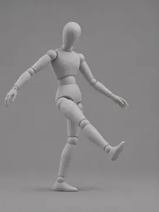
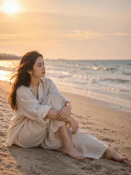
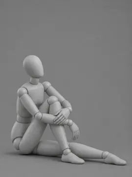
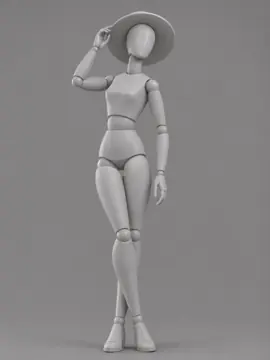
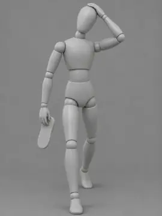
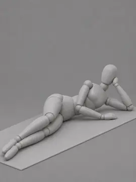
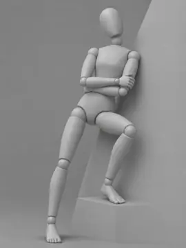
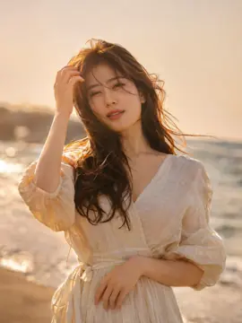
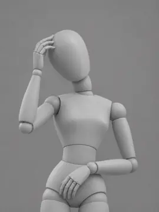

# 海边度假 · Seaside holiday

10 组写真姿势：左边是写真照，右边是照着它画的木头白模。白模可以当姿势参考图，和你的照片一起发给生图模型。 在线试用：[Promicat 姿势库](https://promicat.app/zh/poses?ref=github)

[← 返回目录](../README.md#写真姿势)

## 提裙回眸（回眸）

 

大图：[写真照](../images/photo-poses/beach/sp021-photo.webp) · [白模](../images/photo-poses/beach/sp021-pose.webp)

<details><summary>提示词：用你的照片（附图 1 你的照片，附图 2 白模）</summary>

```text
A real professional portrait photoshoot photo: a seaside holiday photoshoot at golden hour on a quiet beach, backlit warm sun, wind, 85mm f/2. Subject: the person in image 1 (keep their exact face, facial features, skin tone and hairstyle; do not beautify or swap the face), wearing a flowing linen dress or a loose linen shirt and trousers. Pose: walking along the waterline holding the hem of the dress, turning back over the shoulder, hair blown. Image 2 is a wooden artist's mannequin that shows only this body pose: copy it exactly (head, torso, arms, hands, legs, feet, which hand does what, the camera angle), but do not copy the mannequin itself: no wooden skin, no joints, no blank face. Natural, relaxed and unstiff, true skin texture. No text, no logo, no watermark. Portrait 3:4.
```

</details>

<details><summary>提示词：生成示例图（虚构模特）</summary>

```text
A real professional portrait photoshoot photo, the kind posted by a top portrait studio: a seaside holiday photoshoot at golden hour on a quiet beach, backlit warm sun, wind, 85mm f/2. Model: a beautiful mixed-race professional fashion model in her twenties with a naturally attractive face, styled hair and natural makeup, wearing a flowing linen dress or a loose linen shirt and trousers. The photographer directs the model into a natural, relaxed, unstiff pose that looks caught between moments: walking along the waterline holding the hem of the dress, turning back over the shoulder, hair blown. Asymmetric body, soft hands, flattering angle, true skin texture, refined but not plastic, fully clothed and modest. Full body or three-quarter body in frame, the whole pose clearly readable. No text, no logo, no watermark. Portrait 3:4.
```

</details>

## 赤脚踢水（动态）

 

大图：[写真照](../images/photo-poses/beach/sp022-photo.webp) · [白模](../images/photo-poses/beach/sp022-pose.webp)

<details><summary>提示词：用你的照片（附图 1 你的照片，附图 2 白模）</summary>

```text
A real professional portrait photoshoot photo: a seaside holiday photoshoot at golden hour on a quiet beach, backlit warm sun, wind, 85mm f/2. Subject: the person in image 1 (keep their exact face, facial features, skin tone and hairstyle; do not beautify or swap the face), wearing a flowing linen dress or a loose linen shirt and trousers. Pose: kicking water up with one bare foot, arms out for balance, laughing. Image 2 is a wooden artist's mannequin that shows only this body pose: copy it exactly (head, torso, arms, hands, legs, feet, which hand does what, the camera angle), but do not copy the mannequin itself: no wooden skin, no joints, no blank face. Natural, relaxed and unstiff, true skin texture. No text, no logo, no watermark. Portrait 3:4.
```

</details>

<details><summary>提示词：生成示例图（虚构模特）</summary>

```text
A real professional portrait photoshoot photo, the kind posted by a top portrait studio: a seaside holiday photoshoot at golden hour on a quiet beach, backlit warm sun, wind, 85mm f/2. Model: a handsome Mediterranean professional male model in his twenties with a well-groomed look and styled hair, wearing a flowing linen dress or a loose linen shirt and trousers. The photographer directs the model into a natural, relaxed, unstiff pose that looks caught between moments: kicking water up with one bare foot, arms out for balance, laughing. Asymmetric body, soft hands, flattering angle, true skin texture, refined but not plastic, fully clothed and modest. Full body or three-quarter body in frame, the whole pose clearly readable. No text, no logo, no watermark. Portrait 3:4.
```

</details>

## 坐沙抱膝（坐）

 

大图：[写真照](../images/photo-poses/beach/sp023-photo.webp) · [白模](../images/photo-poses/beach/sp023-pose.webp)

<details><summary>提示词：用你的照片（附图 1 你的照片，附图 2 白模）</summary>

```text
A real professional portrait photoshoot photo: a seaside holiday photoshoot at golden hour on a quiet beach, backlit warm sun, wind, 85mm f/2. Subject: the person in image 1 (keep their exact face, facial features, skin tone and hairstyle; do not beautify or swap the face), wearing a flowing linen dress or a loose linen shirt and trousers. Pose: sitting on the sand hugging one knee, the other leg stretched, looking at the sea. Image 2 is a wooden artist's mannequin that shows only this body pose: copy it exactly (head, torso, arms, hands, legs, feet, which hand does what, the camera angle), but do not copy the mannequin itself: no wooden skin, no joints, no blank face. Natural, relaxed and unstiff, true skin texture. No text, no logo, no watermark. Portrait 3:4.
```

</details>

<details><summary>提示词：生成示例图（虚构模特）</summary>

```text
A real professional portrait photoshoot photo, the kind posted by a top portrait studio: a seaside holiday photoshoot at golden hour on a quiet beach, backlit warm sun, wind, 85mm f/2. Model: a beautiful Southeast Asian professional fashion model in her twenties with a naturally attractive face, styled hair and natural makeup, wearing a flowing linen dress or a loose linen shirt and trousers. The photographer directs the model into a natural, relaxed, unstiff pose that looks caught between moments: sitting on the sand hugging one knee, the other leg stretched, looking at the sea. Asymmetric body, soft hands, flattering angle, true skin texture, refined but not plastic, fully clothed and modest. Full body or three-quarter body in frame, the whole pose clearly readable. No text, no logo, no watermark. Portrait 3:4.
```

</details>

## 按帽子（站）

 

大图：[写真照](../images/photo-poses/beach/sp024-photo.webp) · [白模](../images/photo-poses/beach/sp024-pose.webp)

<details><summary>提示词：用你的照片（附图 1 你的照片，附图 2 白模）</summary>

```text
A real professional portrait photoshoot photo: a seaside holiday photoshoot at golden hour on a quiet beach, backlit warm sun, wind, 85mm f/2. Subject: the person in image 1 (keep their exact face, facial features, skin tone and hairstyle; do not beautify or swap the face), wearing a flowing linen dress or a loose linen shirt and trousers. Pose: standing in the wind holding a straw hat on the head with one hand, the other arm loose. Image 2 is a wooden artist's mannequin that shows only this body pose: copy it exactly (head, torso, arms, hands, legs, feet, which hand does what, the camera angle), but do not copy the mannequin itself: no wooden skin, no joints, no blank face. Natural, relaxed and unstiff, true skin texture. No text, no logo, no watermark. Portrait 3:4.
```

</details>

<details><summary>提示词：生成示例图（虚构模特）</summary>

```text
A real professional portrait photoshoot photo, the kind posted by a top portrait studio: a seaside holiday photoshoot at golden hour on a quiet beach, backlit warm sun, wind, 85mm f/2. Model: a beautiful Japanese professional fashion model in her twenties with a naturally attractive face, styled hair and natural makeup, wearing a flowing linen dress or a loose linen shirt and trousers. The photographer directs the model into a natural, relaxed, unstiff pose that looks caught between moments: standing in the wind holding a straw hat on the head with one hand, the other arm loose. Asymmetric body, soft hands, flattering angle, true skin texture, refined but not plastic, fully clothed and modest. Full body or three-quarter body in frame, the whole pose clearly readable. No text, no logo, no watermark. Portrait 3:4.
```

</details>

## 拎鞋走（走）

 

大图：[写真照](../images/photo-poses/beach/sp025-photo.webp) · [白模](../images/photo-poses/beach/sp025-pose.webp)

<details><summary>提示词：用你的照片（附图 1 你的照片，附图 2 白模）</summary>

```text
A real professional portrait photoshoot photo: a seaside holiday photoshoot at golden hour on a quiet beach, backlit warm sun, wind, 85mm f/2. Subject: the person in image 1 (keep their exact face, facial features, skin tone and hairstyle; do not beautify or swap the face), wearing a flowing linen dress or a loose linen shirt and trousers. Pose: walking toward the camera carrying sandals in one hand, the other hand in the hair. Image 2 is a wooden artist's mannequin that shows only this body pose: copy it exactly (head, torso, arms, hands, legs, feet, which hand does what, the camera angle), but do not copy the mannequin itself: no wooden skin, no joints, no blank face. Natural, relaxed and unstiff, true skin texture. No text, no logo, no watermark. Portrait 3:4.
```

</details>

<details><summary>提示词：生成示例图（虚构模特）</summary>

```text
A real professional portrait photoshoot photo, the kind posted by a top portrait studio: a seaside holiday photoshoot at golden hour on a quiet beach, backlit warm sun, wind, 85mm f/2. Model: a handsome Middle Eastern professional male model in his twenties with a well-groomed look and styled hair, wearing a flowing linen dress or a loose linen shirt and trousers. The photographer directs the model into a natural, relaxed, unstiff pose that looks caught between moments: walking toward the camera carrying sandals in one hand, the other hand in the hair. Asymmetric body, soft hands, flattering angle, true skin texture, refined but not plastic, fully clothed and modest. Full body or three-quarter body in frame, the whole pose clearly readable. No text, no logo, no watermark. Portrait 3:4.
```

</details>

## 侧躺沙滩（躺）

 

大图：[写真照](../images/photo-poses/beach/sp026-photo.webp) · [白模](../images/photo-poses/beach/sp026-pose.webp)

<details><summary>提示词：用你的照片（附图 1 你的照片，附图 2 白模）</summary>

```text
A real professional portrait photoshoot photo: a seaside holiday photoshoot at golden hour on a quiet beach, backlit warm sun, wind, 85mm f/2. Subject: the person in image 1 (keep their exact face, facial features, skin tone and hairstyle; do not beautify or swap the face), wearing a flowing linen dress or a loose linen shirt and trousers. Pose: lying on the side on a beach blanket propped on one elbow, fully dressed, smiling. Image 2 is a wooden artist's mannequin that shows only this body pose: copy it exactly (head, torso, arms, hands, legs, feet, which hand does what, the camera angle), but do not copy the mannequin itself: no wooden skin, no joints, no blank face. Natural, relaxed and unstiff, true skin texture. No text, no logo, no watermark. Portrait 3:4.
```

</details>

<details><summary>提示词：生成示例图（虚构模特）</summary>

```text
A real professional portrait photoshoot photo, the kind posted by a top portrait studio: a seaside holiday photoshoot at golden hour on a quiet beach, backlit warm sun, wind, 85mm f/2. Model: a beautiful Indian professional fashion model in her twenties with a naturally attractive face, styled hair and natural makeup, wearing a flowing linen dress or a loose linen shirt and trousers. The photographer directs the model into a natural, relaxed, unstiff pose that looks caught between moments: lying on the side on a beach blanket propped on one elbow, fully dressed, smiling. Asymmetric body, soft hands, flattering angle, true skin texture, refined but not plastic, fully clothed and modest. Full body or three-quarter body in frame, the whole pose clearly readable. No text, no logo, no watermark. Portrait 3:4.
```

</details>

## 蹲捡贝壳（蹲跪）

 

大图：[写真照](../images/photo-poses/beach/sp027-photo.webp) · [白模](../images/photo-poses/beach/sp027-pose.webp)

<details><summary>提示词：用你的照片（附图 1 你的照片，附图 2 白模）</summary>

```text
A real professional portrait photoshoot photo: a seaside holiday photoshoot at golden hour on a quiet beach, backlit warm sun, wind, 85mm f/2. Subject: the person in image 1 (keep their exact face, facial features, skin tone and hairstyle; do not beautify or swap the face), wearing a flowing linen dress or a loose linen shirt and trousers. Pose: squatting at the waterline holding a shell up to look at it. Image 2 is a wooden artist's mannequin that shows only this body pose: copy it exactly (head, torso, arms, hands, legs, feet, which hand does what, the camera angle), but do not copy the mannequin itself: no wooden skin, no joints, no blank face. Natural, relaxed and unstiff, true skin texture. No text, no logo, no watermark. Portrait 3:4.
```

</details>

<details><summary>提示词：生成示例图（虚构模特）</summary>

```text
A real professional portrait photoshoot photo, the kind posted by a top portrait studio: a seaside holiday photoshoot at golden hour on a quiet beach, backlit warm sun, wind, 85mm f/2. Model: a beautiful white European professional fashion model in her twenties with a naturally attractive face, styled hair and natural makeup, wearing a flowing linen dress or a loose linen shirt and trousers. The photographer directs the model into a natural, relaxed, unstiff pose that looks caught between moments: squatting at the waterline holding a shell up to look at it. Asymmetric body, soft hands, flattering angle, true skin texture, refined but not plastic, fully clothed and modest. Full body or three-quarter body in frame, the whole pose clearly readable. No text, no logo, no watermark. Portrait 3:4.
```

</details>

## 张开双臂（动态）

 

大图：[写真照](../images/photo-poses/beach/sp028-photo.webp) · [白模](../images/photo-poses/beach/sp028-pose.webp)

<details><summary>提示词：用你的照片（附图 1 你的照片，附图 2 白模）</summary>

```text
A real professional portrait photoshoot photo: a seaside holiday photoshoot at golden hour on a quiet beach, backlit warm sun, wind, 85mm f/2. Subject: the person in image 1 (keep their exact face, facial features, skin tone and hairstyle; do not beautify or swap the face), wearing a flowing linen dress or a loose linen shirt and trousers. Pose: standing with arms spread wide facing the sunset, head tilted back, eyes closed. Image 2 is a wooden artist's mannequin that shows only this body pose: copy it exactly (head, torso, arms, hands, legs, feet, which hand does what, the camera angle), but do not copy the mannequin itself: no wooden skin, no joints, no blank face. Natural, relaxed and unstiff, true skin texture. No text, no logo, no watermark. Portrait 3:4.
```

</details>

<details><summary>提示词：生成示例图（虚构模特）</summary>

```text
A real professional portrait photoshoot photo, the kind posted by a top portrait studio: a seaside holiday photoshoot at golden hour on a quiet beach, backlit warm sun, wind, 85mm f/2. Model: a handsome Brazilian professional male model in his twenties with a well-groomed look and styled hair, wearing a flowing linen dress or a loose linen shirt and trousers. The photographer directs the model into a natural, relaxed, unstiff pose that looks caught between moments: standing with arms spread wide facing the sunset, head tilted back, eyes closed. Asymmetric body, soft hands, flattering angle, true skin texture, refined but not plastic, fully clothed and modest. Full body or three-quarter body in frame, the whole pose clearly readable. No text, no logo, no watermark. Portrait 3:4.
```

</details>

## 倚礁石（靠）

 

大图：[写真照](../images/photo-poses/beach/sp029-photo.webp) · [白模](../images/photo-poses/beach/sp029-pose.webp)

<details><summary>提示词：用你的照片（附图 1 你的照片，附图 2 白模）</summary>

```text
A real professional portrait photoshoot photo: a seaside holiday photoshoot at golden hour on a quiet beach, backlit warm sun, wind, 85mm f/2. Subject: the person in image 1 (keep their exact face, facial features, skin tone and hairstyle; do not beautify or swap the face), wearing a flowing linen dress or a loose linen shirt and trousers. Pose: leaning back against a big rock, one foot on it, arms folded loosely. Image 2 is a wooden artist's mannequin that shows only this body pose: copy it exactly (head, torso, arms, hands, legs, feet, which hand does what, the camera angle), but do not copy the mannequin itself: no wooden skin, no joints, no blank face. Natural, relaxed and unstiff, true skin texture. No text, no logo, no watermark. Portrait 3:4.
```

</details>

<details><summary>提示词：生成示例图（虚构模特）</summary>

```text
A real professional portrait photoshoot photo, the kind posted by a top portrait studio: a seaside holiday photoshoot at golden hour on a quiet beach, backlit warm sun, wind, 85mm f/2. Model: a beautiful Latina professional fashion model in her twenties with a naturally attractive face, styled hair and natural makeup, wearing a flowing linen dress or a loose linen shirt and trousers. The photographer directs the model into a natural, relaxed, unstiff pose that looks caught between moments: leaning back against a big rock, one foot on it, arms folded loosely. Asymmetric body, soft hands, flattering angle, true skin texture, refined but not plastic, fully clothed and modest. Full body or three-quarter body in frame, the whole pose clearly readable. No text, no logo, no watermark. Portrait 3:4.
```

</details>

## 拨发逆光（半身）

 

大图：[写真照](../images/photo-poses/beach/sp030-photo.webp) · [白模](../images/photo-poses/beach/sp030-pose.webp)

<details><summary>提示词：用你的照片（附图 1 你的照片，附图 2 白模）</summary>

```text
A real professional portrait photoshoot photo: a seaside holiday photoshoot at golden hour on a quiet beach, backlit warm sun, wind, 85mm f/2. Subject: the person in image 1 (keep their exact face, facial features, skin tone and hairstyle; do not beautify or swap the face), wearing a flowing linen dress or a loose linen shirt and trousers. Pose: pushing windblown hair off the face with one hand, squinting into the backlight. Image 2 is a wooden artist's mannequin that shows only this body pose: copy it exactly (head, torso, arms, hands, legs, feet, which hand does what, the camera angle), but do not copy the mannequin itself: no wooden skin, no joints, no blank face. Natural, relaxed and unstiff, true skin texture. No text, no logo, no watermark. Portrait 3:4.
```

</details>

<details><summary>提示词：生成示例图（虚构模特）</summary>

```text
A real professional portrait photoshoot photo, the kind posted by a top portrait studio: a seaside holiday photoshoot at golden hour on a quiet beach, backlit warm sun, wind, 85mm f/2. Model: a beautiful Korean professional fashion model in her twenties with a naturally attractive face, styled hair and natural makeup, wearing a flowing linen dress or a loose linen shirt and trousers. The photographer directs the model into a natural, relaxed, unstiff pose that looks caught between moments: pushing windblown hair off the face with one hand, squinting into the backlight. Asymmetric body, soft hands, flattering angle, true skin texture, refined but not plastic, fully clothed and modest. Waist-up framing, both arms and hands readable. No text, no logo, no watermark. Portrait 3:4.
```

</details>
