# Seaside holiday

English · [简体中文](beach.zh-CN.md)

10 photo poses: a sample photo and the white model drawn from it. Attach your photo first and the white model second. Try them with your own photo on [Promicat](https://promicat.app/poses?utm_source=github&utm_medium=readme&utm_campaign=ai-photo-poses).

[← Back to all styles](../README.md#photo-poses)

## Walking along the waterline holding the hem of the dress (Looking back)

<a href="https://promicat.app/poses/styles/sp021?utm_source=github&utm_medium=readme&utm_campaign=ai-photo-poses">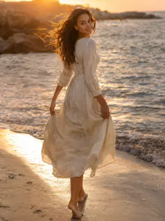</a> 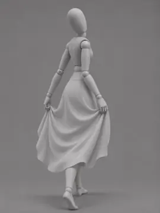

Full size: [photo](../images/photo-poses/beach/sp021-photo.webp) · [white model](../images/photo-poses/beach/sp021-pose.webp) · [try it on Promicat](https://promicat.app/poses/styles/sp021?utm_source=github&utm_medium=readme&utm_campaign=ai-photo-poses)

<details><summary>Prompt with your photo (image 1: your photo, image 2: white model)</summary>

```text
A real professional portrait photoshoot photo: a seaside holiday photoshoot at golden hour on a quiet beach, backlit warm sun, wind, 85mm f/2. Subject: the person in image 1 (keep their exact face, facial features, skin tone and hairstyle; do not beautify or swap the face), wearing a flowing linen dress or a loose linen shirt and trousers. Pose: walking along the waterline holding the hem of the dress, turning back over the shoulder, hair blown. Image 2 is a wooden artist's mannequin that shows only this body pose: copy it exactly (head, torso, arms, hands, legs, feet, which hand does what, the camera angle), but do not copy the mannequin itself: no wooden skin, no joints, no blank face. Natural, relaxed and unstiff, true skin texture. No text, no logo, no watermark. Portrait 3:4.
```

</details>

<details><summary>Prompt for the sample (fictional model)</summary>

```text
A real professional portrait photoshoot photo, the kind posted by a top portrait studio: a seaside holiday photoshoot at golden hour on a quiet beach, backlit warm sun, wind, 85mm f/2. Model: a beautiful mixed-race professional fashion model in her twenties with a naturally attractive face, styled hair and natural makeup, wearing a flowing linen dress or a loose linen shirt and trousers. The photographer directs the model into a natural, relaxed, unstiff pose that looks caught between moments: walking along the waterline holding the hem of the dress, turning back over the shoulder, hair blown. Asymmetric body, soft hands, flattering angle, true skin texture, refined but not plastic, fully clothed and modest. Full body or three-quarter body in frame, the whole pose clearly readable. No text, no logo, no watermark. Portrait 3:4.
```

</details>

## Kicking water up with one bare foot (In motion)

<a href="https://promicat.app/poses/styles/sp022?utm_source=github&utm_medium=readme&utm_campaign=ai-photo-poses">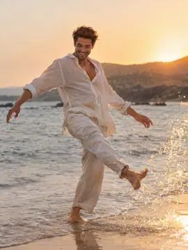</a> 

Full size: [photo](../images/photo-poses/beach/sp022-photo.webp) · [white model](../images/photo-poses/beach/sp022-pose.webp) · [try it on Promicat](https://promicat.app/poses/styles/sp022?utm_source=github&utm_medium=readme&utm_campaign=ai-photo-poses)

<details><summary>Prompt with your photo (image 1: your photo, image 2: white model)</summary>

```text
A real professional portrait photoshoot photo: a seaside holiday photoshoot at golden hour on a quiet beach, backlit warm sun, wind, 85mm f/2. Subject: the person in image 1 (keep their exact face, facial features, skin tone and hairstyle; do not beautify or swap the face), wearing a flowing linen dress or a loose linen shirt and trousers. Pose: kicking water up with one bare foot, arms out for balance, laughing. Image 2 is a wooden artist's mannequin that shows only this body pose: copy it exactly (head, torso, arms, hands, legs, feet, which hand does what, the camera angle), but do not copy the mannequin itself: no wooden skin, no joints, no blank face. Natural, relaxed and unstiff, true skin texture. No text, no logo, no watermark. Portrait 3:4.
```

</details>

<details><summary>Prompt for the sample (fictional model)</summary>

```text
A real professional portrait photoshoot photo, the kind posted by a top portrait studio: a seaside holiday photoshoot at golden hour on a quiet beach, backlit warm sun, wind, 85mm f/2. Model: a handsome Mediterranean professional male model in his twenties with a well-groomed look and styled hair, wearing a flowing linen dress or a loose linen shirt and trousers. The photographer directs the model into a natural, relaxed, unstiff pose that looks caught between moments: kicking water up with one bare foot, arms out for balance, laughing. Asymmetric body, soft hands, flattering angle, true skin texture, refined but not plastic, fully clothed and modest. Full body or three-quarter body in frame, the whole pose clearly readable. No text, no logo, no watermark. Portrait 3:4.
```

</details>

## Sitting on the sand hugging one knee (Sitting)

<a href="https://promicat.app/poses/styles/sp023?utm_source=github&utm_medium=readme&utm_campaign=ai-photo-poses"></a> 

Full size: [photo](../images/photo-poses/beach/sp023-photo.webp) · [white model](../images/photo-poses/beach/sp023-pose.webp) · [try it on Promicat](https://promicat.app/poses/styles/sp023?utm_source=github&utm_medium=readme&utm_campaign=ai-photo-poses)

<details><summary>Prompt with your photo (image 1: your photo, image 2: white model)</summary>

```text
A real professional portrait photoshoot photo: a seaside holiday photoshoot at golden hour on a quiet beach, backlit warm sun, wind, 85mm f/2. Subject: the person in image 1 (keep their exact face, facial features, skin tone and hairstyle; do not beautify or swap the face), wearing a flowing linen dress or a loose linen shirt and trousers. Pose: sitting on the sand hugging one knee, the other leg stretched, looking at the sea. Image 2 is a wooden artist's mannequin that shows only this body pose: copy it exactly (head, torso, arms, hands, legs, feet, which hand does what, the camera angle), but do not copy the mannequin itself: no wooden skin, no joints, no blank face. Natural, relaxed and unstiff, true skin texture. No text, no logo, no watermark. Portrait 3:4.
```

</details>

<details><summary>Prompt for the sample (fictional model)</summary>

```text
A real professional portrait photoshoot photo, the kind posted by a top portrait studio: a seaside holiday photoshoot at golden hour on a quiet beach, backlit warm sun, wind, 85mm f/2. Model: a beautiful Southeast Asian professional fashion model in her twenties with a naturally attractive face, styled hair and natural makeup, wearing a flowing linen dress or a loose linen shirt and trousers. The photographer directs the model into a natural, relaxed, unstiff pose that looks caught between moments: sitting on the sand hugging one knee, the other leg stretched, looking at the sea. Asymmetric body, soft hands, flattering angle, true skin texture, refined but not plastic, fully clothed and modest. Full body or three-quarter body in frame, the whole pose clearly readable. No text, no logo, no watermark. Portrait 3:4.
```

</details>

## Standing in the wind holding a straw hat on the head with one hand (Standing)

<a href="https://promicat.app/poses/styles/sp024?utm_source=github&utm_medium=readme&utm_campaign=ai-photo-poses">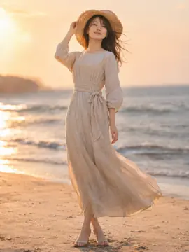</a> 

Full size: [photo](../images/photo-poses/beach/sp024-photo.webp) · [white model](../images/photo-poses/beach/sp024-pose.webp) · [try it on Promicat](https://promicat.app/poses/styles/sp024?utm_source=github&utm_medium=readme&utm_campaign=ai-photo-poses)

<details><summary>Prompt with your photo (image 1: your photo, image 2: white model)</summary>

```text
A real professional portrait photoshoot photo: a seaside holiday photoshoot at golden hour on a quiet beach, backlit warm sun, wind, 85mm f/2. Subject: the person in image 1 (keep their exact face, facial features, skin tone and hairstyle; do not beautify or swap the face), wearing a flowing linen dress or a loose linen shirt and trousers. Pose: standing in the wind holding a straw hat on the head with one hand, the other arm loose. Image 2 is a wooden artist's mannequin that shows only this body pose: copy it exactly (head, torso, arms, hands, legs, feet, which hand does what, the camera angle), but do not copy the mannequin itself: no wooden skin, no joints, no blank face. Natural, relaxed and unstiff, true skin texture. No text, no logo, no watermark. Portrait 3:4.
```

</details>

<details><summary>Prompt for the sample (fictional model)</summary>

```text
A real professional portrait photoshoot photo, the kind posted by a top portrait studio: a seaside holiday photoshoot at golden hour on a quiet beach, backlit warm sun, wind, 85mm f/2. Model: a beautiful Japanese professional fashion model in her twenties with a naturally attractive face, styled hair and natural makeup, wearing a flowing linen dress or a loose linen shirt and trousers. The photographer directs the model into a natural, relaxed, unstiff pose that looks caught between moments: standing in the wind holding a straw hat on the head with one hand, the other arm loose. Asymmetric body, soft hands, flattering angle, true skin texture, refined but not plastic, fully clothed and modest. Full body or three-quarter body in frame, the whole pose clearly readable. No text, no logo, no watermark. Portrait 3:4.
```

</details>

## Walking toward the camera carrying sandals in one hand (Walking)

<a href="https://promicat.app/poses/styles/sp025?utm_source=github&utm_medium=readme&utm_campaign=ai-photo-poses">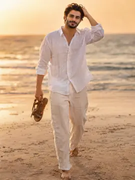</a> 

Full size: [photo](../images/photo-poses/beach/sp025-photo.webp) · [white model](../images/photo-poses/beach/sp025-pose.webp) · [try it on Promicat](https://promicat.app/poses/styles/sp025?utm_source=github&utm_medium=readme&utm_campaign=ai-photo-poses)

<details><summary>Prompt with your photo (image 1: your photo, image 2: white model)</summary>

```text
A real professional portrait photoshoot photo: a seaside holiday photoshoot at golden hour on a quiet beach, backlit warm sun, wind, 85mm f/2. Subject: the person in image 1 (keep their exact face, facial features, skin tone and hairstyle; do not beautify or swap the face), wearing a flowing linen dress or a loose linen shirt and trousers. Pose: walking toward the camera carrying sandals in one hand, the other hand in the hair. Image 2 is a wooden artist's mannequin that shows only this body pose: copy it exactly (head, torso, arms, hands, legs, feet, which hand does what, the camera angle), but do not copy the mannequin itself: no wooden skin, no joints, no blank face. Natural, relaxed and unstiff, true skin texture. No text, no logo, no watermark. Portrait 3:4.
```

</details>

<details><summary>Prompt for the sample (fictional model)</summary>

```text
A real professional portrait photoshoot photo, the kind posted by a top portrait studio: a seaside holiday photoshoot at golden hour on a quiet beach, backlit warm sun, wind, 85mm f/2. Model: a handsome Middle Eastern professional male model in his twenties with a well-groomed look and styled hair, wearing a flowing linen dress or a loose linen shirt and trousers. The photographer directs the model into a natural, relaxed, unstiff pose that looks caught between moments: walking toward the camera carrying sandals in one hand, the other hand in the hair. Asymmetric body, soft hands, flattering angle, true skin texture, refined but not plastic, fully clothed and modest. Full body or three-quarter body in frame, the whole pose clearly readable. No text, no logo, no watermark. Portrait 3:4.
```

</details>

## Lying on the side on a beach blanket propped on one elbow (Lying)

<a href="https://promicat.app/poses/styles/sp026?utm_source=github&utm_medium=readme&utm_campaign=ai-photo-poses">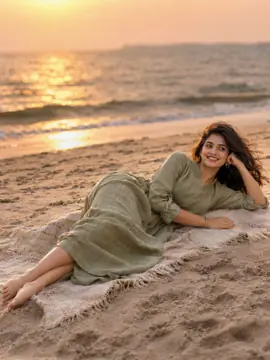</a> 

Full size: [photo](../images/photo-poses/beach/sp026-photo.webp) · [white model](../images/photo-poses/beach/sp026-pose.webp) · [try it on Promicat](https://promicat.app/poses/styles/sp026?utm_source=github&utm_medium=readme&utm_campaign=ai-photo-poses)

<details><summary>Prompt with your photo (image 1: your photo, image 2: white model)</summary>

```text
A real professional portrait photoshoot photo: a seaside holiday photoshoot at golden hour on a quiet beach, backlit warm sun, wind, 85mm f/2. Subject: the person in image 1 (keep their exact face, facial features, skin tone and hairstyle; do not beautify or swap the face), wearing a flowing linen dress or a loose linen shirt and trousers. Pose: lying on the side on a beach blanket propped on one elbow, fully dressed, smiling. Image 2 is a wooden artist's mannequin that shows only this body pose: copy it exactly (head, torso, arms, hands, legs, feet, which hand does what, the camera angle), but do not copy the mannequin itself: no wooden skin, no joints, no blank face. Natural, relaxed and unstiff, true skin texture. No text, no logo, no watermark. Portrait 3:4.
```

</details>

<details><summary>Prompt for the sample (fictional model)</summary>

```text
A real professional portrait photoshoot photo, the kind posted by a top portrait studio: a seaside holiday photoshoot at golden hour on a quiet beach, backlit warm sun, wind, 85mm f/2. Model: a beautiful Indian professional fashion model in her twenties with a naturally attractive face, styled hair and natural makeup, wearing a flowing linen dress or a loose linen shirt and trousers. The photographer directs the model into a natural, relaxed, unstiff pose that looks caught between moments: lying on the side on a beach blanket propped on one elbow, fully dressed, smiling. Asymmetric body, soft hands, flattering angle, true skin texture, refined but not plastic, fully clothed and modest. Full body or three-quarter body in frame, the whole pose clearly readable. No text, no logo, no watermark. Portrait 3:4.
```

</details>

## Squatting at the waterline holding a shell up to look at it (Crouching)

<a href="https://promicat.app/poses/styles/sp027?utm_source=github&utm_medium=readme&utm_campaign=ai-photo-poses">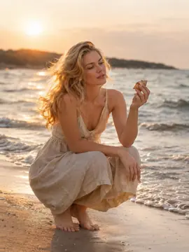</a> 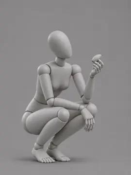

Full size: [photo](../images/photo-poses/beach/sp027-photo.webp) · [white model](../images/photo-poses/beach/sp027-pose.webp) · [try it on Promicat](https://promicat.app/poses/styles/sp027?utm_source=github&utm_medium=readme&utm_campaign=ai-photo-poses)

<details><summary>Prompt with your photo (image 1: your photo, image 2: white model)</summary>

```text
A real professional portrait photoshoot photo: a seaside holiday photoshoot at golden hour on a quiet beach, backlit warm sun, wind, 85mm f/2. Subject: the person in image 1 (keep their exact face, facial features, skin tone and hairstyle; do not beautify or swap the face), wearing a flowing linen dress or a loose linen shirt and trousers. Pose: squatting at the waterline holding a shell up to look at it. Image 2 is a wooden artist's mannequin that shows only this body pose: copy it exactly (head, torso, arms, hands, legs, feet, which hand does what, the camera angle), but do not copy the mannequin itself: no wooden skin, no joints, no blank face. Natural, relaxed and unstiff, true skin texture. No text, no logo, no watermark. Portrait 3:4.
```

</details>

<details><summary>Prompt for the sample (fictional model)</summary>

```text
A real professional portrait photoshoot photo, the kind posted by a top portrait studio: a seaside holiday photoshoot at golden hour on a quiet beach, backlit warm sun, wind, 85mm f/2. Model: a beautiful white European professional fashion model in her twenties with a naturally attractive face, styled hair and natural makeup, wearing a flowing linen dress or a loose linen shirt and trousers. The photographer directs the model into a natural, relaxed, unstiff pose that looks caught between moments: squatting at the waterline holding a shell up to look at it. Asymmetric body, soft hands, flattering angle, true skin texture, refined but not plastic, fully clothed and modest. Full body or three-quarter body in frame, the whole pose clearly readable. No text, no logo, no watermark. Portrait 3:4.
```

</details>

## Standing with arms spread wide facing the sunset (In motion)

<a href="https://promicat.app/poses/styles/sp028?utm_source=github&utm_medium=readme&utm_campaign=ai-photo-poses">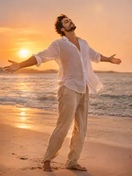</a> 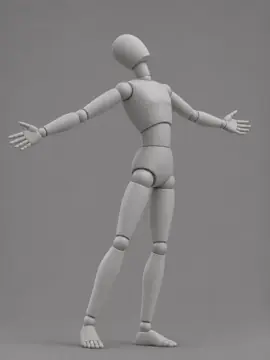

Full size: [photo](../images/photo-poses/beach/sp028-photo.webp) · [white model](../images/photo-poses/beach/sp028-pose.webp) · [try it on Promicat](https://promicat.app/poses/styles/sp028?utm_source=github&utm_medium=readme&utm_campaign=ai-photo-poses)

<details><summary>Prompt with your photo (image 1: your photo, image 2: white model)</summary>

```text
A real professional portrait photoshoot photo: a seaside holiday photoshoot at golden hour on a quiet beach, backlit warm sun, wind, 85mm f/2. Subject: the person in image 1 (keep their exact face, facial features, skin tone and hairstyle; do not beautify or swap the face), wearing a flowing linen dress or a loose linen shirt and trousers. Pose: standing with arms spread wide facing the sunset, head tilted back, eyes closed. Image 2 is a wooden artist's mannequin that shows only this body pose: copy it exactly (head, torso, arms, hands, legs, feet, which hand does what, the camera angle), but do not copy the mannequin itself: no wooden skin, no joints, no blank face. Natural, relaxed and unstiff, true skin texture. No text, no logo, no watermark. Portrait 3:4.
```

</details>

<details><summary>Prompt for the sample (fictional model)</summary>

```text
A real professional portrait photoshoot photo, the kind posted by a top portrait studio: a seaside holiday photoshoot at golden hour on a quiet beach, backlit warm sun, wind, 85mm f/2. Model: a handsome Brazilian professional male model in his twenties with a well-groomed look and styled hair, wearing a flowing linen dress or a loose linen shirt and trousers. The photographer directs the model into a natural, relaxed, unstiff pose that looks caught between moments: standing with arms spread wide facing the sunset, head tilted back, eyes closed. Asymmetric body, soft hands, flattering angle, true skin texture, refined but not plastic, fully clothed and modest. Full body or three-quarter body in frame, the whole pose clearly readable. No text, no logo, no watermark. Portrait 3:4.
```

</details>

## Leaning back against a big rock (Leaning)

<a href="https://promicat.app/poses/styles/sp029?utm_source=github&utm_medium=readme&utm_campaign=ai-photo-poses">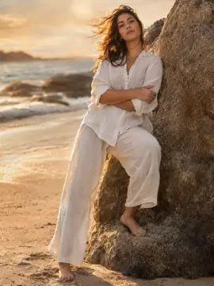</a> 

Full size: [photo](../images/photo-poses/beach/sp029-photo.webp) · [white model](../images/photo-poses/beach/sp029-pose.webp) · [try it on Promicat](https://promicat.app/poses/styles/sp029?utm_source=github&utm_medium=readme&utm_campaign=ai-photo-poses)

<details><summary>Prompt with your photo (image 1: your photo, image 2: white model)</summary>

```text
A real professional portrait photoshoot photo: a seaside holiday photoshoot at golden hour on a quiet beach, backlit warm sun, wind, 85mm f/2. Subject: the person in image 1 (keep their exact face, facial features, skin tone and hairstyle; do not beautify or swap the face), wearing a flowing linen dress or a loose linen shirt and trousers. Pose: leaning back against a big rock, one foot on it, arms folded loosely. Image 2 is a wooden artist's mannequin that shows only this body pose: copy it exactly (head, torso, arms, hands, legs, feet, which hand does what, the camera angle), but do not copy the mannequin itself: no wooden skin, no joints, no blank face. Natural, relaxed and unstiff, true skin texture. No text, no logo, no watermark. Portrait 3:4.
```

</details>

<details><summary>Prompt for the sample (fictional model)</summary>

```text
A real professional portrait photoshoot photo, the kind posted by a top portrait studio: a seaside holiday photoshoot at golden hour on a quiet beach, backlit warm sun, wind, 85mm f/2. Model: a beautiful Latina professional fashion model in her twenties with a naturally attractive face, styled hair and natural makeup, wearing a flowing linen dress or a loose linen shirt and trousers. The photographer directs the model into a natural, relaxed, unstiff pose that looks caught between moments: leaning back against a big rock, one foot on it, arms folded loosely. Asymmetric body, soft hands, flattering angle, true skin texture, refined but not plastic, fully clothed and modest. Full body or three-quarter body in frame, the whole pose clearly readable. No text, no logo, no watermark. Portrait 3:4.
```

</details>

## Pushing windblown hair off the face with one hand (Upper body)

<a href="https://promicat.app/poses/styles/sp030?utm_source=github&utm_medium=readme&utm_campaign=ai-photo-poses"></a> 

Full size: [photo](../images/photo-poses/beach/sp030-photo.webp) · [white model](../images/photo-poses/beach/sp030-pose.webp) · [try it on Promicat](https://promicat.app/poses/styles/sp030?utm_source=github&utm_medium=readme&utm_campaign=ai-photo-poses)

<details><summary>Prompt with your photo (image 1: your photo, image 2: white model)</summary>

```text
A real professional portrait photoshoot photo: a seaside holiday photoshoot at golden hour on a quiet beach, backlit warm sun, wind, 85mm f/2. Subject: the person in image 1 (keep their exact face, facial features, skin tone and hairstyle; do not beautify or swap the face), wearing a flowing linen dress or a loose linen shirt and trousers. Pose: pushing windblown hair off the face with one hand, squinting into the backlight. Image 2 is a wooden artist's mannequin that shows only this body pose: copy it exactly (head, torso, arms, hands, legs, feet, which hand does what, the camera angle), but do not copy the mannequin itself: no wooden skin, no joints, no blank face. Natural, relaxed and unstiff, true skin texture. No text, no logo, no watermark. Portrait 3:4.
```

</details>

<details><summary>Prompt for the sample (fictional model)</summary>

```text
A real professional portrait photoshoot photo, the kind posted by a top portrait studio: a seaside holiday photoshoot at golden hour on a quiet beach, backlit warm sun, wind, 85mm f/2. Model: a beautiful Korean professional fashion model in her twenties with a naturally attractive face, styled hair and natural makeup, wearing a flowing linen dress or a loose linen shirt and trousers. The photographer directs the model into a natural, relaxed, unstiff pose that looks caught between moments: pushing windblown hair off the face with one hand, squinting into the backlight. Asymmetric body, soft hands, flattering angle, true skin texture, refined but not plastic, fully clothed and modest. Waist-up framing, both arms and hands readable. No text, no logo, no watermark. Portrait 3:4.
```

</details>
