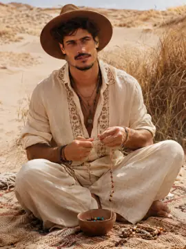
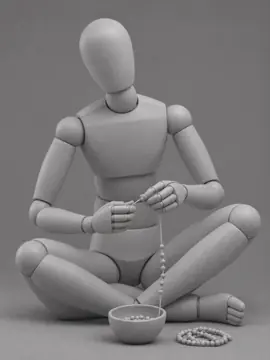
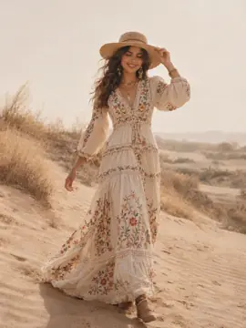
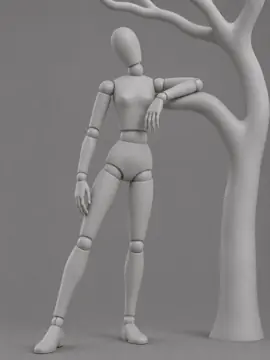
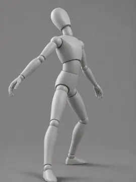
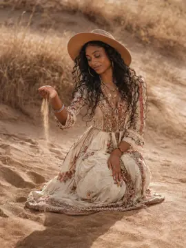
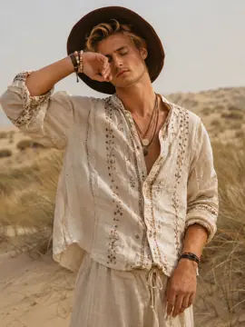
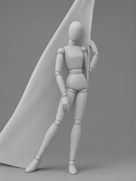
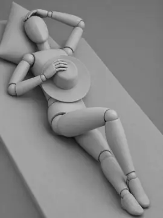

# 波西米亚 · Boho desert

10 组写真姿势：左边是写真照，右边是照着它画的木头白模。白模可以当姿势参考图，和你的照片一起发给生图模型。 在线试用：[Promicat 姿势库](https://promicat.app/zh/poses?ref=github)

[← 返回目录](../README.md#写真姿势)

## 沙丘张臂（动态）

 

大图：[写真照](../images/photo-poses/boho/sp141-photo.webp) · [白模](../images/photo-poses/boho/sp141-pose.webp)

<details><summary>提示词：用你的照片（附图 1 你的照片，附图 2 白模）</summary>

```text
A real professional portrait photoshoot photo: a boho desert-festival photoshoot among sand dunes and dry grass, warm hazy sun, 50mm. Subject: the person in image 1 (keep their exact face, facial features, skin tone and hairstyle; do not beautify or swap the face), wearing a long embroidered maxi dress or a loose linen tunic, layered jewellery, a wide-brim hat. Pose: standing on a dune ridge, arms out, scarf streaming in the wind. Image 2 is a wooden artist's mannequin that shows only this body pose: copy it exactly (head, torso, arms, hands, legs, feet, which hand does what, the camera angle), but do not copy the mannequin itself: no wooden skin, no joints, no blank face. Natural, relaxed and unstiff, true skin texture. No text, no logo, no watermark. Portrait 3:4.
```

</details>

<details><summary>提示词：生成示例图（虚构模特）</summary>

```text
A real professional portrait photoshoot photo, the kind posted by a top portrait studio: a boho desert-festival photoshoot among sand dunes and dry grass, warm hazy sun, 50mm. Model: a beautiful white European professional fashion model in her twenties with a naturally attractive face, styled hair and natural makeup, wearing a long embroidered maxi dress or a loose linen tunic, layered jewellery, a wide-brim hat. The photographer directs the model into a natural, relaxed, unstiff pose that looks caught between moments: standing on a dune ridge, arms out, scarf streaming in the wind. Asymmetric body, soft hands, flattering angle, true skin texture, refined but not plastic, fully clothed and modest. Full body or three-quarter body in frame, the whole pose clearly readable. No text, no logo, no watermark. Portrait 3:4.
```

</details>

## 坐地毯（坐）

 

大图：[写真照](../images/photo-poses/boho/sp142-photo.webp) · [白模](../images/photo-poses/boho/sp142-pose.webp)

<details><summary>提示词：用你的照片（附图 1 你的照片，附图 2 白模）</summary>

```text
A real professional portrait photoshoot photo: a boho desert-festival photoshoot among sand dunes and dry grass, warm hazy sun, 50mm. Subject: the person in image 1 (keep their exact face, facial features, skin tone and hairstyle; do not beautify or swap the face), wearing a loose embroidered linen shirt open at the collar, wide linen trousers, layered necklaces and a wide-brim hat. Pose: sitting cross-legged on a woven rug in the desert, threading beads. Image 2 is a wooden artist's mannequin that shows only this body pose: copy it exactly (head, torso, arms, hands, legs, feet, which hand does what, the camera angle), but do not copy the mannequin itself: no wooden skin, no joints, no blank face. Natural, relaxed and unstiff, true skin texture. No text, no logo, no watermark. Portrait 3:4.
```

</details>

<details><summary>提示词：生成示例图（虚构模特）</summary>

```text
A real professional portrait photoshoot photo, the kind posted by a top portrait studio: a boho desert-festival photoshoot among sand dunes and dry grass, warm hazy sun, 50mm. Model: a handsome Brazilian professional male model in his twenties with a well-groomed look and styled hair, wearing a loose embroidered linen shirt open at the collar, wide linen trousers, layered necklaces and a wide-brim hat. The photographer directs the model into a natural, relaxed, unstiff pose that looks caught between moments: sitting cross-legged on a woven rug in the desert, threading beads. Asymmetric body, soft hands, flattering angle, true skin texture, refined but not plastic, fully clothed and modest. Full body or three-quarter body in frame, the whole pose clearly readable. No text, no logo, no watermark. Portrait 3:4.
```

</details>

## 沙中走（走）

 

大图：[写真照](../images/photo-poses/boho/sp143-photo.webp) · [白模](../images/photo-poses/boho/sp143-pose.webp)

<details><summary>提示词：用你的照片（附图 1 你的照片，附图 2 白模）</summary>

```text
A real professional portrait photoshoot photo: a boho desert-festival photoshoot among sand dunes and dry grass, warm hazy sun, 50mm. Subject: the person in image 1 (keep their exact face, facial features, skin tone and hairstyle; do not beautify or swap the face), wearing a long embroidered maxi dress or a loose linen tunic, layered jewellery, a wide-brim hat. Pose: walking down a sand dune, the long dress trailing, holding the hat. Image 2 is a wooden artist's mannequin that shows only this body pose: copy it exactly (head, torso, arms, hands, legs, feet, which hand does what, the camera angle), but do not copy the mannequin itself: no wooden skin, no joints, no blank face. Natural, relaxed and unstiff, true skin texture. No text, no logo, no watermark. Portrait 3:4.
```

</details>

<details><summary>提示词：生成示例图（虚构模特）</summary>

```text
A real professional portrait photoshoot photo, the kind posted by a top portrait studio: a boho desert-festival photoshoot among sand dunes and dry grass, warm hazy sun, 50mm. Model: a beautiful Latina professional fashion model in her twenties with a naturally attractive face, styled hair and natural makeup, wearing a long embroidered maxi dress or a loose linen tunic, layered jewellery, a wide-brim hat. The photographer directs the model into a natural, relaxed, unstiff pose that looks caught between moments: walking down a sand dune, the long dress trailing, holding the hat. Asymmetric body, soft hands, flattering angle, true skin texture, refined but not plastic, fully clothed and modest. Full body or three-quarter body in frame, the whole pose clearly readable. No text, no logo, no watermark. Portrait 3:4.
```

</details>

## 倚枯树（靠）

 

大图：[写真照](../images/photo-poses/boho/sp144-photo.webp) · [白模](../images/photo-poses/boho/sp144-pose.webp)

<details><summary>提示词：用你的照片（附图 1 你的照片，附图 2 白模）</summary>

```text
A real professional portrait photoshoot photo: a boho desert-festival photoshoot among sand dunes and dry grass, warm hazy sun, 50mm. Subject: the person in image 1 (keep their exact face, facial features, skin tone and hairstyle; do not beautify or swap the face), wearing a long embroidered maxi dress or a loose linen tunic, layered jewellery, a wide-brim hat. Pose: leaning on a twisted dry tree, one arm over a branch. Image 2 is a wooden artist's mannequin that shows only this body pose: copy it exactly (head, torso, arms, hands, legs, feet, which hand does what, the camera angle), but do not copy the mannequin itself: no wooden skin, no joints, no blank face. Natural, relaxed and unstiff, true skin texture. No text, no logo, no watermark. Portrait 3:4.
```

</details>

<details><summary>提示词：生成示例图（虚构模特）</summary>

```text
A real professional portrait photoshoot photo, the kind posted by a top portrait studio: a boho desert-festival photoshoot among sand dunes and dry grass, warm hazy sun, 50mm. Model: a beautiful Korean professional fashion model in her twenties with a naturally attractive face, styled hair and natural makeup, wearing a long embroidered maxi dress or a loose linen tunic, layered jewellery, a wide-brim hat. The photographer directs the model into a natural, relaxed, unstiff pose that looks caught between moments: leaning on a twisted dry tree, one arm over a branch. Asymmetric body, soft hands, flattering angle, true skin texture, refined but not plastic, fully clothed and modest. Full body or three-quarter body in frame, the whole pose clearly readable. No text, no logo, no watermark. Portrait 3:4.
```

</details>

## 转圈裙摆（动态）

 

大图：[写真照](../images/photo-poses/boho/sp145-photo.webp) · [白模](../images/photo-poses/boho/sp145-pose.webp)

<details><summary>提示词：用你的照片（附图 1 你的照片，附图 2 白模）</summary>

```text
A real professional portrait photoshoot photo: a boho desert-festival photoshoot among sand dunes and dry grass, warm hazy sun, 50mm. Subject: the person in image 1 (keep their exact face, facial features, skin tone and hairstyle; do not beautify or swap the face), wearing a loose embroidered linen shirt open at the collar, wide linen trousers, layered necklaces and a wide-brim hat. Pose: spinning so the maxi dress flares, head back laughing. Image 2 is a wooden artist's mannequin that shows only this body pose: copy it exactly (head, torso, arms, hands, legs, feet, which hand does what, the camera angle), but do not copy the mannequin itself: no wooden skin, no joints, no blank face. Natural, relaxed and unstiff, true skin texture. No text, no logo, no watermark. Portrait 3:4.
```

</details>

<details><summary>提示词：生成示例图（虚构模特）</summary>

```text
A real professional portrait photoshoot photo, the kind posted by a top portrait studio: a boho desert-festival photoshoot among sand dunes and dry grass, warm hazy sun, 50mm. Model: a handsome South Asian professional male model in his twenties with a well-groomed look and styled hair, wearing a loose embroidered linen shirt open at the collar, wide linen trousers, layered necklaces and a wide-brim hat. The photographer directs the model into a natural, relaxed, unstiff pose that looks caught between moments: spinning so the maxi dress flares, head back laughing. Asymmetric body, soft hands, flattering angle, true skin texture, refined but not plastic, fully clothed and modest. Full body or three-quarter body in frame, the whole pose clearly readable. No text, no logo, no watermark. Portrait 3:4.
```

</details>

## 压帽回头（回眸）

 

大图：[写真照](../images/photo-poses/boho/sp146-photo.webp) · [白模](../images/photo-poses/boho/sp146-pose.webp)

<details><summary>提示词：用你的照片（附图 1 你的照片，附图 2 白模）</summary>

```text
A real professional portrait photoshoot photo: a boho desert-festival photoshoot among sand dunes and dry grass, warm hazy sun, 50mm. Subject: the person in image 1 (keep their exact face, facial features, skin tone and hairstyle; do not beautify or swap the face), wearing a long embroidered maxi dress or a loose linen tunic, layered jewellery, a wide-brim hat. Pose: walking away, turning back while holding the wide hat. Image 2 is a wooden artist's mannequin that shows only this body pose: copy it exactly (head, torso, arms, hands, legs, feet, which hand does what, the camera angle), but do not copy the mannequin itself: no wooden skin, no joints, no blank face. Natural, relaxed and unstiff, true skin texture. No text, no logo, no watermark. Portrait 3:4.
```

</details>

<details><summary>提示词：生成示例图（虚构模特）</summary>

```text
A real professional portrait photoshoot photo, the kind posted by a top portrait studio: a boho desert-festival photoshoot among sand dunes and dry grass, warm hazy sun, 50mm. Model: a beautiful East African professional fashion model in her twenties with a naturally attractive face, styled hair and natural makeup, wearing a long embroidered maxi dress or a loose linen tunic, layered jewellery, a wide-brim hat. The photographer directs the model into a natural, relaxed, unstiff pose that looks caught between moments: walking away, turning back while holding the wide hat. Asymmetric body, soft hands, flattering angle, true skin texture, refined but not plastic, fully clothed and modest. Full body or three-quarter body in frame, the whole pose clearly readable. No text, no logo, no watermark. Portrait 3:4.
```

</details>

## 跪坐沙地（蹲跪）

 

大图：[写真照](../images/photo-poses/boho/sp147-photo.webp) · [白模](../images/photo-poses/boho/sp147-pose.webp)

<details><summary>提示词：用你的照片（附图 1 你的照片，附图 2 白模）</summary>

```text
A real professional portrait photoshoot photo: a boho desert-festival photoshoot among sand dunes and dry grass, warm hazy sun, 50mm. Subject: the person in image 1 (keep their exact face, facial features, skin tone and hairstyle; do not beautify or swap the face), wearing a long embroidered maxi dress or a loose linen tunic, layered jewellery, a wide-brim hat. Pose: kneeling in the sand letting it run through the fingers. Image 2 is a wooden artist's mannequin that shows only this body pose: copy it exactly (head, torso, arms, hands, legs, feet, which hand does what, the camera angle), but do not copy the mannequin itself: no wooden skin, no joints, no blank face. Natural, relaxed and unstiff, true skin texture. No text, no logo, no watermark. Portrait 3:4.
```

</details>

<details><summary>提示词：生成示例图（虚构模特）</summary>

```text
A real professional portrait photoshoot photo, the kind posted by a top portrait studio: a boho desert-festival photoshoot among sand dunes and dry grass, warm hazy sun, 50mm. Model: a beautiful Black professional fashion model in her twenties with a naturally attractive face, styled hair and natural makeup, wearing a long embroidered maxi dress or a loose linen tunic, layered jewellery, a wide-brim hat. The photographer directs the model into a natural, relaxed, unstiff pose that looks caught between moments: kneeling in the sand letting it run through the fingers. Asymmetric body, soft hands, flattering angle, true skin texture, refined but not plastic, fully clothed and modest. Full body or three-quarter body in frame, the whole pose clearly readable. No text, no logo, no watermark. Portrait 3:4.
```

</details>

## 手链特写（半身）

 

大图：[写真照](../images/photo-poses/boho/sp148-photo.webp) · [白模](../images/photo-poses/boho/sp148-pose.webp)

<details><summary>提示词：用你的照片（附图 1 你的照片，附图 2 白模）</summary>

```text
A real professional portrait photoshoot photo: a boho desert-festival photoshoot among sand dunes and dry grass, warm hazy sun, 50mm. Subject: the person in image 1 (keep their exact face, facial features, skin tone and hairstyle; do not beautify or swap the face), wearing a loose embroidered linen shirt open at the collar, wide linen trousers, layered necklaces and a wide-brim hat. Pose: raising the wrist to the face, bracelets sliding, eyes closed. Image 2 is a wooden artist's mannequin that shows only this body pose: copy it exactly (head, torso, arms, hands, legs, feet, which hand does what, the camera angle), but do not copy the mannequin itself: no wooden skin, no joints, no blank face. Natural, relaxed and unstiff, true skin texture. No text, no logo, no watermark. Portrait 3:4.
```

</details>

<details><summary>提示词：生成示例图（虚构模特）</summary>

```text
A real professional portrait photoshoot photo, the kind posted by a top portrait studio: a boho desert-festival photoshoot among sand dunes and dry grass, warm hazy sun, 50mm. Model: a handsome Scandinavian professional male model in his twenties with a well-groomed look and styled hair, wearing a loose embroidered linen shirt open at the collar, wide linen trousers, layered necklaces and a wide-brim hat. The photographer directs the model into a natural, relaxed, unstiff pose that looks caught between moments: raising the wrist to the face, bracelets sliding, eyes closed. Asymmetric body, soft hands, flattering angle, true skin texture, refined but not plastic, fully clothed and modest. Waist-up framing, both arms and hands readable. No text, no logo, no watermark. Portrait 3:4.
```

</details>

## 靠帐篷（靠）

 

大图：[写真照](../images/photo-poses/boho/sp149-photo.webp) · [白模](../images/photo-poses/boho/sp149-pose.webp)

<details><summary>提示词：用你的照片（附图 1 你的照片，附图 2 白模）</summary>

```text
A real professional portrait photoshoot photo: a boho desert-festival photoshoot among sand dunes and dry grass, warm hazy sun, 50mm. Subject: the person in image 1 (keep their exact face, facial features, skin tone and hairstyle; do not beautify or swap the face), wearing a long embroidered maxi dress or a loose linen tunic, layered jewellery, a wide-brim hat. Pose: leaning in a tent doorway, one hand on the canvas. Image 2 is a wooden artist's mannequin that shows only this body pose: copy it exactly (head, torso, arms, hands, legs, feet, which hand does what, the camera angle), but do not copy the mannequin itself: no wooden skin, no joints, no blank face. Natural, relaxed and unstiff, true skin texture. No text, no logo, no watermark. Portrait 3:4.
```

</details>

<details><summary>提示词：生成示例图（虚构模特）</summary>

```text
A real professional portrait photoshoot photo, the kind posted by a top portrait studio: a boho desert-festival photoshoot among sand dunes and dry grass, warm hazy sun, 50mm. Model: a beautiful East Asian professional fashion model in her twenties with a naturally attractive face, styled hair and natural makeup, wearing a long embroidered maxi dress or a loose linen tunic, layered jewellery, a wide-brim hat. The photographer directs the model into a natural, relaxed, unstiff pose that looks caught between moments: leaning in a tent doorway, one hand on the canvas. Asymmetric body, soft hands, flattering angle, true skin texture, refined but not plastic, fully clothed and modest. Full body or three-quarter body in frame, the whole pose clearly readable. No text, no logo, no watermark. Portrait 3:4.
```

</details>

## 躺地毯（躺）

 

大图：[写真照](../images/photo-poses/boho/sp150-photo.webp) · [白模](../images/photo-poses/boho/sp150-pose.webp)

<details><summary>提示词：用你的照片（附图 1 你的照片，附图 2 白模）</summary>

```text
A real professional portrait photoshoot photo: a boho desert-festival photoshoot among sand dunes and dry grass, warm hazy sun, 50mm. Subject: the person in image 1 (keep their exact face, facial features, skin tone and hairstyle; do not beautify or swap the face), wearing a long embroidered maxi dress or a loose linen tunic, layered jewellery, a wide-brim hat. Pose: lying on the back on a rug, hat over the chest, fully dressed. Image 2 is a wooden artist's mannequin that shows only this body pose: copy it exactly (head, torso, arms, hands, legs, feet, which hand does what, the camera angle), but do not copy the mannequin itself: no wooden skin, no joints, no blank face. Natural, relaxed and unstiff, true skin texture. No text, no logo, no watermark. Portrait 3:4.
```

</details>

<details><summary>提示词：生成示例图（虚构模特）</summary>

```text
A real professional portrait photoshoot photo, the kind posted by a top portrait studio: a boho desert-festival photoshoot among sand dunes and dry grass, warm hazy sun, 50mm. Model: a beautiful mixed-race professional fashion model in her twenties with a naturally attractive face, styled hair and natural makeup, wearing a long embroidered maxi dress or a loose linen tunic, layered jewellery, a wide-brim hat. The photographer directs the model into a natural, relaxed, unstiff pose that looks caught between moments: lying on the back on a rug, hat over the chest, fully dressed. Asymmetric body, soft hands, flattering angle, true skin texture, refined but not plastic, fully clothed and modest. Full body or three-quarter body in frame, the whole pose clearly readable. No text, no logo, no watermark. Portrait 3:4.
```

</details>
