# Boho desert

English · [简体中文](boho.zh-CN.md)

10 photo poses: a sample photo and the white model drawn from it. Attach your photo first and the white model second. Try them with your own photo on [Promicat](https://promicat.app/poses?utm_source=github&utm_medium=readme&utm_campaign=ai-photo-poses).

[← Back to all styles](../README.md#photo-poses)

## Standing on a dune ridge (In motion)

<a href="https://promicat.app/poses/styles/sp141?utm_source=github&utm_medium=readme&utm_campaign=ai-photo-poses">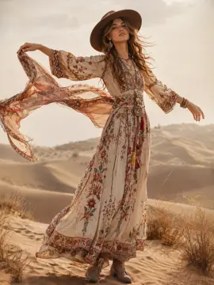</a> 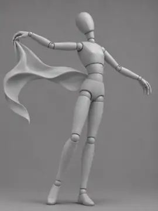

Full size: [photo](../images/photo-poses/boho/sp141-photo.webp) · [white model](../images/photo-poses/boho/sp141-pose.webp) · [try it on Promicat](https://promicat.app/poses/styles/sp141?utm_source=github&utm_medium=readme&utm_campaign=ai-photo-poses)

<details><summary>Prompt with your photo (image 1: your photo, image 2: white model)</summary>

```text
A real professional portrait photoshoot photo: a boho desert-festival photoshoot among sand dunes and dry grass, warm hazy sun, 50mm. Subject: the person in image 1 (keep their exact face, facial features, skin tone and hairstyle; do not beautify or swap the face), wearing a long embroidered maxi dress or a loose linen tunic, layered jewellery, a wide-brim hat. Pose: standing on a dune ridge, arms out, scarf streaming in the wind. Image 2 is a wooden artist's mannequin that shows only this body pose: copy it exactly (head, torso, arms, hands, legs, feet, which hand does what, the camera angle), but do not copy the mannequin itself: no wooden skin, no joints, no blank face. Natural, relaxed and unstiff, true skin texture. No text, no logo, no watermark. Portrait 3:4.
```

</details>

<details><summary>Prompt for the sample (fictional model)</summary>

```text
A real professional portrait photoshoot photo, the kind posted by a top portrait studio: a boho desert-festival photoshoot among sand dunes and dry grass, warm hazy sun, 50mm. Model: a beautiful white European professional fashion model in her twenties with a naturally attractive face, styled hair and natural makeup, wearing a long embroidered maxi dress or a loose linen tunic, layered jewellery, a wide-brim hat. The photographer directs the model into a natural, relaxed, unstiff pose that looks caught between moments: standing on a dune ridge, arms out, scarf streaming in the wind. Asymmetric body, soft hands, flattering angle, true skin texture, refined but not plastic, fully clothed and modest. Full body or three-quarter body in frame, the whole pose clearly readable. No text, no logo, no watermark. Portrait 3:4.
```

</details>

## Sitting cross-legged on a woven rug in the desert (Sitting)

<a href="https://promicat.app/poses/styles/sp142?utm_source=github&utm_medium=readme&utm_campaign=ai-photo-poses"></a> 

Full size: [photo](../images/photo-poses/boho/sp142-photo.webp) · [white model](../images/photo-poses/boho/sp142-pose.webp) · [try it on Promicat](https://promicat.app/poses/styles/sp142?utm_source=github&utm_medium=readme&utm_campaign=ai-photo-poses)

<details><summary>Prompt with your photo (image 1: your photo, image 2: white model)</summary>

```text
A real professional portrait photoshoot photo: a boho desert-festival photoshoot among sand dunes and dry grass, warm hazy sun, 50mm. Subject: the person in image 1 (keep their exact face, facial features, skin tone and hairstyle; do not beautify or swap the face), wearing a loose embroidered linen shirt open at the collar, wide linen trousers, layered necklaces and a wide-brim hat. Pose: sitting cross-legged on a woven rug in the desert, threading beads. Image 2 is a wooden artist's mannequin that shows only this body pose: copy it exactly (head, torso, arms, hands, legs, feet, which hand does what, the camera angle), but do not copy the mannequin itself: no wooden skin, no joints, no blank face. Natural, relaxed and unstiff, true skin texture. No text, no logo, no watermark. Portrait 3:4.
```

</details>

<details><summary>Prompt for the sample (fictional model)</summary>

```text
A real professional portrait photoshoot photo, the kind posted by a top portrait studio: a boho desert-festival photoshoot among sand dunes and dry grass, warm hazy sun, 50mm. Model: a handsome Brazilian professional male model in his twenties with a well-groomed look and styled hair, wearing a loose embroidered linen shirt open at the collar, wide linen trousers, layered necklaces and a wide-brim hat. The photographer directs the model into a natural, relaxed, unstiff pose that looks caught between moments: sitting cross-legged on a woven rug in the desert, threading beads. Asymmetric body, soft hands, flattering angle, true skin texture, refined but not plastic, fully clothed and modest. Full body or three-quarter body in frame, the whole pose clearly readable. No text, no logo, no watermark. Portrait 3:4.
```

</details>

## Walking down a sand dune (Walking)

<a href="https://promicat.app/poses/styles/sp143?utm_source=github&utm_medium=readme&utm_campaign=ai-photo-poses"></a> 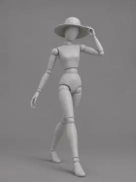

Full size: [photo](../images/photo-poses/boho/sp143-photo.webp) · [white model](../images/photo-poses/boho/sp143-pose.webp) · [try it on Promicat](https://promicat.app/poses/styles/sp143?utm_source=github&utm_medium=readme&utm_campaign=ai-photo-poses)

<details><summary>Prompt with your photo (image 1: your photo, image 2: white model)</summary>

```text
A real professional portrait photoshoot photo: a boho desert-festival photoshoot among sand dunes and dry grass, warm hazy sun, 50mm. Subject: the person in image 1 (keep their exact face, facial features, skin tone and hairstyle; do not beautify or swap the face), wearing a long embroidered maxi dress or a loose linen tunic, layered jewellery, a wide-brim hat. Pose: walking down a sand dune, the long dress trailing, holding the hat. Image 2 is a wooden artist's mannequin that shows only this body pose: copy it exactly (head, torso, arms, hands, legs, feet, which hand does what, the camera angle), but do not copy the mannequin itself: no wooden skin, no joints, no blank face. Natural, relaxed and unstiff, true skin texture. No text, no logo, no watermark. Portrait 3:4.
```

</details>

<details><summary>Prompt for the sample (fictional model)</summary>

```text
A real professional portrait photoshoot photo, the kind posted by a top portrait studio: a boho desert-festival photoshoot among sand dunes and dry grass, warm hazy sun, 50mm. Model: a beautiful Latina professional fashion model in her twenties with a naturally attractive face, styled hair and natural makeup, wearing a long embroidered maxi dress or a loose linen tunic, layered jewellery, a wide-brim hat. The photographer directs the model into a natural, relaxed, unstiff pose that looks caught between moments: walking down a sand dune, the long dress trailing, holding the hat. Asymmetric body, soft hands, flattering angle, true skin texture, refined but not plastic, fully clothed and modest. Full body or three-quarter body in frame, the whole pose clearly readable. No text, no logo, no watermark. Portrait 3:4.
```

</details>

## Leaning on a twisted dry tree (Leaning)

<a href="https://promicat.app/poses/styles/sp144?utm_source=github&utm_medium=readme&utm_campaign=ai-photo-poses">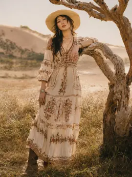</a> 

Full size: [photo](../images/photo-poses/boho/sp144-photo.webp) · [white model](../images/photo-poses/boho/sp144-pose.webp) · [try it on Promicat](https://promicat.app/poses/styles/sp144?utm_source=github&utm_medium=readme&utm_campaign=ai-photo-poses)

<details><summary>Prompt with your photo (image 1: your photo, image 2: white model)</summary>

```text
A real professional portrait photoshoot photo: a boho desert-festival photoshoot among sand dunes and dry grass, warm hazy sun, 50mm. Subject: the person in image 1 (keep their exact face, facial features, skin tone and hairstyle; do not beautify or swap the face), wearing a long embroidered maxi dress or a loose linen tunic, layered jewellery, a wide-brim hat. Pose: leaning on a twisted dry tree, one arm over a branch. Image 2 is a wooden artist's mannequin that shows only this body pose: copy it exactly (head, torso, arms, hands, legs, feet, which hand does what, the camera angle), but do not copy the mannequin itself: no wooden skin, no joints, no blank face. Natural, relaxed and unstiff, true skin texture. No text, no logo, no watermark. Portrait 3:4.
```

</details>

<details><summary>Prompt for the sample (fictional model)</summary>

```text
A real professional portrait photoshoot photo, the kind posted by a top portrait studio: a boho desert-festival photoshoot among sand dunes and dry grass, warm hazy sun, 50mm. Model: a beautiful Korean professional fashion model in her twenties with a naturally attractive face, styled hair and natural makeup, wearing a long embroidered maxi dress or a loose linen tunic, layered jewellery, a wide-brim hat. The photographer directs the model into a natural, relaxed, unstiff pose that looks caught between moments: leaning on a twisted dry tree, one arm over a branch. Asymmetric body, soft hands, flattering angle, true skin texture, refined but not plastic, fully clothed and modest. Full body or three-quarter body in frame, the whole pose clearly readable. No text, no logo, no watermark. Portrait 3:4.
```

</details>

## Spinning so the maxi dress flares (In motion)

<a href="https://promicat.app/poses/styles/sp145?utm_source=github&utm_medium=readme&utm_campaign=ai-photo-poses">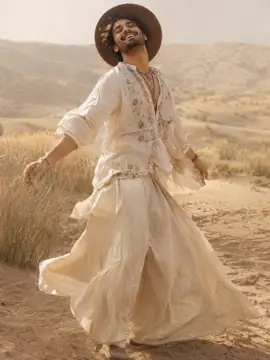</a> 

Full size: [photo](../images/photo-poses/boho/sp145-photo.webp) · [white model](../images/photo-poses/boho/sp145-pose.webp) · [try it on Promicat](https://promicat.app/poses/styles/sp145?utm_source=github&utm_medium=readme&utm_campaign=ai-photo-poses)

<details><summary>Prompt with your photo (image 1: your photo, image 2: white model)</summary>

```text
A real professional portrait photoshoot photo: a boho desert-festival photoshoot among sand dunes and dry grass, warm hazy sun, 50mm. Subject: the person in image 1 (keep their exact face, facial features, skin tone and hairstyle; do not beautify or swap the face), wearing a loose embroidered linen shirt open at the collar, wide linen trousers, layered necklaces and a wide-brim hat. Pose: spinning so the maxi dress flares, head back laughing. Image 2 is a wooden artist's mannequin that shows only this body pose: copy it exactly (head, torso, arms, hands, legs, feet, which hand does what, the camera angle), but do not copy the mannequin itself: no wooden skin, no joints, no blank face. Natural, relaxed and unstiff, true skin texture. No text, no logo, no watermark. Portrait 3:4.
```

</details>

<details><summary>Prompt for the sample (fictional model)</summary>

```text
A real professional portrait photoshoot photo, the kind posted by a top portrait studio: a boho desert-festival photoshoot among sand dunes and dry grass, warm hazy sun, 50mm. Model: a handsome South Asian professional male model in his twenties with a well-groomed look and styled hair, wearing a loose embroidered linen shirt open at the collar, wide linen trousers, layered necklaces and a wide-brim hat. The photographer directs the model into a natural, relaxed, unstiff pose that looks caught between moments: spinning so the maxi dress flares, head back laughing. Asymmetric body, soft hands, flattering angle, true skin texture, refined but not plastic, fully clothed and modest. Full body or three-quarter body in frame, the whole pose clearly readable. No text, no logo, no watermark. Portrait 3:4.
```

</details>

## Walking away (Looking back)

<a href="https://promicat.app/poses/styles/sp146?utm_source=github&utm_medium=readme&utm_campaign=ai-photo-poses">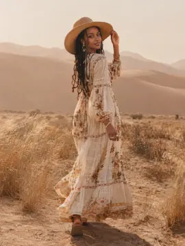</a> 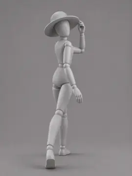

Full size: [photo](../images/photo-poses/boho/sp146-photo.webp) · [white model](../images/photo-poses/boho/sp146-pose.webp) · [try it on Promicat](https://promicat.app/poses/styles/sp146?utm_source=github&utm_medium=readme&utm_campaign=ai-photo-poses)

<details><summary>Prompt with your photo (image 1: your photo, image 2: white model)</summary>

```text
A real professional portrait photoshoot photo: a boho desert-festival photoshoot among sand dunes and dry grass, warm hazy sun, 50mm. Subject: the person in image 1 (keep their exact face, facial features, skin tone and hairstyle; do not beautify or swap the face), wearing a long embroidered maxi dress or a loose linen tunic, layered jewellery, a wide-brim hat. Pose: walking away, turning back while holding the wide hat. Image 2 is a wooden artist's mannequin that shows only this body pose: copy it exactly (head, torso, arms, hands, legs, feet, which hand does what, the camera angle), but do not copy the mannequin itself: no wooden skin, no joints, no blank face. Natural, relaxed and unstiff, true skin texture. No text, no logo, no watermark. Portrait 3:4.
```

</details>

<details><summary>Prompt for the sample (fictional model)</summary>

```text
A real professional portrait photoshoot photo, the kind posted by a top portrait studio: a boho desert-festival photoshoot among sand dunes and dry grass, warm hazy sun, 50mm. Model: a beautiful East African professional fashion model in her twenties with a naturally attractive face, styled hair and natural makeup, wearing a long embroidered maxi dress or a loose linen tunic, layered jewellery, a wide-brim hat. The photographer directs the model into a natural, relaxed, unstiff pose that looks caught between moments: walking away, turning back while holding the wide hat. Asymmetric body, soft hands, flattering angle, true skin texture, refined but not plastic, fully clothed and modest. Full body or three-quarter body in frame, the whole pose clearly readable. No text, no logo, no watermark. Portrait 3:4.
```

</details>

## Kneeling in the sand letting it run through the fingers (Crouching)

<a href="https://promicat.app/poses/styles/sp147?utm_source=github&utm_medium=readme&utm_campaign=ai-photo-poses"></a> 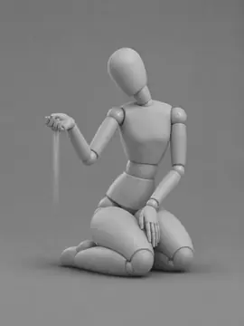

Full size: [photo](../images/photo-poses/boho/sp147-photo.webp) · [white model](../images/photo-poses/boho/sp147-pose.webp) · [try it on Promicat](https://promicat.app/poses/styles/sp147?utm_source=github&utm_medium=readme&utm_campaign=ai-photo-poses)

<details><summary>Prompt with your photo (image 1: your photo, image 2: white model)</summary>

```text
A real professional portrait photoshoot photo: a boho desert-festival photoshoot among sand dunes and dry grass, warm hazy sun, 50mm. Subject: the person in image 1 (keep their exact face, facial features, skin tone and hairstyle; do not beautify or swap the face), wearing a long embroidered maxi dress or a loose linen tunic, layered jewellery, a wide-brim hat. Pose: kneeling in the sand letting it run through the fingers. Image 2 is a wooden artist's mannequin that shows only this body pose: copy it exactly (head, torso, arms, hands, legs, feet, which hand does what, the camera angle), but do not copy the mannequin itself: no wooden skin, no joints, no blank face. Natural, relaxed and unstiff, true skin texture. No text, no logo, no watermark. Portrait 3:4.
```

</details>

<details><summary>Prompt for the sample (fictional model)</summary>

```text
A real professional portrait photoshoot photo, the kind posted by a top portrait studio: a boho desert-festival photoshoot among sand dunes and dry grass, warm hazy sun, 50mm. Model: a beautiful Black professional fashion model in her twenties with a naturally attractive face, styled hair and natural makeup, wearing a long embroidered maxi dress or a loose linen tunic, layered jewellery, a wide-brim hat. The photographer directs the model into a natural, relaxed, unstiff pose that looks caught between moments: kneeling in the sand letting it run through the fingers. Asymmetric body, soft hands, flattering angle, true skin texture, refined but not plastic, fully clothed and modest. Full body or three-quarter body in frame, the whole pose clearly readable. No text, no logo, no watermark. Portrait 3:4.
```

</details>

## Raising the wrist to the face (Upper body)

<a href="https://promicat.app/poses/styles/sp148?utm_source=github&utm_medium=readme&utm_campaign=ai-photo-poses"></a> 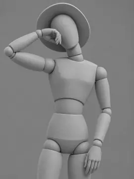

Full size: [photo](../images/photo-poses/boho/sp148-photo.webp) · [white model](../images/photo-poses/boho/sp148-pose.webp) · [try it on Promicat](https://promicat.app/poses/styles/sp148?utm_source=github&utm_medium=readme&utm_campaign=ai-photo-poses)

<details><summary>Prompt with your photo (image 1: your photo, image 2: white model)</summary>

```text
A real professional portrait photoshoot photo: a boho desert-festival photoshoot among sand dunes and dry grass, warm hazy sun, 50mm. Subject: the person in image 1 (keep their exact face, facial features, skin tone and hairstyle; do not beautify or swap the face), wearing a loose embroidered linen shirt open at the collar, wide linen trousers, layered necklaces and a wide-brim hat. Pose: raising the wrist to the face, bracelets sliding, eyes closed. Image 2 is a wooden artist's mannequin that shows only this body pose: copy it exactly (head, torso, arms, hands, legs, feet, which hand does what, the camera angle), but do not copy the mannequin itself: no wooden skin, no joints, no blank face. Natural, relaxed and unstiff, true skin texture. No text, no logo, no watermark. Portrait 3:4.
```

</details>

<details><summary>Prompt for the sample (fictional model)</summary>

```text
A real professional portrait photoshoot photo, the kind posted by a top portrait studio: a boho desert-festival photoshoot among sand dunes and dry grass, warm hazy sun, 50mm. Model: a handsome Scandinavian professional male model in his twenties with a well-groomed look and styled hair, wearing a loose embroidered linen shirt open at the collar, wide linen trousers, layered necklaces and a wide-brim hat. The photographer directs the model into a natural, relaxed, unstiff pose that looks caught between moments: raising the wrist to the face, bracelets sliding, eyes closed. Asymmetric body, soft hands, flattering angle, true skin texture, refined but not plastic, fully clothed and modest. Waist-up framing, both arms and hands readable. No text, no logo, no watermark. Portrait 3:4.
```

</details>

## Leaning in a tent doorway (Leaning)

<a href="https://promicat.app/poses/styles/sp149?utm_source=github&utm_medium=readme&utm_campaign=ai-photo-poses">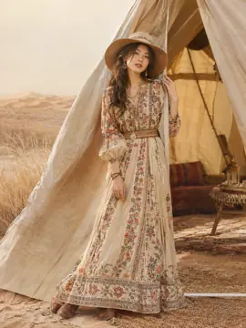</a> 

Full size: [photo](../images/photo-poses/boho/sp149-photo.webp) · [white model](../images/photo-poses/boho/sp149-pose.webp) · [try it on Promicat](https://promicat.app/poses/styles/sp149?utm_source=github&utm_medium=readme&utm_campaign=ai-photo-poses)

<details><summary>Prompt with your photo (image 1: your photo, image 2: white model)</summary>

```text
A real professional portrait photoshoot photo: a boho desert-festival photoshoot among sand dunes and dry grass, warm hazy sun, 50mm. Subject: the person in image 1 (keep their exact face, facial features, skin tone and hairstyle; do not beautify or swap the face), wearing a long embroidered maxi dress or a loose linen tunic, layered jewellery, a wide-brim hat. Pose: leaning in a tent doorway, one hand on the canvas. Image 2 is a wooden artist's mannequin that shows only this body pose: copy it exactly (head, torso, arms, hands, legs, feet, which hand does what, the camera angle), but do not copy the mannequin itself: no wooden skin, no joints, no blank face. Natural, relaxed and unstiff, true skin texture. No text, no logo, no watermark. Portrait 3:4.
```

</details>

<details><summary>Prompt for the sample (fictional model)</summary>

```text
A real professional portrait photoshoot photo, the kind posted by a top portrait studio: a boho desert-festival photoshoot among sand dunes and dry grass, warm hazy sun, 50mm. Model: a beautiful East Asian professional fashion model in her twenties with a naturally attractive face, styled hair and natural makeup, wearing a long embroidered maxi dress or a loose linen tunic, layered jewellery, a wide-brim hat. The photographer directs the model into a natural, relaxed, unstiff pose that looks caught between moments: leaning in a tent doorway, one hand on the canvas. Asymmetric body, soft hands, flattering angle, true skin texture, refined but not plastic, fully clothed and modest. Full body or three-quarter body in frame, the whole pose clearly readable. No text, no logo, no watermark. Portrait 3:4.
```

</details>

## Lying on the back on a rug (Lying)

<a href="https://promicat.app/poses/styles/sp150?utm_source=github&utm_medium=readme&utm_campaign=ai-photo-poses">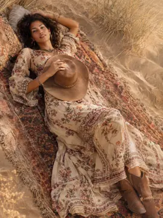</a> 

Full size: [photo](../images/photo-poses/boho/sp150-photo.webp) · [white model](../images/photo-poses/boho/sp150-pose.webp) · [try it on Promicat](https://promicat.app/poses/styles/sp150?utm_source=github&utm_medium=readme&utm_campaign=ai-photo-poses)

<details><summary>Prompt with your photo (image 1: your photo, image 2: white model)</summary>

```text
A real professional portrait photoshoot photo: a boho desert-festival photoshoot among sand dunes and dry grass, warm hazy sun, 50mm. Subject: the person in image 1 (keep their exact face, facial features, skin tone and hairstyle; do not beautify or swap the face), wearing a long embroidered maxi dress or a loose linen tunic, layered jewellery, a wide-brim hat. Pose: lying on the back on a rug, hat over the chest, fully dressed. Image 2 is a wooden artist's mannequin that shows only this body pose: copy it exactly (head, torso, arms, hands, legs, feet, which hand does what, the camera angle), but do not copy the mannequin itself: no wooden skin, no joints, no blank face. Natural, relaxed and unstiff, true skin texture. No text, no logo, no watermark. Portrait 3:4.
```

</details>

<details><summary>Prompt for the sample (fictional model)</summary>

```text
A real professional portrait photoshoot photo, the kind posted by a top portrait studio: a boho desert-festival photoshoot among sand dunes and dry grass, warm hazy sun, 50mm. Model: a beautiful mixed-race professional fashion model in her twenties with a naturally attractive face, styled hair and natural makeup, wearing a long embroidered maxi dress or a loose linen tunic, layered jewellery, a wide-brim hat. The photographer directs the model into a natural, relaxed, unstiff pose that looks caught between moments: lying on the back on a rug, hat over the chest, fully dressed. Asymmetric body, soft hands, flattering angle, true skin texture, refined but not plastic, fully clothed and modest. Full body or three-quarter body in frame, the whole pose clearly readable. No text, no logo, no watermark. Portrait 3:4.
```

</details>
