# Cafe & bookshop

English · [简体中文](cafe.zh-CN.md)

10 white models, each with 4 portraits shot from it in different styles. Attach your photo first and the white model second. Try them with your own photo on [Promicat](https://promicat.app/poses?utm_source=github&utm_medium=readme&utm_campaign=ai-photo-poses).

[← Back to all styles](../README.md#photo-poses)

## Sitting sideways at a window table (Sitting)

| White model | Cafe & bookshop | Dark academia | Street fashion | Y2K flash |
|---|---|---|---|---|
| 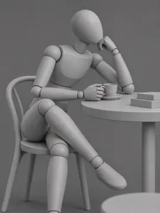 | <a href="https://promicat.app/poses/styles/sp011?utm_source=github&utm_medium=readme&utm_campaign=ai-photo-poses">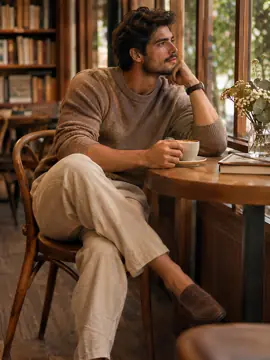</a> | <a href="https://promicat.app/poses/styles/sp011?utm_source=github&utm_medium=readme&utm_campaign=ai-photo-poses">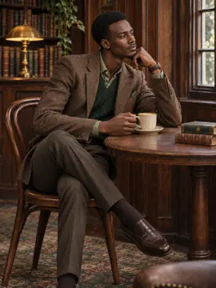</a> | <a href="https://promicat.app/poses/styles/sp011?utm_source=github&utm_medium=readme&utm_campaign=ai-photo-poses">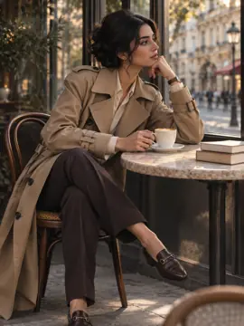</a> | <a href="https://promicat.app/poses/styles/sp011?utm_source=github&utm_medium=readme&utm_campaign=ai-photo-poses">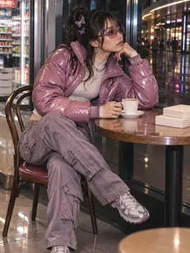</a> |

Full size: [photo](../images/photo-poses/cafe/sp011-photo.webp) · [white model](../images/photo-poses/cafe/sp011-pose.webp) · [try it on Promicat](https://promicat.app/poses/styles/sp011?utm_source=github&utm_medium=readme&utm_campaign=ai-photo-poses)

<details><summary>Prompt with your photo (image 1: your photo, image 2: white model)</summary>

```text
A real professional portrait photoshoot photo: a cafe and bookshop lifestyle photoshoot, warm window light, wooden interior, 50mm f/1.4, soft creamy background. Subject: the person in image 1 (keep their exact face, facial features, skin tone and hairstyle; do not beautify or swap the face), wearing a soft knit or linen outfit in warm neutral tones. Pose: sitting sideways at a window table, chin resting on one hand, the other around a coffee cup, gazing outside. Image 2 is a wooden artist's mannequin that shows only this body pose: copy it exactly (head, torso, arms, hands, legs, feet, which hand does what, the camera angle), but do not copy the mannequin itself: no wooden skin, no joints, no blank face. Natural, relaxed and unstiff, true skin texture. No text, no logo, no watermark. Portrait 3:4.
```

</details>

<details><summary>Prompt for the sample (fictional model)</summary>

```text
A real professional portrait photoshoot photo, the kind posted by a top portrait studio: a cafe and bookshop lifestyle photoshoot, warm window light, wooden interior, 50mm f/1.4, soft creamy background. Model: a handsome Brazilian professional male model in his twenties with a well-groomed look and styled hair, wearing a soft knit or linen outfit in warm neutral tones. The photographer directs the model into a natural, relaxed, unstiff pose that looks caught between moments: sitting sideways at a window table, chin resting on one hand, the other around a coffee cup, gazing outside. Asymmetric body, soft hands, flattering angle, true skin texture, refined but not plastic, fully clothed and modest. Full body or three-quarter body in frame, the whole pose clearly readable. No text, no logo, no watermark. Portrait 3:4.
```

</details>

## Standing at a bookshelf pulling a book halfway out (Standing)

| White model | Cafe & bookshop | New Chinese style | Japanese fresh film | Western cowboy |
|---|---|---|---|---|
| 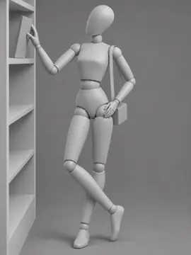 | <a href="https://promicat.app/poses/styles/sp012?utm_source=github&utm_medium=readme&utm_campaign=ai-photo-poses">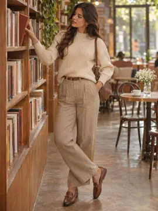</a> | <a href="https://promicat.app/poses/styles/sp012?utm_source=github&utm_medium=readme&utm_campaign=ai-photo-poses">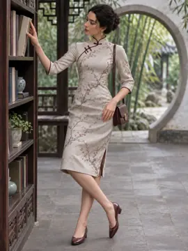</a> | <a href="https://promicat.app/poses/styles/sp012?utm_source=github&utm_medium=readme&utm_campaign=ai-photo-poses">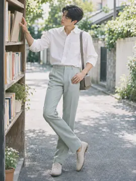</a> | <a href="https://promicat.app/poses/styles/sp012?utm_source=github&utm_medium=readme&utm_campaign=ai-photo-poses">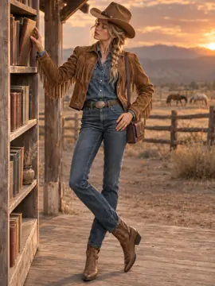</a> |

Full size: [photo](../images/photo-poses/cafe/sp012-photo.webp) · [white model](../images/photo-poses/cafe/sp012-pose.webp) · [try it on Promicat](https://promicat.app/poses/styles/sp012?utm_source=github&utm_medium=readme&utm_campaign=ai-photo-poses)

<details><summary>Prompt with your photo (image 1: your photo, image 2: white model)</summary>

```text
A real professional portrait photoshoot photo: a cafe and bookshop lifestyle photoshoot, warm window light, wooden interior, 50mm f/1.4, soft creamy background. Subject: the person in image 1 (keep their exact face, facial features, skin tone and hairstyle; do not beautify or swap the face), wearing a soft knit or linen outfit in warm neutral tones. Pose: standing at a bookshelf pulling a book halfway out, reading its spine, one foot crossed behind. Image 2 is a wooden artist's mannequin that shows only this body pose: copy it exactly (head, torso, arms, hands, legs, feet, which hand does what, the camera angle), but do not copy the mannequin itself: no wooden skin, no joints, no blank face. Natural, relaxed and unstiff, true skin texture. No text, no logo, no watermark. Portrait 3:4.
```

</details>

<details><summary>Prompt for the sample (fictional model)</summary>

```text
A real professional portrait photoshoot photo, the kind posted by a top portrait studio: a cafe and bookshop lifestyle photoshoot, warm window light, wooden interior, 50mm f/1.4, soft creamy background. Model: a beautiful Latina professional fashion model in her twenties with a naturally attractive face, styled hair and natural makeup, wearing a soft knit or linen outfit in warm neutral tones. The photographer directs the model into a natural, relaxed, unstiff pose that looks caught between moments: standing at a bookshelf pulling a book halfway out, reading its spine, one foot crossed behind. Asymmetric body, soft hands, flattering angle, true skin texture, refined but not plastic, fully clothed and modest. Full body or three-quarter body in frame, the whole pose clearly readable. No text, no logo, no watermark. Portrait 3:4.
```

</details>

## Holding a mug with both hands close to the lips (Upper body)

| White model | Cafe & bookshop | Campus youth | Forest & flower field | Nordic minimal |
|---|---|---|---|---|
| 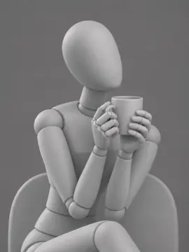 | <a href="https://promicat.app/poses/styles/sp013?utm_source=github&utm_medium=readme&utm_campaign=ai-photo-poses"></a> | <a href="https://promicat.app/poses/styles/sp013?utm_source=github&utm_medium=readme&utm_campaign=ai-photo-poses">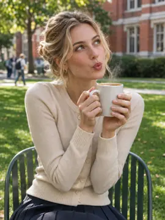</a> | <a href="https://promicat.app/poses/styles/sp013?utm_source=github&utm_medium=readme&utm_campaign=ai-photo-poses"></a> | <a href="https://promicat.app/poses/styles/sp013?utm_source=github&utm_medium=readme&utm_campaign=ai-photo-poses">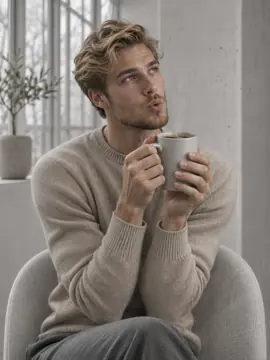</a> |

Full size: [photo](../images/photo-poses/cafe/sp013-photo.webp) · [white model](../images/photo-poses/cafe/sp013-pose.webp) · [try it on Promicat](https://promicat.app/poses/styles/sp013?utm_source=github&utm_medium=readme&utm_campaign=ai-photo-poses)

<details><summary>Prompt with your photo (image 1: your photo, image 2: white model)</summary>

```text
A real professional portrait photoshoot photo: a cafe and bookshop lifestyle photoshoot, warm window light, wooden interior, 50mm f/1.4, soft creamy background. Subject: the person in image 1 (keep their exact face, facial features, skin tone and hairstyle; do not beautify or swap the face), wearing a soft knit or linen outfit in warm neutral tones. Pose: holding a mug with both hands close to the lips, blowing on the coffee, eyes looking up. Image 2 is a wooden artist's mannequin that shows only this body pose: copy it exactly (head, torso, arms, hands, legs, feet, which hand does what, the camera angle), but do not copy the mannequin itself: no wooden skin, no joints, no blank face. Natural, relaxed and unstiff, true skin texture. No text, no logo, no watermark. Portrait 3:4.
```

</details>

<details><summary>Prompt for the sample (fictional model)</summary>

```text
A real professional portrait photoshoot photo, the kind posted by a top portrait studio: a cafe and bookshop lifestyle photoshoot, warm window light, wooden interior, 50mm f/1.4, soft creamy background. Model: a beautiful Korean professional fashion model in her twenties with a naturally attractive face, styled hair and natural makeup, wearing a soft knit or linen outfit in warm neutral tones. The photographer directs the model into a natural, relaxed, unstiff pose that looks caught between moments: holding a mug with both hands close to the lips, blowing on the coffee, eyes looking up. Asymmetric body, soft hands, flattering angle, true skin texture, refined but not plastic, fully clothed and modest. Waist-up framing, both arms and hands readable. No text, no logo, no watermark. Portrait 3:4.
```

</details>

## Sitting in an armchair with legs crossed (Sitting)

| White model | Cafe & bookshop | Gothic | Street fashion | Y2K flash |
|---|---|---|---|---|
| 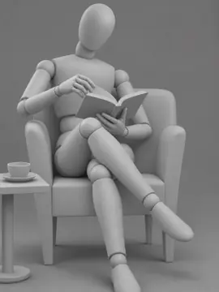 | <a href="https://promicat.app/poses/styles/sp014?utm_source=github&utm_medium=readme&utm_campaign=ai-photo-poses">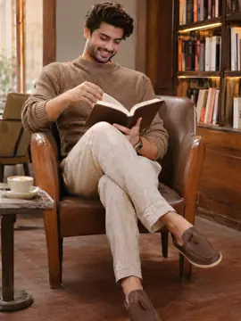</a> | <a href="https://promicat.app/poses/styles/sp014?utm_source=github&utm_medium=readme&utm_campaign=ai-photo-poses">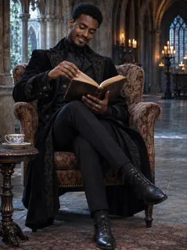</a> | <a href="https://promicat.app/poses/styles/sp014?utm_source=github&utm_medium=readme&utm_campaign=ai-photo-poses">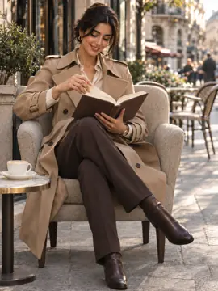</a> | <a href="https://promicat.app/poses/styles/sp014?utm_source=github&utm_medium=readme&utm_campaign=ai-photo-poses">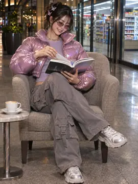</a> |

Full size: [photo](../images/photo-poses/cafe/sp014-photo.webp) · [white model](../images/photo-poses/cafe/sp014-pose.webp) · [try it on Promicat](https://promicat.app/poses/styles/sp014?utm_source=github&utm_medium=readme&utm_campaign=ai-photo-poses)

<details><summary>Prompt with your photo (image 1: your photo, image 2: white model)</summary>

```text
A real professional portrait photoshoot photo: a cafe and bookshop lifestyle photoshoot, warm window light, wooden interior, 50mm f/1.4, soft creamy background. Subject: the person in image 1 (keep their exact face, facial features, skin tone and hairstyle; do not beautify or swap the face), wearing a soft knit or linen outfit in warm neutral tones. Pose: sitting in an armchair with legs crossed, flipping a page and smiling at it. Image 2 is a wooden artist's mannequin that shows only this body pose: copy it exactly (head, torso, arms, hands, legs, feet, which hand does what, the camera angle), but do not copy the mannequin itself: no wooden skin, no joints, no blank face. Natural, relaxed and unstiff, true skin texture. No text, no logo, no watermark. Portrait 3:4.
```

</details>

<details><summary>Prompt for the sample (fictional model)</summary>

```text
A real professional portrait photoshoot photo, the kind posted by a top portrait studio: a cafe and bookshop lifestyle photoshoot, warm window light, wooden interior, 50mm f/1.4, soft creamy background. Model: a handsome South Asian professional male model in his twenties with a well-groomed look and styled hair, wearing a soft knit or linen outfit in warm neutral tones. The photographer directs the model into a natural, relaxed, unstiff pose that looks caught between moments: sitting in an armchair with legs crossed, flipping a page and smiling at it. Asymmetric body, soft hands, flattering angle, true skin texture, refined but not plastic, fully clothed and modest. Full body or three-quarter body in frame, the whole pose clearly readable. No text, no logo, no watermark. Portrait 3:4.
```

</details>

## Leaning forward on the table with the cheek on stacked arms (Sitting)

| White model | Cafe & bookshop | Street punk | Street fashion | Western cowboy |
|---|---|---|---|---|
| 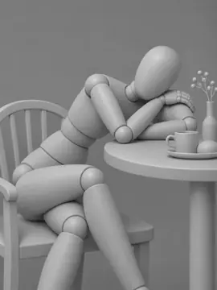 | <a href="https://promicat.app/poses/styles/sp015?utm_source=github&utm_medium=readme&utm_campaign=ai-photo-poses">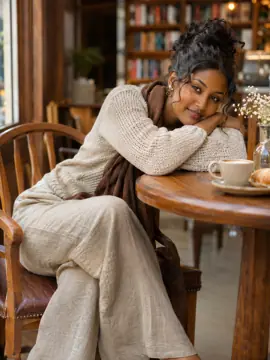</a> | <a href="https://promicat.app/poses/styles/sp015?utm_source=github&utm_medium=readme&utm_campaign=ai-photo-poses">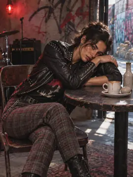</a> | <a href="https://promicat.app/poses/styles/sp015?utm_source=github&utm_medium=readme&utm_campaign=ai-photo-poses">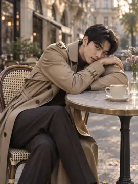</a> | <a href="https://promicat.app/poses/styles/sp015?utm_source=github&utm_medium=readme&utm_campaign=ai-photo-poses">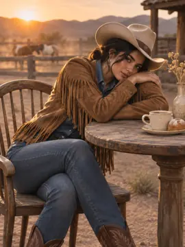</a> |

Full size: [photo](../images/photo-poses/cafe/sp015-photo.webp) · [white model](../images/photo-poses/cafe/sp015-pose.webp) · [try it on Promicat](https://promicat.app/poses/styles/sp015?utm_source=github&utm_medium=readme&utm_campaign=ai-photo-poses)

<details><summary>Prompt with your photo (image 1: your photo, image 2: white model)</summary>

```text
A real professional portrait photoshoot photo: a cafe and bookshop lifestyle photoshoot, warm window light, wooden interior, 50mm f/1.4, soft creamy background. Subject: the person in image 1 (keep their exact face, facial features, skin tone and hairstyle; do not beautify or swap the face), wearing a soft knit or linen outfit in warm neutral tones. Pose: leaning forward on the table with the cheek on stacked arms, looking sideways at the camera. Image 2 is a wooden artist's mannequin that shows only this body pose: copy it exactly (head, torso, arms, hands, legs, feet, which hand does what, the camera angle), but do not copy the mannequin itself: no wooden skin, no joints, no blank face. Natural, relaxed and unstiff, true skin texture. No text, no logo, no watermark. Portrait 3:4.
```

</details>

<details><summary>Prompt for the sample (fictional model)</summary>

```text
A real professional portrait photoshoot photo, the kind posted by a top portrait studio: a cafe and bookshop lifestyle photoshoot, warm window light, wooden interior, 50mm f/1.4, soft creamy background. Model: a beautiful East African professional fashion model in her twenties with a naturally attractive face, styled hair and natural makeup, wearing a soft knit or linen outfit in warm neutral tones. The photographer directs the model into a natural, relaxed, unstiff pose that looks caught between moments: leaning forward on the table with the cheek on stacked arms, looking sideways at the camera. Asymmetric body, soft hands, flattering angle, true skin texture, refined but not plastic, fully clothed and modest. Full body or three-quarter body in frame, the whole pose clearly readable. No text, no logo, no watermark. Portrait 3:4.
```

</details>

## Leaning on the counter with one elbow (Leaning)

| White model | Cafe & bookshop | New Chinese style | Dark academia | Japanese fresh film |
|---|---|---|---|---|
| 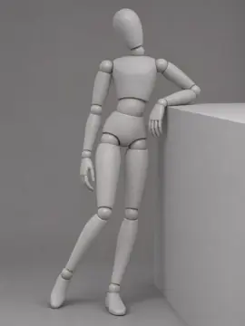 | <a href="https://promicat.app/poses/styles/sp016?utm_source=github&utm_medium=readme&utm_campaign=ai-photo-poses">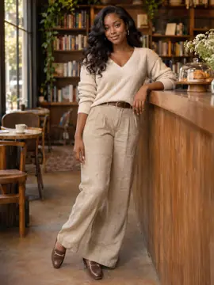</a> | <a href="https://promicat.app/poses/styles/sp016?utm_source=github&utm_medium=readme&utm_campaign=ai-photo-poses">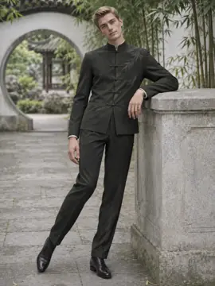</a> | <a href="https://promicat.app/poses/styles/sp016?utm_source=github&utm_medium=readme&utm_campaign=ai-photo-poses">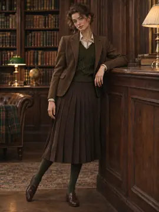</a> | <a href="https://promicat.app/poses/styles/sp016?utm_source=github&utm_medium=readme&utm_campaign=ai-photo-poses">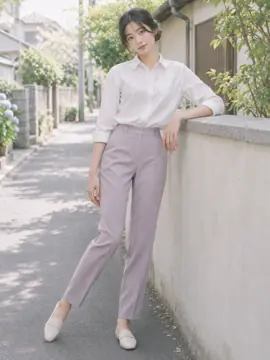</a> |

Full size: [photo](../images/photo-poses/cafe/sp016-photo.webp) · [white model](../images/photo-poses/cafe/sp016-pose.webp) · [try it on Promicat](https://promicat.app/poses/styles/sp016?utm_source=github&utm_medium=readme&utm_campaign=ai-photo-poses)

<details><summary>Prompt with your photo (image 1: your photo, image 2: white model)</summary>

```text
A real professional portrait photoshoot photo: a cafe and bookshop lifestyle photoshoot, warm window light, wooden interior, 50mm f/1.4, soft creamy background. Subject: the person in image 1 (keep their exact face, facial features, skin tone and hairstyle; do not beautify or swap the face), wearing a soft knit or linen outfit in warm neutral tones. Pose: leaning on the counter with one elbow, weight on one leg, turning to the camera. Image 2 is a wooden artist's mannequin that shows only this body pose: copy it exactly (head, torso, arms, hands, legs, feet, which hand does what, the camera angle), but do not copy the mannequin itself: no wooden skin, no joints, no blank face. Natural, relaxed and unstiff, true skin texture. No text, no logo, no watermark. Portrait 3:4.
```

</details>

<details><summary>Prompt for the sample (fictional model)</summary>

```text
A real professional portrait photoshoot photo, the kind posted by a top portrait studio: a cafe and bookshop lifestyle photoshoot, warm window light, wooden interior, 50mm f/1.4, soft creamy background. Model: a beautiful Black professional fashion model in her twenties with a naturally attractive face, styled hair and natural makeup, wearing a soft knit or linen outfit in warm neutral tones. The photographer directs the model into a natural, relaxed, unstiff pose that looks caught between moments: leaning on the counter with one elbow, weight on one leg, turning to the camera. Asymmetric body, soft hands, flattering angle, true skin texture, refined but not plastic, fully clothed and modest. Full body or three-quarter body in frame, the whole pose clearly readable. No text, no logo, no watermark. Portrait 3:4.
```

</details>

## Writing in a notebook (Sitting)

| White model | Cafe & bookshop | Cyberpunk neon | 1950s Hollywood | Cosy at home |
|---|---|---|---|---|
| 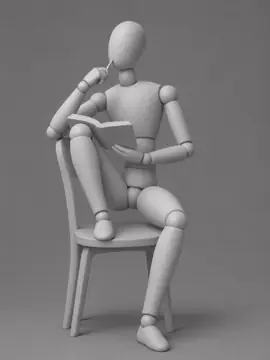 | <a href="https://promicat.app/poses/styles/sp017?utm_source=github&utm_medium=readme&utm_campaign=ai-photo-poses">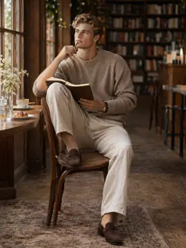</a> | <a href="https://promicat.app/poses/styles/sp017?utm_source=github&utm_medium=readme&utm_campaign=ai-photo-poses">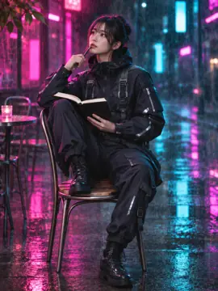</a> | <a href="https://promicat.app/poses/styles/sp017?utm_source=github&utm_medium=readme&utm_campaign=ai-photo-poses">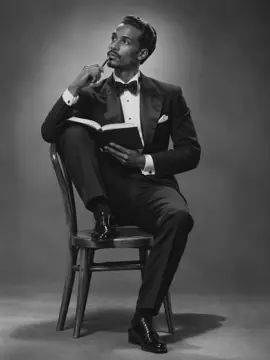</a> | <a href="https://promicat.app/poses/styles/sp017?utm_source=github&utm_medium=readme&utm_campaign=ai-photo-poses">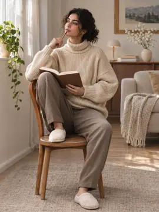</a> |

Full size: [photo](../images/photo-poses/cafe/sp017-photo.webp) · [white model](../images/photo-poses/cafe/sp017-pose.webp) · [try it on Promicat](https://promicat.app/poses/styles/sp017?utm_source=github&utm_medium=readme&utm_campaign=ai-photo-poses)

<details><summary>Prompt with your photo (image 1: your photo, image 2: white model)</summary>

```text
A real professional portrait photoshoot photo: a cafe and bookshop lifestyle photoshoot, warm window light, wooden interior, 50mm f/1.4, soft creamy background. Subject: the person in image 1 (keep their exact face, facial features, skin tone and hairstyle; do not beautify or swap the face), wearing a soft knit or linen outfit in warm neutral tones. Pose: writing in a notebook, pencil at the lips, thinking, one knee up on the chair. Image 2 is a wooden artist's mannequin that shows only this body pose: copy it exactly (head, torso, arms, hands, legs, feet, which hand does what, the camera angle), but do not copy the mannequin itself: no wooden skin, no joints, no blank face. Natural, relaxed and unstiff, true skin texture. No text, no logo, no watermark. Portrait 3:4.
```

</details>

<details><summary>Prompt for the sample (fictional model)</summary>

```text
A real professional portrait photoshoot photo, the kind posted by a top portrait studio: a cafe and bookshop lifestyle photoshoot, warm window light, wooden interior, 50mm f/1.4, soft creamy background. Model: a handsome Scandinavian professional male model in his twenties with a well-groomed look and styled hair, wearing a soft knit or linen outfit in warm neutral tones. The photographer directs the model into a natural, relaxed, unstiff pose that looks caught between moments: writing in a notebook, pencil at the lips, thinking, one knee up on the chair. Asymmetric body, soft hands, flattering angle, true skin texture, refined but not plastic, fully clothed and modest. Full body or three-quarter body in frame, the whole pose clearly readable. No text, no logo, no watermark. Portrait 3:4.
```

</details>

## Stepping out of the cafe door (Looking back)

| White model | Cafe & bookshop | Forest & flower field | Moody studio | Old money |
|---|---|---|---|---|
| 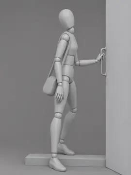 | <a href="https://promicat.app/poses/styles/sp018?utm_source=github&utm_medium=readme&utm_campaign=ai-photo-poses">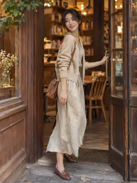</a> | <a href="https://promicat.app/poses/styles/sp018?utm_source=github&utm_medium=readme&utm_campaign=ai-photo-poses">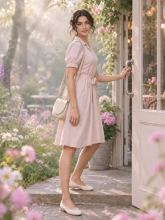</a> | <a href="https://promicat.app/poses/styles/sp018?utm_source=github&utm_medium=readme&utm_campaign=ai-photo-poses">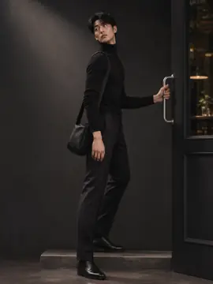</a> | <a href="https://promicat.app/poses/styles/sp018?utm_source=github&utm_medium=readme&utm_campaign=ai-photo-poses">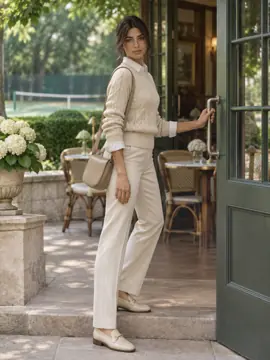</a> |

Full size: [photo](../images/photo-poses/cafe/sp018-photo.webp) · [white model](../images/photo-poses/cafe/sp018-pose.webp) · [try it on Promicat](https://promicat.app/poses/styles/sp018?utm_source=github&utm_medium=readme&utm_campaign=ai-photo-poses)

<details><summary>Prompt with your photo (image 1: your photo, image 2: white model)</summary>

```text
A real professional portrait photoshoot photo: a cafe and bookshop lifestyle photoshoot, warm window light, wooden interior, 50mm f/1.4, soft creamy background. Subject: the person in image 1 (keep their exact face, facial features, skin tone and hairstyle; do not beautify or swap the face), wearing a soft knit or linen outfit in warm neutral tones. Pose: stepping out of the cafe door, holding it with one hand, looking back inside. Image 2 is a wooden artist's mannequin that shows only this body pose: copy it exactly (head, torso, arms, hands, legs, feet, which hand does what, the camera angle), but do not copy the mannequin itself: no wooden skin, no joints, no blank face. Natural, relaxed and unstiff, true skin texture. No text, no logo, no watermark. Portrait 3:4.
```

</details>

<details><summary>Prompt for the sample (fictional model)</summary>

```text
A real professional portrait photoshoot photo, the kind posted by a top portrait studio: a cafe and bookshop lifestyle photoshoot, warm window light, wooden interior, 50mm f/1.4, soft creamy background. Model: a beautiful East Asian professional fashion model in her twenties with a naturally attractive face, styled hair and natural makeup, wearing a soft knit or linen outfit in warm neutral tones. The photographer directs the model into a natural, relaxed, unstiff pose that looks caught between moments: stepping out of the cafe door, holding it with one hand, looking back inside. Asymmetric body, soft hands, flattering angle, true skin texture, refined but not plastic, fully clothed and modest. Full body or three-quarter body in frame, the whole pose clearly readable. No text, no logo, no watermark. Portrait 3:4.
```

</details>

## Sitting on the floor between bookshelves (Sitting)

| White model | Cafe & bookshop | Seaside holiday | Campus youth | HK retro neon |
|---|---|---|---|---|
| 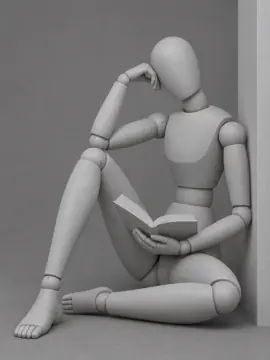 | <a href="https://promicat.app/poses/styles/sp019?utm_source=github&utm_medium=readme&utm_campaign=ai-photo-poses">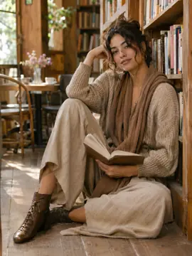</a> | <a href="https://promicat.app/poses/styles/sp019?utm_source=github&utm_medium=readme&utm_campaign=ai-photo-poses"></a> | <a href="https://promicat.app/poses/styles/sp019?utm_source=github&utm_medium=readme&utm_campaign=ai-photo-poses"></a> | <a href="https://promicat.app/poses/styles/sp019?utm_source=github&utm_medium=readme&utm_campaign=ai-photo-poses">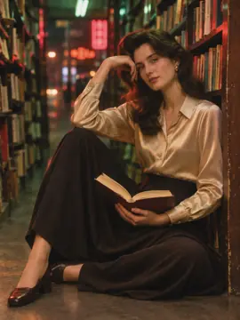</a> |

Full size: [photo](../images/photo-poses/cafe/sp019-photo.webp) · [white model](../images/photo-poses/cafe/sp019-pose.webp) · [try it on Promicat](https://promicat.app/poses/styles/sp019?utm_source=github&utm_medium=readme&utm_campaign=ai-photo-poses)

<details><summary>Prompt with your photo (image 1: your photo, image 2: white model)</summary>

```text
A real professional portrait photoshoot photo: a cafe and bookshop lifestyle photoshoot, warm window light, wooden interior, 50mm f/1.4, soft creamy background. Subject: the person in image 1 (keep their exact face, facial features, skin tone and hairstyle; do not beautify or swap the face), wearing a soft knit or linen outfit in warm neutral tones. Pose: sitting on the floor between bookshelves, back against the shelf, a book open on the knee. Image 2 is a wooden artist's mannequin that shows only this body pose: copy it exactly (head, torso, arms, hands, legs, feet, which hand does what, the camera angle), but do not copy the mannequin itself: no wooden skin, no joints, no blank face. Natural, relaxed and unstiff, true skin texture. No text, no logo, no watermark. Portrait 3:4.
```

</details>

<details><summary>Prompt for the sample (fictional model)</summary>

```text
A real professional portrait photoshoot photo, the kind posted by a top portrait studio: a cafe and bookshop lifestyle photoshoot, warm window light, wooden interior, 50mm f/1.4, soft creamy background. Model: a beautiful mixed-race professional fashion model in her twenties with a naturally attractive face, styled hair and natural makeup, wearing a soft knit or linen outfit in warm neutral tones. The photographer directs the model into a natural, relaxed, unstiff pose that looks caught between moments: sitting on the floor between bookshelves, back against the shelf, a book open on the knee. Asymmetric body, soft hands, flattering angle, true skin texture, refined but not plastic, fully clothed and modest. Full body or three-quarter body in frame, the whole pose clearly readable. No text, no logo, no watermark. Portrait 3:4.
```

</details>

## Walking between tables carrying two cups (Walking)

| White model | Cafe & bookshop | Boho desert | Dark academia | Nordic minimal |
|---|---|---|---|---|
| 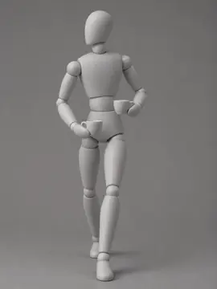 | <a href="https://promicat.app/poses/styles/sp020?utm_source=github&utm_medium=readme&utm_campaign=ai-photo-poses">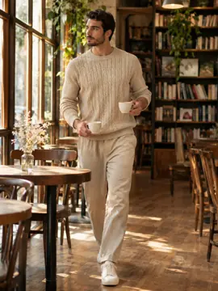</a> | <a href="https://promicat.app/poses/styles/sp020?utm_source=github&utm_medium=readme&utm_campaign=ai-photo-poses">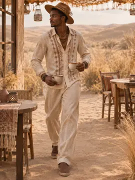</a> | <a href="https://promicat.app/poses/styles/sp020?utm_source=github&utm_medium=readme&utm_campaign=ai-photo-poses">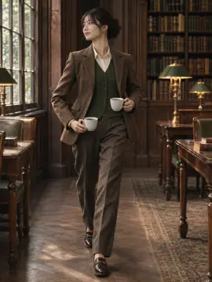</a> | <a href="https://promicat.app/poses/styles/sp020?utm_source=github&utm_medium=readme&utm_campaign=ai-photo-poses">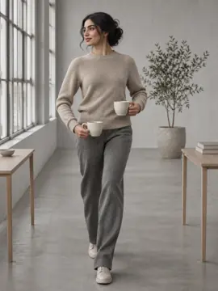</a> |

Full size: [photo](../images/photo-poses/cafe/sp020-photo.webp) · [white model](../images/photo-poses/cafe/sp020-pose.webp) · [try it on Promicat](https://promicat.app/poses/styles/sp020?utm_source=github&utm_medium=readme&utm_campaign=ai-photo-poses)

<details><summary>Prompt with your photo (image 1: your photo, image 2: white model)</summary>

```text
A real professional portrait photoshoot photo: a cafe and bookshop lifestyle photoshoot, warm window light, wooden interior, 50mm f/1.4, soft creamy background. Subject: the person in image 1 (keep their exact face, facial features, skin tone and hairstyle; do not beautify or swap the face), wearing a soft knit or linen outfit in warm neutral tones. Pose: walking between tables carrying two cups, glancing toward the window. Image 2 is a wooden artist's mannequin that shows only this body pose: copy it exactly (head, torso, arms, hands, legs, feet, which hand does what, the camera angle), but do not copy the mannequin itself: no wooden skin, no joints, no blank face. Natural, relaxed and unstiff, true skin texture. No text, no logo, no watermark. Portrait 3:4.
```

</details>

<details><summary>Prompt for the sample (fictional model)</summary>

```text
A real professional portrait photoshoot photo, the kind posted by a top portrait studio: a cafe and bookshop lifestyle photoshoot, warm window light, wooden interior, 50mm f/1.4, soft creamy background. Model: a handsome Mediterranean professional male model in his twenties with a well-groomed look and styled hair, wearing a soft knit or linen outfit in warm neutral tones. The photographer directs the model into a natural, relaxed, unstiff pose that looks caught between moments: walking between tables carrying two cups, glancing toward the window. Asymmetric body, soft hands, flattering angle, true skin texture, refined but not plastic, fully clothed and modest. Full body or three-quarter body in frame, the whole pose clearly readable. No text, no logo, no watermark. Portrait 3:4.
```

</details>
