# 咖啡馆文艺

[English](cafe.md) · 简体中文

10 个白模，每个配 4 张用它拍出的不同风格写真。参考图顺序是你的照片在前、白模在后。也可以在 [Promicat](https://promicat.app/zh/poses?utm_source=github&utm_medium=readme&utm_campaign=ai-photo-poses) 上传照片直接生成。

[← 返回全部风格](../README.zh-CN.md#photo-poses)

## 托腮望窗 (坐)

| 白模 | 咖啡馆文艺 | 学院风 | 街拍时尚 | Y2K 千禧辣妹 |
|---|---|---|---|---|
| 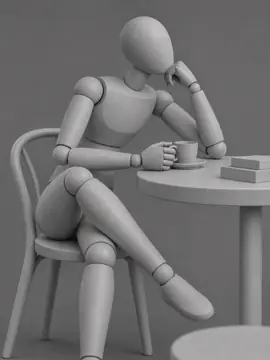 | <a href="https://promicat.app/zh/poses/styles/sp011?utm_source=github&utm_medium=readme&utm_campaign=ai-photo-poses">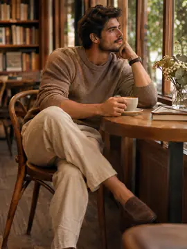</a> | <a href="https://promicat.app/zh/poses/styles/sp011?utm_source=github&utm_medium=readme&utm_campaign=ai-photo-poses">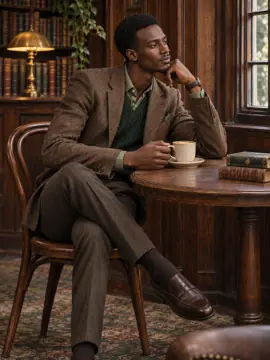</a> | <a href="https://promicat.app/zh/poses/styles/sp011?utm_source=github&utm_medium=readme&utm_campaign=ai-photo-poses">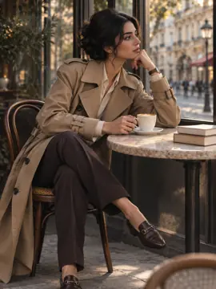</a> | <a href="https://promicat.app/zh/poses/styles/sp011?utm_source=github&utm_medium=readme&utm_campaign=ai-photo-poses">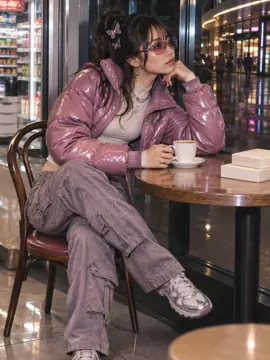</a> |

大图: [写真照](../images/photo-poses/cafe/sp011-photo.webp) · [白模](../images/photo-poses/cafe/sp011-pose.webp) · [在 Promicat 生成](https://promicat.app/zh/poses/styles/sp011?utm_source=github&utm_medium=readme&utm_campaign=ai-photo-poses)

<details><summary>提示词：用你的照片（图 1 你的照片，图 2 白模）</summary>

```text
A real professional portrait photoshoot photo: a cafe and bookshop lifestyle photoshoot, warm window light, wooden interior, 50mm f/1.4, soft creamy background. Subject: the person in image 1 (keep their exact face, facial features, skin tone and hairstyle; do not beautify or swap the face), wearing a soft knit or linen outfit in warm neutral tones. Pose: sitting sideways at a window table, chin resting on one hand, the other around a coffee cup, gazing outside. Image 2 is a wooden artist's mannequin that shows only this body pose: copy it exactly (head, torso, arms, hands, legs, feet, which hand does what, the camera angle), but do not copy the mannequin itself: no wooden skin, no joints, no blank face. Natural, relaxed and unstiff, true skin texture. No text, no logo, no watermark. Portrait 3:4.
```

</details>

<details><summary>提示词：生成示例图（虚构模特）</summary>

```text
A real professional portrait photoshoot photo, the kind posted by a top portrait studio: a cafe and bookshop lifestyle photoshoot, warm window light, wooden interior, 50mm f/1.4, soft creamy background. Model: a handsome Brazilian professional male model in his twenties with a well-groomed look and styled hair, wearing a soft knit or linen outfit in warm neutral tones. The photographer directs the model into a natural, relaxed, unstiff pose that looks caught between moments: sitting sideways at a window table, chin resting on one hand, the other around a coffee cup, gazing outside. Asymmetric body, soft hands, flattering angle, true skin texture, refined but not plastic, fully clothed and modest. Full body or three-quarter body in frame, the whole pose clearly readable. No text, no logo, no watermark. Portrait 3:4.
```

</details>

## 书架抽书 (站)

| 白模 | 咖啡馆文艺 | 新中式 | 日系清新 | 西部牛仔 |
|---|---|---|---|---|
| 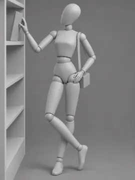 | <a href="https://promicat.app/zh/poses/styles/sp012?utm_source=github&utm_medium=readme&utm_campaign=ai-photo-poses">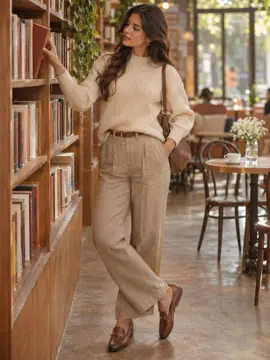</a> | <a href="https://promicat.app/zh/poses/styles/sp012?utm_source=github&utm_medium=readme&utm_campaign=ai-photo-poses">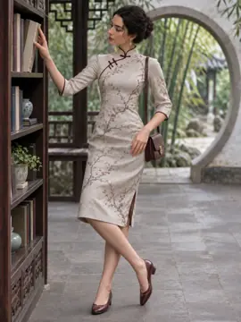</a> | <a href="https://promicat.app/zh/poses/styles/sp012?utm_source=github&utm_medium=readme&utm_campaign=ai-photo-poses">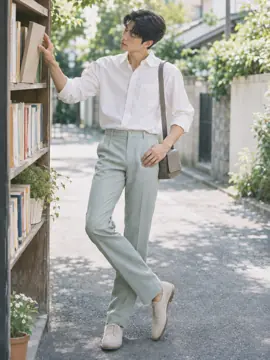</a> | <a href="https://promicat.app/zh/poses/styles/sp012?utm_source=github&utm_medium=readme&utm_campaign=ai-photo-poses">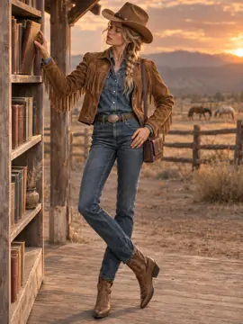</a> |

大图: [写真照](../images/photo-poses/cafe/sp012-photo.webp) · [白模](../images/photo-poses/cafe/sp012-pose.webp) · [在 Promicat 生成](https://promicat.app/zh/poses/styles/sp012?utm_source=github&utm_medium=readme&utm_campaign=ai-photo-poses)

<details><summary>提示词：用你的照片（图 1 你的照片，图 2 白模）</summary>

```text
A real professional portrait photoshoot photo: a cafe and bookshop lifestyle photoshoot, warm window light, wooden interior, 50mm f/1.4, soft creamy background. Subject: the person in image 1 (keep their exact face, facial features, skin tone and hairstyle; do not beautify or swap the face), wearing a soft knit or linen outfit in warm neutral tones. Pose: standing at a bookshelf pulling a book halfway out, reading its spine, one foot crossed behind. Image 2 is a wooden artist's mannequin that shows only this body pose: copy it exactly (head, torso, arms, hands, legs, feet, which hand does what, the camera angle), but do not copy the mannequin itself: no wooden skin, no joints, no blank face. Natural, relaxed and unstiff, true skin texture. No text, no logo, no watermark. Portrait 3:4.
```

</details>

<details><summary>提示词：生成示例图（虚构模特）</summary>

```text
A real professional portrait photoshoot photo, the kind posted by a top portrait studio: a cafe and bookshop lifestyle photoshoot, warm window light, wooden interior, 50mm f/1.4, soft creamy background. Model: a beautiful Latina professional fashion model in her twenties with a naturally attractive face, styled hair and natural makeup, wearing a soft knit or linen outfit in warm neutral tones. The photographer directs the model into a natural, relaxed, unstiff pose that looks caught between moments: standing at a bookshelf pulling a book halfway out, reading its spine, one foot crossed behind. Asymmetric body, soft hands, flattering angle, true skin texture, refined but not plastic, fully clothed and modest. Full body or three-quarter body in frame, the whole pose clearly readable. No text, no logo, no watermark. Portrait 3:4.
```

</details>

## 捧杯吹气 (半身)

| 白模 | 咖啡馆文艺 | 校园青春 | 森系花田 | 北欧极简 |
|---|---|---|---|---|
| 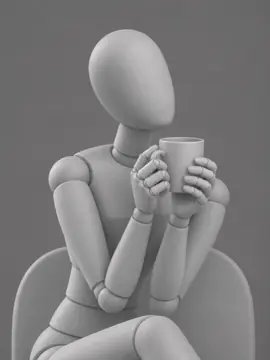 | <a href="https://promicat.app/zh/poses/styles/sp013?utm_source=github&utm_medium=readme&utm_campaign=ai-photo-poses"></a> | <a href="https://promicat.app/zh/poses/styles/sp013?utm_source=github&utm_medium=readme&utm_campaign=ai-photo-poses"></a> | <a href="https://promicat.app/zh/poses/styles/sp013?utm_source=github&utm_medium=readme&utm_campaign=ai-photo-poses"></a> | <a href="https://promicat.app/zh/poses/styles/sp013?utm_source=github&utm_medium=readme&utm_campaign=ai-photo-poses">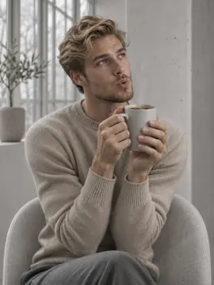</a> |

大图: [写真照](../images/photo-poses/cafe/sp013-photo.webp) · [白模](../images/photo-poses/cafe/sp013-pose.webp) · [在 Promicat 生成](https://promicat.app/zh/poses/styles/sp013?utm_source=github&utm_medium=readme&utm_campaign=ai-photo-poses)

<details><summary>提示词：用你的照片（图 1 你的照片，图 2 白模）</summary>

```text
A real professional portrait photoshoot photo: a cafe and bookshop lifestyle photoshoot, warm window light, wooden interior, 50mm f/1.4, soft creamy background. Subject: the person in image 1 (keep their exact face, facial features, skin tone and hairstyle; do not beautify or swap the face), wearing a soft knit or linen outfit in warm neutral tones. Pose: holding a mug with both hands close to the lips, blowing on the coffee, eyes looking up. Image 2 is a wooden artist's mannequin that shows only this body pose: copy it exactly (head, torso, arms, hands, legs, feet, which hand does what, the camera angle), but do not copy the mannequin itself: no wooden skin, no joints, no blank face. Natural, relaxed and unstiff, true skin texture. No text, no logo, no watermark. Portrait 3:4.
```

</details>

<details><summary>提示词：生成示例图（虚构模特）</summary>

```text
A real professional portrait photoshoot photo, the kind posted by a top portrait studio: a cafe and bookshop lifestyle photoshoot, warm window light, wooden interior, 50mm f/1.4, soft creamy background. Model: a beautiful Korean professional fashion model in her twenties with a naturally attractive face, styled hair and natural makeup, wearing a soft knit or linen outfit in warm neutral tones. The photographer directs the model into a natural, relaxed, unstiff pose that looks caught between moments: holding a mug with both hands close to the lips, blowing on the coffee, eyes looking up. Asymmetric body, soft hands, flattering angle, true skin texture, refined but not plastic, fully clothed and modest. Waist-up framing, both arms and hands readable. No text, no logo, no watermark. Portrait 3:4.
```

</details>

## 翻书低笑 (坐)

| 白模 | 咖啡馆文艺 | 暗黑哥特 | 街拍时尚 | Y2K 千禧辣妹 |
|---|---|---|---|---|
| 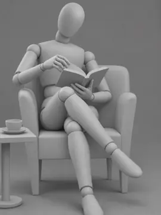 | <a href="https://promicat.app/zh/poses/styles/sp014?utm_source=github&utm_medium=readme&utm_campaign=ai-photo-poses">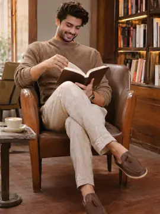</a> | <a href="https://promicat.app/zh/poses/styles/sp014?utm_source=github&utm_medium=readme&utm_campaign=ai-photo-poses">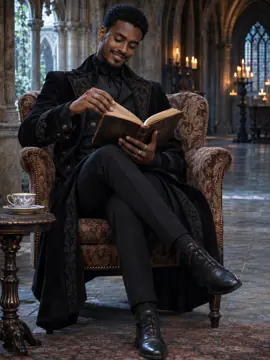</a> | <a href="https://promicat.app/zh/poses/styles/sp014?utm_source=github&utm_medium=readme&utm_campaign=ai-photo-poses">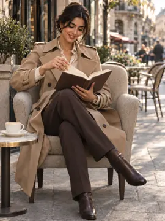</a> | <a href="https://promicat.app/zh/poses/styles/sp014?utm_source=github&utm_medium=readme&utm_campaign=ai-photo-poses">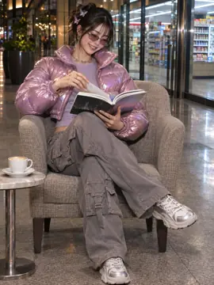</a> |

大图: [写真照](../images/photo-poses/cafe/sp014-photo.webp) · [白模](../images/photo-poses/cafe/sp014-pose.webp) · [在 Promicat 生成](https://promicat.app/zh/poses/styles/sp014?utm_source=github&utm_medium=readme&utm_campaign=ai-photo-poses)

<details><summary>提示词：用你的照片（图 1 你的照片，图 2 白模）</summary>

```text
A real professional portrait photoshoot photo: a cafe and bookshop lifestyle photoshoot, warm window light, wooden interior, 50mm f/1.4, soft creamy background. Subject: the person in image 1 (keep their exact face, facial features, skin tone and hairstyle; do not beautify or swap the face), wearing a soft knit or linen outfit in warm neutral tones. Pose: sitting in an armchair with legs crossed, flipping a page and smiling at it. Image 2 is a wooden artist's mannequin that shows only this body pose: copy it exactly (head, torso, arms, hands, legs, feet, which hand does what, the camera angle), but do not copy the mannequin itself: no wooden skin, no joints, no blank face. Natural, relaxed and unstiff, true skin texture. No text, no logo, no watermark. Portrait 3:4.
```

</details>

<details><summary>提示词：生成示例图（虚构模特）</summary>

```text
A real professional portrait photoshoot photo, the kind posted by a top portrait studio: a cafe and bookshop lifestyle photoshoot, warm window light, wooden interior, 50mm f/1.4, soft creamy background. Model: a handsome South Asian professional male model in his twenties with a well-groomed look and styled hair, wearing a soft knit or linen outfit in warm neutral tones. The photographer directs the model into a natural, relaxed, unstiff pose that looks caught between moments: sitting in an armchair with legs crossed, flipping a page and smiling at it. Asymmetric body, soft hands, flattering angle, true skin texture, refined but not plastic, fully clothed and modest. Full body or three-quarter body in frame, the whole pose clearly readable. No text, no logo, no watermark. Portrait 3:4.
```

</details>

## 趴桌侧脸 (坐)

| 白模 | 咖啡馆文艺 | 街头朋克 | 街拍时尚 | 西部牛仔 |
|---|---|---|---|---|
| 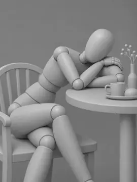 | <a href="https://promicat.app/zh/poses/styles/sp015?utm_source=github&utm_medium=readme&utm_campaign=ai-photo-poses">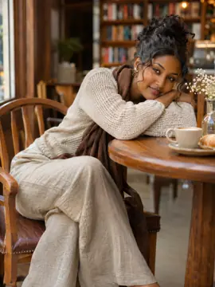</a> | <a href="https://promicat.app/zh/poses/styles/sp015?utm_source=github&utm_medium=readme&utm_campaign=ai-photo-poses">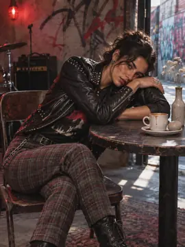</a> | <a href="https://promicat.app/zh/poses/styles/sp015?utm_source=github&utm_medium=readme&utm_campaign=ai-photo-poses">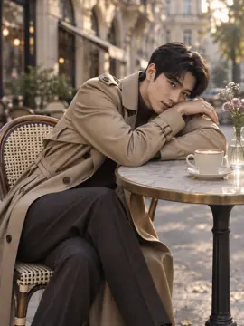</a> | <a href="https://promicat.app/zh/poses/styles/sp015?utm_source=github&utm_medium=readme&utm_campaign=ai-photo-poses">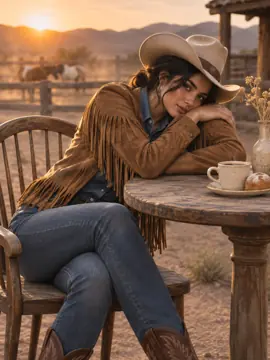</a> |

大图: [写真照](../images/photo-poses/cafe/sp015-photo.webp) · [白模](../images/photo-poses/cafe/sp015-pose.webp) · [在 Promicat 生成](https://promicat.app/zh/poses/styles/sp015?utm_source=github&utm_medium=readme&utm_campaign=ai-photo-poses)

<details><summary>提示词：用你的照片（图 1 你的照片，图 2 白模）</summary>

```text
A real professional portrait photoshoot photo: a cafe and bookshop lifestyle photoshoot, warm window light, wooden interior, 50mm f/1.4, soft creamy background. Subject: the person in image 1 (keep their exact face, facial features, skin tone and hairstyle; do not beautify or swap the face), wearing a soft knit or linen outfit in warm neutral tones. Pose: leaning forward on the table with the cheek on stacked arms, looking sideways at the camera. Image 2 is a wooden artist's mannequin that shows only this body pose: copy it exactly (head, torso, arms, hands, legs, feet, which hand does what, the camera angle), but do not copy the mannequin itself: no wooden skin, no joints, no blank face. Natural, relaxed and unstiff, true skin texture. No text, no logo, no watermark. Portrait 3:4.
```

</details>

<details><summary>提示词：生成示例图（虚构模特）</summary>

```text
A real professional portrait photoshoot photo, the kind posted by a top portrait studio: a cafe and bookshop lifestyle photoshoot, warm window light, wooden interior, 50mm f/1.4, soft creamy background. Model: a beautiful East African professional fashion model in her twenties with a naturally attractive face, styled hair and natural makeup, wearing a soft knit or linen outfit in warm neutral tones. The photographer directs the model into a natural, relaxed, unstiff pose that looks caught between moments: leaning forward on the table with the cheek on stacked arms, looking sideways at the camera. Asymmetric body, soft hands, flattering angle, true skin texture, refined but not plastic, fully clothed and modest. Full body or three-quarter body in frame, the whole pose clearly readable. No text, no logo, no watermark. Portrait 3:4.
```

</details>

## 吧台倚靠 (靠)

| 白模 | 咖啡馆文艺 | 新中式 | 学院风 | 日系清新 |
|---|---|---|---|---|
| 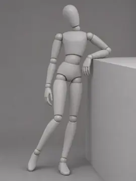 | <a href="https://promicat.app/zh/poses/styles/sp016?utm_source=github&utm_medium=readme&utm_campaign=ai-photo-poses">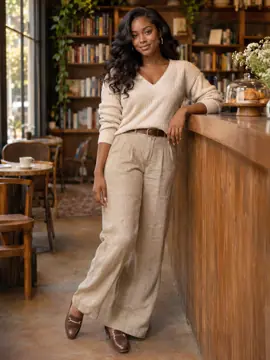</a> | <a href="https://promicat.app/zh/poses/styles/sp016?utm_source=github&utm_medium=readme&utm_campaign=ai-photo-poses">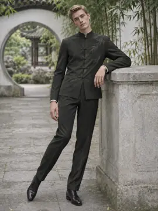</a> | <a href="https://promicat.app/zh/poses/styles/sp016?utm_source=github&utm_medium=readme&utm_campaign=ai-photo-poses">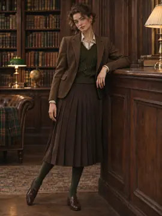</a> | <a href="https://promicat.app/zh/poses/styles/sp016?utm_source=github&utm_medium=readme&utm_campaign=ai-photo-poses">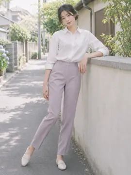</a> |

大图: [写真照](../images/photo-poses/cafe/sp016-photo.webp) · [白模](../images/photo-poses/cafe/sp016-pose.webp) · [在 Promicat 生成](https://promicat.app/zh/poses/styles/sp016?utm_source=github&utm_medium=readme&utm_campaign=ai-photo-poses)

<details><summary>提示词：用你的照片（图 1 你的照片，图 2 白模）</summary>

```text
A real professional portrait photoshoot photo: a cafe and bookshop lifestyle photoshoot, warm window light, wooden interior, 50mm f/1.4, soft creamy background. Subject: the person in image 1 (keep their exact face, facial features, skin tone and hairstyle; do not beautify or swap the face), wearing a soft knit or linen outfit in warm neutral tones. Pose: leaning on the counter with one elbow, weight on one leg, turning to the camera. Image 2 is a wooden artist's mannequin that shows only this body pose: copy it exactly (head, torso, arms, hands, legs, feet, which hand does what, the camera angle), but do not copy the mannequin itself: no wooden skin, no joints, no blank face. Natural, relaxed and unstiff, true skin texture. No text, no logo, no watermark. Portrait 3:4.
```

</details>

<details><summary>提示词：生成示例图（虚构模特）</summary>

```text
A real professional portrait photoshoot photo, the kind posted by a top portrait studio: a cafe and bookshop lifestyle photoshoot, warm window light, wooden interior, 50mm f/1.4, soft creamy background. Model: a beautiful Black professional fashion model in her twenties with a naturally attractive face, styled hair and natural makeup, wearing a soft knit or linen outfit in warm neutral tones. The photographer directs the model into a natural, relaxed, unstiff pose that looks caught between moments: leaning on the counter with one elbow, weight on one leg, turning to the camera. Asymmetric body, soft hands, flattering angle, true skin texture, refined but not plastic, fully clothed and modest. Full body or three-quarter body in frame, the whole pose clearly readable. No text, no logo, no watermark. Portrait 3:4.
```

</details>

## 写笔记咬笔 (坐)

| 白模 | 咖啡馆文艺 | 赛博霓虹 | 好莱坞复古 | 居家慵懒 |
|---|---|---|---|---|
| 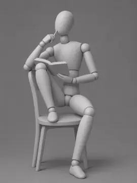 | <a href="https://promicat.app/zh/poses/styles/sp017?utm_source=github&utm_medium=readme&utm_campaign=ai-photo-poses">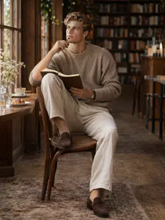</a> | <a href="https://promicat.app/zh/poses/styles/sp017?utm_source=github&utm_medium=readme&utm_campaign=ai-photo-poses">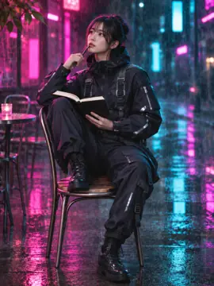</a> | <a href="https://promicat.app/zh/poses/styles/sp017?utm_source=github&utm_medium=readme&utm_campaign=ai-photo-poses">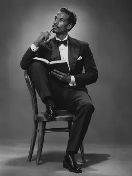</a> | <a href="https://promicat.app/zh/poses/styles/sp017?utm_source=github&utm_medium=readme&utm_campaign=ai-photo-poses">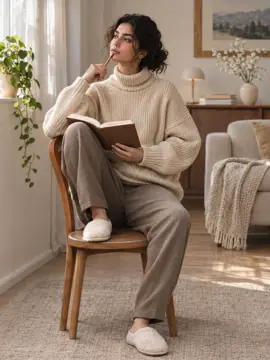</a> |

大图: [写真照](../images/photo-poses/cafe/sp017-photo.webp) · [白模](../images/photo-poses/cafe/sp017-pose.webp) · [在 Promicat 生成](https://promicat.app/zh/poses/styles/sp017?utm_source=github&utm_medium=readme&utm_campaign=ai-photo-poses)

<details><summary>提示词：用你的照片（图 1 你的照片，图 2 白模）</summary>

```text
A real professional portrait photoshoot photo: a cafe and bookshop lifestyle photoshoot, warm window light, wooden interior, 50mm f/1.4, soft creamy background. Subject: the person in image 1 (keep their exact face, facial features, skin tone and hairstyle; do not beautify or swap the face), wearing a soft knit or linen outfit in warm neutral tones. Pose: writing in a notebook, pencil at the lips, thinking, one knee up on the chair. Image 2 is a wooden artist's mannequin that shows only this body pose: copy it exactly (head, torso, arms, hands, legs, feet, which hand does what, the camera angle), but do not copy the mannequin itself: no wooden skin, no joints, no blank face. Natural, relaxed and unstiff, true skin texture. No text, no logo, no watermark. Portrait 3:4.
```

</details>

<details><summary>提示词：生成示例图（虚构模特）</summary>

```text
A real professional portrait photoshoot photo, the kind posted by a top portrait studio: a cafe and bookshop lifestyle photoshoot, warm window light, wooden interior, 50mm f/1.4, soft creamy background. Model: a handsome Scandinavian professional male model in his twenties with a well-groomed look and styled hair, wearing a soft knit or linen outfit in warm neutral tones. The photographer directs the model into a natural, relaxed, unstiff pose that looks caught between moments: writing in a notebook, pencil at the lips, thinking, one knee up on the chair. Asymmetric body, soft hands, flattering angle, true skin texture, refined but not plastic, fully clothed and modest. Full body or three-quarter body in frame, the whole pose clearly readable. No text, no logo, no watermark. Portrait 3:4.
```

</details>

## 门口回眸 (回眸)

| 白模 | 咖啡馆文艺 | 森系花田 | 情绪棚拍 | 老钱风 |
|---|---|---|---|---|
| 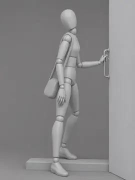 | <a href="https://promicat.app/zh/poses/styles/sp018?utm_source=github&utm_medium=readme&utm_campaign=ai-photo-poses">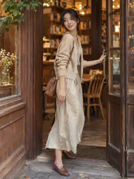</a> | <a href="https://promicat.app/zh/poses/styles/sp018?utm_source=github&utm_medium=readme&utm_campaign=ai-photo-poses">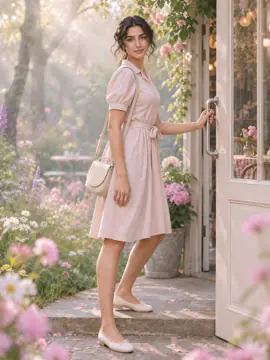</a> | <a href="https://promicat.app/zh/poses/styles/sp018?utm_source=github&utm_medium=readme&utm_campaign=ai-photo-poses">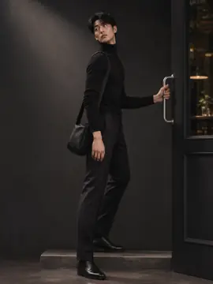</a> | <a href="https://promicat.app/zh/poses/styles/sp018?utm_source=github&utm_medium=readme&utm_campaign=ai-photo-poses">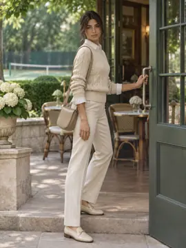</a> |

大图: [写真照](../images/photo-poses/cafe/sp018-photo.webp) · [白模](../images/photo-poses/cafe/sp018-pose.webp) · [在 Promicat 生成](https://promicat.app/zh/poses/styles/sp018?utm_source=github&utm_medium=readme&utm_campaign=ai-photo-poses)

<details><summary>提示词：用你的照片（图 1 你的照片，图 2 白模）</summary>

```text
A real professional portrait photoshoot photo: a cafe and bookshop lifestyle photoshoot, warm window light, wooden interior, 50mm f/1.4, soft creamy background. Subject: the person in image 1 (keep their exact face, facial features, skin tone and hairstyle; do not beautify or swap the face), wearing a soft knit or linen outfit in warm neutral tones. Pose: stepping out of the cafe door, holding it with one hand, looking back inside. Image 2 is a wooden artist's mannequin that shows only this body pose: copy it exactly (head, torso, arms, hands, legs, feet, which hand does what, the camera angle), but do not copy the mannequin itself: no wooden skin, no joints, no blank face. Natural, relaxed and unstiff, true skin texture. No text, no logo, no watermark. Portrait 3:4.
```

</details>

<details><summary>提示词：生成示例图（虚构模特）</summary>

```text
A real professional portrait photoshoot photo, the kind posted by a top portrait studio: a cafe and bookshop lifestyle photoshoot, warm window light, wooden interior, 50mm f/1.4, soft creamy background. Model: a beautiful East Asian professional fashion model in her twenties with a naturally attractive face, styled hair and natural makeup, wearing a soft knit or linen outfit in warm neutral tones. The photographer directs the model into a natural, relaxed, unstiff pose that looks caught between moments: stepping out of the cafe door, holding it with one hand, looking back inside. Asymmetric body, soft hands, flattering angle, true skin texture, refined but not plastic, fully clothed and modest. Full body or three-quarter body in frame, the whole pose clearly readable. No text, no logo, no watermark. Portrait 3:4.
```

</details>

## 地上读书 (坐)

| 白模 | 咖啡馆文艺 | 海边度假 | 校园青春 | 港风复古 |
|---|---|---|---|---|
| 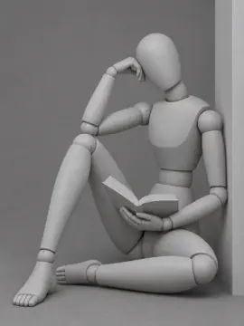 | <a href="https://promicat.app/zh/poses/styles/sp019?utm_source=github&utm_medium=readme&utm_campaign=ai-photo-poses">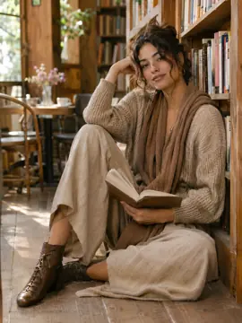</a> | <a href="https://promicat.app/zh/poses/styles/sp019?utm_source=github&utm_medium=readme&utm_campaign=ai-photo-poses"></a> | <a href="https://promicat.app/zh/poses/styles/sp019?utm_source=github&utm_medium=readme&utm_campaign=ai-photo-poses"></a> | <a href="https://promicat.app/zh/poses/styles/sp019?utm_source=github&utm_medium=readme&utm_campaign=ai-photo-poses">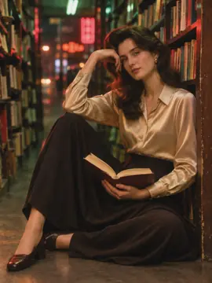</a> |

大图: [写真照](../images/photo-poses/cafe/sp019-photo.webp) · [白模](../images/photo-poses/cafe/sp019-pose.webp) · [在 Promicat 生成](https://promicat.app/zh/poses/styles/sp019?utm_source=github&utm_medium=readme&utm_campaign=ai-photo-poses)

<details><summary>提示词：用你的照片（图 1 你的照片，图 2 白模）</summary>

```text
A real professional portrait photoshoot photo: a cafe and bookshop lifestyle photoshoot, warm window light, wooden interior, 50mm f/1.4, soft creamy background. Subject: the person in image 1 (keep their exact face, facial features, skin tone and hairstyle; do not beautify or swap the face), wearing a soft knit or linen outfit in warm neutral tones. Pose: sitting on the floor between bookshelves, back against the shelf, a book open on the knee. Image 2 is a wooden artist's mannequin that shows only this body pose: copy it exactly (head, torso, arms, hands, legs, feet, which hand does what, the camera angle), but do not copy the mannequin itself: no wooden skin, no joints, no blank face. Natural, relaxed and unstiff, true skin texture. No text, no logo, no watermark. Portrait 3:4.
```

</details>

<details><summary>提示词：生成示例图（虚构模特）</summary>

```text
A real professional portrait photoshoot photo, the kind posted by a top portrait studio: a cafe and bookshop lifestyle photoshoot, warm window light, wooden interior, 50mm f/1.4, soft creamy background. Model: a beautiful mixed-race professional fashion model in her twenties with a naturally attractive face, styled hair and natural makeup, wearing a soft knit or linen outfit in warm neutral tones. The photographer directs the model into a natural, relaxed, unstiff pose that looks caught between moments: sitting on the floor between bookshelves, back against the shelf, a book open on the knee. Asymmetric body, soft hands, flattering angle, true skin texture, refined but not plastic, fully clothed and modest. Full body or three-quarter body in frame, the whole pose clearly readable. No text, no logo, no watermark. Portrait 3:4.
```

</details>

## 端咖啡走路 (走)

| 白模 | 咖啡馆文艺 | 波西米亚 | 学院风 | 北欧极简 |
|---|---|---|---|---|
| 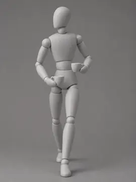 | <a href="https://promicat.app/zh/poses/styles/sp020?utm_source=github&utm_medium=readme&utm_campaign=ai-photo-poses">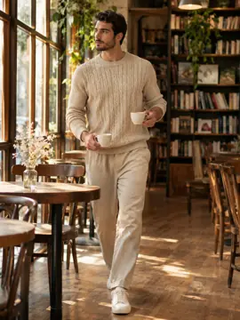</a> | <a href="https://promicat.app/zh/poses/styles/sp020?utm_source=github&utm_medium=readme&utm_campaign=ai-photo-poses">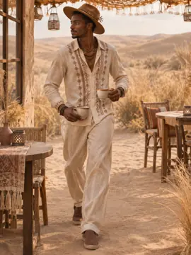</a> | <a href="https://promicat.app/zh/poses/styles/sp020?utm_source=github&utm_medium=readme&utm_campaign=ai-photo-poses">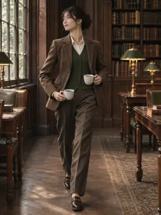</a> | <a href="https://promicat.app/zh/poses/styles/sp020?utm_source=github&utm_medium=readme&utm_campaign=ai-photo-poses">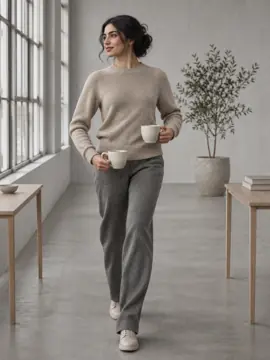</a> |

大图: [写真照](../images/photo-poses/cafe/sp020-photo.webp) · [白模](../images/photo-poses/cafe/sp020-pose.webp) · [在 Promicat 生成](https://promicat.app/zh/poses/styles/sp020?utm_source=github&utm_medium=readme&utm_campaign=ai-photo-poses)

<details><summary>提示词：用你的照片（图 1 你的照片，图 2 白模）</summary>

```text
A real professional portrait photoshoot photo: a cafe and bookshop lifestyle photoshoot, warm window light, wooden interior, 50mm f/1.4, soft creamy background. Subject: the person in image 1 (keep their exact face, facial features, skin tone and hairstyle; do not beautify or swap the face), wearing a soft knit or linen outfit in warm neutral tones. Pose: walking between tables carrying two cups, glancing toward the window. Image 2 is a wooden artist's mannequin that shows only this body pose: copy it exactly (head, torso, arms, hands, legs, feet, which hand does what, the camera angle), but do not copy the mannequin itself: no wooden skin, no joints, no blank face. Natural, relaxed and unstiff, true skin texture. No text, no logo, no watermark. Portrait 3:4.
```

</details>

<details><summary>提示词：生成示例图（虚构模特）</summary>

```text
A real professional portrait photoshoot photo, the kind posted by a top portrait studio: a cafe and bookshop lifestyle photoshoot, warm window light, wooden interior, 50mm f/1.4, soft creamy background. Model: a handsome Mediterranean professional male model in his twenties with a well-groomed look and styled hair, wearing a soft knit or linen outfit in warm neutral tones. The photographer directs the model into a natural, relaxed, unstiff pose that looks caught between moments: walking between tables carrying two cups, glancing toward the window. Asymmetric body, soft hands, flattering angle, true skin texture, refined but not plastic, fully clothed and modest. Full body or three-quarter body in frame, the whole pose clearly readable. No text, no logo, no watermark. Portrait 3:4.
```

</details>
