# Campus youth

English · [简体中文](campus.zh-CN.md)

10 white models, each with 4 portraits shot from it in different styles. Attach your photo first and the white model second. Try them with your own photo on [Promicat](https://promicat.app/poses?utm_source=github&utm_medium=readme&utm_campaign=ai-photo-poses).

[← Back to all styles](../README.md#photo-poses)

## Sitting on steps with forearms on the knees (Sitting)

| White model | Campus youth | Seaside holiday | New Chinese style | Cosy at home |
|---|---|---|---|---|
| 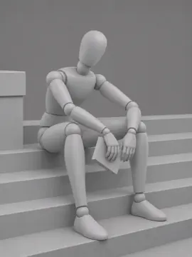 | <a href="https://promicat.app/poses/styles/sp071?utm_source=github&utm_medium=readme&utm_campaign=ai-photo-poses">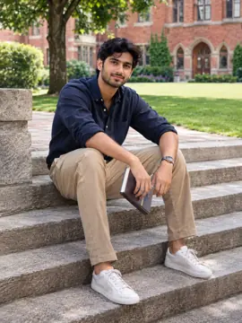</a> | <a href="https://promicat.app/poses/styles/sp071?utm_source=github&utm_medium=readme&utm_campaign=ai-photo-poses">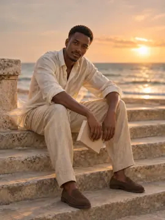</a> | <a href="https://promicat.app/poses/styles/sp071?utm_source=github&utm_medium=readme&utm_campaign=ai-photo-poses">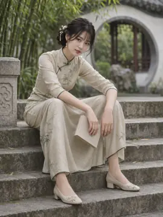</a> | <a href="https://promicat.app/poses/styles/sp071?utm_source=github&utm_medium=readme&utm_campaign=ai-photo-poses">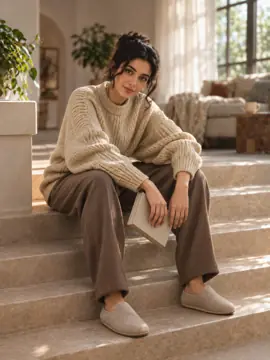</a> |

Full size: [photo](../images/photo-poses/campus/sp071-photo.webp) · [white model](../images/photo-poses/campus/sp071-pose.webp) · [try it on Promicat](https://promicat.app/poses/styles/sp071?utm_source=github&utm_medium=readme&utm_campaign=ai-photo-poses)

<details><summary>Prompt with your photo (image 1: your photo, image 2: white model)</summary>

```text
A real professional portrait photoshoot photo: a campus youth photoshoot on a university lawn by red-brick buildings, bright natural light, 50mm. Subject: the person in image 1 (keep their exact face, facial features, skin tone and hairstyle; do not beautify or swap the face), wearing a cardigan and pleated skirt or a casual shirt and chinos. Pose: sitting on steps with forearms on the knees, a book in one hand, turning to look up at the camera. Image 2 is a wooden artist's mannequin that shows only this body pose: copy it exactly (head, torso, arms, hands, legs, feet, which hand does what, the camera angle), but do not copy the mannequin itself: no wooden skin, no joints, no blank face. Natural, relaxed and unstiff, true skin texture. No text, no logo, no watermark. Portrait 3:4.
```

</details>

<details><summary>Prompt for the sample (fictional model)</summary>

```text
A real professional portrait photoshoot photo, the kind posted by a top portrait studio: a campus youth photoshoot on a university lawn by red-brick buildings, bright natural light, 50mm. Model: a handsome South Asian professional male model in his twenties with a well-groomed look and styled hair, wearing a cardigan and pleated skirt or a casual shirt and chinos. The photographer directs the model into a natural, relaxed, unstiff pose that looks caught between moments: sitting on steps with forearms on the knees, a book in one hand, turning to look up at the camera. Asymmetric body, soft hands, flattering angle, true skin texture, refined but not plastic, fully clothed and modest. Full body or three-quarter body in frame, the whole pose clearly readable. No text, no logo, no watermark. Portrait 3:4.
```

</details>

## Walking across the lawn hugging books to the chest (Walking)

| White model | Campus youth | Cyberpunk neon | HK retro neon | Moody studio |
|---|---|---|---|---|
|  | <a href="https://promicat.app/poses/styles/sp072?utm_source=github&utm_medium=readme&utm_campaign=ai-photo-poses">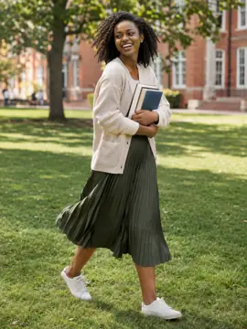</a> | <a href="https://promicat.app/poses/styles/sp072?utm_source=github&utm_medium=readme&utm_campaign=ai-photo-poses">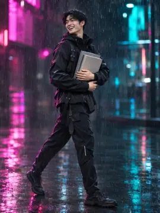</a> | <a href="https://promicat.app/poses/styles/sp072?utm_source=github&utm_medium=readme&utm_campaign=ai-photo-poses">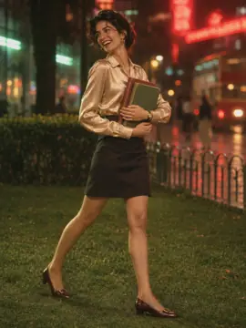</a> | <a href="https://promicat.app/poses/styles/sp072?utm_source=github&utm_medium=readme&utm_campaign=ai-photo-poses">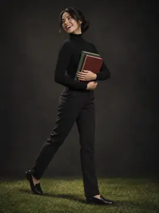</a> |

Full size: [photo](../images/photo-poses/campus/sp072-photo.webp) · [white model](../images/photo-poses/campus/sp072-pose.webp) · [try it on Promicat](https://promicat.app/poses/styles/sp072?utm_source=github&utm_medium=readme&utm_campaign=ai-photo-poses)

<details><summary>Prompt with your photo (image 1: your photo, image 2: white model)</summary>

```text
A real professional portrait photoshoot photo: a campus youth photoshoot on a university lawn by red-brick buildings, bright natural light, 50mm. Subject: the person in image 1 (keep their exact face, facial features, skin tone and hairstyle; do not beautify or swap the face), wearing a cardigan and pleated skirt or a casual shirt and chinos. Pose: walking across the lawn hugging books to the chest, laughing at someone off frame. Image 2 is a wooden artist's mannequin that shows only this body pose: copy it exactly (head, torso, arms, hands, legs, feet, which hand does what, the camera angle), but do not copy the mannequin itself: no wooden skin, no joints, no blank face. Natural, relaxed and unstiff, true skin texture. No text, no logo, no watermark. Portrait 3:4.
```

</details>

<details><summary>Prompt for the sample (fictional model)</summary>

```text
A real professional portrait photoshoot photo, the kind posted by a top portrait studio: a campus youth photoshoot on a university lawn by red-brick buildings, bright natural light, 50mm. Model: a beautiful East African professional fashion model in her twenties with a naturally attractive face, styled hair and natural makeup, wearing a cardigan and pleated skirt or a casual shirt and chinos. The photographer directs the model into a natural, relaxed, unstiff pose that looks caught between moments: walking across the lawn hugging books to the chest, laughing at someone off frame. Asymmetric body, soft hands, flattering angle, true skin texture, refined but not plastic, fully clothed and modest. Full body or three-quarter body in frame, the whole pose clearly readable. No text, no logo, no watermark. Portrait 3:4.
```

</details>

## Leaning against a tree trunk reading (Leaning)

| White model | Campus youth | Forest & flower field | Cosy at home | Street fashion |
|---|---|---|---|---|
| 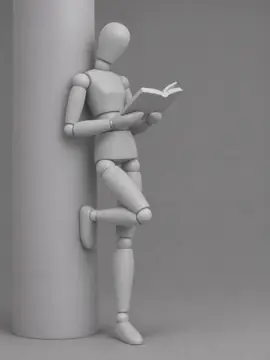 | <a href="https://promicat.app/poses/styles/sp073?utm_source=github&utm_medium=readme&utm_campaign=ai-photo-poses"></a> | <a href="https://promicat.app/poses/styles/sp073?utm_source=github&utm_medium=readme&utm_campaign=ai-photo-poses">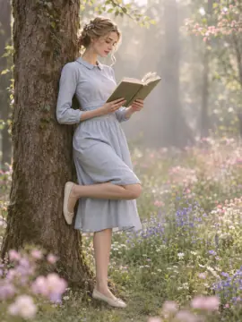</a> | <a href="https://promicat.app/poses/styles/sp073?utm_source=github&utm_medium=readme&utm_campaign=ai-photo-poses">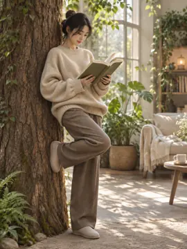</a> | <a href="https://promicat.app/poses/styles/sp073?utm_source=github&utm_medium=readme&utm_campaign=ai-photo-poses">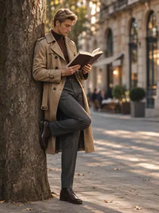</a> |

Full size: [photo](../images/photo-poses/campus/sp073-photo.webp) · [white model](../images/photo-poses/campus/sp073-pose.webp) · [try it on Promicat](https://promicat.app/poses/styles/sp073?utm_source=github&utm_medium=readme&utm_campaign=ai-photo-poses)

<details><summary>Prompt with your photo (image 1: your photo, image 2: white model)</summary>

```text
A real professional portrait photoshoot photo: a campus youth photoshoot on a university lawn by red-brick buildings, bright natural light, 50mm. Subject: the person in image 1 (keep their exact face, facial features, skin tone and hairstyle; do not beautify or swap the face), wearing a cardigan and pleated skirt or a casual shirt and chinos. Pose: leaning against a tree trunk reading, one foot flat on the bark. Image 2 is a wooden artist's mannequin that shows only this body pose: copy it exactly (head, torso, arms, hands, legs, feet, which hand does what, the camera angle), but do not copy the mannequin itself: no wooden skin, no joints, no blank face. Natural, relaxed and unstiff, true skin texture. No text, no logo, no watermark. Portrait 3:4.
```

</details>

<details><summary>Prompt for the sample (fictional model)</summary>

```text
A real professional portrait photoshoot photo, the kind posted by a top portrait studio: a campus youth photoshoot on a university lawn by red-brick buildings, bright natural light, 50mm. Model: a beautiful Black professional fashion model in her twenties with a naturally attractive face, styled hair and natural makeup, wearing a cardigan and pleated skirt or a casual shirt and chinos. The photographer directs the model into a natural, relaxed, unstiff pose that looks caught between moments: leaning against a tree trunk reading, one foot flat on the bark. Asymmetric body, soft hands, flattering angle, true skin texture, refined but not plastic, fully clothed and modest. Full body or three-quarter body in frame, the whole pose clearly readable. No text, no logo, no watermark. Portrait 3:4.
```

</details>

## Lying on the lawn on the back with a book open over the chest (Lying)

| White model | Campus youth | Seaside holiday | Cafe & bookshop | Y2K flash |
|---|---|---|---|---|
|  | <a href="https://promicat.app/poses/styles/sp074?utm_source=github&utm_medium=readme&utm_campaign=ai-photo-poses">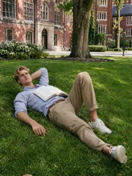</a> | <a href="https://promicat.app/poses/styles/sp074?utm_source=github&utm_medium=readme&utm_campaign=ai-photo-poses">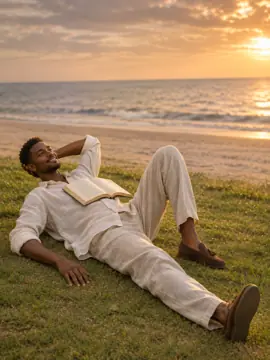</a> | <a href="https://promicat.app/poses/styles/sp074?utm_source=github&utm_medium=readme&utm_campaign=ai-photo-poses">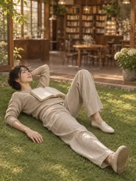</a> | <a href="https://promicat.app/poses/styles/sp074?utm_source=github&utm_medium=readme&utm_campaign=ai-photo-poses">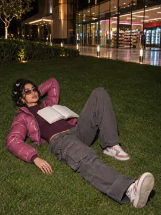</a> |

Full size: [photo](../images/photo-poses/campus/sp074-photo.webp) · [white model](../images/photo-poses/campus/sp074-pose.webp) · [try it on Promicat](https://promicat.app/poses/styles/sp074?utm_source=github&utm_medium=readme&utm_campaign=ai-photo-poses)

<details><summary>Prompt with your photo (image 1: your photo, image 2: white model)</summary>

```text
A real professional portrait photoshoot photo: a campus youth photoshoot on a university lawn by red-brick buildings, bright natural light, 50mm. Subject: the person in image 1 (keep their exact face, facial features, skin tone and hairstyle; do not beautify or swap the face), wearing a cardigan and pleated skirt or a casual shirt and chinos. Pose: lying on the lawn on the back with a book open over the chest, one knee up. Image 2 is a wooden artist's mannequin that shows only this body pose: copy it exactly (head, torso, arms, hands, legs, feet, which hand does what, the camera angle), but do not copy the mannequin itself: no wooden skin, no joints, no blank face. Natural, relaxed and unstiff, true skin texture. No text, no logo, no watermark. Portrait 3:4.
```

</details>

<details><summary>Prompt for the sample (fictional model)</summary>

```text
A real professional portrait photoshoot photo, the kind posted by a top portrait studio: a campus youth photoshoot on a university lawn by red-brick buildings, bright natural light, 50mm. Model: a handsome Scandinavian professional male model in his twenties with a well-groomed look and styled hair, wearing a cardigan and pleated skirt or a casual shirt and chinos. The photographer directs the model into a natural, relaxed, unstiff pose that looks caught between moments: lying on the lawn on the back with a book open over the chest, one knee up. Asymmetric body, soft hands, flattering angle, true skin texture, refined but not plastic, fully clothed and modest. Full body or three-quarter body in frame, the whole pose clearly readable. No text, no logo, no watermark. Portrait 3:4.
```

</details>

## Standing at a chalkboard with chalk in hand (Standing)

| White model | Campus youth | Boho desert | Gothic | Japanese fresh film |
|---|---|---|---|---|
| 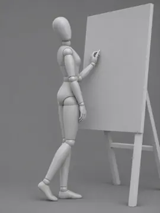 | <a href="https://promicat.app/poses/styles/sp075?utm_source=github&utm_medium=readme&utm_campaign=ai-photo-poses">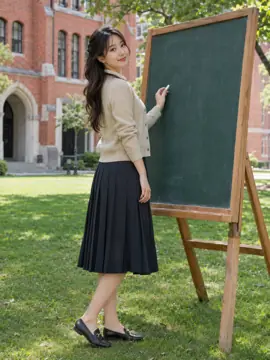</a> | <a href="https://promicat.app/poses/styles/sp075?utm_source=github&utm_medium=readme&utm_campaign=ai-photo-poses">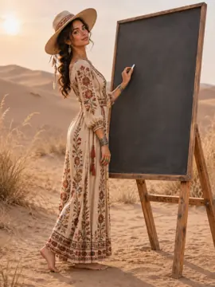</a> | <a href="https://promicat.app/poses/styles/sp075?utm_source=github&utm_medium=readme&utm_campaign=ai-photo-poses">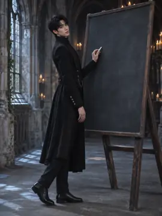</a> | <a href="https://promicat.app/poses/styles/sp075?utm_source=github&utm_medium=readme&utm_campaign=ai-photo-poses">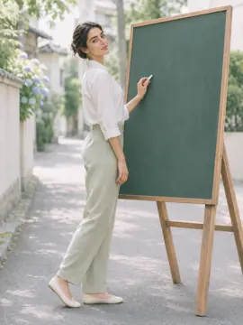</a> |

Full size: [photo](../images/photo-poses/campus/sp075-photo.webp) · [white model](../images/photo-poses/campus/sp075-pose.webp) · [try it on Promicat](https://promicat.app/poses/styles/sp075?utm_source=github&utm_medium=readme&utm_campaign=ai-photo-poses)

<details><summary>Prompt with your photo (image 1: your photo, image 2: white model)</summary>

```text
A real professional portrait photoshoot photo: a campus youth photoshoot on a university lawn by red-brick buildings, bright natural light, 50mm. Subject: the person in image 1 (keep their exact face, facial features, skin tone and hairstyle; do not beautify or swap the face), wearing a cardigan and pleated skirt or a casual shirt and chinos. Pose: standing at a chalkboard with chalk in hand, turning back to the camera. Image 2 is a wooden artist's mannequin that shows only this body pose: copy it exactly (head, torso, arms, hands, legs, feet, which hand does what, the camera angle), but do not copy the mannequin itself: no wooden skin, no joints, no blank face. Natural, relaxed and unstiff, true skin texture. No text, no logo, no watermark. Portrait 3:4.
```

</details>

<details><summary>Prompt for the sample (fictional model)</summary>

```text
A real professional portrait photoshoot photo, the kind posted by a top portrait studio: a campus youth photoshoot on a university lawn by red-brick buildings, bright natural light, 50mm. Model: a beautiful East Asian professional fashion model in her twenties with a naturally attractive face, styled hair and natural makeup, wearing a cardigan and pleated skirt or a casual shirt and chinos. The photographer directs the model into a natural, relaxed, unstiff pose that looks caught between moments: standing at a chalkboard with chalk in hand, turning back to the camera. Asymmetric body, soft hands, flattering angle, true skin texture, refined but not plastic, fully clothed and modest. Full body or three-quarter body in frame, the whole pose clearly readable. No text, no logo, no watermark. Portrait 3:4.
```

</details>

## Riding a bicycle past the red-brick building with one hand waving (In motion)

| White model | Campus youth | Cyberpunk neon | Dark academia | Forest & flower field |
|---|---|---|---|---|
|  | <a href="https://promicat.app/poses/styles/sp076?utm_source=github&utm_medium=readme&utm_campaign=ai-photo-poses">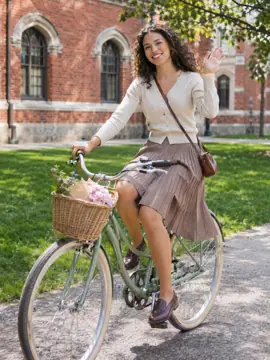</a> | <a href="https://promicat.app/poses/styles/sp076?utm_source=github&utm_medium=readme&utm_campaign=ai-photo-poses">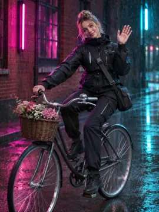</a> | <a href="https://promicat.app/poses/styles/sp076?utm_source=github&utm_medium=readme&utm_campaign=ai-photo-poses">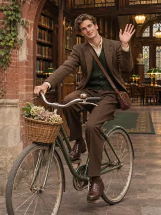</a> | <a href="https://promicat.app/poses/styles/sp076?utm_source=github&utm_medium=readme&utm_campaign=ai-photo-poses">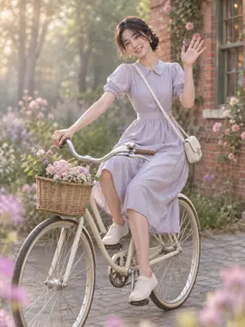</a> |

Full size: [photo](../images/photo-poses/campus/sp076-photo.webp) · [white model](../images/photo-poses/campus/sp076-pose.webp) · [try it on Promicat](https://promicat.app/poses/styles/sp076?utm_source=github&utm_medium=readme&utm_campaign=ai-photo-poses)

<details><summary>Prompt with your photo (image 1: your photo, image 2: white model)</summary>

```text
A real professional portrait photoshoot photo: a campus youth photoshoot on a university lawn by red-brick buildings, bright natural light, 50mm. Subject: the person in image 1 (keep their exact face, facial features, skin tone and hairstyle; do not beautify or swap the face), wearing a cardigan and pleated skirt or a casual shirt and chinos. Pose: riding a bicycle past the red-brick building with one hand waving. Image 2 is a wooden artist's mannequin that shows only this body pose: copy it exactly (head, torso, arms, hands, legs, feet, which hand does what, the camera angle), but do not copy the mannequin itself: no wooden skin, no joints, no blank face. Natural, relaxed and unstiff, true skin texture. No text, no logo, no watermark. Portrait 3:4.
```

</details>

<details><summary>Prompt for the sample (fictional model)</summary>

```text
A real professional portrait photoshoot photo, the kind posted by a top portrait studio: a campus youth photoshoot on a university lawn by red-brick buildings, bright natural light, 50mm. Model: a beautiful mixed-race professional fashion model in her twenties with a naturally attractive face, styled hair and natural makeup, wearing a cardigan and pleated skirt or a casual shirt and chinos. The photographer directs the model into a natural, relaxed, unstiff pose that looks caught between moments: riding a bicycle past the red-brick building with one hand waving. Asymmetric body, soft hands, flattering angle, true skin texture, refined but not plastic, fully clothed and modest. Full body or three-quarter body in frame, the whole pose clearly readable. No text, no logo, no watermark. Portrait 3:4.
```

</details>

## Sitting at a library window desk (Sitting)

| White model | Campus youth | New Chinese style | HK retro neon | Western cowboy |
|---|---|---|---|---|
| 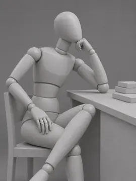 | <a href="https://promicat.app/poses/styles/sp077?utm_source=github&utm_medium=readme&utm_campaign=ai-photo-poses"></a> | <a href="https://promicat.app/poses/styles/sp077?utm_source=github&utm_medium=readme&utm_campaign=ai-photo-poses">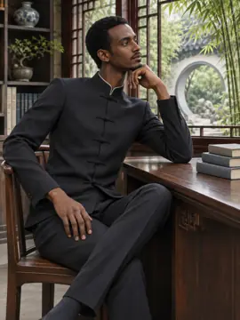</a> | <a href="https://promicat.app/poses/styles/sp077?utm_source=github&utm_medium=readme&utm_campaign=ai-photo-poses">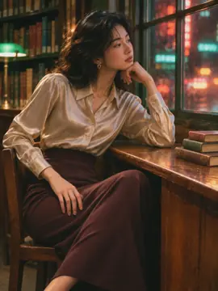</a> | <a href="https://promicat.app/poses/styles/sp077?utm_source=github&utm_medium=readme&utm_campaign=ai-photo-poses">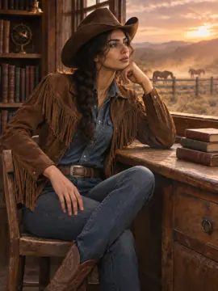</a> |

Full size: [photo](../images/photo-poses/campus/sp077-photo.webp) · [white model](../images/photo-poses/campus/sp077-pose.webp) · [try it on Promicat](https://promicat.app/poses/styles/sp077?utm_source=github&utm_medium=readme&utm_campaign=ai-photo-poses)

<details><summary>Prompt with your photo (image 1: your photo, image 2: white model)</summary>

```text
A real professional portrait photoshoot photo: a campus youth photoshoot on a university lawn by red-brick buildings, bright natural light, 50mm. Subject: the person in image 1 (keep their exact face, facial features, skin tone and hairstyle; do not beautify or swap the face), wearing a cardigan and pleated skirt or a casual shirt and chinos. Pose: sitting at a library window desk, chin on the fist, looking outside. Image 2 is a wooden artist's mannequin that shows only this body pose: copy it exactly (head, torso, arms, hands, legs, feet, which hand does what, the camera angle), but do not copy the mannequin itself: no wooden skin, no joints, no blank face. Natural, relaxed and unstiff, true skin texture. No text, no logo, no watermark. Portrait 3:4.
```

</details>

<details><summary>Prompt for the sample (fictional model)</summary>

```text
A real professional portrait photoshoot photo, the kind posted by a top portrait studio: a campus youth photoshoot on a university lawn by red-brick buildings, bright natural light, 50mm. Model: a handsome Mediterranean professional male model in his twenties with a well-groomed look and styled hair, wearing a cardigan and pleated skirt or a casual shirt and chinos. The photographer directs the model into a natural, relaxed, unstiff pose that looks caught between moments: sitting at a library window desk, chin on the fist, looking outside. Asymmetric body, soft hands, flattering angle, true skin texture, refined but not plastic, fully clothed and modest. Full body or three-quarter body in frame, the whole pose clearly readable. No text, no logo, no watermark. Portrait 3:4.
```

</details>

## Walking away with a backpack on one shoulder (Looking back)

| White model | Campus youth | Nordic minimal | Old money | Street punk |
|---|---|---|---|---|
| 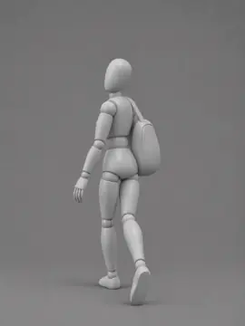 | <a href="https://promicat.app/poses/styles/sp078?utm_source=github&utm_medium=readme&utm_campaign=ai-photo-poses"></a> | <a href="https://promicat.app/poses/styles/sp078?utm_source=github&utm_medium=readme&utm_campaign=ai-photo-poses">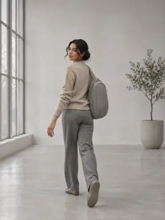</a> | <a href="https://promicat.app/poses/styles/sp078?utm_source=github&utm_medium=readme&utm_campaign=ai-photo-poses">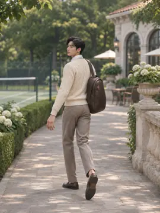</a> | <a href="https://promicat.app/poses/styles/sp078?utm_source=github&utm_medium=readme&utm_campaign=ai-photo-poses">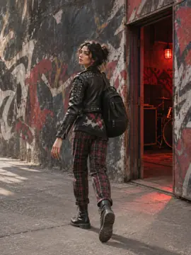</a> |

Full size: [photo](../images/photo-poses/campus/sp078-photo.webp) · [white model](../images/photo-poses/campus/sp078-pose.webp) · [try it on Promicat](https://promicat.app/poses/styles/sp078?utm_source=github&utm_medium=readme&utm_campaign=ai-photo-poses)

<details><summary>Prompt with your photo (image 1: your photo, image 2: white model)</summary>

```text
A real professional portrait photoshoot photo: a campus youth photoshoot on a university lawn by red-brick buildings, bright natural light, 50mm. Subject: the person in image 1 (keep their exact face, facial features, skin tone and hairstyle; do not beautify or swap the face), wearing a cardigan and pleated skirt or a casual shirt and chinos. Pose: walking away with a backpack on one shoulder, looking back. Image 2 is a wooden artist's mannequin that shows only this body pose: copy it exactly (head, torso, arms, hands, legs, feet, which hand does what, the camera angle), but do not copy the mannequin itself: no wooden skin, no joints, no blank face. Natural, relaxed and unstiff, true skin texture. No text, no logo, no watermark. Portrait 3:4.
```

</details>

<details><summary>Prompt for the sample (fictional model)</summary>

```text
A real professional portrait photoshoot photo, the kind posted by a top portrait studio: a campus youth photoshoot on a university lawn by red-brick buildings, bright natural light, 50mm. Model: a beautiful Southeast Asian professional fashion model in her twenties with a naturally attractive face, styled hair and natural makeup, wearing a cardigan and pleated skirt or a casual shirt and chinos. The photographer directs the model into a natural, relaxed, unstiff pose that looks caught between moments: walking away with a backpack on one shoulder, looking back. Asymmetric body, soft hands, flattering angle, true skin texture, refined but not plastic, fully clothed and modest. Full body or three-quarter body in frame, the whole pose clearly readable. No text, no logo, no watermark. Portrait 3:4.
```

</details>

## Sitting on a low railing (Sitting)

| White model | Campus youth | 1950s Hollywood | Moody studio | Street fashion |
|---|---|---|---|---|
|  | <a href="https://promicat.app/poses/styles/sp079?utm_source=github&utm_medium=readme&utm_campaign=ai-photo-poses"></a> | <a href="https://promicat.app/poses/styles/sp079?utm_source=github&utm_medium=readme&utm_campaign=ai-photo-poses">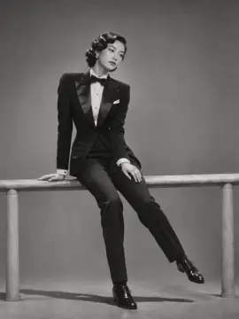</a> | <a href="https://promicat.app/poses/styles/sp079?utm_source=github&utm_medium=readme&utm_campaign=ai-photo-poses">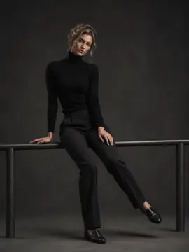</a> | <a href="https://promicat.app/poses/styles/sp079?utm_source=github&utm_medium=readme&utm_campaign=ai-photo-poses">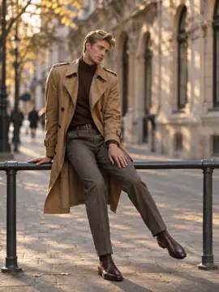</a> |

Full size: [photo](../images/photo-poses/campus/sp079-photo.webp) · [white model](../images/photo-poses/campus/sp079-pose.webp) · [try it on Promicat](https://promicat.app/poses/styles/sp079?utm_source=github&utm_medium=readme&utm_campaign=ai-photo-poses)

<details><summary>Prompt with your photo (image 1: your photo, image 2: white model)</summary>

```text
A real professional portrait photoshoot photo: a campus youth photoshoot on a university lawn by red-brick buildings, bright natural light, 50mm. Subject: the person in image 1 (keep their exact face, facial features, skin tone and hairstyle; do not beautify or swap the face), wearing a cardigan and pleated skirt or a casual shirt and chinos. Pose: sitting on a low railing, legs dangling, swinging one foot. Image 2 is a wooden artist's mannequin that shows only this body pose: copy it exactly (head, torso, arms, hands, legs, feet, which hand does what, the camera angle), but do not copy the mannequin itself: no wooden skin, no joints, no blank face. Natural, relaxed and unstiff, true skin texture. No text, no logo, no watermark. Portrait 3:4.
```

</details>

<details><summary>Prompt for the sample (fictional model)</summary>

```text
A real professional portrait photoshoot photo, the kind posted by a top portrait studio: a campus youth photoshoot on a university lawn by red-brick buildings, bright natural light, 50mm. Model: a beautiful Japanese professional fashion model in her twenties with a naturally attractive face, styled hair and natural makeup, wearing a cardigan and pleated skirt or a casual shirt and chinos. The photographer directs the model into a natural, relaxed, unstiff pose that looks caught between moments: sitting on a low railing, legs dangling, swinging one foot. Asymmetric body, soft hands, flattering angle, true skin texture, refined but not plastic, fully clothed and modest. Full body or three-quarter body in frame, the whole pose clearly readable. No text, no logo, no watermark. Portrait 3:4.
```

</details>

## Jumping on the lawn with knees bent (In motion)

| White model | Campus youth | Gothic | Cosy at home | Y2K flash |
|---|---|---|---|---|
| 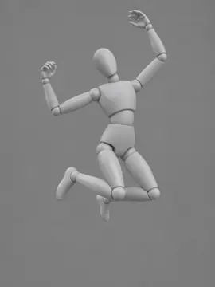 | <a href="https://promicat.app/poses/styles/sp080?utm_source=github&utm_medium=readme&utm_campaign=ai-photo-poses">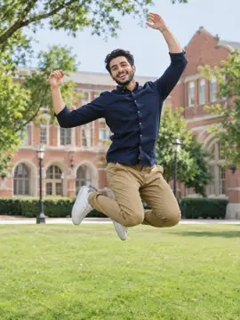</a> | <a href="https://promicat.app/poses/styles/sp080?utm_source=github&utm_medium=readme&utm_campaign=ai-photo-poses">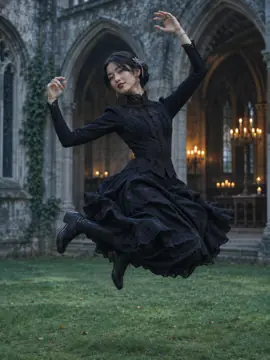</a> | <a href="https://promicat.app/poses/styles/sp080?utm_source=github&utm_medium=readme&utm_campaign=ai-photo-poses">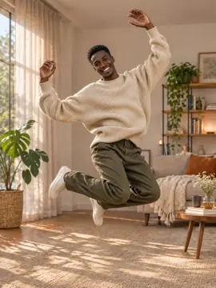</a> | <a href="https://promicat.app/poses/styles/sp080?utm_source=github&utm_medium=readme&utm_campaign=ai-photo-poses">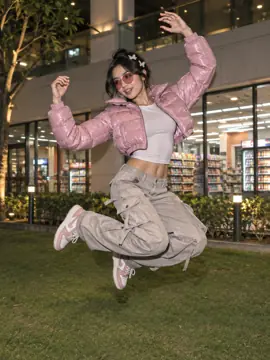</a> |

Full size: [photo](../images/photo-poses/campus/sp080-photo.webp) · [white model](../images/photo-poses/campus/sp080-pose.webp) · [try it on Promicat](https://promicat.app/poses/styles/sp080?utm_source=github&utm_medium=readme&utm_campaign=ai-photo-poses)

<details><summary>Prompt with your photo (image 1: your photo, image 2: white model)</summary>

```text
A real professional portrait photoshoot photo: a campus youth photoshoot on a university lawn by red-brick buildings, bright natural light, 50mm. Subject: the person in image 1 (keep their exact face, facial features, skin tone and hairstyle; do not beautify or swap the face), wearing a cardigan and pleated skirt or a casual shirt and chinos. Pose: jumping on the lawn with knees bent, arms up, mid-air. Image 2 is a wooden artist's mannequin that shows only this body pose: copy it exactly (head, torso, arms, hands, legs, feet, which hand does what, the camera angle), but do not copy the mannequin itself: no wooden skin, no joints, no blank face. Natural, relaxed and unstiff, true skin texture. No text, no logo, no watermark. Portrait 3:4.
```

</details>

<details><summary>Prompt for the sample (fictional model)</summary>

```text
A real professional portrait photoshoot photo, the kind posted by a top portrait studio: a campus youth photoshoot on a university lawn by red-brick buildings, bright natural light, 50mm. Model: a handsome Middle Eastern professional male model in his twenties with a well-groomed look and styled hair, wearing a cardigan and pleated skirt or a casual shirt and chinos. The photographer directs the model into a natural, relaxed, unstiff pose that looks caught between moments: jumping on the lawn with knees bent, arms up, mid-air. Asymmetric body, soft hands, flattering angle, true skin texture, refined but not plastic, fully clothed and modest. Full body or three-quarter body in frame, the whole pose clearly readable. No text, no logo, no watermark. Portrait 3:4.
```

</details>
