# New Chinese style

English · [简体中文](chinese.zh-CN.md)

10 photo poses: a sample photo and the white model drawn from it. Attach your photo first and the white model second. Try them with your own photo on [Promicat](https://promicat.app/poses?utm_source=github&utm_medium=readme&utm_campaign=ai-photo-poses).

[← Back to all styles](../README.md#photo-poses)

## Standing in a moon gate (Looking back)

<a href="https://promicat.app/poses/styles/sp091?utm_source=github&utm_medium=readme&utm_campaign=ai-photo-poses">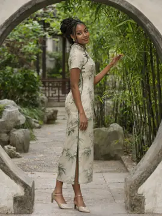</a> 

Full size: [photo](../images/photo-poses/chinese/sp091-photo.webp) · [white model](../images/photo-poses/chinese/sp091-pose.webp) · [try it on Promicat](https://promicat.app/poses/styles/sp091?utm_source=github&utm_medium=readme&utm_campaign=ai-photo-poses)

<details><summary>Prompt with your photo (image 1: your photo, image 2: white model)</summary>

```text
A real professional portrait photoshoot photo: a new-Chinese-style photoshoot in a classical garden with a moon gate and bamboo, soft overcast light, 85mm. Subject: the person in image 1 (keep their exact face, facial features, skin tone and hairstyle; do not beautify or swap the face), wearing a modern qipao-inspired dress or a Chinese-collar jacket, elegant and modest. Pose: standing in a moon gate, one hand lightly touching the bamboo, body three-quarters, looking back. Image 2 is a wooden artist's mannequin that shows only this body pose: copy it exactly (head, torso, arms, hands, legs, feet, which hand does what, the camera angle), but do not copy the mannequin itself: no wooden skin, no joints, no blank face. Natural, relaxed and unstiff, true skin texture. No text, no logo, no watermark. Portrait 3:4.
```

</details>

<details><summary>Prompt for the sample (fictional model)</summary>

```text
A real professional portrait photoshoot photo, the kind posted by a top portrait studio: a new-Chinese-style photoshoot in a classical garden with a moon gate and bamboo, soft overcast light, 85mm. Model: a beautiful East African professional fashion model in her twenties with a naturally attractive face, styled hair and natural makeup, wearing a modern qipao-inspired dress or a Chinese-collar jacket, elegant and modest. The photographer directs the model into a natural, relaxed, unstiff pose that looks caught between moments: standing in a moon gate, one hand lightly touching the bamboo, body three-quarters, looking back. Asymmetric body, soft hands, flattering angle, true skin texture, refined but not plastic, fully clothed and modest. Full body or three-quarter body in frame, the whole pose clearly readable. No text, no logo, no watermark. Portrait 3:4.
```

</details>

## Holding a round silk fan below the eyes (Upper body)

<a href="https://promicat.app/poses/styles/sp092?utm_source=github&utm_medium=readme&utm_campaign=ai-photo-poses"></a> 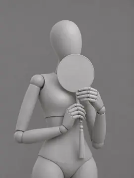

Full size: [photo](../images/photo-poses/chinese/sp092-photo.webp) · [white model](../images/photo-poses/chinese/sp092-pose.webp) · [try it on Promicat](https://promicat.app/poses/styles/sp092?utm_source=github&utm_medium=readme&utm_campaign=ai-photo-poses)

<details><summary>Prompt with your photo (image 1: your photo, image 2: white model)</summary>

```text
A real professional portrait photoshoot photo: a new-Chinese-style photoshoot in a classical garden with a moon gate and bamboo, soft overcast light, 85mm. Subject: the person in image 1 (keep their exact face, facial features, skin tone and hairstyle; do not beautify or swap the face), wearing a modern qipao-inspired dress or a Chinese-collar jacket, elegant and modest. Pose: holding a round silk fan below the eyes, looking sideways. Image 2 is a wooden artist's mannequin that shows only this body pose: copy it exactly (head, torso, arms, hands, legs, feet, which hand does what, the camera angle), but do not copy the mannequin itself: no wooden skin, no joints, no blank face. Natural, relaxed and unstiff, true skin texture. No text, no logo, no watermark. Portrait 3:4.
```

</details>

<details><summary>Prompt for the sample (fictional model)</summary>

```text
A real professional portrait photoshoot photo, the kind posted by a top portrait studio: a new-Chinese-style photoshoot in a classical garden with a moon gate and bamboo, soft overcast light, 85mm. Model: a beautiful Black professional fashion model in her twenties with a naturally attractive face, styled hair and natural makeup, wearing a modern qipao-inspired dress or a Chinese-collar jacket, elegant and modest. The photographer directs the model into a natural, relaxed, unstiff pose that looks caught between moments: holding a round silk fan below the eyes, looking sideways. Asymmetric body, soft hands, flattering angle, true skin texture, refined but not plastic, fully clothed and modest. Waist-up framing, both arms and hands readable. No text, no logo, no watermark. Portrait 3:4.
```

</details>

## Sitting sideways on a covered-walkway bench (Sitting)

<a href="https://promicat.app/poses/styles/sp093?utm_source=github&utm_medium=readme&utm_campaign=ai-photo-poses"></a> 

Full size: [photo](../images/photo-poses/chinese/sp093-photo.webp) · [white model](../images/photo-poses/chinese/sp093-pose.webp) · [try it on Promicat](https://promicat.app/poses/styles/sp093?utm_source=github&utm_medium=readme&utm_campaign=ai-photo-poses)

<details><summary>Prompt with your photo (image 1: your photo, image 2: white model)</summary>

```text
A real professional portrait photoshoot photo: a new-Chinese-style photoshoot in a classical garden with a moon gate and bamboo, soft overcast light, 85mm. Subject: the person in image 1 (keep their exact face, facial features, skin tone and hairstyle; do not beautify or swap the face), wearing a modern qipao-inspired dress or a Chinese-collar jacket, elegant and modest. Pose: sitting sideways on a covered-walkway bench, one arm on the railing, gazing at the pond. Image 2 is a wooden artist's mannequin that shows only this body pose: copy it exactly (head, torso, arms, hands, legs, feet, which hand does what, the camera angle), but do not copy the mannequin itself: no wooden skin, no joints, no blank face. Natural, relaxed and unstiff, true skin texture. No text, no logo, no watermark. Portrait 3:4.
```

</details>

<details><summary>Prompt for the sample (fictional model)</summary>

```text
A real professional portrait photoshoot photo, the kind posted by a top portrait studio: a new-Chinese-style photoshoot in a classical garden with a moon gate and bamboo, soft overcast light, 85mm. Model: a handsome Scandinavian professional male model in his twenties with a well-groomed look and styled hair, wearing a modern qipao-inspired dress or a Chinese-collar jacket, elegant and modest. The photographer directs the model into a natural, relaxed, unstiff pose that looks caught between moments: sitting sideways on a covered-walkway bench, one arm on the railing, gazing at the pond. Asymmetric body, soft hands, flattering angle, true skin texture, refined but not plastic, fully clothed and modest. Full body or three-quarter body in frame, the whole pose clearly readable. No text, no logo, no watermark. Portrait 3:4.
```

</details>

## Standing on a stone bridge holding an oil-paper umbrella on the shoulder (Standing)

<a href="https://promicat.app/poses/styles/sp094?utm_source=github&utm_medium=readme&utm_campaign=ai-photo-poses"></a> 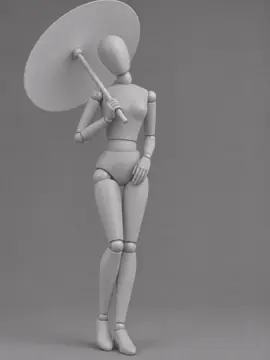

Full size: [photo](../images/photo-poses/chinese/sp094-photo.webp) · [white model](../images/photo-poses/chinese/sp094-pose.webp) · [try it on Promicat](https://promicat.app/poses/styles/sp094?utm_source=github&utm_medium=readme&utm_campaign=ai-photo-poses)

<details><summary>Prompt with your photo (image 1: your photo, image 2: white model)</summary>

```text
A real professional portrait photoshoot photo: a new-Chinese-style photoshoot in a classical garden with a moon gate and bamboo, soft overcast light, 85mm. Subject: the person in image 1 (keep their exact face, facial features, skin tone and hairstyle; do not beautify or swap the face), wearing a modern qipao-inspired dress or a Chinese-collar jacket, elegant and modest. Pose: standing on a stone bridge holding an oil-paper umbrella on the shoulder. Image 2 is a wooden artist's mannequin that shows only this body pose: copy it exactly (head, torso, arms, hands, legs, feet, which hand does what, the camera angle), but do not copy the mannequin itself: no wooden skin, no joints, no blank face. Natural, relaxed and unstiff, true skin texture. No text, no logo, no watermark. Portrait 3:4.
```

</details>

<details><summary>Prompt for the sample (fictional model)</summary>

```text
A real professional portrait photoshoot photo, the kind posted by a top portrait studio: a new-Chinese-style photoshoot in a classical garden with a moon gate and bamboo, soft overcast light, 85mm. Model: a beautiful East Asian professional fashion model in her twenties with a naturally attractive face, styled hair and natural makeup, wearing a modern qipao-inspired dress or a Chinese-collar jacket, elegant and modest. The photographer directs the model into a natural, relaxed, unstiff pose that looks caught between moments: standing on a stone bridge holding an oil-paper umbrella on the shoulder. Asymmetric body, soft hands, flattering angle, true skin texture, refined but not plastic, fully clothed and modest. Full body or three-quarter body in frame, the whole pose clearly readable. No text, no logo, no watermark. Portrait 3:4.
```

</details>

## Leaning against a carved lattice window (Leaning)

<a href="https://promicat.app/poses/styles/sp095?utm_source=github&utm_medium=readme&utm_campaign=ai-photo-poses">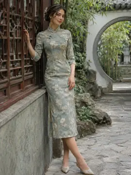</a> 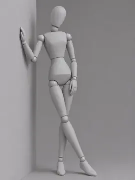

Full size: [photo](../images/photo-poses/chinese/sp095-photo.webp) · [white model](../images/photo-poses/chinese/sp095-pose.webp) · [try it on Promicat](https://promicat.app/poses/styles/sp095?utm_source=github&utm_medium=readme&utm_campaign=ai-photo-poses)

<details><summary>Prompt with your photo (image 1: your photo, image 2: white model)</summary>

```text
A real professional portrait photoshoot photo: a new-Chinese-style photoshoot in a classical garden with a moon gate and bamboo, soft overcast light, 85mm. Subject: the person in image 1 (keep their exact face, facial features, skin tone and hairstyle; do not beautify or swap the face), wearing a modern qipao-inspired dress or a Chinese-collar jacket, elegant and modest. Pose: leaning against a carved lattice window, fingertips on the wood. Image 2 is a wooden artist's mannequin that shows only this body pose: copy it exactly (head, torso, arms, hands, legs, feet, which hand does what, the camera angle), but do not copy the mannequin itself: no wooden skin, no joints, no blank face. Natural, relaxed and unstiff, true skin texture. No text, no logo, no watermark. Portrait 3:4.
```

</details>

<details><summary>Prompt for the sample (fictional model)</summary>

```text
A real professional portrait photoshoot photo, the kind posted by a top portrait studio: a new-Chinese-style photoshoot in a classical garden with a moon gate and bamboo, soft overcast light, 85mm. Model: a beautiful mixed-race professional fashion model in her twenties with a naturally attractive face, styled hair and natural makeup, wearing a modern qipao-inspired dress or a Chinese-collar jacket, elegant and modest. The photographer directs the model into a natural, relaxed, unstiff pose that looks caught between moments: leaning against a carved lattice window, fingertips on the wood. Asymmetric body, soft hands, flattering angle, true skin texture, refined but not plastic, fully clothed and modest. Full body or three-quarter body in frame, the whole pose clearly readable. No text, no logo, no watermark. Portrait 3:4.
```

</details>

## Walking up garden stone steps (Walking)

<a href="https://promicat.app/poses/styles/sp096?utm_source=github&utm_medium=readme&utm_campaign=ai-photo-poses">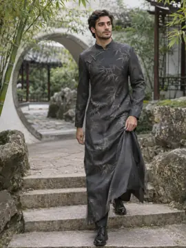</a> 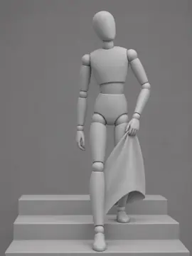

Full size: [photo](../images/photo-poses/chinese/sp096-photo.webp) · [white model](../images/photo-poses/chinese/sp096-pose.webp) · [try it on Promicat](https://promicat.app/poses/styles/sp096?utm_source=github&utm_medium=readme&utm_campaign=ai-photo-poses)

<details><summary>Prompt with your photo (image 1: your photo, image 2: white model)</summary>

```text
A real professional portrait photoshoot photo: a new-Chinese-style photoshoot in a classical garden with a moon gate and bamboo, soft overcast light, 85mm. Subject: the person in image 1 (keep their exact face, facial features, skin tone and hairstyle; do not beautify or swap the face), wearing a modern qipao-inspired dress or a Chinese-collar jacket, elegant and modest. Pose: walking up garden stone steps, lifting the dress hem slightly, looking ahead. Image 2 is a wooden artist's mannequin that shows only this body pose: copy it exactly (head, torso, arms, hands, legs, feet, which hand does what, the camera angle), but do not copy the mannequin itself: no wooden skin, no joints, no blank face. Natural, relaxed and unstiff, true skin texture. No text, no logo, no watermark. Portrait 3:4.
```

</details>

<details><summary>Prompt for the sample (fictional model)</summary>

```text
A real professional portrait photoshoot photo, the kind posted by a top portrait studio: a new-Chinese-style photoshoot in a classical garden with a moon gate and bamboo, soft overcast light, 85mm. Model: a handsome Mediterranean professional male model in his twenties with a well-groomed look and styled hair, wearing a modern qipao-inspired dress or a Chinese-collar jacket, elegant and modest. The photographer directs the model into a natural, relaxed, unstiff pose that looks caught between moments: walking up garden stone steps, lifting the dress hem slightly, looking ahead. Asymmetric body, soft hands, flattering angle, true skin texture, refined but not plastic, fully clothed and modest. Full body or three-quarter body in frame, the whole pose clearly readable. No text, no logo, no watermark. Portrait 3:4.
```

</details>

## Crouching at the pond edge (Crouching)

<a href="https://promicat.app/poses/styles/sp097?utm_source=github&utm_medium=readme&utm_campaign=ai-photo-poses"></a> 

Full size: [photo](../images/photo-poses/chinese/sp097-photo.webp) · [white model](../images/photo-poses/chinese/sp097-pose.webp) · [try it on Promicat](https://promicat.app/poses/styles/sp097?utm_source=github&utm_medium=readme&utm_campaign=ai-photo-poses)

<details><summary>Prompt with your photo (image 1: your photo, image 2: white model)</summary>

```text
A real professional portrait photoshoot photo: a new-Chinese-style photoshoot in a classical garden with a moon gate and bamboo, soft overcast light, 85mm. Subject: the person in image 1 (keep their exact face, facial features, skin tone and hairstyle; do not beautify or swap the face), wearing a modern qipao-inspired dress or a Chinese-collar jacket, elegant and modest. Pose: crouching at the pond edge, one hand trailing in the water. Image 2 is a wooden artist's mannequin that shows only this body pose: copy it exactly (head, torso, arms, hands, legs, feet, which hand does what, the camera angle), but do not copy the mannequin itself: no wooden skin, no joints, no blank face. Natural, relaxed and unstiff, true skin texture. No text, no logo, no watermark. Portrait 3:4.
```

</details>

<details><summary>Prompt for the sample (fictional model)</summary>

```text
A real professional portrait photoshoot photo, the kind posted by a top portrait studio: a new-Chinese-style photoshoot in a classical garden with a moon gate and bamboo, soft overcast light, 85mm. Model: a beautiful Southeast Asian professional fashion model in her twenties with a naturally attractive face, styled hair and natural makeup, wearing a modern qipao-inspired dress or a Chinese-collar jacket, elegant and modest. The photographer directs the model into a natural, relaxed, unstiff pose that looks caught between moments: crouching at the pond edge, one hand trailing in the water. Asymmetric body, soft hands, flattering angle, true skin texture, refined but not plastic, fully clothed and modest. Full body or three-quarter body in frame, the whole pose clearly readable. No text, no logo, no watermark. Portrait 3:4.
```

</details>

## Sitting at a tea table pouring tea (Sitting)

<a href="https://promicat.app/poses/styles/sp098?utm_source=github&utm_medium=readme&utm_campaign=ai-photo-poses">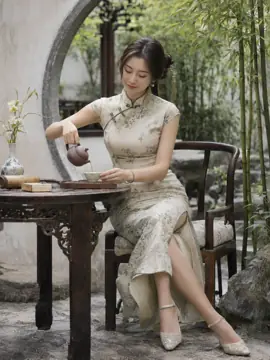</a> 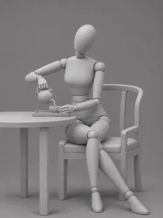

Full size: [photo](../images/photo-poses/chinese/sp098-photo.webp) · [white model](../images/photo-poses/chinese/sp098-pose.webp) · [try it on Promicat](https://promicat.app/poses/styles/sp098?utm_source=github&utm_medium=readme&utm_campaign=ai-photo-poses)

<details><summary>Prompt with your photo (image 1: your photo, image 2: white model)</summary>

```text
A real professional portrait photoshoot photo: a new-Chinese-style photoshoot in a classical garden with a moon gate and bamboo, soft overcast light, 85mm. Subject: the person in image 1 (keep their exact face, facial features, skin tone and hairstyle; do not beautify or swap the face), wearing a modern qipao-inspired dress or a Chinese-collar jacket, elegant and modest. Pose: sitting at a tea table pouring tea, head bent. Image 2 is a wooden artist's mannequin that shows only this body pose: copy it exactly (head, torso, arms, hands, legs, feet, which hand does what, the camera angle), but do not copy the mannequin itself: no wooden skin, no joints, no blank face. Natural, relaxed and unstiff, true skin texture. No text, no logo, no watermark. Portrait 3:4.
```

</details>

<details><summary>Prompt for the sample (fictional model)</summary>

```text
A real professional portrait photoshoot photo, the kind posted by a top portrait studio: a new-Chinese-style photoshoot in a classical garden with a moon gate and bamboo, soft overcast light, 85mm. Model: a beautiful Japanese professional fashion model in her twenties with a naturally attractive face, styled hair and natural makeup, wearing a modern qipao-inspired dress or a Chinese-collar jacket, elegant and modest. The photographer directs the model into a natural, relaxed, unstiff pose that looks caught between moments: sitting at a tea table pouring tea, head bent. Asymmetric body, soft hands, flattering angle, true skin texture, refined but not plastic, fully clothed and modest. Full body or three-quarter body in frame, the whole pose clearly readable. No text, no logo, no watermark. Portrait 3:4.
```

</details>

## Holding a plum blossom twig to the nose (Upper body)

<a href="https://promicat.app/poses/styles/sp099?utm_source=github&utm_medium=readme&utm_campaign=ai-photo-poses"></a> 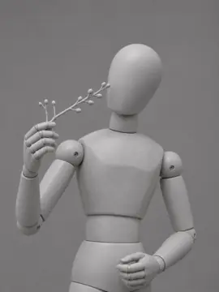

Full size: [photo](../images/photo-poses/chinese/sp099-photo.webp) · [white model](../images/photo-poses/chinese/sp099-pose.webp) · [try it on Promicat](https://promicat.app/poses/styles/sp099?utm_source=github&utm_medium=readme&utm_campaign=ai-photo-poses)

<details><summary>Prompt with your photo (image 1: your photo, image 2: white model)</summary>

```text
A real professional portrait photoshoot photo: a new-Chinese-style photoshoot in a classical garden with a moon gate and bamboo, soft overcast light, 85mm. Subject: the person in image 1 (keep their exact face, facial features, skin tone and hairstyle; do not beautify or swap the face), wearing a modern qipao-inspired dress or a Chinese-collar jacket, elegant and modest. Pose: holding a plum blossom twig to the nose, eyes closed. Image 2 is a wooden artist's mannequin that shows only this body pose: copy it exactly (head, torso, arms, hands, legs, feet, which hand does what, the camera angle), but do not copy the mannequin itself: no wooden skin, no joints, no blank face. Natural, relaxed and unstiff, true skin texture. No text, no logo, no watermark. Portrait 3:4.
```

</details>

<details><summary>Prompt for the sample (fictional model)</summary>

```text
A real professional portrait photoshoot photo, the kind posted by a top portrait studio: a new-Chinese-style photoshoot in a classical garden with a moon gate and bamboo, soft overcast light, 85mm. Model: a handsome Middle Eastern professional male model in his twenties with a well-groomed look and styled hair, wearing a modern qipao-inspired dress or a Chinese-collar jacket, elegant and modest. The photographer directs the model into a natural, relaxed, unstiff pose that looks caught between moments: holding a plum blossom twig to the nose, eyes closed. Asymmetric body, soft hands, flattering angle, true skin texture, refined but not plastic, fully clothed and modest. Waist-up framing, both arms and hands readable. No text, no logo, no watermark. Portrait 3:4.
```

</details>

## Turning in the bamboo grove so the dress swings (In motion)

<a href="https://promicat.app/poses/styles/sp100?utm_source=github&utm_medium=readme&utm_campaign=ai-photo-poses">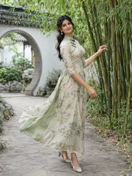</a> 

Full size: [photo](../images/photo-poses/chinese/sp100-photo.webp) · [white model](../images/photo-poses/chinese/sp100-pose.webp) · [try it on Promicat](https://promicat.app/poses/styles/sp100?utm_source=github&utm_medium=readme&utm_campaign=ai-photo-poses)

<details><summary>Prompt with your photo (image 1: your photo, image 2: white model)</summary>

```text
A real professional portrait photoshoot photo: a new-Chinese-style photoshoot in a classical garden with a moon gate and bamboo, soft overcast light, 85mm. Subject: the person in image 1 (keep their exact face, facial features, skin tone and hairstyle; do not beautify or swap the face), wearing a modern qipao-inspired dress or a Chinese-collar jacket, elegant and modest. Pose: turning in the bamboo grove so the dress swings, one hand lifted. Image 2 is a wooden artist's mannequin that shows only this body pose: copy it exactly (head, torso, arms, hands, legs, feet, which hand does what, the camera angle), but do not copy the mannequin itself: no wooden skin, no joints, no blank face. Natural, relaxed and unstiff, true skin texture. No text, no logo, no watermark. Portrait 3:4.
```

</details>

<details><summary>Prompt for the sample (fictional model)</summary>

```text
A real professional portrait photoshoot photo, the kind posted by a top portrait studio: a new-Chinese-style photoshoot in a classical garden with a moon gate and bamboo, soft overcast light, 85mm. Model: a beautiful Indian professional fashion model in her twenties with a naturally attractive face, styled hair and natural makeup, wearing a modern qipao-inspired dress or a Chinese-collar jacket, elegant and modest. The photographer directs the model into a natural, relaxed, unstiff pose that looks caught between moments: turning in the bamboo grove so the dress swings, one hand lifted. Asymmetric body, soft hands, flattering angle, true skin texture, refined but not plastic, fully clothed and modest. Full body or three-quarter body in frame, the whole pose clearly readable. No text, no logo, no watermark. Portrait 3:4.
```

</details>
