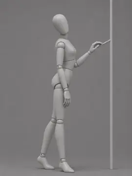
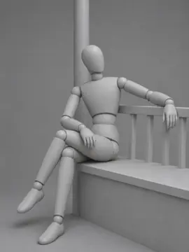
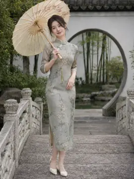
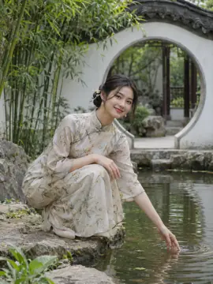
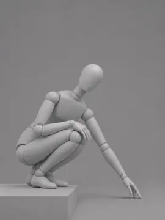
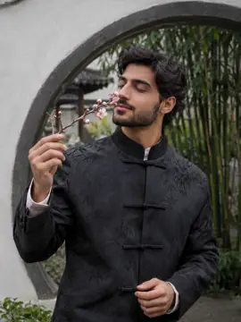

# 新中式 · New Chinese style

10 组写真姿势：左边是写真照，右边是照着它画的木头白模。白模可以当姿势参考图，和你的照片一起发给生图模型。 在线试用：[Promicat 姿势库](https://promicat.app/zh/poses?ref=github)

[← 返回目录](../README.md#写真姿势)

## 月洞门回眸（回眸）

 

大图：[写真照](../images/photo-poses/chinese/sp091-photo.webp) · [白模](../images/photo-poses/chinese/sp091-pose.webp)

<details><summary>提示词：用你的照片（附图 1 你的照片，附图 2 白模）</summary>

```text
A real professional portrait photoshoot photo: a new-Chinese-style photoshoot in a classical garden with a moon gate and bamboo, soft overcast light, 85mm. Subject: the person in image 1 (keep their exact face, facial features, skin tone and hairstyle; do not beautify or swap the face), wearing a modern qipao-inspired dress or a Chinese-collar jacket, elegant and modest. Pose: standing in a moon gate, one hand lightly touching the bamboo, body three-quarters, looking back. Image 2 is a wooden artist's mannequin that shows only this body pose: copy it exactly (head, torso, arms, hands, legs, feet, which hand does what, the camera angle), but do not copy the mannequin itself: no wooden skin, no joints, no blank face. Natural, relaxed and unstiff, true skin texture. No text, no logo, no watermark. Portrait 3:4.
```

</details>

<details><summary>提示词：生成示例图（虚构模特）</summary>

```text
A real professional portrait photoshoot photo, the kind posted by a top portrait studio: a new-Chinese-style photoshoot in a classical garden with a moon gate and bamboo, soft overcast light, 85mm. Model: a beautiful East African professional fashion model in her twenties with a naturally attractive face, styled hair and natural makeup, wearing a modern qipao-inspired dress or a Chinese-collar jacket, elegant and modest. The photographer directs the model into a natural, relaxed, unstiff pose that looks caught between moments: standing in a moon gate, one hand lightly touching the bamboo, body three-quarters, looking back. Asymmetric body, soft hands, flattering angle, true skin texture, refined but not plastic, fully clothed and modest. Full body or three-quarter body in frame, the whole pose clearly readable. No text, no logo, no watermark. Portrait 3:4.
```

</details>

## 执扇半遮（半身）

 

大图：[写真照](../images/photo-poses/chinese/sp092-photo.webp) · [白模](../images/photo-poses/chinese/sp092-pose.webp)

<details><summary>提示词：用你的照片（附图 1 你的照片，附图 2 白模）</summary>

```text
A real professional portrait photoshoot photo: a new-Chinese-style photoshoot in a classical garden with a moon gate and bamboo, soft overcast light, 85mm. Subject: the person in image 1 (keep their exact face, facial features, skin tone and hairstyle; do not beautify or swap the face), wearing a modern qipao-inspired dress or a Chinese-collar jacket, elegant and modest. Pose: holding a round silk fan below the eyes, looking sideways. Image 2 is a wooden artist's mannequin that shows only this body pose: copy it exactly (head, torso, arms, hands, legs, feet, which hand does what, the camera angle), but do not copy the mannequin itself: no wooden skin, no joints, no blank face. Natural, relaxed and unstiff, true skin texture. No text, no logo, no watermark. Portrait 3:4.
```

</details>

<details><summary>提示词：生成示例图（虚构模特）</summary>

```text
A real professional portrait photoshoot photo, the kind posted by a top portrait studio: a new-Chinese-style photoshoot in a classical garden with a moon gate and bamboo, soft overcast light, 85mm. Model: a beautiful Black professional fashion model in her twenties with a naturally attractive face, styled hair and natural makeup, wearing a modern qipao-inspired dress or a Chinese-collar jacket, elegant and modest. The photographer directs the model into a natural, relaxed, unstiff pose that looks caught between moments: holding a round silk fan below the eyes, looking sideways. Asymmetric body, soft hands, flattering angle, true skin texture, refined but not plastic, fully clothed and modest. Waist-up framing, both arms and hands readable. No text, no logo, no watermark. Portrait 3:4.
```

</details>

## 廊下坐栏（坐）

 

大图：[写真照](../images/photo-poses/chinese/sp093-photo.webp) · [白模](../images/photo-poses/chinese/sp093-pose.webp)

<details><summary>提示词：用你的照片（附图 1 你的照片，附图 2 白模）</summary>

```text
A real professional portrait photoshoot photo: a new-Chinese-style photoshoot in a classical garden with a moon gate and bamboo, soft overcast light, 85mm. Subject: the person in image 1 (keep their exact face, facial features, skin tone and hairstyle; do not beautify or swap the face), wearing a modern qipao-inspired dress or a Chinese-collar jacket, elegant and modest. Pose: sitting sideways on a covered-walkway bench, one arm on the railing, gazing at the pond. Image 2 is a wooden artist's mannequin that shows only this body pose: copy it exactly (head, torso, arms, hands, legs, feet, which hand does what, the camera angle), but do not copy the mannequin itself: no wooden skin, no joints, no blank face. Natural, relaxed and unstiff, true skin texture. No text, no logo, no watermark. Portrait 3:4.
```

</details>

<details><summary>提示词：生成示例图（虚构模特）</summary>

```text
A real professional portrait photoshoot photo, the kind posted by a top portrait studio: a new-Chinese-style photoshoot in a classical garden with a moon gate and bamboo, soft overcast light, 85mm. Model: a handsome Scandinavian professional male model in his twenties with a well-groomed look and styled hair, wearing a modern qipao-inspired dress or a Chinese-collar jacket, elegant and modest. The photographer directs the model into a natural, relaxed, unstiff pose that looks caught between moments: sitting sideways on a covered-walkway bench, one arm on the railing, gazing at the pond. Asymmetric body, soft hands, flattering angle, true skin texture, refined but not plastic, fully clothed and modest. Full body or three-quarter body in frame, the whole pose clearly readable. No text, no logo, no watermark. Portrait 3:4.
```

</details>

## 撑油纸伞（站）

 

大图：[写真照](../images/photo-poses/chinese/sp094-photo.webp) · [白模](../images/photo-poses/chinese/sp094-pose.webp)

<details><summary>提示词：用你的照片（附图 1 你的照片，附图 2 白模）</summary>

```text
A real professional portrait photoshoot photo: a new-Chinese-style photoshoot in a classical garden with a moon gate and bamboo, soft overcast light, 85mm. Subject: the person in image 1 (keep their exact face, facial features, skin tone and hairstyle; do not beautify or swap the face), wearing a modern qipao-inspired dress or a Chinese-collar jacket, elegant and modest. Pose: standing on a stone bridge holding an oil-paper umbrella on the shoulder. Image 2 is a wooden artist's mannequin that shows only this body pose: copy it exactly (head, torso, arms, hands, legs, feet, which hand does what, the camera angle), but do not copy the mannequin itself: no wooden skin, no joints, no blank face. Natural, relaxed and unstiff, true skin texture. No text, no logo, no watermark. Portrait 3:4.
```

</details>

<details><summary>提示词：生成示例图（虚构模特）</summary>

```text
A real professional portrait photoshoot photo, the kind posted by a top portrait studio: a new-Chinese-style photoshoot in a classical garden with a moon gate and bamboo, soft overcast light, 85mm. Model: a beautiful East Asian professional fashion model in her twenties with a naturally attractive face, styled hair and natural makeup, wearing a modern qipao-inspired dress or a Chinese-collar jacket, elegant and modest. The photographer directs the model into a natural, relaxed, unstiff pose that looks caught between moments: standing on a stone bridge holding an oil-paper umbrella on the shoulder. Asymmetric body, soft hands, flattering angle, true skin texture, refined but not plastic, fully clothed and modest. Full body or three-quarter body in frame, the whole pose clearly readable. No text, no logo, no watermark. Portrait 3:4.
```

</details>

## 倚窗格（靠）

 

大图：[写真照](../images/photo-poses/chinese/sp095-photo.webp) · [白模](../images/photo-poses/chinese/sp095-pose.webp)

<details><summary>提示词：用你的照片（附图 1 你的照片，附图 2 白模）</summary>

```text
A real professional portrait photoshoot photo: a new-Chinese-style photoshoot in a classical garden with a moon gate and bamboo, soft overcast light, 85mm. Subject: the person in image 1 (keep their exact face, facial features, skin tone and hairstyle; do not beautify or swap the face), wearing a modern qipao-inspired dress or a Chinese-collar jacket, elegant and modest. Pose: leaning against a carved lattice window, fingertips on the wood. Image 2 is a wooden artist's mannequin that shows only this body pose: copy it exactly (head, torso, arms, hands, legs, feet, which hand does what, the camera angle), but do not copy the mannequin itself: no wooden skin, no joints, no blank face. Natural, relaxed and unstiff, true skin texture. No text, no logo, no watermark. Portrait 3:4.
```

</details>

<details><summary>提示词：生成示例图（虚构模特）</summary>

```text
A real professional portrait photoshoot photo, the kind posted by a top portrait studio: a new-Chinese-style photoshoot in a classical garden with a moon gate and bamboo, soft overcast light, 85mm. Model: a beautiful mixed-race professional fashion model in her twenties with a naturally attractive face, styled hair and natural makeup, wearing a modern qipao-inspired dress or a Chinese-collar jacket, elegant and modest. The photographer directs the model into a natural, relaxed, unstiff pose that looks caught between moments: leaning against a carved lattice window, fingertips on the wood. Asymmetric body, soft hands, flattering angle, true skin texture, refined but not plastic, fully clothed and modest. Full body or three-quarter body in frame, the whole pose clearly readable. No text, no logo, no watermark. Portrait 3:4.
```

</details>

## 拾阶而上（走）

 

大图：[写真照](../images/photo-poses/chinese/sp096-photo.webp) · [白模](../images/photo-poses/chinese/sp096-pose.webp)

<details><summary>提示词：用你的照片（附图 1 你的照片，附图 2 白模）</summary>

```text
A real professional portrait photoshoot photo: a new-Chinese-style photoshoot in a classical garden with a moon gate and bamboo, soft overcast light, 85mm. Subject: the person in image 1 (keep their exact face, facial features, skin tone and hairstyle; do not beautify or swap the face), wearing a modern qipao-inspired dress or a Chinese-collar jacket, elegant and modest. Pose: walking up garden stone steps, lifting the dress hem slightly, looking ahead. Image 2 is a wooden artist's mannequin that shows only this body pose: copy it exactly (head, torso, arms, hands, legs, feet, which hand does what, the camera angle), but do not copy the mannequin itself: no wooden skin, no joints, no blank face. Natural, relaxed and unstiff, true skin texture. No text, no logo, no watermark. Portrait 3:4.
```

</details>

<details><summary>提示词：生成示例图（虚构模特）</summary>

```text
A real professional portrait photoshoot photo, the kind posted by a top portrait studio: a new-Chinese-style photoshoot in a classical garden with a moon gate and bamboo, soft overcast light, 85mm. Model: a handsome Mediterranean professional male model in his twenties with a well-groomed look and styled hair, wearing a modern qipao-inspired dress or a Chinese-collar jacket, elegant and modest. The photographer directs the model into a natural, relaxed, unstiff pose that looks caught between moments: walking up garden stone steps, lifting the dress hem slightly, looking ahead. Asymmetric body, soft hands, flattering angle, true skin texture, refined but not plastic, fully clothed and modest. Full body or three-quarter body in frame, the whole pose clearly readable. No text, no logo, no watermark. Portrait 3:4.
```

</details>

## 池边蹲（蹲跪）

 

大图：[写真照](../images/photo-poses/chinese/sp097-photo.webp) · [白模](../images/photo-poses/chinese/sp097-pose.webp)

<details><summary>提示词：用你的照片（附图 1 你的照片，附图 2 白模）</summary>

```text
A real professional portrait photoshoot photo: a new-Chinese-style photoshoot in a classical garden with a moon gate and bamboo, soft overcast light, 85mm. Subject: the person in image 1 (keep their exact face, facial features, skin tone and hairstyle; do not beautify or swap the face), wearing a modern qipao-inspired dress or a Chinese-collar jacket, elegant and modest. Pose: crouching at the pond edge, one hand trailing in the water. Image 2 is a wooden artist's mannequin that shows only this body pose: copy it exactly (head, torso, arms, hands, legs, feet, which hand does what, the camera angle), but do not copy the mannequin itself: no wooden skin, no joints, no blank face. Natural, relaxed and unstiff, true skin texture. No text, no logo, no watermark. Portrait 3:4.
```

</details>

<details><summary>提示词：生成示例图（虚构模特）</summary>

```text
A real professional portrait photoshoot photo, the kind posted by a top portrait studio: a new-Chinese-style photoshoot in a classical garden with a moon gate and bamboo, soft overcast light, 85mm. Model: a beautiful Southeast Asian professional fashion model in her twenties with a naturally attractive face, styled hair and natural makeup, wearing a modern qipao-inspired dress or a Chinese-collar jacket, elegant and modest. The photographer directs the model into a natural, relaxed, unstiff pose that looks caught between moments: crouching at the pond edge, one hand trailing in the water. Asymmetric body, soft hands, flattering angle, true skin texture, refined but not plastic, fully clothed and modest. Full body or three-quarter body in frame, the whole pose clearly readable. No text, no logo, no watermark. Portrait 3:4.
```

</details>

## 品茶（坐）

 

大图：[写真照](../images/photo-poses/chinese/sp098-photo.webp) · [白模](../images/photo-poses/chinese/sp098-pose.webp)

<details><summary>提示词：用你的照片（附图 1 你的照片，附图 2 白模）</summary>

```text
A real professional portrait photoshoot photo: a new-Chinese-style photoshoot in a classical garden with a moon gate and bamboo, soft overcast light, 85mm. Subject: the person in image 1 (keep their exact face, facial features, skin tone and hairstyle; do not beautify or swap the face), wearing a modern qipao-inspired dress or a Chinese-collar jacket, elegant and modest. Pose: sitting at a tea table pouring tea, head bent. Image 2 is a wooden artist's mannequin that shows only this body pose: copy it exactly (head, torso, arms, hands, legs, feet, which hand does what, the camera angle), but do not copy the mannequin itself: no wooden skin, no joints, no blank face. Natural, relaxed and unstiff, true skin texture. No text, no logo, no watermark. Portrait 3:4.
```

</details>

<details><summary>提示词：生成示例图（虚构模特）</summary>

```text
A real professional portrait photoshoot photo, the kind posted by a top portrait studio: a new-Chinese-style photoshoot in a classical garden with a moon gate and bamboo, soft overcast light, 85mm. Model: a beautiful Japanese professional fashion model in her twenties with a naturally attractive face, styled hair and natural makeup, wearing a modern qipao-inspired dress or a Chinese-collar jacket, elegant and modest. The photographer directs the model into a natural, relaxed, unstiff pose that looks caught between moments: sitting at a tea table pouring tea, head bent. Asymmetric body, soft hands, flattering angle, true skin texture, refined but not plastic, fully clothed and modest. Full body or three-quarter body in frame, the whole pose clearly readable. No text, no logo, no watermark. Portrait 3:4.
```

</details>

## 拈花（半身）

 

大图：[写真照](../images/photo-poses/chinese/sp099-photo.webp) · [白模](../images/photo-poses/chinese/sp099-pose.webp)

<details><summary>提示词：用你的照片（附图 1 你的照片，附图 2 白模）</summary>

```text
A real professional portrait photoshoot photo: a new-Chinese-style photoshoot in a classical garden with a moon gate and bamboo, soft overcast light, 85mm. Subject: the person in image 1 (keep their exact face, facial features, skin tone and hairstyle; do not beautify or swap the face), wearing a modern qipao-inspired dress or a Chinese-collar jacket, elegant and modest. Pose: holding a plum blossom twig to the nose, eyes closed. Image 2 is a wooden artist's mannequin that shows only this body pose: copy it exactly (head, torso, arms, hands, legs, feet, which hand does what, the camera angle), but do not copy the mannequin itself: no wooden skin, no joints, no blank face. Natural, relaxed and unstiff, true skin texture. No text, no logo, no watermark. Portrait 3:4.
```

</details>

<details><summary>提示词：生成示例图（虚构模特）</summary>

```text
A real professional portrait photoshoot photo, the kind posted by a top portrait studio: a new-Chinese-style photoshoot in a classical garden with a moon gate and bamboo, soft overcast light, 85mm. Model: a handsome Middle Eastern professional male model in his twenties with a well-groomed look and styled hair, wearing a modern qipao-inspired dress or a Chinese-collar jacket, elegant and modest. The photographer directs the model into a natural, relaxed, unstiff pose that looks caught between moments: holding a plum blossom twig to the nose, eyes closed. Asymmetric body, soft hands, flattering angle, true skin texture, refined but not plastic, fully clothed and modest. Waist-up framing, both arms and hands readable. No text, no logo, no watermark. Portrait 3:4.
```

</details>

## 竹林转身（动态）

 

大图：[写真照](../images/photo-poses/chinese/sp100-photo.webp) · [白模](../images/photo-poses/chinese/sp100-pose.webp)

<details><summary>提示词：用你的照片（附图 1 你的照片，附图 2 白模）</summary>

```text
A real professional portrait photoshoot photo: a new-Chinese-style photoshoot in a classical garden with a moon gate and bamboo, soft overcast light, 85mm. Subject: the person in image 1 (keep their exact face, facial features, skin tone and hairstyle; do not beautify or swap the face), wearing a modern qipao-inspired dress or a Chinese-collar jacket, elegant and modest. Pose: turning in the bamboo grove so the dress swings, one hand lifted. Image 2 is a wooden artist's mannequin that shows only this body pose: copy it exactly (head, torso, arms, hands, legs, feet, which hand does what, the camera angle), but do not copy the mannequin itself: no wooden skin, no joints, no blank face. Natural, relaxed and unstiff, true skin texture. No text, no logo, no watermark. Portrait 3:4.
```

</details>

<details><summary>提示词：生成示例图（虚构模特）</summary>

```text
A real professional portrait photoshoot photo, the kind posted by a top portrait studio: a new-Chinese-style photoshoot in a classical garden with a moon gate and bamboo, soft overcast light, 85mm. Model: a beautiful Indian professional fashion model in her twenties with a naturally attractive face, styled hair and natural makeup, wearing a modern qipao-inspired dress or a Chinese-collar jacket, elegant and modest. The photographer directs the model into a natural, relaxed, unstiff pose that looks caught between moments: turning in the bamboo grove so the dress swings, one hand lifted. Asymmetric body, soft hands, flattering angle, true skin texture, refined but not plastic, fully clothed and modest. Full body or three-quarter body in frame, the whole pose clearly readable. No text, no logo, no watermark. Portrait 3:4.
```

</details>
