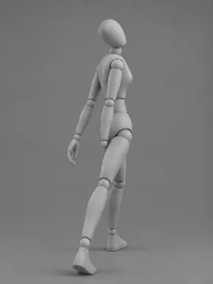
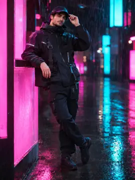
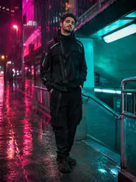
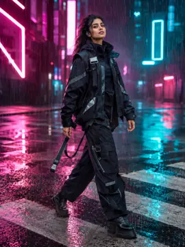
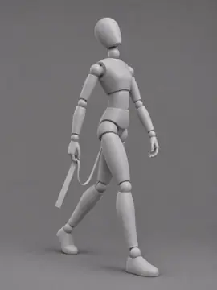
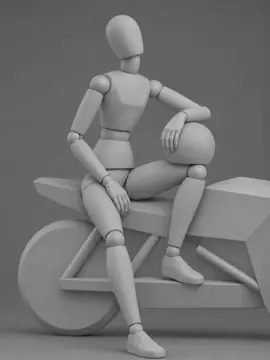
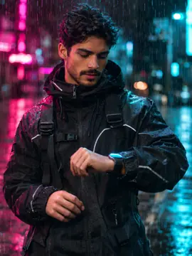
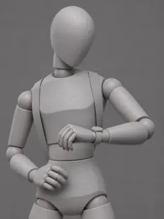
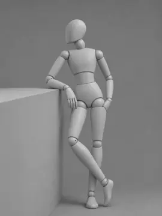
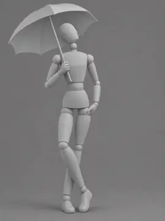

# 赛博霓虹 · Cyberpunk neon

10 组写真姿势：左边是写真照，右边是照着它画的木头白模。白模可以当姿势参考图，和你的照片一起发给生图模型。 在线试用：[Promicat 姿势库](https://promicat.app/zh/poses?ref=github)

[← 返回目录](../README.md#写真姿势)

## 雨中回头（回眸）

 

大图：[写真照](../images/photo-poses/cyber/sp171-photo.webp) · [白模](../images/photo-poses/cyber/sp171-pose.webp)

<details><summary>提示词：用你的照片（附图 1 你的照片，附图 2 白模）</summary>

```text
A real professional portrait photoshoot photo: a cyberpunk photoshoot in a rainy night street under magenta and cyan signs, reflections on wet ground, 35mm f/1.4. Subject: the person in image 1 (keep their exact face, facial features, skin tone and hairstyle; do not beautify or swap the face), wearing a techwear jacket with straps, high collar and reflective details. Pose: walking on a wet neon street turning the head back, hood half up. Image 2 is a wooden artist's mannequin that shows only this body pose: copy it exactly (head, torso, arms, hands, legs, feet, which hand does what, the camera angle), but do not copy the mannequin itself: no wooden skin, no joints, no blank face. Natural, relaxed and unstiff, true skin texture. No text, no logo, no watermark. Portrait 3:4.
```

</details>

<details><summary>提示词：生成示例图（虚构模特）</summary>

```text
A real professional portrait photoshoot photo, the kind posted by a top portrait studio: a cyberpunk photoshoot in a rainy night street under magenta and cyan signs, reflections on wet ground, 35mm f/1.4. Model: a beautiful mixed-race professional fashion model in her twenties with a naturally attractive face, styled hair and natural makeup, wearing a techwear jacket with straps, high collar and reflective details. The photographer directs the model into a natural, relaxed, unstiff pose that looks caught between moments: walking on a wet neon street turning the head back, hood half up. Asymmetric body, soft hands, flattering angle, true skin texture, refined but not plastic, fully clothed and modest. Full body or three-quarter body in frame, the whole pose clearly readable. No text, no logo, no watermark. Portrait 3:4.
```

</details>

## 靠广告牌（靠）

 

大图：[写真照](../images/photo-poses/cyber/sp172-photo.webp) · [白模](../images/photo-poses/cyber/sp172-pose.webp)

<details><summary>提示词：用你的照片（附图 1 你的照片，附图 2 白模）</summary>

```text
A real professional portrait photoshoot photo: a cyberpunk photoshoot in a rainy night street under magenta and cyan signs, reflections on wet ground, 35mm f/1.4. Subject: the person in image 1 (keep their exact face, facial features, skin tone and hairstyle; do not beautify or swap the face), wearing a techwear jacket with straps, high collar and reflective details. Pose: leaning on a glowing sign, one hand on the visor of a cap. Image 2 is a wooden artist's mannequin that shows only this body pose: copy it exactly (head, torso, arms, hands, legs, feet, which hand does what, the camera angle), but do not copy the mannequin itself: no wooden skin, no joints, no blank face. Natural, relaxed and unstiff, true skin texture. No text, no logo, no watermark. Portrait 3:4.
```

</details>

<details><summary>提示词：生成示例图（虚构模特）</summary>

```text
A real professional portrait photoshoot photo, the kind posted by a top portrait studio: a cyberpunk photoshoot in a rainy night street under magenta and cyan signs, reflections on wet ground, 35mm f/1.4. Model: a handsome Mediterranean professional male model in his twenties with a well-groomed look and styled hair, wearing a techwear jacket with straps, high collar and reflective details. The photographer directs the model into a natural, relaxed, unstiff pose that looks caught between moments: leaning on a glowing sign, one hand on the visor of a cap. Asymmetric body, soft hands, flattering angle, true skin texture, refined but not plastic, fully clothed and modest. Full body or three-quarter body in frame, the whole pose clearly readable. No text, no logo, no watermark. Portrait 3:4.
```

</details>

## 蹲屋顶（蹲跪）

 

大图：[写真照](../images/photo-poses/cyber/sp173-photo.webp) · [白模](../images/photo-poses/cyber/sp173-pose.webp)

<details><summary>提示词：用你的照片（附图 1 你的照片，附图 2 白模）</summary>

```text
A real professional portrait photoshoot photo: a cyberpunk photoshoot in a rainy night street under magenta and cyan signs, reflections on wet ground, 35mm f/1.4. Subject: the person in image 1 (keep their exact face, facial features, skin tone and hairstyle; do not beautify or swap the face), wearing a techwear jacket with straps, high collar and reflective details. Pose: crouching on a rooftop edge-safe ledge, forearms on the knees, looking down at the city. Image 2 is a wooden artist's mannequin that shows only this body pose: copy it exactly (head, torso, arms, hands, legs, feet, which hand does what, the camera angle), but do not copy the mannequin itself: no wooden skin, no joints, no blank face. Natural, relaxed and unstiff, true skin texture. No text, no logo, no watermark. Portrait 3:4.
```

</details>

<details><summary>提示词：生成示例图（虚构模特）</summary>

```text
A real professional portrait photoshoot photo, the kind posted by a top portrait studio: a cyberpunk photoshoot in a rainy night street under magenta and cyan signs, reflections on wet ground, 35mm f/1.4. Model: a beautiful Southeast Asian professional fashion model in her twenties with a naturally attractive face, styled hair and natural makeup, wearing a techwear jacket with straps, high collar and reflective details. The photographer directs the model into a natural, relaxed, unstiff pose that looks caught between moments: crouching on a rooftop edge-safe ledge, forearms on the knees, looking down at the city. Asymmetric body, soft hands, flattering angle, true skin texture, refined but not plastic, fully clothed and modest. Full body or three-quarter body in frame, the whole pose clearly readable. No text, no logo, no watermark. Portrait 3:4.
```

</details>

## 拉拉链（半身）

 

大图：[写真照](../images/photo-poses/cyber/sp174-photo.webp) · [白模](../images/photo-poses/cyber/sp174-pose.webp)

<details><summary>提示词：用你的照片（附图 1 你的照片，附图 2 白模）</summary>

```text
A real professional portrait photoshoot photo: a cyberpunk photoshoot in a rainy night street under magenta and cyan signs, reflections on wet ground, 35mm f/1.4. Subject: the person in image 1 (keep their exact face, facial features, skin tone and hairstyle; do not beautify or swap the face), wearing a techwear jacket with straps, high collar and reflective details. Pose: zipping the high collar up to the chin, eyes on the camera. Image 2 is a wooden artist's mannequin that shows only this body pose: copy it exactly (head, torso, arms, hands, legs, feet, which hand does what, the camera angle), but do not copy the mannequin itself: no wooden skin, no joints, no blank face. Natural, relaxed and unstiff, true skin texture. No text, no logo, no watermark. Portrait 3:4.
```

</details>

<details><summary>提示词：生成示例图（虚构模特）</summary>

```text
A real professional portrait photoshoot photo, the kind posted by a top portrait studio: a cyberpunk photoshoot in a rainy night street under magenta and cyan signs, reflections on wet ground, 35mm f/1.4. Model: a beautiful Japanese professional fashion model in her twenties with a naturally attractive face, styled hair and natural makeup, wearing a techwear jacket with straps, high collar and reflective details. The photographer directs the model into a natural, relaxed, unstiff pose that looks caught between moments: zipping the high collar up to the chin, eyes on the camera. Asymmetric body, soft hands, flattering angle, true skin texture, refined but not plastic, fully clothed and modest. Waist-up framing, both arms and hands readable. No text, no logo, no watermark. Portrait 3:4.
```

</details>

## 站地铁口（站）

 

大图：[写真照](../images/photo-poses/cyber/sp175-photo.webp) · [白模](../images/photo-poses/cyber/sp175-pose.webp)

<details><summary>提示词：用你的照片（附图 1 你的照片，附图 2 白模）</summary>

```text
A real professional portrait photoshoot photo: a cyberpunk photoshoot in a rainy night street under magenta and cyan signs, reflections on wet ground, 35mm f/1.4. Subject: the person in image 1 (keep their exact face, facial features, skin tone and hairstyle; do not beautify or swap the face), wearing a techwear jacket with straps, high collar and reflective details. Pose: standing at a subway entrance under cyan light, hands in pockets. Image 2 is a wooden artist's mannequin that shows only this body pose: copy it exactly (head, torso, arms, hands, legs, feet, which hand does what, the camera angle), but do not copy the mannequin itself: no wooden skin, no joints, no blank face. Natural, relaxed and unstiff, true skin texture. No text, no logo, no watermark. Portrait 3:4.
```

</details>

<details><summary>提示词：生成示例图（虚构模特）</summary>

```text
A real professional portrait photoshoot photo, the kind posted by a top portrait studio: a cyberpunk photoshoot in a rainy night street under magenta and cyan signs, reflections on wet ground, 35mm f/1.4. Model: a handsome Middle Eastern professional male model in his twenties with a well-groomed look and styled hair, wearing a techwear jacket with straps, high collar and reflective details. The photographer directs the model into a natural, relaxed, unstiff pose that looks caught between moments: standing at a subway entrance under cyan light, hands in pockets. Asymmetric body, soft hands, flattering angle, true skin texture, refined but not plastic, fully clothed and modest. Full body or three-quarter body in frame, the whole pose clearly readable. No text, no logo, no watermark. Portrait 3:4.
```

</details>

## 快步过街（走）

 

大图：[写真照](../images/photo-poses/cyber/sp176-photo.webp) · [白模](../images/photo-poses/cyber/sp176-pose.webp)

<details><summary>提示词：用你的照片（附图 1 你的照片，附图 2 白模）</summary>

```text
A real professional portrait photoshoot photo: a cyberpunk photoshoot in a rainy night street under magenta and cyan signs, reflections on wet ground, 35mm f/1.4. Subject: the person in image 1 (keep their exact face, facial features, skin tone and hairstyle; do not beautify or swap the face), wearing a techwear jacket with straps, high collar and reflective details. Pose: striding across a crossing with the jacket straps swinging. Image 2 is a wooden artist's mannequin that shows only this body pose: copy it exactly (head, torso, arms, hands, legs, feet, which hand does what, the camera angle), but do not copy the mannequin itself: no wooden skin, no joints, no blank face. Natural, relaxed and unstiff, true skin texture. No text, no logo, no watermark. Portrait 3:4.
```

</details>

<details><summary>提示词：生成示例图（虚构模特）</summary>

```text
A real professional portrait photoshoot photo, the kind posted by a top portrait studio: a cyberpunk photoshoot in a rainy night street under magenta and cyan signs, reflections on wet ground, 35mm f/1.4. Model: a beautiful Indian professional fashion model in her twenties with a naturally attractive face, styled hair and natural makeup, wearing a techwear jacket with straps, high collar and reflective details. The photographer directs the model into a natural, relaxed, unstiff pose that looks caught between moments: striding across a crossing with the jacket straps swinging. Asymmetric body, soft hands, flattering angle, true skin texture, refined but not plastic, fully clothed and modest. Full body or three-quarter body in frame, the whole pose clearly readable. No text, no logo, no watermark. Portrait 3:4.
```

</details>

## 坐摩托（坐）

 

大图：[写真照](../images/photo-poses/cyber/sp177-photo.webp) · [白模](../images/photo-poses/cyber/sp177-pose.webp)

<details><summary>提示词：用你的照片（附图 1 你的照片，附图 2 白模）</summary>

```text
A real professional portrait photoshoot photo: a cyberpunk photoshoot in a rainy night street under magenta and cyan signs, reflections on wet ground, 35mm f/1.4. Subject: the person in image 1 (keep their exact face, facial features, skin tone and hairstyle; do not beautify or swap the face), wearing a techwear jacket with straps, high collar and reflective details. Pose: sitting sideways on a parked motorbike, helmet on the knee. Image 2 is a wooden artist's mannequin that shows only this body pose: copy it exactly (head, torso, arms, hands, legs, feet, which hand does what, the camera angle), but do not copy the mannequin itself: no wooden skin, no joints, no blank face. Natural, relaxed and unstiff, true skin texture. No text, no logo, no watermark. Portrait 3:4.
```

</details>

<details><summary>提示词：生成示例图（虚构模特）</summary>

```text
A real professional portrait photoshoot photo, the kind posted by a top portrait studio: a cyberpunk photoshoot in a rainy night street under magenta and cyan signs, reflections on wet ground, 35mm f/1.4. Model: a beautiful white European professional fashion model in her twenties with a naturally attractive face, styled hair and natural makeup, wearing a techwear jacket with straps, high collar and reflective details. The photographer directs the model into a natural, relaxed, unstiff pose that looks caught between moments: sitting sideways on a parked motorbike, helmet on the knee. Asymmetric body, soft hands, flattering angle, true skin texture, refined but not plastic, fully clothed and modest. Full body or three-quarter body in frame, the whole pose clearly readable. No text, no logo, no watermark. Portrait 3:4.
```

</details>

## 抬手看表（半身）

 

大图：[写真照](../images/photo-poses/cyber/sp178-photo.webp) · [白模](../images/photo-poses/cyber/sp178-pose.webp)

<details><summary>提示词：用你的照片（附图 1 你的照片，附图 2 白模）</summary>

```text
A real professional portrait photoshoot photo: a cyberpunk photoshoot in a rainy night street under magenta and cyan signs, reflections on wet ground, 35mm f/1.4. Subject: the person in image 1 (keep their exact face, facial features, skin tone and hairstyle; do not beautify or swap the face), wearing a techwear jacket with straps, high collar and reflective details. Pose: raising a wrist to check a glowing smartwatch. Image 2 is a wooden artist's mannequin that shows only this body pose: copy it exactly (head, torso, arms, hands, legs, feet, which hand does what, the camera angle), but do not copy the mannequin itself: no wooden skin, no joints, no blank face. Natural, relaxed and unstiff, true skin texture. No text, no logo, no watermark. Portrait 3:4.
```

</details>

<details><summary>提示词：生成示例图（虚构模特）</summary>

```text
A real professional portrait photoshoot photo, the kind posted by a top portrait studio: a cyberpunk photoshoot in a rainy night street under magenta and cyan signs, reflections on wet ground, 35mm f/1.4. Model: a handsome Brazilian professional male model in his twenties with a well-groomed look and styled hair, wearing a techwear jacket with straps, high collar and reflective details. The photographer directs the model into a natural, relaxed, unstiff pose that looks caught between moments: raising a wrist to check a glowing smartwatch. Asymmetric body, soft hands, flattering angle, true skin texture, refined but not plastic, fully clothed and modest. Waist-up framing, both arms and hands readable. No text, no logo, no watermark. Portrait 3:4.
```

</details>

## 靠窗外看（靠）

 

大图：[写真照](../images/photo-poses/cyber/sp179-photo.webp) · [白模](../images/photo-poses/cyber/sp179-pose.webp)

<details><summary>提示词：用你的照片（附图 1 你的照片，附图 2 白模）</summary>

```text
A real professional portrait photoshoot photo: a cyberpunk photoshoot in a rainy night street under magenta and cyan signs, reflections on wet ground, 35mm f/1.4. Subject: the person in image 1 (keep their exact face, facial features, skin tone and hairstyle; do not beautify or swap the face), wearing a techwear jacket with straps, high collar and reflective details. Pose: leaning on a noodle-bar window from outside, looking in. Image 2 is a wooden artist's mannequin that shows only this body pose: copy it exactly (head, torso, arms, hands, legs, feet, which hand does what, the camera angle), but do not copy the mannequin itself: no wooden skin, no joints, no blank face. Natural, relaxed and unstiff, true skin texture. No text, no logo, no watermark. Portrait 3:4.
```

</details>

<details><summary>提示词：生成示例图（虚构模特）</summary>

```text
A real professional portrait photoshoot photo, the kind posted by a top portrait studio: a cyberpunk photoshoot in a rainy night street under magenta and cyan signs, reflections on wet ground, 35mm f/1.4. Model: a beautiful Latina professional fashion model in her twenties with a naturally attractive face, styled hair and natural makeup, wearing a techwear jacket with straps, high collar and reflective details. The photographer directs the model into a natural, relaxed, unstiff pose that looks caught between moments: leaning on a noodle-bar window from outside, looking in. Asymmetric body, soft hands, flattering angle, true skin texture, refined but not plastic, fully clothed and modest. Full body or three-quarter body in frame, the whole pose clearly readable. No text, no logo, no watermark. Portrait 3:4.
```

</details>

## 伞下仰头（站）

 

大图：[写真照](../images/photo-poses/cyber/sp180-photo.webp) · [白模](../images/photo-poses/cyber/sp180-pose.webp)

<details><summary>提示词：用你的照片（附图 1 你的照片，附图 2 白模）</summary>

```text
A real professional portrait photoshoot photo: a cyberpunk photoshoot in a rainy night street under magenta and cyan signs, reflections on wet ground, 35mm f/1.4. Subject: the person in image 1 (keep their exact face, facial features, skin tone and hairstyle; do not beautify or swap the face), wearing a techwear jacket with straps, high collar and reflective details. Pose: standing under an umbrella looking up at a hologram sign. Image 2 is a wooden artist's mannequin that shows only this body pose: copy it exactly (head, torso, arms, hands, legs, feet, which hand does what, the camera angle), but do not copy the mannequin itself: no wooden skin, no joints, no blank face. Natural, relaxed and unstiff, true skin texture. No text, no logo, no watermark. Portrait 3:4.
```

</details>

<details><summary>提示词：生成示例图（虚构模特）</summary>

```text
A real professional portrait photoshoot photo, the kind posted by a top portrait studio: a cyberpunk photoshoot in a rainy night street under magenta and cyan signs, reflections on wet ground, 35mm f/1.4. Model: a beautiful Korean professional fashion model in her twenties with a naturally attractive face, styled hair and natural makeup, wearing a techwear jacket with straps, high collar and reflective details. The photographer directs the model into a natural, relaxed, unstiff pose that looks caught between moments: standing under an umbrella looking up at a hologram sign. Asymmetric body, soft hands, flattering angle, true skin texture, refined but not plastic, fully clothed and modest. Full body or three-quarter body in frame, the whole pose clearly readable. No text, no logo, no watermark. Portrait 3:4.
```

</details>
