# 赛博霓虹

[English](cyber.md) · 简体中文

10 个白模，每个配 4 张用它拍出的不同风格写真。参考图顺序是你的照片在前、白模在后。也可以在 [Promicat](https://promicat.app/zh/poses?utm_source=github&utm_medium=readme&utm_campaign=ai-photo-poses) 上传照片直接生成。

[← 返回全部风格](../README.zh-CN.md#photo-poses)

## 雨中回头 (回眸)

| 白模 | 赛博霓虹 | 港风复古 | 居家慵懒 | 街头朋克 |
|---|---|---|---|---|
| 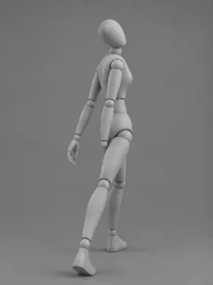 | <a href="https://promicat.app/zh/poses/styles/sp171?utm_source=github&utm_medium=readme&utm_campaign=ai-photo-poses">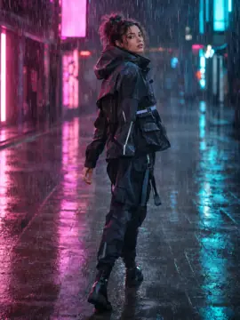</a> | <a href="https://promicat.app/zh/poses/styles/sp171?utm_source=github&utm_medium=readme&utm_campaign=ai-photo-poses">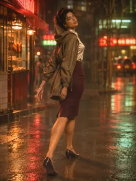</a> | <a href="https://promicat.app/zh/poses/styles/sp171?utm_source=github&utm_medium=readme&utm_campaign=ai-photo-poses">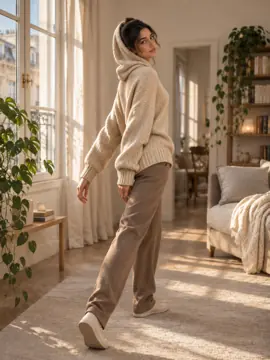</a> | <a href="https://promicat.app/zh/poses/styles/sp171?utm_source=github&utm_medium=readme&utm_campaign=ai-photo-poses">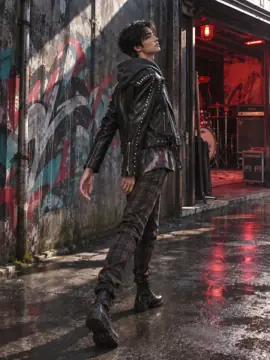</a> |

大图: [写真照](../images/photo-poses/cyber/sp171-photo.webp) · [白模](../images/photo-poses/cyber/sp171-pose.webp) · [在 Promicat 生成](https://promicat.app/zh/poses/styles/sp171?utm_source=github&utm_medium=readme&utm_campaign=ai-photo-poses)

<details><summary>提示词：用你的照片（图 1 你的照片，图 2 白模）</summary>

```text
A real professional portrait photoshoot photo: a cyberpunk photoshoot in a rainy night street under magenta and cyan signs, reflections on wet ground, 35mm f/1.4. Subject: the person in image 1 (keep their exact face, facial features, skin tone and hairstyle; do not beautify or swap the face), wearing a techwear jacket with straps, high collar and reflective details. Pose: walking on a wet neon street turning the head back, hood half up. Image 2 is a wooden artist's mannequin that shows only this body pose: copy it exactly (head, torso, arms, hands, legs, feet, which hand does what, the camera angle), but do not copy the mannequin itself: no wooden skin, no joints, no blank face. Natural, relaxed and unstiff, true skin texture. No text, no logo, no watermark. Portrait 3:4.
```

</details>

<details><summary>提示词：生成示例图（虚构模特）</summary>

```text
A real professional portrait photoshoot photo, the kind posted by a top portrait studio: a cyberpunk photoshoot in a rainy night street under magenta and cyan signs, reflections on wet ground, 35mm f/1.4. Model: a beautiful mixed-race professional fashion model in her twenties with a naturally attractive face, styled hair and natural makeup, wearing a techwear jacket with straps, high collar and reflective details. The photographer directs the model into a natural, relaxed, unstiff pose that looks caught between moments: walking on a wet neon street turning the head back, hood half up. Asymmetric body, soft hands, flattering angle, true skin texture, refined but not plastic, fully clothed and modest. Full body or three-quarter body in frame, the whole pose clearly readable. No text, no logo, no watermark. Portrait 3:4.
```

</details>

## 靠广告牌 (靠)

| 白模 | 赛博霓虹 | 校园青春 | 学院风 | 好莱坞复古 |
|---|---|---|---|---|
| 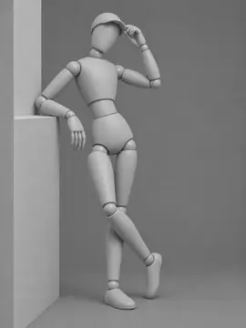 | <a href="https://promicat.app/zh/poses/styles/sp172?utm_source=github&utm_medium=readme&utm_campaign=ai-photo-poses">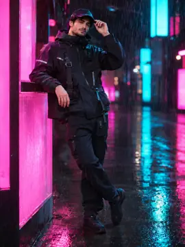</a> | <a href="https://promicat.app/zh/poses/styles/sp172?utm_source=github&utm_medium=readme&utm_campaign=ai-photo-poses">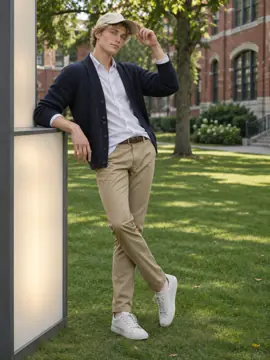</a> | <a href="https://promicat.app/zh/poses/styles/sp172?utm_source=github&utm_medium=readme&utm_campaign=ai-photo-poses">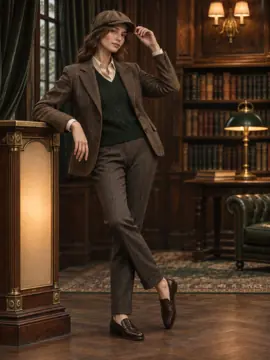</a> | <a href="https://promicat.app/zh/poses/styles/sp172?utm_source=github&utm_medium=readme&utm_campaign=ai-photo-poses">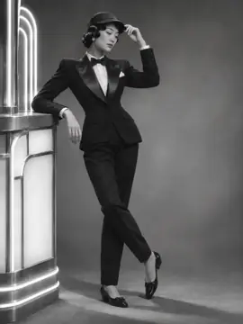</a> |

大图: [写真照](../images/photo-poses/cyber/sp172-photo.webp) · [白模](../images/photo-poses/cyber/sp172-pose.webp) · [在 Promicat 生成](https://promicat.app/zh/poses/styles/sp172?utm_source=github&utm_medium=readme&utm_campaign=ai-photo-poses)

<details><summary>提示词：用你的照片（图 1 你的照片，图 2 白模）</summary>

```text
A real professional portrait photoshoot photo: a cyberpunk photoshoot in a rainy night street under magenta and cyan signs, reflections on wet ground, 35mm f/1.4. Subject: the person in image 1 (keep their exact face, facial features, skin tone and hairstyle; do not beautify or swap the face), wearing a techwear jacket with straps, high collar and reflective details. Pose: leaning on a glowing sign, one hand on the visor of a cap. Image 2 is a wooden artist's mannequin that shows only this body pose: copy it exactly (head, torso, arms, hands, legs, feet, which hand does what, the camera angle), but do not copy the mannequin itself: no wooden skin, no joints, no blank face. Natural, relaxed and unstiff, true skin texture. No text, no logo, no watermark. Portrait 3:4.
```

</details>

<details><summary>提示词：生成示例图（虚构模特）</summary>

```text
A real professional portrait photoshoot photo, the kind posted by a top portrait studio: a cyberpunk photoshoot in a rainy night street under magenta and cyan signs, reflections on wet ground, 35mm f/1.4. Model: a handsome Mediterranean professional male model in his twenties with a well-groomed look and styled hair, wearing a techwear jacket with straps, high collar and reflective details. The photographer directs the model into a natural, relaxed, unstiff pose that looks caught between moments: leaning on a glowing sign, one hand on the visor of a cap. Asymmetric body, soft hands, flattering angle, true skin texture, refined but not plastic, fully clothed and modest. Full body or three-quarter body in frame, the whole pose clearly readable. No text, no logo, no watermark. Portrait 3:4.
```

</details>

## 蹲屋顶 (蹲跪)

| 白模 | 赛博霓虹 | 森系花田 | 日系清新 | 街头朋克 |
|---|---|---|---|---|
| 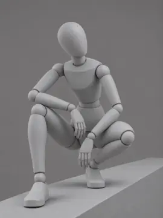 | <a href="https://promicat.app/zh/poses/styles/sp173?utm_source=github&utm_medium=readme&utm_campaign=ai-photo-poses">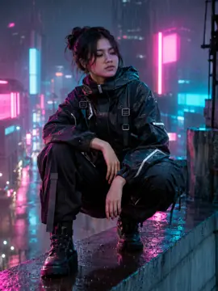</a> | <a href="https://promicat.app/zh/poses/styles/sp173?utm_source=github&utm_medium=readme&utm_campaign=ai-photo-poses"></a> | <a href="https://promicat.app/zh/poses/styles/sp173?utm_source=github&utm_medium=readme&utm_campaign=ai-photo-poses">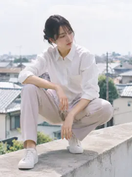</a> | <a href="https://promicat.app/zh/poses/styles/sp173?utm_source=github&utm_medium=readme&utm_campaign=ai-photo-poses">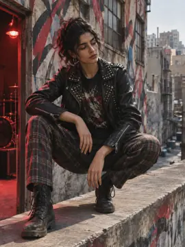</a> |

大图: [写真照](../images/photo-poses/cyber/sp173-photo.webp) · [白模](../images/photo-poses/cyber/sp173-pose.webp) · [在 Promicat 生成](https://promicat.app/zh/poses/styles/sp173?utm_source=github&utm_medium=readme&utm_campaign=ai-photo-poses)

<details><summary>提示词：用你的照片（图 1 你的照片，图 2 白模）</summary>

```text
A real professional portrait photoshoot photo: a cyberpunk photoshoot in a rainy night street under magenta and cyan signs, reflections on wet ground, 35mm f/1.4. Subject: the person in image 1 (keep their exact face, facial features, skin tone and hairstyle; do not beautify or swap the face), wearing a techwear jacket with straps, high collar and reflective details. Pose: crouching on a rooftop edge-safe ledge, forearms on the knees, looking down at the city. Image 2 is a wooden artist's mannequin that shows only this body pose: copy it exactly (head, torso, arms, hands, legs, feet, which hand does what, the camera angle), but do not copy the mannequin itself: no wooden skin, no joints, no blank face. Natural, relaxed and unstiff, true skin texture. No text, no logo, no watermark. Portrait 3:4.
```

</details>

<details><summary>提示词：生成示例图（虚构模特）</summary>

```text
A real professional portrait photoshoot photo, the kind posted by a top portrait studio: a cyberpunk photoshoot in a rainy night street under magenta and cyan signs, reflections on wet ground, 35mm f/1.4. Model: a beautiful Southeast Asian professional fashion model in her twenties with a naturally attractive face, styled hair and natural makeup, wearing a techwear jacket with straps, high collar and reflective details. The photographer directs the model into a natural, relaxed, unstiff pose that looks caught between moments: crouching on a rooftop edge-safe ledge, forearms on the knees, looking down at the city. Asymmetric body, soft hands, flattering angle, true skin texture, refined but not plastic, fully clothed and modest. Full body or three-quarter body in frame, the whole pose clearly readable. No text, no logo, no watermark. Portrait 3:4.
```

</details>

## 拉拉链 (半身)

| 白模 | 赛博霓虹 | 咖啡馆文艺 | 港风复古 | 好莱坞复古 |
|---|---|---|---|---|
| 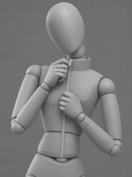 | <a href="https://promicat.app/zh/poses/styles/sp174?utm_source=github&utm_medium=readme&utm_campaign=ai-photo-poses">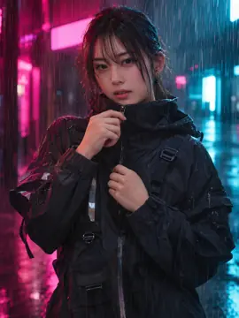</a> | <a href="https://promicat.app/zh/poses/styles/sp174?utm_source=github&utm_medium=readme&utm_campaign=ai-photo-poses"></a> | <a href="https://promicat.app/zh/poses/styles/sp174?utm_source=github&utm_medium=readme&utm_campaign=ai-photo-poses">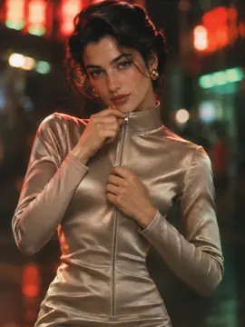</a> | <a href="https://promicat.app/zh/poses/styles/sp174?utm_source=github&utm_medium=readme&utm_campaign=ai-photo-poses">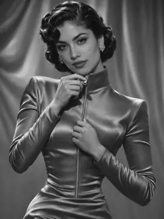</a> |

大图: [写真照](../images/photo-poses/cyber/sp174-photo.webp) · [白模](../images/photo-poses/cyber/sp174-pose.webp) · [在 Promicat 生成](https://promicat.app/zh/poses/styles/sp174?utm_source=github&utm_medium=readme&utm_campaign=ai-photo-poses)

<details><summary>提示词：用你的照片（图 1 你的照片，图 2 白模）</summary>

```text
A real professional portrait photoshoot photo: a cyberpunk photoshoot in a rainy night street under magenta and cyan signs, reflections on wet ground, 35mm f/1.4. Subject: the person in image 1 (keep their exact face, facial features, skin tone and hairstyle; do not beautify or swap the face), wearing a techwear jacket with straps, high collar and reflective details. Pose: zipping the high collar up to the chin, eyes on the camera. Image 2 is a wooden artist's mannequin that shows only this body pose: copy it exactly (head, torso, arms, hands, legs, feet, which hand does what, the camera angle), but do not copy the mannequin itself: no wooden skin, no joints, no blank face. Natural, relaxed and unstiff, true skin texture. No text, no logo, no watermark. Portrait 3:4.
```

</details>

<details><summary>提示词：生成示例图（虚构模特）</summary>

```text
A real professional portrait photoshoot photo, the kind posted by a top portrait studio: a cyberpunk photoshoot in a rainy night street under magenta and cyan signs, reflections on wet ground, 35mm f/1.4. Model: a beautiful Japanese professional fashion model in her twenties with a naturally attractive face, styled hair and natural makeup, wearing a techwear jacket with straps, high collar and reflective details. The photographer directs the model into a natural, relaxed, unstiff pose that looks caught between moments: zipping the high collar up to the chin, eyes on the camera. Asymmetric body, soft hands, flattering angle, true skin texture, refined but not plastic, fully clothed and modest. Waist-up framing, both arms and hands readable. No text, no logo, no watermark. Portrait 3:4.
```

</details>

## 站地铁口 (站)

| 白模 | 赛博霓虹 | 波西米亚 | 暗黑哥特 | Y2K 千禧辣妹 |
|---|---|---|---|---|
| 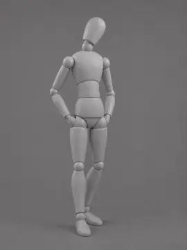 | <a href="https://promicat.app/zh/poses/styles/sp175?utm_source=github&utm_medium=readme&utm_campaign=ai-photo-poses">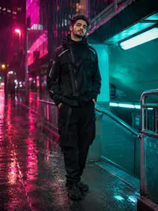</a> | <a href="https://promicat.app/zh/poses/styles/sp175?utm_source=github&utm_medium=readme&utm_campaign=ai-photo-poses"></a> | <a href="https://promicat.app/zh/poses/styles/sp175?utm_source=github&utm_medium=readme&utm_campaign=ai-photo-poses">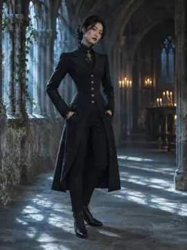</a> | <a href="https://promicat.app/zh/poses/styles/sp175?utm_source=github&utm_medium=readme&utm_campaign=ai-photo-poses">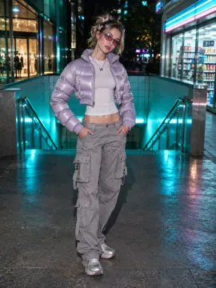</a> |

大图: [写真照](../images/photo-poses/cyber/sp175-photo.webp) · [白模](../images/photo-poses/cyber/sp175-pose.webp) · [在 Promicat 生成](https://promicat.app/zh/poses/styles/sp175?utm_source=github&utm_medium=readme&utm_campaign=ai-photo-poses)

<details><summary>提示词：用你的照片（图 1 你的照片，图 2 白模）</summary>

```text
A real professional portrait photoshoot photo: a cyberpunk photoshoot in a rainy night street under magenta and cyan signs, reflections on wet ground, 35mm f/1.4. Subject: the person in image 1 (keep their exact face, facial features, skin tone and hairstyle; do not beautify or swap the face), wearing a techwear jacket with straps, high collar and reflective details. Pose: standing at a subway entrance under cyan light, hands in pockets. Image 2 is a wooden artist's mannequin that shows only this body pose: copy it exactly (head, torso, arms, hands, legs, feet, which hand does what, the camera angle), but do not copy the mannequin itself: no wooden skin, no joints, no blank face. Natural, relaxed and unstiff, true skin texture. No text, no logo, no watermark. Portrait 3:4.
```

</details>

<details><summary>提示词：生成示例图（虚构模特）</summary>

```text
A real professional portrait photoshoot photo, the kind posted by a top portrait studio: a cyberpunk photoshoot in a rainy night street under magenta and cyan signs, reflections on wet ground, 35mm f/1.4. Model: a handsome Middle Eastern professional male model in his twenties with a well-groomed look and styled hair, wearing a techwear jacket with straps, high collar and reflective details. The photographer directs the model into a natural, relaxed, unstiff pose that looks caught between moments: standing at a subway entrance under cyan light, hands in pockets. Asymmetric body, soft hands, flattering angle, true skin texture, refined but not plastic, fully clothed and modest. Full body or three-quarter body in frame, the whole pose clearly readable. No text, no logo, no watermark. Portrait 3:4.
```

</details>

## 快步过街 (走)

| 白模 | 赛博霓虹 | 海边度假 | 咖啡馆文艺 | 老钱风 |
|---|---|---|---|---|
| 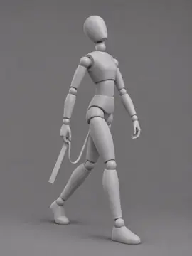 | <a href="https://promicat.app/zh/poses/styles/sp176?utm_source=github&utm_medium=readme&utm_campaign=ai-photo-poses">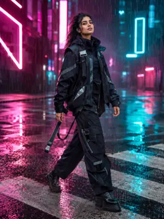</a> | <a href="https://promicat.app/zh/poses/styles/sp176?utm_source=github&utm_medium=readme&utm_campaign=ai-photo-poses"></a> | <a href="https://promicat.app/zh/poses/styles/sp176?utm_source=github&utm_medium=readme&utm_campaign=ai-photo-poses"></a> | <a href="https://promicat.app/zh/poses/styles/sp176?utm_source=github&utm_medium=readme&utm_campaign=ai-photo-poses"></a> |

大图: [写真照](../images/photo-poses/cyber/sp176-photo.webp) · [白模](../images/photo-poses/cyber/sp176-pose.webp) · [在 Promicat 生成](https://promicat.app/zh/poses/styles/sp176?utm_source=github&utm_medium=readme&utm_campaign=ai-photo-poses)

<details><summary>提示词：用你的照片（图 1 你的照片，图 2 白模）</summary>

```text
A real professional portrait photoshoot photo: a cyberpunk photoshoot in a rainy night street under magenta and cyan signs, reflections on wet ground, 35mm f/1.4. Subject: the person in image 1 (keep their exact face, facial features, skin tone and hairstyle; do not beautify or swap the face), wearing a techwear jacket with straps, high collar and reflective details. Pose: striding across a crossing with the jacket straps swinging. Image 2 is a wooden artist's mannequin that shows only this body pose: copy it exactly (head, torso, arms, hands, legs, feet, which hand does what, the camera angle), but do not copy the mannequin itself: no wooden skin, no joints, no blank face. Natural, relaxed and unstiff, true skin texture. No text, no logo, no watermark. Portrait 3:4.
```

</details>

<details><summary>提示词：生成示例图（虚构模特）</summary>

```text
A real professional portrait photoshoot photo, the kind posted by a top portrait studio: a cyberpunk photoshoot in a rainy night street under magenta and cyan signs, reflections on wet ground, 35mm f/1.4. Model: a beautiful Indian professional fashion model in her twenties with a naturally attractive face, styled hair and natural makeup, wearing a techwear jacket with straps, high collar and reflective details. The photographer directs the model into a natural, relaxed, unstiff pose that looks caught between moments: striding across a crossing with the jacket straps swinging. Asymmetric body, soft hands, flattering angle, true skin texture, refined but not plastic, fully clothed and modest. Full body or three-quarter body in frame, the whole pose clearly readable. No text, no logo, no watermark. Portrait 3:4.
```

</details>

## 坐摩托 (坐)

| 白模 | 赛博霓虹 | 情绪棚拍 | 北欧极简 | 街头朋克 |
|---|---|---|---|---|
| 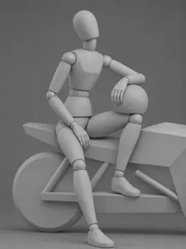 | <a href="https://promicat.app/zh/poses/styles/sp177?utm_source=github&utm_medium=readme&utm_campaign=ai-photo-poses">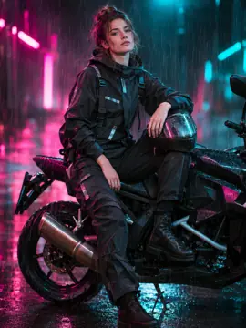</a> | <a href="https://promicat.app/zh/poses/styles/sp177?utm_source=github&utm_medium=readme&utm_campaign=ai-photo-poses">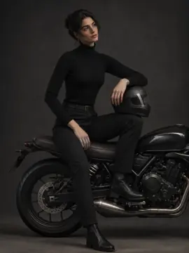</a> | <a href="https://promicat.app/zh/poses/styles/sp177?utm_source=github&utm_medium=readme&utm_campaign=ai-photo-poses">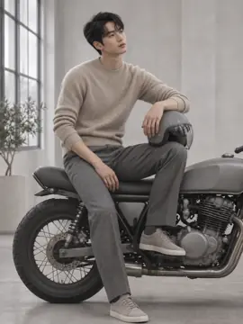</a> | <a href="https://promicat.app/zh/poses/styles/sp177?utm_source=github&utm_medium=readme&utm_campaign=ai-photo-poses">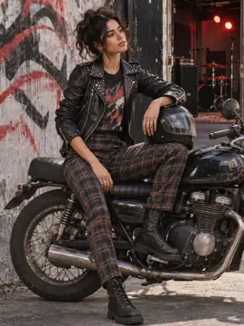</a> |

大图: [写真照](../images/photo-poses/cyber/sp177-photo.webp) · [白模](../images/photo-poses/cyber/sp177-pose.webp) · [在 Promicat 生成](https://promicat.app/zh/poses/styles/sp177?utm_source=github&utm_medium=readme&utm_campaign=ai-photo-poses)

<details><summary>提示词：用你的照片（图 1 你的照片，图 2 白模）</summary>

```text
A real professional portrait photoshoot photo: a cyberpunk photoshoot in a rainy night street under magenta and cyan signs, reflections on wet ground, 35mm f/1.4. Subject: the person in image 1 (keep their exact face, facial features, skin tone and hairstyle; do not beautify or swap the face), wearing a techwear jacket with straps, high collar and reflective details. Pose: sitting sideways on a parked motorbike, helmet on the knee. Image 2 is a wooden artist's mannequin that shows only this body pose: copy it exactly (head, torso, arms, hands, legs, feet, which hand does what, the camera angle), but do not copy the mannequin itself: no wooden skin, no joints, no blank face. Natural, relaxed and unstiff, true skin texture. No text, no logo, no watermark. Portrait 3:4.
```

</details>

<details><summary>提示词：生成示例图（虚构模特）</summary>

```text
A real professional portrait photoshoot photo, the kind posted by a top portrait studio: a cyberpunk photoshoot in a rainy night street under magenta and cyan signs, reflections on wet ground, 35mm f/1.4. Model: a beautiful white European professional fashion model in her twenties with a naturally attractive face, styled hair and natural makeup, wearing a techwear jacket with straps, high collar and reflective details. The photographer directs the model into a natural, relaxed, unstiff pose that looks caught between moments: sitting sideways on a parked motorbike, helmet on the knee. Asymmetric body, soft hands, flattering angle, true skin texture, refined but not plastic, fully clothed and modest. Full body or three-quarter body in frame, the whole pose clearly readable. No text, no logo, no watermark. Portrait 3:4.
```

</details>

## 抬手看表 (半身)

| 白模 | 赛博霓虹 | 新中式 | 居家慵懒 | 西部牛仔 |
|---|---|---|---|---|
| 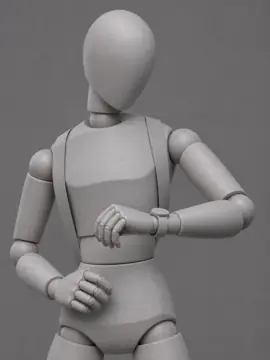 | <a href="https://promicat.app/zh/poses/styles/sp178?utm_source=github&utm_medium=readme&utm_campaign=ai-photo-poses">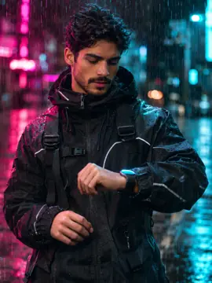</a> | <a href="https://promicat.app/zh/poses/styles/sp178?utm_source=github&utm_medium=readme&utm_campaign=ai-photo-poses">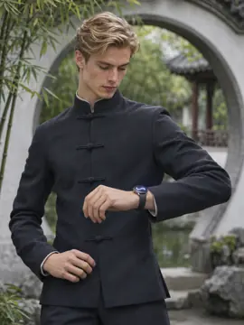</a> | <a href="https://promicat.app/zh/poses/styles/sp178?utm_source=github&utm_medium=readme&utm_campaign=ai-photo-poses">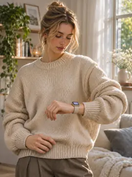</a> | <a href="https://promicat.app/zh/poses/styles/sp178?utm_source=github&utm_medium=readme&utm_campaign=ai-photo-poses">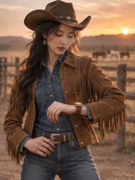</a> |

大图: [写真照](../images/photo-poses/cyber/sp178-photo.webp) · [白模](../images/photo-poses/cyber/sp178-pose.webp) · [在 Promicat 生成](https://promicat.app/zh/poses/styles/sp178?utm_source=github&utm_medium=readme&utm_campaign=ai-photo-poses)

<details><summary>提示词：用你的照片（图 1 你的照片，图 2 白模）</summary>

```text
A real professional portrait photoshoot photo: a cyberpunk photoshoot in a rainy night street under magenta and cyan signs, reflections on wet ground, 35mm f/1.4. Subject: the person in image 1 (keep their exact face, facial features, skin tone and hairstyle; do not beautify or swap the face), wearing a techwear jacket with straps, high collar and reflective details. Pose: raising a wrist to check a glowing smartwatch. Image 2 is a wooden artist's mannequin that shows only this body pose: copy it exactly (head, torso, arms, hands, legs, feet, which hand does what, the camera angle), but do not copy the mannequin itself: no wooden skin, no joints, no blank face. Natural, relaxed and unstiff, true skin texture. No text, no logo, no watermark. Portrait 3:4.
```

</details>

<details><summary>提示词：生成示例图（虚构模特）</summary>

```text
A real professional portrait photoshoot photo, the kind posted by a top portrait studio: a cyberpunk photoshoot in a rainy night street under magenta and cyan signs, reflections on wet ground, 35mm f/1.4. Model: a handsome Brazilian professional male model in his twenties with a well-groomed look and styled hair, wearing a techwear jacket with straps, high collar and reflective details. The photographer directs the model into a natural, relaxed, unstiff pose that looks caught between moments: raising a wrist to check a glowing smartwatch. Asymmetric body, soft hands, flattering angle, true skin texture, refined but not plastic, fully clothed and modest. Waist-up framing, both arms and hands readable. No text, no logo, no watermark. Portrait 3:4.
```

</details>

## 靠窗外看 (靠)

| 白模 | 赛博霓虹 | 校园青春 | 日系清新 | 街拍时尚 |
|---|---|---|---|---|
| 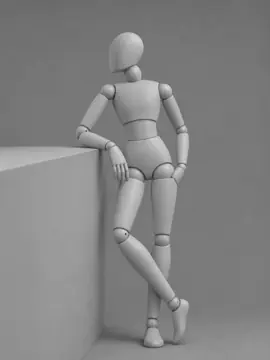 | <a href="https://promicat.app/zh/poses/styles/sp179?utm_source=github&utm_medium=readme&utm_campaign=ai-photo-poses">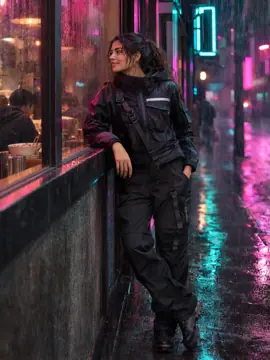</a> | <a href="https://promicat.app/zh/poses/styles/sp179?utm_source=github&utm_medium=readme&utm_campaign=ai-photo-poses">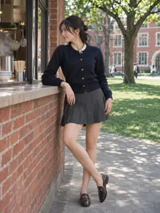</a> | <a href="https://promicat.app/zh/poses/styles/sp179?utm_source=github&utm_medium=readme&utm_campaign=ai-photo-poses"></a> | <a href="https://promicat.app/zh/poses/styles/sp179?utm_source=github&utm_medium=readme&utm_campaign=ai-photo-poses">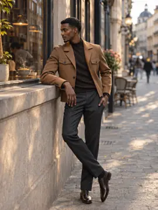</a> |

大图: [写真照](../images/photo-poses/cyber/sp179-photo.webp) · [白模](../images/photo-poses/cyber/sp179-pose.webp) · [在 Promicat 生成](https://promicat.app/zh/poses/styles/sp179?utm_source=github&utm_medium=readme&utm_campaign=ai-photo-poses)

<details><summary>提示词：用你的照片（图 1 你的照片，图 2 白模）</summary>

```text
A real professional portrait photoshoot photo: a cyberpunk photoshoot in a rainy night street under magenta and cyan signs, reflections on wet ground, 35mm f/1.4. Subject: the person in image 1 (keep their exact face, facial features, skin tone and hairstyle; do not beautify or swap the face), wearing a techwear jacket with straps, high collar and reflective details. Pose: leaning on a noodle-bar window from outside, looking in. Image 2 is a wooden artist's mannequin that shows only this body pose: copy it exactly (head, torso, arms, hands, legs, feet, which hand does what, the camera angle), but do not copy the mannequin itself: no wooden skin, no joints, no blank face. Natural, relaxed and unstiff, true skin texture. No text, no logo, no watermark. Portrait 3:4.
```

</details>

<details><summary>提示词：生成示例图（虚构模特）</summary>

```text
A real professional portrait photoshoot photo, the kind posted by a top portrait studio: a cyberpunk photoshoot in a rainy night street under magenta and cyan signs, reflections on wet ground, 35mm f/1.4. Model: a beautiful Latina professional fashion model in her twenties with a naturally attractive face, styled hair and natural makeup, wearing a techwear jacket with straps, high collar and reflective details. The photographer directs the model into a natural, relaxed, unstiff pose that looks caught between moments: leaning on a noodle-bar window from outside, looking in. Asymmetric body, soft hands, flattering angle, true skin texture, refined but not plastic, fully clothed and modest. Full body or three-quarter body in frame, the whole pose clearly readable. No text, no logo, no watermark. Portrait 3:4.
```

</details>

## 伞下仰头 (站)

| 白模 | 赛博霓虹 | 学院风 | 森系花田 | 北欧极简 |
|---|---|---|---|---|
| 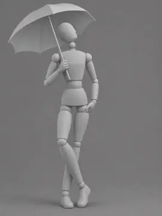 | <a href="https://promicat.app/zh/poses/styles/sp180?utm_source=github&utm_medium=readme&utm_campaign=ai-photo-poses">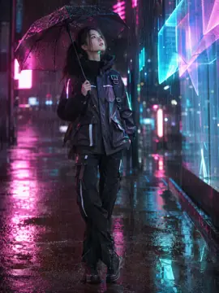</a> | <a href="https://promicat.app/zh/poses/styles/sp180?utm_source=github&utm_medium=readme&utm_campaign=ai-photo-poses">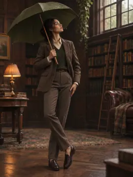</a> | <a href="https://promicat.app/zh/poses/styles/sp180?utm_source=github&utm_medium=readme&utm_campaign=ai-photo-poses">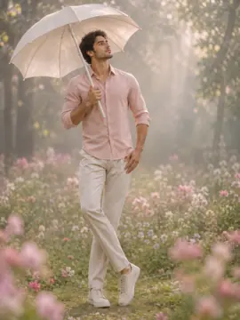</a> | <a href="https://promicat.app/zh/poses/styles/sp180?utm_source=github&utm_medium=readme&utm_campaign=ai-photo-poses">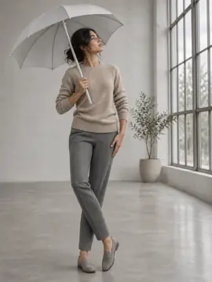</a> |

大图: [写真照](../images/photo-poses/cyber/sp180-photo.webp) · [白模](../images/photo-poses/cyber/sp180-pose.webp) · [在 Promicat 生成](https://promicat.app/zh/poses/styles/sp180?utm_source=github&utm_medium=readme&utm_campaign=ai-photo-poses)

<details><summary>提示词：用你的照片（图 1 你的照片，图 2 白模）</summary>

```text
A real professional portrait photoshoot photo: a cyberpunk photoshoot in a rainy night street under magenta and cyan signs, reflections on wet ground, 35mm f/1.4. Subject: the person in image 1 (keep their exact face, facial features, skin tone and hairstyle; do not beautify or swap the face), wearing a techwear jacket with straps, high collar and reflective details. Pose: standing under an umbrella looking up at a hologram sign. Image 2 is a wooden artist's mannequin that shows only this body pose: copy it exactly (head, torso, arms, hands, legs, feet, which hand does what, the camera angle), but do not copy the mannequin itself: no wooden skin, no joints, no blank face. Natural, relaxed and unstiff, true skin texture. No text, no logo, no watermark. Portrait 3:4.
```

</details>

<details><summary>提示词：生成示例图（虚构模特）</summary>

```text
A real professional portrait photoshoot photo, the kind posted by a top portrait studio: a cyberpunk photoshoot in a rainy night street under magenta and cyan signs, reflections on wet ground, 35mm f/1.4. Model: a beautiful Korean professional fashion model in her twenties with a naturally attractive face, styled hair and natural makeup, wearing a techwear jacket with straps, high collar and reflective details. The photographer directs the model into a natural, relaxed, unstiff pose that looks caught between moments: standing under an umbrella looking up at a hologram sign. Asymmetric body, soft hands, flattering angle, true skin texture, refined but not plastic, fully clothed and modest. Full body or three-quarter body in frame, the whole pose clearly readable. No text, no logo, no watermark. Portrait 3:4.
```

</details>
