# 学院风 · Dark academia

10 组写真姿势：左边是写真照，右边是照着它画的木头白模。白模可以当姿势参考图，和你的照片一起发给生图模型。 在线试用：[Promicat 姿势库](https://promicat.app/zh/poses?ref=github)

[← 返回目录](../README.md#写真姿势)

## 书梯上（站）

 

大图：[写真照](../images/photo-poses/darkacad/sp111-photo.webp) · [白模](../images/photo-poses/darkacad/sp111-pose.webp)

<details><summary>提示词：用你的照片（附图 1 你的照片，附图 2 白模）</summary>

```text
A real professional portrait photoshoot photo: a dark-academia photoshoot in an old wood-panelled library, warm lamp light, brown and green tones, 50mm. Subject: the person in image 1 (keep their exact face, facial features, skin tone and hairstyle; do not beautify or swap the face), wearing a tweed blazer, knit vest, pleated skirt or wool trousers, loafers. Pose: standing on a library ladder reaching for a book, looking down at the camera. Image 2 is a wooden artist's mannequin that shows only this body pose: copy it exactly (head, torso, arms, hands, legs, feet, which hand does what, the camera angle), but do not copy the mannequin itself: no wooden skin, no joints, no blank face. Natural, relaxed and unstiff, true skin texture. No text, no logo, no watermark. Portrait 3:4.
```

</details>

<details><summary>提示词：生成示例图（虚构模特）</summary>

```text
A real professional portrait photoshoot photo, the kind posted by a top portrait studio: a dark-academia photoshoot in an old wood-panelled library, warm lamp light, brown and green tones, 50mm. Model: a beautiful Black professional fashion model in her twenties with a naturally attractive face, styled hair and natural makeup, wearing a tweed blazer, knit vest, pleated skirt or wool trousers, loafers. The photographer directs the model into a natural, relaxed, unstiff pose that looks caught between moments: standing on a library ladder reaching for a book, looking down at the camera. Asymmetric body, soft hands, flattering angle, true skin texture, refined but not plastic, fully clothed and modest. Full body or three-quarter body in frame, the whole pose clearly readable. No text, no logo, no watermark. Portrait 3:4.
```

</details>

## 台灯下读（坐）

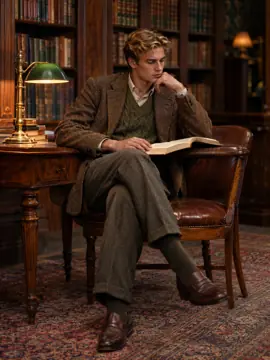 

大图：[写真照](../images/photo-poses/darkacad/sp112-photo.webp) · [白模](../images/photo-poses/darkacad/sp112-pose.webp)

<details><summary>提示词：用你的照片（附图 1 你的照片，附图 2 白模）</summary>

```text
A real professional portrait photoshoot photo: a dark-academia photoshoot in an old wood-panelled library, warm lamp light, brown and green tones, 50mm. Subject: the person in image 1 (keep their exact face, facial features, skin tone and hairstyle; do not beautify or swap the face), wearing a tweed blazer, knit vest, pleated skirt or wool trousers, loafers. Pose: sitting at a desk under a green lamp, chin on the hand, reading. Image 2 is a wooden artist's mannequin that shows only this body pose: copy it exactly (head, torso, arms, hands, legs, feet, which hand does what, the camera angle), but do not copy the mannequin itself: no wooden skin, no joints, no blank face. Natural, relaxed and unstiff, true skin texture. No text, no logo, no watermark. Portrait 3:4.
```

</details>

<details><summary>提示词：生成示例图（虚构模特）</summary>

```text
A real professional portrait photoshoot photo, the kind posted by a top portrait studio: a dark-academia photoshoot in an old wood-panelled library, warm lamp light, brown and green tones, 50mm. Model: a handsome Scandinavian professional male model in his twenties with a well-groomed look and styled hair, wearing a tweed blazer, knit vest, pleated skirt or wool trousers, loafers. The photographer directs the model into a natural, relaxed, unstiff pose that looks caught between moments: sitting at a desk under a green lamp, chin on the hand, reading. Asymmetric body, soft hands, flattering angle, true skin texture, refined but not plastic, fully clothed and modest. Full body or three-quarter body in frame, the whole pose clearly readable. No text, no logo, no watermark. Portrait 3:4.
```

</details>

## 抱书倚架（靠）

 

大图：[写真照](../images/photo-poses/darkacad/sp113-photo.webp) · [白模](../images/photo-poses/darkacad/sp113-pose.webp)

<details><summary>提示词：用你的照片（附图 1 你的照片，附图 2 白模）</summary>

```text
A real professional portrait photoshoot photo: a dark-academia photoshoot in an old wood-panelled library, warm lamp light, brown and green tones, 50mm. Subject: the person in image 1 (keep their exact face, facial features, skin tone and hairstyle; do not beautify or swap the face), wearing a tweed blazer, knit vest, pleated skirt or wool trousers, loafers. Pose: leaning on the bookshelves hugging books, one foot crossed. Image 2 is a wooden artist's mannequin that shows only this body pose: copy it exactly (head, torso, arms, hands, legs, feet, which hand does what, the camera angle), but do not copy the mannequin itself: no wooden skin, no joints, no blank face. Natural, relaxed and unstiff, true skin texture. No text, no logo, no watermark. Portrait 3:4.
```

</details>

<details><summary>提示词：生成示例图（虚构模特）</summary>

```text
A real professional portrait photoshoot photo, the kind posted by a top portrait studio: a dark-academia photoshoot in an old wood-panelled library, warm lamp light, brown and green tones, 50mm. Model: a beautiful East Asian professional fashion model in her twenties with a naturally attractive face, styled hair and natural makeup, wearing a tweed blazer, knit vest, pleated skirt or wool trousers, loafers. The photographer directs the model into a natural, relaxed, unstiff pose that looks caught between moments: leaning on the bookshelves hugging books, one foot crossed. Asymmetric body, soft hands, flattering angle, true skin texture, refined but not plastic, fully clothed and modest. Full body or three-quarter body in frame, the whole pose clearly readable. No text, no logo, no watermark. Portrait 3:4.
```

</details>

## 地毯坐书堆（坐）

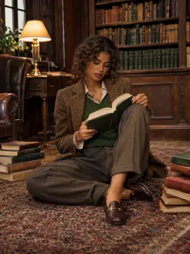 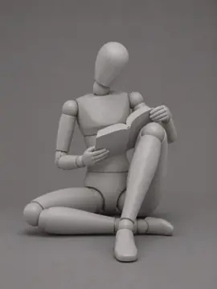

大图：[写真照](../images/photo-poses/darkacad/sp114-photo.webp) · [白模](../images/photo-poses/darkacad/sp114-pose.webp)

<details><summary>提示词：用你的照片（附图 1 你的照片，附图 2 白模）</summary>

```text
A real professional portrait photoshoot photo: a dark-academia photoshoot in an old wood-panelled library, warm lamp light, brown and green tones, 50mm. Subject: the person in image 1 (keep their exact face, facial features, skin tone and hairstyle; do not beautify or swap the face), wearing a tweed blazer, knit vest, pleated skirt or wool trousers, loafers. Pose: sitting on the rug among piles of books, one knee up, reading. Image 2 is a wooden artist's mannequin that shows only this body pose: copy it exactly (head, torso, arms, hands, legs, feet, which hand does what, the camera angle), but do not copy the mannequin itself: no wooden skin, no joints, no blank face. Natural, relaxed and unstiff, true skin texture. No text, no logo, no watermark. Portrait 3:4.
```

</details>

<details><summary>提示词：生成示例图（虚构模特）</summary>

```text
A real professional portrait photoshoot photo, the kind posted by a top portrait studio: a dark-academia photoshoot in an old wood-panelled library, warm lamp light, brown and green tones, 50mm. Model: a beautiful mixed-race professional fashion model in her twenties with a naturally attractive face, styled hair and natural makeup, wearing a tweed blazer, knit vest, pleated skirt or wool trousers, loafers. The photographer directs the model into a natural, relaxed, unstiff pose that looks caught between moments: sitting on the rug among piles of books, one knee up, reading. Asymmetric body, soft hands, flattering angle, true skin texture, refined but not plastic, fully clothed and modest. Full body or three-quarter body in frame, the whole pose clearly readable. No text, no logo, no watermark. Portrait 3:4.
```

</details>

## 走廊快走（走）

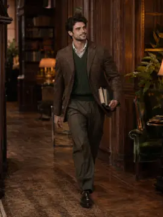 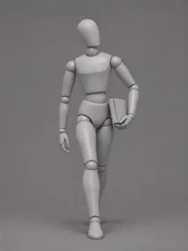

大图：[写真照](../images/photo-poses/darkacad/sp115-photo.webp) · [白模](../images/photo-poses/darkacad/sp115-pose.webp)

<details><summary>提示词：用你的照片（附图 1 你的照片，附图 2 白模）</summary>

```text
A real professional portrait photoshoot photo: a dark-academia photoshoot in an old wood-panelled library, warm lamp light, brown and green tones, 50mm. Subject: the person in image 1 (keep their exact face, facial features, skin tone and hairstyle; do not beautify or swap the face), wearing a tweed blazer, knit vest, pleated skirt or wool trousers, loafers. Pose: walking briskly down a panelled corridor with books under the arm. Image 2 is a wooden artist's mannequin that shows only this body pose: copy it exactly (head, torso, arms, hands, legs, feet, which hand does what, the camera angle), but do not copy the mannequin itself: no wooden skin, no joints, no blank face. Natural, relaxed and unstiff, true skin texture. No text, no logo, no watermark. Portrait 3:4.
```

</details>

<details><summary>提示词：生成示例图（虚构模特）</summary>

```text
A real professional portrait photoshoot photo, the kind posted by a top portrait studio: a dark-academia photoshoot in an old wood-panelled library, warm lamp light, brown and green tones, 50mm. Model: a handsome Mediterranean professional male model in his twenties with a well-groomed look and styled hair, wearing a tweed blazer, knit vest, pleated skirt or wool trousers, loafers. The photographer directs the model into a natural, relaxed, unstiff pose that looks caught between moments: walking briskly down a panelled corridor with books under the arm. Asymmetric body, soft hands, flattering angle, true skin texture, refined but not plastic, fully clothed and modest. Full body or three-quarter body in frame, the whole pose clearly readable. No text, no logo, no watermark. Portrait 3:4.
```

</details>

## 窗边写信（坐）

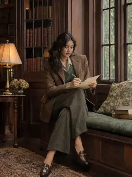 

大图：[写真照](../images/photo-poses/darkacad/sp116-photo.webp) · [白模](../images/photo-poses/darkacad/sp116-pose.webp)

<details><summary>提示词：用你的照片（附图 1 你的照片，附图 2 白模）</summary>

```text
A real professional portrait photoshoot photo: a dark-academia photoshoot in an old wood-panelled library, warm lamp light, brown and green tones, 50mm. Subject: the person in image 1 (keep their exact face, facial features, skin tone and hairstyle; do not beautify or swap the face), wearing a tweed blazer, knit vest, pleated skirt or wool trousers, loafers. Pose: sitting at a window seat writing a letter on the knee. Image 2 is a wooden artist's mannequin that shows only this body pose: copy it exactly (head, torso, arms, hands, legs, feet, which hand does what, the camera angle), but do not copy the mannequin itself: no wooden skin, no joints, no blank face. Natural, relaxed and unstiff, true skin texture. No text, no logo, no watermark. Portrait 3:4.
```

</details>

<details><summary>提示词：生成示例图（虚构模特）</summary>

```text
A real professional portrait photoshoot photo, the kind posted by a top portrait studio: a dark-academia photoshoot in an old wood-panelled library, warm lamp light, brown and green tones, 50mm. Model: a beautiful Southeast Asian professional fashion model in her twenties with a naturally attractive face, styled hair and natural makeup, wearing a tweed blazer, knit vest, pleated skirt or wool trousers, loafers. The photographer directs the model into a natural, relaxed, unstiff pose that looks caught between moments: sitting at a window seat writing a letter on the knee. Asymmetric body, soft hands, flattering angle, true skin texture, refined but not plastic, fully clothed and modest. Full body or three-quarter body in frame, the whole pose clearly readable. No text, no logo, no watermark. Portrait 3:4.
```

</details>

## 扶眼镜（半身）

 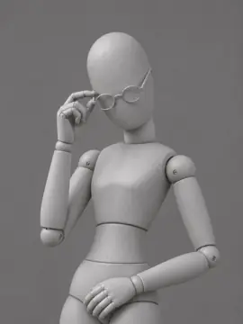

大图：[写真照](../images/photo-poses/darkacad/sp117-photo.webp) · [白模](../images/photo-poses/darkacad/sp117-pose.webp)

<details><summary>提示词：用你的照片（附图 1 你的照片，附图 2 白模）</summary>

```text
A real professional portrait photoshoot photo: a dark-academia photoshoot in an old wood-panelled library, warm lamp light, brown and green tones, 50mm. Subject: the person in image 1 (keep their exact face, facial features, skin tone and hairstyle; do not beautify or swap the face), wearing a tweed blazer, knit vest, pleated skirt or wool trousers, loafers. Pose: pushing up round glasses with one finger, eyes on the camera. Image 2 is a wooden artist's mannequin that shows only this body pose: copy it exactly (head, torso, arms, hands, legs, feet, which hand does what, the camera angle), but do not copy the mannequin itself: no wooden skin, no joints, no blank face. Natural, relaxed and unstiff, true skin texture. No text, no logo, no watermark. Portrait 3:4.
```

</details>

<details><summary>提示词：生成示例图（虚构模特）</summary>

```text
A real professional portrait photoshoot photo, the kind posted by a top portrait studio: a dark-academia photoshoot in an old wood-panelled library, warm lamp light, brown and green tones, 50mm. Model: a beautiful Japanese professional fashion model in her twenties with a naturally attractive face, styled hair and natural makeup, wearing a tweed blazer, knit vest, pleated skirt or wool trousers, loafers. The photographer directs the model into a natural, relaxed, unstiff pose that looks caught between moments: pushing up round glasses with one finger, eyes on the camera. Asymmetric body, soft hands, flattering angle, true skin texture, refined but not plastic, fully clothed and modest. Waist-up framing, both arms and hands readable. No text, no logo, no watermark. Portrait 3:4.
```

</details>

## 转身回头（回眸）

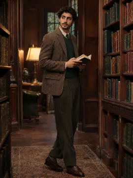 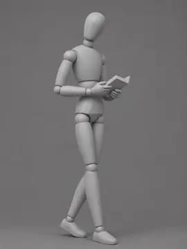

大图：[写真照](../images/photo-poses/darkacad/sp118-photo.webp) · [白模](../images/photo-poses/darkacad/sp118-pose.webp)

<details><summary>提示词：用你的照片（附图 1 你的照片，附图 2 白模）</summary>

```text
A real professional portrait photoshoot photo: a dark-academia photoshoot in an old wood-panelled library, warm lamp light, brown and green tones, 50mm. Subject: the person in image 1 (keep their exact face, facial features, skin tone and hairstyle; do not beautify or swap the face), wearing a tweed blazer, knit vest, pleated skirt or wool trousers, loafers. Pose: turning around between shelves at a sound, a book still open. Image 2 is a wooden artist's mannequin that shows only this body pose: copy it exactly (head, torso, arms, hands, legs, feet, which hand does what, the camera angle), but do not copy the mannequin itself: no wooden skin, no joints, no blank face. Natural, relaxed and unstiff, true skin texture. No text, no logo, no watermark. Portrait 3:4.
```

</details>

<details><summary>提示词：生成示例图（虚构模特）</summary>

```text
A real professional portrait photoshoot photo, the kind posted by a top portrait studio: a dark-academia photoshoot in an old wood-panelled library, warm lamp light, brown and green tones, 50mm. Model: a handsome Middle Eastern professional male model in his twenties with a well-groomed look and styled hair, wearing a tweed blazer, knit vest, pleated skirt or wool trousers, loafers. The photographer directs the model into a natural, relaxed, unstiff pose that looks caught between moments: turning around between shelves at a sound, a book still open. Asymmetric body, soft hands, flattering angle, true skin texture, refined but not plastic, fully clothed and modest. Full body or three-quarter body in frame, the whole pose clearly readable. No text, no logo, no watermark. Portrait 3:4.
```

</details>

## 壁炉前（站）

 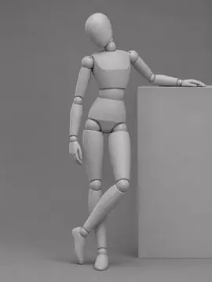

大图：[写真照](../images/photo-poses/darkacad/sp119-photo.webp) · [白模](../images/photo-poses/darkacad/sp119-pose.webp)

<details><summary>提示词：用你的照片（附图 1 你的照片，附图 2 白模）</summary>

```text
A real professional portrait photoshoot photo: a dark-academia photoshoot in an old wood-panelled library, warm lamp light, brown and green tones, 50mm. Subject: the person in image 1 (keep their exact face, facial features, skin tone and hairstyle; do not beautify or swap the face), wearing a tweed blazer, knit vest, pleated skirt or wool trousers, loafers. Pose: standing by a fireplace with one hand on the mantel, looking at the fire. Image 2 is a wooden artist's mannequin that shows only this body pose: copy it exactly (head, torso, arms, hands, legs, feet, which hand does what, the camera angle), but do not copy the mannequin itself: no wooden skin, no joints, no blank face. Natural, relaxed and unstiff, true skin texture. No text, no logo, no watermark. Portrait 3:4.
```

</details>

<details><summary>提示词：生成示例图（虚构模特）</summary>

```text
A real professional portrait photoshoot photo, the kind posted by a top portrait studio: a dark-academia photoshoot in an old wood-panelled library, warm lamp light, brown and green tones, 50mm. Model: a beautiful Indian professional fashion model in her twenties with a naturally attractive face, styled hair and natural makeup, wearing a tweed blazer, knit vest, pleated skirt or wool trousers, loafers. The photographer directs the model into a natural, relaxed, unstiff pose that looks caught between moments: standing by a fireplace with one hand on the mantel, looking at the fire. Asymmetric body, soft hands, flattering angle, true skin texture, refined but not plastic, fully clothed and modest. Full body or three-quarter body in frame, the whole pose clearly readable. No text, no logo, no watermark. Portrait 3:4.
```

</details>

## 靠桌沿（靠）

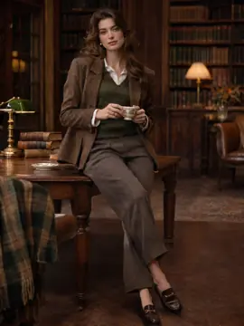 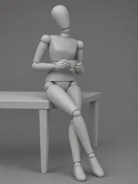

大图：[写真照](../images/photo-poses/darkacad/sp120-photo.webp) · [白模](../images/photo-poses/darkacad/sp120-pose.webp)

<details><summary>提示词：用你的照片（附图 1 你的照片，附图 2 白模）</summary>

```text
A real professional portrait photoshoot photo: a dark-academia photoshoot in an old wood-panelled library, warm lamp light, brown and green tones, 50mm. Subject: the person in image 1 (keep their exact face, facial features, skin tone and hairstyle; do not beautify or swap the face), wearing a tweed blazer, knit vest, pleated skirt or wool trousers, loafers. Pose: perched on the edge of an oak table, ankles crossed, holding a teacup. Image 2 is a wooden artist's mannequin that shows only this body pose: copy it exactly (head, torso, arms, hands, legs, feet, which hand does what, the camera angle), but do not copy the mannequin itself: no wooden skin, no joints, no blank face. Natural, relaxed and unstiff, true skin texture. No text, no logo, no watermark. Portrait 3:4.
```

</details>

<details><summary>提示词：生成示例图（虚构模特）</summary>

```text
A real professional portrait photoshoot photo, the kind posted by a top portrait studio: a dark-academia photoshoot in an old wood-panelled library, warm lamp light, brown and green tones, 50mm. Model: a beautiful white European professional fashion model in her twenties with a naturally attractive face, styled hair and natural makeup, wearing a tweed blazer, knit vest, pleated skirt or wool trousers, loafers. The photographer directs the model into a natural, relaxed, unstiff pose that looks caught between moments: perched on the edge of an oak table, ankles crossed, holding a teacup. Asymmetric body, soft hands, flattering angle, true skin texture, refined but not plastic, fully clothed and modest. Full body or three-quarter body in frame, the whole pose clearly readable. No text, no logo, no watermark. Portrait 3:4.
```

</details>
