# Dark academia

English · [简体中文](darkacad.zh-CN.md)

10 white models, each with 4 portraits shot from it in different styles. Attach your photo first and the white model second. Try them with your own photo on [Promicat](https://promicat.app/poses?utm_source=github&utm_medium=readme&utm_campaign=ai-photo-poses).

[← Back to all styles](../README.md#photo-poses)

## Standing on a library ladder reaching for a book (Standing)

| White model | Dark academia | Campus youth | HK retro neon | Western cowboy |
|---|---|---|---|---|
| 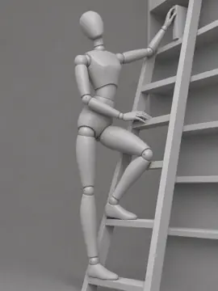 | <a href="https://promicat.app/poses/styles/sp111?utm_source=github&utm_medium=readme&utm_campaign=ai-photo-poses">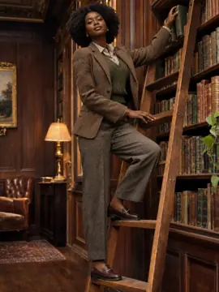</a> | <a href="https://promicat.app/poses/styles/sp111?utm_source=github&utm_medium=readme&utm_campaign=ai-photo-poses"></a> | <a href="https://promicat.app/poses/styles/sp111?utm_source=github&utm_medium=readme&utm_campaign=ai-photo-poses"></a> | <a href="https://promicat.app/poses/styles/sp111?utm_source=github&utm_medium=readme&utm_campaign=ai-photo-poses">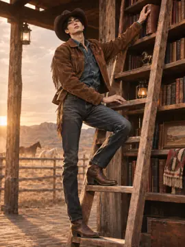</a> |

Full size: [photo](../images/photo-poses/darkacad/sp111-photo.webp) · [white model](../images/photo-poses/darkacad/sp111-pose.webp) · [try it on Promicat](https://promicat.app/poses/styles/sp111?utm_source=github&utm_medium=readme&utm_campaign=ai-photo-poses)

<details><summary>Prompt with your photo (image 1: your photo, image 2: white model)</summary>

```text
A real professional portrait photoshoot photo: a dark-academia photoshoot in an old wood-panelled library, warm lamp light, brown and green tones, 50mm. Subject: the person in image 1 (keep their exact face, facial features, skin tone and hairstyle; do not beautify or swap the face), wearing a tweed blazer, knit vest, pleated skirt or wool trousers, loafers. Pose: standing on a library ladder reaching for a book, looking down at the camera. Image 2 is a wooden artist's mannequin that shows only this body pose: copy it exactly (head, torso, arms, hands, legs, feet, which hand does what, the camera angle), but do not copy the mannequin itself: no wooden skin, no joints, no blank face. Natural, relaxed and unstiff, true skin texture. No text, no logo, no watermark. Portrait 3:4.
```

</details>

<details><summary>Prompt for the sample (fictional model)</summary>

```text
A real professional portrait photoshoot photo, the kind posted by a top portrait studio: a dark-academia photoshoot in an old wood-panelled library, warm lamp light, brown and green tones, 50mm. Model: a beautiful Black professional fashion model in her twenties with a naturally attractive face, styled hair and natural makeup, wearing a tweed blazer, knit vest, pleated skirt or wool trousers, loafers. The photographer directs the model into a natural, relaxed, unstiff pose that looks caught between moments: standing on a library ladder reaching for a book, looking down at the camera. Asymmetric body, soft hands, flattering angle, true skin texture, refined but not plastic, fully clothed and modest. Full body or three-quarter body in frame, the whole pose clearly readable. No text, no logo, no watermark. Portrait 3:4.
```

</details>

## Sitting at a desk under a green lamp (Sitting)

| White model | Dark academia | Seaside holiday | Cyberpunk neon | Y2K flash |
|---|---|---|---|---|
| 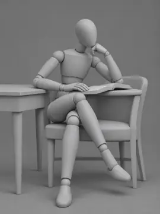 | <a href="https://promicat.app/poses/styles/sp112?utm_source=github&utm_medium=readme&utm_campaign=ai-photo-poses"></a> | <a href="https://promicat.app/poses/styles/sp112?utm_source=github&utm_medium=readme&utm_campaign=ai-photo-poses"></a> | <a href="https://promicat.app/poses/styles/sp112?utm_source=github&utm_medium=readme&utm_campaign=ai-photo-poses">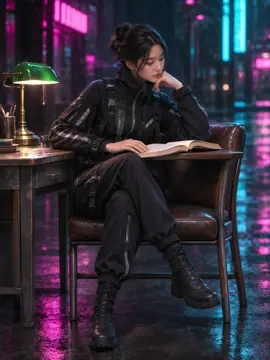</a> | <a href="https://promicat.app/poses/styles/sp112?utm_source=github&utm_medium=readme&utm_campaign=ai-photo-poses">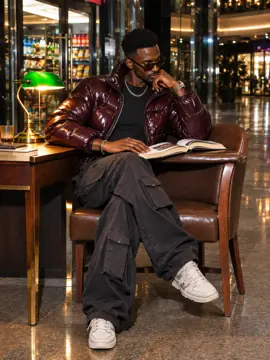</a> |

Full size: [photo](../images/photo-poses/darkacad/sp112-photo.webp) · [white model](../images/photo-poses/darkacad/sp112-pose.webp) · [try it on Promicat](https://promicat.app/poses/styles/sp112?utm_source=github&utm_medium=readme&utm_campaign=ai-photo-poses)

<details><summary>Prompt with your photo (image 1: your photo, image 2: white model)</summary>

```text
A real professional portrait photoshoot photo: a dark-academia photoshoot in an old wood-panelled library, warm lamp light, brown and green tones, 50mm. Subject: the person in image 1 (keep their exact face, facial features, skin tone and hairstyle; do not beautify or swap the face), wearing a tweed blazer, knit vest, pleated skirt or wool trousers, loafers. Pose: sitting at a desk under a green lamp, chin on the hand, reading. Image 2 is a wooden artist's mannequin that shows only this body pose: copy it exactly (head, torso, arms, hands, legs, feet, which hand does what, the camera angle), but do not copy the mannequin itself: no wooden skin, no joints, no blank face. Natural, relaxed and unstiff, true skin texture. No text, no logo, no watermark. Portrait 3:4.
```

</details>

<details><summary>Prompt for the sample (fictional model)</summary>

```text
A real professional portrait photoshoot photo, the kind posted by a top portrait studio: a dark-academia photoshoot in an old wood-panelled library, warm lamp light, brown and green tones, 50mm. Model: a handsome Scandinavian professional male model in his twenties with a well-groomed look and styled hair, wearing a tweed blazer, knit vest, pleated skirt or wool trousers, loafers. The photographer directs the model into a natural, relaxed, unstiff pose that looks caught between moments: sitting at a desk under a green lamp, chin on the hand, reading. Asymmetric body, soft hands, flattering angle, true skin texture, refined but not plastic, fully clothed and modest. Full body or three-quarter body in frame, the whole pose clearly readable. No text, no logo, no watermark. Portrait 3:4.
```

</details>

## Leaning on the bookshelves hugging books (Leaning)

| White model | Dark academia | Gothic | Moody studio | Street fashion |
|---|---|---|---|---|
| 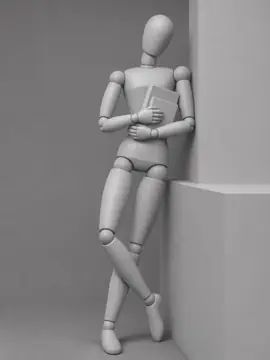 | <a href="https://promicat.app/poses/styles/sp113?utm_source=github&utm_medium=readme&utm_campaign=ai-photo-poses">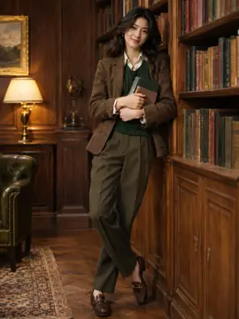</a> | <a href="https://promicat.app/poses/styles/sp113?utm_source=github&utm_medium=readme&utm_campaign=ai-photo-poses"></a> | <a href="https://promicat.app/poses/styles/sp113?utm_source=github&utm_medium=readme&utm_campaign=ai-photo-poses"></a> | <a href="https://promicat.app/poses/styles/sp113?utm_source=github&utm_medium=readme&utm_campaign=ai-photo-poses">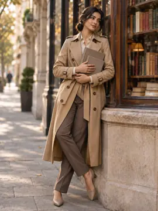</a> |

Full size: [photo](../images/photo-poses/darkacad/sp113-photo.webp) · [white model](../images/photo-poses/darkacad/sp113-pose.webp) · [try it on Promicat](https://promicat.app/poses/styles/sp113?utm_source=github&utm_medium=readme&utm_campaign=ai-photo-poses)

<details><summary>Prompt with your photo (image 1: your photo, image 2: white model)</summary>

```text
A real professional portrait photoshoot photo: a dark-academia photoshoot in an old wood-panelled library, warm lamp light, brown and green tones, 50mm. Subject: the person in image 1 (keep their exact face, facial features, skin tone and hairstyle; do not beautify or swap the face), wearing a tweed blazer, knit vest, pleated skirt or wool trousers, loafers. Pose: leaning on the bookshelves hugging books, one foot crossed. Image 2 is a wooden artist's mannequin that shows only this body pose: copy it exactly (head, torso, arms, hands, legs, feet, which hand does what, the camera angle), but do not copy the mannequin itself: no wooden skin, no joints, no blank face. Natural, relaxed and unstiff, true skin texture. No text, no logo, no watermark. Portrait 3:4.
```

</details>

<details><summary>Prompt for the sample (fictional model)</summary>

```text
A real professional portrait photoshoot photo, the kind posted by a top portrait studio: a dark-academia photoshoot in an old wood-panelled library, warm lamp light, brown and green tones, 50mm. Model: a beautiful East Asian professional fashion model in her twenties with a naturally attractive face, styled hair and natural makeup, wearing a tweed blazer, knit vest, pleated skirt or wool trousers, loafers. The photographer directs the model into a natural, relaxed, unstiff pose that looks caught between moments: leaning on the bookshelves hugging books, one foot crossed. Asymmetric body, soft hands, flattering angle, true skin texture, refined but not plastic, fully clothed and modest. Full body or three-quarter body in frame, the whole pose clearly readable. No text, no logo, no watermark. Portrait 3:4.
```

</details>

## Sitting on the rug among piles of books (Sitting)

| White model | Dark academia | Moody studio | Nordic minimal | Western cowboy |
|---|---|---|---|---|
|  | <a href="https://promicat.app/poses/styles/sp114?utm_source=github&utm_medium=readme&utm_campaign=ai-photo-poses"></a> | <a href="https://promicat.app/poses/styles/sp114?utm_source=github&utm_medium=readme&utm_campaign=ai-photo-poses">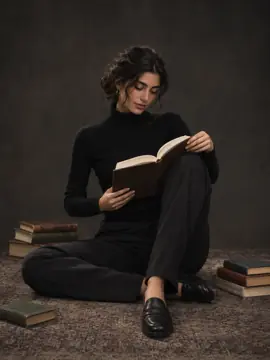</a> | <a href="https://promicat.app/poses/styles/sp114?utm_source=github&utm_medium=readme&utm_campaign=ai-photo-poses">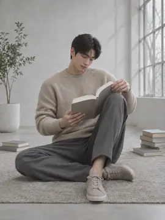</a> | <a href="https://promicat.app/poses/styles/sp114?utm_source=github&utm_medium=readme&utm_campaign=ai-photo-poses"></a> |

Full size: [photo](../images/photo-poses/darkacad/sp114-photo.webp) · [white model](../images/photo-poses/darkacad/sp114-pose.webp) · [try it on Promicat](https://promicat.app/poses/styles/sp114?utm_source=github&utm_medium=readme&utm_campaign=ai-photo-poses)

<details><summary>Prompt with your photo (image 1: your photo, image 2: white model)</summary>

```text
A real professional portrait photoshoot photo: a dark-academia photoshoot in an old wood-panelled library, warm lamp light, brown and green tones, 50mm. Subject: the person in image 1 (keep their exact face, facial features, skin tone and hairstyle; do not beautify or swap the face), wearing a tweed blazer, knit vest, pleated skirt or wool trousers, loafers. Pose: sitting on the rug among piles of books, one knee up, reading. Image 2 is a wooden artist's mannequin that shows only this body pose: copy it exactly (head, torso, arms, hands, legs, feet, which hand does what, the camera angle), but do not copy the mannequin itself: no wooden skin, no joints, no blank face. Natural, relaxed and unstiff, true skin texture. No text, no logo, no watermark. Portrait 3:4.
```

</details>

<details><summary>Prompt for the sample (fictional model)</summary>

```text
A real professional portrait photoshoot photo, the kind posted by a top portrait studio: a dark-academia photoshoot in an old wood-panelled library, warm lamp light, brown and green tones, 50mm. Model: a beautiful mixed-race professional fashion model in her twenties with a naturally attractive face, styled hair and natural makeup, wearing a tweed blazer, knit vest, pleated skirt or wool trousers, loafers. The photographer directs the model into a natural, relaxed, unstiff pose that looks caught between moments: sitting on the rug among piles of books, one knee up, reading. Asymmetric body, soft hands, flattering angle, true skin texture, refined but not plastic, fully clothed and modest. Full body or three-quarter body in frame, the whole pose clearly readable. No text, no logo, no watermark. Portrait 3:4.
```

</details>

## Walking briskly down a panelled corridor with books under the arm (Walking)

| White model | Dark academia | Boho desert | 1950s Hollywood | Street fashion |
|---|---|---|---|---|
|  | <a href="https://promicat.app/poses/styles/sp115?utm_source=github&utm_medium=readme&utm_campaign=ai-photo-poses"></a> | <a href="https://promicat.app/poses/styles/sp115?utm_source=github&utm_medium=readme&utm_campaign=ai-photo-poses">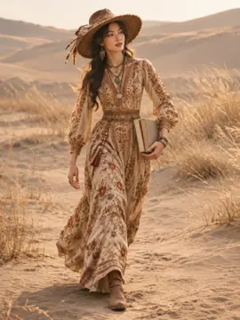</a> | <a href="https://promicat.app/poses/styles/sp115?utm_source=github&utm_medium=readme&utm_campaign=ai-photo-poses">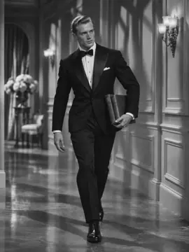</a> | <a href="https://promicat.app/poses/styles/sp115?utm_source=github&utm_medium=readme&utm_campaign=ai-photo-poses">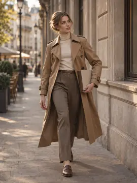</a> |

Full size: [photo](../images/photo-poses/darkacad/sp115-photo.webp) · [white model](../images/photo-poses/darkacad/sp115-pose.webp) · [try it on Promicat](https://promicat.app/poses/styles/sp115?utm_source=github&utm_medium=readme&utm_campaign=ai-photo-poses)

<details><summary>Prompt with your photo (image 1: your photo, image 2: white model)</summary>

```text
A real professional portrait photoshoot photo: a dark-academia photoshoot in an old wood-panelled library, warm lamp light, brown and green tones, 50mm. Subject: the person in image 1 (keep their exact face, facial features, skin tone and hairstyle; do not beautify or swap the face), wearing a tweed blazer, knit vest, pleated skirt or wool trousers, loafers. Pose: walking briskly down a panelled corridor with books under the arm. Image 2 is a wooden artist's mannequin that shows only this body pose: copy it exactly (head, torso, arms, hands, legs, feet, which hand does what, the camera angle), but do not copy the mannequin itself: no wooden skin, no joints, no blank face. Natural, relaxed and unstiff, true skin texture. No text, no logo, no watermark. Portrait 3:4.
```

</details>

<details><summary>Prompt for the sample (fictional model)</summary>

```text
A real professional portrait photoshoot photo, the kind posted by a top portrait studio: a dark-academia photoshoot in an old wood-panelled library, warm lamp light, brown and green tones, 50mm. Model: a handsome Mediterranean professional male model in his twenties with a well-groomed look and styled hair, wearing a tweed blazer, knit vest, pleated skirt or wool trousers, loafers. The photographer directs the model into a natural, relaxed, unstiff pose that looks caught between moments: walking briskly down a panelled corridor with books under the arm. Asymmetric body, soft hands, flattering angle, true skin texture, refined but not plastic, fully clothed and modest. Full body or three-quarter body in frame, the whole pose clearly readable. No text, no logo, no watermark. Portrait 3:4.
```

</details>

## Sitting at a window seat writing a letter on the knee (Sitting)

| White model | Dark academia | Cafe & bookshop | Cyberpunk neon | Japanese fresh film |
|---|---|---|---|---|
| 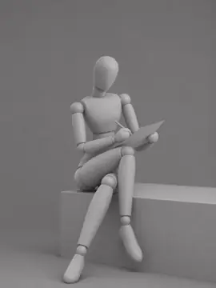 | <a href="https://promicat.app/poses/styles/sp116?utm_source=github&utm_medium=readme&utm_campaign=ai-photo-poses"></a> | <a href="https://promicat.app/poses/styles/sp116?utm_source=github&utm_medium=readme&utm_campaign=ai-photo-poses"></a> | <a href="https://promicat.app/poses/styles/sp116?utm_source=github&utm_medium=readme&utm_campaign=ai-photo-poses">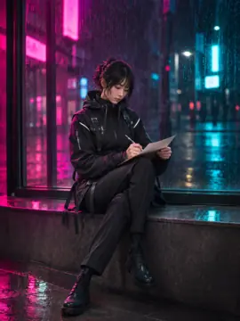</a> | <a href="https://promicat.app/poses/styles/sp116?utm_source=github&utm_medium=readme&utm_campaign=ai-photo-poses"></a> |

Full size: [photo](../images/photo-poses/darkacad/sp116-photo.webp) · [white model](../images/photo-poses/darkacad/sp116-pose.webp) · [try it on Promicat](https://promicat.app/poses/styles/sp116?utm_source=github&utm_medium=readme&utm_campaign=ai-photo-poses)

<details><summary>Prompt with your photo (image 1: your photo, image 2: white model)</summary>

```text
A real professional portrait photoshoot photo: a dark-academia photoshoot in an old wood-panelled library, warm lamp light, brown and green tones, 50mm. Subject: the person in image 1 (keep their exact face, facial features, skin tone and hairstyle; do not beautify or swap the face), wearing a tweed blazer, knit vest, pleated skirt or wool trousers, loafers. Pose: sitting at a window seat writing a letter on the knee. Image 2 is a wooden artist's mannequin that shows only this body pose: copy it exactly (head, torso, arms, hands, legs, feet, which hand does what, the camera angle), but do not copy the mannequin itself: no wooden skin, no joints, no blank face. Natural, relaxed and unstiff, true skin texture. No text, no logo, no watermark. Portrait 3:4.
```

</details>

<details><summary>Prompt for the sample (fictional model)</summary>

```text
A real professional portrait photoshoot photo, the kind posted by a top portrait studio: a dark-academia photoshoot in an old wood-panelled library, warm lamp light, brown and green tones, 50mm. Model: a beautiful Southeast Asian professional fashion model in her twenties with a naturally attractive face, styled hair and natural makeup, wearing a tweed blazer, knit vest, pleated skirt or wool trousers, loafers. The photographer directs the model into a natural, relaxed, unstiff pose that looks caught between moments: sitting at a window seat writing a letter on the knee. Asymmetric body, soft hands, flattering angle, true skin texture, refined but not plastic, fully clothed and modest. Full body or three-quarter body in frame, the whole pose clearly readable. No text, no logo, no watermark. Portrait 3:4.
```

</details>

## Pushing up round glasses with one finger (Upper body)

| White model | Dark academia | Forest & flower field | Gothic | Y2K flash |
|---|---|---|---|---|
|  | <a href="https://promicat.app/poses/styles/sp117?utm_source=github&utm_medium=readme&utm_campaign=ai-photo-poses">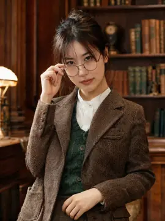</a> | <a href="https://promicat.app/poses/styles/sp117?utm_source=github&utm_medium=readme&utm_campaign=ai-photo-poses">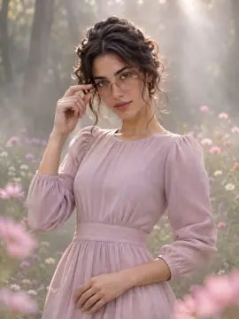</a> | <a href="https://promicat.app/poses/styles/sp117?utm_source=github&utm_medium=readme&utm_campaign=ai-photo-poses">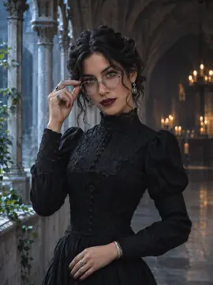</a> | <a href="https://promicat.app/poses/styles/sp117?utm_source=github&utm_medium=readme&utm_campaign=ai-photo-poses">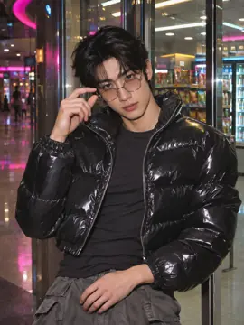</a> |

Full size: [photo](../images/photo-poses/darkacad/sp117-photo.webp) · [white model](../images/photo-poses/darkacad/sp117-pose.webp) · [try it on Promicat](https://promicat.app/poses/styles/sp117?utm_source=github&utm_medium=readme&utm_campaign=ai-photo-poses)

<details><summary>Prompt with your photo (image 1: your photo, image 2: white model)</summary>

```text
A real professional portrait photoshoot photo: a dark-academia photoshoot in an old wood-panelled library, warm lamp light, brown and green tones, 50mm. Subject: the person in image 1 (keep their exact face, facial features, skin tone and hairstyle; do not beautify or swap the face), wearing a tweed blazer, knit vest, pleated skirt or wool trousers, loafers. Pose: pushing up round glasses with one finger, eyes on the camera. Image 2 is a wooden artist's mannequin that shows only this body pose: copy it exactly (head, torso, arms, hands, legs, feet, which hand does what, the camera angle), but do not copy the mannequin itself: no wooden skin, no joints, no blank face. Natural, relaxed and unstiff, true skin texture. No text, no logo, no watermark. Portrait 3:4.
```

</details>

<details><summary>Prompt for the sample (fictional model)</summary>

```text
A real professional portrait photoshoot photo, the kind posted by a top portrait studio: a dark-academia photoshoot in an old wood-panelled library, warm lamp light, brown and green tones, 50mm. Model: a beautiful Japanese professional fashion model in her twenties with a naturally attractive face, styled hair and natural makeup, wearing a tweed blazer, knit vest, pleated skirt or wool trousers, loafers. The photographer directs the model into a natural, relaxed, unstiff pose that looks caught between moments: pushing up round glasses with one finger, eyes on the camera. Asymmetric body, soft hands, flattering angle, true skin texture, refined but not plastic, fully clothed and modest. Waist-up framing, both arms and hands readable. No text, no logo, no watermark. Portrait 3:4.
```

</details>

## Turning around between shelves at a sound (Looking back)

| White model | Dark academia | Seaside holiday | Cosy at home | Street punk |
|---|---|---|---|---|
|  | <a href="https://promicat.app/poses/styles/sp118?utm_source=github&utm_medium=readme&utm_campaign=ai-photo-poses"></a> | <a href="https://promicat.app/poses/styles/sp118?utm_source=github&utm_medium=readme&utm_campaign=ai-photo-poses"></a> | <a href="https://promicat.app/poses/styles/sp118?utm_source=github&utm_medium=readme&utm_campaign=ai-photo-poses">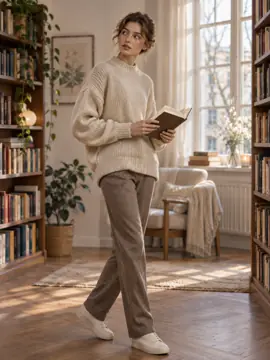</a> | <a href="https://promicat.app/poses/styles/sp118?utm_source=github&utm_medium=readme&utm_campaign=ai-photo-poses">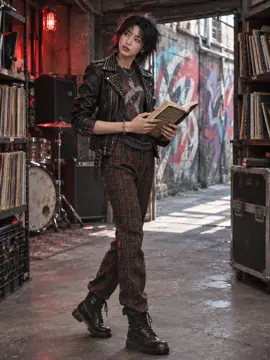</a> |

Full size: [photo](../images/photo-poses/darkacad/sp118-photo.webp) · [white model](../images/photo-poses/darkacad/sp118-pose.webp) · [try it on Promicat](https://promicat.app/poses/styles/sp118?utm_source=github&utm_medium=readme&utm_campaign=ai-photo-poses)

<details><summary>Prompt with your photo (image 1: your photo, image 2: white model)</summary>

```text
A real professional portrait photoshoot photo: a dark-academia photoshoot in an old wood-panelled library, warm lamp light, brown and green tones, 50mm. Subject: the person in image 1 (keep their exact face, facial features, skin tone and hairstyle; do not beautify or swap the face), wearing a tweed blazer, knit vest, pleated skirt or wool trousers, loafers. Pose: turning around between shelves at a sound, a book still open. Image 2 is a wooden artist's mannequin that shows only this body pose: copy it exactly (head, torso, arms, hands, legs, feet, which hand does what, the camera angle), but do not copy the mannequin itself: no wooden skin, no joints, no blank face. Natural, relaxed and unstiff, true skin texture. No text, no logo, no watermark. Portrait 3:4.
```

</details>

<details><summary>Prompt for the sample (fictional model)</summary>

```text
A real professional portrait photoshoot photo, the kind posted by a top portrait studio: a dark-academia photoshoot in an old wood-panelled library, warm lamp light, brown and green tones, 50mm. Model: a handsome Middle Eastern professional male model in his twenties with a well-groomed look and styled hair, wearing a tweed blazer, knit vest, pleated skirt or wool trousers, loafers. The photographer directs the model into a natural, relaxed, unstiff pose that looks caught between moments: turning around between shelves at a sound, a book still open. Asymmetric body, soft hands, flattering angle, true skin texture, refined but not plastic, fully clothed and modest. Full body or three-quarter body in frame, the whole pose clearly readable. No text, no logo, no watermark. Portrait 3:4.
```

</details>

## Standing by a fireplace with one hand on the mantel (Standing)

| White model | Dark academia | Campus youth | New Chinese style | Old money |
|---|---|---|---|---|
|  | <a href="https://promicat.app/poses/styles/sp119?utm_source=github&utm_medium=readme&utm_campaign=ai-photo-poses">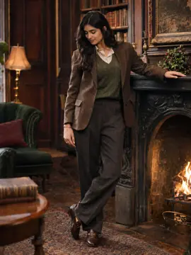</a> | <a href="https://promicat.app/poses/styles/sp119?utm_source=github&utm_medium=readme&utm_campaign=ai-photo-poses">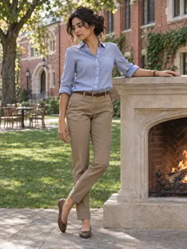</a> | <a href="https://promicat.app/poses/styles/sp119?utm_source=github&utm_medium=readme&utm_campaign=ai-photo-poses">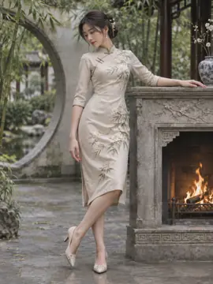</a> | <a href="https://promicat.app/poses/styles/sp119?utm_source=github&utm_medium=readme&utm_campaign=ai-photo-poses">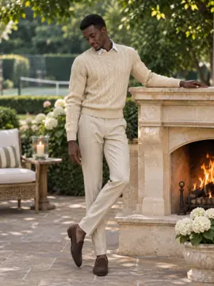</a> |

Full size: [photo](../images/photo-poses/darkacad/sp119-photo.webp) · [white model](../images/photo-poses/darkacad/sp119-pose.webp) · [try it on Promicat](https://promicat.app/poses/styles/sp119?utm_source=github&utm_medium=readme&utm_campaign=ai-photo-poses)

<details><summary>Prompt with your photo (image 1: your photo, image 2: white model)</summary>

```text
A real professional portrait photoshoot photo: a dark-academia photoshoot in an old wood-panelled library, warm lamp light, brown and green tones, 50mm. Subject: the person in image 1 (keep their exact face, facial features, skin tone and hairstyle; do not beautify or swap the face), wearing a tweed blazer, knit vest, pleated skirt or wool trousers, loafers. Pose: standing by a fireplace with one hand on the mantel, looking at the fire. Image 2 is a wooden artist's mannequin that shows only this body pose: copy it exactly (head, torso, arms, hands, legs, feet, which hand does what, the camera angle), but do not copy the mannequin itself: no wooden skin, no joints, no blank face. Natural, relaxed and unstiff, true skin texture. No text, no logo, no watermark. Portrait 3:4.
```

</details>

<details><summary>Prompt for the sample (fictional model)</summary>

```text
A real professional portrait photoshoot photo, the kind posted by a top portrait studio: a dark-academia photoshoot in an old wood-panelled library, warm lamp light, brown and green tones, 50mm. Model: a beautiful Indian professional fashion model in her twenties with a naturally attractive face, styled hair and natural makeup, wearing a tweed blazer, knit vest, pleated skirt or wool trousers, loafers. The photographer directs the model into a natural, relaxed, unstiff pose that looks caught between moments: standing by a fireplace with one hand on the mantel, looking at the fire. Asymmetric body, soft hands, flattering angle, true skin texture, refined but not plastic, fully clothed and modest. Full body or three-quarter body in frame, the whole pose clearly readable. No text, no logo, no watermark. Portrait 3:4.
```

</details>

## Perched on the edge of an oak table (Leaning)

| White model | Dark academia | HK retro neon | Japanese fresh film | Y2K flash |
|---|---|---|---|---|
|  | <a href="https://promicat.app/poses/styles/sp120?utm_source=github&utm_medium=readme&utm_campaign=ai-photo-poses"></a> | <a href="https://promicat.app/poses/styles/sp120?utm_source=github&utm_medium=readme&utm_campaign=ai-photo-poses"></a> | <a href="https://promicat.app/poses/styles/sp120?utm_source=github&utm_medium=readme&utm_campaign=ai-photo-poses">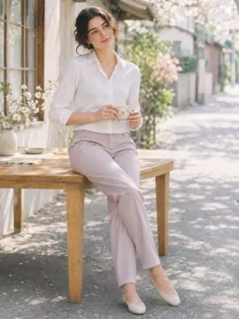</a> | <a href="https://promicat.app/poses/styles/sp120?utm_source=github&utm_medium=readme&utm_campaign=ai-photo-poses"></a> |

Full size: [photo](../images/photo-poses/darkacad/sp120-photo.webp) · [white model](../images/photo-poses/darkacad/sp120-pose.webp) · [try it on Promicat](https://promicat.app/poses/styles/sp120?utm_source=github&utm_medium=readme&utm_campaign=ai-photo-poses)

<details><summary>Prompt with your photo (image 1: your photo, image 2: white model)</summary>

```text
A real professional portrait photoshoot photo: a dark-academia photoshoot in an old wood-panelled library, warm lamp light, brown and green tones, 50mm. Subject: the person in image 1 (keep their exact face, facial features, skin tone and hairstyle; do not beautify or swap the face), wearing a tweed blazer, knit vest, pleated skirt or wool trousers, loafers. Pose: perched on the edge of an oak table, ankles crossed, holding a teacup. Image 2 is a wooden artist's mannequin that shows only this body pose: copy it exactly (head, torso, arms, hands, legs, feet, which hand does what, the camera angle), but do not copy the mannequin itself: no wooden skin, no joints, no blank face. Natural, relaxed and unstiff, true skin texture. No text, no logo, no watermark. Portrait 3:4.
```

</details>

<details><summary>Prompt for the sample (fictional model)</summary>

```text
A real professional portrait photoshoot photo, the kind posted by a top portrait studio: a dark-academia photoshoot in an old wood-panelled library, warm lamp light, brown and green tones, 50mm. Model: a beautiful white European professional fashion model in her twenties with a naturally attractive face, styled hair and natural makeup, wearing a tweed blazer, knit vest, pleated skirt or wool trousers, loafers. The photographer directs the model into a natural, relaxed, unstiff pose that looks caught between moments: perched on the edge of an oak table, ankles crossed, holding a teacup. Asymmetric body, soft hands, flattering angle, true skin texture, refined but not plastic, fully clothed and modest. Full body or three-quarter body in frame, the whole pose clearly readable. No text, no logo, no watermark. Portrait 3:4.
```

</details>
