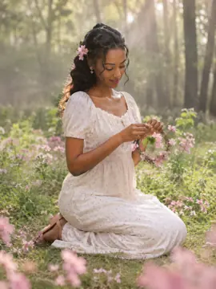
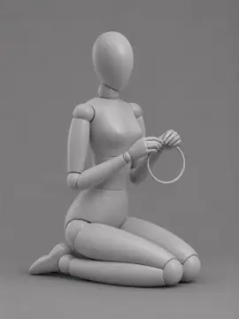
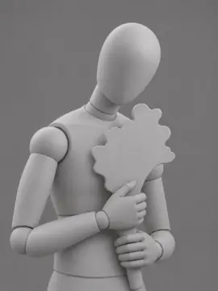
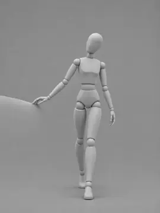
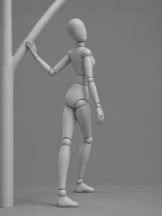

# Forest & flower field

English · [简体中文](flower.zh-CN.md)

10 photo poses: a sample photo and the white model drawn from it. Attach your photo first and the white model second. Try them with your own photo on [Promicat](https://promicat.app/poses?utm_source=github&utm_medium=readme&utm_campaign=ai-photo-poses).

[← Back to all styles](../README.md#photo-poses)

## Crouching among the flowers (Crouching)

<a href="https://promicat.app/poses/styles/sp031?utm_source=github&utm_medium=readme&utm_campaign=ai-photo-poses"></a> 

Full size: [photo](../images/photo-poses/flower/sp031-photo.webp) · [white model](../images/photo-poses/flower/sp031-pose.webp) · [try it on Promicat](https://promicat.app/poses/styles/sp031?utm_source=github&utm_medium=readme&utm_campaign=ai-photo-poses)

<details><summary>Prompt with your photo (image 1: your photo, image 2: white model)</summary>

```text
A real professional portrait photoshoot photo: a dreamy forest-and-flower-field photoshoot, soft hazy backlight, pastel tones, 85mm f/1.8, flowers blurred in the foreground. Subject: the person in image 1 (keep their exact face, facial features, skin tone and hairstyle; do not beautify or swap the face), wearing a light cotton dress or a soft pastel shirt. Pose: crouching among the flowers, one hand holding a bloom near the face, smiling softly down. Image 2 is a wooden artist's mannequin that shows only this body pose: copy it exactly (head, torso, arms, hands, legs, feet, which hand does what, the camera angle), but do not copy the mannequin itself: no wooden skin, no joints, no blank face. Natural, relaxed and unstiff, true skin texture. No text, no logo, no watermark. Portrait 3:4.
```

</details>

<details><summary>Prompt for the sample (fictional model)</summary>

```text
A real professional portrait photoshoot photo, the kind posted by a top portrait studio: a dreamy forest-and-flower-field photoshoot, soft hazy backlight, pastel tones, 85mm f/1.8, flowers blurred in the foreground. Model: a beautiful Latina professional fashion model in her twenties with a naturally attractive face, styled hair and natural makeup, wearing a light cotton dress or a soft pastel shirt. The photographer directs the model into a natural, relaxed, unstiff pose that looks caught between moments: crouching among the flowers, one hand holding a bloom near the face, smiling softly down. Asymmetric body, soft hands, flattering angle, true skin texture, refined but not plastic, fully clothed and modest. Full body or three-quarter body in frame, the whole pose clearly readable. No text, no logo, no watermark. Portrait 3:4.
```

</details>

## Turning in the flower field so the dress flares (In motion)

<a href="https://promicat.app/poses/styles/sp032?utm_source=github&utm_medium=readme&utm_campaign=ai-photo-poses"></a> 

Full size: [photo](../images/photo-poses/flower/sp032-photo.webp) · [white model](../images/photo-poses/flower/sp032-pose.webp) · [try it on Promicat](https://promicat.app/poses/styles/sp032?utm_source=github&utm_medium=readme&utm_campaign=ai-photo-poses)

<details><summary>Prompt with your photo (image 1: your photo, image 2: white model)</summary>

```text
A real professional portrait photoshoot photo: a dreamy forest-and-flower-field photoshoot, soft hazy backlight, pastel tones, 85mm f/1.8, flowers blurred in the foreground. Subject: the person in image 1 (keep their exact face, facial features, skin tone and hairstyle; do not beautify or swap the face), wearing a light cotton dress or a soft pastel shirt. Pose: turning in the flower field so the dress flares, arms loose, looking back. Image 2 is a wooden artist's mannequin that shows only this body pose: copy it exactly (head, torso, arms, hands, legs, feet, which hand does what, the camera angle), but do not copy the mannequin itself: no wooden skin, no joints, no blank face. Natural, relaxed and unstiff, true skin texture. No text, no logo, no watermark. Portrait 3:4.
```

</details>

<details><summary>Prompt for the sample (fictional model)</summary>

```text
A real professional portrait photoshoot photo, the kind posted by a top portrait studio: a dreamy forest-and-flower-field photoshoot, soft hazy backlight, pastel tones, 85mm f/1.8, flowers blurred in the foreground. Model: a beautiful Korean professional fashion model in her twenties with a naturally attractive face, styled hair and natural makeup, wearing a light cotton dress or a soft pastel shirt. The photographer directs the model into a natural, relaxed, unstiff pose that looks caught between moments: turning in the flower field so the dress flares, arms loose, looking back. Asymmetric body, soft hands, flattering angle, true skin texture, refined but not plastic, fully clothed and modest. Full body or three-quarter body in frame, the whole pose clearly readable. No text, no logo, no watermark. Portrait 3:4.
```

</details>

## Lying on the back in the flowers (Lying)

<a href="https://promicat.app/poses/styles/sp033?utm_source=github&utm_medium=readme&utm_campaign=ai-photo-poses"></a> 

Full size: [photo](../images/photo-poses/flower/sp033-photo.webp) · [white model](../images/photo-poses/flower/sp033-pose.webp) · [try it on Promicat](https://promicat.app/poses/styles/sp033?utm_source=github&utm_medium=readme&utm_campaign=ai-photo-poses)

<details><summary>Prompt with your photo (image 1: your photo, image 2: white model)</summary>

```text
A real professional portrait photoshoot photo: a dreamy forest-and-flower-field photoshoot, soft hazy backlight, pastel tones, 85mm f/1.8, flowers blurred in the foreground. Subject: the person in image 1 (keep their exact face, facial features, skin tone and hairstyle; do not beautify or swap the face), wearing a light cotton dress or a soft pastel shirt. Pose: lying on the back in the flowers, one arm above the head, a flower held to the chest. Image 2 is a wooden artist's mannequin that shows only this body pose: copy it exactly (head, torso, arms, hands, legs, feet, which hand does what, the camera angle), but do not copy the mannequin itself: no wooden skin, no joints, no blank face. Natural, relaxed and unstiff, true skin texture. No text, no logo, no watermark. Portrait 3:4.
```

</details>

<details><summary>Prompt for the sample (fictional model)</summary>

```text
A real professional portrait photoshoot photo, the kind posted by a top portrait studio: a dreamy forest-and-flower-field photoshoot, soft hazy backlight, pastel tones, 85mm f/1.8, flowers blurred in the foreground. Model: a handsome South Asian professional male model in his twenties with a well-groomed look and styled hair, wearing a light cotton dress or a soft pastel shirt. The photographer directs the model into a natural, relaxed, unstiff pose that looks caught between moments: lying on the back in the flowers, one arm above the head, a flower held to the chest. Asymmetric body, soft hands, flattering angle, true skin texture, refined but not plastic, fully clothed and modest. Full body or three-quarter body in frame, the whole pose clearly readable. No text, no logo, no watermark. Portrait 3:4.
```

</details>

## Kneeling and sitting back on the heels weaving a flower crown (Sitting)

<a href="https://promicat.app/poses/styles/sp034?utm_source=github&utm_medium=readme&utm_campaign=ai-photo-poses"></a> 

Full size: [photo](../images/photo-poses/flower/sp034-photo.webp) · [white model](../images/photo-poses/flower/sp034-pose.webp) · [try it on Promicat](https://promicat.app/poses/styles/sp034?utm_source=github&utm_medium=readme&utm_campaign=ai-photo-poses)

<details><summary>Prompt with your photo (image 1: your photo, image 2: white model)</summary>

```text
A real professional portrait photoshoot photo: a dreamy forest-and-flower-field photoshoot, soft hazy backlight, pastel tones, 85mm f/1.8, flowers blurred in the foreground. Subject: the person in image 1 (keep their exact face, facial features, skin tone and hairstyle; do not beautify or swap the face), wearing a light cotton dress or a soft pastel shirt. Pose: kneeling and sitting back on the heels weaving a flower crown, head down. Image 2 is a wooden artist's mannequin that shows only this body pose: copy it exactly (head, torso, arms, hands, legs, feet, which hand does what, the camera angle), but do not copy the mannequin itself: no wooden skin, no joints, no blank face. Natural, relaxed and unstiff, true skin texture. No text, no logo, no watermark. Portrait 3:4.
```

</details>

<details><summary>Prompt for the sample (fictional model)</summary>

```text
A real professional portrait photoshoot photo, the kind posted by a top portrait studio: a dreamy forest-and-flower-field photoshoot, soft hazy backlight, pastel tones, 85mm f/1.8, flowers blurred in the foreground. Model: a beautiful East African professional fashion model in her twenties with a naturally attractive face, styled hair and natural makeup, wearing a light cotton dress or a soft pastel shirt. The photographer directs the model into a natural, relaxed, unstiff pose that looks caught between moments: kneeling and sitting back on the heels weaving a flower crown, head down. Asymmetric body, soft hands, flattering angle, true skin texture, refined but not plastic, fully clothed and modest. Full body or three-quarter body in frame, the whole pose clearly readable. No text, no logo, no watermark. Portrait 3:4.
```

</details>

## Leaning against a birch trunk (Leaning)

<a href="https://promicat.app/poses/styles/sp035?utm_source=github&utm_medium=readme&utm_campaign=ai-photo-poses"></a> 

Full size: [photo](../images/photo-poses/flower/sp035-photo.webp) · [white model](../images/photo-poses/flower/sp035-pose.webp) · [try it on Promicat](https://promicat.app/poses/styles/sp035?utm_source=github&utm_medium=readme&utm_campaign=ai-photo-poses)

<details><summary>Prompt with your photo (image 1: your photo, image 2: white model)</summary>

```text
A real professional portrait photoshoot photo: a dreamy forest-and-flower-field photoshoot, soft hazy backlight, pastel tones, 85mm f/1.8, flowers blurred in the foreground. Subject: the person in image 1 (keep their exact face, facial features, skin tone and hairstyle; do not beautify or swap the face), wearing a light cotton dress or a soft pastel shirt. Pose: leaning against a birch trunk, one hand on the bark, gazing up through the leaves. Image 2 is a wooden artist's mannequin that shows only this body pose: copy it exactly (head, torso, arms, hands, legs, feet, which hand does what, the camera angle), but do not copy the mannequin itself: no wooden skin, no joints, no blank face. Natural, relaxed and unstiff, true skin texture. No text, no logo, no watermark. Portrait 3:4.
```

</details>

<details><summary>Prompt for the sample (fictional model)</summary>

```text
A real professional portrait photoshoot photo, the kind posted by a top portrait studio: a dreamy forest-and-flower-field photoshoot, soft hazy backlight, pastel tones, 85mm f/1.8, flowers blurred in the foreground. Model: a beautiful Black professional fashion model in her twenties with a naturally attractive face, styled hair and natural makeup, wearing a light cotton dress or a soft pastel shirt. The photographer directs the model into a natural, relaxed, unstiff pose that looks caught between moments: leaning against a birch trunk, one hand on the bark, gazing up through the leaves. Asymmetric body, soft hands, flattering angle, true skin texture, refined but not plastic, fully clothed and modest. Full body or three-quarter body in frame, the whole pose clearly readable. No text, no logo, no watermark. Portrait 3:4.
```

</details>

## Holding a bunch of wildflowers against the chest (Upper body)

<a href="https://promicat.app/poses/styles/sp036?utm_source=github&utm_medium=readme&utm_campaign=ai-photo-poses"></a> 

Full size: [photo](../images/photo-poses/flower/sp036-photo.webp) · [white model](../images/photo-poses/flower/sp036-pose.webp) · [try it on Promicat](https://promicat.app/poses/styles/sp036?utm_source=github&utm_medium=readme&utm_campaign=ai-photo-poses)

<details><summary>Prompt with your photo (image 1: your photo, image 2: white model)</summary>

```text
A real professional portrait photoshoot photo: a dreamy forest-and-flower-field photoshoot, soft hazy backlight, pastel tones, 85mm f/1.8, flowers blurred in the foreground. Subject: the person in image 1 (keep their exact face, facial features, skin tone and hairstyle; do not beautify or swap the face), wearing a light cotton dress or a soft pastel shirt. Pose: holding a bunch of wildflowers against the chest, chin down, eyes up to the camera. Image 2 is a wooden artist's mannequin that shows only this body pose: copy it exactly (head, torso, arms, hands, legs, feet, which hand does what, the camera angle), but do not copy the mannequin itself: no wooden skin, no joints, no blank face. Natural, relaxed and unstiff, true skin texture. No text, no logo, no watermark. Portrait 3:4.
```

</details>

<details><summary>Prompt for the sample (fictional model)</summary>

```text
A real professional portrait photoshoot photo, the kind posted by a top portrait studio: a dreamy forest-and-flower-field photoshoot, soft hazy backlight, pastel tones, 85mm f/1.8, flowers blurred in the foreground. Model: a handsome Scandinavian professional male model in his twenties with a well-groomed look and styled hair, wearing a light cotton dress or a soft pastel shirt. The photographer directs the model into a natural, relaxed, unstiff pose that looks caught between moments: holding a bunch of wildflowers against the chest, chin down, eyes up to the camera. Asymmetric body, soft hands, flattering angle, true skin texture, refined but not plastic, fully clothed and modest. Waist-up framing, both arms and hands readable. No text, no logo, no watermark. Portrait 3:4.
```

</details>

## Walking along a forest path brushing the ferns with one hand (Walking)

<a href="https://promicat.app/poses/styles/sp037?utm_source=github&utm_medium=readme&utm_campaign=ai-photo-poses"></a> 

Full size: [photo](../images/photo-poses/flower/sp037-photo.webp) · [white model](../images/photo-poses/flower/sp037-pose.webp) · [try it on Promicat](https://promicat.app/poses/styles/sp037?utm_source=github&utm_medium=readme&utm_campaign=ai-photo-poses)

<details><summary>Prompt with your photo (image 1: your photo, image 2: white model)</summary>

```text
A real professional portrait photoshoot photo: a dreamy forest-and-flower-field photoshoot, soft hazy backlight, pastel tones, 85mm f/1.8, flowers blurred in the foreground. Subject: the person in image 1 (keep their exact face, facial features, skin tone and hairstyle; do not beautify or swap the face), wearing a light cotton dress or a soft pastel shirt. Pose: walking along a forest path brushing the ferns with one hand. Image 2 is a wooden artist's mannequin that shows only this body pose: copy it exactly (head, torso, arms, hands, legs, feet, which hand does what, the camera angle), but do not copy the mannequin itself: no wooden skin, no joints, no blank face. Natural, relaxed and unstiff, true skin texture. No text, no logo, no watermark. Portrait 3:4.
```

</details>

<details><summary>Prompt for the sample (fictional model)</summary>

```text
A real professional portrait photoshoot photo, the kind posted by a top portrait studio: a dreamy forest-and-flower-field photoshoot, soft hazy backlight, pastel tones, 85mm f/1.8, flowers blurred in the foreground. Model: a beautiful East Asian professional fashion model in her twenties with a naturally attractive face, styled hair and natural makeup, wearing a light cotton dress or a soft pastel shirt. The photographer directs the model into a natural, relaxed, unstiff pose that looks caught between moments: walking along a forest path brushing the ferns with one hand. Asymmetric body, soft hands, flattering angle, true skin texture, refined but not plastic, fully clothed and modest. Full body or three-quarter body in frame, the whole pose clearly readable. No text, no logo, no watermark. Portrait 3:4.
```

</details>

## Sitting in the grass leaning back on both hands (Sitting)

<a href="https://promicat.app/poses/styles/sp038?utm_source=github&utm_medium=readme&utm_campaign=ai-photo-poses"></a> 

Full size: [photo](../images/photo-poses/flower/sp038-photo.webp) · [white model](../images/photo-poses/flower/sp038-pose.webp) · [try it on Promicat](https://promicat.app/poses/styles/sp038?utm_source=github&utm_medium=readme&utm_campaign=ai-photo-poses)

<details><summary>Prompt with your photo (image 1: your photo, image 2: white model)</summary>

```text
A real professional portrait photoshoot photo: a dreamy forest-and-flower-field photoshoot, soft hazy backlight, pastel tones, 85mm f/1.8, flowers blurred in the foreground. Subject: the person in image 1 (keep their exact face, facial features, skin tone and hairstyle; do not beautify or swap the face), wearing a light cotton dress or a soft pastel shirt. Pose: sitting in the grass leaning back on both hands, legs crossed at the ankle, face to the sun. Image 2 is a wooden artist's mannequin that shows only this body pose: copy it exactly (head, torso, arms, hands, legs, feet, which hand does what, the camera angle), but do not copy the mannequin itself: no wooden skin, no joints, no blank face. Natural, relaxed and unstiff, true skin texture. No text, no logo, no watermark. Portrait 3:4.
```

</details>

<details><summary>Prompt for the sample (fictional model)</summary>

```text
A real professional portrait photoshoot photo, the kind posted by a top portrait studio: a dreamy forest-and-flower-field photoshoot, soft hazy backlight, pastel tones, 85mm f/1.8, flowers blurred in the foreground. Model: a beautiful mixed-race professional fashion model in her twenties with a naturally attractive face, styled hair and natural makeup, wearing a light cotton dress or a soft pastel shirt. The photographer directs the model into a natural, relaxed, unstiff pose that looks caught between moments: sitting in the grass leaning back on both hands, legs crossed at the ankle, face to the sun. Asymmetric body, soft hands, flattering angle, true skin texture, refined but not plastic, fully clothed and modest. Full body or three-quarter body in frame, the whole pose clearly readable. No text, no logo, no watermark. Portrait 3:4.
```

</details>

## Placing a flower crown on the head with both hands (Upper body)

<a href="https://promicat.app/poses/styles/sp039?utm_source=github&utm_medium=readme&utm_campaign=ai-photo-poses"></a> 

Full size: [photo](../images/photo-poses/flower/sp039-photo.webp) · [white model](../images/photo-poses/flower/sp039-pose.webp) · [try it on Promicat](https://promicat.app/poses/styles/sp039?utm_source=github&utm_medium=readme&utm_campaign=ai-photo-poses)

<details><summary>Prompt with your photo (image 1: your photo, image 2: white model)</summary>

```text
A real professional portrait photoshoot photo: a dreamy forest-and-flower-field photoshoot, soft hazy backlight, pastel tones, 85mm f/1.8, flowers blurred in the foreground. Subject: the person in image 1 (keep their exact face, facial features, skin tone and hairstyle; do not beautify or swap the face), wearing a light cotton dress or a soft pastel shirt. Pose: placing a flower crown on the head with both hands, eyes closed, smiling. Image 2 is a wooden artist's mannequin that shows only this body pose: copy it exactly (head, torso, arms, hands, legs, feet, which hand does what, the camera angle), but do not copy the mannequin itself: no wooden skin, no joints, no blank face. Natural, relaxed and unstiff, true skin texture. No text, no logo, no watermark. Portrait 3:4.
```

</details>

<details><summary>Prompt for the sample (fictional model)</summary>

```text
A real professional portrait photoshoot photo, the kind posted by a top portrait studio: a dreamy forest-and-flower-field photoshoot, soft hazy backlight, pastel tones, 85mm f/1.8, flowers blurred in the foreground. Model: a handsome Mediterranean professional male model in his twenties with a well-groomed look and styled hair, wearing a light cotton dress or a soft pastel shirt. The photographer directs the model into a natural, relaxed, unstiff pose that looks caught between moments: placing a flower crown on the head with both hands, eyes closed, smiling. Asymmetric body, soft hands, flattering angle, true skin texture, refined but not plastic, fully clothed and modest. Waist-up framing, both arms and hands readable. No text, no logo, no watermark. Portrait 3:4.
```

</details>

## Standing between trees looking back over the shoulder (Looking back)

<a href="https://promicat.app/poses/styles/sp040?utm_source=github&utm_medium=readme&utm_campaign=ai-photo-poses"></a> 

Full size: [photo](../images/photo-poses/flower/sp040-photo.webp) · [white model](../images/photo-poses/flower/sp040-pose.webp) · [try it on Promicat](https://promicat.app/poses/styles/sp040?utm_source=github&utm_medium=readme&utm_campaign=ai-photo-poses)

<details><summary>Prompt with your photo (image 1: your photo, image 2: white model)</summary>

```text
A real professional portrait photoshoot photo: a dreamy forest-and-flower-field photoshoot, soft hazy backlight, pastel tones, 85mm f/1.8, flowers blurred in the foreground. Subject: the person in image 1 (keep their exact face, facial features, skin tone and hairstyle; do not beautify or swap the face), wearing a light cotton dress or a soft pastel shirt. Pose: standing between trees looking back over the shoulder, one hand on a branch. Image 2 is a wooden artist's mannequin that shows only this body pose: copy it exactly (head, torso, arms, hands, legs, feet, which hand does what, the camera angle), but do not copy the mannequin itself: no wooden skin, no joints, no blank face. Natural, relaxed and unstiff, true skin texture. No text, no logo, no watermark. Portrait 3:4.
```

</details>

<details><summary>Prompt for the sample (fictional model)</summary>

```text
A real professional portrait photoshoot photo, the kind posted by a top portrait studio: a dreamy forest-and-flower-field photoshoot, soft hazy backlight, pastel tones, 85mm f/1.8, flowers blurred in the foreground. Model: a beautiful Southeast Asian professional fashion model in her twenties with a naturally attractive face, styled hair and natural makeup, wearing a light cotton dress or a soft pastel shirt. The photographer directs the model into a natural, relaxed, unstiff pose that looks caught between moments: standing between trees looking back over the shoulder, one hand on a branch. Asymmetric body, soft hands, flattering angle, true skin texture, refined but not plastic, fully clothed and modest. Full body or three-quarter body in frame, the whole pose clearly readable. No text, no logo, no watermark. Portrait 3:4.
```

</details>
