# 森系花田

[English](flower.md) · 简体中文

10 个白模，每个配 4 张用它拍出的不同风格写真。参考图顺序是你的照片在前、白模在后。也可以在 [Promicat](https://promicat.app/zh/poses?utm_source=github&utm_medium=readme&utm_campaign=ai-photo-poses) 上传照片直接生成。

[← 返回全部风格](../README.zh-CN.md#photo-poses)

## 蹲着闻花 (蹲跪)

| 白模 | 森系花田 | 海边度假 | 新中式 | 西部牛仔 |
|---|---|---|---|---|
| 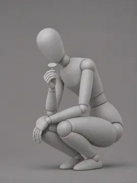 | <a href="https://promicat.app/zh/poses/styles/sp031?utm_source=github&utm_medium=readme&utm_campaign=ai-photo-poses">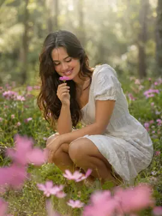</a> | <a href="https://promicat.app/zh/poses/styles/sp031?utm_source=github&utm_medium=readme&utm_campaign=ai-photo-poses">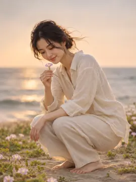</a> | <a href="https://promicat.app/zh/poses/styles/sp031?utm_source=github&utm_medium=readme&utm_campaign=ai-photo-poses">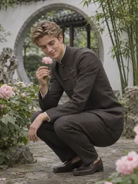</a> | <a href="https://promicat.app/zh/poses/styles/sp031?utm_source=github&utm_medium=readme&utm_campaign=ai-photo-poses">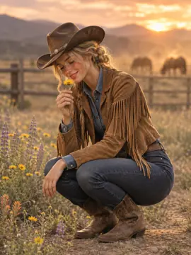</a> |

大图: [写真照](../images/photo-poses/flower/sp031-photo.webp) · [白模](../images/photo-poses/flower/sp031-pose.webp) · [在 Promicat 生成](https://promicat.app/zh/poses/styles/sp031?utm_source=github&utm_medium=readme&utm_campaign=ai-photo-poses)

<details><summary>提示词：用你的照片（图 1 你的照片，图 2 白模）</summary>

```text
A real professional portrait photoshoot photo: a dreamy forest-and-flower-field photoshoot, soft hazy backlight, pastel tones, 85mm f/1.8, flowers blurred in the foreground. Subject: the person in image 1 (keep their exact face, facial features, skin tone and hairstyle; do not beautify or swap the face), wearing a light cotton dress or a soft pastel shirt. Pose: crouching among the flowers, one hand holding a bloom near the face, smiling softly down. Image 2 is a wooden artist's mannequin that shows only this body pose: copy it exactly (head, torso, arms, hands, legs, feet, which hand does what, the camera angle), but do not copy the mannequin itself: no wooden skin, no joints, no blank face. Natural, relaxed and unstiff, true skin texture. No text, no logo, no watermark. Portrait 3:4.
```

</details>

<details><summary>提示词：生成示例图（虚构模特）</summary>

```text
A real professional portrait photoshoot photo, the kind posted by a top portrait studio: a dreamy forest-and-flower-field photoshoot, soft hazy backlight, pastel tones, 85mm f/1.8, flowers blurred in the foreground. Model: a beautiful Latina professional fashion model in her twenties with a naturally attractive face, styled hair and natural makeup, wearing a light cotton dress or a soft pastel shirt. The photographer directs the model into a natural, relaxed, unstiff pose that looks caught between moments: crouching among the flowers, one hand holding a bloom near the face, smiling softly down. Asymmetric body, soft hands, flattering angle, true skin texture, refined but not plastic, fully clothed and modest. Full body or three-quarter body in frame, the whole pose clearly readable. No text, no logo, no watermark. Portrait 3:4.
```

</details>

## 花中转身 (动态)

| 白模 | 森系花田 | 海边度假 | 好莱坞复古 | 北欧极简 |
|---|---|---|---|---|
| 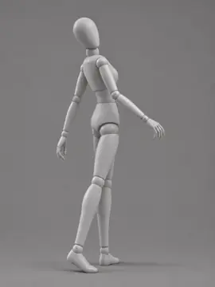 | <a href="https://promicat.app/zh/poses/styles/sp032?utm_source=github&utm_medium=readme&utm_campaign=ai-photo-poses">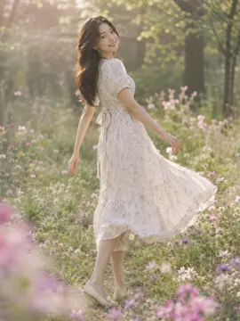</a> | <a href="https://promicat.app/zh/poses/styles/sp032?utm_source=github&utm_medium=readme&utm_campaign=ai-photo-poses"></a> | <a href="https://promicat.app/zh/poses/styles/sp032?utm_source=github&utm_medium=readme&utm_campaign=ai-photo-poses">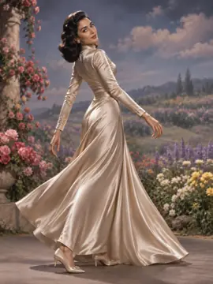</a> | <a href="https://promicat.app/zh/poses/styles/sp032?utm_source=github&utm_medium=readme&utm_campaign=ai-photo-poses">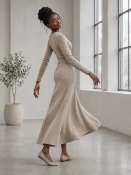</a> |

大图: [写真照](../images/photo-poses/flower/sp032-photo.webp) · [白模](../images/photo-poses/flower/sp032-pose.webp) · [在 Promicat 生成](https://promicat.app/zh/poses/styles/sp032?utm_source=github&utm_medium=readme&utm_campaign=ai-photo-poses)

<details><summary>提示词：用你的照片（图 1 你的照片，图 2 白模）</summary>

```text
A real professional portrait photoshoot photo: a dreamy forest-and-flower-field photoshoot, soft hazy backlight, pastel tones, 85mm f/1.8, flowers blurred in the foreground. Subject: the person in image 1 (keep their exact face, facial features, skin tone and hairstyle; do not beautify or swap the face), wearing a light cotton dress or a soft pastel shirt. Pose: turning in the flower field so the dress flares, arms loose, looking back. Image 2 is a wooden artist's mannequin that shows only this body pose: copy it exactly (head, torso, arms, hands, legs, feet, which hand does what, the camera angle), but do not copy the mannequin itself: no wooden skin, no joints, no blank face. Natural, relaxed and unstiff, true skin texture. No text, no logo, no watermark. Portrait 3:4.
```

</details>

<details><summary>提示词：生成示例图（虚构模特）</summary>

```text
A real professional portrait photoshoot photo, the kind posted by a top portrait studio: a dreamy forest-and-flower-field photoshoot, soft hazy backlight, pastel tones, 85mm f/1.8, flowers blurred in the foreground. Model: a beautiful Korean professional fashion model in her twenties with a naturally attractive face, styled hair and natural makeup, wearing a light cotton dress or a soft pastel shirt. The photographer directs the model into a natural, relaxed, unstiff pose that looks caught between moments: turning in the flower field so the dress flares, arms loose, looking back. Asymmetric body, soft hands, flattering angle, true skin texture, refined but not plastic, fully clothed and modest. Full body or three-quarter body in frame, the whole pose clearly readable. No text, no logo, no watermark. Portrait 3:4.
```

</details>

## 躺花丛 (躺)

| 白模 | 森系花田 | 咖啡馆文艺 | 情绪棚拍 | 街拍时尚 |
|---|---|---|---|---|
| 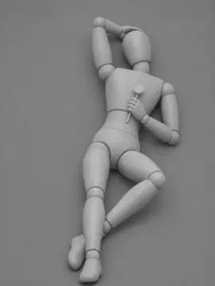 | <a href="https://promicat.app/zh/poses/styles/sp033?utm_source=github&utm_medium=readme&utm_campaign=ai-photo-poses">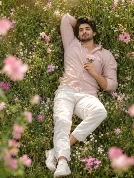</a> | <a href="https://promicat.app/zh/poses/styles/sp033?utm_source=github&utm_medium=readme&utm_campaign=ai-photo-poses">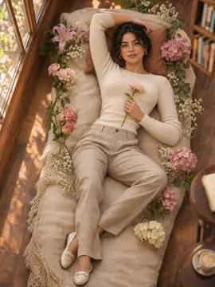</a> | <a href="https://promicat.app/zh/poses/styles/sp033?utm_source=github&utm_medium=readme&utm_campaign=ai-photo-poses">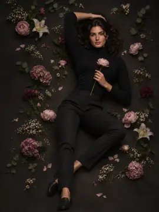</a> | <a href="https://promicat.app/zh/poses/styles/sp033?utm_source=github&utm_medium=readme&utm_campaign=ai-photo-poses">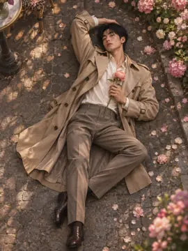</a> |

大图: [写真照](../images/photo-poses/flower/sp033-photo.webp) · [白模](../images/photo-poses/flower/sp033-pose.webp) · [在 Promicat 生成](https://promicat.app/zh/poses/styles/sp033?utm_source=github&utm_medium=readme&utm_campaign=ai-photo-poses)

<details><summary>提示词：用你的照片（图 1 你的照片，图 2 白模）</summary>

```text
A real professional portrait photoshoot photo: a dreamy forest-and-flower-field photoshoot, soft hazy backlight, pastel tones, 85mm f/1.8, flowers blurred in the foreground. Subject: the person in image 1 (keep their exact face, facial features, skin tone and hairstyle; do not beautify or swap the face), wearing a light cotton dress or a soft pastel shirt. Pose: lying on the back in the flowers, one arm above the head, a flower held to the chest. Image 2 is a wooden artist's mannequin that shows only this body pose: copy it exactly (head, torso, arms, hands, legs, feet, which hand does what, the camera angle), but do not copy the mannequin itself: no wooden skin, no joints, no blank face. Natural, relaxed and unstiff, true skin texture. No text, no logo, no watermark. Portrait 3:4.
```

</details>

<details><summary>提示词：生成示例图（虚构模特）</summary>

```text
A real professional portrait photoshoot photo, the kind posted by a top portrait studio: a dreamy forest-and-flower-field photoshoot, soft hazy backlight, pastel tones, 85mm f/1.8, flowers blurred in the foreground. Model: a handsome South Asian professional male model in his twenties with a well-groomed look and styled hair, wearing a light cotton dress or a soft pastel shirt. The photographer directs the model into a natural, relaxed, unstiff pose that looks caught between moments: lying on the back in the flowers, one arm above the head, a flower held to the chest. Asymmetric body, soft hands, flattering angle, true skin texture, refined but not plastic, fully clothed and modest. Full body or three-quarter body in frame, the whole pose clearly readable. No text, no logo, no watermark. Portrait 3:4.
```

</details>

## 跪坐编花环 (坐)

| 白模 | 森系花田 | 校园青春 | 暗黑哥特 | 北欧极简 |
|---|---|---|---|---|
| 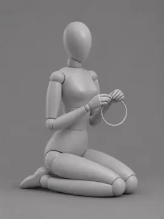 | <a href="https://promicat.app/zh/poses/styles/sp034?utm_source=github&utm_medium=readme&utm_campaign=ai-photo-poses">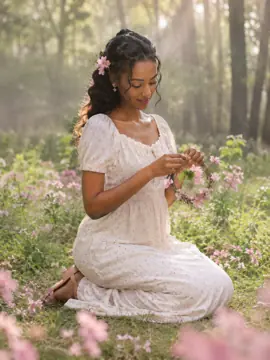</a> | <a href="https://promicat.app/zh/poses/styles/sp034?utm_source=github&utm_medium=readme&utm_campaign=ai-photo-poses">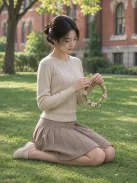</a> | <a href="https://promicat.app/zh/poses/styles/sp034?utm_source=github&utm_medium=readme&utm_campaign=ai-photo-poses">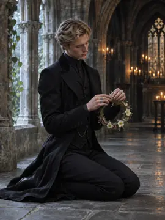</a> | <a href="https://promicat.app/zh/poses/styles/sp034?utm_source=github&utm_medium=readme&utm_campaign=ai-photo-poses">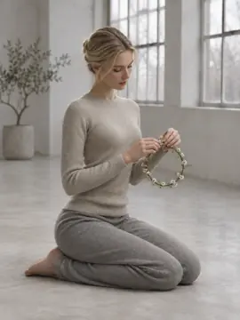</a> |

大图: [写真照](../images/photo-poses/flower/sp034-photo.webp) · [白模](../images/photo-poses/flower/sp034-pose.webp) · [在 Promicat 生成](https://promicat.app/zh/poses/styles/sp034?utm_source=github&utm_medium=readme&utm_campaign=ai-photo-poses)

<details><summary>提示词：用你的照片（图 1 你的照片，图 2 白模）</summary>

```text
A real professional portrait photoshoot photo: a dreamy forest-and-flower-field photoshoot, soft hazy backlight, pastel tones, 85mm f/1.8, flowers blurred in the foreground. Subject: the person in image 1 (keep their exact face, facial features, skin tone and hairstyle; do not beautify or swap the face), wearing a light cotton dress or a soft pastel shirt. Pose: kneeling and sitting back on the heels weaving a flower crown, head down. Image 2 is a wooden artist's mannequin that shows only this body pose: copy it exactly (head, torso, arms, hands, legs, feet, which hand does what, the camera angle), but do not copy the mannequin itself: no wooden skin, no joints, no blank face. Natural, relaxed and unstiff, true skin texture. No text, no logo, no watermark. Portrait 3:4.
```

</details>

<details><summary>提示词：生成示例图（虚构模特）</summary>

```text
A real professional portrait photoshoot photo, the kind posted by a top portrait studio: a dreamy forest-and-flower-field photoshoot, soft hazy backlight, pastel tones, 85mm f/1.8, flowers blurred in the foreground. Model: a beautiful East African professional fashion model in her twenties with a naturally attractive face, styled hair and natural makeup, wearing a light cotton dress or a soft pastel shirt. The photographer directs the model into a natural, relaxed, unstiff pose that looks caught between moments: kneeling and sitting back on the heels weaving a flower crown, head down. Asymmetric body, soft hands, flattering angle, true skin texture, refined but not plastic, fully clothed and modest. Full body or three-quarter body in frame, the whole pose clearly readable. No text, no logo, no watermark. Portrait 3:4.
```

</details>

## 倚树干 (靠)

| 白模 | 森系花田 | 校园青春 | 港风复古 | 情绪棚拍 |
|---|---|---|---|---|
| 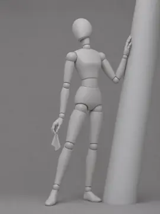 | <a href="https://promicat.app/zh/poses/styles/sp035?utm_source=github&utm_medium=readme&utm_campaign=ai-photo-poses">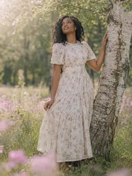</a> | <a href="https://promicat.app/zh/poses/styles/sp035?utm_source=github&utm_medium=readme&utm_campaign=ai-photo-poses">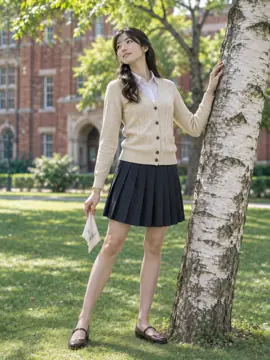</a> | <a href="https://promicat.app/zh/poses/styles/sp035?utm_source=github&utm_medium=readme&utm_campaign=ai-photo-poses">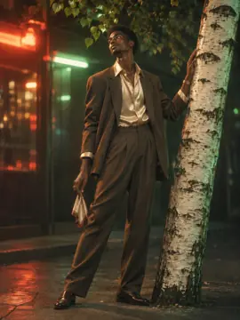</a> | <a href="https://promicat.app/zh/poses/styles/sp035?utm_source=github&utm_medium=readme&utm_campaign=ai-photo-poses">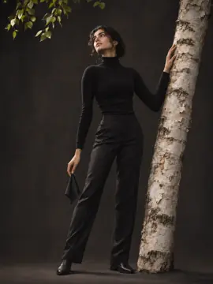</a> |

大图: [写真照](../images/photo-poses/flower/sp035-photo.webp) · [白模](../images/photo-poses/flower/sp035-pose.webp) · [在 Promicat 生成](https://promicat.app/zh/poses/styles/sp035?utm_source=github&utm_medium=readme&utm_campaign=ai-photo-poses)

<details><summary>提示词：用你的照片（图 1 你的照片，图 2 白模）</summary>

```text
A real professional portrait photoshoot photo: a dreamy forest-and-flower-field photoshoot, soft hazy backlight, pastel tones, 85mm f/1.8, flowers blurred in the foreground. Subject: the person in image 1 (keep their exact face, facial features, skin tone and hairstyle; do not beautify or swap the face), wearing a light cotton dress or a soft pastel shirt. Pose: leaning against a birch trunk, one hand on the bark, gazing up through the leaves. Image 2 is a wooden artist's mannequin that shows only this body pose: copy it exactly (head, torso, arms, hands, legs, feet, which hand does what, the camera angle), but do not copy the mannequin itself: no wooden skin, no joints, no blank face. Natural, relaxed and unstiff, true skin texture. No text, no logo, no watermark. Portrait 3:4.
```

</details>

<details><summary>提示词：生成示例图（虚构模特）</summary>

```text
A real professional portrait photoshoot photo, the kind posted by a top portrait studio: a dreamy forest-and-flower-field photoshoot, soft hazy backlight, pastel tones, 85mm f/1.8, flowers blurred in the foreground. Model: a beautiful Black professional fashion model in her twenties with a naturally attractive face, styled hair and natural makeup, wearing a light cotton dress or a soft pastel shirt. The photographer directs the model into a natural, relaxed, unstiff pose that looks caught between moments: leaning against a birch trunk, one hand on the bark, gazing up through the leaves. Asymmetric body, soft hands, flattering angle, true skin texture, refined but not plastic, fully clothed and modest. Full body or three-quarter body in frame, the whole pose clearly readable. No text, no logo, no watermark. Portrait 3:4.
```

</details>

## 捧花半身 (半身)

| 白模 | 森系花田 | 海边度假 | 好莱坞复古 | Y2K 千禧辣妹 |
|---|---|---|---|---|
| 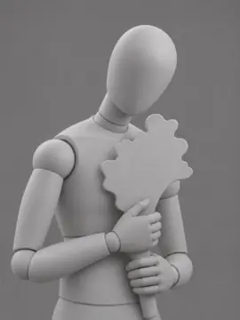 | <a href="https://promicat.app/zh/poses/styles/sp036?utm_source=github&utm_medium=readme&utm_campaign=ai-photo-poses">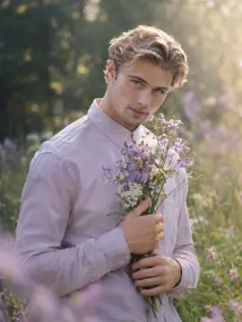</a> | <a href="https://promicat.app/zh/poses/styles/sp036?utm_source=github&utm_medium=readme&utm_campaign=ai-photo-poses">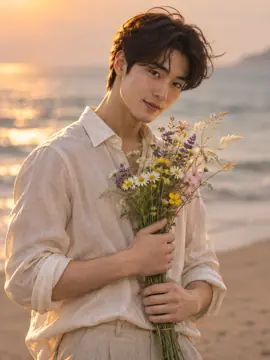</a> | <a href="https://promicat.app/zh/poses/styles/sp036?utm_source=github&utm_medium=readme&utm_campaign=ai-photo-poses">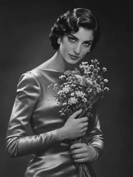</a> | <a href="https://promicat.app/zh/poses/styles/sp036?utm_source=github&utm_medium=readme&utm_campaign=ai-photo-poses">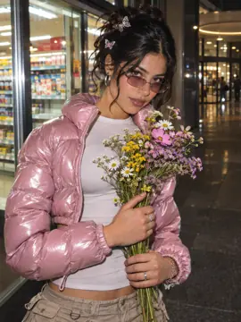</a> |

大图: [写真照](../images/photo-poses/flower/sp036-photo.webp) · [白模](../images/photo-poses/flower/sp036-pose.webp) · [在 Promicat 生成](https://promicat.app/zh/poses/styles/sp036?utm_source=github&utm_medium=readme&utm_campaign=ai-photo-poses)

<details><summary>提示词：用你的照片（图 1 你的照片，图 2 白模）</summary>

```text
A real professional portrait photoshoot photo: a dreamy forest-and-flower-field photoshoot, soft hazy backlight, pastel tones, 85mm f/1.8, flowers blurred in the foreground. Subject: the person in image 1 (keep their exact face, facial features, skin tone and hairstyle; do not beautify or swap the face), wearing a light cotton dress or a soft pastel shirt. Pose: holding a bunch of wildflowers against the chest, chin down, eyes up to the camera. Image 2 is a wooden artist's mannequin that shows only this body pose: copy it exactly (head, torso, arms, hands, legs, feet, which hand does what, the camera angle), but do not copy the mannequin itself: no wooden skin, no joints, no blank face. Natural, relaxed and unstiff, true skin texture. No text, no logo, no watermark. Portrait 3:4.
```

</details>

<details><summary>提示词：生成示例图（虚构模特）</summary>

```text
A real professional portrait photoshoot photo, the kind posted by a top portrait studio: a dreamy forest-and-flower-field photoshoot, soft hazy backlight, pastel tones, 85mm f/1.8, flowers blurred in the foreground. Model: a handsome Scandinavian professional male model in his twenties with a well-groomed look and styled hair, wearing a light cotton dress or a soft pastel shirt. The photographer directs the model into a natural, relaxed, unstiff pose that looks caught between moments: holding a bunch of wildflowers against the chest, chin down, eyes up to the camera. Asymmetric body, soft hands, flattering angle, true skin texture, refined but not plastic, fully clothed and modest. Waist-up framing, both arms and hands readable. No text, no logo, no watermark. Portrait 3:4.
```

</details>

## 林间走 (走)

| 白模 | 森系花田 | 咖啡馆文艺 | 日系清新 | 街头朋克 |
|---|---|---|---|---|
| 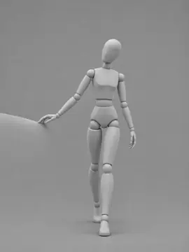 | <a href="https://promicat.app/zh/poses/styles/sp037?utm_source=github&utm_medium=readme&utm_campaign=ai-photo-poses">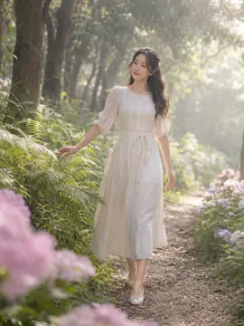</a> | <a href="https://promicat.app/zh/poses/styles/sp037?utm_source=github&utm_medium=readme&utm_campaign=ai-photo-poses">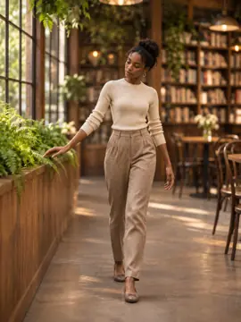</a> | <a href="https://promicat.app/zh/poses/styles/sp037?utm_source=github&utm_medium=readme&utm_campaign=ai-photo-poses">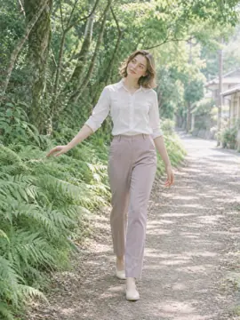</a> | <a href="https://promicat.app/zh/poses/styles/sp037?utm_source=github&utm_medium=readme&utm_campaign=ai-photo-poses">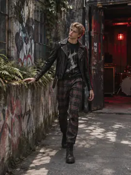</a> |

大图: [写真照](../images/photo-poses/flower/sp037-photo.webp) · [白模](../images/photo-poses/flower/sp037-pose.webp) · [在 Promicat 生成](https://promicat.app/zh/poses/styles/sp037?utm_source=github&utm_medium=readme&utm_campaign=ai-photo-poses)

<details><summary>提示词：用你的照片（图 1 你的照片，图 2 白模）</summary>

```text
A real professional portrait photoshoot photo: a dreamy forest-and-flower-field photoshoot, soft hazy backlight, pastel tones, 85mm f/1.8, flowers blurred in the foreground. Subject: the person in image 1 (keep their exact face, facial features, skin tone and hairstyle; do not beautify or swap the face), wearing a light cotton dress or a soft pastel shirt. Pose: walking along a forest path brushing the ferns with one hand. Image 2 is a wooden artist's mannequin that shows only this body pose: copy it exactly (head, torso, arms, hands, legs, feet, which hand does what, the camera angle), but do not copy the mannequin itself: no wooden skin, no joints, no blank face. Natural, relaxed and unstiff, true skin texture. No text, no logo, no watermark. Portrait 3:4.
```

</details>

<details><summary>提示词：生成示例图（虚构模特）</summary>

```text
A real professional portrait photoshoot photo, the kind posted by a top portrait studio: a dreamy forest-and-flower-field photoshoot, soft hazy backlight, pastel tones, 85mm f/1.8, flowers blurred in the foreground. Model: a beautiful East Asian professional fashion model in her twenties with a naturally attractive face, styled hair and natural makeup, wearing a light cotton dress or a soft pastel shirt. The photographer directs the model into a natural, relaxed, unstiff pose that looks caught between moments: walking along a forest path brushing the ferns with one hand. Asymmetric body, soft hands, flattering angle, true skin texture, refined but not plastic, fully clothed and modest. Full body or three-quarter body in frame, the whole pose clearly readable. No text, no logo, no watermark. Portrait 3:4.
```

</details>

## 坐草地后仰 (坐)

| 白模 | 森系花田 | 居家慵懒 | 老钱风 | 街拍时尚 |
|---|---|---|---|---|
| 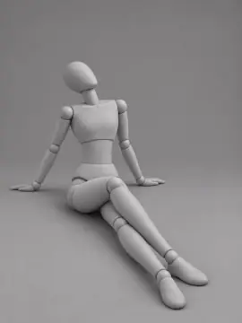 | <a href="https://promicat.app/zh/poses/styles/sp038?utm_source=github&utm_medium=readme&utm_campaign=ai-photo-poses">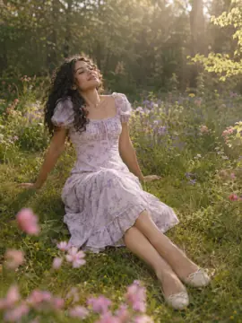</a> | <a href="https://promicat.app/zh/poses/styles/sp038?utm_source=github&utm_medium=readme&utm_campaign=ai-photo-poses">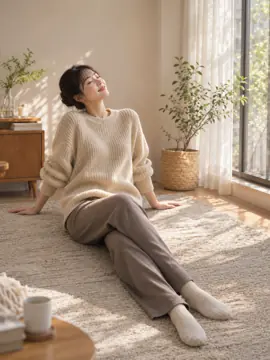</a> | <a href="https://promicat.app/zh/poses/styles/sp038?utm_source=github&utm_medium=readme&utm_campaign=ai-photo-poses">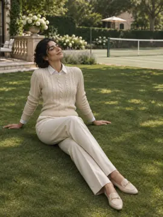</a> | <a href="https://promicat.app/zh/poses/styles/sp038?utm_source=github&utm_medium=readme&utm_campaign=ai-photo-poses">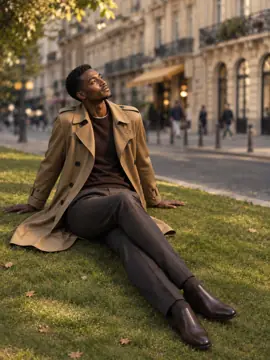</a> |

大图: [写真照](../images/photo-poses/flower/sp038-photo.webp) · [白模](../images/photo-poses/flower/sp038-pose.webp) · [在 Promicat 生成](https://promicat.app/zh/poses/styles/sp038?utm_source=github&utm_medium=readme&utm_campaign=ai-photo-poses)

<details><summary>提示词：用你的照片（图 1 你的照片，图 2 白模）</summary>

```text
A real professional portrait photoshoot photo: a dreamy forest-and-flower-field photoshoot, soft hazy backlight, pastel tones, 85mm f/1.8, flowers blurred in the foreground. Subject: the person in image 1 (keep their exact face, facial features, skin tone and hairstyle; do not beautify or swap the face), wearing a light cotton dress or a soft pastel shirt. Pose: sitting in the grass leaning back on both hands, legs crossed at the ankle, face to the sun. Image 2 is a wooden artist's mannequin that shows only this body pose: copy it exactly (head, torso, arms, hands, legs, feet, which hand does what, the camera angle), but do not copy the mannequin itself: no wooden skin, no joints, no blank face. Natural, relaxed and unstiff, true skin texture. No text, no logo, no watermark. Portrait 3:4.
```

</details>

<details><summary>提示词：生成示例图（虚构模特）</summary>

```text
A real professional portrait photoshoot photo, the kind posted by a top portrait studio: a dreamy forest-and-flower-field photoshoot, soft hazy backlight, pastel tones, 85mm f/1.8, flowers blurred in the foreground. Model: a beautiful mixed-race professional fashion model in her twenties with a naturally attractive face, styled hair and natural makeup, wearing a light cotton dress or a soft pastel shirt. The photographer directs the model into a natural, relaxed, unstiff pose that looks caught between moments: sitting in the grass leaning back on both hands, legs crossed at the ankle, face to the sun. Asymmetric body, soft hands, flattering angle, true skin texture, refined but not plastic, fully clothed and modest. Full body or three-quarter body in frame, the whole pose clearly readable. No text, no logo, no watermark. Portrait 3:4.
```

</details>

## 花环戴头 (半身)

| 白模 | 森系花田 | 波西米亚 | 新中式 | 学院风 |
|---|---|---|---|---|
| 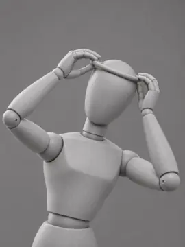 | <a href="https://promicat.app/zh/poses/styles/sp039?utm_source=github&utm_medium=readme&utm_campaign=ai-photo-poses">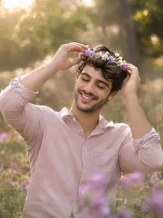</a> | <a href="https://promicat.app/zh/poses/styles/sp039?utm_source=github&utm_medium=readme&utm_campaign=ai-photo-poses">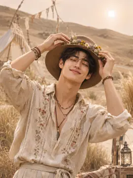</a> | <a href="https://promicat.app/zh/poses/styles/sp039?utm_source=github&utm_medium=readme&utm_campaign=ai-photo-poses">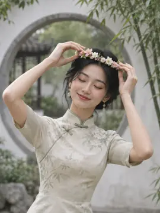</a> | <a href="https://promicat.app/zh/poses/styles/sp039?utm_source=github&utm_medium=readme&utm_campaign=ai-photo-poses">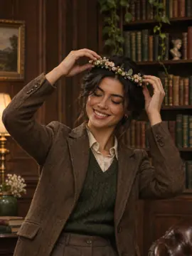</a> |

大图: [写真照](../images/photo-poses/flower/sp039-photo.webp) · [白模](../images/photo-poses/flower/sp039-pose.webp) · [在 Promicat 生成](https://promicat.app/zh/poses/styles/sp039?utm_source=github&utm_medium=readme&utm_campaign=ai-photo-poses)

<details><summary>提示词：用你的照片（图 1 你的照片，图 2 白模）</summary>

```text
A real professional portrait photoshoot photo: a dreamy forest-and-flower-field photoshoot, soft hazy backlight, pastel tones, 85mm f/1.8, flowers blurred in the foreground. Subject: the person in image 1 (keep their exact face, facial features, skin tone and hairstyle; do not beautify or swap the face), wearing a light cotton dress or a soft pastel shirt. Pose: placing a flower crown on the head with both hands, eyes closed, smiling. Image 2 is a wooden artist's mannequin that shows only this body pose: copy it exactly (head, torso, arms, hands, legs, feet, which hand does what, the camera angle), but do not copy the mannequin itself: no wooden skin, no joints, no blank face. Natural, relaxed and unstiff, true skin texture. No text, no logo, no watermark. Portrait 3:4.
```

</details>

<details><summary>提示词：生成示例图（虚构模特）</summary>

```text
A real professional portrait photoshoot photo, the kind posted by a top portrait studio: a dreamy forest-and-flower-field photoshoot, soft hazy backlight, pastel tones, 85mm f/1.8, flowers blurred in the foreground. Model: a handsome Mediterranean professional male model in his twenties with a well-groomed look and styled hair, wearing a light cotton dress or a soft pastel shirt. The photographer directs the model into a natural, relaxed, unstiff pose that looks caught between moments: placing a flower crown on the head with both hands, eyes closed, smiling. Asymmetric body, soft hands, flattering angle, true skin texture, refined but not plastic, fully clothed and modest. Waist-up framing, both arms and hands readable. No text, no logo, no watermark. Portrait 3:4.
```

</details>

## 回眸穿林 (回眸)

| 白模 | 森系花田 | 赛博霓虹 | 北欧极简 | 西部牛仔 |
|---|---|---|---|---|
| 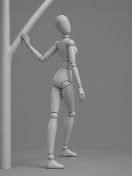 | <a href="https://promicat.app/zh/poses/styles/sp040?utm_source=github&utm_medium=readme&utm_campaign=ai-photo-poses">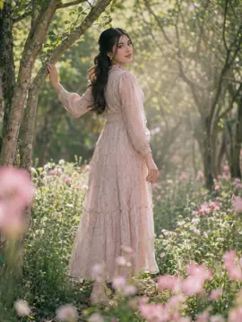</a> | <a href="https://promicat.app/zh/poses/styles/sp040?utm_source=github&utm_medium=readme&utm_campaign=ai-photo-poses">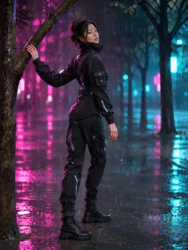</a> | <a href="https://promicat.app/zh/poses/styles/sp040?utm_source=github&utm_medium=readme&utm_campaign=ai-photo-poses">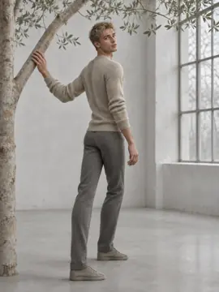</a> | <a href="https://promicat.app/zh/poses/styles/sp040?utm_source=github&utm_medium=readme&utm_campaign=ai-photo-poses">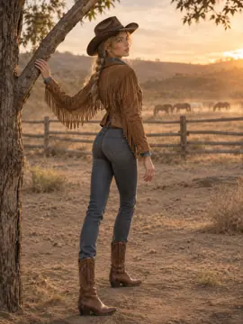</a> |

大图: [写真照](../images/photo-poses/flower/sp040-photo.webp) · [白模](../images/photo-poses/flower/sp040-pose.webp) · [在 Promicat 生成](https://promicat.app/zh/poses/styles/sp040?utm_source=github&utm_medium=readme&utm_campaign=ai-photo-poses)

<details><summary>提示词：用你的照片（图 1 你的照片，图 2 白模）</summary>

```text
A real professional portrait photoshoot photo: a dreamy forest-and-flower-field photoshoot, soft hazy backlight, pastel tones, 85mm f/1.8, flowers blurred in the foreground. Subject: the person in image 1 (keep their exact face, facial features, skin tone and hairstyle; do not beautify or swap the face), wearing a light cotton dress or a soft pastel shirt. Pose: standing between trees looking back over the shoulder, one hand on a branch. Image 2 is a wooden artist's mannequin that shows only this body pose: copy it exactly (head, torso, arms, hands, legs, feet, which hand does what, the camera angle), but do not copy the mannequin itself: no wooden skin, no joints, no blank face. Natural, relaxed and unstiff, true skin texture. No text, no logo, no watermark. Portrait 3:4.
```

</details>

<details><summary>提示词：生成示例图（虚构模特）</summary>

```text
A real professional portrait photoshoot photo, the kind posted by a top portrait studio: a dreamy forest-and-flower-field photoshoot, soft hazy backlight, pastel tones, 85mm f/1.8, flowers blurred in the foreground. Model: a beautiful Southeast Asian professional fashion model in her twenties with a naturally attractive face, styled hair and natural makeup, wearing a light cotton dress or a soft pastel shirt. The photographer directs the model into a natural, relaxed, unstiff pose that looks caught between moments: standing between trees looking back over the shoulder, one hand on a branch. Asymmetric body, soft hands, flattering angle, true skin texture, refined but not plastic, fully clothed and modest. Full body or three-quarter body in frame, the whole pose clearly readable. No text, no logo, no watermark. Portrait 3:4.
```

</details>
