# Gothic

English · [简体中文](gothic.zh-CN.md)

10 white models, each with 4 portraits shot from it in different styles. Attach your photo first and the white model second. Try them with your own photo on [Promicat](https://promicat.app/poses?utm_source=github&utm_medium=readme&utm_campaign=ai-photo-poses).

[← Back to all styles](../README.md#photo-poses)

## Walking through a stone cloister (Looking back)

| White model | Gothic | Boho desert | New Chinese style | 1950s Hollywood |
|---|---|---|---|---|
| 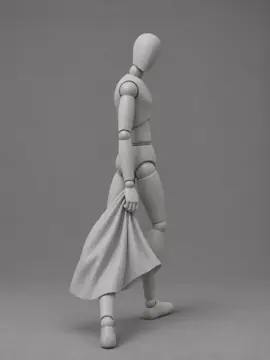 | <a href="https://promicat.app/poses/styles/sp101?utm_source=github&utm_medium=readme&utm_campaign=ai-photo-poses">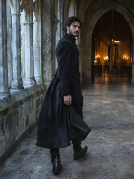</a> | <a href="https://promicat.app/poses/styles/sp101?utm_source=github&utm_medium=readme&utm_campaign=ai-photo-poses">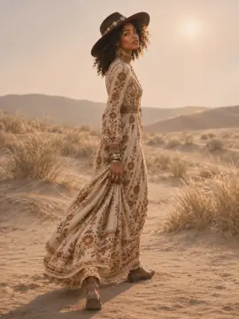</a> | <a href="https://promicat.app/poses/styles/sp101?utm_source=github&utm_medium=readme&utm_campaign=ai-photo-poses">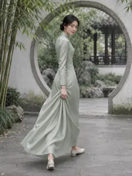</a> | <a href="https://promicat.app/poses/styles/sp101?utm_source=github&utm_medium=readme&utm_campaign=ai-photo-poses">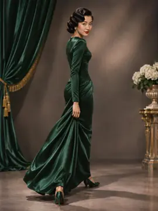</a> |

Full size: [photo](../images/photo-poses/gothic/sp101-photo.webp) · [white model](../images/photo-poses/gothic/sp101-pose.webp) · [try it on Promicat](https://promicat.app/poses/styles/sp101?utm_source=github&utm_medium=readme&utm_campaign=ai-photo-poses)

<details><summary>Prompt with your photo (image 1: your photo, image 2: white model)</summary>

```text
A real professional portrait photoshoot photo: a gothic photoshoot in an old cathedral cloister and candle-lit hall, cold blue daylight and warm candles, deep shadows, 50mm. Subject: the person in image 1 (keep their exact face, facial features, skin tone and hairstyle; do not beautify or swap the face), wearing a long black Victorian frock coat over a high-collared black shirt and waistcoat, black trousers and boots, silver rings. Pose: walking through a stone cloister, turning back over the shoulder, holding the long skirt. Image 2 is a wooden artist's mannequin that shows only this body pose: copy it exactly (head, torso, arms, hands, legs, feet, which hand does what, the camera angle), but do not copy the mannequin itself: no wooden skin, no joints, no blank face. Natural, relaxed and unstiff, true skin texture. No text, no logo, no watermark. Portrait 3:4.
```

</details>

<details><summary>Prompt for the sample (fictional model)</summary>

```text
A real professional portrait photoshoot photo, the kind posted by a top portrait studio: a gothic photoshoot in an old cathedral cloister and candle-lit hall, cold blue daylight and warm candles, deep shadows, 50mm. Model: a handsome Middle Eastern professional male model in his twenties with a well-groomed look and styled hair, wearing a long black Victorian frock coat over a high-collared black shirt and waistcoat, black trousers and boots, silver rings. The photographer directs the model into a natural, relaxed, unstiff pose that looks caught between moments: walking through a stone cloister, turning back over the shoulder, holding the long skirt. Asymmetric body, soft hands, flattering angle, true skin texture, refined but not plastic, fully clothed and modest. Full body or three-quarter body in frame, the whole pose clearly readable. No text, no logo, no watermark. Portrait 3:4.
```

</details>

## Standing beside a tall candelabra (Standing)

| White model | Gothic | HK retro neon | Cosy at home | Street fashion |
|---|---|---|---|---|
|  | <a href="https://promicat.app/poses/styles/sp102?utm_source=github&utm_medium=readme&utm_campaign=ai-photo-poses">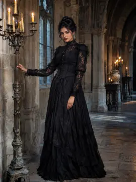</a> | <a href="https://promicat.app/poses/styles/sp102?utm_source=github&utm_medium=readme&utm_campaign=ai-photo-poses">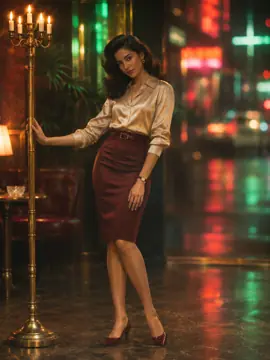</a> | <a href="https://promicat.app/poses/styles/sp102?utm_source=github&utm_medium=readme&utm_campaign=ai-photo-poses">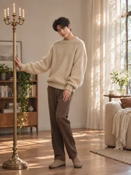</a> | <a href="https://promicat.app/poses/styles/sp102?utm_source=github&utm_medium=readme&utm_campaign=ai-photo-poses">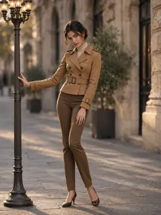</a> |

Full size: [photo](../images/photo-poses/gothic/sp102-photo.webp) · [white model](../images/photo-poses/gothic/sp102-pose.webp) · [try it on Promicat](https://promicat.app/poses/styles/sp102?utm_source=github&utm_medium=readme&utm_campaign=ai-photo-poses)

<details><summary>Prompt with your photo (image 1: your photo, image 2: white model)</summary>

```text
A real professional portrait photoshoot photo: a gothic photoshoot in an old cathedral cloister and candle-lit hall, cold blue daylight and warm candles, deep shadows, 50mm. Subject: the person in image 1 (keep their exact face, facial features, skin tone and hairstyle; do not beautify or swap the face), wearing a long black Victorian-gothic dress with high lace collar or a black frock coat, dark lipstick, silver jewellery. Pose: standing beside a tall candelabra, one hand on it, chin lowered, eyes up to the camera. Image 2 is a wooden artist's mannequin that shows only this body pose: copy it exactly (head, torso, arms, hands, legs, feet, which hand does what, the camera angle), but do not copy the mannequin itself: no wooden skin, no joints, no blank face. Natural, relaxed and unstiff, true skin texture. No text, no logo, no watermark. Portrait 3:4.
```

</details>

<details><summary>Prompt for the sample (fictional model)</summary>

```text
A real professional portrait photoshoot photo, the kind posted by a top portrait studio: a gothic photoshoot in an old cathedral cloister and candle-lit hall, cold blue daylight and warm candles, deep shadows, 50mm. Model: a beautiful Indian professional fashion model in her twenties with a naturally attractive face, styled hair and natural makeup, wearing a long black Victorian-gothic dress with high lace collar or a black frock coat, dark lipstick, silver jewellery. The photographer directs the model into a natural, relaxed, unstiff pose that looks caught between moments: standing beside a tall candelabra, one hand on it, chin lowered, eyes up to the camera. Asymmetric body, soft hands, flattering angle, true skin texture, refined but not plastic, fully clothed and modest. Full body or three-quarter body in frame, the whole pose clearly readable. No text, no logo, no watermark. Portrait 3:4.
```

</details>

## Sitting sideways on a carved wooden chair (Sitting)

| White model | Gothic | Seaside holiday | New Chinese style | Forest & flower field |
|---|---|---|---|---|
| 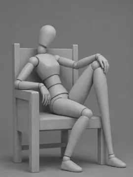 | <a href="https://promicat.app/poses/styles/sp103?utm_source=github&utm_medium=readme&utm_campaign=ai-photo-poses"></a> | <a href="https://promicat.app/poses/styles/sp103?utm_source=github&utm_medium=readme&utm_campaign=ai-photo-poses">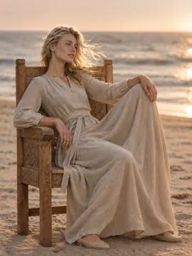</a> | <a href="https://promicat.app/poses/styles/sp103?utm_source=github&utm_medium=readme&utm_campaign=ai-photo-poses">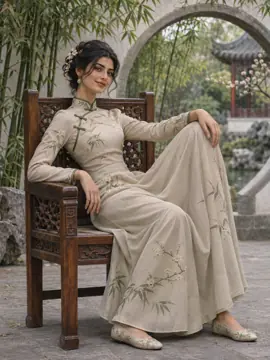</a> | <a href="https://promicat.app/poses/styles/sp103?utm_source=github&utm_medium=readme&utm_campaign=ai-photo-poses">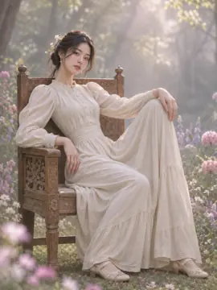</a> |

Full size: [photo](../images/photo-poses/gothic/sp103-photo.webp) · [white model](../images/photo-poses/gothic/sp103-pose.webp) · [try it on Promicat](https://promicat.app/poses/styles/sp103?utm_source=github&utm_medium=readme&utm_campaign=ai-photo-poses)

<details><summary>Prompt with your photo (image 1: your photo, image 2: white model)</summary>

```text
A real professional portrait photoshoot photo: a gothic photoshoot in an old cathedral cloister and candle-lit hall, cold blue daylight and warm candles, deep shadows, 50mm. Subject: the person in image 1 (keep their exact face, facial features, skin tone and hairstyle; do not beautify or swap the face), wearing a long black Victorian-gothic dress with high lace collar or a black frock coat, dark lipstick, silver jewellery. Pose: sitting sideways on a carved wooden chair, one leg over the armrest, fully covered by the long dress. Image 2 is a wooden artist's mannequin that shows only this body pose: copy it exactly (head, torso, arms, hands, legs, feet, which hand does what, the camera angle), but do not copy the mannequin itself: no wooden skin, no joints, no blank face. Natural, relaxed and unstiff, true skin texture. No text, no logo, no watermark. Portrait 3:4.
```

</details>

<details><summary>Prompt for the sample (fictional model)</summary>

```text
A real professional portrait photoshoot photo, the kind posted by a top portrait studio: a gothic photoshoot in an old cathedral cloister and candle-lit hall, cold blue daylight and warm candles, deep shadows, 50mm. Model: a beautiful white European professional fashion model in her twenties with a naturally attractive face, styled hair and natural makeup, wearing a long black Victorian-gothic dress with high lace collar or a black frock coat, dark lipstick, silver jewellery. The photographer directs the model into a natural, relaxed, unstiff pose that looks caught between moments: sitting sideways on a carved wooden chair, one leg over the armrest, fully covered by the long dress. Asymmetric body, soft hands, flattering angle, true skin texture, refined but not plastic, fully clothed and modest. Full body or three-quarter body in frame, the whole pose clearly readable. No text, no logo, no watermark. Portrait 3:4.
```

</details>

## Leaning against a stone column (Leaning)

| White model | Gothic | Nordic minimal | Old money | Street punk |
|---|---|---|---|---|
|  | <a href="https://promicat.app/poses/styles/sp104?utm_source=github&utm_medium=readme&utm_campaign=ai-photo-poses">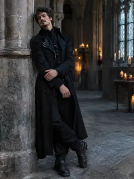</a> | <a href="https://promicat.app/poses/styles/sp104?utm_source=github&utm_medium=readme&utm_campaign=ai-photo-poses">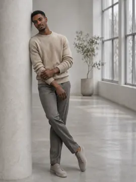</a> | <a href="https://promicat.app/poses/styles/sp104?utm_source=github&utm_medium=readme&utm_campaign=ai-photo-poses">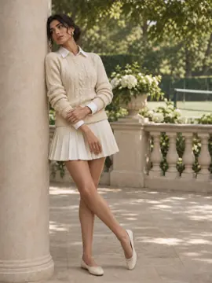</a> | <a href="https://promicat.app/poses/styles/sp104?utm_source=github&utm_medium=readme&utm_campaign=ai-photo-poses">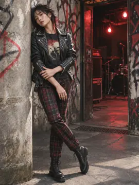</a> |

Full size: [photo](../images/photo-poses/gothic/sp104-photo.webp) · [white model](../images/photo-poses/gothic/sp104-pose.webp) · [try it on Promicat](https://promicat.app/poses/styles/sp104?utm_source=github&utm_medium=readme&utm_campaign=ai-photo-poses)

<details><summary>Prompt with your photo (image 1: your photo, image 2: white model)</summary>

```text
A real professional portrait photoshoot photo: a gothic photoshoot in an old cathedral cloister and candle-lit hall, cold blue daylight and warm candles, deep shadows, 50mm. Subject: the person in image 1 (keep their exact face, facial features, skin tone and hairstyle; do not beautify or swap the face), wearing a long black Victorian frock coat over a high-collared black shirt and waistcoat, black trousers and boots, silver rings. Pose: leaning against a stone column, arms folded, head tilted. Image 2 is a wooden artist's mannequin that shows only this body pose: copy it exactly (head, torso, arms, hands, legs, feet, which hand does what, the camera angle), but do not copy the mannequin itself: no wooden skin, no joints, no blank face. Natural, relaxed and unstiff, true skin texture. No text, no logo, no watermark. Portrait 3:4.
```

</details>

<details><summary>Prompt for the sample (fictional model)</summary>

```text
A real professional portrait photoshoot photo, the kind posted by a top portrait studio: a gothic photoshoot in an old cathedral cloister and candle-lit hall, cold blue daylight and warm candles, deep shadows, 50mm. Model: a handsome Brazilian professional male model in his twenties with a well-groomed look and styled hair, wearing a long black Victorian frock coat over a high-collared black shirt and waistcoat, black trousers and boots, silver rings. The photographer directs the model into a natural, relaxed, unstiff pose that looks caught between moments: leaning against a stone column, arms folded, head tilted. Asymmetric body, soft hands, flattering angle, true skin texture, refined but not plastic, fully clothed and modest. Full body or three-quarter body in frame, the whole pose clearly readable. No text, no logo, no watermark. Portrait 3:4.
```

</details>

## Holding a dark red rose against the lace collar (Upper body)

| White model | Gothic | Cyberpunk neon | Japanese fresh film | Western cowboy |
|---|---|---|---|---|
|  | <a href="https://promicat.app/poses/styles/sp105?utm_source=github&utm_medium=readme&utm_campaign=ai-photo-poses"></a> | <a href="https://promicat.app/poses/styles/sp105?utm_source=github&utm_medium=readme&utm_campaign=ai-photo-poses">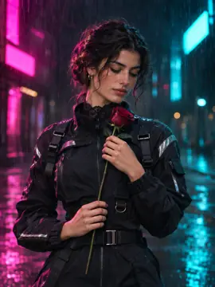</a> | <a href="https://promicat.app/poses/styles/sp105?utm_source=github&utm_medium=readme&utm_campaign=ai-photo-poses">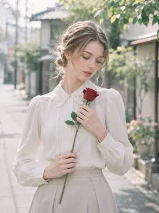</a> | <a href="https://promicat.app/poses/styles/sp105?utm_source=github&utm_medium=readme&utm_campaign=ai-photo-poses">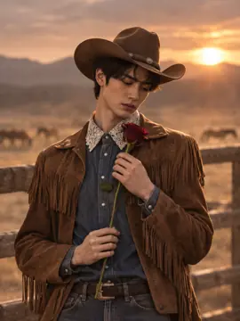</a> |

Full size: [photo](../images/photo-poses/gothic/sp105-photo.webp) · [white model](../images/photo-poses/gothic/sp105-pose.webp) · [try it on Promicat](https://promicat.app/poses/styles/sp105?utm_source=github&utm_medium=readme&utm_campaign=ai-photo-poses)

<details><summary>Prompt with your photo (image 1: your photo, image 2: white model)</summary>

```text
A real professional portrait photoshoot photo: a gothic photoshoot in an old cathedral cloister and candle-lit hall, cold blue daylight and warm candles, deep shadows, 50mm. Subject: the person in image 1 (keep their exact face, facial features, skin tone and hairstyle; do not beautify or swap the face), wearing a long black Victorian-gothic dress with high lace collar or a black frock coat, dark lipstick, silver jewellery. Pose: holding a dark red rose against the lace collar, eyes downcast. Image 2 is a wooden artist's mannequin that shows only this body pose: copy it exactly (head, torso, arms, hands, legs, feet, which hand does what, the camera angle), but do not copy the mannequin itself: no wooden skin, no joints, no blank face. Natural, relaxed and unstiff, true skin texture. No text, no logo, no watermark. Portrait 3:4.
```

</details>

<details><summary>Prompt for the sample (fictional model)</summary>

```text
A real professional portrait photoshoot photo, the kind posted by a top portrait studio: a gothic photoshoot in an old cathedral cloister and candle-lit hall, cold blue daylight and warm candles, deep shadows, 50mm. Model: a beautiful Latina professional fashion model in her twenties with a naturally attractive face, styled hair and natural makeup, wearing a long black Victorian-gothic dress with high lace collar or a black frock coat, dark lipstick, silver jewellery. The photographer directs the model into a natural, relaxed, unstiff pose that looks caught between moments: holding a dark red rose against the lace collar, eyes downcast. Asymmetric body, soft hands, flattering angle, true skin texture, refined but not plastic, fully clothed and modest. Waist-up framing, both arms and hands readable. No text, no logo, no watermark. Portrait 3:4.
```

</details>

## Descending a spiral stone staircase (Walking)

| White model | Gothic | Cafe & bookshop | Cosy at home | Y2K flash |
|---|---|---|---|---|
|  | <a href="https://promicat.app/poses/styles/sp106?utm_source=github&utm_medium=readme&utm_campaign=ai-photo-poses">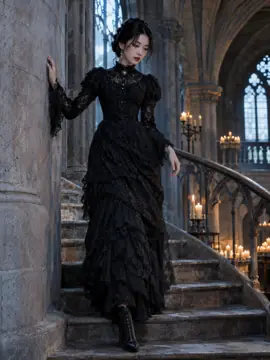</a> | <a href="https://promicat.app/poses/styles/sp106?utm_source=github&utm_medium=readme&utm_campaign=ai-photo-poses">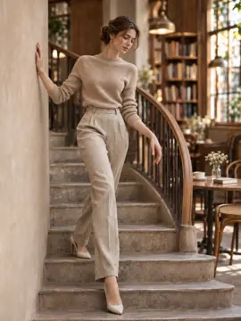</a> | <a href="https://promicat.app/poses/styles/sp106?utm_source=github&utm_medium=readme&utm_campaign=ai-photo-poses">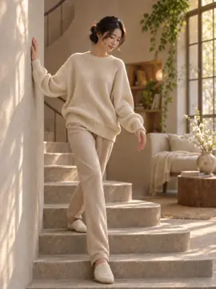</a> | <a href="https://promicat.app/poses/styles/sp106?utm_source=github&utm_medium=readme&utm_campaign=ai-photo-poses">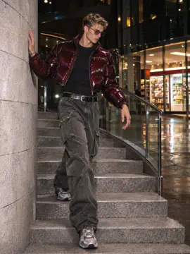</a> |

Full size: [photo](../images/photo-poses/gothic/sp106-photo.webp) · [white model](../images/photo-poses/gothic/sp106-pose.webp) · [try it on Promicat](https://promicat.app/poses/styles/sp106?utm_source=github&utm_medium=readme&utm_campaign=ai-photo-poses)

<details><summary>Prompt with your photo (image 1: your photo, image 2: white model)</summary>

```text
A real professional portrait photoshoot photo: a gothic photoshoot in an old cathedral cloister and candle-lit hall, cold blue daylight and warm candles, deep shadows, 50mm. Subject: the person in image 1 (keep their exact face, facial features, skin tone and hairstyle; do not beautify or swap the face), wearing a long black Victorian-gothic dress with high lace collar or a black frock coat, dark lipstick, silver jewellery. Pose: descending a spiral stone staircase, one hand on the wall. Image 2 is a wooden artist's mannequin that shows only this body pose: copy it exactly (head, torso, arms, hands, legs, feet, which hand does what, the camera angle), but do not copy the mannequin itself: no wooden skin, no joints, no blank face. Natural, relaxed and unstiff, true skin texture. No text, no logo, no watermark. Portrait 3:4.
```

</details>

<details><summary>Prompt for the sample (fictional model)</summary>

```text
A real professional portrait photoshoot photo, the kind posted by a top portrait studio: a gothic photoshoot in an old cathedral cloister and candle-lit hall, cold blue daylight and warm candles, deep shadows, 50mm. Model: a beautiful Korean professional fashion model in her twenties with a naturally attractive face, styled hair and natural makeup, wearing a long black Victorian-gothic dress with high lace collar or a black frock coat, dark lipstick, silver jewellery. The photographer directs the model into a natural, relaxed, unstiff pose that looks caught between moments: descending a spiral stone staircase, one hand on the wall. Asymmetric body, soft hands, flattering angle, true skin texture, refined but not plastic, fully clothed and modest. Full body or three-quarter body in frame, the whole pose clearly readable. No text, no logo, no watermark. Portrait 3:4.
```

</details>

## Kneeling on the stone floor with the dress spread around (Crouching)

| White model | Gothic | Boho desert | Dark academia | Forest & flower field |
|---|---|---|---|---|
|  | <a href="https://promicat.app/poses/styles/sp107?utm_source=github&utm_medium=readme&utm_campaign=ai-photo-poses"></a> | <a href="https://promicat.app/poses/styles/sp107?utm_source=github&utm_medium=readme&utm_campaign=ai-photo-poses">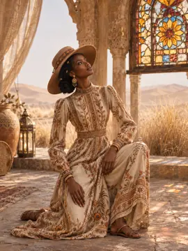</a> | <a href="https://promicat.app/poses/styles/sp107?utm_source=github&utm_medium=readme&utm_campaign=ai-photo-poses">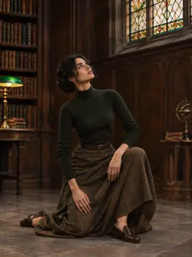</a> | <a href="https://promicat.app/poses/styles/sp107?utm_source=github&utm_medium=readme&utm_campaign=ai-photo-poses">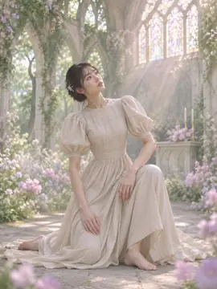</a> |

Full size: [photo](../images/photo-poses/gothic/sp107-photo.webp) · [white model](../images/photo-poses/gothic/sp107-pose.webp) · [try it on Promicat](https://promicat.app/poses/styles/sp107?utm_source=github&utm_medium=readme&utm_campaign=ai-photo-poses)

<details><summary>Prompt with your photo (image 1: your photo, image 2: white model)</summary>

```text
A real professional portrait photoshoot photo: a gothic photoshoot in an old cathedral cloister and candle-lit hall, cold blue daylight and warm candles, deep shadows, 50mm. Subject: the person in image 1 (keep their exact face, facial features, skin tone and hairstyle; do not beautify or swap the face), wearing a long black Victorian frock coat over a high-collared black shirt and waistcoat, black trousers and boots, silver rings. Pose: kneeling on the stone floor with the dress spread around, looking up at a stained-glass window. Image 2 is a wooden artist's mannequin that shows only this body pose: copy it exactly (head, torso, arms, hands, legs, feet, which hand does what, the camera angle), but do not copy the mannequin itself: no wooden skin, no joints, no blank face. Natural, relaxed and unstiff, true skin texture. No text, no logo, no watermark. Portrait 3:4.
```

</details>

<details><summary>Prompt for the sample (fictional model)</summary>

```text
A real professional portrait photoshoot photo, the kind posted by a top portrait studio: a gothic photoshoot in an old cathedral cloister and candle-lit hall, cold blue daylight and warm candles, deep shadows, 50mm. Model: a handsome South Asian professional male model in his twenties with a well-groomed look and styled hair, wearing a long black Victorian frock coat over a high-collared black shirt and waistcoat, black trousers and boots, silver rings. The photographer directs the model into a natural, relaxed, unstiff pose that looks caught between moments: kneeling on the stone floor with the dress spread around, looking up at a stained-glass window. Asymmetric body, soft hands, flattering angle, true skin texture, refined but not plastic, fully clothed and modest. Full body or three-quarter body in frame, the whole pose clearly readable. No text, no logo, no watermark. Portrait 3:4.
```

</details>

## Standing in coloured light from a stained-glass window (Standing)

| White model | Gothic | Campus youth | New Chinese style | Moody studio |
|---|---|---|---|---|
|  | <a href="https://promicat.app/poses/styles/sp108?utm_source=github&utm_medium=readme&utm_campaign=ai-photo-poses"></a> | <a href="https://promicat.app/poses/styles/sp108?utm_source=github&utm_medium=readme&utm_campaign=ai-photo-poses">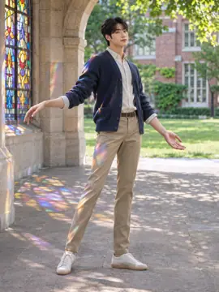</a> | <a href="https://promicat.app/poses/styles/sp108?utm_source=github&utm_medium=readme&utm_campaign=ai-photo-poses">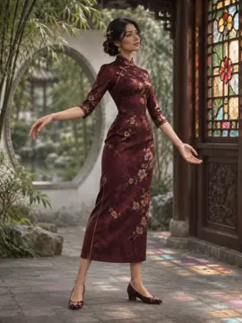</a> | <a href="https://promicat.app/poses/styles/sp108?utm_source=github&utm_medium=readme&utm_campaign=ai-photo-poses">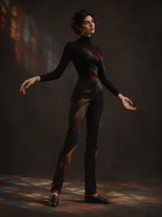</a> |

Full size: [photo](../images/photo-poses/gothic/sp108-photo.webp) · [white model](../images/photo-poses/gothic/sp108-pose.webp) · [try it on Promicat](https://promicat.app/poses/styles/sp108?utm_source=github&utm_medium=readme&utm_campaign=ai-photo-poses)

<details><summary>Prompt with your photo (image 1: your photo, image 2: white model)</summary>

```text
A real professional portrait photoshoot photo: a gothic photoshoot in an old cathedral cloister and candle-lit hall, cold blue daylight and warm candles, deep shadows, 50mm. Subject: the person in image 1 (keep their exact face, facial features, skin tone and hairstyle; do not beautify or swap the face), wearing a long black Victorian-gothic dress with high lace collar or a black frock coat, dark lipstick, silver jewellery. Pose: standing in coloured light from a stained-glass window, arms open slightly. Image 2 is a wooden artist's mannequin that shows only this body pose: copy it exactly (head, torso, arms, hands, legs, feet, which hand does what, the camera angle), but do not copy the mannequin itself: no wooden skin, no joints, no blank face. Natural, relaxed and unstiff, true skin texture. No text, no logo, no watermark. Portrait 3:4.
```

</details>

<details><summary>Prompt for the sample (fictional model)</summary>

```text
A real professional portrait photoshoot photo, the kind posted by a top portrait studio: a gothic photoshoot in an old cathedral cloister and candle-lit hall, cold blue daylight and warm candles, deep shadows, 50mm. Model: a beautiful East African professional fashion model in her twenties with a naturally attractive face, styled hair and natural makeup, wearing a long black Victorian-gothic dress with high lace collar or a black frock coat, dark lipstick, silver jewellery. The photographer directs the model into a natural, relaxed, unstiff pose that looks caught between moments: standing in coloured light from a stained-glass window, arms open slightly. Asymmetric body, soft hands, flattering angle, true skin texture, refined but not plastic, fully clothed and modest. Full body or three-quarter body in frame, the whole pose clearly readable. No text, no logo, no watermark. Portrait 3:4.
```

</details>

## Reading an old leather book held close (Upper body)

| White model | Gothic | Cafe & bookshop | Japanese fresh film | Nordic minimal |
|---|---|---|---|---|
|  | <a href="https://promicat.app/poses/styles/sp109?utm_source=github&utm_medium=readme&utm_campaign=ai-photo-poses">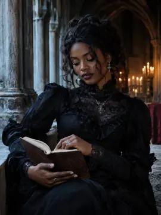</a> | <a href="https://promicat.app/poses/styles/sp109?utm_source=github&utm_medium=readme&utm_campaign=ai-photo-poses">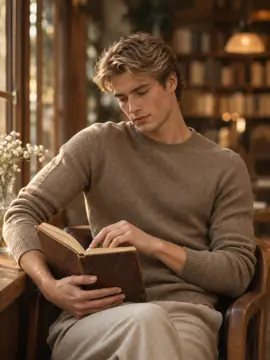</a> | <a href="https://promicat.app/poses/styles/sp109?utm_source=github&utm_medium=readme&utm_campaign=ai-photo-poses">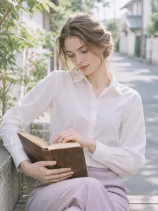</a> | <a href="https://promicat.app/poses/styles/sp109?utm_source=github&utm_medium=readme&utm_campaign=ai-photo-poses">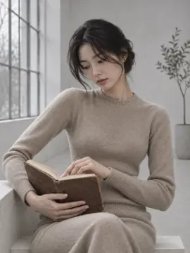</a> |

Full size: [photo](../images/photo-poses/gothic/sp109-photo.webp) · [white model](../images/photo-poses/gothic/sp109-pose.webp) · [try it on Promicat](https://promicat.app/poses/styles/sp109?utm_source=github&utm_medium=readme&utm_campaign=ai-photo-poses)

<details><summary>Prompt with your photo (image 1: your photo, image 2: white model)</summary>

```text
A real professional portrait photoshoot photo: a gothic photoshoot in an old cathedral cloister and candle-lit hall, cold blue daylight and warm candles, deep shadows, 50mm. Subject: the person in image 1 (keep their exact face, facial features, skin tone and hairstyle; do not beautify or swap the face), wearing a long black Victorian-gothic dress with high lace collar or a black frock coat, dark lipstick, silver jewellery. Pose: reading an old leather book held close, one finger on the page. Image 2 is a wooden artist's mannequin that shows only this body pose: copy it exactly (head, torso, arms, hands, legs, feet, which hand does what, the camera angle), but do not copy the mannequin itself: no wooden skin, no joints, no blank face. Natural, relaxed and unstiff, true skin texture. No text, no logo, no watermark. Portrait 3:4.
```

</details>

<details><summary>Prompt for the sample (fictional model)</summary>

```text
A real professional portrait photoshoot photo, the kind posted by a top portrait studio: a gothic photoshoot in an old cathedral cloister and candle-lit hall, cold blue daylight and warm candles, deep shadows, 50mm. Model: a beautiful Black professional fashion model in her twenties with a naturally attractive face, styled hair and natural makeup, wearing a long black Victorian-gothic dress with high lace collar or a black frock coat, dark lipstick, silver jewellery. The photographer directs the model into a natural, relaxed, unstiff pose that looks caught between moments: reading an old leather book held close, one finger on the page. Asymmetric body, soft hands, flattering angle, true skin texture, refined but not plastic, fully clothed and modest. Waist-up framing, both arms and hands readable. No text, no logo, no watermark. Portrait 3:4.
```

</details>

## Half hidden behind a heavy wooden door (Looking back)

| White model | Gothic | Cosy at home | Old money | Street punk |
|---|---|---|---|---|
|  | <a href="https://promicat.app/poses/styles/sp110?utm_source=github&utm_medium=readme&utm_campaign=ai-photo-poses">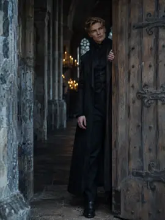</a> | <a href="https://promicat.app/poses/styles/sp110?utm_source=github&utm_medium=readme&utm_campaign=ai-photo-poses">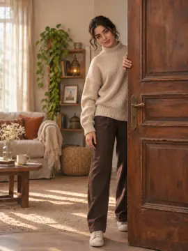</a> | <a href="https://promicat.app/poses/styles/sp110?utm_source=github&utm_medium=readme&utm_campaign=ai-photo-poses">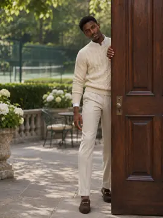</a> | <a href="https://promicat.app/poses/styles/sp110?utm_source=github&utm_medium=readme&utm_campaign=ai-photo-poses">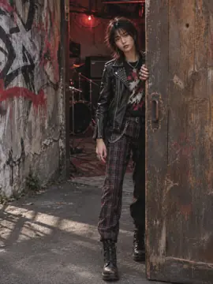</a> |

Full size: [photo](../images/photo-poses/gothic/sp110-photo.webp) · [white model](../images/photo-poses/gothic/sp110-pose.webp) · [try it on Promicat](https://promicat.app/poses/styles/sp110?utm_source=github&utm_medium=readme&utm_campaign=ai-photo-poses)

<details><summary>Prompt with your photo (image 1: your photo, image 2: white model)</summary>

```text
A real professional portrait photoshoot photo: a gothic photoshoot in an old cathedral cloister and candle-lit hall, cold blue daylight and warm candles, deep shadows, 50mm. Subject: the person in image 1 (keep their exact face, facial features, skin tone and hairstyle; do not beautify or swap the face), wearing a long black Victorian frock coat over a high-collared black shirt and waistcoat, black trousers and boots, silver rings. Pose: half hidden behind a heavy wooden door, one hand on its edge, peering out. Image 2 is a wooden artist's mannequin that shows only this body pose: copy it exactly (head, torso, arms, hands, legs, feet, which hand does what, the camera angle), but do not copy the mannequin itself: no wooden skin, no joints, no blank face. Natural, relaxed and unstiff, true skin texture. No text, no logo, no watermark. Portrait 3:4.
```

</details>

<details><summary>Prompt for the sample (fictional model)</summary>

```text
A real professional portrait photoshoot photo, the kind posted by a top portrait studio: a gothic photoshoot in an old cathedral cloister and candle-lit hall, cold blue daylight and warm candles, deep shadows, 50mm. Model: a handsome Scandinavian professional male model in his twenties with a well-groomed look and styled hair, wearing a long black Victorian frock coat over a high-collared black shirt and waistcoat, black trousers and boots, silver rings. The photographer directs the model into a natural, relaxed, unstiff pose that looks caught between moments: half hidden behind a heavy wooden door, one hand on its edge, peering out. Asymmetric body, soft hands, flattering angle, true skin texture, refined but not plastic, fully clothed and modest. Full body or three-quarter body in frame, the whole pose clearly readable. No text, no logo, no watermark. Portrait 3:4.
```

</details>
