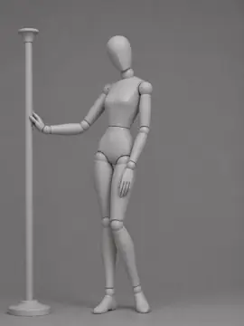
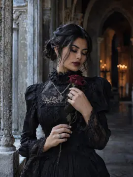
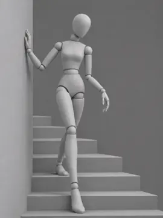
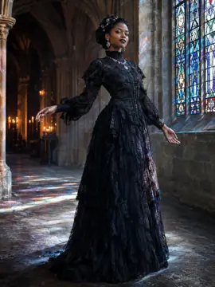
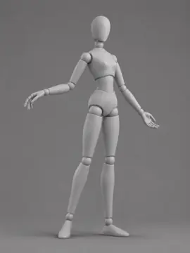

# 暗黑哥特 · Gothic

10 组写真姿势：左边是写真照，右边是照着它画的木头白模。白模可以当姿势参考图，和你的照片一起发给生图模型。 在线试用：[Promicat 姿势库](https://promicat.app/zh/poses?ref=github)

[← 返回目录](../README.md#写真姿势)

## 回廊回眸（回眸）

 

大图：[写真照](../images/photo-poses/gothic/sp101-photo.webp) · [白模](../images/photo-poses/gothic/sp101-pose.webp)

<details><summary>提示词：用你的照片（附图 1 你的照片，附图 2 白模）</summary>

```text
A real professional portrait photoshoot photo: a gothic photoshoot in an old cathedral cloister and candle-lit hall, cold blue daylight and warm candles, deep shadows, 50mm. Subject: the person in image 1 (keep their exact face, facial features, skin tone and hairstyle; do not beautify or swap the face), wearing a long black Victorian frock coat over a high-collared black shirt and waistcoat, black trousers and boots, silver rings. Pose: walking through a stone cloister, turning back over the shoulder, holding the long skirt. Image 2 is a wooden artist's mannequin that shows only this body pose: copy it exactly (head, torso, arms, hands, legs, feet, which hand does what, the camera angle), but do not copy the mannequin itself: no wooden skin, no joints, no blank face. Natural, relaxed and unstiff, true skin texture. No text, no logo, no watermark. Portrait 3:4.
```

</details>

<details><summary>提示词：生成示例图（虚构模特）</summary>

```text
A real professional portrait photoshoot photo, the kind posted by a top portrait studio: a gothic photoshoot in an old cathedral cloister and candle-lit hall, cold blue daylight and warm candles, deep shadows, 50mm. Model: a handsome Middle Eastern professional male model in his twenties with a well-groomed look and styled hair, wearing a long black Victorian frock coat over a high-collared black shirt and waistcoat, black trousers and boots, silver rings. The photographer directs the model into a natural, relaxed, unstiff pose that looks caught between moments: walking through a stone cloister, turning back over the shoulder, holding the long skirt. Asymmetric body, soft hands, flattering angle, true skin texture, refined but not plastic, fully clothed and modest. Full body or three-quarter body in frame, the whole pose clearly readable. No text, no logo, no watermark. Portrait 3:4.
```

</details>

## 烛台前（站）

 

大图：[写真照](../images/photo-poses/gothic/sp102-photo.webp) · [白模](../images/photo-poses/gothic/sp102-pose.webp)

<details><summary>提示词：用你的照片（附图 1 你的照片，附图 2 白模）</summary>

```text
A real professional portrait photoshoot photo: a gothic photoshoot in an old cathedral cloister and candle-lit hall, cold blue daylight and warm candles, deep shadows, 50mm. Subject: the person in image 1 (keep their exact face, facial features, skin tone and hairstyle; do not beautify or swap the face), wearing a long black Victorian-gothic dress with high lace collar or a black frock coat, dark lipstick, silver jewellery. Pose: standing beside a tall candelabra, one hand on it, chin lowered, eyes up to the camera. Image 2 is a wooden artist's mannequin that shows only this body pose: copy it exactly (head, torso, arms, hands, legs, feet, which hand does what, the camera angle), but do not copy the mannequin itself: no wooden skin, no joints, no blank face. Natural, relaxed and unstiff, true skin texture. No text, no logo, no watermark. Portrait 3:4.
```

</details>

<details><summary>提示词：生成示例图（虚构模特）</summary>

```text
A real professional portrait photoshoot photo, the kind posted by a top portrait studio: a gothic photoshoot in an old cathedral cloister and candle-lit hall, cold blue daylight and warm candles, deep shadows, 50mm. Model: a beautiful Indian professional fashion model in her twenties with a naturally attractive face, styled hair and natural makeup, wearing a long black Victorian-gothic dress with high lace collar or a black frock coat, dark lipstick, silver jewellery. The photographer directs the model into a natural, relaxed, unstiff pose that looks caught between moments: standing beside a tall candelabra, one hand on it, chin lowered, eyes up to the camera. Asymmetric body, soft hands, flattering angle, true skin texture, refined but not plastic, fully clothed and modest. Full body or three-quarter body in frame, the whole pose clearly readable. No text, no logo, no watermark. Portrait 3:4.
```

</details>

## 王座侧坐（坐）

 

大图：[写真照](../images/photo-poses/gothic/sp103-photo.webp) · [白模](../images/photo-poses/gothic/sp103-pose.webp)

<details><summary>提示词：用你的照片（附图 1 你的照片，附图 2 白模）</summary>

```text
A real professional portrait photoshoot photo: a gothic photoshoot in an old cathedral cloister and candle-lit hall, cold blue daylight and warm candles, deep shadows, 50mm. Subject: the person in image 1 (keep their exact face, facial features, skin tone and hairstyle; do not beautify or swap the face), wearing a long black Victorian-gothic dress with high lace collar or a black frock coat, dark lipstick, silver jewellery. Pose: sitting sideways on a carved wooden chair, one leg over the armrest, fully covered by the long dress. Image 2 is a wooden artist's mannequin that shows only this body pose: copy it exactly (head, torso, arms, hands, legs, feet, which hand does what, the camera angle), but do not copy the mannequin itself: no wooden skin, no joints, no blank face. Natural, relaxed and unstiff, true skin texture. No text, no logo, no watermark. Portrait 3:4.
```

</details>

<details><summary>提示词：生成示例图（虚构模特）</summary>

```text
A real professional portrait photoshoot photo, the kind posted by a top portrait studio: a gothic photoshoot in an old cathedral cloister and candle-lit hall, cold blue daylight and warm candles, deep shadows, 50mm. Model: a beautiful white European professional fashion model in her twenties with a naturally attractive face, styled hair and natural makeup, wearing a long black Victorian-gothic dress with high lace collar or a black frock coat, dark lipstick, silver jewellery. The photographer directs the model into a natural, relaxed, unstiff pose that looks caught between moments: sitting sideways on a carved wooden chair, one leg over the armrest, fully covered by the long dress. Asymmetric body, soft hands, flattering angle, true skin texture, refined but not plastic, fully clothed and modest. Full body or three-quarter body in frame, the whole pose clearly readable. No text, no logo, no watermark. Portrait 3:4.
```

</details>

## 倚石柱（靠）

 

大图：[写真照](../images/photo-poses/gothic/sp104-photo.webp) · [白模](../images/photo-poses/gothic/sp104-pose.webp)

<details><summary>提示词：用你的照片（附图 1 你的照片，附图 2 白模）</summary>

```text
A real professional portrait photoshoot photo: a gothic photoshoot in an old cathedral cloister and candle-lit hall, cold blue daylight and warm candles, deep shadows, 50mm. Subject: the person in image 1 (keep their exact face, facial features, skin tone and hairstyle; do not beautify or swap the face), wearing a long black Victorian frock coat over a high-collared black shirt and waistcoat, black trousers and boots, silver rings. Pose: leaning against a stone column, arms folded, head tilted. Image 2 is a wooden artist's mannequin that shows only this body pose: copy it exactly (head, torso, arms, hands, legs, feet, which hand does what, the camera angle), but do not copy the mannequin itself: no wooden skin, no joints, no blank face. Natural, relaxed and unstiff, true skin texture. No text, no logo, no watermark. Portrait 3:4.
```

</details>

<details><summary>提示词：生成示例图（虚构模特）</summary>

```text
A real professional portrait photoshoot photo, the kind posted by a top portrait studio: a gothic photoshoot in an old cathedral cloister and candle-lit hall, cold blue daylight and warm candles, deep shadows, 50mm. Model: a handsome Brazilian professional male model in his twenties with a well-groomed look and styled hair, wearing a long black Victorian frock coat over a high-collared black shirt and waistcoat, black trousers and boots, silver rings. The photographer directs the model into a natural, relaxed, unstiff pose that looks caught between moments: leaning against a stone column, arms folded, head tilted. Asymmetric body, soft hands, flattering angle, true skin texture, refined but not plastic, fully clothed and modest. Full body or three-quarter body in frame, the whole pose clearly readable. No text, no logo, no watermark. Portrait 3:4.
```

</details>

## 手捧玫瑰（半身）

 

大图：[写真照](../images/photo-poses/gothic/sp105-photo.webp) · [白模](../images/photo-poses/gothic/sp105-pose.webp)

<details><summary>提示词：用你的照片（附图 1 你的照片，附图 2 白模）</summary>

```text
A real professional portrait photoshoot photo: a gothic photoshoot in an old cathedral cloister and candle-lit hall, cold blue daylight and warm candles, deep shadows, 50mm. Subject: the person in image 1 (keep their exact face, facial features, skin tone and hairstyle; do not beautify or swap the face), wearing a long black Victorian-gothic dress with high lace collar or a black frock coat, dark lipstick, silver jewellery. Pose: holding a dark red rose against the lace collar, eyes downcast. Image 2 is a wooden artist's mannequin that shows only this body pose: copy it exactly (head, torso, arms, hands, legs, feet, which hand does what, the camera angle), but do not copy the mannequin itself: no wooden skin, no joints, no blank face. Natural, relaxed and unstiff, true skin texture. No text, no logo, no watermark. Portrait 3:4.
```

</details>

<details><summary>提示词：生成示例图（虚构模特）</summary>

```text
A real professional portrait photoshoot photo, the kind posted by a top portrait studio: a gothic photoshoot in an old cathedral cloister and candle-lit hall, cold blue daylight and warm candles, deep shadows, 50mm. Model: a beautiful Latina professional fashion model in her twenties with a naturally attractive face, styled hair and natural makeup, wearing a long black Victorian-gothic dress with high lace collar or a black frock coat, dark lipstick, silver jewellery. The photographer directs the model into a natural, relaxed, unstiff pose that looks caught between moments: holding a dark red rose against the lace collar, eyes downcast. Asymmetric body, soft hands, flattering angle, true skin texture, refined but not plastic, fully clothed and modest. Waist-up framing, both arms and hands readable. No text, no logo, no watermark. Portrait 3:4.
```

</details>

## 楼梯下行（走）

 

大图：[写真照](../images/photo-poses/gothic/sp106-photo.webp) · [白模](../images/photo-poses/gothic/sp106-pose.webp)

<details><summary>提示词：用你的照片（附图 1 你的照片，附图 2 白模）</summary>

```text
A real professional portrait photoshoot photo: a gothic photoshoot in an old cathedral cloister and candle-lit hall, cold blue daylight and warm candles, deep shadows, 50mm. Subject: the person in image 1 (keep their exact face, facial features, skin tone and hairstyle; do not beautify or swap the face), wearing a long black Victorian-gothic dress with high lace collar or a black frock coat, dark lipstick, silver jewellery. Pose: descending a spiral stone staircase, one hand on the wall. Image 2 is a wooden artist's mannequin that shows only this body pose: copy it exactly (head, torso, arms, hands, legs, feet, which hand does what, the camera angle), but do not copy the mannequin itself: no wooden skin, no joints, no blank face. Natural, relaxed and unstiff, true skin texture. No text, no logo, no watermark. Portrait 3:4.
```

</details>

<details><summary>提示词：生成示例图（虚构模特）</summary>

```text
A real professional portrait photoshoot photo, the kind posted by a top portrait studio: a gothic photoshoot in an old cathedral cloister and candle-lit hall, cold blue daylight and warm candles, deep shadows, 50mm. Model: a beautiful Korean professional fashion model in her twenties with a naturally attractive face, styled hair and natural makeup, wearing a long black Victorian-gothic dress with high lace collar or a black frock coat, dark lipstick, silver jewellery. The photographer directs the model into a natural, relaxed, unstiff pose that looks caught between moments: descending a spiral stone staircase, one hand on the wall. Asymmetric body, soft hands, flattering angle, true skin texture, refined but not plastic, fully clothed and modest. Full body or three-quarter body in frame, the whole pose clearly readable. No text, no logo, no watermark. Portrait 3:4.
```

</details>

## 跪坐石地（蹲跪）

 

大图：[写真照](../images/photo-poses/gothic/sp107-photo.webp) · [白模](../images/photo-poses/gothic/sp107-pose.webp)

<details><summary>提示词：用你的照片（附图 1 你的照片，附图 2 白模）</summary>

```text
A real professional portrait photoshoot photo: a gothic photoshoot in an old cathedral cloister and candle-lit hall, cold blue daylight and warm candles, deep shadows, 50mm. Subject: the person in image 1 (keep their exact face, facial features, skin tone and hairstyle; do not beautify or swap the face), wearing a long black Victorian frock coat over a high-collared black shirt and waistcoat, black trousers and boots, silver rings. Pose: kneeling on the stone floor with the dress spread around, looking up at a stained-glass window. Image 2 is a wooden artist's mannequin that shows only this body pose: copy it exactly (head, torso, arms, hands, legs, feet, which hand does what, the camera angle), but do not copy the mannequin itself: no wooden skin, no joints, no blank face. Natural, relaxed and unstiff, true skin texture. No text, no logo, no watermark. Portrait 3:4.
```

</details>

<details><summary>提示词：生成示例图（虚构模特）</summary>

```text
A real professional portrait photoshoot photo, the kind posted by a top portrait studio: a gothic photoshoot in an old cathedral cloister and candle-lit hall, cold blue daylight and warm candles, deep shadows, 50mm. Model: a handsome South Asian professional male model in his twenties with a well-groomed look and styled hair, wearing a long black Victorian frock coat over a high-collared black shirt and waistcoat, black trousers and boots, silver rings. The photographer directs the model into a natural, relaxed, unstiff pose that looks caught between moments: kneeling on the stone floor with the dress spread around, looking up at a stained-glass window. Asymmetric body, soft hands, flattering angle, true skin texture, refined but not plastic, fully clothed and modest. Full body or three-quarter body in frame, the whole pose clearly readable. No text, no logo, no watermark. Portrait 3:4.
```

</details>

## 彩窗光下（站）

 

大图：[写真照](../images/photo-poses/gothic/sp108-photo.webp) · [白模](../images/photo-poses/gothic/sp108-pose.webp)

<details><summary>提示词：用你的照片（附图 1 你的照片，附图 2 白模）</summary>

```text
A real professional portrait photoshoot photo: a gothic photoshoot in an old cathedral cloister and candle-lit hall, cold blue daylight and warm candles, deep shadows, 50mm. Subject: the person in image 1 (keep their exact face, facial features, skin tone and hairstyle; do not beautify or swap the face), wearing a long black Victorian-gothic dress with high lace collar or a black frock coat, dark lipstick, silver jewellery. Pose: standing in coloured light from a stained-glass window, arms open slightly. Image 2 is a wooden artist's mannequin that shows only this body pose: copy it exactly (head, torso, arms, hands, legs, feet, which hand does what, the camera angle), but do not copy the mannequin itself: no wooden skin, no joints, no blank face. Natural, relaxed and unstiff, true skin texture. No text, no logo, no watermark. Portrait 3:4.
```

</details>

<details><summary>提示词：生成示例图（虚构模特）</summary>

```text
A real professional portrait photoshoot photo, the kind posted by a top portrait studio: a gothic photoshoot in an old cathedral cloister and candle-lit hall, cold blue daylight and warm candles, deep shadows, 50mm. Model: a beautiful East African professional fashion model in her twenties with a naturally attractive face, styled hair and natural makeup, wearing a long black Victorian-gothic dress with high lace collar or a black frock coat, dark lipstick, silver jewellery. The photographer directs the model into a natural, relaxed, unstiff pose that looks caught between moments: standing in coloured light from a stained-glass window, arms open slightly. Asymmetric body, soft hands, flattering angle, true skin texture, refined but not plastic, fully clothed and modest. Full body or three-quarter body in frame, the whole pose clearly readable. No text, no logo, no watermark. Portrait 3:4.
```

</details>

## 手持古书（半身）

 

大图：[写真照](../images/photo-poses/gothic/sp109-photo.webp) · [白模](../images/photo-poses/gothic/sp109-pose.webp)

<details><summary>提示词：用你的照片（附图 1 你的照片，附图 2 白模）</summary>

```text
A real professional portrait photoshoot photo: a gothic photoshoot in an old cathedral cloister and candle-lit hall, cold blue daylight and warm candles, deep shadows, 50mm. Subject: the person in image 1 (keep their exact face, facial features, skin tone and hairstyle; do not beautify or swap the face), wearing a long black Victorian-gothic dress with high lace collar or a black frock coat, dark lipstick, silver jewellery. Pose: reading an old leather book held close, one finger on the page. Image 2 is a wooden artist's mannequin that shows only this body pose: copy it exactly (head, torso, arms, hands, legs, feet, which hand does what, the camera angle), but do not copy the mannequin itself: no wooden skin, no joints, no blank face. Natural, relaxed and unstiff, true skin texture. No text, no logo, no watermark. Portrait 3:4.
```

</details>

<details><summary>提示词：生成示例图（虚构模特）</summary>

```text
A real professional portrait photoshoot photo, the kind posted by a top portrait studio: a gothic photoshoot in an old cathedral cloister and candle-lit hall, cold blue daylight and warm candles, deep shadows, 50mm. Model: a beautiful Black professional fashion model in her twenties with a naturally attractive face, styled hair and natural makeup, wearing a long black Victorian-gothic dress with high lace collar or a black frock coat, dark lipstick, silver jewellery. The photographer directs the model into a natural, relaxed, unstiff pose that looks caught between moments: reading an old leather book held close, one finger on the page. Asymmetric body, soft hands, flattering angle, true skin texture, refined but not plastic, fully clothed and modest. Waist-up framing, both arms and hands readable. No text, no logo, no watermark. Portrait 3:4.
```

</details>

## 门后半身（回眸）

 

大图：[写真照](../images/photo-poses/gothic/sp110-photo.webp) · [白模](../images/photo-poses/gothic/sp110-pose.webp)

<details><summary>提示词：用你的照片（附图 1 你的照片，附图 2 白模）</summary>

```text
A real professional portrait photoshoot photo: a gothic photoshoot in an old cathedral cloister and candle-lit hall, cold blue daylight and warm candles, deep shadows, 50mm. Subject: the person in image 1 (keep their exact face, facial features, skin tone and hairstyle; do not beautify or swap the face), wearing a long black Victorian frock coat over a high-collared black shirt and waistcoat, black trousers and boots, silver rings. Pose: half hidden behind a heavy wooden door, one hand on its edge, peering out. Image 2 is a wooden artist's mannequin that shows only this body pose: copy it exactly (head, torso, arms, hands, legs, feet, which hand does what, the camera angle), but do not copy the mannequin itself: no wooden skin, no joints, no blank face. Natural, relaxed and unstiff, true skin texture. No text, no logo, no watermark. Portrait 3:4.
```

</details>

<details><summary>提示词：生成示例图（虚构模特）</summary>

```text
A real professional portrait photoshoot photo, the kind posted by a top portrait studio: a gothic photoshoot in an old cathedral cloister and candle-lit hall, cold blue daylight and warm candles, deep shadows, 50mm. Model: a handsome Scandinavian professional male model in his twenties with a well-groomed look and styled hair, wearing a long black Victorian frock coat over a high-collared black shirt and waistcoat, black trousers and boots, silver rings. The photographer directs the model into a natural, relaxed, unstiff pose that looks caught between moments: half hidden behind a heavy wooden door, one hand on its edge, peering out. Asymmetric body, soft hands, flattering angle, true skin texture, refined but not plastic, fully clothed and modest. Full body or three-quarter body in frame, the whole pose clearly readable. No text, no logo, no watermark. Portrait 3:4.
```

</details>
