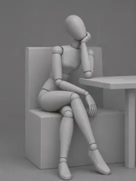
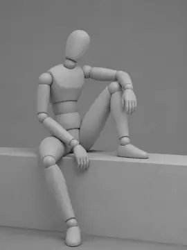

# 港风复古 · HK retro neon

10 组写真姿势：左边是写真照，右边是照着它画的木头白模。白模可以当姿势参考图，和你的照片一起发给生图模型。 在线试用：[Promicat 姿势库](https://promicat.app/zh/poses?ref=github)

[← 返回目录](../README.md#写真姿势)

## 靠霓虹墙（靠）

 

大图：[写真照](../images/photo-poses/hkretro/sp051-photo.webp) · [白模](../images/photo-poses/hkretro/sp051-pose.webp)

<details><summary>提示词：用你的照片（附图 1 你的照片，附图 2 白模）</summary>

```text
A real professional portrait photoshoot photo: a 1990s Hong Kong retro night photoshoot with neon signs, tungsten and green fluorescent light, CineStill 800T halation, 50mm f/1.4. Subject: the person in image 1 (keep their exact face, facial features, skin tone and hairstyle; do not beautify or swap the face), wearing a vintage satin shirt, a fitted retro dress or a loose blazer. Pose: leaning back against a neon-lit wall, head tilted, one hand at the collar, looking into the camera. Image 2 is a wooden artist's mannequin that shows only this body pose: copy it exactly (head, torso, arms, hands, legs, feet, which hand does what, the camera angle), but do not copy the mannequin itself: no wooden skin, no joints, no blank face. Natural, relaxed and unstiff, true skin texture. No text, no logo, no watermark. Portrait 3:4.
```

</details>

<details><summary>提示词：生成示例图（虚构模特）</summary>

```text
A real professional portrait photoshoot photo, the kind posted by a top portrait studio: a 1990s Hong Kong retro night photoshoot with neon signs, tungsten and green fluorescent light, CineStill 800T halation, 50mm f/1.4. Model: a beautiful Korean professional fashion model in her twenties with a naturally attractive face, styled hair and natural makeup, wearing a vintage satin shirt, a fitted retro dress or a loose blazer. The photographer directs the model into a natural, relaxed, unstiff pose that looks caught between moments: leaning back against a neon-lit wall, head tilted, one hand at the collar, looking into the camera. Asymmetric body, soft hands, flattering angle, true skin texture, refined but not plastic, fully clothed and modest. Full body or three-quarter body in frame, the whole pose clearly readable. No text, no logo, no watermark. Portrait 3:4.
```

</details>

## 外套搭肩走（走）

 

大图：[写真照](../images/photo-poses/hkretro/sp052-photo.webp) · [白模](../images/photo-poses/hkretro/sp052-pose.webp)

<details><summary>提示词：用你的照片（附图 1 你的照片，附图 2 白模）</summary>

```text
A real professional portrait photoshoot photo: a 1990s Hong Kong retro night photoshoot with neon signs, tungsten and green fluorescent light, CineStill 800T halation, 50mm f/1.4. Subject: the person in image 1 (keep their exact face, facial features, skin tone and hairstyle; do not beautify or swap the face), wearing a vintage satin shirt, a fitted retro dress or a loose blazer. Pose: walking under neon signs with a jacket over one shoulder, looking sideways. Image 2 is a wooden artist's mannequin that shows only this body pose: copy it exactly (head, torso, arms, hands, legs, feet, which hand does what, the camera angle), but do not copy the mannequin itself: no wooden skin, no joints, no blank face. Natural, relaxed and unstiff, true skin texture. No text, no logo, no watermark. Portrait 3:4.
```

</details>

<details><summary>提示词：生成示例图（虚构模特）</summary>

```text
A real professional portrait photoshoot photo, the kind posted by a top portrait studio: a 1990s Hong Kong retro night photoshoot with neon signs, tungsten and green fluorescent light, CineStill 800T halation, 50mm f/1.4. Model: a handsome South Asian professional male model in his twenties with a well-groomed look and styled hair, wearing a vintage satin shirt, a fitted retro dress or a loose blazer. The photographer directs the model into a natural, relaxed, unstiff pose that looks caught between moments: walking under neon signs with a jacket over one shoulder, looking sideways. Asymmetric body, soft hands, flattering angle, true skin texture, refined but not plastic, fully clothed and modest. Full body or three-quarter body in frame, the whole pose clearly readable. No text, no logo, no watermark. Portrait 3:4.
```

</details>

## 电话亭打电话（站）

 

大图：[写真照](../images/photo-poses/hkretro/sp053-photo.webp) · [白模](../images/photo-poses/hkretro/sp053-pose.webp)

<details><summary>提示词：用你的照片（附图 1 你的照片，附图 2 白模）</summary>

```text
A real professional portrait photoshoot photo: a 1990s Hong Kong retro night photoshoot with neon signs, tungsten and green fluorescent light, CineStill 800T halation, 50mm f/1.4. Subject: the person in image 1 (keep their exact face, facial features, skin tone and hairstyle; do not beautify or swap the face), wearing a vintage satin shirt, a fitted retro dress or a loose blazer. Pose: standing in a red phone booth with the receiver at the ear, the other hand on the glass. Image 2 is a wooden artist's mannequin that shows only this body pose: copy it exactly (head, torso, arms, hands, legs, feet, which hand does what, the camera angle), but do not copy the mannequin itself: no wooden skin, no joints, no blank face. Natural, relaxed and unstiff, true skin texture. No text, no logo, no watermark. Portrait 3:4.
```

</details>

<details><summary>提示词：生成示例图（虚构模特）</summary>

```text
A real professional portrait photoshoot photo, the kind posted by a top portrait studio: a 1990s Hong Kong retro night photoshoot with neon signs, tungsten and green fluorescent light, CineStill 800T halation, 50mm f/1.4. Model: a beautiful East African professional fashion model in her twenties with a naturally attractive face, styled hair and natural makeup, wearing a vintage satin shirt, a fitted retro dress or a loose blazer. The photographer directs the model into a natural, relaxed, unstiff pose that looks caught between moments: standing in a red phone booth with the receiver at the ear, the other hand on the glass. Asymmetric body, soft hands, flattering angle, true skin texture, refined but not plastic, fully clothed and modest. Full body or three-quarter body in frame, the whole pose clearly readable. No text, no logo, no watermark. Portrait 3:4.
```

</details>

## 茶餐厅托腮（坐）

 

大图：[写真照](../images/photo-poses/hkretro/sp054-photo.webp) · [白模](../images/photo-poses/hkretro/sp054-pose.webp)

<details><summary>提示词：用你的照片（附图 1 你的照片，附图 2 白模）</summary>

```text
A real professional portrait photoshoot photo: a 1990s Hong Kong retro night photoshoot with neon signs, tungsten and green fluorescent light, CineStill 800T halation, 50mm f/1.4. Subject: the person in image 1 (keep their exact face, facial features, skin tone and hairstyle; do not beautify or swap the face), wearing a vintage satin shirt, a fitted retro dress or a loose blazer. Pose: sitting in a cha chaan teng booth, chin on the hand, a glass of iced tea in front. Image 2 is a wooden artist's mannequin that shows only this body pose: copy it exactly (head, torso, arms, hands, legs, feet, which hand does what, the camera angle), but do not copy the mannequin itself: no wooden skin, no joints, no blank face. Natural, relaxed and unstiff, true skin texture. No text, no logo, no watermark. Portrait 3:4.
```

</details>

<details><summary>提示词：生成示例图（虚构模特）</summary>

```text
A real professional portrait photoshoot photo, the kind posted by a top portrait studio: a 1990s Hong Kong retro night photoshoot with neon signs, tungsten and green fluorescent light, CineStill 800T halation, 50mm f/1.4. Model: a beautiful Black professional fashion model in her twenties with a naturally attractive face, styled hair and natural makeup, wearing a vintage satin shirt, a fitted retro dress or a loose blazer. The photographer directs the model into a natural, relaxed, unstiff pose that looks caught between moments: sitting in a cha chaan teng booth, chin on the hand, a glass of iced tea in front. Asymmetric body, soft hands, flattering angle, true skin texture, refined but not plastic, fully clothed and modest. Full body or three-quarter body in frame, the whole pose clearly readable. No text, no logo, no watermark. Portrait 3:4.
```

</details>

## 回头望镜（回眸）

 

大图：[写真照](../images/photo-poses/hkretro/sp055-photo.webp) · [白模](../images/photo-poses/hkretro/sp055-pose.webp)

<details><summary>提示词：用你的照片（附图 1 你的照片，附图 2 白模）</summary>

```text
A real professional portrait photoshoot photo: a 1990s Hong Kong retro night photoshoot with neon signs, tungsten and green fluorescent light, CineStill 800T halation, 50mm f/1.4. Subject: the person in image 1 (keep their exact face, facial features, skin tone and hairstyle; do not beautify or swap the face), wearing a vintage satin shirt, a fitted retro dress or a loose blazer. Pose: walking away down a wet street, turning the face back over the shoulder. Image 2 is a wooden artist's mannequin that shows only this body pose: copy it exactly (head, torso, arms, hands, legs, feet, which hand does what, the camera angle), but do not copy the mannequin itself: no wooden skin, no joints, no blank face. Natural, relaxed and unstiff, true skin texture. No text, no logo, no watermark. Portrait 3:4.
```

</details>

<details><summary>提示词：生成示例图（虚构模特）</summary>

```text
A real professional portrait photoshoot photo, the kind posted by a top portrait studio: a 1990s Hong Kong retro night photoshoot with neon signs, tungsten and green fluorescent light, CineStill 800T halation, 50mm f/1.4. Model: a handsome Scandinavian professional male model in his twenties with a well-groomed look and styled hair, wearing a vintage satin shirt, a fitted retro dress or a loose blazer. The photographer directs the model into a natural, relaxed, unstiff pose that looks caught between moments: walking away down a wet street, turning the face back over the shoulder. Asymmetric body, soft hands, flattering angle, true skin texture, refined but not plastic, fully clothed and modest. Full body or three-quarter body in frame, the whole pose clearly readable. No text, no logo, no watermark. Portrait 3:4.
```

</details>

## 点烟姿势无烟（半身）

 

大图：[写真照](../images/photo-poses/hkretro/sp056-photo.webp) · [白模](../images/photo-poses/hkretro/sp056-pose.webp)

<details><summary>提示词：用你的照片（附图 1 你的照片，附图 2 白模）</summary>

```text
A real professional portrait photoshoot photo: a 1990s Hong Kong retro night photoshoot with neon signs, tungsten and green fluorescent light, CineStill 800T halation, 50mm f/1.4. Subject: the person in image 1 (keep their exact face, facial features, skin tone and hairstyle; do not beautify or swap the face), wearing a vintage satin shirt, a fitted retro dress or a loose blazer. Pose: cupping both hands near the face as if shielding a match, eyes down, no cigarette. Image 2 is a wooden artist's mannequin that shows only this body pose: copy it exactly (head, torso, arms, hands, legs, feet, which hand does what, the camera angle), but do not copy the mannequin itself: no wooden skin, no joints, no blank face. Natural, relaxed and unstiff, true skin texture. No text, no logo, no watermark. Portrait 3:4.
```

</details>

<details><summary>提示词：生成示例图（虚构模特）</summary>

```text
A real professional portrait photoshoot photo, the kind posted by a top portrait studio: a 1990s Hong Kong retro night photoshoot with neon signs, tungsten and green fluorescent light, CineStill 800T halation, 50mm f/1.4. Model: a beautiful East Asian professional fashion model in her twenties with a naturally attractive face, styled hair and natural makeup, wearing a vintage satin shirt, a fitted retro dress or a loose blazer. The photographer directs the model into a natural, relaxed, unstiff pose that looks caught between moments: cupping both hands near the face as if shielding a match, eyes down, no cigarette. Asymmetric body, soft hands, flattering angle, true skin texture, refined but not plastic, fully clothed and modest. Waist-up framing, both arms and hands readable. No text, no logo, no watermark. Portrait 3:4.
```

</details>

## 倚出租车（靠）

 

大图：[写真照](../images/photo-poses/hkretro/sp057-photo.webp) · [白模](../images/photo-poses/hkretro/sp057-pose.webp)

<details><summary>提示词：用你的照片（附图 1 你的照片，附图 2 白模）</summary>

```text
A real professional portrait photoshoot photo: a 1990s Hong Kong retro night photoshoot with neon signs, tungsten and green fluorescent light, CineStill 800T halation, 50mm f/1.4. Subject: the person in image 1 (keep their exact face, facial features, skin tone and hairstyle; do not beautify or swap the face), wearing a vintage satin shirt, a fitted retro dress or a loose blazer. Pose: leaning on the roof of a red taxi with one forearm, looking down the street. Image 2 is a wooden artist's mannequin that shows only this body pose: copy it exactly (head, torso, arms, hands, legs, feet, which hand does what, the camera angle), but do not copy the mannequin itself: no wooden skin, no joints, no blank face. Natural, relaxed and unstiff, true skin texture. No text, no logo, no watermark. Portrait 3:4.
```

</details>

<details><summary>提示词：生成示例图（虚构模特）</summary>

```text
A real professional portrait photoshoot photo, the kind posted by a top portrait studio: a 1990s Hong Kong retro night photoshoot with neon signs, tungsten and green fluorescent light, CineStill 800T halation, 50mm f/1.4. Model: a beautiful mixed-race professional fashion model in her twenties with a naturally attractive face, styled hair and natural makeup, wearing a vintage satin shirt, a fitted retro dress or a loose blazer. The photographer directs the model into a natural, relaxed, unstiff pose that looks caught between moments: leaning on the roof of a red taxi with one forearm, looking down the street. Asymmetric body, soft hands, flattering angle, true skin texture, refined but not plastic, fully clothed and modest. Full body or three-quarter body in frame, the whole pose clearly readable. No text, no logo, no watermark. Portrait 3:4.
```

</details>

## 天台坐边（坐）

 

大图：[写真照](../images/photo-poses/hkretro/sp058-photo.webp) · [白模](../images/photo-poses/hkretro/sp058-pose.webp)

<details><summary>提示词：用你的照片（附图 1 你的照片，附图 2 白模）</summary>

```text
A real professional portrait photoshoot photo: a 1990s Hong Kong retro night photoshoot with neon signs, tungsten and green fluorescent light, CineStill 800T halation, 50mm f/1.4. Subject: the person in image 1 (keep their exact face, facial features, skin tone and hairstyle; do not beautify or swap the face), wearing a vintage satin shirt, a fitted retro dress or a loose blazer. Pose: sitting on a rooftop ledge with the city lights behind, one leg bent up. Image 2 is a wooden artist's mannequin that shows only this body pose: copy it exactly (head, torso, arms, hands, legs, feet, which hand does what, the camera angle), but do not copy the mannequin itself: no wooden skin, no joints, no blank face. Natural, relaxed and unstiff, true skin texture. No text, no logo, no watermark. Portrait 3:4.
```

</details>

<details><summary>提示词：生成示例图（虚构模特）</summary>

```text
A real professional portrait photoshoot photo, the kind posted by a top portrait studio: a 1990s Hong Kong retro night photoshoot with neon signs, tungsten and green fluorescent light, CineStill 800T halation, 50mm f/1.4. Model: a handsome Mediterranean professional male model in his twenties with a well-groomed look and styled hair, wearing a vintage satin shirt, a fitted retro dress or a loose blazer. The photographer directs the model into a natural, relaxed, unstiff pose that looks caught between moments: sitting on a rooftop ledge with the city lights behind, one leg bent up. Asymmetric body, soft hands, flattering angle, true skin texture, refined but not plastic, fully clothed and modest. Full body or three-quarter body in frame, the whole pose clearly readable. No text, no logo, no watermark. Portrait 3:4.
```

</details>

## 楼梯间仰头（站）

 

大图：[写真照](../images/photo-poses/hkretro/sp059-photo.webp) · [白模](../images/photo-poses/hkretro/sp059-pose.webp)

<details><summary>提示词：用你的照片（附图 1 你的照片，附图 2 白模）</summary>

```text
A real professional portrait photoshoot photo: a 1990s Hong Kong retro night photoshoot with neon signs, tungsten and green fluorescent light, CineStill 800T halation, 50mm f/1.4. Subject: the person in image 1 (keep their exact face, facial features, skin tone and hairstyle; do not beautify or swap the face), wearing a vintage satin shirt, a fitted retro dress or a loose blazer. Pose: standing in a tiled stairwell under a green fluorescent light, head back against the wall. Image 2 is a wooden artist's mannequin that shows only this body pose: copy it exactly (head, torso, arms, hands, legs, feet, which hand does what, the camera angle), but do not copy the mannequin itself: no wooden skin, no joints, no blank face. Natural, relaxed and unstiff, true skin texture. No text, no logo, no watermark. Portrait 3:4.
```

</details>

<details><summary>提示词：生成示例图（虚构模特）</summary>

```text
A real professional portrait photoshoot photo, the kind posted by a top portrait studio: a 1990s Hong Kong retro night photoshoot with neon signs, tungsten and green fluorescent light, CineStill 800T halation, 50mm f/1.4. Model: a beautiful Southeast Asian professional fashion model in her twenties with a naturally attractive face, styled hair and natural makeup, wearing a vintage satin shirt, a fitted retro dress or a loose blazer. The photographer directs the model into a natural, relaxed, unstiff pose that looks caught between moments: standing in a tiled stairwell under a green fluorescent light, head back against the wall. Asymmetric body, soft hands, flattering angle, true skin texture, refined but not plastic, fully clothed and modest. Full body or three-quarter body in frame, the whole pose clearly readable. No text, no logo, no watermark. Portrait 3:4.
```

</details>

## 撑伞雨夜（站）

 

大图：[写真照](../images/photo-poses/hkretro/sp060-photo.webp) · [白模](../images/photo-poses/hkretro/sp060-pose.webp)

<details><summary>提示词：用你的照片（附图 1 你的照片，附图 2 白模）</summary>

```text
A real professional portrait photoshoot photo: a 1990s Hong Kong retro night photoshoot with neon signs, tungsten and green fluorescent light, CineStill 800T halation, 50mm f/1.4. Subject: the person in image 1 (keep their exact face, facial features, skin tone and hairstyle; do not beautify or swap the face), wearing a vintage satin shirt, a fitted retro dress or a loose blazer. Pose: standing in the rain under a transparent umbrella, looking up at the signs. Image 2 is a wooden artist's mannequin that shows only this body pose: copy it exactly (head, torso, arms, hands, legs, feet, which hand does what, the camera angle), but do not copy the mannequin itself: no wooden skin, no joints, no blank face. Natural, relaxed and unstiff, true skin texture. No text, no logo, no watermark. Portrait 3:4.
```

</details>

<details><summary>提示词：生成示例图（虚构模特）</summary>

```text
A real professional portrait photoshoot photo, the kind posted by a top portrait studio: a 1990s Hong Kong retro night photoshoot with neon signs, tungsten and green fluorescent light, CineStill 800T halation, 50mm f/1.4. Model: a beautiful Japanese professional fashion model in her twenties with a naturally attractive face, styled hair and natural makeup, wearing a vintage satin shirt, a fitted retro dress or a loose blazer. The photographer directs the model into a natural, relaxed, unstiff pose that looks caught between moments: standing in the rain under a transparent umbrella, looking up at the signs. Asymmetric body, soft hands, flattering angle, true skin texture, refined but not plastic, fully clothed and modest. Full body or three-quarter body in frame, the whole pose clearly readable. No text, no logo, no watermark. Portrait 3:4.
```

</details>
