# HK retro neon

English · [简体中文](hkretro.zh-CN.md)

10 white models, each with 4 portraits shot from it in different styles. Attach your photo first and the white model second. Try them with your own photo on [Promicat](https://promicat.app/poses?utm_source=github&utm_medium=readme&utm_campaign=ai-photo-poses).

[← Back to all styles](../README.md#photo-poses)

## Leaning back against a neon-lit wall (Leaning)

| White model | HK retro neon | Boho desert | Cosy at home | Japanese fresh film |
|---|---|---|---|---|
| 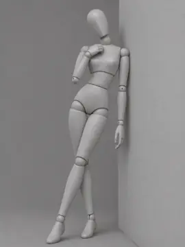 | <a href="https://promicat.app/poses/styles/sp051?utm_source=github&utm_medium=readme&utm_campaign=ai-photo-poses">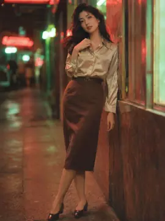</a> | <a href="https://promicat.app/poses/styles/sp051?utm_source=github&utm_medium=readme&utm_campaign=ai-photo-poses"></a> | <a href="https://promicat.app/poses/styles/sp051?utm_source=github&utm_medium=readme&utm_campaign=ai-photo-poses">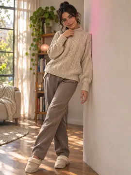</a> | <a href="https://promicat.app/poses/styles/sp051?utm_source=github&utm_medium=readme&utm_campaign=ai-photo-poses">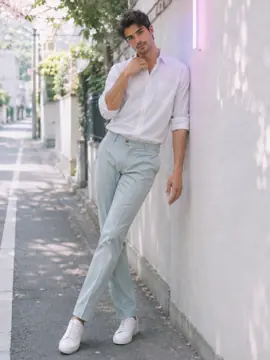</a> |

Full size: [photo](../images/photo-poses/hkretro/sp051-photo.webp) · [white model](../images/photo-poses/hkretro/sp051-pose.webp) · [try it on Promicat](https://promicat.app/poses/styles/sp051?utm_source=github&utm_medium=readme&utm_campaign=ai-photo-poses)

<details><summary>Prompt with your photo (image 1: your photo, image 2: white model)</summary>

```text
A real professional portrait photoshoot photo: a 1990s Hong Kong retro night photoshoot with neon signs, tungsten and green fluorescent light, CineStill 800T halation, 50mm f/1.4. Subject: the person in image 1 (keep their exact face, facial features, skin tone and hairstyle; do not beautify or swap the face), wearing a vintage satin shirt, a fitted retro dress or a loose blazer. Pose: leaning back against a neon-lit wall, head tilted, one hand at the collar, looking into the camera. Image 2 is a wooden artist's mannequin that shows only this body pose: copy it exactly (head, torso, arms, hands, legs, feet, which hand does what, the camera angle), but do not copy the mannequin itself: no wooden skin, no joints, no blank face. Natural, relaxed and unstiff, true skin texture. No text, no logo, no watermark. Portrait 3:4.
```

</details>

<details><summary>Prompt for the sample (fictional model)</summary>

```text
A real professional portrait photoshoot photo, the kind posted by a top portrait studio: a 1990s Hong Kong retro night photoshoot with neon signs, tungsten and green fluorescent light, CineStill 800T halation, 50mm f/1.4. Model: a beautiful Korean professional fashion model in her twenties with a naturally attractive face, styled hair and natural makeup, wearing a vintage satin shirt, a fitted retro dress or a loose blazer. The photographer directs the model into a natural, relaxed, unstiff pose that looks caught between moments: leaning back against a neon-lit wall, head tilted, one hand at the collar, looking into the camera. Asymmetric body, soft hands, flattering angle, true skin texture, refined but not plastic, fully clothed and modest. Full body or three-quarter body in frame, the whole pose clearly readable. No text, no logo, no watermark. Portrait 3:4.
```

</details>

## Walking under neon signs with a jacket over one shoulder (Walking)

| White model | HK retro neon | Gothic | Japanese fresh film | Y2K flash |
|---|---|---|---|---|
|  | <a href="https://promicat.app/poses/styles/sp052?utm_source=github&utm_medium=readme&utm_campaign=ai-photo-poses">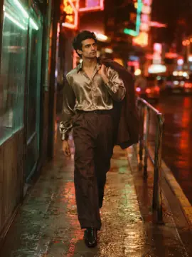</a> | <a href="https://promicat.app/poses/styles/sp052?utm_source=github&utm_medium=readme&utm_campaign=ai-photo-poses">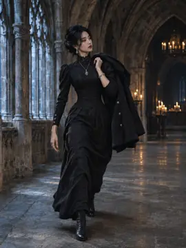</a> | <a href="https://promicat.app/poses/styles/sp052?utm_source=github&utm_medium=readme&utm_campaign=ai-photo-poses">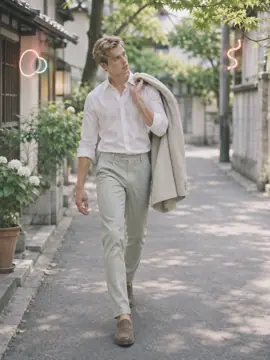</a> | <a href="https://promicat.app/poses/styles/sp052?utm_source=github&utm_medium=readme&utm_campaign=ai-photo-poses">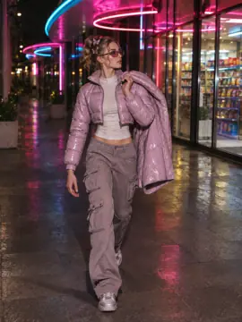</a> |

Full size: [photo](../images/photo-poses/hkretro/sp052-photo.webp) · [white model](../images/photo-poses/hkretro/sp052-pose.webp) · [try it on Promicat](https://promicat.app/poses/styles/sp052?utm_source=github&utm_medium=readme&utm_campaign=ai-photo-poses)

<details><summary>Prompt with your photo (image 1: your photo, image 2: white model)</summary>

```text
A real professional portrait photoshoot photo: a 1990s Hong Kong retro night photoshoot with neon signs, tungsten and green fluorescent light, CineStill 800T halation, 50mm f/1.4. Subject: the person in image 1 (keep their exact face, facial features, skin tone and hairstyle; do not beautify or swap the face), wearing a vintage satin shirt, a fitted retro dress or a loose blazer. Pose: walking under neon signs with a jacket over one shoulder, looking sideways. Image 2 is a wooden artist's mannequin that shows only this body pose: copy it exactly (head, torso, arms, hands, legs, feet, which hand does what, the camera angle), but do not copy the mannequin itself: no wooden skin, no joints, no blank face. Natural, relaxed and unstiff, true skin texture. No text, no logo, no watermark. Portrait 3:4.
```

</details>

<details><summary>Prompt for the sample (fictional model)</summary>

```text
A real professional portrait photoshoot photo, the kind posted by a top portrait studio: a 1990s Hong Kong retro night photoshoot with neon signs, tungsten and green fluorescent light, CineStill 800T halation, 50mm f/1.4. Model: a handsome South Asian professional male model in his twenties with a well-groomed look and styled hair, wearing a vintage satin shirt, a fitted retro dress or a loose blazer. The photographer directs the model into a natural, relaxed, unstiff pose that looks caught between moments: walking under neon signs with a jacket over one shoulder, looking sideways. Asymmetric body, soft hands, flattering angle, true skin texture, refined but not plastic, fully clothed and modest. Full body or three-quarter body in frame, the whole pose clearly readable. No text, no logo, no watermark. Portrait 3:4.
```

</details>

## Standing in a red phone booth with the receiver at the ear (Standing)

| White model | HK retro neon | Seaside holiday | Forest & flower field | 1950s Hollywood |
|---|---|---|---|---|
|  | <a href="https://promicat.app/poses/styles/sp053?utm_source=github&utm_medium=readme&utm_campaign=ai-photo-poses">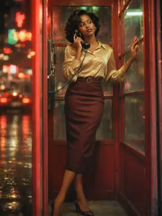</a> | <a href="https://promicat.app/poses/styles/sp053?utm_source=github&utm_medium=readme&utm_campaign=ai-photo-poses">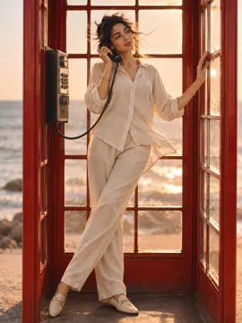</a> | <a href="https://promicat.app/poses/styles/sp053?utm_source=github&utm_medium=readme&utm_campaign=ai-photo-poses">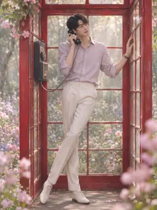</a> | <a href="https://promicat.app/poses/styles/sp053?utm_source=github&utm_medium=readme&utm_campaign=ai-photo-poses">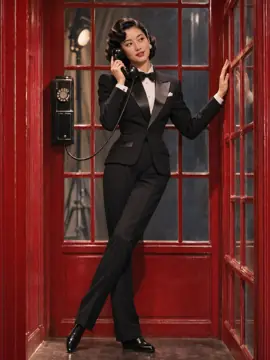</a> |

Full size: [photo](../images/photo-poses/hkretro/sp053-photo.webp) · [white model](../images/photo-poses/hkretro/sp053-pose.webp) · [try it on Promicat](https://promicat.app/poses/styles/sp053?utm_source=github&utm_medium=readme&utm_campaign=ai-photo-poses)

<details><summary>Prompt with your photo (image 1: your photo, image 2: white model)</summary>

```text
A real professional portrait photoshoot photo: a 1990s Hong Kong retro night photoshoot with neon signs, tungsten and green fluorescent light, CineStill 800T halation, 50mm f/1.4. Subject: the person in image 1 (keep their exact face, facial features, skin tone and hairstyle; do not beautify or swap the face), wearing a vintage satin shirt, a fitted retro dress or a loose blazer. Pose: standing in a red phone booth with the receiver at the ear, the other hand on the glass. Image 2 is a wooden artist's mannequin that shows only this body pose: copy it exactly (head, torso, arms, hands, legs, feet, which hand does what, the camera angle), but do not copy the mannequin itself: no wooden skin, no joints, no blank face. Natural, relaxed and unstiff, true skin texture. No text, no logo, no watermark. Portrait 3:4.
```

</details>

<details><summary>Prompt for the sample (fictional model)</summary>

```text
A real professional portrait photoshoot photo, the kind posted by a top portrait studio: a 1990s Hong Kong retro night photoshoot with neon signs, tungsten and green fluorescent light, CineStill 800T halation, 50mm f/1.4. Model: a beautiful East African professional fashion model in her twenties with a naturally attractive face, styled hair and natural makeup, wearing a vintage satin shirt, a fitted retro dress or a loose blazer. The photographer directs the model into a natural, relaxed, unstiff pose that looks caught between moments: standing in a red phone booth with the receiver at the ear, the other hand on the glass. Asymmetric body, soft hands, flattering angle, true skin texture, refined but not plastic, fully clothed and modest. Full body or three-quarter body in frame, the whole pose clearly readable. No text, no logo, no watermark. Portrait 3:4.
```

</details>

## Sitting in a cha chaan teng booth (Sitting)

| White model | HK retro neon | Cyberpunk neon | Dark academia | Y2K flash |
|---|---|---|---|---|
|  | <a href="https://promicat.app/poses/styles/sp054?utm_source=github&utm_medium=readme&utm_campaign=ai-photo-poses">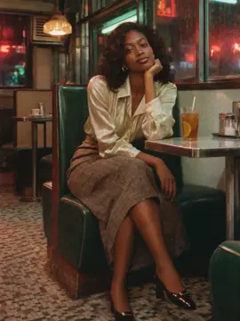</a> | <a href="https://promicat.app/poses/styles/sp054?utm_source=github&utm_medium=readme&utm_campaign=ai-photo-poses">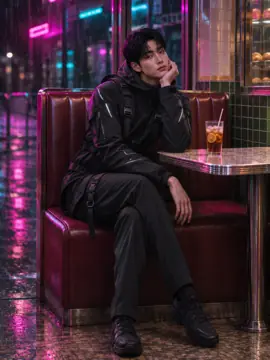</a> | <a href="https://promicat.app/poses/styles/sp054?utm_source=github&utm_medium=readme&utm_campaign=ai-photo-poses">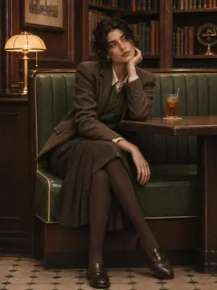</a> | <a href="https://promicat.app/poses/styles/sp054?utm_source=github&utm_medium=readme&utm_campaign=ai-photo-poses">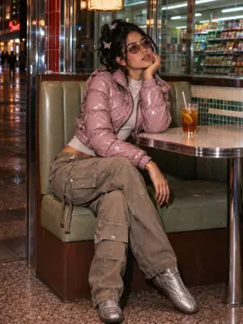</a> |

Full size: [photo](../images/photo-poses/hkretro/sp054-photo.webp) · [white model](../images/photo-poses/hkretro/sp054-pose.webp) · [try it on Promicat](https://promicat.app/poses/styles/sp054?utm_source=github&utm_medium=readme&utm_campaign=ai-photo-poses)

<details><summary>Prompt with your photo (image 1: your photo, image 2: white model)</summary>

```text
A real professional portrait photoshoot photo: a 1990s Hong Kong retro night photoshoot with neon signs, tungsten and green fluorescent light, CineStill 800T halation, 50mm f/1.4. Subject: the person in image 1 (keep their exact face, facial features, skin tone and hairstyle; do not beautify or swap the face), wearing a vintage satin shirt, a fitted retro dress or a loose blazer. Pose: sitting in a cha chaan teng booth, chin on the hand, a glass of iced tea in front. Image 2 is a wooden artist's mannequin that shows only this body pose: copy it exactly (head, torso, arms, hands, legs, feet, which hand does what, the camera angle), but do not copy the mannequin itself: no wooden skin, no joints, no blank face. Natural, relaxed and unstiff, true skin texture. No text, no logo, no watermark. Portrait 3:4.
```

</details>

<details><summary>Prompt for the sample (fictional model)</summary>

```text
A real professional portrait photoshoot photo, the kind posted by a top portrait studio: a 1990s Hong Kong retro night photoshoot with neon signs, tungsten and green fluorescent light, CineStill 800T halation, 50mm f/1.4. Model: a beautiful Black professional fashion model in her twenties with a naturally attractive face, styled hair and natural makeup, wearing a vintage satin shirt, a fitted retro dress or a loose blazer. The photographer directs the model into a natural, relaxed, unstiff pose that looks caught between moments: sitting in a cha chaan teng booth, chin on the hand, a glass of iced tea in front. Asymmetric body, soft hands, flattering angle, true skin texture, refined but not plastic, fully clothed and modest. Full body or three-quarter body in frame, the whole pose clearly readable. No text, no logo, no watermark. Portrait 3:4.
```

</details>

## Walking away down a wet street (Looking back)

| White model | HK retro neon | Boho desert | Forest & flower field | Moody studio |
|---|---|---|---|---|
|  | <a href="https://promicat.app/poses/styles/sp055?utm_source=github&utm_medium=readme&utm_campaign=ai-photo-poses">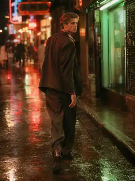</a> | <a href="https://promicat.app/poses/styles/sp055?utm_source=github&utm_medium=readme&utm_campaign=ai-photo-poses"></a> | <a href="https://promicat.app/poses/styles/sp055?utm_source=github&utm_medium=readme&utm_campaign=ai-photo-poses"></a> | <a href="https://promicat.app/poses/styles/sp055?utm_source=github&utm_medium=readme&utm_campaign=ai-photo-poses">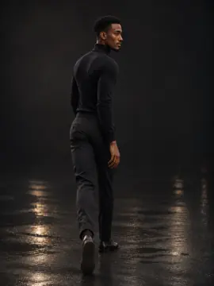</a> |

Full size: [photo](../images/photo-poses/hkretro/sp055-photo.webp) · [white model](../images/photo-poses/hkretro/sp055-pose.webp) · [try it on Promicat](https://promicat.app/poses/styles/sp055?utm_source=github&utm_medium=readme&utm_campaign=ai-photo-poses)

<details><summary>Prompt with your photo (image 1: your photo, image 2: white model)</summary>

```text
A real professional portrait photoshoot photo: a 1990s Hong Kong retro night photoshoot with neon signs, tungsten and green fluorescent light, CineStill 800T halation, 50mm f/1.4. Subject: the person in image 1 (keep their exact face, facial features, skin tone and hairstyle; do not beautify or swap the face), wearing a vintage satin shirt, a fitted retro dress or a loose blazer. Pose: walking away down a wet street, turning the face back over the shoulder. Image 2 is a wooden artist's mannequin that shows only this body pose: copy it exactly (head, torso, arms, hands, legs, feet, which hand does what, the camera angle), but do not copy the mannequin itself: no wooden skin, no joints, no blank face. Natural, relaxed and unstiff, true skin texture. No text, no logo, no watermark. Portrait 3:4.
```

</details>

<details><summary>Prompt for the sample (fictional model)</summary>

```text
A real professional portrait photoshoot photo, the kind posted by a top portrait studio: a 1990s Hong Kong retro night photoshoot with neon signs, tungsten and green fluorescent light, CineStill 800T halation, 50mm f/1.4. Model: a handsome Scandinavian professional male model in his twenties with a well-groomed look and styled hair, wearing a vintage satin shirt, a fitted retro dress or a loose blazer. The photographer directs the model into a natural, relaxed, unstiff pose that looks caught between moments: walking away down a wet street, turning the face back over the shoulder. Asymmetric body, soft hands, flattering angle, true skin texture, refined but not plastic, fully clothed and modest. Full body or three-quarter body in frame, the whole pose clearly readable. No text, no logo, no watermark. Portrait 3:4.
```

</details>

## Cupping both hands near the face as if shielding a match (Upper body)

| White model | HK retro neon | Seaside holiday | 1950s Hollywood | Nordic minimal |
|---|---|---|---|---|
|  | <a href="https://promicat.app/poses/styles/sp056?utm_source=github&utm_medium=readme&utm_campaign=ai-photo-poses">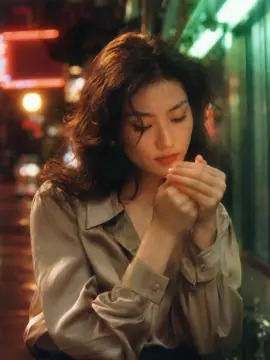</a> | <a href="https://promicat.app/poses/styles/sp056?utm_source=github&utm_medium=readme&utm_campaign=ai-photo-poses"></a> | <a href="https://promicat.app/poses/styles/sp056?utm_source=github&utm_medium=readme&utm_campaign=ai-photo-poses">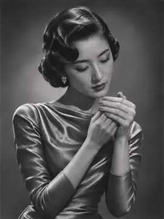</a> | <a href="https://promicat.app/poses/styles/sp056?utm_source=github&utm_medium=readme&utm_campaign=ai-photo-poses"></a> |

Full size: [photo](../images/photo-poses/hkretro/sp056-photo.webp) · [white model](../images/photo-poses/hkretro/sp056-pose.webp) · [try it on Promicat](https://promicat.app/poses/styles/sp056?utm_source=github&utm_medium=readme&utm_campaign=ai-photo-poses)

<details><summary>Prompt with your photo (image 1: your photo, image 2: white model)</summary>

```text
A real professional portrait photoshoot photo: a 1990s Hong Kong retro night photoshoot with neon signs, tungsten and green fluorescent light, CineStill 800T halation, 50mm f/1.4. Subject: the person in image 1 (keep their exact face, facial features, skin tone and hairstyle; do not beautify or swap the face), wearing a vintage satin shirt, a fitted retro dress or a loose blazer. Pose: cupping both hands near the face as if shielding a match, eyes down, no cigarette. Image 2 is a wooden artist's mannequin that shows only this body pose: copy it exactly (head, torso, arms, hands, legs, feet, which hand does what, the camera angle), but do not copy the mannequin itself: no wooden skin, no joints, no blank face. Natural, relaxed and unstiff, true skin texture. No text, no logo, no watermark. Portrait 3:4.
```

</details>

<details><summary>Prompt for the sample (fictional model)</summary>

```text
A real professional portrait photoshoot photo, the kind posted by a top portrait studio: a 1990s Hong Kong retro night photoshoot with neon signs, tungsten and green fluorescent light, CineStill 800T halation, 50mm f/1.4. Model: a beautiful East Asian professional fashion model in her twenties with a naturally attractive face, styled hair and natural makeup, wearing a vintage satin shirt, a fitted retro dress or a loose blazer. The photographer directs the model into a natural, relaxed, unstiff pose that looks caught between moments: cupping both hands near the face as if shielding a match, eyes down, no cigarette. Asymmetric body, soft hands, flattering angle, true skin texture, refined but not plastic, fully clothed and modest. Waist-up framing, both arms and hands readable. No text, no logo, no watermark. Portrait 3:4.
```

</details>

## Leaning on the roof of a red taxi with one forearm (Leaning)

| White model | HK retro neon | Cyberpunk neon | Cosy at home | Street fashion |
|---|---|---|---|---|
| 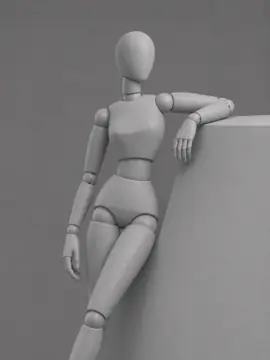 | <a href="https://promicat.app/poses/styles/sp057?utm_source=github&utm_medium=readme&utm_campaign=ai-photo-poses">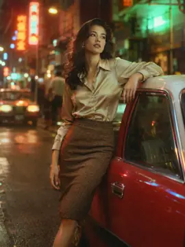</a> | <a href="https://promicat.app/poses/styles/sp057?utm_source=github&utm_medium=readme&utm_campaign=ai-photo-poses">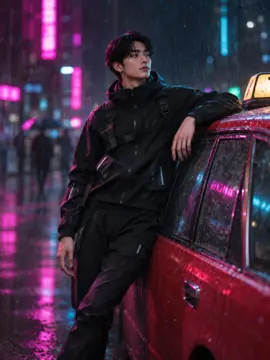</a> | <a href="https://promicat.app/poses/styles/sp057?utm_source=github&utm_medium=readme&utm_campaign=ai-photo-poses"></a> | <a href="https://promicat.app/poses/styles/sp057?utm_source=github&utm_medium=readme&utm_campaign=ai-photo-poses"></a> |

Full size: [photo](../images/photo-poses/hkretro/sp057-photo.webp) · [white model](../images/photo-poses/hkretro/sp057-pose.webp) · [try it on Promicat](https://promicat.app/poses/styles/sp057?utm_source=github&utm_medium=readme&utm_campaign=ai-photo-poses)

<details><summary>Prompt with your photo (image 1: your photo, image 2: white model)</summary>

```text
A real professional portrait photoshoot photo: a 1990s Hong Kong retro night photoshoot with neon signs, tungsten and green fluorescent light, CineStill 800T halation, 50mm f/1.4. Subject: the person in image 1 (keep their exact face, facial features, skin tone and hairstyle; do not beautify or swap the face), wearing a vintage satin shirt, a fitted retro dress or a loose blazer. Pose: leaning on the roof of a red taxi with one forearm, looking down the street. Image 2 is a wooden artist's mannequin that shows only this body pose: copy it exactly (head, torso, arms, hands, legs, feet, which hand does what, the camera angle), but do not copy the mannequin itself: no wooden skin, no joints, no blank face. Natural, relaxed and unstiff, true skin texture. No text, no logo, no watermark. Portrait 3:4.
```

</details>

<details><summary>Prompt for the sample (fictional model)</summary>

```text
A real professional portrait photoshoot photo, the kind posted by a top portrait studio: a 1990s Hong Kong retro night photoshoot with neon signs, tungsten and green fluorescent light, CineStill 800T halation, 50mm f/1.4. Model: a beautiful mixed-race professional fashion model in her twenties with a naturally attractive face, styled hair and natural makeup, wearing a vintage satin shirt, a fitted retro dress or a loose blazer. The photographer directs the model into a natural, relaxed, unstiff pose that looks caught between moments: leaning on the roof of a red taxi with one forearm, looking down the street. Asymmetric body, soft hands, flattering angle, true skin texture, refined but not plastic, fully clothed and modest. Full body or three-quarter body in frame, the whole pose clearly readable. No text, no logo, no watermark. Portrait 3:4.
```

</details>

## Sitting on a rooftop ledge with the city lights behind (Sitting)

| White model | HK retro neon | Campus youth | New Chinese style | Old money |
|---|---|---|---|---|
|  | <a href="https://promicat.app/poses/styles/sp058?utm_source=github&utm_medium=readme&utm_campaign=ai-photo-poses">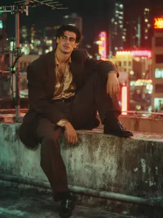</a> | <a href="https://promicat.app/poses/styles/sp058?utm_source=github&utm_medium=readme&utm_campaign=ai-photo-poses"></a> | <a href="https://promicat.app/poses/styles/sp058?utm_source=github&utm_medium=readme&utm_campaign=ai-photo-poses">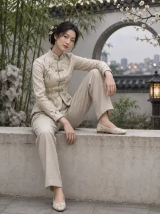</a> | <a href="https://promicat.app/poses/styles/sp058?utm_source=github&utm_medium=readme&utm_campaign=ai-photo-poses"></a> |

Full size: [photo](../images/photo-poses/hkretro/sp058-photo.webp) · [white model](../images/photo-poses/hkretro/sp058-pose.webp) · [try it on Promicat](https://promicat.app/poses/styles/sp058?utm_source=github&utm_medium=readme&utm_campaign=ai-photo-poses)

<details><summary>Prompt with your photo (image 1: your photo, image 2: white model)</summary>

```text
A real professional portrait photoshoot photo: a 1990s Hong Kong retro night photoshoot with neon signs, tungsten and green fluorescent light, CineStill 800T halation, 50mm f/1.4. Subject: the person in image 1 (keep their exact face, facial features, skin tone and hairstyle; do not beautify or swap the face), wearing a vintage satin shirt, a fitted retro dress or a loose blazer. Pose: sitting on a rooftop ledge with the city lights behind, one leg bent up. Image 2 is a wooden artist's mannequin that shows only this body pose: copy it exactly (head, torso, arms, hands, legs, feet, which hand does what, the camera angle), but do not copy the mannequin itself: no wooden skin, no joints, no blank face. Natural, relaxed and unstiff, true skin texture. No text, no logo, no watermark. Portrait 3:4.
```

</details>

<details><summary>Prompt for the sample (fictional model)</summary>

```text
A real professional portrait photoshoot photo, the kind posted by a top portrait studio: a 1990s Hong Kong retro night photoshoot with neon signs, tungsten and green fluorescent light, CineStill 800T halation, 50mm f/1.4. Model: a handsome Mediterranean professional male model in his twenties with a well-groomed look and styled hair, wearing a vintage satin shirt, a fitted retro dress or a loose blazer. The photographer directs the model into a natural, relaxed, unstiff pose that looks caught between moments: sitting on a rooftop ledge with the city lights behind, one leg bent up. Asymmetric body, soft hands, flattering angle, true skin texture, refined but not plastic, fully clothed and modest. Full body or three-quarter body in frame, the whole pose clearly readable. No text, no logo, no watermark. Portrait 3:4.
```

</details>

## Standing in a tiled stairwell under a green fluorescent light (Standing)

| White model | HK retro neon | Cafe & bookshop | Gothic | Western cowboy |
|---|---|---|---|---|
| 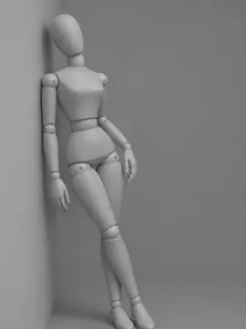 | <a href="https://promicat.app/poses/styles/sp059?utm_source=github&utm_medium=readme&utm_campaign=ai-photo-poses">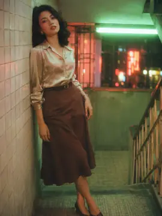</a> | <a href="https://promicat.app/poses/styles/sp059?utm_source=github&utm_medium=readme&utm_campaign=ai-photo-poses">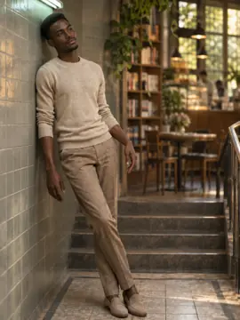</a> | <a href="https://promicat.app/poses/styles/sp059?utm_source=github&utm_medium=readme&utm_campaign=ai-photo-poses">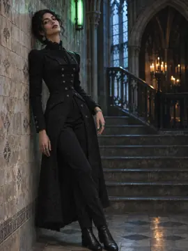</a> | <a href="https://promicat.app/poses/styles/sp059?utm_source=github&utm_medium=readme&utm_campaign=ai-photo-poses">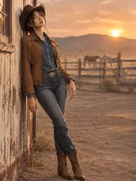</a> |

Full size: [photo](../images/photo-poses/hkretro/sp059-photo.webp) · [white model](../images/photo-poses/hkretro/sp059-pose.webp) · [try it on Promicat](https://promicat.app/poses/styles/sp059?utm_source=github&utm_medium=readme&utm_campaign=ai-photo-poses)

<details><summary>Prompt with your photo (image 1: your photo, image 2: white model)</summary>

```text
A real professional portrait photoshoot photo: a 1990s Hong Kong retro night photoshoot with neon signs, tungsten and green fluorescent light, CineStill 800T halation, 50mm f/1.4. Subject: the person in image 1 (keep their exact face, facial features, skin tone and hairstyle; do not beautify or swap the face), wearing a vintage satin shirt, a fitted retro dress or a loose blazer. Pose: standing in a tiled stairwell under a green fluorescent light, head back against the wall. Image 2 is a wooden artist's mannequin that shows only this body pose: copy it exactly (head, torso, arms, hands, legs, feet, which hand does what, the camera angle), but do not copy the mannequin itself: no wooden skin, no joints, no blank face. Natural, relaxed and unstiff, true skin texture. No text, no logo, no watermark. Portrait 3:4.
```

</details>

<details><summary>Prompt for the sample (fictional model)</summary>

```text
A real professional portrait photoshoot photo, the kind posted by a top portrait studio: a 1990s Hong Kong retro night photoshoot with neon signs, tungsten and green fluorescent light, CineStill 800T halation, 50mm f/1.4. Model: a beautiful Southeast Asian professional fashion model in her twenties with a naturally attractive face, styled hair and natural makeup, wearing a vintage satin shirt, a fitted retro dress or a loose blazer. The photographer directs the model into a natural, relaxed, unstiff pose that looks caught between moments: standing in a tiled stairwell under a green fluorescent light, head back against the wall. Asymmetric body, soft hands, flattering angle, true skin texture, refined but not plastic, fully clothed and modest. Full body or three-quarter body in frame, the whole pose clearly readable. No text, no logo, no watermark. Portrait 3:4.
```

</details>

## Standing in the rain under a transparent umbrella (Standing)

| White model | HK retro neon | Japanese fresh film | Nordic minimal | Street punk |
|---|---|---|---|---|
|  | <a href="https://promicat.app/poses/styles/sp060?utm_source=github&utm_medium=readme&utm_campaign=ai-photo-poses">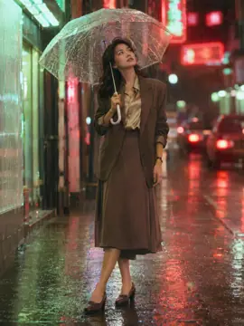</a> | <a href="https://promicat.app/poses/styles/sp060?utm_source=github&utm_medium=readme&utm_campaign=ai-photo-poses">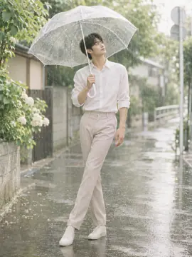</a> | <a href="https://promicat.app/poses/styles/sp060?utm_source=github&utm_medium=readme&utm_campaign=ai-photo-poses">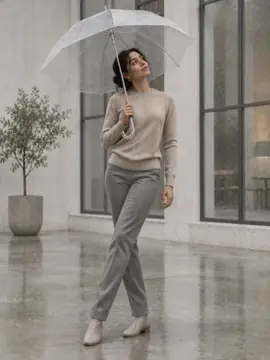</a> | <a href="https://promicat.app/poses/styles/sp060?utm_source=github&utm_medium=readme&utm_campaign=ai-photo-poses">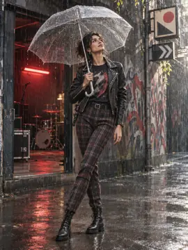</a> |

Full size: [photo](../images/photo-poses/hkretro/sp060-photo.webp) · [white model](../images/photo-poses/hkretro/sp060-pose.webp) · [try it on Promicat](https://promicat.app/poses/styles/sp060?utm_source=github&utm_medium=readme&utm_campaign=ai-photo-poses)

<details><summary>Prompt with your photo (image 1: your photo, image 2: white model)</summary>

```text
A real professional portrait photoshoot photo: a 1990s Hong Kong retro night photoshoot with neon signs, tungsten and green fluorescent light, CineStill 800T halation, 50mm f/1.4. Subject: the person in image 1 (keep their exact face, facial features, skin tone and hairstyle; do not beautify or swap the face), wearing a vintage satin shirt, a fitted retro dress or a loose blazer. Pose: standing in the rain under a transparent umbrella, looking up at the signs. Image 2 is a wooden artist's mannequin that shows only this body pose: copy it exactly (head, torso, arms, hands, legs, feet, which hand does what, the camera angle), but do not copy the mannequin itself: no wooden skin, no joints, no blank face. Natural, relaxed and unstiff, true skin texture. No text, no logo, no watermark. Portrait 3:4.
```

</details>

<details><summary>Prompt for the sample (fictional model)</summary>

```text
A real professional portrait photoshoot photo, the kind posted by a top portrait studio: a 1990s Hong Kong retro night photoshoot with neon signs, tungsten and green fluorescent light, CineStill 800T halation, 50mm f/1.4. Model: a beautiful Japanese professional fashion model in her twenties with a naturally attractive face, styled hair and natural makeup, wearing a vintage satin shirt, a fitted retro dress or a loose blazer. The photographer directs the model into a natural, relaxed, unstiff pose that looks caught between moments: standing in the rain under a transparent umbrella, looking up at the signs. Asymmetric body, soft hands, flattering angle, true skin texture, refined but not plastic, fully clothed and modest. Full body or three-quarter body in frame, the whole pose clearly readable. No text, no logo, no watermark. Portrait 3:4.
```

</details>
