# 港风复古

[English](hkretro.md) · 简体中文

10 个白模，每个配 4 张用它拍出的不同风格写真。参考图顺序是你的照片在前、白模在后。也可以在 [Promicat](https://promicat.app/zh/poses?utm_source=github&utm_medium=readme&utm_campaign=ai-photo-poses) 上传照片直接生成。

[← 返回全部风格](../README.zh-CN.md#photo-poses)

## 靠霓虹墙 (靠)

| 白模 | 港风复古 | 波西米亚 | 居家慵懒 | 日系清新 |
|---|---|---|---|---|
| 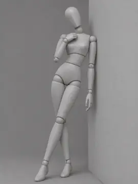 | <a href="https://promicat.app/zh/poses/styles/sp051?utm_source=github&utm_medium=readme&utm_campaign=ai-photo-poses">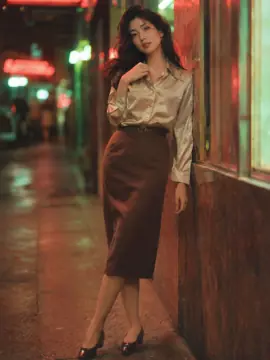</a> | <a href="https://promicat.app/zh/poses/styles/sp051?utm_source=github&utm_medium=readme&utm_campaign=ai-photo-poses"></a> | <a href="https://promicat.app/zh/poses/styles/sp051?utm_source=github&utm_medium=readme&utm_campaign=ai-photo-poses">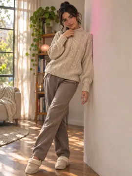</a> | <a href="https://promicat.app/zh/poses/styles/sp051?utm_source=github&utm_medium=readme&utm_campaign=ai-photo-poses">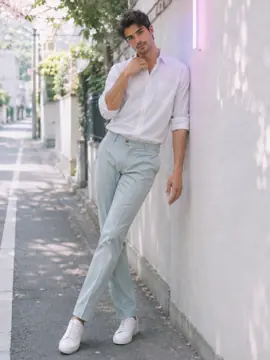</a> |

大图: [写真照](../images/photo-poses/hkretro/sp051-photo.webp) · [白模](../images/photo-poses/hkretro/sp051-pose.webp) · [在 Promicat 生成](https://promicat.app/zh/poses/styles/sp051?utm_source=github&utm_medium=readme&utm_campaign=ai-photo-poses)

<details><summary>提示词：用你的照片（图 1 你的照片，图 2 白模）</summary>

```text
A real professional portrait photoshoot photo: a 1990s Hong Kong retro night photoshoot with neon signs, tungsten and green fluorescent light, CineStill 800T halation, 50mm f/1.4. Subject: the person in image 1 (keep their exact face, facial features, skin tone and hairstyle; do not beautify or swap the face), wearing a vintage satin shirt, a fitted retro dress or a loose blazer. Pose: leaning back against a neon-lit wall, head tilted, one hand at the collar, looking into the camera. Image 2 is a wooden artist's mannequin that shows only this body pose: copy it exactly (head, torso, arms, hands, legs, feet, which hand does what, the camera angle), but do not copy the mannequin itself: no wooden skin, no joints, no blank face. Natural, relaxed and unstiff, true skin texture. No text, no logo, no watermark. Portrait 3:4.
```

</details>

<details><summary>提示词：生成示例图（虚构模特）</summary>

```text
A real professional portrait photoshoot photo, the kind posted by a top portrait studio: a 1990s Hong Kong retro night photoshoot with neon signs, tungsten and green fluorescent light, CineStill 800T halation, 50mm f/1.4. Model: a beautiful Korean professional fashion model in her twenties with a naturally attractive face, styled hair and natural makeup, wearing a vintage satin shirt, a fitted retro dress or a loose blazer. The photographer directs the model into a natural, relaxed, unstiff pose that looks caught between moments: leaning back against a neon-lit wall, head tilted, one hand at the collar, looking into the camera. Asymmetric body, soft hands, flattering angle, true skin texture, refined but not plastic, fully clothed and modest. Full body or three-quarter body in frame, the whole pose clearly readable. No text, no logo, no watermark. Portrait 3:4.
```

</details>

## 外套搭肩走 (走)

| 白模 | 港风复古 | 暗黑哥特 | 日系清新 | Y2K 千禧辣妹 |
|---|---|---|---|---|
| 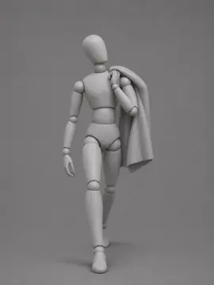 | <a href="https://promicat.app/zh/poses/styles/sp052?utm_source=github&utm_medium=readme&utm_campaign=ai-photo-poses">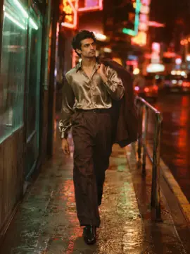</a> | <a href="https://promicat.app/zh/poses/styles/sp052?utm_source=github&utm_medium=readme&utm_campaign=ai-photo-poses">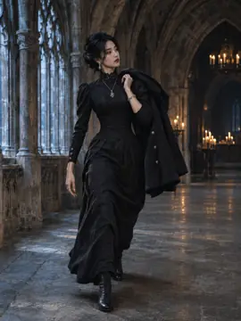</a> | <a href="https://promicat.app/zh/poses/styles/sp052?utm_source=github&utm_medium=readme&utm_campaign=ai-photo-poses">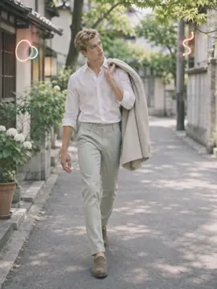</a> | <a href="https://promicat.app/zh/poses/styles/sp052?utm_source=github&utm_medium=readme&utm_campaign=ai-photo-poses">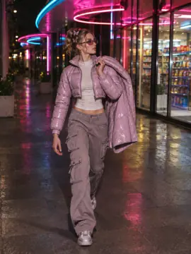</a> |

大图: [写真照](../images/photo-poses/hkretro/sp052-photo.webp) · [白模](../images/photo-poses/hkretro/sp052-pose.webp) · [在 Promicat 生成](https://promicat.app/zh/poses/styles/sp052?utm_source=github&utm_medium=readme&utm_campaign=ai-photo-poses)

<details><summary>提示词：用你的照片（图 1 你的照片，图 2 白模）</summary>

```text
A real professional portrait photoshoot photo: a 1990s Hong Kong retro night photoshoot with neon signs, tungsten and green fluorescent light, CineStill 800T halation, 50mm f/1.4. Subject: the person in image 1 (keep their exact face, facial features, skin tone and hairstyle; do not beautify or swap the face), wearing a vintage satin shirt, a fitted retro dress or a loose blazer. Pose: walking under neon signs with a jacket over one shoulder, looking sideways. Image 2 is a wooden artist's mannequin that shows only this body pose: copy it exactly (head, torso, arms, hands, legs, feet, which hand does what, the camera angle), but do not copy the mannequin itself: no wooden skin, no joints, no blank face. Natural, relaxed and unstiff, true skin texture. No text, no logo, no watermark. Portrait 3:4.
```

</details>

<details><summary>提示词：生成示例图（虚构模特）</summary>

```text
A real professional portrait photoshoot photo, the kind posted by a top portrait studio: a 1990s Hong Kong retro night photoshoot with neon signs, tungsten and green fluorescent light, CineStill 800T halation, 50mm f/1.4. Model: a handsome South Asian professional male model in his twenties with a well-groomed look and styled hair, wearing a vintage satin shirt, a fitted retro dress or a loose blazer. The photographer directs the model into a natural, relaxed, unstiff pose that looks caught between moments: walking under neon signs with a jacket over one shoulder, looking sideways. Asymmetric body, soft hands, flattering angle, true skin texture, refined but not plastic, fully clothed and modest. Full body or three-quarter body in frame, the whole pose clearly readable. No text, no logo, no watermark. Portrait 3:4.
```

</details>

## 电话亭打电话 (站)

| 白模 | 港风复古 | 海边度假 | 森系花田 | 好莱坞复古 |
|---|---|---|---|---|
| 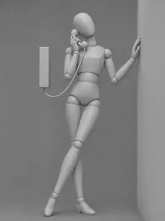 | <a href="https://promicat.app/zh/poses/styles/sp053?utm_source=github&utm_medium=readme&utm_campaign=ai-photo-poses"></a> | <a href="https://promicat.app/zh/poses/styles/sp053?utm_source=github&utm_medium=readme&utm_campaign=ai-photo-poses">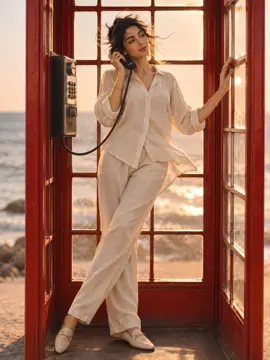</a> | <a href="https://promicat.app/zh/poses/styles/sp053?utm_source=github&utm_medium=readme&utm_campaign=ai-photo-poses">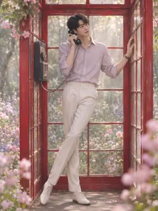</a> | <a href="https://promicat.app/zh/poses/styles/sp053?utm_source=github&utm_medium=readme&utm_campaign=ai-photo-poses">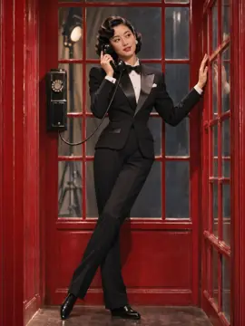</a> |

大图: [写真照](../images/photo-poses/hkretro/sp053-photo.webp) · [白模](../images/photo-poses/hkretro/sp053-pose.webp) · [在 Promicat 生成](https://promicat.app/zh/poses/styles/sp053?utm_source=github&utm_medium=readme&utm_campaign=ai-photo-poses)

<details><summary>提示词：用你的照片（图 1 你的照片，图 2 白模）</summary>

```text
A real professional portrait photoshoot photo: a 1990s Hong Kong retro night photoshoot with neon signs, tungsten and green fluorescent light, CineStill 800T halation, 50mm f/1.4. Subject: the person in image 1 (keep their exact face, facial features, skin tone and hairstyle; do not beautify or swap the face), wearing a vintage satin shirt, a fitted retro dress or a loose blazer. Pose: standing in a red phone booth with the receiver at the ear, the other hand on the glass. Image 2 is a wooden artist's mannequin that shows only this body pose: copy it exactly (head, torso, arms, hands, legs, feet, which hand does what, the camera angle), but do not copy the mannequin itself: no wooden skin, no joints, no blank face. Natural, relaxed and unstiff, true skin texture. No text, no logo, no watermark. Portrait 3:4.
```

</details>

<details><summary>提示词：生成示例图（虚构模特）</summary>

```text
A real professional portrait photoshoot photo, the kind posted by a top portrait studio: a 1990s Hong Kong retro night photoshoot with neon signs, tungsten and green fluorescent light, CineStill 800T halation, 50mm f/1.4. Model: a beautiful East African professional fashion model in her twenties with a naturally attractive face, styled hair and natural makeup, wearing a vintage satin shirt, a fitted retro dress or a loose blazer. The photographer directs the model into a natural, relaxed, unstiff pose that looks caught between moments: standing in a red phone booth with the receiver at the ear, the other hand on the glass. Asymmetric body, soft hands, flattering angle, true skin texture, refined but not plastic, fully clothed and modest. Full body or three-quarter body in frame, the whole pose clearly readable. No text, no logo, no watermark. Portrait 3:4.
```

</details>

## 茶餐厅托腮 (坐)

| 白模 | 港风复古 | 赛博霓虹 | 学院风 | Y2K 千禧辣妹 |
|---|---|---|---|---|
| 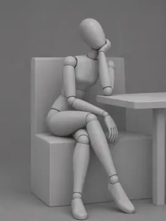 | <a href="https://promicat.app/zh/poses/styles/sp054?utm_source=github&utm_medium=readme&utm_campaign=ai-photo-poses">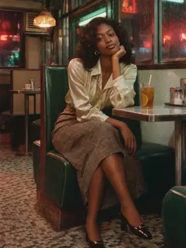</a> | <a href="https://promicat.app/zh/poses/styles/sp054?utm_source=github&utm_medium=readme&utm_campaign=ai-photo-poses">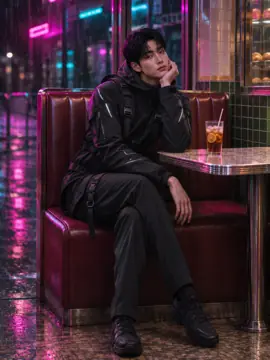</a> | <a href="https://promicat.app/zh/poses/styles/sp054?utm_source=github&utm_medium=readme&utm_campaign=ai-photo-poses">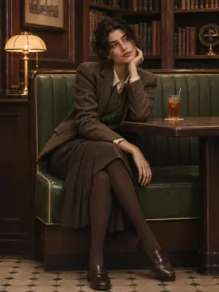</a> | <a href="https://promicat.app/zh/poses/styles/sp054?utm_source=github&utm_medium=readme&utm_campaign=ai-photo-poses">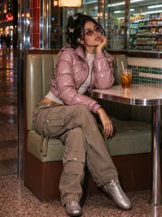</a> |

大图: [写真照](../images/photo-poses/hkretro/sp054-photo.webp) · [白模](../images/photo-poses/hkretro/sp054-pose.webp) · [在 Promicat 生成](https://promicat.app/zh/poses/styles/sp054?utm_source=github&utm_medium=readme&utm_campaign=ai-photo-poses)

<details><summary>提示词：用你的照片（图 1 你的照片，图 2 白模）</summary>

```text
A real professional portrait photoshoot photo: a 1990s Hong Kong retro night photoshoot with neon signs, tungsten and green fluorescent light, CineStill 800T halation, 50mm f/1.4. Subject: the person in image 1 (keep their exact face, facial features, skin tone and hairstyle; do not beautify or swap the face), wearing a vintage satin shirt, a fitted retro dress or a loose blazer. Pose: sitting in a cha chaan teng booth, chin on the hand, a glass of iced tea in front. Image 2 is a wooden artist's mannequin that shows only this body pose: copy it exactly (head, torso, arms, hands, legs, feet, which hand does what, the camera angle), but do not copy the mannequin itself: no wooden skin, no joints, no blank face. Natural, relaxed and unstiff, true skin texture. No text, no logo, no watermark. Portrait 3:4.
```

</details>

<details><summary>提示词：生成示例图（虚构模特）</summary>

```text
A real professional portrait photoshoot photo, the kind posted by a top portrait studio: a 1990s Hong Kong retro night photoshoot with neon signs, tungsten and green fluorescent light, CineStill 800T halation, 50mm f/1.4. Model: a beautiful Black professional fashion model in her twenties with a naturally attractive face, styled hair and natural makeup, wearing a vintage satin shirt, a fitted retro dress or a loose blazer. The photographer directs the model into a natural, relaxed, unstiff pose that looks caught between moments: sitting in a cha chaan teng booth, chin on the hand, a glass of iced tea in front. Asymmetric body, soft hands, flattering angle, true skin texture, refined but not plastic, fully clothed and modest. Full body or three-quarter body in frame, the whole pose clearly readable. No text, no logo, no watermark. Portrait 3:4.
```

</details>

## 回头望镜 (回眸)

| 白模 | 港风复古 | 波西米亚 | 森系花田 | 情绪棚拍 |
|---|---|---|---|---|
| 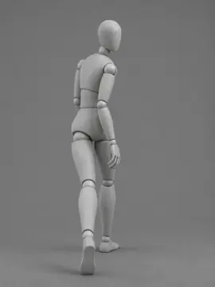 | <a href="https://promicat.app/zh/poses/styles/sp055?utm_source=github&utm_medium=readme&utm_campaign=ai-photo-poses">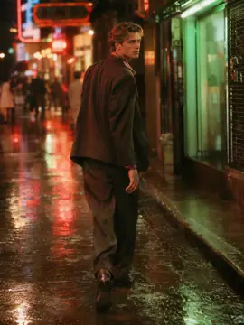</a> | <a href="https://promicat.app/zh/poses/styles/sp055?utm_source=github&utm_medium=readme&utm_campaign=ai-photo-poses"></a> | <a href="https://promicat.app/zh/poses/styles/sp055?utm_source=github&utm_medium=readme&utm_campaign=ai-photo-poses">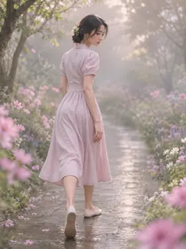</a> | <a href="https://promicat.app/zh/poses/styles/sp055?utm_source=github&utm_medium=readme&utm_campaign=ai-photo-poses">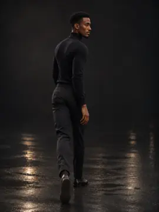</a> |

大图: [写真照](../images/photo-poses/hkretro/sp055-photo.webp) · [白模](../images/photo-poses/hkretro/sp055-pose.webp) · [在 Promicat 生成](https://promicat.app/zh/poses/styles/sp055?utm_source=github&utm_medium=readme&utm_campaign=ai-photo-poses)

<details><summary>提示词：用你的照片（图 1 你的照片，图 2 白模）</summary>

```text
A real professional portrait photoshoot photo: a 1990s Hong Kong retro night photoshoot with neon signs, tungsten and green fluorescent light, CineStill 800T halation, 50mm f/1.4. Subject: the person in image 1 (keep their exact face, facial features, skin tone and hairstyle; do not beautify or swap the face), wearing a vintage satin shirt, a fitted retro dress or a loose blazer. Pose: walking away down a wet street, turning the face back over the shoulder. Image 2 is a wooden artist's mannequin that shows only this body pose: copy it exactly (head, torso, arms, hands, legs, feet, which hand does what, the camera angle), but do not copy the mannequin itself: no wooden skin, no joints, no blank face. Natural, relaxed and unstiff, true skin texture. No text, no logo, no watermark. Portrait 3:4.
```

</details>

<details><summary>提示词：生成示例图（虚构模特）</summary>

```text
A real professional portrait photoshoot photo, the kind posted by a top portrait studio: a 1990s Hong Kong retro night photoshoot with neon signs, tungsten and green fluorescent light, CineStill 800T halation, 50mm f/1.4. Model: a handsome Scandinavian professional male model in his twenties with a well-groomed look and styled hair, wearing a vintage satin shirt, a fitted retro dress or a loose blazer. The photographer directs the model into a natural, relaxed, unstiff pose that looks caught between moments: walking away down a wet street, turning the face back over the shoulder. Asymmetric body, soft hands, flattering angle, true skin texture, refined but not plastic, fully clothed and modest. Full body or three-quarter body in frame, the whole pose clearly readable. No text, no logo, no watermark. Portrait 3:4.
```

</details>

## 点烟姿势无烟 (半身)

| 白模 | 港风复古 | 海边度假 | 好莱坞复古 | 北欧极简 |
|---|---|---|---|---|
| 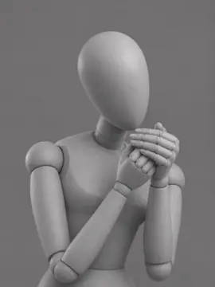 | <a href="https://promicat.app/zh/poses/styles/sp056?utm_source=github&utm_medium=readme&utm_campaign=ai-photo-poses">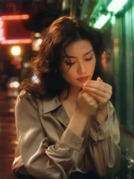</a> | <a href="https://promicat.app/zh/poses/styles/sp056?utm_source=github&utm_medium=readme&utm_campaign=ai-photo-poses"></a> | <a href="https://promicat.app/zh/poses/styles/sp056?utm_source=github&utm_medium=readme&utm_campaign=ai-photo-poses">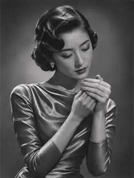</a> | <a href="https://promicat.app/zh/poses/styles/sp056?utm_source=github&utm_medium=readme&utm_campaign=ai-photo-poses"></a> |

大图: [写真照](../images/photo-poses/hkretro/sp056-photo.webp) · [白模](../images/photo-poses/hkretro/sp056-pose.webp) · [在 Promicat 生成](https://promicat.app/zh/poses/styles/sp056?utm_source=github&utm_medium=readme&utm_campaign=ai-photo-poses)

<details><summary>提示词：用你的照片（图 1 你的照片，图 2 白模）</summary>

```text
A real professional portrait photoshoot photo: a 1990s Hong Kong retro night photoshoot with neon signs, tungsten and green fluorescent light, CineStill 800T halation, 50mm f/1.4. Subject: the person in image 1 (keep their exact face, facial features, skin tone and hairstyle; do not beautify or swap the face), wearing a vintage satin shirt, a fitted retro dress or a loose blazer. Pose: cupping both hands near the face as if shielding a match, eyes down, no cigarette. Image 2 is a wooden artist's mannequin that shows only this body pose: copy it exactly (head, torso, arms, hands, legs, feet, which hand does what, the camera angle), but do not copy the mannequin itself: no wooden skin, no joints, no blank face. Natural, relaxed and unstiff, true skin texture. No text, no logo, no watermark. Portrait 3:4.
```

</details>

<details><summary>提示词：生成示例图（虚构模特）</summary>

```text
A real professional portrait photoshoot photo, the kind posted by a top portrait studio: a 1990s Hong Kong retro night photoshoot with neon signs, tungsten and green fluorescent light, CineStill 800T halation, 50mm f/1.4. Model: a beautiful East Asian professional fashion model in her twenties with a naturally attractive face, styled hair and natural makeup, wearing a vintage satin shirt, a fitted retro dress or a loose blazer. The photographer directs the model into a natural, relaxed, unstiff pose that looks caught between moments: cupping both hands near the face as if shielding a match, eyes down, no cigarette. Asymmetric body, soft hands, flattering angle, true skin texture, refined but not plastic, fully clothed and modest. Waist-up framing, both arms and hands readable. No text, no logo, no watermark. Portrait 3:4.
```

</details>

## 倚出租车 (靠)

| 白模 | 港风复古 | 赛博霓虹 | 居家慵懒 | 街拍时尚 |
|---|---|---|---|---|
| 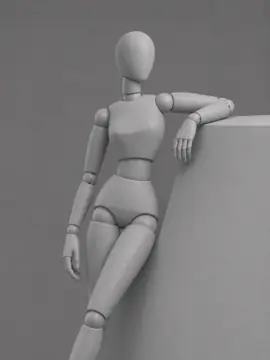 | <a href="https://promicat.app/zh/poses/styles/sp057?utm_source=github&utm_medium=readme&utm_campaign=ai-photo-poses">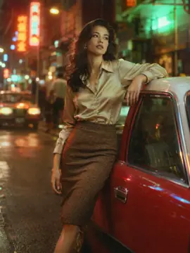</a> | <a href="https://promicat.app/zh/poses/styles/sp057?utm_source=github&utm_medium=readme&utm_campaign=ai-photo-poses">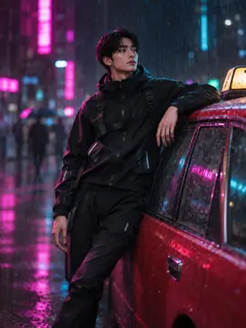</a> | <a href="https://promicat.app/zh/poses/styles/sp057?utm_source=github&utm_medium=readme&utm_campaign=ai-photo-poses"></a> | <a href="https://promicat.app/zh/poses/styles/sp057?utm_source=github&utm_medium=readme&utm_campaign=ai-photo-poses">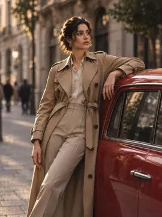</a> |

大图: [写真照](../images/photo-poses/hkretro/sp057-photo.webp) · [白模](../images/photo-poses/hkretro/sp057-pose.webp) · [在 Promicat 生成](https://promicat.app/zh/poses/styles/sp057?utm_source=github&utm_medium=readme&utm_campaign=ai-photo-poses)

<details><summary>提示词：用你的照片（图 1 你的照片，图 2 白模）</summary>

```text
A real professional portrait photoshoot photo: a 1990s Hong Kong retro night photoshoot with neon signs, tungsten and green fluorescent light, CineStill 800T halation, 50mm f/1.4. Subject: the person in image 1 (keep their exact face, facial features, skin tone and hairstyle; do not beautify or swap the face), wearing a vintage satin shirt, a fitted retro dress or a loose blazer. Pose: leaning on the roof of a red taxi with one forearm, looking down the street. Image 2 is a wooden artist's mannequin that shows only this body pose: copy it exactly (head, torso, arms, hands, legs, feet, which hand does what, the camera angle), but do not copy the mannequin itself: no wooden skin, no joints, no blank face. Natural, relaxed and unstiff, true skin texture. No text, no logo, no watermark. Portrait 3:4.
```

</details>

<details><summary>提示词：生成示例图（虚构模特）</summary>

```text
A real professional portrait photoshoot photo, the kind posted by a top portrait studio: a 1990s Hong Kong retro night photoshoot with neon signs, tungsten and green fluorescent light, CineStill 800T halation, 50mm f/1.4. Model: a beautiful mixed-race professional fashion model in her twenties with a naturally attractive face, styled hair and natural makeup, wearing a vintage satin shirt, a fitted retro dress or a loose blazer. The photographer directs the model into a natural, relaxed, unstiff pose that looks caught between moments: leaning on the roof of a red taxi with one forearm, looking down the street. Asymmetric body, soft hands, flattering angle, true skin texture, refined but not plastic, fully clothed and modest. Full body or three-quarter body in frame, the whole pose clearly readable. No text, no logo, no watermark. Portrait 3:4.
```

</details>

## 天台坐边 (坐)

| 白模 | 港风复古 | 校园青春 | 新中式 | 老钱风 |
|---|---|---|---|---|
| 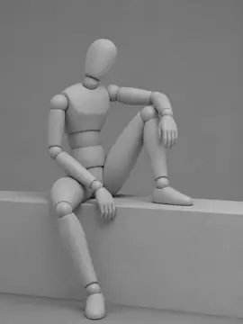 | <a href="https://promicat.app/zh/poses/styles/sp058?utm_source=github&utm_medium=readme&utm_campaign=ai-photo-poses">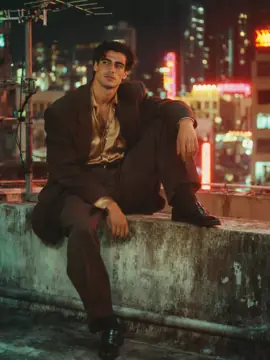</a> | <a href="https://promicat.app/zh/poses/styles/sp058?utm_source=github&utm_medium=readme&utm_campaign=ai-photo-poses"></a> | <a href="https://promicat.app/zh/poses/styles/sp058?utm_source=github&utm_medium=readme&utm_campaign=ai-photo-poses">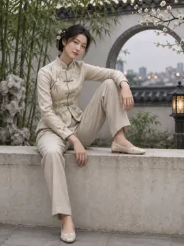</a> | <a href="https://promicat.app/zh/poses/styles/sp058?utm_source=github&utm_medium=readme&utm_campaign=ai-photo-poses"></a> |

大图: [写真照](../images/photo-poses/hkretro/sp058-photo.webp) · [白模](../images/photo-poses/hkretro/sp058-pose.webp) · [在 Promicat 生成](https://promicat.app/zh/poses/styles/sp058?utm_source=github&utm_medium=readme&utm_campaign=ai-photo-poses)

<details><summary>提示词：用你的照片（图 1 你的照片，图 2 白模）</summary>

```text
A real professional portrait photoshoot photo: a 1990s Hong Kong retro night photoshoot with neon signs, tungsten and green fluorescent light, CineStill 800T halation, 50mm f/1.4. Subject: the person in image 1 (keep their exact face, facial features, skin tone and hairstyle; do not beautify or swap the face), wearing a vintage satin shirt, a fitted retro dress or a loose blazer. Pose: sitting on a rooftop ledge with the city lights behind, one leg bent up. Image 2 is a wooden artist's mannequin that shows only this body pose: copy it exactly (head, torso, arms, hands, legs, feet, which hand does what, the camera angle), but do not copy the mannequin itself: no wooden skin, no joints, no blank face. Natural, relaxed and unstiff, true skin texture. No text, no logo, no watermark. Portrait 3:4.
```

</details>

<details><summary>提示词：生成示例图（虚构模特）</summary>

```text
A real professional portrait photoshoot photo, the kind posted by a top portrait studio: a 1990s Hong Kong retro night photoshoot with neon signs, tungsten and green fluorescent light, CineStill 800T halation, 50mm f/1.4. Model: a handsome Mediterranean professional male model in his twenties with a well-groomed look and styled hair, wearing a vintage satin shirt, a fitted retro dress or a loose blazer. The photographer directs the model into a natural, relaxed, unstiff pose that looks caught between moments: sitting on a rooftop ledge with the city lights behind, one leg bent up. Asymmetric body, soft hands, flattering angle, true skin texture, refined but not plastic, fully clothed and modest. Full body or three-quarter body in frame, the whole pose clearly readable. No text, no logo, no watermark. Portrait 3:4.
```

</details>

## 楼梯间仰头 (站)

| 白模 | 港风复古 | 咖啡馆文艺 | 暗黑哥特 | 西部牛仔 |
|---|---|---|---|---|
| 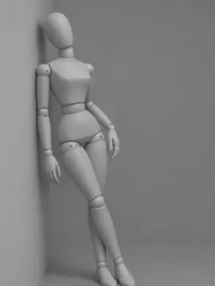 | <a href="https://promicat.app/zh/poses/styles/sp059?utm_source=github&utm_medium=readme&utm_campaign=ai-photo-poses">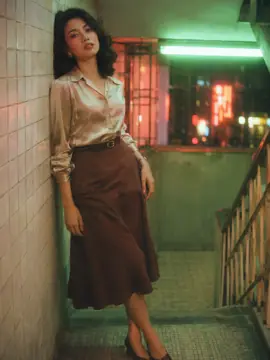</a> | <a href="https://promicat.app/zh/poses/styles/sp059?utm_source=github&utm_medium=readme&utm_campaign=ai-photo-poses">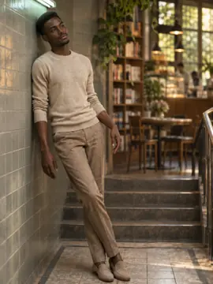</a> | <a href="https://promicat.app/zh/poses/styles/sp059?utm_source=github&utm_medium=readme&utm_campaign=ai-photo-poses">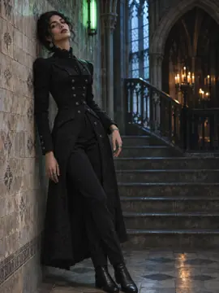</a> | <a href="https://promicat.app/zh/poses/styles/sp059?utm_source=github&utm_medium=readme&utm_campaign=ai-photo-poses"></a> |

大图: [写真照](../images/photo-poses/hkretro/sp059-photo.webp) · [白模](../images/photo-poses/hkretro/sp059-pose.webp) · [在 Promicat 生成](https://promicat.app/zh/poses/styles/sp059?utm_source=github&utm_medium=readme&utm_campaign=ai-photo-poses)

<details><summary>提示词：用你的照片（图 1 你的照片，图 2 白模）</summary>

```text
A real professional portrait photoshoot photo: a 1990s Hong Kong retro night photoshoot with neon signs, tungsten and green fluorescent light, CineStill 800T halation, 50mm f/1.4. Subject: the person in image 1 (keep their exact face, facial features, skin tone and hairstyle; do not beautify or swap the face), wearing a vintage satin shirt, a fitted retro dress or a loose blazer. Pose: standing in a tiled stairwell under a green fluorescent light, head back against the wall. Image 2 is a wooden artist's mannequin that shows only this body pose: copy it exactly (head, torso, arms, hands, legs, feet, which hand does what, the camera angle), but do not copy the mannequin itself: no wooden skin, no joints, no blank face. Natural, relaxed and unstiff, true skin texture. No text, no logo, no watermark. Portrait 3:4.
```

</details>

<details><summary>提示词：生成示例图（虚构模特）</summary>

```text
A real professional portrait photoshoot photo, the kind posted by a top portrait studio: a 1990s Hong Kong retro night photoshoot with neon signs, tungsten and green fluorescent light, CineStill 800T halation, 50mm f/1.4. Model: a beautiful Southeast Asian professional fashion model in her twenties with a naturally attractive face, styled hair and natural makeup, wearing a vintage satin shirt, a fitted retro dress or a loose blazer. The photographer directs the model into a natural, relaxed, unstiff pose that looks caught between moments: standing in a tiled stairwell under a green fluorescent light, head back against the wall. Asymmetric body, soft hands, flattering angle, true skin texture, refined but not plastic, fully clothed and modest. Full body or three-quarter body in frame, the whole pose clearly readable. No text, no logo, no watermark. Portrait 3:4.
```

</details>

## 撑伞雨夜 (站)

| 白模 | 港风复古 | 日系清新 | 北欧极简 | 街头朋克 |
|---|---|---|---|---|
| 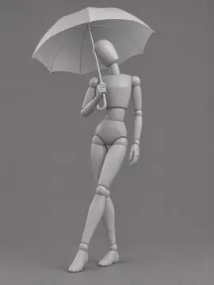 | <a href="https://promicat.app/zh/poses/styles/sp060?utm_source=github&utm_medium=readme&utm_campaign=ai-photo-poses">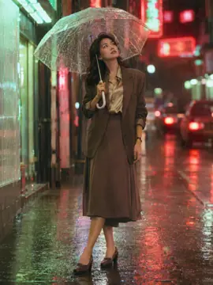</a> | <a href="https://promicat.app/zh/poses/styles/sp060?utm_source=github&utm_medium=readme&utm_campaign=ai-photo-poses">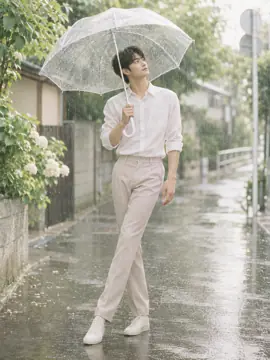</a> | <a href="https://promicat.app/zh/poses/styles/sp060?utm_source=github&utm_medium=readme&utm_campaign=ai-photo-poses">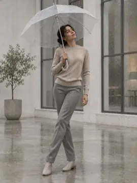</a> | <a href="https://promicat.app/zh/poses/styles/sp060?utm_source=github&utm_medium=readme&utm_campaign=ai-photo-poses">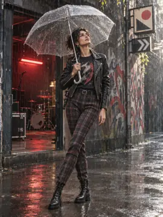</a> |

大图: [写真照](../images/photo-poses/hkretro/sp060-photo.webp) · [白模](../images/photo-poses/hkretro/sp060-pose.webp) · [在 Promicat 生成](https://promicat.app/zh/poses/styles/sp060?utm_source=github&utm_medium=readme&utm_campaign=ai-photo-poses)

<details><summary>提示词：用你的照片（图 1 你的照片，图 2 白模）</summary>

```text
A real professional portrait photoshoot photo: a 1990s Hong Kong retro night photoshoot with neon signs, tungsten and green fluorescent light, CineStill 800T halation, 50mm f/1.4. Subject: the person in image 1 (keep their exact face, facial features, skin tone and hairstyle; do not beautify or swap the face), wearing a vintage satin shirt, a fitted retro dress or a loose blazer. Pose: standing in the rain under a transparent umbrella, looking up at the signs. Image 2 is a wooden artist's mannequin that shows only this body pose: copy it exactly (head, torso, arms, hands, legs, feet, which hand does what, the camera angle), but do not copy the mannequin itself: no wooden skin, no joints, no blank face. Natural, relaxed and unstiff, true skin texture. No text, no logo, no watermark. Portrait 3:4.
```

</details>

<details><summary>提示词：生成示例图（虚构模特）</summary>

```text
A real professional portrait photoshoot photo, the kind posted by a top portrait studio: a 1990s Hong Kong retro night photoshoot with neon signs, tungsten and green fluorescent light, CineStill 800T halation, 50mm f/1.4. Model: a beautiful Japanese professional fashion model in her twenties with a naturally attractive face, styled hair and natural makeup, wearing a vintage satin shirt, a fitted retro dress or a loose blazer. The photographer directs the model into a natural, relaxed, unstiff pose that looks caught between moments: standing in the rain under a transparent umbrella, looking up at the signs. Asymmetric body, soft hands, flattering angle, true skin texture, refined but not plastic, fully clothed and modest. Full body or three-quarter body in frame, the whole pose clearly readable. No text, no logo, no watermark. Portrait 3:4.
```

</details>
