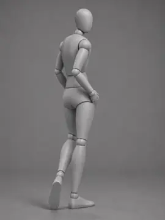
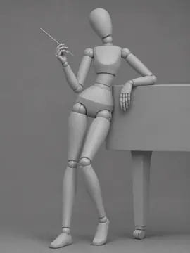
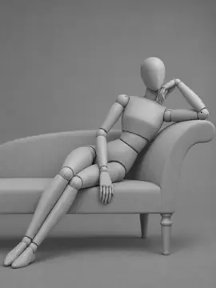

# 好莱坞复古 · 1950s Hollywood

10 组写真姿势：左边是写真照，右边是照着它画的木头白模。白模可以当姿势参考图，和你的照片一起发给生图模型。 在线试用：[Promicat 姿势库](https://promicat.app/zh/poses?ref=github)

[← 返回目录](../README.md#写真姿势)

## 楼梯扶手（站）

 

大图：[写真照](../images/photo-poses/hollywood/sp181-photo.webp) · [白模](../images/photo-poses/hollywood/sp181-pose.webp)

<details><summary>提示词：用你的照片（附图 1 你的照片，附图 2 白模）</summary>

```text
A real professional portrait photoshoot photo: a 1950s Hollywood glamour photoshoot on a classic studio set, hard butterfly light and soft fill, black-and-white or rich Technicolor, 85mm. Subject: the person in image 1 (keep their exact face, facial features, skin tone and hairstyle; do not beautify or swap the face), wearing an elegant floor-length satin gown with sleeves or a tuxedo, finger-wave hair. Pose: standing on a grand staircase with one hand on the banister, chin lifted. Image 2 is a wooden artist's mannequin that shows only this body pose: copy it exactly (head, torso, arms, hands, legs, feet, which hand does what, the camera angle), but do not copy the mannequin itself: no wooden skin, no joints, no blank face. Natural, relaxed and unstiff, true skin texture. No text, no logo, no watermark. Portrait 3:4.
```

</details>

<details><summary>提示词：生成示例图（虚构模特）</summary>

```text
A real professional portrait photoshoot photo, the kind posted by a top portrait studio: a 1950s Hollywood glamour photoshoot on a classic studio set, hard butterfly light and soft fill, black-and-white or rich Technicolor, 85mm. Model: a beautiful Latina professional fashion model in her twenties with a naturally attractive face, styled hair and natural makeup, wearing an elegant floor-length satin gown with sleeves or a tuxedo, finger-wave hair. The photographer directs the model into a natural, relaxed, unstiff pose that looks caught between moments: standing on a grand staircase with one hand on the banister, chin lifted. Asymmetric body, soft hands, flattering angle, true skin texture, refined but not plastic, fully clothed and modest. Full body or three-quarter body in frame, the whole pose clearly readable. No text, no logo, no watermark. Portrait 3:4.
```

</details>

## 化妆镜前（坐）

 

大图：[写真照](../images/photo-poses/hollywood/sp182-photo.webp) · [白模](../images/photo-poses/hollywood/sp182-pose.webp)

<details><summary>提示词：用你的照片（附图 1 你的照片，附图 2 白模）</summary>

```text
A real professional portrait photoshoot photo: a 1950s Hollywood glamour photoshoot on a classic studio set, hard butterfly light and soft fill, black-and-white or rich Technicolor, 85mm. Subject: the person in image 1 (keep their exact face, facial features, skin tone and hairstyle; do not beautify or swap the face), wearing an elegant floor-length satin gown with sleeves or a tuxedo, finger-wave hair. Pose: sitting at a vanity mirror putting on an earring, looking at the reflection. Image 2 is a wooden artist's mannequin that shows only this body pose: copy it exactly (head, torso, arms, hands, legs, feet, which hand does what, the camera angle), but do not copy the mannequin itself: no wooden skin, no joints, no blank face. Natural, relaxed and unstiff, true skin texture. No text, no logo, no watermark. Portrait 3:4.
```

</details>

<details><summary>提示词：生成示例图（虚构模特）</summary>

```text
A real professional portrait photoshoot photo, the kind posted by a top portrait studio: a 1950s Hollywood glamour photoshoot on a classic studio set, hard butterfly light and soft fill, black-and-white or rich Technicolor, 85mm. Model: a beautiful Korean professional fashion model in her twenties with a naturally attractive face, styled hair and natural makeup, wearing an elegant floor-length satin gown with sleeves or a tuxedo, finger-wave hair. The photographer directs the model into a natural, relaxed, unstiff pose that looks caught between moments: sitting at a vanity mirror putting on an earring, looking at the reflection. Asymmetric body, soft hands, flattering angle, true skin texture, refined but not plastic, fully clothed and modest. Full body or three-quarter body in frame, the whole pose clearly readable. No text, no logo, no watermark. Portrait 3:4.
```

</details>

## 回眸肩头（回眸）

 

大图：[写真照](../images/photo-poses/hollywood/sp183-photo.webp) · [白模](../images/photo-poses/hollywood/sp183-pose.webp)

<details><summary>提示词：用你的照片（附图 1 你的照片，附图 2 白模）</summary>

```text
A real professional portrait photoshoot photo: a 1950s Hollywood glamour photoshoot on a classic studio set, hard butterfly light and soft fill, black-and-white or rich Technicolor, 85mm. Subject: the person in image 1 (keep their exact face, facial features, skin tone and hairstyle; do not beautify or swap the face), wearing a classic black tuxedo with a bow tie, slicked-back hair. Pose: back turned, looking over the shoulder at the camera, the gown pooled. Image 2 is a wooden artist's mannequin that shows only this body pose: copy it exactly (head, torso, arms, hands, legs, feet, which hand does what, the camera angle), but do not copy the mannequin itself: no wooden skin, no joints, no blank face. Natural, relaxed and unstiff, true skin texture. No text, no logo, no watermark. Portrait 3:4.
```

</details>

<details><summary>提示词：生成示例图（虚构模特）</summary>

```text
A real professional portrait photoshoot photo, the kind posted by a top portrait studio: a 1950s Hollywood glamour photoshoot on a classic studio set, hard butterfly light and soft fill, black-and-white or rich Technicolor, 85mm. Model: a handsome South Asian professional male model in his twenties with a well-groomed look and styled hair, wearing a classic black tuxedo with a bow tie, slicked-back hair. The photographer directs the model into a natural, relaxed, unstiff pose that looks caught between moments: back turned, looking over the shoulder at the camera, the gown pooled. Asymmetric body, soft hands, flattering angle, true skin texture, refined but not plastic, fully clothed and modest. Full body or three-quarter body in frame, the whole pose clearly readable. No text, no logo, no watermark. Portrait 3:4.
```

</details>

## 倚钢琴（靠）

 

大图：[写真照](../images/photo-poses/hollywood/sp184-photo.webp) · [白模](../images/photo-poses/hollywood/sp184-pose.webp)

<details><summary>提示词：用你的照片（附图 1 你的照片，附图 2 白模）</summary>

```text
A real professional portrait photoshoot photo: a 1950s Hollywood glamour photoshoot on a classic studio set, hard butterfly light and soft fill, black-and-white or rich Technicolor, 85mm. Subject: the person in image 1 (keep their exact face, facial features, skin tone and hairstyle; do not beautify or swap the face), wearing an elegant floor-length satin gown with sleeves or a tuxedo, finger-wave hair. Pose: leaning on a grand piano with one elbow, holding a long cigarette holder without a cigarette. Image 2 is a wooden artist's mannequin that shows only this body pose: copy it exactly (head, torso, arms, hands, legs, feet, which hand does what, the camera angle), but do not copy the mannequin itself: no wooden skin, no joints, no blank face. Natural, relaxed and unstiff, true skin texture. No text, no logo, no watermark. Portrait 3:4.
```

</details>

<details><summary>提示词：生成示例图（虚构模特）</summary>

```text
A real professional portrait photoshoot photo, the kind posted by a top portrait studio: a 1950s Hollywood glamour photoshoot on a classic studio set, hard butterfly light and soft fill, black-and-white or rich Technicolor, 85mm. Model: a beautiful East African professional fashion model in her twenties with a naturally attractive face, styled hair and natural makeup, wearing an elegant floor-length satin gown with sleeves or a tuxedo, finger-wave hair. The photographer directs the model into a natural, relaxed, unstiff pose that looks caught between moments: leaning on a grand piano with one elbow, holding a long cigarette holder without a cigarette. Asymmetric body, soft hands, flattering angle, true skin texture, refined but not plastic, fully clothed and modest. Full body or three-quarter body in frame, the whole pose clearly readable. No text, no logo, no watermark. Portrait 3:4.
```

</details>

## 躺贵妃椅（躺）

 

大图：[写真照](../images/photo-poses/hollywood/sp185-photo.webp) · [白模](../images/photo-poses/hollywood/sp185-pose.webp)

<details><summary>提示词：用你的照片（附图 1 你的照片，附图 2 白模）</summary>

```text
A real professional portrait photoshoot photo: a 1950s Hollywood glamour photoshoot on a classic studio set, hard butterfly light and soft fill, black-and-white or rich Technicolor, 85mm. Subject: the person in image 1 (keep their exact face, facial features, skin tone and hairstyle; do not beautify or swap the face), wearing an elegant floor-length satin gown with sleeves or a tuxedo, finger-wave hair. Pose: reclining on a chaise longue propped on one arm, fully covered gown. Image 2 is a wooden artist's mannequin that shows only this body pose: copy it exactly (head, torso, arms, hands, legs, feet, which hand does what, the camera angle), but do not copy the mannequin itself: no wooden skin, no joints, no blank face. Natural, relaxed and unstiff, true skin texture. No text, no logo, no watermark. Portrait 3:4.
```

</details>

<details><summary>提示词：生成示例图（虚构模特）</summary>

```text
A real professional portrait photoshoot photo, the kind posted by a top portrait studio: a 1950s Hollywood glamour photoshoot on a classic studio set, hard butterfly light and soft fill, black-and-white or rich Technicolor, 85mm. Model: a beautiful Black professional fashion model in her twenties with a naturally attractive face, styled hair and natural makeup, wearing an elegant floor-length satin gown with sleeves or a tuxedo, finger-wave hair. The photographer directs the model into a natural, relaxed, unstiff pose that looks caught between moments: reclining on a chaise longue propped on one arm, fully covered gown. Asymmetric body, soft hands, flattering angle, true skin texture, refined but not plastic, fully clothed and modest. Full body or three-quarter body in frame, the whole pose clearly readable. No text, no logo, no watermark. Portrait 3:4.
```

</details>

## 手托下巴（半身）

 

大图：[写真照](../images/photo-poses/hollywood/sp186-photo.webp) · [白模](../images/photo-poses/hollywood/sp186-pose.webp)

<details><summary>提示词：用你的照片（附图 1 你的照片，附图 2 白模）</summary>

```text
A real professional portrait photoshoot photo: a 1950s Hollywood glamour photoshoot on a classic studio set, hard butterfly light and soft fill, black-and-white or rich Technicolor, 85mm. Subject: the person in image 1 (keep their exact face, facial features, skin tone and hairstyle; do not beautify or swap the face), wearing a classic black tuxedo with a bow tie, slicked-back hair. Pose: resting the chin on the back of a gloved hand, eyes to the light. Image 2 is a wooden artist's mannequin that shows only this body pose: copy it exactly (head, torso, arms, hands, legs, feet, which hand does what, the camera angle), but do not copy the mannequin itself: no wooden skin, no joints, no blank face. Natural, relaxed and unstiff, true skin texture. No text, no logo, no watermark. Portrait 3:4.
```

</details>

<details><summary>提示词：生成示例图（虚构模特）</summary>

```text
A real professional portrait photoshoot photo, the kind posted by a top portrait studio: a 1950s Hollywood glamour photoshoot on a classic studio set, hard butterfly light and soft fill, black-and-white or rich Technicolor, 85mm. Model: a handsome Scandinavian professional male model in his twenties with a well-groomed look and styled hair, wearing a classic black tuxedo with a bow tie, slicked-back hair. The photographer directs the model into a natural, relaxed, unstiff pose that looks caught between moments: resting the chin on the back of a gloved hand, eyes to the light. Asymmetric body, soft hands, flattering angle, true skin texture, refined but not plastic, fully clothed and modest. Waist-up framing, both arms and hands readable. No text, no logo, no watermark. Portrait 3:4.
```

</details>

## 走红毯（走）

 

大图：[写真照](../images/photo-poses/hollywood/sp187-photo.webp) · [白模](../images/photo-poses/hollywood/sp187-pose.webp)

<details><summary>提示词：用你的照片（附图 1 你的照片，附图 2 白模）</summary>

```text
A real professional portrait photoshoot photo: a 1950s Hollywood glamour photoshoot on a classic studio set, hard butterfly light and soft fill, black-and-white or rich Technicolor, 85mm. Subject: the person in image 1 (keep their exact face, facial features, skin tone and hairstyle; do not beautify or swap the face), wearing an elegant floor-length satin gown with sleeves or a tuxedo, finger-wave hair. Pose: walking toward the camera on a carpet, holding the gown slightly. Image 2 is a wooden artist's mannequin that shows only this body pose: copy it exactly (head, torso, arms, hands, legs, feet, which hand does what, the camera angle), but do not copy the mannequin itself: no wooden skin, no joints, no blank face. Natural, relaxed and unstiff, true skin texture. No text, no logo, no watermark. Portrait 3:4.
```

</details>

<details><summary>提示词：生成示例图（虚构模特）</summary>

```text
A real professional portrait photoshoot photo, the kind posted by a top portrait studio: a 1950s Hollywood glamour photoshoot on a classic studio set, hard butterfly light and soft fill, black-and-white or rich Technicolor, 85mm. Model: a beautiful East Asian professional fashion model in her twenties with a naturally attractive face, styled hair and natural makeup, wearing an elegant floor-length satin gown with sleeves or a tuxedo, finger-wave hair. The photographer directs the model into a natural, relaxed, unstiff pose that looks caught between moments: walking toward the camera on a carpet, holding the gown slightly. Asymmetric body, soft hands, flattering angle, true skin texture, refined but not plastic, fully clothed and modest. Full body or three-quarter body in frame, the whole pose clearly readable. No text, no logo, no watermark. Portrait 3:4.
```

</details>

## 转身裙摆（动态）

 

大图：[写真照](../images/photo-poses/hollywood/sp188-photo.webp) · [白模](../images/photo-poses/hollywood/sp188-pose.webp)

<details><summary>提示词：用你的照片（附图 1 你的照片，附图 2 白模）</summary>

```text
A real professional portrait photoshoot photo: a 1950s Hollywood glamour photoshoot on a classic studio set, hard butterfly light and soft fill, black-and-white or rich Technicolor, 85mm. Subject: the person in image 1 (keep their exact face, facial features, skin tone and hairstyle; do not beautify or swap the face), wearing an elegant floor-length satin gown with sleeves or a tuxedo, finger-wave hair. Pose: turning so the satin gown swirls. Image 2 is a wooden artist's mannequin that shows only this body pose: copy it exactly (head, torso, arms, hands, legs, feet, which hand does what, the camera angle), but do not copy the mannequin itself: no wooden skin, no joints, no blank face. Natural, relaxed and unstiff, true skin texture. No text, no logo, no watermark. Portrait 3:4.
```

</details>

<details><summary>提示词：生成示例图（虚构模特）</summary>

```text
A real professional portrait photoshoot photo, the kind posted by a top portrait studio: a 1950s Hollywood glamour photoshoot on a classic studio set, hard butterfly light and soft fill, black-and-white or rich Technicolor, 85mm. Model: a beautiful mixed-race professional fashion model in her twenties with a naturally attractive face, styled hair and natural makeup, wearing an elegant floor-length satin gown with sleeves or a tuxedo, finger-wave hair. The photographer directs the model into a natural, relaxed, unstiff pose that looks caught between moments: turning so the satin gown swirls. Asymmetric body, soft hands, flattering angle, true skin texture, refined but not plastic, fully clothed and modest. Full body or three-quarter body in frame, the whole pose clearly readable. No text, no logo, no watermark. Portrait 3:4.
```

</details>

## 坐台阶（坐）

 

大图：[写真照](../images/photo-poses/hollywood/sp189-photo.webp) · [白模](../images/photo-poses/hollywood/sp189-pose.webp)

<details><summary>提示词：用你的照片（附图 1 你的照片，附图 2 白模）</summary>

```text
A real professional portrait photoshoot photo: a 1950s Hollywood glamour photoshoot on a classic studio set, hard butterfly light and soft fill, black-and-white or rich Technicolor, 85mm. Subject: the person in image 1 (keep their exact face, facial features, skin tone and hairstyle; do not beautify or swap the face), wearing a classic black tuxedo with a bow tie, slicked-back hair. Pose: sitting on studio steps with the gown spread, head tilted. Image 2 is a wooden artist's mannequin that shows only this body pose: copy it exactly (head, torso, arms, hands, legs, feet, which hand does what, the camera angle), but do not copy the mannequin itself: no wooden skin, no joints, no blank face. Natural, relaxed and unstiff, true skin texture. No text, no logo, no watermark. Portrait 3:4.
```

</details>

<details><summary>提示词：生成示例图（虚构模特）</summary>

```text
A real professional portrait photoshoot photo, the kind posted by a top portrait studio: a 1950s Hollywood glamour photoshoot on a classic studio set, hard butterfly light and soft fill, black-and-white or rich Technicolor, 85mm. Model: a handsome Mediterranean professional male model in his twenties with a well-groomed look and styled hair, wearing a classic black tuxedo with a bow tie, slicked-back hair. The photographer directs the model into a natural, relaxed, unstiff pose that looks caught between moments: sitting on studio steps with the gown spread, head tilted. Asymmetric body, soft hands, flattering angle, true skin texture, refined but not plastic, fully clothed and modest. Full body or three-quarter body in frame, the whole pose clearly readable. No text, no logo, no watermark. Portrait 3:4.
```

</details>

## 整理领结（半身）

 

大图：[写真照](../images/photo-poses/hollywood/sp190-photo.webp) · [白模](../images/photo-poses/hollywood/sp190-pose.webp)

<details><summary>提示词：用你的照片（附图 1 你的照片，附图 2 白模）</summary>

```text
A real professional portrait photoshoot photo: a 1950s Hollywood glamour photoshoot on a classic studio set, hard butterfly light and soft fill, black-and-white or rich Technicolor, 85mm. Subject: the person in image 1 (keep their exact face, facial features, skin tone and hairstyle; do not beautify or swap the face), wearing an elegant floor-length satin gown with sleeves or a tuxedo, finger-wave hair. Pose: adjusting a bow tie with both hands, eyebrow raised. Image 2 is a wooden artist's mannequin that shows only this body pose: copy it exactly (head, torso, arms, hands, legs, feet, which hand does what, the camera angle), but do not copy the mannequin itself: no wooden skin, no joints, no blank face. Natural, relaxed and unstiff, true skin texture. No text, no logo, no watermark. Portrait 3:4.
```

</details>

<details><summary>提示词：生成示例图（虚构模特）</summary>

```text
A real professional portrait photoshoot photo, the kind posted by a top portrait studio: a 1950s Hollywood glamour photoshoot on a classic studio set, hard butterfly light and soft fill, black-and-white or rich Technicolor, 85mm. Model: a beautiful Southeast Asian professional fashion model in her twenties with a naturally attractive face, styled hair and natural makeup, wearing an elegant floor-length satin gown with sleeves or a tuxedo, finger-wave hair. The photographer directs the model into a natural, relaxed, unstiff pose that looks caught between moments: adjusting a bow tie with both hands, eyebrow raised. Asymmetric body, soft hands, flattering angle, true skin texture, refined but not plastic, fully clothed and modest. Waist-up framing, both arms and hands readable. No text, no logo, no watermark. Portrait 3:4.
```

</details>
