# 1950s Hollywood

English · [简体中文](hollywood.zh-CN.md)

10 photo poses: a sample photo and the white model drawn from it. Attach your photo first and the white model second. Try them with your own photo on [Promicat](https://promicat.app/poses?utm_source=github&utm_medium=readme&utm_campaign=ai-photo-poses).

[← Back to all styles](../README.md#photo-poses)

## Standing on a grand staircase with one hand on the banister (Standing)

<a href="https://promicat.app/poses/styles/sp181?utm_source=github&utm_medium=readme&utm_campaign=ai-photo-poses">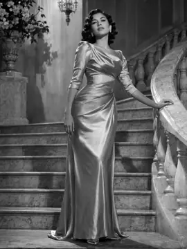</a> 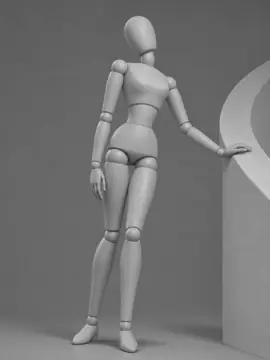

Full size: [photo](../images/photo-poses/hollywood/sp181-photo.webp) · [white model](../images/photo-poses/hollywood/sp181-pose.webp) · [try it on Promicat](https://promicat.app/poses/styles/sp181?utm_source=github&utm_medium=readme&utm_campaign=ai-photo-poses)

<details><summary>Prompt with your photo (image 1: your photo, image 2: white model)</summary>

```text
A real professional portrait photoshoot photo: a 1950s Hollywood glamour photoshoot on a classic studio set, hard butterfly light and soft fill, black-and-white or rich Technicolor, 85mm. Subject: the person in image 1 (keep their exact face, facial features, skin tone and hairstyle; do not beautify or swap the face), wearing an elegant floor-length satin gown with sleeves or a tuxedo, finger-wave hair. Pose: standing on a grand staircase with one hand on the banister, chin lifted. Image 2 is a wooden artist's mannequin that shows only this body pose: copy it exactly (head, torso, arms, hands, legs, feet, which hand does what, the camera angle), but do not copy the mannequin itself: no wooden skin, no joints, no blank face. Natural, relaxed and unstiff, true skin texture. No text, no logo, no watermark. Portrait 3:4.
```

</details>

<details><summary>Prompt for the sample (fictional model)</summary>

```text
A real professional portrait photoshoot photo, the kind posted by a top portrait studio: a 1950s Hollywood glamour photoshoot on a classic studio set, hard butterfly light and soft fill, black-and-white or rich Technicolor, 85mm. Model: a beautiful Latina professional fashion model in her twenties with a naturally attractive face, styled hair and natural makeup, wearing an elegant floor-length satin gown with sleeves or a tuxedo, finger-wave hair. The photographer directs the model into a natural, relaxed, unstiff pose that looks caught between moments: standing on a grand staircase with one hand on the banister, chin lifted. Asymmetric body, soft hands, flattering angle, true skin texture, refined but not plastic, fully clothed and modest. Full body or three-quarter body in frame, the whole pose clearly readable. No text, no logo, no watermark. Portrait 3:4.
```

</details>

## Sitting at a vanity mirror putting on an earring (Sitting)

<a href="https://promicat.app/poses/styles/sp182?utm_source=github&utm_medium=readme&utm_campaign=ai-photo-poses">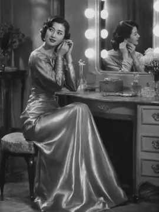</a> 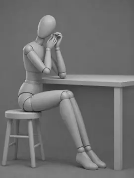

Full size: [photo](../images/photo-poses/hollywood/sp182-photo.webp) · [white model](../images/photo-poses/hollywood/sp182-pose.webp) · [try it on Promicat](https://promicat.app/poses/styles/sp182?utm_source=github&utm_medium=readme&utm_campaign=ai-photo-poses)

<details><summary>Prompt with your photo (image 1: your photo, image 2: white model)</summary>

```text
A real professional portrait photoshoot photo: a 1950s Hollywood glamour photoshoot on a classic studio set, hard butterfly light and soft fill, black-and-white or rich Technicolor, 85mm. Subject: the person in image 1 (keep their exact face, facial features, skin tone and hairstyle; do not beautify or swap the face), wearing an elegant floor-length satin gown with sleeves or a tuxedo, finger-wave hair. Pose: sitting at a vanity mirror putting on an earring, looking at the reflection. Image 2 is a wooden artist's mannequin that shows only this body pose: copy it exactly (head, torso, arms, hands, legs, feet, which hand does what, the camera angle), but do not copy the mannequin itself: no wooden skin, no joints, no blank face. Natural, relaxed and unstiff, true skin texture. No text, no logo, no watermark. Portrait 3:4.
```

</details>

<details><summary>Prompt for the sample (fictional model)</summary>

```text
A real professional portrait photoshoot photo, the kind posted by a top portrait studio: a 1950s Hollywood glamour photoshoot on a classic studio set, hard butterfly light and soft fill, black-and-white or rich Technicolor, 85mm. Model: a beautiful Korean professional fashion model in her twenties with a naturally attractive face, styled hair and natural makeup, wearing an elegant floor-length satin gown with sleeves or a tuxedo, finger-wave hair. The photographer directs the model into a natural, relaxed, unstiff pose that looks caught between moments: sitting at a vanity mirror putting on an earring, looking at the reflection. Asymmetric body, soft hands, flattering angle, true skin texture, refined but not plastic, fully clothed and modest. Full body or three-quarter body in frame, the whole pose clearly readable. No text, no logo, no watermark. Portrait 3:4.
```

</details>

## Back turned (Looking back)

<a href="https://promicat.app/poses/styles/sp183?utm_source=github&utm_medium=readme&utm_campaign=ai-photo-poses">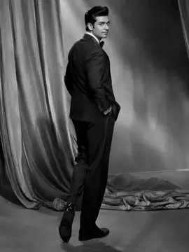</a> 

Full size: [photo](../images/photo-poses/hollywood/sp183-photo.webp) · [white model](../images/photo-poses/hollywood/sp183-pose.webp) · [try it on Promicat](https://promicat.app/poses/styles/sp183?utm_source=github&utm_medium=readme&utm_campaign=ai-photo-poses)

<details><summary>Prompt with your photo (image 1: your photo, image 2: white model)</summary>

```text
A real professional portrait photoshoot photo: a 1950s Hollywood glamour photoshoot on a classic studio set, hard butterfly light and soft fill, black-and-white or rich Technicolor, 85mm. Subject: the person in image 1 (keep their exact face, facial features, skin tone and hairstyle; do not beautify or swap the face), wearing a classic black tuxedo with a bow tie, slicked-back hair. Pose: back turned, looking over the shoulder at the camera, the gown pooled. Image 2 is a wooden artist's mannequin that shows only this body pose: copy it exactly (head, torso, arms, hands, legs, feet, which hand does what, the camera angle), but do not copy the mannequin itself: no wooden skin, no joints, no blank face. Natural, relaxed and unstiff, true skin texture. No text, no logo, no watermark. Portrait 3:4.
```

</details>

<details><summary>Prompt for the sample (fictional model)</summary>

```text
A real professional portrait photoshoot photo, the kind posted by a top portrait studio: a 1950s Hollywood glamour photoshoot on a classic studio set, hard butterfly light and soft fill, black-and-white or rich Technicolor, 85mm. Model: a handsome South Asian professional male model in his twenties with a well-groomed look and styled hair, wearing a classic black tuxedo with a bow tie, slicked-back hair. The photographer directs the model into a natural, relaxed, unstiff pose that looks caught between moments: back turned, looking over the shoulder at the camera, the gown pooled. Asymmetric body, soft hands, flattering angle, true skin texture, refined but not plastic, fully clothed and modest. Full body or three-quarter body in frame, the whole pose clearly readable. No text, no logo, no watermark. Portrait 3:4.
```

</details>

## Leaning on a grand piano with one elbow (Leaning)

<a href="https://promicat.app/poses/styles/sp184?utm_source=github&utm_medium=readme&utm_campaign=ai-photo-poses">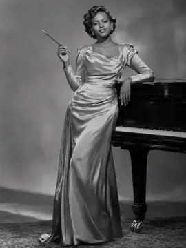</a> 

Full size: [photo](../images/photo-poses/hollywood/sp184-photo.webp) · [white model](../images/photo-poses/hollywood/sp184-pose.webp) · [try it on Promicat](https://promicat.app/poses/styles/sp184?utm_source=github&utm_medium=readme&utm_campaign=ai-photo-poses)

<details><summary>Prompt with your photo (image 1: your photo, image 2: white model)</summary>

```text
A real professional portrait photoshoot photo: a 1950s Hollywood glamour photoshoot on a classic studio set, hard butterfly light and soft fill, black-and-white or rich Technicolor, 85mm. Subject: the person in image 1 (keep their exact face, facial features, skin tone and hairstyle; do not beautify or swap the face), wearing an elegant floor-length satin gown with sleeves or a tuxedo, finger-wave hair. Pose: leaning on a grand piano with one elbow, holding a long cigarette holder without a cigarette. Image 2 is a wooden artist's mannequin that shows only this body pose: copy it exactly (head, torso, arms, hands, legs, feet, which hand does what, the camera angle), but do not copy the mannequin itself: no wooden skin, no joints, no blank face. Natural, relaxed and unstiff, true skin texture. No text, no logo, no watermark. Portrait 3:4.
```

</details>

<details><summary>Prompt for the sample (fictional model)</summary>

```text
A real professional portrait photoshoot photo, the kind posted by a top portrait studio: a 1950s Hollywood glamour photoshoot on a classic studio set, hard butterfly light and soft fill, black-and-white or rich Technicolor, 85mm. Model: a beautiful East African professional fashion model in her twenties with a naturally attractive face, styled hair and natural makeup, wearing an elegant floor-length satin gown with sleeves or a tuxedo, finger-wave hair. The photographer directs the model into a natural, relaxed, unstiff pose that looks caught between moments: leaning on a grand piano with one elbow, holding a long cigarette holder without a cigarette. Asymmetric body, soft hands, flattering angle, true skin texture, refined but not plastic, fully clothed and modest. Full body or three-quarter body in frame, the whole pose clearly readable. No text, no logo, no watermark. Portrait 3:4.
```

</details>

## Reclining on a chaise longue propped on one arm (Lying)

<a href="https://promicat.app/poses/styles/sp185?utm_source=github&utm_medium=readme&utm_campaign=ai-photo-poses">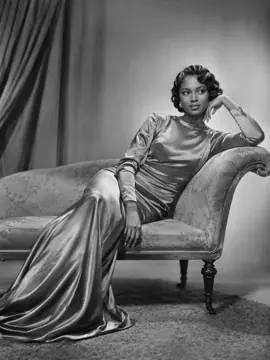</a> 

Full size: [photo](../images/photo-poses/hollywood/sp185-photo.webp) · [white model](../images/photo-poses/hollywood/sp185-pose.webp) · [try it on Promicat](https://promicat.app/poses/styles/sp185?utm_source=github&utm_medium=readme&utm_campaign=ai-photo-poses)

<details><summary>Prompt with your photo (image 1: your photo, image 2: white model)</summary>

```text
A real professional portrait photoshoot photo: a 1950s Hollywood glamour photoshoot on a classic studio set, hard butterfly light and soft fill, black-and-white or rich Technicolor, 85mm. Subject: the person in image 1 (keep their exact face, facial features, skin tone and hairstyle; do not beautify or swap the face), wearing an elegant floor-length satin gown with sleeves or a tuxedo, finger-wave hair. Pose: reclining on a chaise longue propped on one arm, fully covered gown. Image 2 is a wooden artist's mannequin that shows only this body pose: copy it exactly (head, torso, arms, hands, legs, feet, which hand does what, the camera angle), but do not copy the mannequin itself: no wooden skin, no joints, no blank face. Natural, relaxed and unstiff, true skin texture. No text, no logo, no watermark. Portrait 3:4.
```

</details>

<details><summary>Prompt for the sample (fictional model)</summary>

```text
A real professional portrait photoshoot photo, the kind posted by a top portrait studio: a 1950s Hollywood glamour photoshoot on a classic studio set, hard butterfly light and soft fill, black-and-white or rich Technicolor, 85mm. Model: a beautiful Black professional fashion model in her twenties with a naturally attractive face, styled hair and natural makeup, wearing an elegant floor-length satin gown with sleeves or a tuxedo, finger-wave hair. The photographer directs the model into a natural, relaxed, unstiff pose that looks caught between moments: reclining on a chaise longue propped on one arm, fully covered gown. Asymmetric body, soft hands, flattering angle, true skin texture, refined but not plastic, fully clothed and modest. Full body or three-quarter body in frame, the whole pose clearly readable. No text, no logo, no watermark. Portrait 3:4.
```

</details>

## Resting the chin on the back of a gloved hand (Upper body)

<a href="https://promicat.app/poses/styles/sp186?utm_source=github&utm_medium=readme&utm_campaign=ai-photo-poses">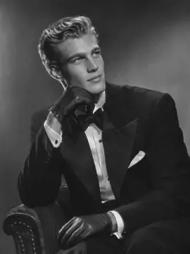</a> 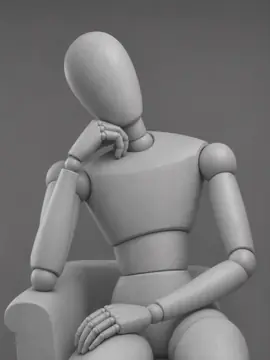

Full size: [photo](../images/photo-poses/hollywood/sp186-photo.webp) · [white model](../images/photo-poses/hollywood/sp186-pose.webp) · [try it on Promicat](https://promicat.app/poses/styles/sp186?utm_source=github&utm_medium=readme&utm_campaign=ai-photo-poses)

<details><summary>Prompt with your photo (image 1: your photo, image 2: white model)</summary>

```text
A real professional portrait photoshoot photo: a 1950s Hollywood glamour photoshoot on a classic studio set, hard butterfly light and soft fill, black-and-white or rich Technicolor, 85mm. Subject: the person in image 1 (keep their exact face, facial features, skin tone and hairstyle; do not beautify or swap the face), wearing a classic black tuxedo with a bow tie, slicked-back hair. Pose: resting the chin on the back of a gloved hand, eyes to the light. Image 2 is a wooden artist's mannequin that shows only this body pose: copy it exactly (head, torso, arms, hands, legs, feet, which hand does what, the camera angle), but do not copy the mannequin itself: no wooden skin, no joints, no blank face. Natural, relaxed and unstiff, true skin texture. No text, no logo, no watermark. Portrait 3:4.
```

</details>

<details><summary>Prompt for the sample (fictional model)</summary>

```text
A real professional portrait photoshoot photo, the kind posted by a top portrait studio: a 1950s Hollywood glamour photoshoot on a classic studio set, hard butterfly light and soft fill, black-and-white or rich Technicolor, 85mm. Model: a handsome Scandinavian professional male model in his twenties with a well-groomed look and styled hair, wearing a classic black tuxedo with a bow tie, slicked-back hair. The photographer directs the model into a natural, relaxed, unstiff pose that looks caught between moments: resting the chin on the back of a gloved hand, eyes to the light. Asymmetric body, soft hands, flattering angle, true skin texture, refined but not plastic, fully clothed and modest. Waist-up framing, both arms and hands readable. No text, no logo, no watermark. Portrait 3:4.
```

</details>

## Walking toward the camera on a carpet (Walking)

<a href="https://promicat.app/poses/styles/sp187?utm_source=github&utm_medium=readme&utm_campaign=ai-photo-poses">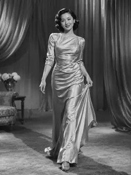</a> 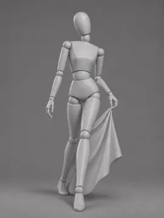

Full size: [photo](../images/photo-poses/hollywood/sp187-photo.webp) · [white model](../images/photo-poses/hollywood/sp187-pose.webp) · [try it on Promicat](https://promicat.app/poses/styles/sp187?utm_source=github&utm_medium=readme&utm_campaign=ai-photo-poses)

<details><summary>Prompt with your photo (image 1: your photo, image 2: white model)</summary>

```text
A real professional portrait photoshoot photo: a 1950s Hollywood glamour photoshoot on a classic studio set, hard butterfly light and soft fill, black-and-white or rich Technicolor, 85mm. Subject: the person in image 1 (keep their exact face, facial features, skin tone and hairstyle; do not beautify or swap the face), wearing an elegant floor-length satin gown with sleeves or a tuxedo, finger-wave hair. Pose: walking toward the camera on a carpet, holding the gown slightly. Image 2 is a wooden artist's mannequin that shows only this body pose: copy it exactly (head, torso, arms, hands, legs, feet, which hand does what, the camera angle), but do not copy the mannequin itself: no wooden skin, no joints, no blank face. Natural, relaxed and unstiff, true skin texture. No text, no logo, no watermark. Portrait 3:4.
```

</details>

<details><summary>Prompt for the sample (fictional model)</summary>

```text
A real professional portrait photoshoot photo, the kind posted by a top portrait studio: a 1950s Hollywood glamour photoshoot on a classic studio set, hard butterfly light and soft fill, black-and-white or rich Technicolor, 85mm. Model: a beautiful East Asian professional fashion model in her twenties with a naturally attractive face, styled hair and natural makeup, wearing an elegant floor-length satin gown with sleeves or a tuxedo, finger-wave hair. The photographer directs the model into a natural, relaxed, unstiff pose that looks caught between moments: walking toward the camera on a carpet, holding the gown slightly. Asymmetric body, soft hands, flattering angle, true skin texture, refined but not plastic, fully clothed and modest. Full body or three-quarter body in frame, the whole pose clearly readable. No text, no logo, no watermark. Portrait 3:4.
```

</details>

## Turning so the satin gown swirls (In motion)

<a href="https://promicat.app/poses/styles/sp188?utm_source=github&utm_medium=readme&utm_campaign=ai-photo-poses">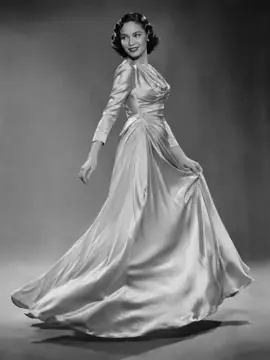</a> 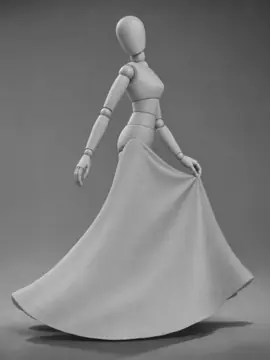

Full size: [photo](../images/photo-poses/hollywood/sp188-photo.webp) · [white model](../images/photo-poses/hollywood/sp188-pose.webp) · [try it on Promicat](https://promicat.app/poses/styles/sp188?utm_source=github&utm_medium=readme&utm_campaign=ai-photo-poses)

<details><summary>Prompt with your photo (image 1: your photo, image 2: white model)</summary>

```text
A real professional portrait photoshoot photo: a 1950s Hollywood glamour photoshoot on a classic studio set, hard butterfly light and soft fill, black-and-white or rich Technicolor, 85mm. Subject: the person in image 1 (keep their exact face, facial features, skin tone and hairstyle; do not beautify or swap the face), wearing an elegant floor-length satin gown with sleeves or a tuxedo, finger-wave hair. Pose: turning so the satin gown swirls. Image 2 is a wooden artist's mannequin that shows only this body pose: copy it exactly (head, torso, arms, hands, legs, feet, which hand does what, the camera angle), but do not copy the mannequin itself: no wooden skin, no joints, no blank face. Natural, relaxed and unstiff, true skin texture. No text, no logo, no watermark. Portrait 3:4.
```

</details>

<details><summary>Prompt for the sample (fictional model)</summary>

```text
A real professional portrait photoshoot photo, the kind posted by a top portrait studio: a 1950s Hollywood glamour photoshoot on a classic studio set, hard butterfly light and soft fill, black-and-white or rich Technicolor, 85mm. Model: a beautiful mixed-race professional fashion model in her twenties with a naturally attractive face, styled hair and natural makeup, wearing an elegant floor-length satin gown with sleeves or a tuxedo, finger-wave hair. The photographer directs the model into a natural, relaxed, unstiff pose that looks caught between moments: turning so the satin gown swirls. Asymmetric body, soft hands, flattering angle, true skin texture, refined but not plastic, fully clothed and modest. Full body or three-quarter body in frame, the whole pose clearly readable. No text, no logo, no watermark. Portrait 3:4.
```

</details>

## Sitting on studio steps with the gown spread (Sitting)

<a href="https://promicat.app/poses/styles/sp189?utm_source=github&utm_medium=readme&utm_campaign=ai-photo-poses">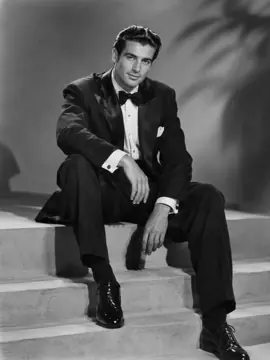</a> 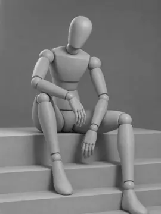

Full size: [photo](../images/photo-poses/hollywood/sp189-photo.webp) · [white model](../images/photo-poses/hollywood/sp189-pose.webp) · [try it on Promicat](https://promicat.app/poses/styles/sp189?utm_source=github&utm_medium=readme&utm_campaign=ai-photo-poses)

<details><summary>Prompt with your photo (image 1: your photo, image 2: white model)</summary>

```text
A real professional portrait photoshoot photo: a 1950s Hollywood glamour photoshoot on a classic studio set, hard butterfly light and soft fill, black-and-white or rich Technicolor, 85mm. Subject: the person in image 1 (keep their exact face, facial features, skin tone and hairstyle; do not beautify or swap the face), wearing a classic black tuxedo with a bow tie, slicked-back hair. Pose: sitting on studio steps with the gown spread, head tilted. Image 2 is a wooden artist's mannequin that shows only this body pose: copy it exactly (head, torso, arms, hands, legs, feet, which hand does what, the camera angle), but do not copy the mannequin itself: no wooden skin, no joints, no blank face. Natural, relaxed and unstiff, true skin texture. No text, no logo, no watermark. Portrait 3:4.
```

</details>

<details><summary>Prompt for the sample (fictional model)</summary>

```text
A real professional portrait photoshoot photo, the kind posted by a top portrait studio: a 1950s Hollywood glamour photoshoot on a classic studio set, hard butterfly light and soft fill, black-and-white or rich Technicolor, 85mm. Model: a handsome Mediterranean professional male model in his twenties with a well-groomed look and styled hair, wearing a classic black tuxedo with a bow tie, slicked-back hair. The photographer directs the model into a natural, relaxed, unstiff pose that looks caught between moments: sitting on studio steps with the gown spread, head tilted. Asymmetric body, soft hands, flattering angle, true skin texture, refined but not plastic, fully clothed and modest. Full body or three-quarter body in frame, the whole pose clearly readable. No text, no logo, no watermark. Portrait 3:4.
```

</details>

## Adjusting a bow tie with both hands (Upper body)

<a href="https://promicat.app/poses/styles/sp190?utm_source=github&utm_medium=readme&utm_campaign=ai-photo-poses">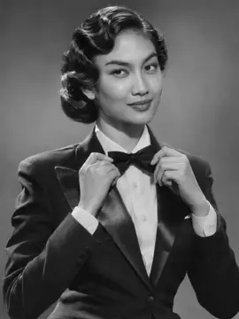</a> 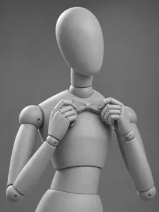

Full size: [photo](../images/photo-poses/hollywood/sp190-photo.webp) · [white model](../images/photo-poses/hollywood/sp190-pose.webp) · [try it on Promicat](https://promicat.app/poses/styles/sp190?utm_source=github&utm_medium=readme&utm_campaign=ai-photo-poses)

<details><summary>Prompt with your photo (image 1: your photo, image 2: white model)</summary>

```text
A real professional portrait photoshoot photo: a 1950s Hollywood glamour photoshoot on a classic studio set, hard butterfly light and soft fill, black-and-white or rich Technicolor, 85mm. Subject: the person in image 1 (keep their exact face, facial features, skin tone and hairstyle; do not beautify or swap the face), wearing an elegant floor-length satin gown with sleeves or a tuxedo, finger-wave hair. Pose: adjusting a bow tie with both hands, eyebrow raised. Image 2 is a wooden artist's mannequin that shows only this body pose: copy it exactly (head, torso, arms, hands, legs, feet, which hand does what, the camera angle), but do not copy the mannequin itself: no wooden skin, no joints, no blank face. Natural, relaxed and unstiff, true skin texture. No text, no logo, no watermark. Portrait 3:4.
```

</details>

<details><summary>Prompt for the sample (fictional model)</summary>

```text
A real professional portrait photoshoot photo, the kind posted by a top portrait studio: a 1950s Hollywood glamour photoshoot on a classic studio set, hard butterfly light and soft fill, black-and-white or rich Technicolor, 85mm. Model: a beautiful Southeast Asian professional fashion model in her twenties with a naturally attractive face, styled hair and natural makeup, wearing an elegant floor-length satin gown with sleeves or a tuxedo, finger-wave hair. The photographer directs the model into a natural, relaxed, unstiff pose that looks caught between moments: adjusting a bow tie with both hands, eyebrow raised. Asymmetric body, soft hands, flattering angle, true skin texture, refined but not plastic, fully clothed and modest. Waist-up framing, both arms and hands readable. No text, no logo, no watermark. Portrait 3:4.
```

</details>
