# 好莱坞复古

[English](hollywood.md) · 简体中文

10 个白模，每个配 4 张用它拍出的不同风格写真。参考图顺序是你的照片在前、白模在后。也可以在 [Promicat](https://promicat.app/zh/poses?utm_source=github&utm_medium=readme&utm_campaign=ai-photo-poses) 上传照片直接生成。

[← 返回全部风格](../README.zh-CN.md#photo-poses)

## 楼梯扶手 (站)

| 白模 | 好莱坞复古 | 赛博霓虹 | 日系清新 | 街头朋克 |
|---|---|---|---|---|
| 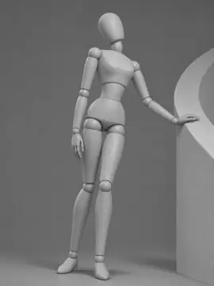 | <a href="https://promicat.app/zh/poses/styles/sp181?utm_source=github&utm_medium=readme&utm_campaign=ai-photo-poses">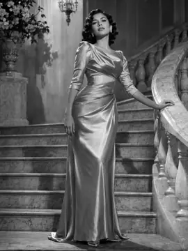</a> | <a href="https://promicat.app/zh/poses/styles/sp181?utm_source=github&utm_medium=readme&utm_campaign=ai-photo-poses">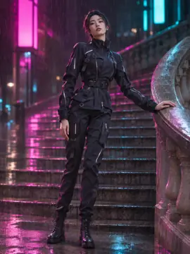</a> | <a href="https://promicat.app/zh/poses/styles/sp181?utm_source=github&utm_medium=readme&utm_campaign=ai-photo-poses">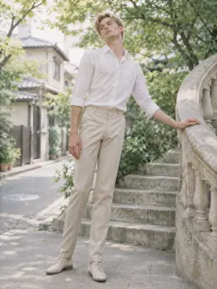</a> | <a href="https://promicat.app/zh/poses/styles/sp181?utm_source=github&utm_medium=readme&utm_campaign=ai-photo-poses">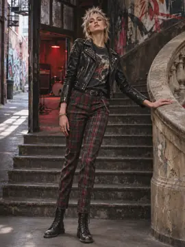</a> |

大图: [写真照](../images/photo-poses/hollywood/sp181-photo.webp) · [白模](../images/photo-poses/hollywood/sp181-pose.webp) · [在 Promicat 生成](https://promicat.app/zh/poses/styles/sp181?utm_source=github&utm_medium=readme&utm_campaign=ai-photo-poses)

<details><summary>提示词：用你的照片（图 1 你的照片，图 2 白模）</summary>

```text
A real professional portrait photoshoot photo: a 1950s Hollywood glamour photoshoot on a classic studio set, hard butterfly light and soft fill, black-and-white or rich Technicolor, 85mm. Subject: the person in image 1 (keep their exact face, facial features, skin tone and hairstyle; do not beautify or swap the face), wearing an elegant floor-length satin gown with sleeves or a tuxedo, finger-wave hair. Pose: standing on a grand staircase with one hand on the banister, chin lifted. Image 2 is a wooden artist's mannequin that shows only this body pose: copy it exactly (head, torso, arms, hands, legs, feet, which hand does what, the camera angle), but do not copy the mannequin itself: no wooden skin, no joints, no blank face. Natural, relaxed and unstiff, true skin texture. No text, no logo, no watermark. Portrait 3:4.
```

</details>

<details><summary>提示词：生成示例图（虚构模特）</summary>

```text
A real professional portrait photoshoot photo, the kind posted by a top portrait studio: a 1950s Hollywood glamour photoshoot on a classic studio set, hard butterfly light and soft fill, black-and-white or rich Technicolor, 85mm. Model: a beautiful Latina professional fashion model in her twenties with a naturally attractive face, styled hair and natural makeup, wearing an elegant floor-length satin gown with sleeves or a tuxedo, finger-wave hair. The photographer directs the model into a natural, relaxed, unstiff pose that looks caught between moments: standing on a grand staircase with one hand on the banister, chin lifted. Asymmetric body, soft hands, flattering angle, true skin texture, refined but not plastic, fully clothed and modest. Full body or three-quarter body in frame, the whole pose clearly readable. No text, no logo, no watermark. Portrait 3:4.
```

</details>

## 化妆镜前 (坐)

| 白模 | 好莱坞复古 | 咖啡馆文艺 | 学院风 | 森系花田 |
|---|---|---|---|---|
| 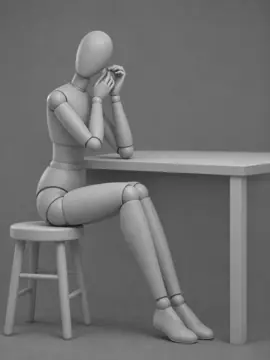 | <a href="https://promicat.app/zh/poses/styles/sp182?utm_source=github&utm_medium=readme&utm_campaign=ai-photo-poses">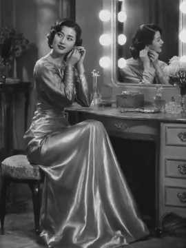</a> | <a href="https://promicat.app/zh/poses/styles/sp182?utm_source=github&utm_medium=readme&utm_campaign=ai-photo-poses">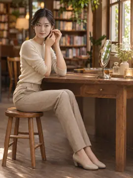</a> | <a href="https://promicat.app/zh/poses/styles/sp182?utm_source=github&utm_medium=readme&utm_campaign=ai-photo-poses">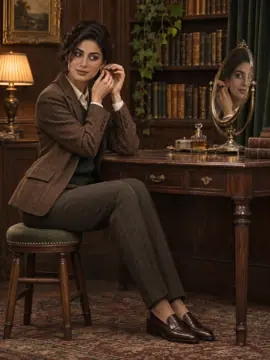</a> | <a href="https://promicat.app/zh/poses/styles/sp182?utm_source=github&utm_medium=readme&utm_campaign=ai-photo-poses">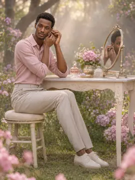</a> |

大图: [写真照](../images/photo-poses/hollywood/sp182-photo.webp) · [白模](../images/photo-poses/hollywood/sp182-pose.webp) · [在 Promicat 生成](https://promicat.app/zh/poses/styles/sp182?utm_source=github&utm_medium=readme&utm_campaign=ai-photo-poses)

<details><summary>提示词：用你的照片（图 1 你的照片，图 2 白模）</summary>

```text
A real professional portrait photoshoot photo: a 1950s Hollywood glamour photoshoot on a classic studio set, hard butterfly light and soft fill, black-and-white or rich Technicolor, 85mm. Subject: the person in image 1 (keep their exact face, facial features, skin tone and hairstyle; do not beautify or swap the face), wearing an elegant floor-length satin gown with sleeves or a tuxedo, finger-wave hair. Pose: sitting at a vanity mirror putting on an earring, looking at the reflection. Image 2 is a wooden artist's mannequin that shows only this body pose: copy it exactly (head, torso, arms, hands, legs, feet, which hand does what, the camera angle), but do not copy the mannequin itself: no wooden skin, no joints, no blank face. Natural, relaxed and unstiff, true skin texture. No text, no logo, no watermark. Portrait 3:4.
```

</details>

<details><summary>提示词：生成示例图（虚构模特）</summary>

```text
A real professional portrait photoshoot photo, the kind posted by a top portrait studio: a 1950s Hollywood glamour photoshoot on a classic studio set, hard butterfly light and soft fill, black-and-white or rich Technicolor, 85mm. Model: a beautiful Korean professional fashion model in her twenties with a naturally attractive face, styled hair and natural makeup, wearing an elegant floor-length satin gown with sleeves or a tuxedo, finger-wave hair. The photographer directs the model into a natural, relaxed, unstiff pose that looks caught between moments: sitting at a vanity mirror putting on an earring, looking at the reflection. Asymmetric body, soft hands, flattering angle, true skin texture, refined but not plastic, fully clothed and modest. Full body or three-quarter body in frame, the whole pose clearly readable. No text, no logo, no watermark. Portrait 3:4.
```

</details>

## 回眸肩头 (回眸)

| 白模 | 好莱坞复古 | 波西米亚 | 新中式 | 暗黑哥特 |
|---|---|---|---|---|
| 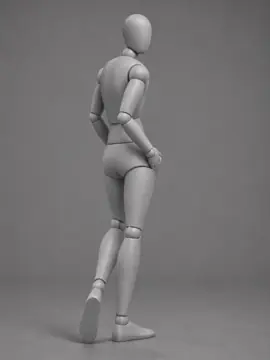 | <a href="https://promicat.app/zh/poses/styles/sp183?utm_source=github&utm_medium=readme&utm_campaign=ai-photo-poses">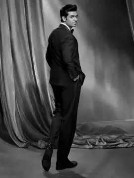</a> | <a href="https://promicat.app/zh/poses/styles/sp183?utm_source=github&utm_medium=readme&utm_campaign=ai-photo-poses">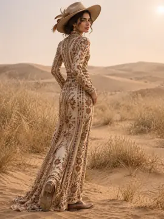</a> | <a href="https://promicat.app/zh/poses/styles/sp183?utm_source=github&utm_medium=readme&utm_campaign=ai-photo-poses">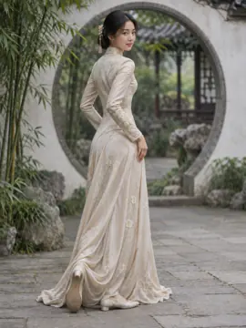</a> | <a href="https://promicat.app/zh/poses/styles/sp183?utm_source=github&utm_medium=readme&utm_campaign=ai-photo-poses">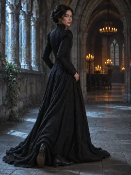</a> |

大图: [写真照](../images/photo-poses/hollywood/sp183-photo.webp) · [白模](../images/photo-poses/hollywood/sp183-pose.webp) · [在 Promicat 生成](https://promicat.app/zh/poses/styles/sp183?utm_source=github&utm_medium=readme&utm_campaign=ai-photo-poses)

<details><summary>提示词：用你的照片（图 1 你的照片，图 2 白模）</summary>

```text
A real professional portrait photoshoot photo: a 1950s Hollywood glamour photoshoot on a classic studio set, hard butterfly light and soft fill, black-and-white or rich Technicolor, 85mm. Subject: the person in image 1 (keep their exact face, facial features, skin tone and hairstyle; do not beautify or swap the face), wearing a classic black tuxedo with a bow tie, slicked-back hair. Pose: back turned, looking over the shoulder at the camera, the gown pooled. Image 2 is a wooden artist's mannequin that shows only this body pose: copy it exactly (head, torso, arms, hands, legs, feet, which hand does what, the camera angle), but do not copy the mannequin itself: no wooden skin, no joints, no blank face. Natural, relaxed and unstiff, true skin texture. No text, no logo, no watermark. Portrait 3:4.
```

</details>

<details><summary>提示词：生成示例图（虚构模特）</summary>

```text
A real professional portrait photoshoot photo, the kind posted by a top portrait studio: a 1950s Hollywood glamour photoshoot on a classic studio set, hard butterfly light and soft fill, black-and-white or rich Technicolor, 85mm. Model: a handsome South Asian professional male model in his twenties with a well-groomed look and styled hair, wearing a classic black tuxedo with a bow tie, slicked-back hair. The photographer directs the model into a natural, relaxed, unstiff pose that looks caught between moments: back turned, looking over the shoulder at the camera, the gown pooled. Asymmetric body, soft hands, flattering angle, true skin texture, refined but not plastic, fully clothed and modest. Full body or three-quarter body in frame, the whole pose clearly readable. No text, no logo, no watermark. Portrait 3:4.
```

</details>

## 倚钢琴 (靠)

| 白模 | 好莱坞复古 | 赛博霓虹 | 街拍时尚 | Y2K 千禧辣妹 |
|---|---|---|---|---|
| 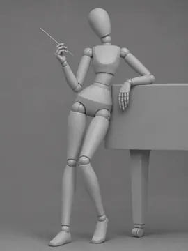 | <a href="https://promicat.app/zh/poses/styles/sp184?utm_source=github&utm_medium=readme&utm_campaign=ai-photo-poses">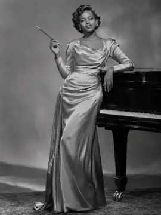</a> | <a href="https://promicat.app/zh/poses/styles/sp184?utm_source=github&utm_medium=readme&utm_campaign=ai-photo-poses">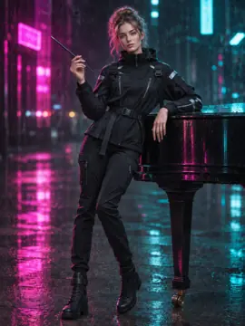</a> | <a href="https://promicat.app/zh/poses/styles/sp184?utm_source=github&utm_medium=readme&utm_campaign=ai-photo-poses">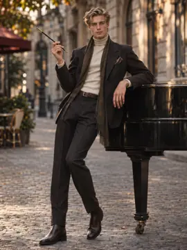</a> | <a href="https://promicat.app/zh/poses/styles/sp184?utm_source=github&utm_medium=readme&utm_campaign=ai-photo-poses">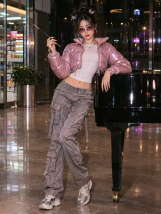</a> |

大图: [写真照](../images/photo-poses/hollywood/sp184-photo.webp) · [白模](../images/photo-poses/hollywood/sp184-pose.webp) · [在 Promicat 生成](https://promicat.app/zh/poses/styles/sp184?utm_source=github&utm_medium=readme&utm_campaign=ai-photo-poses)

<details><summary>提示词：用你的照片（图 1 你的照片，图 2 白模）</summary>

```text
A real professional portrait photoshoot photo: a 1950s Hollywood glamour photoshoot on a classic studio set, hard butterfly light and soft fill, black-and-white or rich Technicolor, 85mm. Subject: the person in image 1 (keep their exact face, facial features, skin tone and hairstyle; do not beautify or swap the face), wearing an elegant floor-length satin gown with sleeves or a tuxedo, finger-wave hair. Pose: leaning on a grand piano with one elbow, holding a long cigarette holder without a cigarette. Image 2 is a wooden artist's mannequin that shows only this body pose: copy it exactly (head, torso, arms, hands, legs, feet, which hand does what, the camera angle), but do not copy the mannequin itself: no wooden skin, no joints, no blank face. Natural, relaxed and unstiff, true skin texture. No text, no logo, no watermark. Portrait 3:4.
```

</details>

<details><summary>提示词：生成示例图（虚构模特）</summary>

```text
A real professional portrait photoshoot photo, the kind posted by a top portrait studio: a 1950s Hollywood glamour photoshoot on a classic studio set, hard butterfly light and soft fill, black-and-white or rich Technicolor, 85mm. Model: a beautiful East African professional fashion model in her twenties with a naturally attractive face, styled hair and natural makeup, wearing an elegant floor-length satin gown with sleeves or a tuxedo, finger-wave hair. The photographer directs the model into a natural, relaxed, unstiff pose that looks caught between moments: leaning on a grand piano with one elbow, holding a long cigarette holder without a cigarette. Asymmetric body, soft hands, flattering angle, true skin texture, refined but not plastic, fully clothed and modest. Full body or three-quarter body in frame, the whole pose clearly readable. No text, no logo, no watermark. Portrait 3:4.
```

</details>

## 躺贵妃椅 (躺)

| 白模 | 好莱坞复古 | 海边度假 | 北欧极简 | 老钱风 |
|---|---|---|---|---|
| 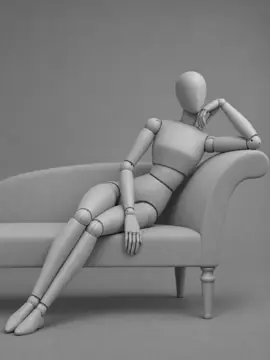 | <a href="https://promicat.app/zh/poses/styles/sp185?utm_source=github&utm_medium=readme&utm_campaign=ai-photo-poses">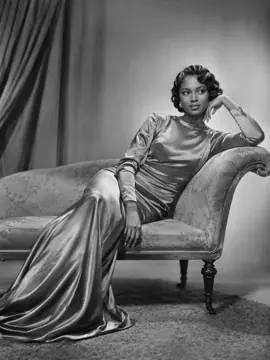</a> | <a href="https://promicat.app/zh/poses/styles/sp185?utm_source=github&utm_medium=readme&utm_campaign=ai-photo-poses">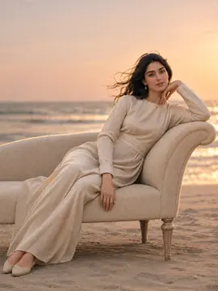</a> | <a href="https://promicat.app/zh/poses/styles/sp185?utm_source=github&utm_medium=readme&utm_campaign=ai-photo-poses">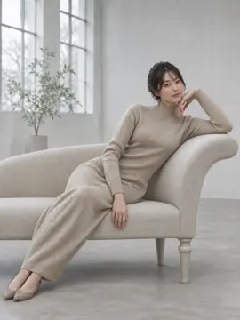</a> | <a href="https://promicat.app/zh/poses/styles/sp185?utm_source=github&utm_medium=readme&utm_campaign=ai-photo-poses">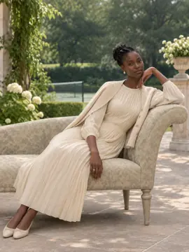</a> |

大图: [写真照](../images/photo-poses/hollywood/sp185-photo.webp) · [白模](../images/photo-poses/hollywood/sp185-pose.webp) · [在 Promicat 生成](https://promicat.app/zh/poses/styles/sp185?utm_source=github&utm_medium=readme&utm_campaign=ai-photo-poses)

<details><summary>提示词：用你的照片（图 1 你的照片，图 2 白模）</summary>

```text
A real professional portrait photoshoot photo: a 1950s Hollywood glamour photoshoot on a classic studio set, hard butterfly light and soft fill, black-and-white or rich Technicolor, 85mm. Subject: the person in image 1 (keep their exact face, facial features, skin tone and hairstyle; do not beautify or swap the face), wearing an elegant floor-length satin gown with sleeves or a tuxedo, finger-wave hair. Pose: reclining on a chaise longue propped on one arm, fully covered gown. Image 2 is a wooden artist's mannequin that shows only this body pose: copy it exactly (head, torso, arms, hands, legs, feet, which hand does what, the camera angle), but do not copy the mannequin itself: no wooden skin, no joints, no blank face. Natural, relaxed and unstiff, true skin texture. No text, no logo, no watermark. Portrait 3:4.
```

</details>

<details><summary>提示词：生成示例图（虚构模特）</summary>

```text
A real professional portrait photoshoot photo, the kind posted by a top portrait studio: a 1950s Hollywood glamour photoshoot on a classic studio set, hard butterfly light and soft fill, black-and-white or rich Technicolor, 85mm. Model: a beautiful Black professional fashion model in her twenties with a naturally attractive face, styled hair and natural makeup, wearing an elegant floor-length satin gown with sleeves or a tuxedo, finger-wave hair. The photographer directs the model into a natural, relaxed, unstiff pose that looks caught between moments: reclining on a chaise longue propped on one arm, fully covered gown. Asymmetric body, soft hands, flattering angle, true skin texture, refined but not plastic, fully clothed and modest. Full body or three-quarter body in frame, the whole pose clearly readable. No text, no logo, no watermark. Portrait 3:4.
```

</details>

## 手托下巴 (半身)

| 白模 | 好莱坞复古 | 校园青春 | 港风复古 | 情绪棚拍 |
|---|---|---|---|---|
| 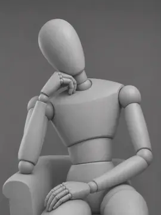 | <a href="https://promicat.app/zh/poses/styles/sp186?utm_source=github&utm_medium=readme&utm_campaign=ai-photo-poses">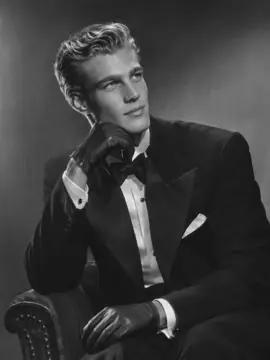</a> | <a href="https://promicat.app/zh/poses/styles/sp186?utm_source=github&utm_medium=readme&utm_campaign=ai-photo-poses">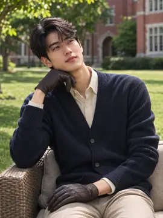</a> | <a href="https://promicat.app/zh/poses/styles/sp186?utm_source=github&utm_medium=readme&utm_campaign=ai-photo-poses">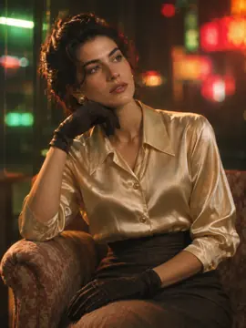</a> | <a href="https://promicat.app/zh/poses/styles/sp186?utm_source=github&utm_medium=readme&utm_campaign=ai-photo-poses">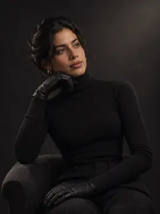</a> |

大图: [写真照](../images/photo-poses/hollywood/sp186-photo.webp) · [白模](../images/photo-poses/hollywood/sp186-pose.webp) · [在 Promicat 生成](https://promicat.app/zh/poses/styles/sp186?utm_source=github&utm_medium=readme&utm_campaign=ai-photo-poses)

<details><summary>提示词：用你的照片（图 1 你的照片，图 2 白模）</summary>

```text
A real professional portrait photoshoot photo: a 1950s Hollywood glamour photoshoot on a classic studio set, hard butterfly light and soft fill, black-and-white or rich Technicolor, 85mm. Subject: the person in image 1 (keep their exact face, facial features, skin tone and hairstyle; do not beautify or swap the face), wearing a classic black tuxedo with a bow tie, slicked-back hair. Pose: resting the chin on the back of a gloved hand, eyes to the light. Image 2 is a wooden artist's mannequin that shows only this body pose: copy it exactly (head, torso, arms, hands, legs, feet, which hand does what, the camera angle), but do not copy the mannequin itself: no wooden skin, no joints, no blank face. Natural, relaxed and unstiff, true skin texture. No text, no logo, no watermark. Portrait 3:4.
```

</details>

<details><summary>提示词：生成示例图（虚构模特）</summary>

```text
A real professional portrait photoshoot photo, the kind posted by a top portrait studio: a 1950s Hollywood glamour photoshoot on a classic studio set, hard butterfly light and soft fill, black-and-white or rich Technicolor, 85mm. Model: a handsome Scandinavian professional male model in his twenties with a well-groomed look and styled hair, wearing a classic black tuxedo with a bow tie, slicked-back hair. The photographer directs the model into a natural, relaxed, unstiff pose that looks caught between moments: resting the chin on the back of a gloved hand, eyes to the light. Asymmetric body, soft hands, flattering angle, true skin texture, refined but not plastic, fully clothed and modest. Waist-up framing, both arms and hands readable. No text, no logo, no watermark. Portrait 3:4.
```

</details>

## 走红毯 (走)

| 白模 | 好莱坞复古 | 森系花田 | 暗黑哥特 | 日系清新 |
|---|---|---|---|---|
| 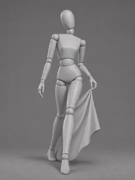 | <a href="https://promicat.app/zh/poses/styles/sp187?utm_source=github&utm_medium=readme&utm_campaign=ai-photo-poses">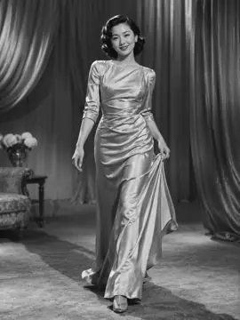</a> | <a href="https://promicat.app/zh/poses/styles/sp187?utm_source=github&utm_medium=readme&utm_campaign=ai-photo-poses">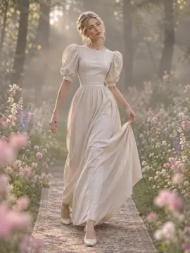</a> | <a href="https://promicat.app/zh/poses/styles/sp187?utm_source=github&utm_medium=readme&utm_campaign=ai-photo-poses">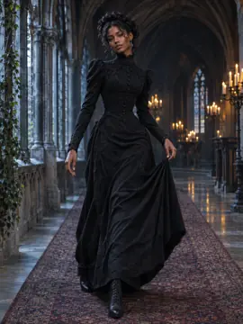</a> | <a href="https://promicat.app/zh/poses/styles/sp187?utm_source=github&utm_medium=readme&utm_campaign=ai-photo-poses">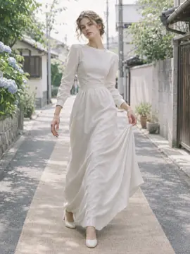</a> |

大图: [写真照](../images/photo-poses/hollywood/sp187-photo.webp) · [白模](../images/photo-poses/hollywood/sp187-pose.webp) · [在 Promicat 生成](https://promicat.app/zh/poses/styles/sp187?utm_source=github&utm_medium=readme&utm_campaign=ai-photo-poses)

<details><summary>提示词：用你的照片（图 1 你的照片，图 2 白模）</summary>

```text
A real professional portrait photoshoot photo: a 1950s Hollywood glamour photoshoot on a classic studio set, hard butterfly light and soft fill, black-and-white or rich Technicolor, 85mm. Subject: the person in image 1 (keep their exact face, facial features, skin tone and hairstyle; do not beautify or swap the face), wearing an elegant floor-length satin gown with sleeves or a tuxedo, finger-wave hair. Pose: walking toward the camera on a carpet, holding the gown slightly. Image 2 is a wooden artist's mannequin that shows only this body pose: copy it exactly (head, torso, arms, hands, legs, feet, which hand does what, the camera angle), but do not copy the mannequin itself: no wooden skin, no joints, no blank face. Natural, relaxed and unstiff, true skin texture. No text, no logo, no watermark. Portrait 3:4.
```

</details>

<details><summary>提示词：生成示例图（虚构模特）</summary>

```text
A real professional portrait photoshoot photo, the kind posted by a top portrait studio: a 1950s Hollywood glamour photoshoot on a classic studio set, hard butterfly light and soft fill, black-and-white or rich Technicolor, 85mm. Model: a beautiful East Asian professional fashion model in her twenties with a naturally attractive face, styled hair and natural makeup, wearing an elegant floor-length satin gown with sleeves or a tuxedo, finger-wave hair. The photographer directs the model into a natural, relaxed, unstiff pose that looks caught between moments: walking toward the camera on a carpet, holding the gown slightly. Asymmetric body, soft hands, flattering angle, true skin texture, refined but not plastic, fully clothed and modest. Full body or three-quarter body in frame, the whole pose clearly readable. No text, no logo, no watermark. Portrait 3:4.
```

</details>

## 转身裙摆 (动态)

| 白模 | 好莱坞复古 | 海边度假 | 新中式 | 学院风 |
|---|---|---|---|---|
| 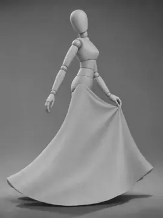 | <a href="https://promicat.app/zh/poses/styles/sp188?utm_source=github&utm_medium=readme&utm_campaign=ai-photo-poses">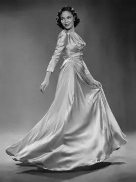</a> | <a href="https://promicat.app/zh/poses/styles/sp188?utm_source=github&utm_medium=readme&utm_campaign=ai-photo-poses">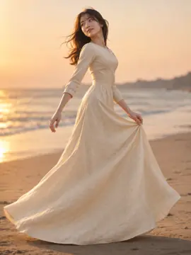</a> | <a href="https://promicat.app/zh/poses/styles/sp188?utm_source=github&utm_medium=readme&utm_campaign=ai-photo-poses">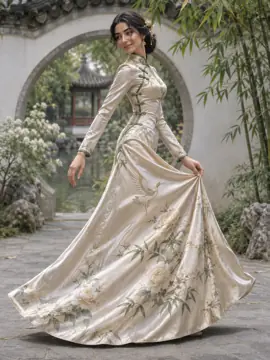</a> | <a href="https://promicat.app/zh/poses/styles/sp188?utm_source=github&utm_medium=readme&utm_campaign=ai-photo-poses">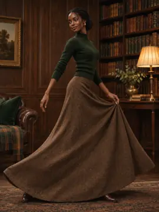</a> |

大图: [写真照](../images/photo-poses/hollywood/sp188-photo.webp) · [白模](../images/photo-poses/hollywood/sp188-pose.webp) · [在 Promicat 生成](https://promicat.app/zh/poses/styles/sp188?utm_source=github&utm_medium=readme&utm_campaign=ai-photo-poses)

<details><summary>提示词：用你的照片（图 1 你的照片，图 2 白模）</summary>

```text
A real professional portrait photoshoot photo: a 1950s Hollywood glamour photoshoot on a classic studio set, hard butterfly light and soft fill, black-and-white or rich Technicolor, 85mm. Subject: the person in image 1 (keep their exact face, facial features, skin tone and hairstyle; do not beautify or swap the face), wearing an elegant floor-length satin gown with sleeves or a tuxedo, finger-wave hair. Pose: turning so the satin gown swirls. Image 2 is a wooden artist's mannequin that shows only this body pose: copy it exactly (head, torso, arms, hands, legs, feet, which hand does what, the camera angle), but do not copy the mannequin itself: no wooden skin, no joints, no blank face. Natural, relaxed and unstiff, true skin texture. No text, no logo, no watermark. Portrait 3:4.
```

</details>

<details><summary>提示词：生成示例图（虚构模特）</summary>

```text
A real professional portrait photoshoot photo, the kind posted by a top portrait studio: a 1950s Hollywood glamour photoshoot on a classic studio set, hard butterfly light and soft fill, black-and-white or rich Technicolor, 85mm. Model: a beautiful mixed-race professional fashion model in her twenties with a naturally attractive face, styled hair and natural makeup, wearing an elegant floor-length satin gown with sleeves or a tuxedo, finger-wave hair. The photographer directs the model into a natural, relaxed, unstiff pose that looks caught between moments: turning so the satin gown swirls. Asymmetric body, soft hands, flattering angle, true skin texture, refined but not plastic, fully clothed and modest. Full body or three-quarter body in frame, the whole pose clearly readable. No text, no logo, no watermark. Portrait 3:4.
```

</details>

## 坐台阶 (坐)

| 白模 | 好莱坞复古 | 波西米亚 | 新中式 | 老钱风 |
|---|---|---|---|---|
| 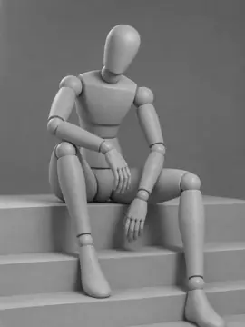 | <a href="https://promicat.app/zh/poses/styles/sp189?utm_source=github&utm_medium=readme&utm_campaign=ai-photo-poses">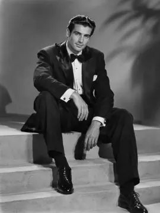</a> | <a href="https://promicat.app/zh/poses/styles/sp189?utm_source=github&utm_medium=readme&utm_campaign=ai-photo-poses">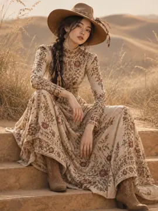</a> | <a href="https://promicat.app/zh/poses/styles/sp189?utm_source=github&utm_medium=readme&utm_campaign=ai-photo-poses">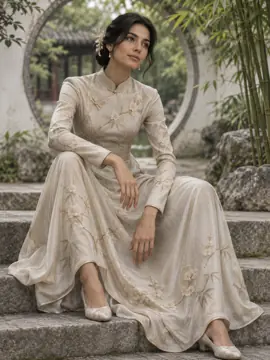</a> | <a href="https://promicat.app/zh/poses/styles/sp189?utm_source=github&utm_medium=readme&utm_campaign=ai-photo-poses">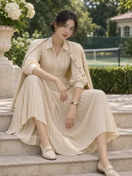</a> |

大图: [写真照](../images/photo-poses/hollywood/sp189-photo.webp) · [白模](../images/photo-poses/hollywood/sp189-pose.webp) · [在 Promicat 生成](https://promicat.app/zh/poses/styles/sp189?utm_source=github&utm_medium=readme&utm_campaign=ai-photo-poses)

<details><summary>提示词：用你的照片（图 1 你的照片，图 2 白模）</summary>

```text
A real professional portrait photoshoot photo: a 1950s Hollywood glamour photoshoot on a classic studio set, hard butterfly light and soft fill, black-and-white or rich Technicolor, 85mm. Subject: the person in image 1 (keep their exact face, facial features, skin tone and hairstyle; do not beautify or swap the face), wearing a classic black tuxedo with a bow tie, slicked-back hair. Pose: sitting on studio steps with the gown spread, head tilted. Image 2 is a wooden artist's mannequin that shows only this body pose: copy it exactly (head, torso, arms, hands, legs, feet, which hand does what, the camera angle), but do not copy the mannequin itself: no wooden skin, no joints, no blank face. Natural, relaxed and unstiff, true skin texture. No text, no logo, no watermark. Portrait 3:4.
```

</details>

<details><summary>提示词：生成示例图（虚构模特）</summary>

```text
A real professional portrait photoshoot photo, the kind posted by a top portrait studio: a 1950s Hollywood glamour photoshoot on a classic studio set, hard butterfly light and soft fill, black-and-white or rich Technicolor, 85mm. Model: a handsome Mediterranean professional male model in his twenties with a well-groomed look and styled hair, wearing a classic black tuxedo with a bow tie, slicked-back hair. The photographer directs the model into a natural, relaxed, unstiff pose that looks caught between moments: sitting on studio steps with the gown spread, head tilted. Asymmetric body, soft hands, flattering angle, true skin texture, refined but not plastic, fully clothed and modest. Full body or three-quarter body in frame, the whole pose clearly readable. No text, no logo, no watermark. Portrait 3:4.
```

</details>

## 整理领结 (半身)

| 白模 | 好莱坞复古 | 校园青春 | 居家慵懒 | 西部牛仔 |
|---|---|---|---|---|
| 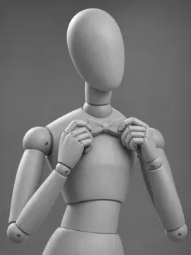 | <a href="https://promicat.app/zh/poses/styles/sp190?utm_source=github&utm_medium=readme&utm_campaign=ai-photo-poses">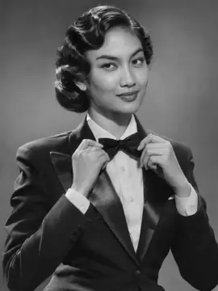</a> | <a href="https://promicat.app/zh/poses/styles/sp190?utm_source=github&utm_medium=readme&utm_campaign=ai-photo-poses">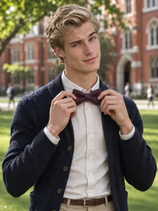</a> | <a href="https://promicat.app/zh/poses/styles/sp190?utm_source=github&utm_medium=readme&utm_campaign=ai-photo-poses">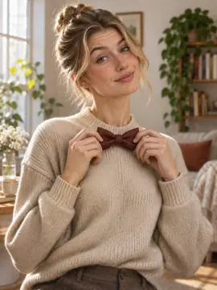</a> | <a href="https://promicat.app/zh/poses/styles/sp190?utm_source=github&utm_medium=readme&utm_campaign=ai-photo-poses">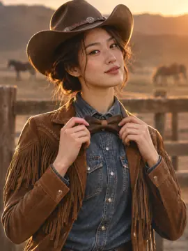</a> |

大图: [写真照](../images/photo-poses/hollywood/sp190-photo.webp) · [白模](../images/photo-poses/hollywood/sp190-pose.webp) · [在 Promicat 生成](https://promicat.app/zh/poses/styles/sp190?utm_source=github&utm_medium=readme&utm_campaign=ai-photo-poses)

<details><summary>提示词：用你的照片（图 1 你的照片，图 2 白模）</summary>

```text
A real professional portrait photoshoot photo: a 1950s Hollywood glamour photoshoot on a classic studio set, hard butterfly light and soft fill, black-and-white or rich Technicolor, 85mm. Subject: the person in image 1 (keep their exact face, facial features, skin tone and hairstyle; do not beautify or swap the face), wearing an elegant floor-length satin gown with sleeves or a tuxedo, finger-wave hair. Pose: adjusting a bow tie with both hands, eyebrow raised. Image 2 is a wooden artist's mannequin that shows only this body pose: copy it exactly (head, torso, arms, hands, legs, feet, which hand does what, the camera angle), but do not copy the mannequin itself: no wooden skin, no joints, no blank face. Natural, relaxed and unstiff, true skin texture. No text, no logo, no watermark. Portrait 3:4.
```

</details>

<details><summary>提示词：生成示例图（虚构模特）</summary>

```text
A real professional portrait photoshoot photo, the kind posted by a top portrait studio: a 1950s Hollywood glamour photoshoot on a classic studio set, hard butterfly light and soft fill, black-and-white or rich Technicolor, 85mm. Model: a beautiful Southeast Asian professional fashion model in her twenties with a naturally attractive face, styled hair and natural makeup, wearing an elegant floor-length satin gown with sleeves or a tuxedo, finger-wave hair. The photographer directs the model into a natural, relaxed, unstiff pose that looks caught between moments: adjusting a bow tie with both hands, eyebrow raised. Asymmetric body, soft hands, flattering angle, true skin texture, refined but not plastic, fully clothed and modest. Waist-up framing, both arms and hands readable. No text, no logo, no watermark. Portrait 3:4.
```

</details>
