# Cosy at home

English · [简体中文](home.zh-CN.md)

10 photo poses: a sample photo and the white model drawn from it. Attach your photo first and the white model second. Try them with your own photo on [Promicat](https://promicat.app/poses?utm_source=github&utm_medium=readme&utm_campaign=ai-photo-poses).

[← Back to all styles](../README.md#photo-poses)

## Sitting on the floor against the sofa hugging one knee (Sitting)

<a href="https://promicat.app/poses/styles/sp061?utm_source=github&utm_medium=readme&utm_campaign=ai-photo-poses">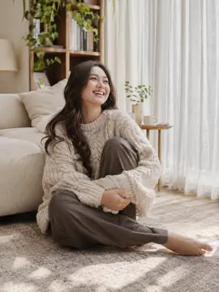</a> 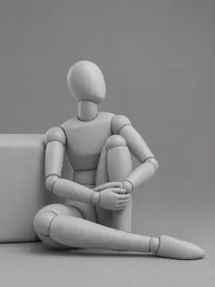

Full size: [photo](../images/photo-poses/home/sp061-photo.webp) · [white model](../images/photo-poses/home/sp061-pose.webp) · [try it on Promicat](https://promicat.app/poses/styles/sp061?utm_source=github&utm_medium=readme&utm_campaign=ai-photo-poses)

<details><summary>Prompt with your photo (image 1: your photo, image 2: white model)</summary>

```text
A real professional portrait photoshoot photo: a cosy at-home lifestyle photoshoot in a sunlit apartment, soft morning window light, 35mm. Subject: the person in image 1 (keep their exact face, facial features, skin tone and hairstyle; do not beautify or swap the face), wearing an oversized knit sweater and comfortable trousers, fully covered. Pose: sitting on the floor against the sofa hugging one knee, laughing toward the window. Image 2 is a wooden artist's mannequin that shows only this body pose: copy it exactly (head, torso, arms, hands, legs, feet, which hand does what, the camera angle), but do not copy the mannequin itself: no wooden skin, no joints, no blank face. Natural, relaxed and unstiff, true skin texture. No text, no logo, no watermark. Portrait 3:4.
```

</details>

<details><summary>Prompt for the sample (fictional model)</summary>

```text
A real professional portrait photoshoot photo, the kind posted by a top portrait studio: a cosy at-home lifestyle photoshoot in a sunlit apartment, soft morning window light, 35mm. Model: a beautiful Southeast Asian professional fashion model in her twenties with a naturally attractive face, styled hair and natural makeup, wearing an oversized knit sweater and comfortable trousers, fully covered. The photographer directs the model into a natural, relaxed, unstiff pose that looks caught between moments: sitting on the floor against the sofa hugging one knee, laughing toward the window. Asymmetric body, soft hands, flattering angle, true skin texture, refined but not plastic, fully clothed and modest. Full body or three-quarter body in frame, the whole pose clearly readable. No text, no logo, no watermark. Portrait 3:4.
```

</details>

## Stretching both arms overhead by the window (In motion)

<a href="https://promicat.app/poses/styles/sp062?utm_source=github&utm_medium=readme&utm_campaign=ai-photo-poses">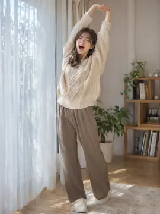</a> 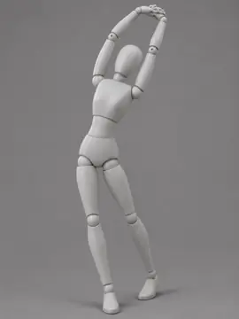

Full size: [photo](../images/photo-poses/home/sp062-photo.webp) · [white model](../images/photo-poses/home/sp062-pose.webp) · [try it on Promicat](https://promicat.app/poses/styles/sp062?utm_source=github&utm_medium=readme&utm_campaign=ai-photo-poses)

<details><summary>Prompt with your photo (image 1: your photo, image 2: white model)</summary>

```text
A real professional portrait photoshoot photo: a cosy at-home lifestyle photoshoot in a sunlit apartment, soft morning window light, 35mm. Subject: the person in image 1 (keep their exact face, facial features, skin tone and hairstyle; do not beautify or swap the face), wearing an oversized knit sweater and comfortable trousers, fully covered. Pose: stretching both arms overhead by the window, eyes closed, yawning. Image 2 is a wooden artist's mannequin that shows only this body pose: copy it exactly (head, torso, arms, hands, legs, feet, which hand does what, the camera angle), but do not copy the mannequin itself: no wooden skin, no joints, no blank face. Natural, relaxed and unstiff, true skin texture. No text, no logo, no watermark. Portrait 3:4.
```

</details>

<details><summary>Prompt for the sample (fictional model)</summary>

```text
A real professional portrait photoshoot photo, the kind posted by a top portrait studio: a cosy at-home lifestyle photoshoot in a sunlit apartment, soft morning window light, 35mm. Model: a beautiful Japanese professional fashion model in her twenties with a naturally attractive face, styled hair and natural makeup, wearing an oversized knit sweater and comfortable trousers, fully covered. The photographer directs the model into a natural, relaxed, unstiff pose that looks caught between moments: stretching both arms overhead by the window, eyes closed, yawning. Asymmetric body, soft hands, flattering angle, true skin texture, refined but not plastic, fully clothed and modest. Full body or three-quarter body in frame, the whole pose clearly readable. No text, no logo, no watermark. Portrait 3:4.
```

</details>

## Sitting cross-legged on a made bed reading (Sitting)

<a href="https://promicat.app/poses/styles/sp063?utm_source=github&utm_medium=readme&utm_campaign=ai-photo-poses">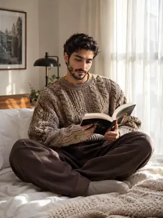</a> 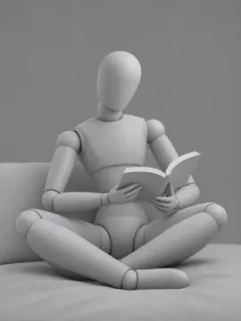

Full size: [photo](../images/photo-poses/home/sp063-photo.webp) · [white model](../images/photo-poses/home/sp063-pose.webp) · [try it on Promicat](https://promicat.app/poses/styles/sp063?utm_source=github&utm_medium=readme&utm_campaign=ai-photo-poses)

<details><summary>Prompt with your photo (image 1: your photo, image 2: white model)</summary>

```text
A real professional portrait photoshoot photo: a cosy at-home lifestyle photoshoot in a sunlit apartment, soft morning window light, 35mm. Subject: the person in image 1 (keep their exact face, facial features, skin tone and hairstyle; do not beautify or swap the face), wearing an oversized knit sweater and comfortable trousers, fully covered. Pose: sitting cross-legged on a made bed reading, fully dressed in a sweater. Image 2 is a wooden artist's mannequin that shows only this body pose: copy it exactly (head, torso, arms, hands, legs, feet, which hand does what, the camera angle), but do not copy the mannequin itself: no wooden skin, no joints, no blank face. Natural, relaxed and unstiff, true skin texture. No text, no logo, no watermark. Portrait 3:4.
```

</details>

<details><summary>Prompt for the sample (fictional model)</summary>

```text
A real professional portrait photoshoot photo, the kind posted by a top portrait studio: a cosy at-home lifestyle photoshoot in a sunlit apartment, soft morning window light, 35mm. Model: a handsome Middle Eastern professional male model in his twenties with a well-groomed look and styled hair, wearing an oversized knit sweater and comfortable trousers, fully covered. The photographer directs the model into a natural, relaxed, unstiff pose that looks caught between moments: sitting cross-legged on a made bed reading, fully dressed in a sweater. Asymmetric body, soft hands, flattering angle, true skin texture, refined but not plastic, fully clothed and modest. Full body or three-quarter body in frame, the whole pose clearly readable. No text, no logo, no watermark. Portrait 3:4.
```

</details>

## Leaning on the kitchen counter holding a mug (Leaning)

<a href="https://promicat.app/poses/styles/sp064?utm_source=github&utm_medium=readme&utm_campaign=ai-photo-poses">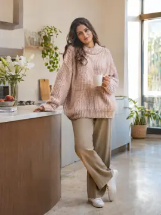</a> 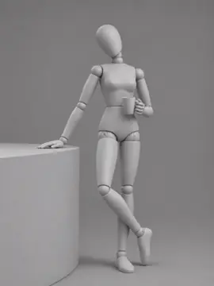

Full size: [photo](../images/photo-poses/home/sp064-photo.webp) · [white model](../images/photo-poses/home/sp064-pose.webp) · [try it on Promicat](https://promicat.app/poses/styles/sp064?utm_source=github&utm_medium=readme&utm_campaign=ai-photo-poses)

<details><summary>Prompt with your photo (image 1: your photo, image 2: white model)</summary>

```text
A real professional portrait photoshoot photo: a cosy at-home lifestyle photoshoot in a sunlit apartment, soft morning window light, 35mm. Subject: the person in image 1 (keep their exact face, facial features, skin tone and hairstyle; do not beautify or swap the face), wearing an oversized knit sweater and comfortable trousers, fully covered. Pose: leaning on the kitchen counter holding a mug, one foot tucked behind the other ankle. Image 2 is a wooden artist's mannequin that shows only this body pose: copy it exactly (head, torso, arms, hands, legs, feet, which hand does what, the camera angle), but do not copy the mannequin itself: no wooden skin, no joints, no blank face. Natural, relaxed and unstiff, true skin texture. No text, no logo, no watermark. Portrait 3:4.
```

</details>

<details><summary>Prompt for the sample (fictional model)</summary>

```text
A real professional portrait photoshoot photo, the kind posted by a top portrait studio: a cosy at-home lifestyle photoshoot in a sunlit apartment, soft morning window light, 35mm. Model: a beautiful Indian professional fashion model in her twenties with a naturally attractive face, styled hair and natural makeup, wearing an oversized knit sweater and comfortable trousers, fully covered. The photographer directs the model into a natural, relaxed, unstiff pose that looks caught between moments: leaning on the kitchen counter holding a mug, one foot tucked behind the other ankle. Asymmetric body, soft hands, flattering angle, true skin texture, refined but not plastic, fully clothed and modest. Full body or three-quarter body in frame, the whole pose clearly readable. No text, no logo, no watermark. Portrait 3:4.
```

</details>

## Lying on the stomach on a rug propped on the elbows (Lying)

<a href="https://promicat.app/poses/styles/sp065?utm_source=github&utm_medium=readme&utm_campaign=ai-photo-poses">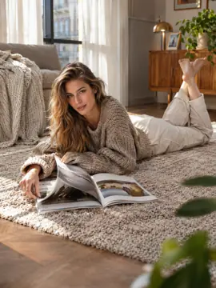</a> 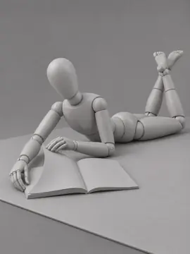

Full size: [photo](../images/photo-poses/home/sp065-photo.webp) · [white model](../images/photo-poses/home/sp065-pose.webp) · [try it on Promicat](https://promicat.app/poses/styles/sp065?utm_source=github&utm_medium=readme&utm_campaign=ai-photo-poses)

<details><summary>Prompt with your photo (image 1: your photo, image 2: white model)</summary>

```text
A real professional portrait photoshoot photo: a cosy at-home lifestyle photoshoot in a sunlit apartment, soft morning window light, 35mm. Subject: the person in image 1 (keep their exact face, facial features, skin tone and hairstyle; do not beautify or swap the face), wearing an oversized knit sweater and comfortable trousers, fully covered. Pose: lying on the stomach on a rug propped on the elbows, flipping a magazine, feet crossed in the air. Image 2 is a wooden artist's mannequin that shows only this body pose: copy it exactly (head, torso, arms, hands, legs, feet, which hand does what, the camera angle), but do not copy the mannequin itself: no wooden skin, no joints, no blank face. Natural, relaxed and unstiff, true skin texture. No text, no logo, no watermark. Portrait 3:4.
```

</details>

<details><summary>Prompt for the sample (fictional model)</summary>

```text
A real professional portrait photoshoot photo, the kind posted by a top portrait studio: a cosy at-home lifestyle photoshoot in a sunlit apartment, soft morning window light, 35mm. Model: a beautiful white European professional fashion model in her twenties with a naturally attractive face, styled hair and natural makeup, wearing an oversized knit sweater and comfortable trousers, fully covered. The photographer directs the model into a natural, relaxed, unstiff pose that looks caught between moments: lying on the stomach on a rug propped on the elbows, flipping a magazine, feet crossed in the air. Asymmetric body, soft hands, flattering angle, true skin texture, refined but not plastic, fully clothed and modest. Full body or three-quarter body in frame, the whole pose clearly readable. No text, no logo, no watermark. Portrait 3:4.
```

</details>

## Curled into the corner of the sofa hugging a cushion (Sitting)

<a href="https://promicat.app/poses/styles/sp066?utm_source=github&utm_medium=readme&utm_campaign=ai-photo-poses">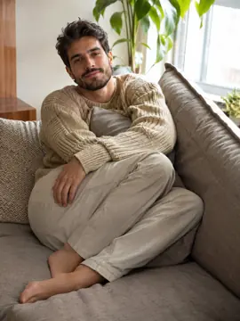</a> 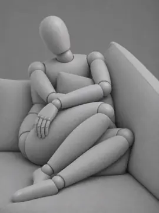

Full size: [photo](../images/photo-poses/home/sp066-photo.webp) · [white model](../images/photo-poses/home/sp066-pose.webp) · [try it on Promicat](https://promicat.app/poses/styles/sp066?utm_source=github&utm_medium=readme&utm_campaign=ai-photo-poses)

<details><summary>Prompt with your photo (image 1: your photo, image 2: white model)</summary>

```text
A real professional portrait photoshoot photo: a cosy at-home lifestyle photoshoot in a sunlit apartment, soft morning window light, 35mm. Subject: the person in image 1 (keep their exact face, facial features, skin tone and hairstyle; do not beautify or swap the face), wearing an oversized knit sweater and comfortable trousers, fully covered. Pose: curled into the corner of the sofa hugging a cushion, looking at the camera. Image 2 is a wooden artist's mannequin that shows only this body pose: copy it exactly (head, torso, arms, hands, legs, feet, which hand does what, the camera angle), but do not copy the mannequin itself: no wooden skin, no joints, no blank face. Natural, relaxed and unstiff, true skin texture. No text, no logo, no watermark. Portrait 3:4.
```

</details>

<details><summary>Prompt for the sample (fictional model)</summary>

```text
A real professional portrait photoshoot photo, the kind posted by a top portrait studio: a cosy at-home lifestyle photoshoot in a sunlit apartment, soft morning window light, 35mm. Model: a handsome Brazilian professional male model in his twenties with a well-groomed look and styled hair, wearing an oversized knit sweater and comfortable trousers, fully covered. The photographer directs the model into a natural, relaxed, unstiff pose that looks caught between moments: curled into the corner of the sofa hugging a cushion, looking at the camera. Asymmetric body, soft hands, flattering angle, true skin texture, refined but not plastic, fully clothed and modest. Full body or three-quarter body in frame, the whole pose clearly readable. No text, no logo, no watermark. Portrait 3:4.
```

</details>

## Watering plants on the window sill (Standing)

<a href="https://promicat.app/poses/styles/sp067?utm_source=github&utm_medium=readme&utm_campaign=ai-photo-poses">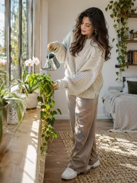</a> 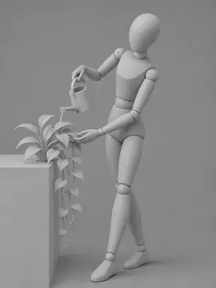

Full size: [photo](../images/photo-poses/home/sp067-photo.webp) · [white model](../images/photo-poses/home/sp067-pose.webp) · [try it on Promicat](https://promicat.app/poses/styles/sp067?utm_source=github&utm_medium=readme&utm_campaign=ai-photo-poses)

<details><summary>Prompt with your photo (image 1: your photo, image 2: white model)</summary>

```text
A real professional portrait photoshoot photo: a cosy at-home lifestyle photoshoot in a sunlit apartment, soft morning window light, 35mm. Subject: the person in image 1 (keep their exact face, facial features, skin tone and hairstyle; do not beautify or swap the face), wearing an oversized knit sweater and comfortable trousers, fully covered. Pose: watering plants on the window sill, leaning slightly forward. Image 2 is a wooden artist's mannequin that shows only this body pose: copy it exactly (head, torso, arms, hands, legs, feet, which hand does what, the camera angle), but do not copy the mannequin itself: no wooden skin, no joints, no blank face. Natural, relaxed and unstiff, true skin texture. No text, no logo, no watermark. Portrait 3:4.
```

</details>

<details><summary>Prompt for the sample (fictional model)</summary>

```text
A real professional portrait photoshoot photo, the kind posted by a top portrait studio: a cosy at-home lifestyle photoshoot in a sunlit apartment, soft morning window light, 35mm. Model: a beautiful Latina professional fashion model in her twenties with a naturally attractive face, styled hair and natural makeup, wearing an oversized knit sweater and comfortable trousers, fully covered. The photographer directs the model into a natural, relaxed, unstiff pose that looks caught between moments: watering plants on the window sill, leaning slightly forward. Asymmetric body, soft hands, flattering angle, true skin texture, refined but not plastic, fully clothed and modest. Full body or three-quarter body in frame, the whole pose clearly readable. No text, no logo, no watermark. Portrait 3:4.
```

</details>

## Sitting on a deep window sill with knees up (Sitting)

<a href="https://promicat.app/poses/styles/sp068?utm_source=github&utm_medium=readme&utm_campaign=ai-photo-poses">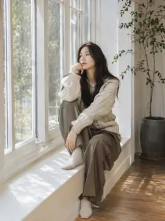</a> 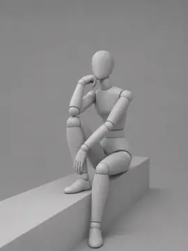

Full size: [photo](../images/photo-poses/home/sp068-photo.webp) · [white model](../images/photo-poses/home/sp068-pose.webp) · [try it on Promicat](https://promicat.app/poses/styles/sp068?utm_source=github&utm_medium=readme&utm_campaign=ai-photo-poses)

<details><summary>Prompt with your photo (image 1: your photo, image 2: white model)</summary>

```text
A real professional portrait photoshoot photo: a cosy at-home lifestyle photoshoot in a sunlit apartment, soft morning window light, 35mm. Subject: the person in image 1 (keep their exact face, facial features, skin tone and hairstyle; do not beautify or swap the face), wearing an oversized knit sweater and comfortable trousers, fully covered. Pose: sitting on a deep window sill with knees up, looking outside. Image 2 is a wooden artist's mannequin that shows only this body pose: copy it exactly (head, torso, arms, hands, legs, feet, which hand does what, the camera angle), but do not copy the mannequin itself: no wooden skin, no joints, no blank face. Natural, relaxed and unstiff, true skin texture. No text, no logo, no watermark. Portrait 3:4.
```

</details>

<details><summary>Prompt for the sample (fictional model)</summary>

```text
A real professional portrait photoshoot photo, the kind posted by a top portrait studio: a cosy at-home lifestyle photoshoot in a sunlit apartment, soft morning window light, 35mm. Model: a beautiful Korean professional fashion model in her twenties with a naturally attractive face, styled hair and natural makeup, wearing an oversized knit sweater and comfortable trousers, fully covered. The photographer directs the model into a natural, relaxed, unstiff pose that looks caught between moments: sitting on a deep window sill with knees up, looking outside. Asymmetric body, soft hands, flattering angle, true skin texture, refined but not plastic, fully clothed and modest. Full body or three-quarter body in frame, the whole pose clearly readable. No text, no logo, no watermark. Portrait 3:4.
```

</details>

## Wrapped in a knitted blanket held closed at the chin (Upper body)

<a href="https://promicat.app/poses/styles/sp069?utm_source=github&utm_medium=readme&utm_campaign=ai-photo-poses">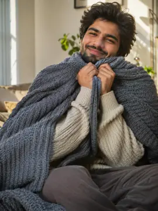</a> 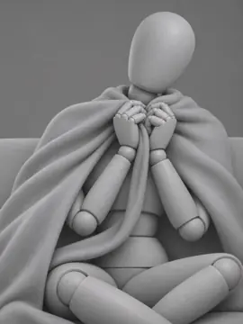

Full size: [photo](../images/photo-poses/home/sp069-photo.webp) · [white model](../images/photo-poses/home/sp069-pose.webp) · [try it on Promicat](https://promicat.app/poses/styles/sp069?utm_source=github&utm_medium=readme&utm_campaign=ai-photo-poses)

<details><summary>Prompt with your photo (image 1: your photo, image 2: white model)</summary>

```text
A real professional portrait photoshoot photo: a cosy at-home lifestyle photoshoot in a sunlit apartment, soft morning window light, 35mm. Subject: the person in image 1 (keep their exact face, facial features, skin tone and hairstyle; do not beautify or swap the face), wearing an oversized knit sweater and comfortable trousers, fully covered. Pose: wrapped in a knitted blanket held closed at the chin, smiling sleepily. Image 2 is a wooden artist's mannequin that shows only this body pose: copy it exactly (head, torso, arms, hands, legs, feet, which hand does what, the camera angle), but do not copy the mannequin itself: no wooden skin, no joints, no blank face. Natural, relaxed and unstiff, true skin texture. No text, no logo, no watermark. Portrait 3:4.
```

</details>

<details><summary>Prompt for the sample (fictional model)</summary>

```text
A real professional portrait photoshoot photo, the kind posted by a top portrait studio: a cosy at-home lifestyle photoshoot in a sunlit apartment, soft morning window light, 35mm. Model: a handsome South Asian professional male model in his twenties with a well-groomed look and styled hair, wearing an oversized knit sweater and comfortable trousers, fully covered. The photographer directs the model into a natural, relaxed, unstiff pose that looks caught between moments: wrapped in a knitted blanket held closed at the chin, smiling sleepily. Asymmetric body, soft hands, flattering angle, true skin texture, refined but not plastic, fully clothed and modest. Waist-up framing, both arms and hands readable. No text, no logo, no watermark. Portrait 3:4.
```

</details>

## Walking barefoot across the wooden floor carrying a cup (Walking)

<a href="https://promicat.app/poses/styles/sp070?utm_source=github&utm_medium=readme&utm_campaign=ai-photo-poses">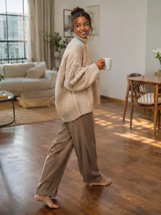</a> 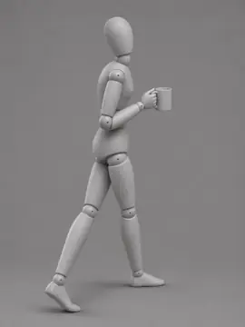

Full size: [photo](../images/photo-poses/home/sp070-photo.webp) · [white model](../images/photo-poses/home/sp070-pose.webp) · [try it on Promicat](https://promicat.app/poses/styles/sp070?utm_source=github&utm_medium=readme&utm_campaign=ai-photo-poses)

<details><summary>Prompt with your photo (image 1: your photo, image 2: white model)</summary>

```text
A real professional portrait photoshoot photo: a cosy at-home lifestyle photoshoot in a sunlit apartment, soft morning window light, 35mm. Subject: the person in image 1 (keep their exact face, facial features, skin tone and hairstyle; do not beautify or swap the face), wearing an oversized knit sweater and comfortable trousers, fully covered. Pose: walking barefoot across the wooden floor carrying a cup, glancing back. Image 2 is a wooden artist's mannequin that shows only this body pose: copy it exactly (head, torso, arms, hands, legs, feet, which hand does what, the camera angle), but do not copy the mannequin itself: no wooden skin, no joints, no blank face. Natural, relaxed and unstiff, true skin texture. No text, no logo, no watermark. Portrait 3:4.
```

</details>

<details><summary>Prompt for the sample (fictional model)</summary>

```text
A real professional portrait photoshoot photo, the kind posted by a top portrait studio: a cosy at-home lifestyle photoshoot in a sunlit apartment, soft morning window light, 35mm. Model: a beautiful East African professional fashion model in her twenties with a naturally attractive face, styled hair and natural makeup, wearing an oversized knit sweater and comfortable trousers, fully covered. The photographer directs the model into a natural, relaxed, unstiff pose that looks caught between moments: walking barefoot across the wooden floor carrying a cup, glancing back. Asymmetric body, soft hands, flattering angle, true skin texture, refined but not plastic, fully clothed and modest. Full body or three-quarter body in frame, the whole pose clearly readable. No text, no logo, no watermark. Portrait 3:4.
```

</details>
