# 居家慵懒

[English](home.md) · 简体中文

10 个白模，每个配 4 张用它拍出的不同风格写真。参考图顺序是你的照片在前、白模在后。也可以在 [Promicat](https://promicat.app/zh/poses?utm_source=github&utm_medium=readme&utm_campaign=ai-photo-poses) 上传照片直接生成。

[← 返回全部风格](../README.zh-CN.md#photo-poses)

## 靠沙发抱膝笑 (坐)

| 白模 | 居家慵懒 | 波西米亚 | 港风复古 | 老钱风 |
|---|---|---|---|---|
|  | <a href="https://promicat.app/zh/poses/styles/sp061?utm_source=github&utm_medium=readme&utm_campaign=ai-photo-poses"></a> | <a href="https://promicat.app/zh/poses/styles/sp061?utm_source=github&utm_medium=readme&utm_campaign=ai-photo-poses">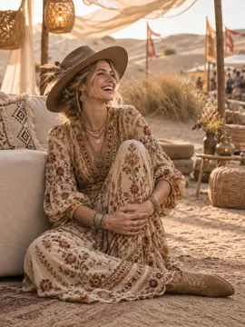</a> | <a href="https://promicat.app/zh/poses/styles/sp061?utm_source=github&utm_medium=readme&utm_campaign=ai-photo-poses">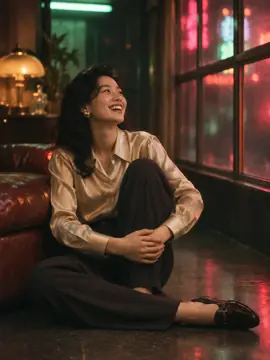</a> | <a href="https://promicat.app/zh/poses/styles/sp061?utm_source=github&utm_medium=readme&utm_campaign=ai-photo-poses">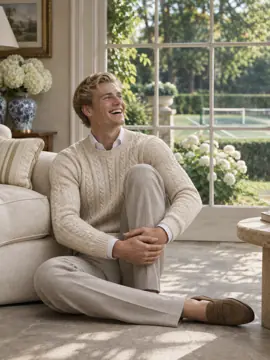</a> |

大图: [写真照](../images/photo-poses/home/sp061-photo.webp) · [白模](../images/photo-poses/home/sp061-pose.webp) · [在 Promicat 生成](https://promicat.app/zh/poses/styles/sp061?utm_source=github&utm_medium=readme&utm_campaign=ai-photo-poses)

<details><summary>提示词：用你的照片（图 1 你的照片，图 2 白模）</summary>

```text
A real professional portrait photoshoot photo: a cosy at-home lifestyle photoshoot in a sunlit apartment, soft morning window light, 35mm. Subject: the person in image 1 (keep their exact face, facial features, skin tone and hairstyle; do not beautify or swap the face), wearing an oversized knit sweater and comfortable trousers, fully covered. Pose: sitting on the floor against the sofa hugging one knee, laughing toward the window. Image 2 is a wooden artist's mannequin that shows only this body pose: copy it exactly (head, torso, arms, hands, legs, feet, which hand does what, the camera angle), but do not copy the mannequin itself: no wooden skin, no joints, no blank face. Natural, relaxed and unstiff, true skin texture. No text, no logo, no watermark. Portrait 3:4.
```

</details>

<details><summary>提示词：生成示例图（虚构模特）</summary>

```text
A real professional portrait photoshoot photo, the kind posted by a top portrait studio: a cosy at-home lifestyle photoshoot in a sunlit apartment, soft morning window light, 35mm. Model: a beautiful Southeast Asian professional fashion model in her twenties with a naturally attractive face, styled hair and natural makeup, wearing an oversized knit sweater and comfortable trousers, fully covered. The photographer directs the model into a natural, relaxed, unstiff pose that looks caught between moments: sitting on the floor against the sofa hugging one knee, laughing toward the window. Asymmetric body, soft hands, flattering angle, true skin texture, refined but not plastic, fully clothed and modest. Full body or three-quarter body in frame, the whole pose clearly readable. No text, no logo, no watermark. Portrait 3:4.
```

</details>

## 窗边伸懒腰 (动态)

| 白模 | 居家慵懒 | 赛博霓虹 | 学院风 | 暗黑哥特 |
|---|---|---|---|---|
| 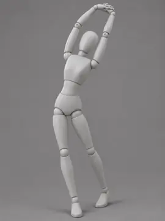 | <a href="https://promicat.app/zh/poses/styles/sp062?utm_source=github&utm_medium=readme&utm_campaign=ai-photo-poses"></a> | <a href="https://promicat.app/zh/poses/styles/sp062?utm_source=github&utm_medium=readme&utm_campaign=ai-photo-poses">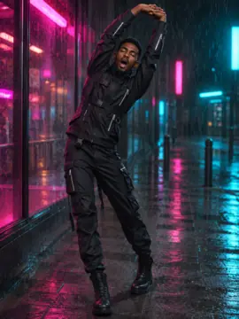</a> | <a href="https://promicat.app/zh/poses/styles/sp062?utm_source=github&utm_medium=readme&utm_campaign=ai-photo-poses">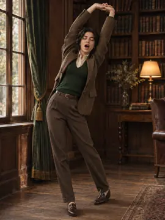</a> | <a href="https://promicat.app/zh/poses/styles/sp062?utm_source=github&utm_medium=readme&utm_campaign=ai-photo-poses">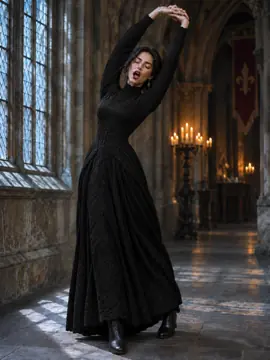</a> |

大图: [写真照](../images/photo-poses/home/sp062-photo.webp) · [白模](../images/photo-poses/home/sp062-pose.webp) · [在 Promicat 生成](https://promicat.app/zh/poses/styles/sp062?utm_source=github&utm_medium=readme&utm_campaign=ai-photo-poses)

<details><summary>提示词：用你的照片（图 1 你的照片，图 2 白模）</summary>

```text
A real professional portrait photoshoot photo: a cosy at-home lifestyle photoshoot in a sunlit apartment, soft morning window light, 35mm. Subject: the person in image 1 (keep their exact face, facial features, skin tone and hairstyle; do not beautify or swap the face), wearing an oversized knit sweater and comfortable trousers, fully covered. Pose: stretching both arms overhead by the window, eyes closed, yawning. Image 2 is a wooden artist's mannequin that shows only this body pose: copy it exactly (head, torso, arms, hands, legs, feet, which hand does what, the camera angle), but do not copy the mannequin itself: no wooden skin, no joints, no blank face. Natural, relaxed and unstiff, true skin texture. No text, no logo, no watermark. Portrait 3:4.
```

</details>

<details><summary>提示词：生成示例图（虚构模特）</summary>

```text
A real professional portrait photoshoot photo, the kind posted by a top portrait studio: a cosy at-home lifestyle photoshoot in a sunlit apartment, soft morning window light, 35mm. Model: a beautiful Japanese professional fashion model in her twenties with a naturally attractive face, styled hair and natural makeup, wearing an oversized knit sweater and comfortable trousers, fully covered. The photographer directs the model into a natural, relaxed, unstiff pose that looks caught between moments: stretching both arms overhead by the window, eyes closed, yawning. Asymmetric body, soft hands, flattering angle, true skin texture, refined but not plastic, fully clothed and modest. Full body or three-quarter body in frame, the whole pose clearly readable. No text, no logo, no watermark. Portrait 3:4.
```

</details>

## 床边看书 (坐)

| 白模 | 居家慵懒 | 森系花田 | 日系清新 | Y2K 千禧辣妹 |
|---|---|---|---|---|
| 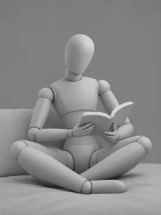 | <a href="https://promicat.app/zh/poses/styles/sp063?utm_source=github&utm_medium=readme&utm_campaign=ai-photo-poses"></a> | <a href="https://promicat.app/zh/poses/styles/sp063?utm_source=github&utm_medium=readme&utm_campaign=ai-photo-poses">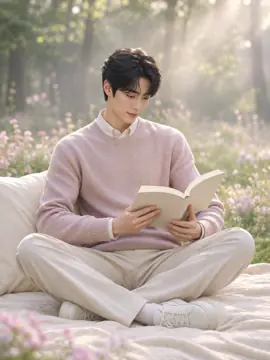</a> | <a href="https://promicat.app/zh/poses/styles/sp063?utm_source=github&utm_medium=readme&utm_campaign=ai-photo-poses">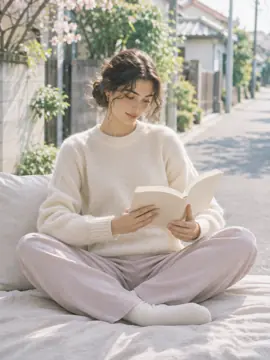</a> | <a href="https://promicat.app/zh/poses/styles/sp063?utm_source=github&utm_medium=readme&utm_campaign=ai-photo-poses">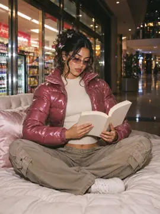</a> |

大图: [写真照](../images/photo-poses/home/sp063-photo.webp) · [白模](../images/photo-poses/home/sp063-pose.webp) · [在 Promicat 生成](https://promicat.app/zh/poses/styles/sp063?utm_source=github&utm_medium=readme&utm_campaign=ai-photo-poses)

<details><summary>提示词：用你的照片（图 1 你的照片，图 2 白模）</summary>

```text
A real professional portrait photoshoot photo: a cosy at-home lifestyle photoshoot in a sunlit apartment, soft morning window light, 35mm. Subject: the person in image 1 (keep their exact face, facial features, skin tone and hairstyle; do not beautify or swap the face), wearing an oversized knit sweater and comfortable trousers, fully covered. Pose: sitting cross-legged on a made bed reading, fully dressed in a sweater. Image 2 is a wooden artist's mannequin that shows only this body pose: copy it exactly (head, torso, arms, hands, legs, feet, which hand does what, the camera angle), but do not copy the mannequin itself: no wooden skin, no joints, no blank face. Natural, relaxed and unstiff, true skin texture. No text, no logo, no watermark. Portrait 3:4.
```

</details>

<details><summary>提示词：生成示例图（虚构模特）</summary>

```text
A real professional portrait photoshoot photo, the kind posted by a top portrait studio: a cosy at-home lifestyle photoshoot in a sunlit apartment, soft morning window light, 35mm. Model: a handsome Middle Eastern professional male model in his twenties with a well-groomed look and styled hair, wearing an oversized knit sweater and comfortable trousers, fully covered. The photographer directs the model into a natural, relaxed, unstiff pose that looks caught between moments: sitting cross-legged on a made bed reading, fully dressed in a sweater. Asymmetric body, soft hands, flattering angle, true skin texture, refined but not plastic, fully clothed and modest. Full body or three-quarter body in frame, the whole pose clearly readable. No text, no logo, no watermark. Portrait 3:4.
```

</details>

## 厨房倚台 (靠)

| 白模 | 居家慵懒 | 咖啡馆文艺 | 新中式 | 情绪棚拍 |
|---|---|---|---|---|
|  | <a href="https://promicat.app/zh/poses/styles/sp064?utm_source=github&utm_medium=readme&utm_campaign=ai-photo-poses"></a> | <a href="https://promicat.app/zh/poses/styles/sp064?utm_source=github&utm_medium=readme&utm_campaign=ai-photo-poses">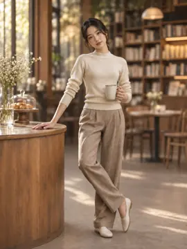</a> | <a href="https://promicat.app/zh/poses/styles/sp064?utm_source=github&utm_medium=readme&utm_campaign=ai-photo-poses">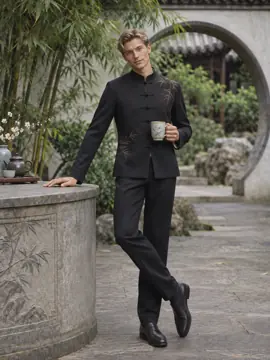</a> | <a href="https://promicat.app/zh/poses/styles/sp064?utm_source=github&utm_medium=readme&utm_campaign=ai-photo-poses">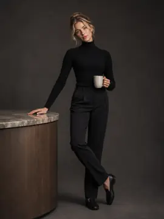</a> |

大图: [写真照](../images/photo-poses/home/sp064-photo.webp) · [白模](../images/photo-poses/home/sp064-pose.webp) · [在 Promicat 生成](https://promicat.app/zh/poses/styles/sp064?utm_source=github&utm_medium=readme&utm_campaign=ai-photo-poses)

<details><summary>提示词：用你的照片（图 1 你的照片，图 2 白模）</summary>

```text
A real professional portrait photoshoot photo: a cosy at-home lifestyle photoshoot in a sunlit apartment, soft morning window light, 35mm. Subject: the person in image 1 (keep their exact face, facial features, skin tone and hairstyle; do not beautify or swap the face), wearing an oversized knit sweater and comfortable trousers, fully covered. Pose: leaning on the kitchen counter holding a mug, one foot tucked behind the other ankle. Image 2 is a wooden artist's mannequin that shows only this body pose: copy it exactly (head, torso, arms, hands, legs, feet, which hand does what, the camera angle), but do not copy the mannequin itself: no wooden skin, no joints, no blank face. Natural, relaxed and unstiff, true skin texture. No text, no logo, no watermark. Portrait 3:4.
```

</details>

<details><summary>提示词：生成示例图（虚构模特）</summary>

```text
A real professional portrait photoshoot photo, the kind posted by a top portrait studio: a cosy at-home lifestyle photoshoot in a sunlit apartment, soft morning window light, 35mm. Model: a beautiful Indian professional fashion model in her twenties with a naturally attractive face, styled hair and natural makeup, wearing an oversized knit sweater and comfortable trousers, fully covered. The photographer directs the model into a natural, relaxed, unstiff pose that looks caught between moments: leaning on the kitchen counter holding a mug, one foot tucked behind the other ankle. Asymmetric body, soft hands, flattering angle, true skin texture, refined but not plastic, fully clothed and modest. Full body or three-quarter body in frame, the whole pose clearly readable. No text, no logo, no watermark. Portrait 3:4.
```

</details>

## 地毯趴着 (躺)

| 白模 | 居家慵懒 | 街头朋克 | 街拍时尚 | 西部牛仔 |
|---|---|---|---|---|
|  | <a href="https://promicat.app/zh/poses/styles/sp065?utm_source=github&utm_medium=readme&utm_campaign=ai-photo-poses">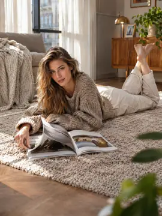</a> | <a href="https://promicat.app/zh/poses/styles/sp065?utm_source=github&utm_medium=readme&utm_campaign=ai-photo-poses">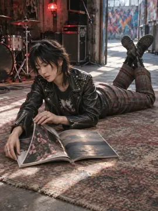</a> | <a href="https://promicat.app/zh/poses/styles/sp065?utm_source=github&utm_medium=readme&utm_campaign=ai-photo-poses">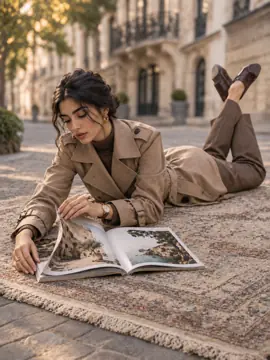</a> | <a href="https://promicat.app/zh/poses/styles/sp065?utm_source=github&utm_medium=readme&utm_campaign=ai-photo-poses">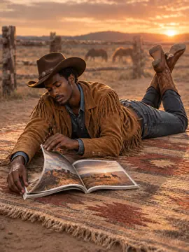</a> |

大图: [写真照](../images/photo-poses/home/sp065-photo.webp) · [白模](../images/photo-poses/home/sp065-pose.webp) · [在 Promicat 生成](https://promicat.app/zh/poses/styles/sp065?utm_source=github&utm_medium=readme&utm_campaign=ai-photo-poses)

<details><summary>提示词：用你的照片（图 1 你的照片，图 2 白模）</summary>

```text
A real professional portrait photoshoot photo: a cosy at-home lifestyle photoshoot in a sunlit apartment, soft morning window light, 35mm. Subject: the person in image 1 (keep their exact face, facial features, skin tone and hairstyle; do not beautify or swap the face), wearing an oversized knit sweater and comfortable trousers, fully covered. Pose: lying on the stomach on a rug propped on the elbows, flipping a magazine, feet crossed in the air. Image 2 is a wooden artist's mannequin that shows only this body pose: copy it exactly (head, torso, arms, hands, legs, feet, which hand does what, the camera angle), but do not copy the mannequin itself: no wooden skin, no joints, no blank face. Natural, relaxed and unstiff, true skin texture. No text, no logo, no watermark. Portrait 3:4.
```

</details>

<details><summary>提示词：生成示例图（虚构模特）</summary>

```text
A real professional portrait photoshoot photo, the kind posted by a top portrait studio: a cosy at-home lifestyle photoshoot in a sunlit apartment, soft morning window light, 35mm. Model: a beautiful white European professional fashion model in her twenties with a naturally attractive face, styled hair and natural makeup, wearing an oversized knit sweater and comfortable trousers, fully covered. The photographer directs the model into a natural, relaxed, unstiff pose that looks caught between moments: lying on the stomach on a rug propped on the elbows, flipping a magazine, feet crossed in the air. Asymmetric body, soft hands, flattering angle, true skin texture, refined but not plastic, fully clothed and modest. Full body or three-quarter body in frame, the whole pose clearly readable. No text, no logo, no watermark. Portrait 3:4.
```

</details>

## 抱枕窝沙发 (坐)

| 白模 | 居家慵懒 | 港风复古 | 日系清新 | Y2K 千禧辣妹 |
|---|---|---|---|---|
| 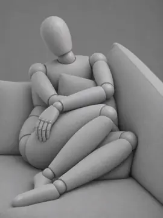 | <a href="https://promicat.app/zh/poses/styles/sp066?utm_source=github&utm_medium=readme&utm_campaign=ai-photo-poses"></a> | <a href="https://promicat.app/zh/poses/styles/sp066?utm_source=github&utm_medium=readme&utm_campaign=ai-photo-poses">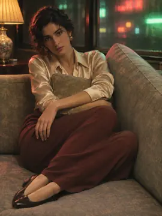</a> | <a href="https://promicat.app/zh/poses/styles/sp066?utm_source=github&utm_medium=readme&utm_campaign=ai-photo-poses">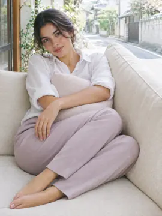</a> | <a href="https://promicat.app/zh/poses/styles/sp066?utm_source=github&utm_medium=readme&utm_campaign=ai-photo-poses">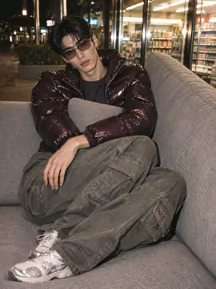</a> |

大图: [写真照](../images/photo-poses/home/sp066-photo.webp) · [白模](../images/photo-poses/home/sp066-pose.webp) · [在 Promicat 生成](https://promicat.app/zh/poses/styles/sp066?utm_source=github&utm_medium=readme&utm_campaign=ai-photo-poses)

<details><summary>提示词：用你的照片（图 1 你的照片，图 2 白模）</summary>

```text
A real professional portrait photoshoot photo: a cosy at-home lifestyle photoshoot in a sunlit apartment, soft morning window light, 35mm. Subject: the person in image 1 (keep their exact face, facial features, skin tone and hairstyle; do not beautify or swap the face), wearing an oversized knit sweater and comfortable trousers, fully covered. Pose: curled into the corner of the sofa hugging a cushion, looking at the camera. Image 2 is a wooden artist's mannequin that shows only this body pose: copy it exactly (head, torso, arms, hands, legs, feet, which hand does what, the camera angle), but do not copy the mannequin itself: no wooden skin, no joints, no blank face. Natural, relaxed and unstiff, true skin texture. No text, no logo, no watermark. Portrait 3:4.
```

</details>

<details><summary>提示词：生成示例图（虚构模特）</summary>

```text
A real professional portrait photoshoot photo, the kind posted by a top portrait studio: a cosy at-home lifestyle photoshoot in a sunlit apartment, soft morning window light, 35mm. Model: a handsome Brazilian professional male model in his twenties with a well-groomed look and styled hair, wearing an oversized knit sweater and comfortable trousers, fully covered. The photographer directs the model into a natural, relaxed, unstiff pose that looks caught between moments: curled into the corner of the sofa hugging a cushion, looking at the camera. Asymmetric body, soft hands, flattering angle, true skin texture, refined but not plastic, fully clothed and modest. Full body or three-quarter body in frame, the whole pose clearly readable. No text, no logo, no watermark. Portrait 3:4.
```

</details>

## 浇花 (站)

| 白模 | 居家慵懒 | 校园青春 | 学院风 | 街头朋克 |
|---|---|---|---|---|
|  | <a href="https://promicat.app/zh/poses/styles/sp067?utm_source=github&utm_medium=readme&utm_campaign=ai-photo-poses">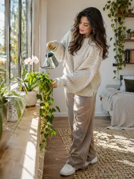</a> | <a href="https://promicat.app/zh/poses/styles/sp067?utm_source=github&utm_medium=readme&utm_campaign=ai-photo-poses">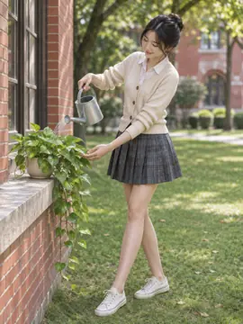</a> | <a href="https://promicat.app/zh/poses/styles/sp067?utm_source=github&utm_medium=readme&utm_campaign=ai-photo-poses">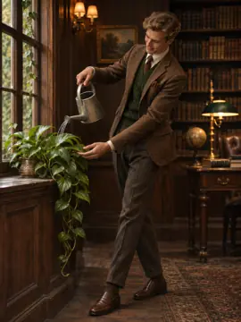</a> | <a href="https://promicat.app/zh/poses/styles/sp067?utm_source=github&utm_medium=readme&utm_campaign=ai-photo-poses">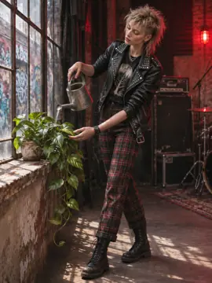</a> |

大图: [写真照](../images/photo-poses/home/sp067-photo.webp) · [白模](../images/photo-poses/home/sp067-pose.webp) · [在 Promicat 生成](https://promicat.app/zh/poses/styles/sp067?utm_source=github&utm_medium=readme&utm_campaign=ai-photo-poses)

<details><summary>提示词：用你的照片（图 1 你的照片，图 2 白模）</summary>

```text
A real professional portrait photoshoot photo: a cosy at-home lifestyle photoshoot in a sunlit apartment, soft morning window light, 35mm. Subject: the person in image 1 (keep their exact face, facial features, skin tone and hairstyle; do not beautify or swap the face), wearing an oversized knit sweater and comfortable trousers, fully covered. Pose: watering plants on the window sill, leaning slightly forward. Image 2 is a wooden artist's mannequin that shows only this body pose: copy it exactly (head, torso, arms, hands, legs, feet, which hand does what, the camera angle), but do not copy the mannequin itself: no wooden skin, no joints, no blank face. Natural, relaxed and unstiff, true skin texture. No text, no logo, no watermark. Portrait 3:4.
```

</details>

<details><summary>提示词：生成示例图（虚构模特）</summary>

```text
A real professional portrait photoshoot photo, the kind posted by a top portrait studio: a cosy at-home lifestyle photoshoot in a sunlit apartment, soft morning window light, 35mm. Model: a beautiful Latina professional fashion model in her twenties with a naturally attractive face, styled hair and natural makeup, wearing an oversized knit sweater and comfortable trousers, fully covered. The photographer directs the model into a natural, relaxed, unstiff pose that looks caught between moments: watering plants on the window sill, leaning slightly forward. Asymmetric body, soft hands, flattering angle, true skin texture, refined but not plastic, fully clothed and modest. Full body or three-quarter body in frame, the whole pose clearly readable. No text, no logo, no watermark. Portrait 3:4.
```

</details>

## 窗台坐 (坐)

| 白模 | 居家慵懒 | 暗黑哥特 | 日系清新 | 老钱风 |
|---|---|---|---|---|
|  | <a href="https://promicat.app/zh/poses/styles/sp068?utm_source=github&utm_medium=readme&utm_campaign=ai-photo-poses"></a> | <a href="https://promicat.app/zh/poses/styles/sp068?utm_source=github&utm_medium=readme&utm_campaign=ai-photo-poses">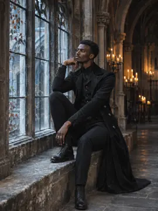</a> | <a href="https://promicat.app/zh/poses/styles/sp068?utm_source=github&utm_medium=readme&utm_campaign=ai-photo-poses">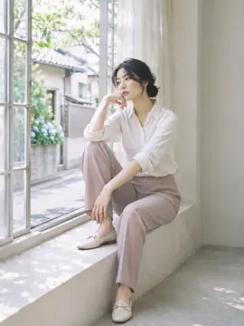</a> | <a href="https://promicat.app/zh/poses/styles/sp068?utm_source=github&utm_medium=readme&utm_campaign=ai-photo-poses">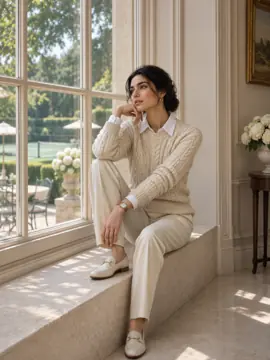</a> |

大图: [写真照](../images/photo-poses/home/sp068-photo.webp) · [白模](../images/photo-poses/home/sp068-pose.webp) · [在 Promicat 生成](https://promicat.app/zh/poses/styles/sp068?utm_source=github&utm_medium=readme&utm_campaign=ai-photo-poses)

<details><summary>提示词：用你的照片（图 1 你的照片，图 2 白模）</summary>

```text
A real professional portrait photoshoot photo: a cosy at-home lifestyle photoshoot in a sunlit apartment, soft morning window light, 35mm. Subject: the person in image 1 (keep their exact face, facial features, skin tone and hairstyle; do not beautify or swap the face), wearing an oversized knit sweater and comfortable trousers, fully covered. Pose: sitting on a deep window sill with knees up, looking outside. Image 2 is a wooden artist's mannequin that shows only this body pose: copy it exactly (head, torso, arms, hands, legs, feet, which hand does what, the camera angle), but do not copy the mannequin itself: no wooden skin, no joints, no blank face. Natural, relaxed and unstiff, true skin texture. No text, no logo, no watermark. Portrait 3:4.
```

</details>

<details><summary>提示词：生成示例图（虚构模特）</summary>

```text
A real professional portrait photoshoot photo, the kind posted by a top portrait studio: a cosy at-home lifestyle photoshoot in a sunlit apartment, soft morning window light, 35mm. Model: a beautiful Korean professional fashion model in her twenties with a naturally attractive face, styled hair and natural makeup, wearing an oversized knit sweater and comfortable trousers, fully covered. The photographer directs the model into a natural, relaxed, unstiff pose that looks caught between moments: sitting on a deep window sill with knees up, looking outside. Asymmetric body, soft hands, flattering angle, true skin texture, refined but not plastic, fully clothed and modest. Full body or three-quarter body in frame, the whole pose clearly readable. No text, no logo, no watermark. Portrait 3:4.
```

</details>

## 裹毯子 (半身)

| 白模 | 居家慵懒 | 好莱坞复古 | 北欧极简 | 西部牛仔 |
|---|---|---|---|---|
|  | <a href="https://promicat.app/zh/poses/styles/sp069?utm_source=github&utm_medium=readme&utm_campaign=ai-photo-poses">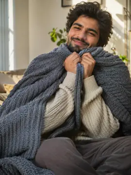</a> | <a href="https://promicat.app/zh/poses/styles/sp069?utm_source=github&utm_medium=readme&utm_campaign=ai-photo-poses">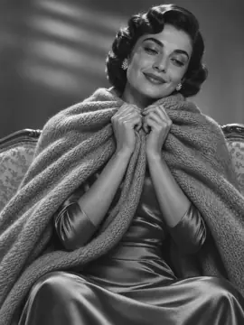</a> | <a href="https://promicat.app/zh/poses/styles/sp069?utm_source=github&utm_medium=readme&utm_campaign=ai-photo-poses">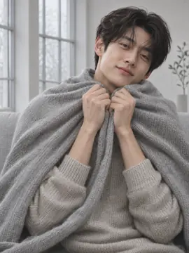</a> | <a href="https://promicat.app/zh/poses/styles/sp069?utm_source=github&utm_medium=readme&utm_campaign=ai-photo-poses">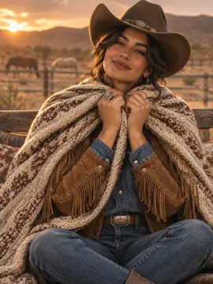</a> |

大图: [写真照](../images/photo-poses/home/sp069-photo.webp) · [白模](../images/photo-poses/home/sp069-pose.webp) · [在 Promicat 生成](https://promicat.app/zh/poses/styles/sp069?utm_source=github&utm_medium=readme&utm_campaign=ai-photo-poses)

<details><summary>提示词：用你的照片（图 1 你的照片，图 2 白模）</summary>

```text
A real professional portrait photoshoot photo: a cosy at-home lifestyle photoshoot in a sunlit apartment, soft morning window light, 35mm. Subject: the person in image 1 (keep their exact face, facial features, skin tone and hairstyle; do not beautify or swap the face), wearing an oversized knit sweater and comfortable trousers, fully covered. Pose: wrapped in a knitted blanket held closed at the chin, smiling sleepily. Image 2 is a wooden artist's mannequin that shows only this body pose: copy it exactly (head, torso, arms, hands, legs, feet, which hand does what, the camera angle), but do not copy the mannequin itself: no wooden skin, no joints, no blank face. Natural, relaxed and unstiff, true skin texture. No text, no logo, no watermark. Portrait 3:4.
```

</details>

<details><summary>提示词：生成示例图（虚构模特）</summary>

```text
A real professional portrait photoshoot photo, the kind posted by a top portrait studio: a cosy at-home lifestyle photoshoot in a sunlit apartment, soft morning window light, 35mm. Model: a handsome South Asian professional male model in his twenties with a well-groomed look and styled hair, wearing an oversized knit sweater and comfortable trousers, fully covered. The photographer directs the model into a natural, relaxed, unstiff pose that looks caught between moments: wrapped in a knitted blanket held closed at the chin, smiling sleepily. Asymmetric body, soft hands, flattering angle, true skin texture, refined but not plastic, fully clothed and modest. Waist-up framing, both arms and hands readable. No text, no logo, no watermark. Portrait 3:4.
```

</details>

## 光脚走过 (走)

| 白模 | 居家慵懒 | 波西米亚 | 咖啡馆文艺 | 校园青春 |
|---|---|---|---|---|
|  | <a href="https://promicat.app/zh/poses/styles/sp070?utm_source=github&utm_medium=readme&utm_campaign=ai-photo-poses">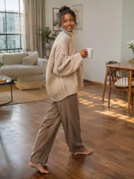</a> | <a href="https://promicat.app/zh/poses/styles/sp070?utm_source=github&utm_medium=readme&utm_campaign=ai-photo-poses"></a> | <a href="https://promicat.app/zh/poses/styles/sp070?utm_source=github&utm_medium=readme&utm_campaign=ai-photo-poses">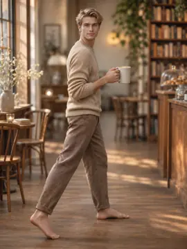</a> | <a href="https://promicat.app/zh/poses/styles/sp070?utm_source=github&utm_medium=readme&utm_campaign=ai-photo-poses">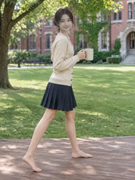</a> |

大图: [写真照](../images/photo-poses/home/sp070-photo.webp) · [白模](../images/photo-poses/home/sp070-pose.webp) · [在 Promicat 生成](https://promicat.app/zh/poses/styles/sp070?utm_source=github&utm_medium=readme&utm_campaign=ai-photo-poses)

<details><summary>提示词：用你的照片（图 1 你的照片，图 2 白模）</summary>

```text
A real professional portrait photoshoot photo: a cosy at-home lifestyle photoshoot in a sunlit apartment, soft morning window light, 35mm. Subject: the person in image 1 (keep their exact face, facial features, skin tone and hairstyle; do not beautify or swap the face), wearing an oversized knit sweater and comfortable trousers, fully covered. Pose: walking barefoot across the wooden floor carrying a cup, glancing back. Image 2 is a wooden artist's mannequin that shows only this body pose: copy it exactly (head, torso, arms, hands, legs, feet, which hand does what, the camera angle), but do not copy the mannequin itself: no wooden skin, no joints, no blank face. Natural, relaxed and unstiff, true skin texture. No text, no logo, no watermark. Portrait 3:4.
```

</details>

<details><summary>提示词：生成示例图（虚构模特）</summary>

```text
A real professional portrait photoshoot photo, the kind posted by a top portrait studio: a cosy at-home lifestyle photoshoot in a sunlit apartment, soft morning window light, 35mm. Model: a beautiful East African professional fashion model in her twenties with a naturally attractive face, styled hair and natural makeup, wearing an oversized knit sweater and comfortable trousers, fully covered. The photographer directs the model into a natural, relaxed, unstiff pose that looks caught between moments: walking barefoot across the wooden floor carrying a cup, glancing back. Asymmetric body, soft hands, flattering angle, true skin texture, refined but not plastic, fully clothed and modest. Full body or three-quarter body in frame, the whole pose clearly readable. No text, no logo, no watermark. Portrait 3:4.
```

</details>
