# Japanese fresh film

English · [简体中文](jfilm.zh-CN.md)

10 photo poses: a sample photo and the white model drawn from it. Attach your photo first and the white model second. Try them with your own photo on [Promicat](https://promicat.app/poses?utm_source=github&utm_medium=readme&utm_campaign=ai-photo-poses).

[← Back to all styles](../README.md#photo-poses)

## Standing by a bicycle on a quiet street (Standing)

<a href="https://promicat.app/poses/styles/sp041?utm_source=github&utm_medium=readme&utm_campaign=ai-photo-poses">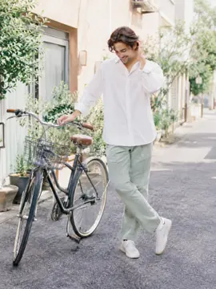</a> 

Full size: [photo](../images/photo-poses/jfilm/sp041-photo.webp) · [white model](../images/photo-poses/jfilm/sp041-pose.webp) · [try it on Promicat](https://promicat.app/poses/styles/sp041?utm_source=github&utm_medium=readme&utm_campaign=ai-photo-poses)

<details><summary>Prompt with your photo (image 1: your photo, image 2: white model)</summary>

```text
A real professional portrait photoshoot photo: a Japanese-style fresh film photoshoot in a quiet residential street, overexposed airy light, Fuji film colours, 35mm. Subject: the person in image 1 (keep their exact face, facial features, skin tone and hairstyle; do not beautify or swap the face), wearing a white shirt or a simple pastel outfit. Pose: standing by a bicycle on a quiet street, one hand tucking hair behind the ear, looking down shyly. Image 2 is a wooden artist's mannequin that shows only this body pose: copy it exactly (head, torso, arms, hands, legs, feet, which hand does what, the camera angle), but do not copy the mannequin itself: no wooden skin, no joints, no blank face. Natural, relaxed and unstiff, true skin texture. No text, no logo, no watermark. Portrait 3:4.
```

</details>

<details><summary>Prompt for the sample (fictional model)</summary>

```text
A real professional portrait photoshoot photo, the kind posted by a top portrait studio: a Japanese-style fresh film photoshoot in a quiet residential street, overexposed airy light, Fuji film colours, 35mm. Model: a handsome Mediterranean professional male model in his twenties with a well-groomed look and styled hair, wearing a white shirt or a simple pastel outfit. The photographer directs the model into a natural, relaxed, unstiff pose that looks caught between moments: standing by a bicycle on a quiet street, one hand tucking hair behind the ear, looking down shyly. Asymmetric body, soft hands, flattering angle, true skin texture, refined but not plastic, fully clothed and modest. Full body or three-quarter body in frame, the whole pose clearly readable. No text, no logo, no watermark. Portrait 3:4.
```

</details>

## Riding a bicycle slowly (In motion)

<a href="https://promicat.app/poses/styles/sp042?utm_source=github&utm_medium=readme&utm_campaign=ai-photo-poses">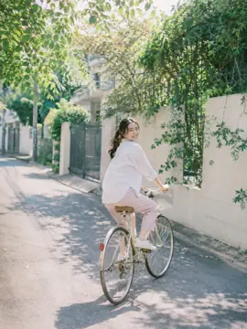</a> 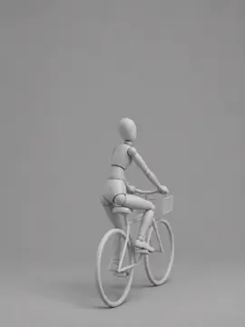

Full size: [photo](../images/photo-poses/jfilm/sp042-photo.webp) · [white model](../images/photo-poses/jfilm/sp042-pose.webp) · [try it on Promicat](https://promicat.app/poses/styles/sp042?utm_source=github&utm_medium=readme&utm_campaign=ai-photo-poses)

<details><summary>Prompt with your photo (image 1: your photo, image 2: white model)</summary>

```text
A real professional portrait photoshoot photo: a Japanese-style fresh film photoshoot in a quiet residential street, overexposed airy light, Fuji film colours, 35mm. Subject: the person in image 1 (keep their exact face, facial features, skin tone and hairstyle; do not beautify or swap the face), wearing a white shirt or a simple pastel outfit. Pose: riding a bicycle slowly, turning back to look at the camera with a smile. Image 2 is a wooden artist's mannequin that shows only this body pose: copy it exactly (head, torso, arms, hands, legs, feet, which hand does what, the camera angle), but do not copy the mannequin itself: no wooden skin, no joints, no blank face. Natural, relaxed and unstiff, true skin texture. No text, no logo, no watermark. Portrait 3:4.
```

</details>

<details><summary>Prompt for the sample (fictional model)</summary>

```text
A real professional portrait photoshoot photo, the kind posted by a top portrait studio: a Japanese-style fresh film photoshoot in a quiet residential street, overexposed airy light, Fuji film colours, 35mm. Model: a beautiful Southeast Asian professional fashion model in her twenties with a naturally attractive face, styled hair and natural makeup, wearing a white shirt or a simple pastel outfit. The photographer directs the model into a natural, relaxed, unstiff pose that looks caught between moments: riding a bicycle slowly, turning back to look at the camera with a smile. Asymmetric body, soft hands, flattering angle, true skin texture, refined but not plastic, fully clothed and modest. Full body or three-quarter body in frame, the whole pose clearly readable. No text, no logo, no watermark. Portrait 3:4.
```

</details>

## Sitting on a low kerb with knees together (Sitting)

<a href="https://promicat.app/poses/styles/sp043?utm_source=github&utm_medium=readme&utm_campaign=ai-photo-poses">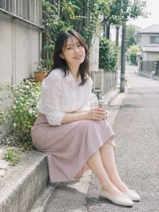</a> 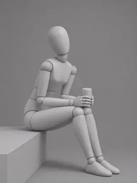

Full size: [photo](../images/photo-poses/jfilm/sp043-photo.webp) · [white model](../images/photo-poses/jfilm/sp043-pose.webp) · [try it on Promicat](https://promicat.app/poses/styles/sp043?utm_source=github&utm_medium=readme&utm_campaign=ai-photo-poses)

<details><summary>Prompt with your photo (image 1: your photo, image 2: white model)</summary>

```text
A real professional portrait photoshoot photo: a Japanese-style fresh film photoshoot in a quiet residential street, overexposed airy light, Fuji film colours, 35mm. Subject: the person in image 1 (keep their exact face, facial features, skin tone and hairstyle; do not beautify or swap the face), wearing a white shirt or a simple pastel outfit. Pose: sitting on a low kerb with knees together, holding a soda can, looking up. Image 2 is a wooden artist's mannequin that shows only this body pose: copy it exactly (head, torso, arms, hands, legs, feet, which hand does what, the camera angle), but do not copy the mannequin itself: no wooden skin, no joints, no blank face. Natural, relaxed and unstiff, true skin texture. No text, no logo, no watermark. Portrait 3:4.
```

</details>

<details><summary>Prompt for the sample (fictional model)</summary>

```text
A real professional portrait photoshoot photo, the kind posted by a top portrait studio: a Japanese-style fresh film photoshoot in a quiet residential street, overexposed airy light, Fuji film colours, 35mm. Model: a beautiful Japanese professional fashion model in her twenties with a naturally attractive face, styled hair and natural makeup, wearing a white shirt or a simple pastel outfit. The photographer directs the model into a natural, relaxed, unstiff pose that looks caught between moments: sitting on a low kerb with knees together, holding a soda can, looking up. Asymmetric body, soft hands, flattering angle, true skin texture, refined but not plastic, fully clothed and modest. Full body or three-quarter body in frame, the whole pose clearly readable. No text, no logo, no watermark. Portrait 3:4.
```

</details>

## Standing at a small train crossing holding a bag in both hands in front (Standing)

<a href="https://promicat.app/poses/styles/sp044?utm_source=github&utm_medium=readme&utm_campaign=ai-photo-poses">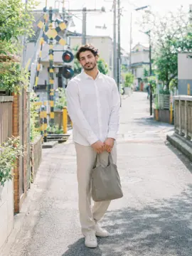</a> 

Full size: [photo](../images/photo-poses/jfilm/sp044-photo.webp) · [white model](../images/photo-poses/jfilm/sp044-pose.webp) · [try it on Promicat](https://promicat.app/poses/styles/sp044?utm_source=github&utm_medium=readme&utm_campaign=ai-photo-poses)

<details><summary>Prompt with your photo (image 1: your photo, image 2: white model)</summary>

```text
A real professional portrait photoshoot photo: a Japanese-style fresh film photoshoot in a quiet residential street, overexposed airy light, Fuji film colours, 35mm. Subject: the person in image 1 (keep their exact face, facial features, skin tone and hairstyle; do not beautify or swap the face), wearing a white shirt or a simple pastel outfit. Pose: standing at a small train crossing holding a bag in both hands in front. Image 2 is a wooden artist's mannequin that shows only this body pose: copy it exactly (head, torso, arms, hands, legs, feet, which hand does what, the camera angle), but do not copy the mannequin itself: no wooden skin, no joints, no blank face. Natural, relaxed and unstiff, true skin texture. No text, no logo, no watermark. Portrait 3:4.
```

</details>

<details><summary>Prompt for the sample (fictional model)</summary>

```text
A real professional portrait photoshoot photo, the kind posted by a top portrait studio: a Japanese-style fresh film photoshoot in a quiet residential street, overexposed airy light, Fuji film colours, 35mm. Model: a handsome Middle Eastern professional male model in his twenties with a well-groomed look and styled hair, wearing a white shirt or a simple pastel outfit. The photographer directs the model into a natural, relaxed, unstiff pose that looks caught between moments: standing at a small train crossing holding a bag in both hands in front. Asymmetric body, soft hands, flattering angle, true skin texture, refined but not plastic, fully clothed and modest. Full body or three-quarter body in frame, the whole pose clearly readable. No text, no logo, no watermark. Portrait 3:4.
```

</details>

## Leaning on a vending machine (Leaning)

<a href="https://promicat.app/poses/styles/sp045?utm_source=github&utm_medium=readme&utm_campaign=ai-photo-poses">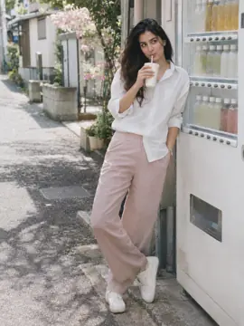</a> 

Full size: [photo](../images/photo-poses/jfilm/sp045-photo.webp) · [white model](../images/photo-poses/jfilm/sp045-pose.webp) · [try it on Promicat](https://promicat.app/poses/styles/sp045?utm_source=github&utm_medium=readme&utm_campaign=ai-photo-poses)

<details><summary>Prompt with your photo (image 1: your photo, image 2: white model)</summary>

```text
A real professional portrait photoshoot photo: a Japanese-style fresh film photoshoot in a quiet residential street, overexposed airy light, Fuji film colours, 35mm. Subject: the person in image 1 (keep their exact face, facial features, skin tone and hairstyle; do not beautify or swap the face), wearing a white shirt or a simple pastel outfit. Pose: leaning on a vending machine, one foot crossed, sipping from a straw. Image 2 is a wooden artist's mannequin that shows only this body pose: copy it exactly (head, torso, arms, hands, legs, feet, which hand does what, the camera angle), but do not copy the mannequin itself: no wooden skin, no joints, no blank face. Natural, relaxed and unstiff, true skin texture. No text, no logo, no watermark. Portrait 3:4.
```

</details>

<details><summary>Prompt for the sample (fictional model)</summary>

```text
A real professional portrait photoshoot photo, the kind posted by a top portrait studio: a Japanese-style fresh film photoshoot in a quiet residential street, overexposed airy light, Fuji film colours, 35mm. Model: a beautiful Indian professional fashion model in her twenties with a naturally attractive face, styled hair and natural makeup, wearing a white shirt or a simple pastel outfit. The photographer directs the model into a natural, relaxed, unstiff pose that looks caught between moments: leaning on a vending machine, one foot crossed, sipping from a straw. Asymmetric body, soft hands, flattering angle, true skin texture, refined but not plastic, fully clothed and modest. Full body or three-quarter body in frame, the whole pose clearly readable. No text, no logo, no watermark. Portrait 3:4.
```

</details>

## Shading the eyes with one hand against the bright sky (Upper body)

<a href="https://promicat.app/poses/styles/sp046?utm_source=github&utm_medium=readme&utm_campaign=ai-photo-poses"></a> 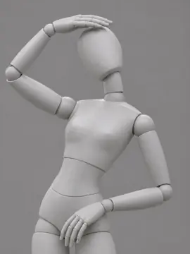

Full size: [photo](../images/photo-poses/jfilm/sp046-photo.webp) · [white model](../images/photo-poses/jfilm/sp046-pose.webp) · [try it on Promicat](https://promicat.app/poses/styles/sp046?utm_source=github&utm_medium=readme&utm_campaign=ai-photo-poses)

<details><summary>Prompt with your photo (image 1: your photo, image 2: white model)</summary>

```text
A real professional portrait photoshoot photo: a Japanese-style fresh film photoshoot in a quiet residential street, overexposed airy light, Fuji film colours, 35mm. Subject: the person in image 1 (keep their exact face, facial features, skin tone and hairstyle; do not beautify or swap the face), wearing a white shirt or a simple pastel outfit. Pose: shading the eyes with one hand against the bright sky, mouth slightly open. Image 2 is a wooden artist's mannequin that shows only this body pose: copy it exactly (head, torso, arms, hands, legs, feet, which hand does what, the camera angle), but do not copy the mannequin itself: no wooden skin, no joints, no blank face. Natural, relaxed and unstiff, true skin texture. No text, no logo, no watermark. Portrait 3:4.
```

</details>

<details><summary>Prompt for the sample (fictional model)</summary>

```text
A real professional portrait photoshoot photo, the kind posted by a top portrait studio: a Japanese-style fresh film photoshoot in a quiet residential street, overexposed airy light, Fuji film colours, 35mm. Model: a beautiful white European professional fashion model in her twenties with a naturally attractive face, styled hair and natural makeup, wearing a white shirt or a simple pastel outfit. The photographer directs the model into a natural, relaxed, unstiff pose that looks caught between moments: shading the eyes with one hand against the bright sky, mouth slightly open. Asymmetric body, soft hands, flattering angle, true skin texture, refined but not plastic, fully clothed and modest. Waist-up framing, both arms and hands readable. No text, no logo, no watermark. Portrait 3:4.
```

</details>

## Crouching to offer a hand to a cat on the street (Crouching)

<a href="https://promicat.app/poses/styles/sp047?utm_source=github&utm_medium=readme&utm_campaign=ai-photo-poses">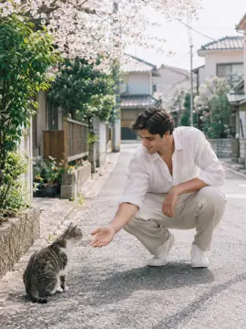</a> 

Full size: [photo](../images/photo-poses/jfilm/sp047-photo.webp) · [white model](../images/photo-poses/jfilm/sp047-pose.webp) · [try it on Promicat](https://promicat.app/poses/styles/sp047?utm_source=github&utm_medium=readme&utm_campaign=ai-photo-poses)

<details><summary>Prompt with your photo (image 1: your photo, image 2: white model)</summary>

```text
A real professional portrait photoshoot photo: a Japanese-style fresh film photoshoot in a quiet residential street, overexposed airy light, Fuji film colours, 35mm. Subject: the person in image 1 (keep their exact face, facial features, skin tone and hairstyle; do not beautify or swap the face), wearing a white shirt or a simple pastel outfit. Pose: crouching to offer a hand to a cat on the street, head tilted. Image 2 is a wooden artist's mannequin that shows only this body pose: copy it exactly (head, torso, arms, hands, legs, feet, which hand does what, the camera angle), but do not copy the mannequin itself: no wooden skin, no joints, no blank face. Natural, relaxed and unstiff, true skin texture. No text, no logo, no watermark. Portrait 3:4.
```

</details>

<details><summary>Prompt for the sample (fictional model)</summary>

```text
A real professional portrait photoshoot photo, the kind posted by a top portrait studio: a Japanese-style fresh film photoshoot in a quiet residential street, overexposed airy light, Fuji film colours, 35mm. Model: a handsome Brazilian professional male model in his twenties with a well-groomed look and styled hair, wearing a white shirt or a simple pastel outfit. The photographer directs the model into a natural, relaxed, unstiff pose that looks caught between moments: crouching to offer a hand to a cat on the street, head tilted. Asymmetric body, soft hands, flattering angle, true skin texture, refined but not plastic, fully clothed and modest. Full body or three-quarter body in frame, the whole pose clearly readable. No text, no logo, no watermark. Portrait 3:4.
```

</details>

## Walking past laundry hanging between houses (Walking)

<a href="https://promicat.app/poses/styles/sp048?utm_source=github&utm_medium=readme&utm_campaign=ai-photo-poses"></a> 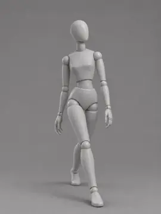

Full size: [photo](../images/photo-poses/jfilm/sp048-photo.webp) · [white model](../images/photo-poses/jfilm/sp048-pose.webp) · [try it on Promicat](https://promicat.app/poses/styles/sp048?utm_source=github&utm_medium=readme&utm_campaign=ai-photo-poses)

<details><summary>Prompt with your photo (image 1: your photo, image 2: white model)</summary>

```text
A real professional portrait photoshoot photo: a Japanese-style fresh film photoshoot in a quiet residential street, overexposed airy light, Fuji film colours, 35mm. Subject: the person in image 1 (keep their exact face, facial features, skin tone and hairstyle; do not beautify or swap the face), wearing a white shirt or a simple pastel outfit. Pose: walking past laundry hanging between houses, glancing to the side. Image 2 is a wooden artist's mannequin that shows only this body pose: copy it exactly (head, torso, arms, hands, legs, feet, which hand does what, the camera angle), but do not copy the mannequin itself: no wooden skin, no joints, no blank face. Natural, relaxed and unstiff, true skin texture. No text, no logo, no watermark. Portrait 3:4.
```

</details>

<details><summary>Prompt for the sample (fictional model)</summary>

```text
A real professional portrait photoshoot photo, the kind posted by a top portrait studio: a Japanese-style fresh film photoshoot in a quiet residential street, overexposed airy light, Fuji film colours, 35mm. Model: a beautiful Latina professional fashion model in her twenties with a naturally attractive face, styled hair and natural makeup, wearing a white shirt or a simple pastel outfit. The photographer directs the model into a natural, relaxed, unstiff pose that looks caught between moments: walking past laundry hanging between houses, glancing to the side. Asymmetric body, soft hands, flattering angle, true skin texture, refined but not plastic, fully clothed and modest. Full body or three-quarter body in frame, the whole pose clearly readable. No text, no logo, no watermark. Portrait 3:4.
```

</details>

## Sitting on old stone steps (Sitting)

<a href="https://promicat.app/poses/styles/sp049?utm_source=github&utm_medium=readme&utm_campaign=ai-photo-poses"></a> 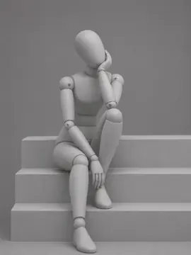

Full size: [photo](../images/photo-poses/jfilm/sp049-photo.webp) · [white model](../images/photo-poses/jfilm/sp049-pose.webp) · [try it on Promicat](https://promicat.app/poses/styles/sp049?utm_source=github&utm_medium=readme&utm_campaign=ai-photo-poses)

<details><summary>Prompt with your photo (image 1: your photo, image 2: white model)</summary>

```text
A real professional portrait photoshoot photo: a Japanese-style fresh film photoshoot in a quiet residential street, overexposed airy light, Fuji film colours, 35mm. Subject: the person in image 1 (keep their exact face, facial features, skin tone and hairstyle; do not beautify or swap the face), wearing a white shirt or a simple pastel outfit. Pose: sitting on old stone steps, elbow on knee, chin in hand. Image 2 is a wooden artist's mannequin that shows only this body pose: copy it exactly (head, torso, arms, hands, legs, feet, which hand does what, the camera angle), but do not copy the mannequin itself: no wooden skin, no joints, no blank face. Natural, relaxed and unstiff, true skin texture. No text, no logo, no watermark. Portrait 3:4.
```

</details>

<details><summary>Prompt for the sample (fictional model)</summary>

```text
A real professional portrait photoshoot photo, the kind posted by a top portrait studio: a Japanese-style fresh film photoshoot in a quiet residential street, overexposed airy light, Fuji film colours, 35mm. Model: a beautiful Korean professional fashion model in her twenties with a naturally attractive face, styled hair and natural makeup, wearing a white shirt or a simple pastel outfit. The photographer directs the model into a natural, relaxed, unstiff pose that looks caught between moments: sitting on old stone steps, elbow on knee, chin in hand. Asymmetric body, soft hands, flattering angle, true skin texture, refined but not plastic, fully clothed and modest. Full body or three-quarter body in frame, the whole pose clearly readable. No text, no logo, no watermark. Portrait 3:4.
```

</details>

## Standing on a seaside road with the white shirt blowing (In motion)

<a href="https://promicat.app/poses/styles/sp050?utm_source=github&utm_medium=readme&utm_campaign=ai-photo-poses">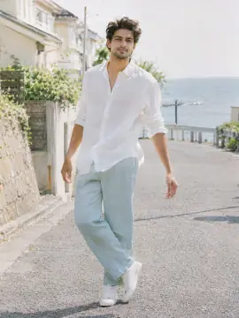</a> 

Full size: [photo](../images/photo-poses/jfilm/sp050-photo.webp) · [white model](../images/photo-poses/jfilm/sp050-pose.webp) · [try it on Promicat](https://promicat.app/poses/styles/sp050?utm_source=github&utm_medium=readme&utm_campaign=ai-photo-poses)

<details><summary>Prompt with your photo (image 1: your photo, image 2: white model)</summary>

```text
A real professional portrait photoshoot photo: a Japanese-style fresh film photoshoot in a quiet residential street, overexposed airy light, Fuji film colours, 35mm. Subject: the person in image 1 (keep their exact face, facial features, skin tone and hairstyle; do not beautify or swap the face), wearing a white shirt or a simple pastel outfit. Pose: standing on a seaside road with the white shirt blowing, arms slightly away from the body. Image 2 is a wooden artist's mannequin that shows only this body pose: copy it exactly (head, torso, arms, hands, legs, feet, which hand does what, the camera angle), but do not copy the mannequin itself: no wooden skin, no joints, no blank face. Natural, relaxed and unstiff, true skin texture. No text, no logo, no watermark. Portrait 3:4.
```

</details>

<details><summary>Prompt for the sample (fictional model)</summary>

```text
A real professional portrait photoshoot photo, the kind posted by a top portrait studio: a Japanese-style fresh film photoshoot in a quiet residential street, overexposed airy light, Fuji film colours, 35mm. Model: a handsome South Asian professional male model in his twenties with a well-groomed look and styled hair, wearing a white shirt or a simple pastel outfit. The photographer directs the model into a natural, relaxed, unstiff pose that looks caught between moments: standing on a seaside road with the white shirt blowing, arms slightly away from the body. Asymmetric body, soft hands, flattering angle, true skin texture, refined but not plastic, fully clothed and modest. Full body or three-quarter body in frame, the whole pose clearly readable. No text, no logo, no watermark. Portrait 3:4.
```

</details>
