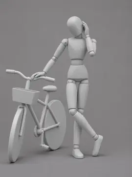
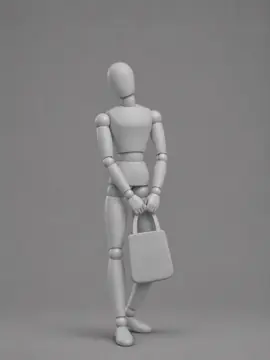
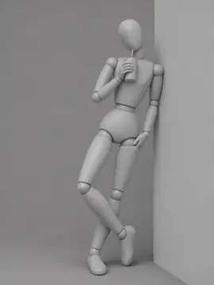
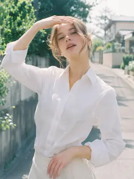
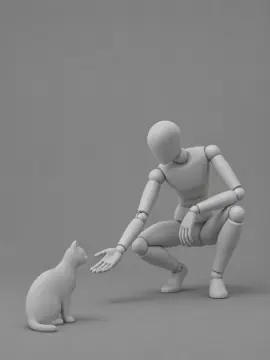
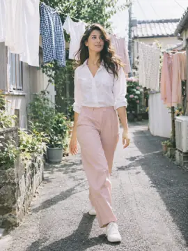
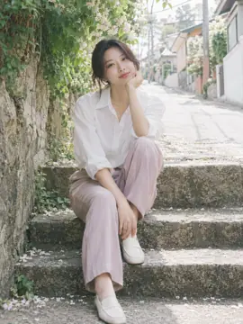
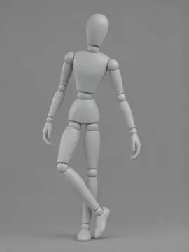

# 日系清新 · Japanese fresh film

10 组写真姿势：左边是写真照，右边是照着它画的木头白模。白模可以当姿势参考图，和你的照片一起发给生图模型。 在线试用：[Promicat 姿势库](https://promicat.app/zh/poses?ref=github)

[← 返回目录](../README.md#写真姿势)

## 扶车撩发（站）

 

大图：[写真照](../images/photo-poses/jfilm/sp041-photo.webp) · [白模](../images/photo-poses/jfilm/sp041-pose.webp)

<details><summary>提示词：用你的照片（附图 1 你的照片，附图 2 白模）</summary>

```text
A real professional portrait photoshoot photo: a Japanese-style fresh film photoshoot in a quiet residential street, overexposed airy light, Fuji film colours, 35mm. Subject: the person in image 1 (keep their exact face, facial features, skin tone and hairstyle; do not beautify or swap the face), wearing a white shirt or a simple pastel outfit. Pose: standing by a bicycle on a quiet street, one hand tucking hair behind the ear, looking down shyly. Image 2 is a wooden artist's mannequin that shows only this body pose: copy it exactly (head, torso, arms, hands, legs, feet, which hand does what, the camera angle), but do not copy the mannequin itself: no wooden skin, no joints, no blank face. Natural, relaxed and unstiff, true skin texture. No text, no logo, no watermark. Portrait 3:4.
```

</details>

<details><summary>提示词：生成示例图（虚构模特）</summary>

```text
A real professional portrait photoshoot photo, the kind posted by a top portrait studio: a Japanese-style fresh film photoshoot in a quiet residential street, overexposed airy light, Fuji film colours, 35mm. Model: a handsome Mediterranean professional male model in his twenties with a well-groomed look and styled hair, wearing a white shirt or a simple pastel outfit. The photographer directs the model into a natural, relaxed, unstiff pose that looks caught between moments: standing by a bicycle on a quiet street, one hand tucking hair behind the ear, looking down shyly. Asymmetric body, soft hands, flattering angle, true skin texture, refined but not plastic, fully clothed and modest. Full body or three-quarter body in frame, the whole pose clearly readable. No text, no logo, no watermark. Portrait 3:4.
```

</details>

## 骑车回头（动态）

 

大图：[写真照](../images/photo-poses/jfilm/sp042-photo.webp) · [白模](../images/photo-poses/jfilm/sp042-pose.webp)

<details><summary>提示词：用你的照片（附图 1 你的照片，附图 2 白模）</summary>

```text
A real professional portrait photoshoot photo: a Japanese-style fresh film photoshoot in a quiet residential street, overexposed airy light, Fuji film colours, 35mm. Subject: the person in image 1 (keep their exact face, facial features, skin tone and hairstyle; do not beautify or swap the face), wearing a white shirt or a simple pastel outfit. Pose: riding a bicycle slowly, turning back to look at the camera with a smile. Image 2 is a wooden artist's mannequin that shows only this body pose: copy it exactly (head, torso, arms, hands, legs, feet, which hand does what, the camera angle), but do not copy the mannequin itself: no wooden skin, no joints, no blank face. Natural, relaxed and unstiff, true skin texture. No text, no logo, no watermark. Portrait 3:4.
```

</details>

<details><summary>提示词：生成示例图（虚构模特）</summary>

```text
A real professional portrait photoshoot photo, the kind posted by a top portrait studio: a Japanese-style fresh film photoshoot in a quiet residential street, overexposed airy light, Fuji film colours, 35mm. Model: a beautiful Southeast Asian professional fashion model in her twenties with a naturally attractive face, styled hair and natural makeup, wearing a white shirt or a simple pastel outfit. The photographer directs the model into a natural, relaxed, unstiff pose that looks caught between moments: riding a bicycle slowly, turning back to look at the camera with a smile. Asymmetric body, soft hands, flattering angle, true skin texture, refined but not plastic, fully clothed and modest. Full body or three-quarter body in frame, the whole pose clearly readable. No text, no logo, no watermark. Portrait 3:4.
```

</details>

## 坐路边（坐）

 

大图：[写真照](../images/photo-poses/jfilm/sp043-photo.webp) · [白模](../images/photo-poses/jfilm/sp043-pose.webp)

<details><summary>提示词：用你的照片（附图 1 你的照片，附图 2 白模）</summary>

```text
A real professional portrait photoshoot photo: a Japanese-style fresh film photoshoot in a quiet residential street, overexposed airy light, Fuji film colours, 35mm. Subject: the person in image 1 (keep their exact face, facial features, skin tone and hairstyle; do not beautify or swap the face), wearing a white shirt or a simple pastel outfit. Pose: sitting on a low kerb with knees together, holding a soda can, looking up. Image 2 is a wooden artist's mannequin that shows only this body pose: copy it exactly (head, torso, arms, hands, legs, feet, which hand does what, the camera angle), but do not copy the mannequin itself: no wooden skin, no joints, no blank face. Natural, relaxed and unstiff, true skin texture. No text, no logo, no watermark. Portrait 3:4.
```

</details>

<details><summary>提示词：生成示例图（虚构模特）</summary>

```text
A real professional portrait photoshoot photo, the kind posted by a top portrait studio: a Japanese-style fresh film photoshoot in a quiet residential street, overexposed airy light, Fuji film colours, 35mm. Model: a beautiful Japanese professional fashion model in her twenties with a naturally attractive face, styled hair and natural makeup, wearing a white shirt or a simple pastel outfit. The photographer directs the model into a natural, relaxed, unstiff pose that looks caught between moments: sitting on a low kerb with knees together, holding a soda can, looking up. Asymmetric body, soft hands, flattering angle, true skin texture, refined but not plastic, fully clothed and modest. Full body or three-quarter body in frame, the whole pose clearly readable. No text, no logo, no watermark. Portrait 3:4.
```

</details>

## 电车站等车（站）

 

大图：[写真照](../images/photo-poses/jfilm/sp044-photo.webp) · [白模](../images/photo-poses/jfilm/sp044-pose.webp)

<details><summary>提示词：用你的照片（附图 1 你的照片，附图 2 白模）</summary>

```text
A real professional portrait photoshoot photo: a Japanese-style fresh film photoshoot in a quiet residential street, overexposed airy light, Fuji film colours, 35mm. Subject: the person in image 1 (keep their exact face, facial features, skin tone and hairstyle; do not beautify or swap the face), wearing a white shirt or a simple pastel outfit. Pose: standing at a small train crossing holding a bag in both hands in front. Image 2 is a wooden artist's mannequin that shows only this body pose: copy it exactly (head, torso, arms, hands, legs, feet, which hand does what, the camera angle), but do not copy the mannequin itself: no wooden skin, no joints, no blank face. Natural, relaxed and unstiff, true skin texture. No text, no logo, no watermark. Portrait 3:4.
```

</details>

<details><summary>提示词：生成示例图（虚构模特）</summary>

```text
A real professional portrait photoshoot photo, the kind posted by a top portrait studio: a Japanese-style fresh film photoshoot in a quiet residential street, overexposed airy light, Fuji film colours, 35mm. Model: a handsome Middle Eastern professional male model in his twenties with a well-groomed look and styled hair, wearing a white shirt or a simple pastel outfit. The photographer directs the model into a natural, relaxed, unstiff pose that looks caught between moments: standing at a small train crossing holding a bag in both hands in front. Asymmetric body, soft hands, flattering angle, true skin texture, refined but not plastic, fully clothed and modest. Full body or three-quarter body in frame, the whole pose clearly readable. No text, no logo, no watermark. Portrait 3:4.
```

</details>

## 靠自动售货机（靠）

 

大图：[写真照](../images/photo-poses/jfilm/sp045-photo.webp) · [白模](../images/photo-poses/jfilm/sp045-pose.webp)

<details><summary>提示词：用你的照片（附图 1 你的照片，附图 2 白模）</summary>

```text
A real professional portrait photoshoot photo: a Japanese-style fresh film photoshoot in a quiet residential street, overexposed airy light, Fuji film colours, 35mm. Subject: the person in image 1 (keep their exact face, facial features, skin tone and hairstyle; do not beautify or swap the face), wearing a white shirt or a simple pastel outfit. Pose: leaning on a vending machine, one foot crossed, sipping from a straw. Image 2 is a wooden artist's mannequin that shows only this body pose: copy it exactly (head, torso, arms, hands, legs, feet, which hand does what, the camera angle), but do not copy the mannequin itself: no wooden skin, no joints, no blank face. Natural, relaxed and unstiff, true skin texture. No text, no logo, no watermark. Portrait 3:4.
```

</details>

<details><summary>提示词：生成示例图（虚构模特）</summary>

```text
A real professional portrait photoshoot photo, the kind posted by a top portrait studio: a Japanese-style fresh film photoshoot in a quiet residential street, overexposed airy light, Fuji film colours, 35mm. Model: a beautiful Indian professional fashion model in her twenties with a naturally attractive face, styled hair and natural makeup, wearing a white shirt or a simple pastel outfit. The photographer directs the model into a natural, relaxed, unstiff pose that looks caught between moments: leaning on a vending machine, one foot crossed, sipping from a straw. Asymmetric body, soft hands, flattering angle, true skin texture, refined but not plastic, fully clothed and modest. Full body or three-quarter body in frame, the whole pose clearly readable. No text, no logo, no watermark. Portrait 3:4.
```

</details>

## 伸手挡光（半身）

 

大图：[写真照](../images/photo-poses/jfilm/sp046-photo.webp) · [白模](../images/photo-poses/jfilm/sp046-pose.webp)

<details><summary>提示词：用你的照片（附图 1 你的照片，附图 2 白模）</summary>

```text
A real professional portrait photoshoot photo: a Japanese-style fresh film photoshoot in a quiet residential street, overexposed airy light, Fuji film colours, 35mm. Subject: the person in image 1 (keep their exact face, facial features, skin tone and hairstyle; do not beautify or swap the face), wearing a white shirt or a simple pastel outfit. Pose: shading the eyes with one hand against the bright sky, mouth slightly open. Image 2 is a wooden artist's mannequin that shows only this body pose: copy it exactly (head, torso, arms, hands, legs, feet, which hand does what, the camera angle), but do not copy the mannequin itself: no wooden skin, no joints, no blank face. Natural, relaxed and unstiff, true skin texture. No text, no logo, no watermark. Portrait 3:4.
```

</details>

<details><summary>提示词：生成示例图（虚构模特）</summary>

```text
A real professional portrait photoshoot photo, the kind posted by a top portrait studio: a Japanese-style fresh film photoshoot in a quiet residential street, overexposed airy light, Fuji film colours, 35mm. Model: a beautiful white European professional fashion model in her twenties with a naturally attractive face, styled hair and natural makeup, wearing a white shirt or a simple pastel outfit. The photographer directs the model into a natural, relaxed, unstiff pose that looks caught between moments: shading the eyes with one hand against the bright sky, mouth slightly open. Asymmetric body, soft hands, flattering angle, true skin texture, refined but not plastic, fully clothed and modest. Waist-up framing, both arms and hands readable. No text, no logo, no watermark. Portrait 3:4.
```

</details>

## 蹲着喂猫（蹲跪）

 

大图：[写真照](../images/photo-poses/jfilm/sp047-photo.webp) · [白模](../images/photo-poses/jfilm/sp047-pose.webp)

<details><summary>提示词：用你的照片（附图 1 你的照片，附图 2 白模）</summary>

```text
A real professional portrait photoshoot photo: a Japanese-style fresh film photoshoot in a quiet residential street, overexposed airy light, Fuji film colours, 35mm. Subject: the person in image 1 (keep their exact face, facial features, skin tone and hairstyle; do not beautify or swap the face), wearing a white shirt or a simple pastel outfit. Pose: crouching to offer a hand to a cat on the street, head tilted. Image 2 is a wooden artist's mannequin that shows only this body pose: copy it exactly (head, torso, arms, hands, legs, feet, which hand does what, the camera angle), but do not copy the mannequin itself: no wooden skin, no joints, no blank face. Natural, relaxed and unstiff, true skin texture. No text, no logo, no watermark. Portrait 3:4.
```

</details>

<details><summary>提示词：生成示例图（虚构模特）</summary>

```text
A real professional portrait photoshoot photo, the kind posted by a top portrait studio: a Japanese-style fresh film photoshoot in a quiet residential street, overexposed airy light, Fuji film colours, 35mm. Model: a handsome Brazilian professional male model in his twenties with a well-groomed look and styled hair, wearing a white shirt or a simple pastel outfit. The photographer directs the model into a natural, relaxed, unstiff pose that looks caught between moments: crouching to offer a hand to a cat on the street, head tilted. Asymmetric body, soft hands, flattering angle, true skin texture, refined but not plastic, fully clothed and modest. Full body or three-quarter body in frame, the whole pose clearly readable. No text, no logo, no watermark. Portrait 3:4.
```

</details>

## 走过晾衣绳（走）

 

大图：[写真照](../images/photo-poses/jfilm/sp048-photo.webp) · [白模](../images/photo-poses/jfilm/sp048-pose.webp)

<details><summary>提示词：用你的照片（附图 1 你的照片，附图 2 白模）</summary>

```text
A real professional portrait photoshoot photo: a Japanese-style fresh film photoshoot in a quiet residential street, overexposed airy light, Fuji film colours, 35mm. Subject: the person in image 1 (keep their exact face, facial features, skin tone and hairstyle; do not beautify or swap the face), wearing a white shirt or a simple pastel outfit. Pose: walking past laundry hanging between houses, glancing to the side. Image 2 is a wooden artist's mannequin that shows only this body pose: copy it exactly (head, torso, arms, hands, legs, feet, which hand does what, the camera angle), but do not copy the mannequin itself: no wooden skin, no joints, no blank face. Natural, relaxed and unstiff, true skin texture. No text, no logo, no watermark. Portrait 3:4.
```

</details>

<details><summary>提示词：生成示例图（虚构模特）</summary>

```text
A real professional portrait photoshoot photo, the kind posted by a top portrait studio: a Japanese-style fresh film photoshoot in a quiet residential street, overexposed airy light, Fuji film colours, 35mm. Model: a beautiful Latina professional fashion model in her twenties with a naturally attractive face, styled hair and natural makeup, wearing a white shirt or a simple pastel outfit. The photographer directs the model into a natural, relaxed, unstiff pose that looks caught between moments: walking past laundry hanging between houses, glancing to the side. Asymmetric body, soft hands, flattering angle, true skin texture, refined but not plastic, fully clothed and modest. Full body or three-quarter body in frame, the whole pose clearly readable. No text, no logo, no watermark. Portrait 3:4.
```

</details>

## 坐台阶托腮（坐）

 

大图：[写真照](../images/photo-poses/jfilm/sp049-photo.webp) · [白模](../images/photo-poses/jfilm/sp049-pose.webp)

<details><summary>提示词：用你的照片（附图 1 你的照片，附图 2 白模）</summary>

```text
A real professional portrait photoshoot photo: a Japanese-style fresh film photoshoot in a quiet residential street, overexposed airy light, Fuji film colours, 35mm. Subject: the person in image 1 (keep their exact face, facial features, skin tone and hairstyle; do not beautify or swap the face), wearing a white shirt or a simple pastel outfit. Pose: sitting on old stone steps, elbow on knee, chin in hand. Image 2 is a wooden artist's mannequin that shows only this body pose: copy it exactly (head, torso, arms, hands, legs, feet, which hand does what, the camera angle), but do not copy the mannequin itself: no wooden skin, no joints, no blank face. Natural, relaxed and unstiff, true skin texture. No text, no logo, no watermark. Portrait 3:4.
```

</details>

<details><summary>提示词：生成示例图（虚构模特）</summary>

```text
A real professional portrait photoshoot photo, the kind posted by a top portrait studio: a Japanese-style fresh film photoshoot in a quiet residential street, overexposed airy light, Fuji film colours, 35mm. Model: a beautiful Korean professional fashion model in her twenties with a naturally attractive face, styled hair and natural makeup, wearing a white shirt or a simple pastel outfit. The photographer directs the model into a natural, relaxed, unstiff pose that looks caught between moments: sitting on old stone steps, elbow on knee, chin in hand. Asymmetric body, soft hands, flattering angle, true skin texture, refined but not plastic, fully clothed and modest. Full body or three-quarter body in frame, the whole pose clearly readable. No text, no logo, no watermark. Portrait 3:4.
```

</details>

## 风吹衬衫（动态）

 

大图：[写真照](../images/photo-poses/jfilm/sp050-photo.webp) · [白模](../images/photo-poses/jfilm/sp050-pose.webp)

<details><summary>提示词：用你的照片（附图 1 你的照片，附图 2 白模）</summary>

```text
A real professional portrait photoshoot photo: a Japanese-style fresh film photoshoot in a quiet residential street, overexposed airy light, Fuji film colours, 35mm. Subject: the person in image 1 (keep their exact face, facial features, skin tone and hairstyle; do not beautify or swap the face), wearing a white shirt or a simple pastel outfit. Pose: standing on a seaside road with the white shirt blowing, arms slightly away from the body. Image 2 is a wooden artist's mannequin that shows only this body pose: copy it exactly (head, torso, arms, hands, legs, feet, which hand does what, the camera angle), but do not copy the mannequin itself: no wooden skin, no joints, no blank face. Natural, relaxed and unstiff, true skin texture. No text, no logo, no watermark. Portrait 3:4.
```

</details>

<details><summary>提示词：生成示例图（虚构模特）</summary>

```text
A real professional portrait photoshoot photo, the kind posted by a top portrait studio: a Japanese-style fresh film photoshoot in a quiet residential street, overexposed airy light, Fuji film colours, 35mm. Model: a handsome South Asian professional male model in his twenties with a well-groomed look and styled hair, wearing a white shirt or a simple pastel outfit. The photographer directs the model into a natural, relaxed, unstiff pose that looks caught between moments: standing on a seaside road with the white shirt blowing, arms slightly away from the body. Asymmetric body, soft hands, flattering angle, true skin texture, refined but not plastic, fully clothed and modest. Full body or three-quarter body in frame, the whole pose clearly readable. No text, no logo, no watermark. Portrait 3:4.
```

</details>
