# 日系清新

[English](jfilm.md) · 简体中文

10 个白模，每个配 4 张用它拍出的不同风格写真。参考图顺序是你的照片在前、白模在后。也可以在 [Promicat](https://promicat.app/zh/poses?utm_source=github&utm_medium=readme&utm_campaign=ai-photo-poses) 上传照片直接生成。

[← 返回全部风格](../README.zh-CN.md#photo-poses)

## 扶车撩发 (站)

| 白模 | 日系清新 | 咖啡馆文艺 | 森系花田 | 暗黑哥特 |
|---|---|---|---|---|
| 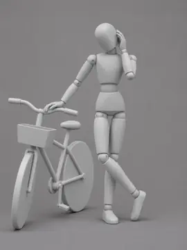 | <a href="https://promicat.app/zh/poses/styles/sp041?utm_source=github&utm_medium=readme&utm_campaign=ai-photo-poses">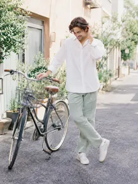</a> | <a href="https://promicat.app/zh/poses/styles/sp041?utm_source=github&utm_medium=readme&utm_campaign=ai-photo-poses">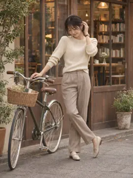</a> | <a href="https://promicat.app/zh/poses/styles/sp041?utm_source=github&utm_medium=readme&utm_campaign=ai-photo-poses">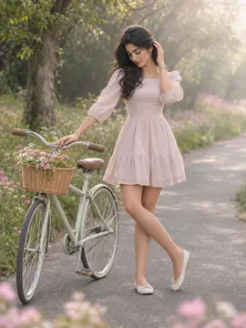</a> | <a href="https://promicat.app/zh/poses/styles/sp041?utm_source=github&utm_medium=readme&utm_campaign=ai-photo-poses">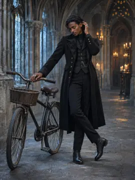</a> |

大图: [写真照](../images/photo-poses/jfilm/sp041-photo.webp) · [白模](../images/photo-poses/jfilm/sp041-pose.webp) · [在 Promicat 生成](https://promicat.app/zh/poses/styles/sp041?utm_source=github&utm_medium=readme&utm_campaign=ai-photo-poses)

<details><summary>提示词：用你的照片（图 1 你的照片，图 2 白模）</summary>

```text
A real professional portrait photoshoot photo: a Japanese-style fresh film photoshoot in a quiet residential street, overexposed airy light, Fuji film colours, 35mm. Subject: the person in image 1 (keep their exact face, facial features, skin tone and hairstyle; do not beautify or swap the face), wearing a white shirt or a simple pastel outfit. Pose: standing by a bicycle on a quiet street, one hand tucking hair behind the ear, looking down shyly. Image 2 is a wooden artist's mannequin that shows only this body pose: copy it exactly (head, torso, arms, hands, legs, feet, which hand does what, the camera angle), but do not copy the mannequin itself: no wooden skin, no joints, no blank face. Natural, relaxed and unstiff, true skin texture. No text, no logo, no watermark. Portrait 3:4.
```

</details>

<details><summary>提示词：生成示例图（虚构模特）</summary>

```text
A real professional portrait photoshoot photo, the kind posted by a top portrait studio: a Japanese-style fresh film photoshoot in a quiet residential street, overexposed airy light, Fuji film colours, 35mm. Model: a handsome Mediterranean professional male model in his twenties with a well-groomed look and styled hair, wearing a white shirt or a simple pastel outfit. The photographer directs the model into a natural, relaxed, unstiff pose that looks caught between moments: standing by a bicycle on a quiet street, one hand tucking hair behind the ear, looking down shyly. Asymmetric body, soft hands, flattering angle, true skin texture, refined but not plastic, fully clothed and modest. Full body or three-quarter body in frame, the whole pose clearly readable. No text, no logo, no watermark. Portrait 3:4.
```

</details>

## 骑车回头 (动态)

| 白模 | 日系清新 | 校园青春 | 学院风 | 西部牛仔 |
|---|---|---|---|---|
| 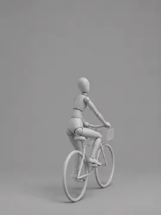 | <a href="https://promicat.app/zh/poses/styles/sp042?utm_source=github&utm_medium=readme&utm_campaign=ai-photo-poses">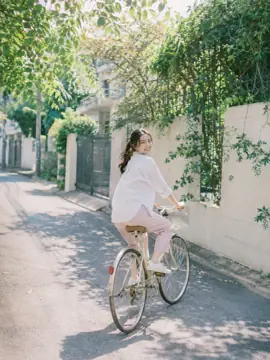</a> | <a href="https://promicat.app/zh/poses/styles/sp042?utm_source=github&utm_medium=readme&utm_campaign=ai-photo-poses">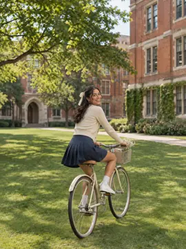</a> | <a href="https://promicat.app/zh/poses/styles/sp042?utm_source=github&utm_medium=readme&utm_campaign=ai-photo-poses">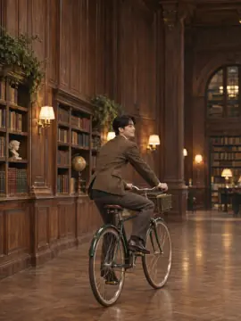</a> | <a href="https://promicat.app/zh/poses/styles/sp042?utm_source=github&utm_medium=readme&utm_campaign=ai-photo-poses">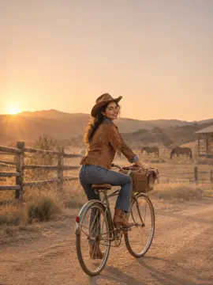</a> |

大图: [写真照](../images/photo-poses/jfilm/sp042-photo.webp) · [白模](../images/photo-poses/jfilm/sp042-pose.webp) · [在 Promicat 生成](https://promicat.app/zh/poses/styles/sp042?utm_source=github&utm_medium=readme&utm_campaign=ai-photo-poses)

<details><summary>提示词：用你的照片（图 1 你的照片，图 2 白模）</summary>

```text
A real professional portrait photoshoot photo: a Japanese-style fresh film photoshoot in a quiet residential street, overexposed airy light, Fuji film colours, 35mm. Subject: the person in image 1 (keep their exact face, facial features, skin tone and hairstyle; do not beautify or swap the face), wearing a white shirt or a simple pastel outfit. Pose: riding a bicycle slowly, turning back to look at the camera with a smile. Image 2 is a wooden artist's mannequin that shows only this body pose: copy it exactly (head, torso, arms, hands, legs, feet, which hand does what, the camera angle), but do not copy the mannequin itself: no wooden skin, no joints, no blank face. Natural, relaxed and unstiff, true skin texture. No text, no logo, no watermark. Portrait 3:4.
```

</details>

<details><summary>提示词：生成示例图（虚构模特）</summary>

```text
A real professional portrait photoshoot photo, the kind posted by a top portrait studio: a Japanese-style fresh film photoshoot in a quiet residential street, overexposed airy light, Fuji film colours, 35mm. Model: a beautiful Southeast Asian professional fashion model in her twenties with a naturally attractive face, styled hair and natural makeup, wearing a white shirt or a simple pastel outfit. The photographer directs the model into a natural, relaxed, unstiff pose that looks caught between moments: riding a bicycle slowly, turning back to look at the camera with a smile. Asymmetric body, soft hands, flattering angle, true skin texture, refined but not plastic, fully clothed and modest. Full body or three-quarter body in frame, the whole pose clearly readable. No text, no logo, no watermark. Portrait 3:4.
```

</details>

## 坐路边 (坐)

| 白模 | 日系清新 | 赛博霓虹 | 老钱风 | 街头朋克 |
|---|---|---|---|---|
| 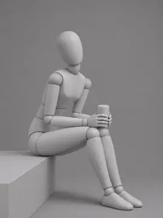 | <a href="https://promicat.app/zh/poses/styles/sp043?utm_source=github&utm_medium=readme&utm_campaign=ai-photo-poses">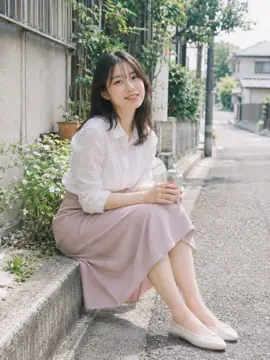</a> | <a href="https://promicat.app/zh/poses/styles/sp043?utm_source=github&utm_medium=readme&utm_campaign=ai-photo-poses">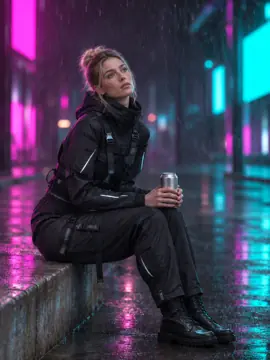</a> | <a href="https://promicat.app/zh/poses/styles/sp043?utm_source=github&utm_medium=readme&utm_campaign=ai-photo-poses">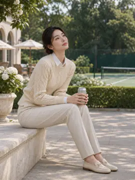</a> | <a href="https://promicat.app/zh/poses/styles/sp043?utm_source=github&utm_medium=readme&utm_campaign=ai-photo-poses">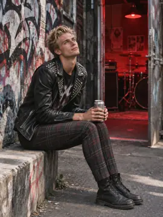</a> |

大图: [写真照](../images/photo-poses/jfilm/sp043-photo.webp) · [白模](../images/photo-poses/jfilm/sp043-pose.webp) · [在 Promicat 生成](https://promicat.app/zh/poses/styles/sp043?utm_source=github&utm_medium=readme&utm_campaign=ai-photo-poses)

<details><summary>提示词：用你的照片（图 1 你的照片，图 2 白模）</summary>

```text
A real professional portrait photoshoot photo: a Japanese-style fresh film photoshoot in a quiet residential street, overexposed airy light, Fuji film colours, 35mm. Subject: the person in image 1 (keep their exact face, facial features, skin tone and hairstyle; do not beautify or swap the face), wearing a white shirt or a simple pastel outfit. Pose: sitting on a low kerb with knees together, holding a soda can, looking up. Image 2 is a wooden artist's mannequin that shows only this body pose: copy it exactly (head, torso, arms, hands, legs, feet, which hand does what, the camera angle), but do not copy the mannequin itself: no wooden skin, no joints, no blank face. Natural, relaxed and unstiff, true skin texture. No text, no logo, no watermark. Portrait 3:4.
```

</details>

<details><summary>提示词：生成示例图（虚构模特）</summary>

```text
A real professional portrait photoshoot photo, the kind posted by a top portrait studio: a Japanese-style fresh film photoshoot in a quiet residential street, overexposed airy light, Fuji film colours, 35mm. Model: a beautiful Japanese professional fashion model in her twenties with a naturally attractive face, styled hair and natural makeup, wearing a white shirt or a simple pastel outfit. The photographer directs the model into a natural, relaxed, unstiff pose that looks caught between moments: sitting on a low kerb with knees together, holding a soda can, looking up. Asymmetric body, soft hands, flattering angle, true skin texture, refined but not plastic, fully clothed and modest. Full body or three-quarter body in frame, the whole pose clearly readable. No text, no logo, no watermark. Portrait 3:4.
```

</details>

## 电车站等车 (站)

| 白模 | 日系清新 | 港风复古 | 居家慵懒 | 情绪棚拍 |
|---|---|---|---|---|
| 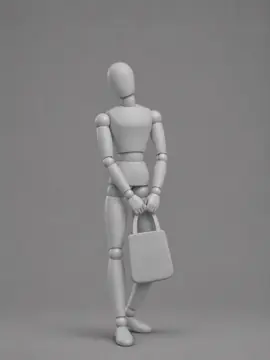 | <a href="https://promicat.app/zh/poses/styles/sp044?utm_source=github&utm_medium=readme&utm_campaign=ai-photo-poses">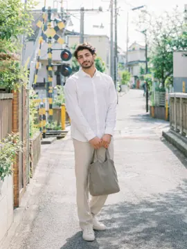</a> | <a href="https://promicat.app/zh/poses/styles/sp044?utm_source=github&utm_medium=readme&utm_campaign=ai-photo-poses">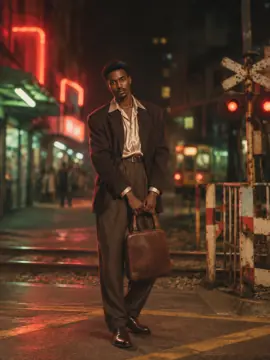</a> | <a href="https://promicat.app/zh/poses/styles/sp044?utm_source=github&utm_medium=readme&utm_campaign=ai-photo-poses">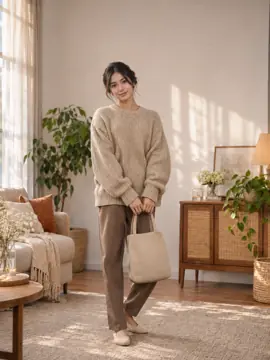</a> | <a href="https://promicat.app/zh/poses/styles/sp044?utm_source=github&utm_medium=readme&utm_campaign=ai-photo-poses">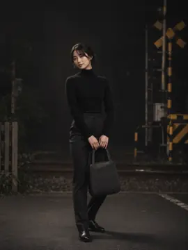</a> |

大图: [写真照](../images/photo-poses/jfilm/sp044-photo.webp) · [白模](../images/photo-poses/jfilm/sp044-pose.webp) · [在 Promicat 生成](https://promicat.app/zh/poses/styles/sp044?utm_source=github&utm_medium=readme&utm_campaign=ai-photo-poses)

<details><summary>提示词：用你的照片（图 1 你的照片，图 2 白模）</summary>

```text
A real professional portrait photoshoot photo: a Japanese-style fresh film photoshoot in a quiet residential street, overexposed airy light, Fuji film colours, 35mm. Subject: the person in image 1 (keep their exact face, facial features, skin tone and hairstyle; do not beautify or swap the face), wearing a white shirt or a simple pastel outfit. Pose: standing at a small train crossing holding a bag in both hands in front. Image 2 is a wooden artist's mannequin that shows only this body pose: copy it exactly (head, torso, arms, hands, legs, feet, which hand does what, the camera angle), but do not copy the mannequin itself: no wooden skin, no joints, no blank face. Natural, relaxed and unstiff, true skin texture. No text, no logo, no watermark. Portrait 3:4.
```

</details>

<details><summary>提示词：生成示例图（虚构模特）</summary>

```text
A real professional portrait photoshoot photo, the kind posted by a top portrait studio: a Japanese-style fresh film photoshoot in a quiet residential street, overexposed airy light, Fuji film colours, 35mm. Model: a handsome Middle Eastern professional male model in his twenties with a well-groomed look and styled hair, wearing a white shirt or a simple pastel outfit. The photographer directs the model into a natural, relaxed, unstiff pose that looks caught between moments: standing at a small train crossing holding a bag in both hands in front. Asymmetric body, soft hands, flattering angle, true skin texture, refined but not plastic, fully clothed and modest. Full body or three-quarter body in frame, the whole pose clearly readable. No text, no logo, no watermark. Portrait 3:4.
```

</details>

## 靠自动售货机 (靠)

| 白模 | 日系清新 | 新中式 | 好莱坞复古 | 街拍时尚 |
|---|---|---|---|---|
| 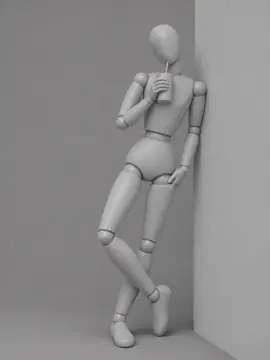 | <a href="https://promicat.app/zh/poses/styles/sp045?utm_source=github&utm_medium=readme&utm_campaign=ai-photo-poses">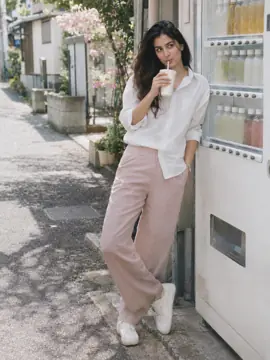</a> | <a href="https://promicat.app/zh/poses/styles/sp045?utm_source=github&utm_medium=readme&utm_campaign=ai-photo-poses">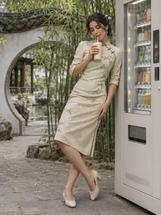</a> | <a href="https://promicat.app/zh/poses/styles/sp045?utm_source=github&utm_medium=readme&utm_campaign=ai-photo-poses">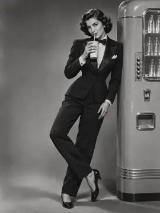</a> | <a href="https://promicat.app/zh/poses/styles/sp045?utm_source=github&utm_medium=readme&utm_campaign=ai-photo-poses">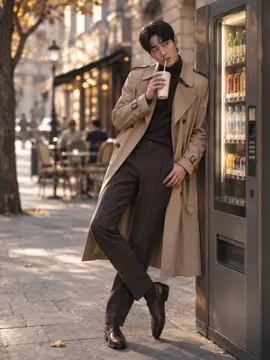</a> |

大图: [写真照](../images/photo-poses/jfilm/sp045-photo.webp) · [白模](../images/photo-poses/jfilm/sp045-pose.webp) · [在 Promicat 生成](https://promicat.app/zh/poses/styles/sp045?utm_source=github&utm_medium=readme&utm_campaign=ai-photo-poses)

<details><summary>提示词：用你的照片（图 1 你的照片，图 2 白模）</summary>

```text
A real professional portrait photoshoot photo: a Japanese-style fresh film photoshoot in a quiet residential street, overexposed airy light, Fuji film colours, 35mm. Subject: the person in image 1 (keep their exact face, facial features, skin tone and hairstyle; do not beautify or swap the face), wearing a white shirt or a simple pastel outfit. Pose: leaning on a vending machine, one foot crossed, sipping from a straw. Image 2 is a wooden artist's mannequin that shows only this body pose: copy it exactly (head, torso, arms, hands, legs, feet, which hand does what, the camera angle), but do not copy the mannequin itself: no wooden skin, no joints, no blank face. Natural, relaxed and unstiff, true skin texture. No text, no logo, no watermark. Portrait 3:4.
```

</details>

<details><summary>提示词：生成示例图（虚构模特）</summary>

```text
A real professional portrait photoshoot photo, the kind posted by a top portrait studio: a Japanese-style fresh film photoshoot in a quiet residential street, overexposed airy light, Fuji film colours, 35mm. Model: a beautiful Indian professional fashion model in her twenties with a naturally attractive face, styled hair and natural makeup, wearing a white shirt or a simple pastel outfit. The photographer directs the model into a natural, relaxed, unstiff pose that looks caught between moments: leaning on a vending machine, one foot crossed, sipping from a straw. Asymmetric body, soft hands, flattering angle, true skin texture, refined but not plastic, fully clothed and modest. Full body or three-quarter body in frame, the whole pose clearly readable. No text, no logo, no watermark. Portrait 3:4.
```

</details>

## 伸手挡光 (半身)

| 白模 | 日系清新 | 海边度假 | 森系花田 | Y2K 千禧辣妹 |
|---|---|---|---|---|
| 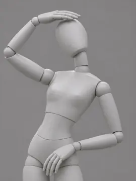 | <a href="https://promicat.app/zh/poses/styles/sp046?utm_source=github&utm_medium=readme&utm_campaign=ai-photo-poses">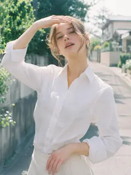</a> | <a href="https://promicat.app/zh/poses/styles/sp046?utm_source=github&utm_medium=readme&utm_campaign=ai-photo-poses">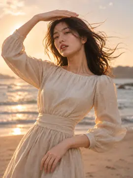</a> | <a href="https://promicat.app/zh/poses/styles/sp046?utm_source=github&utm_medium=readme&utm_campaign=ai-photo-poses">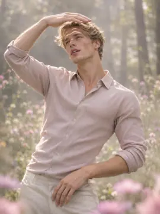</a> | <a href="https://promicat.app/zh/poses/styles/sp046?utm_source=github&utm_medium=readme&utm_campaign=ai-photo-poses">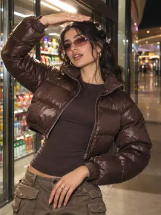</a> |

大图: [写真照](../images/photo-poses/jfilm/sp046-photo.webp) · [白模](../images/photo-poses/jfilm/sp046-pose.webp) · [在 Promicat 生成](https://promicat.app/zh/poses/styles/sp046?utm_source=github&utm_medium=readme&utm_campaign=ai-photo-poses)

<details><summary>提示词：用你的照片（图 1 你的照片，图 2 白模）</summary>

```text
A real professional portrait photoshoot photo: a Japanese-style fresh film photoshoot in a quiet residential street, overexposed airy light, Fuji film colours, 35mm. Subject: the person in image 1 (keep their exact face, facial features, skin tone and hairstyle; do not beautify or swap the face), wearing a white shirt or a simple pastel outfit. Pose: shading the eyes with one hand against the bright sky, mouth slightly open. Image 2 is a wooden artist's mannequin that shows only this body pose: copy it exactly (head, torso, arms, hands, legs, feet, which hand does what, the camera angle), but do not copy the mannequin itself: no wooden skin, no joints, no blank face. Natural, relaxed and unstiff, true skin texture. No text, no logo, no watermark. Portrait 3:4.
```

</details>

<details><summary>提示词：生成示例图（虚构模特）</summary>

```text
A real professional portrait photoshoot photo, the kind posted by a top portrait studio: a Japanese-style fresh film photoshoot in a quiet residential street, overexposed airy light, Fuji film colours, 35mm. Model: a beautiful white European professional fashion model in her twenties with a naturally attractive face, styled hair and natural makeup, wearing a white shirt or a simple pastel outfit. The photographer directs the model into a natural, relaxed, unstiff pose that looks caught between moments: shading the eyes with one hand against the bright sky, mouth slightly open. Asymmetric body, soft hands, flattering angle, true skin texture, refined but not plastic, fully clothed and modest. Waist-up framing, both arms and hands readable. No text, no logo, no watermark. Portrait 3:4.
```

</details>

## 蹲着喂猫 (蹲跪)

| 白模 | 日系清新 | 波西米亚 | 情绪棚拍 | 老钱风 |
|---|---|---|---|---|
| 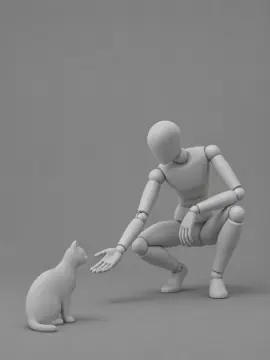 | <a href="https://promicat.app/zh/poses/styles/sp047?utm_source=github&utm_medium=readme&utm_campaign=ai-photo-poses">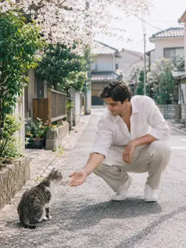</a> | <a href="https://promicat.app/zh/poses/styles/sp047?utm_source=github&utm_medium=readme&utm_campaign=ai-photo-poses">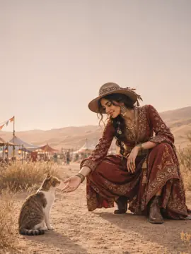</a> | <a href="https://promicat.app/zh/poses/styles/sp047?utm_source=github&utm_medium=readme&utm_campaign=ai-photo-poses">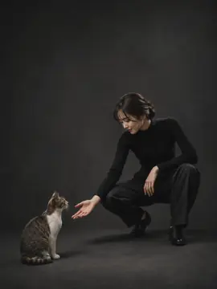</a> | <a href="https://promicat.app/zh/poses/styles/sp047?utm_source=github&utm_medium=readme&utm_campaign=ai-photo-poses">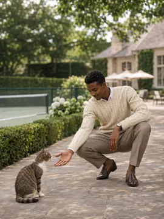</a> |

大图: [写真照](../images/photo-poses/jfilm/sp047-photo.webp) · [白模](../images/photo-poses/jfilm/sp047-pose.webp) · [在 Promicat 生成](https://promicat.app/zh/poses/styles/sp047?utm_source=github&utm_medium=readme&utm_campaign=ai-photo-poses)

<details><summary>提示词：用你的照片（图 1 你的照片，图 2 白模）</summary>

```text
A real professional portrait photoshoot photo: a Japanese-style fresh film photoshoot in a quiet residential street, overexposed airy light, Fuji film colours, 35mm. Subject: the person in image 1 (keep their exact face, facial features, skin tone and hairstyle; do not beautify or swap the face), wearing a white shirt or a simple pastel outfit. Pose: crouching to offer a hand to a cat on the street, head tilted. Image 2 is a wooden artist's mannequin that shows only this body pose: copy it exactly (head, torso, arms, hands, legs, feet, which hand does what, the camera angle), but do not copy the mannequin itself: no wooden skin, no joints, no blank face. Natural, relaxed and unstiff, true skin texture. No text, no logo, no watermark. Portrait 3:4.
```

</details>

<details><summary>提示词：生成示例图（虚构模特）</summary>

```text
A real professional portrait photoshoot photo, the kind posted by a top portrait studio: a Japanese-style fresh film photoshoot in a quiet residential street, overexposed airy light, Fuji film colours, 35mm. Model: a handsome Brazilian professional male model in his twenties with a well-groomed look and styled hair, wearing a white shirt or a simple pastel outfit. The photographer directs the model into a natural, relaxed, unstiff pose that looks caught between moments: crouching to offer a hand to a cat on the street, head tilted. Asymmetric body, soft hands, flattering angle, true skin texture, refined but not plastic, fully clothed and modest. Full body or three-quarter body in frame, the whole pose clearly readable. No text, no logo, no watermark. Portrait 3:4.
```

</details>

## 走过晾衣绳 (走)

| 白模 | 日系清新 | 学院风 | 北欧极简 | 西部牛仔 |
|---|---|---|---|---|
| 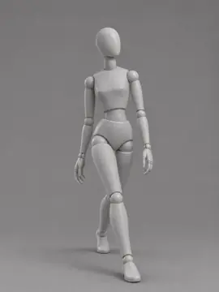 | <a href="https://promicat.app/zh/poses/styles/sp048?utm_source=github&utm_medium=readme&utm_campaign=ai-photo-poses">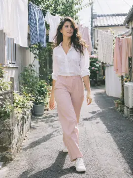</a> | <a href="https://promicat.app/zh/poses/styles/sp048?utm_source=github&utm_medium=readme&utm_campaign=ai-photo-poses">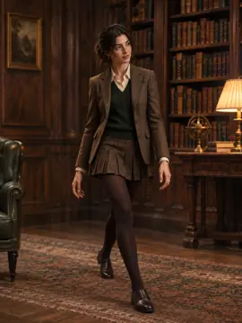</a> | <a href="https://promicat.app/zh/poses/styles/sp048?utm_source=github&utm_medium=readme&utm_campaign=ai-photo-poses">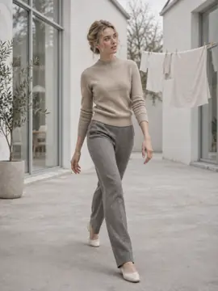</a> | <a href="https://promicat.app/zh/poses/styles/sp048?utm_source=github&utm_medium=readme&utm_campaign=ai-photo-poses">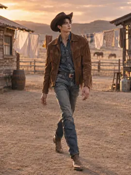</a> |

大图: [写真照](../images/photo-poses/jfilm/sp048-photo.webp) · [白模](../images/photo-poses/jfilm/sp048-pose.webp) · [在 Promicat 生成](https://promicat.app/zh/poses/styles/sp048?utm_source=github&utm_medium=readme&utm_campaign=ai-photo-poses)

<details><summary>提示词：用你的照片（图 1 你的照片，图 2 白模）</summary>

```text
A real professional portrait photoshoot photo: a Japanese-style fresh film photoshoot in a quiet residential street, overexposed airy light, Fuji film colours, 35mm. Subject: the person in image 1 (keep their exact face, facial features, skin tone and hairstyle; do not beautify or swap the face), wearing a white shirt or a simple pastel outfit. Pose: walking past laundry hanging between houses, glancing to the side. Image 2 is a wooden artist's mannequin that shows only this body pose: copy it exactly (head, torso, arms, hands, legs, feet, which hand does what, the camera angle), but do not copy the mannequin itself: no wooden skin, no joints, no blank face. Natural, relaxed and unstiff, true skin texture. No text, no logo, no watermark. Portrait 3:4.
```

</details>

<details><summary>提示词：生成示例图（虚构模特）</summary>

```text
A real professional portrait photoshoot photo, the kind posted by a top portrait studio: a Japanese-style fresh film photoshoot in a quiet residential street, overexposed airy light, Fuji film colours, 35mm. Model: a beautiful Latina professional fashion model in her twenties with a naturally attractive face, styled hair and natural makeup, wearing a white shirt or a simple pastel outfit. The photographer directs the model into a natural, relaxed, unstiff pose that looks caught between moments: walking past laundry hanging between houses, glancing to the side. Asymmetric body, soft hands, flattering angle, true skin texture, refined but not plastic, fully clothed and modest. Full body or three-quarter body in frame, the whole pose clearly readable. No text, no logo, no watermark. Portrait 3:4.
```

</details>

## 坐台阶托腮 (坐)

| 白模 | 日系清新 | 咖啡馆文艺 | 新中式 | 港风复古 |
|---|---|---|---|---|
| 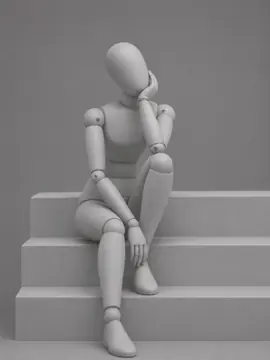 | <a href="https://promicat.app/zh/poses/styles/sp049?utm_source=github&utm_medium=readme&utm_campaign=ai-photo-poses">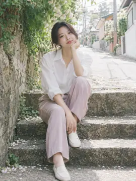</a> | <a href="https://promicat.app/zh/poses/styles/sp049?utm_source=github&utm_medium=readme&utm_campaign=ai-photo-poses">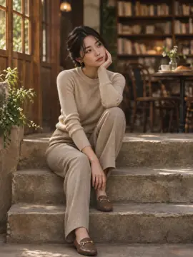</a> | <a href="https://promicat.app/zh/poses/styles/sp049?utm_source=github&utm_medium=readme&utm_campaign=ai-photo-poses">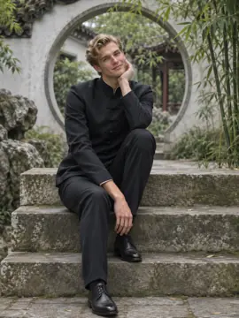</a> | <a href="https://promicat.app/zh/poses/styles/sp049?utm_source=github&utm_medium=readme&utm_campaign=ai-photo-poses">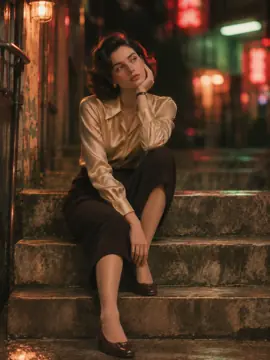</a> |

大图: [写真照](../images/photo-poses/jfilm/sp049-photo.webp) · [白模](../images/photo-poses/jfilm/sp049-pose.webp) · [在 Promicat 生成](https://promicat.app/zh/poses/styles/sp049?utm_source=github&utm_medium=readme&utm_campaign=ai-photo-poses)

<details><summary>提示词：用你的照片（图 1 你的照片，图 2 白模）</summary>

```text
A real professional portrait photoshoot photo: a Japanese-style fresh film photoshoot in a quiet residential street, overexposed airy light, Fuji film colours, 35mm. Subject: the person in image 1 (keep their exact face, facial features, skin tone and hairstyle; do not beautify or swap the face), wearing a white shirt or a simple pastel outfit. Pose: sitting on old stone steps, elbow on knee, chin in hand. Image 2 is a wooden artist's mannequin that shows only this body pose: copy it exactly (head, torso, arms, hands, legs, feet, which hand does what, the camera angle), but do not copy the mannequin itself: no wooden skin, no joints, no blank face. Natural, relaxed and unstiff, true skin texture. No text, no logo, no watermark. Portrait 3:4.
```

</details>

<details><summary>提示词：生成示例图（虚构模特）</summary>

```text
A real professional portrait photoshoot photo, the kind posted by a top portrait studio: a Japanese-style fresh film photoshoot in a quiet residential street, overexposed airy light, Fuji film colours, 35mm. Model: a beautiful Korean professional fashion model in her twenties with a naturally attractive face, styled hair and natural makeup, wearing a white shirt or a simple pastel outfit. The photographer directs the model into a natural, relaxed, unstiff pose that looks caught between moments: sitting on old stone steps, elbow on knee, chin in hand. Asymmetric body, soft hands, flattering angle, true skin texture, refined but not plastic, fully clothed and modest. Full body or three-quarter body in frame, the whole pose clearly readable. No text, no logo, no watermark. Portrait 3:4.
```

</details>

## 风吹衬衫 (动态)

| 白模 | 日系清新 | 校园青春 | 街头朋克 | 街拍时尚 |
|---|---|---|---|---|
| 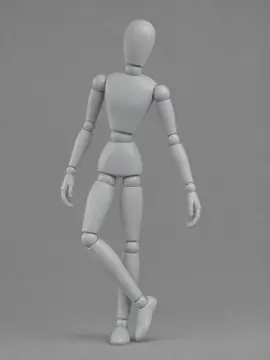 | <a href="https://promicat.app/zh/poses/styles/sp050?utm_source=github&utm_medium=readme&utm_campaign=ai-photo-poses">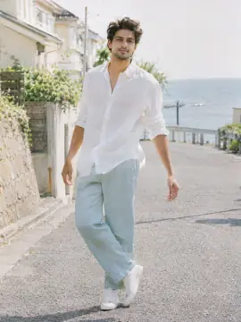</a> | <a href="https://promicat.app/zh/poses/styles/sp050?utm_source=github&utm_medium=readme&utm_campaign=ai-photo-poses">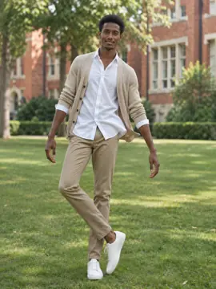</a> | <a href="https://promicat.app/zh/poses/styles/sp050?utm_source=github&utm_medium=readme&utm_campaign=ai-photo-poses">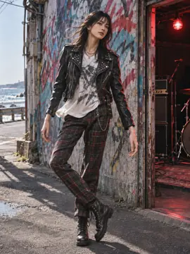</a> | <a href="https://promicat.app/zh/poses/styles/sp050?utm_source=github&utm_medium=readme&utm_campaign=ai-photo-poses">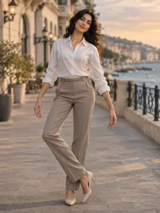</a> |

大图: [写真照](../images/photo-poses/jfilm/sp050-photo.webp) · [白模](../images/photo-poses/jfilm/sp050-pose.webp) · [在 Promicat 生成](https://promicat.app/zh/poses/styles/sp050?utm_source=github&utm_medium=readme&utm_campaign=ai-photo-poses)

<details><summary>提示词：用你的照片（图 1 你的照片，图 2 白模）</summary>

```text
A real professional portrait photoshoot photo: a Japanese-style fresh film photoshoot in a quiet residential street, overexposed airy light, Fuji film colours, 35mm. Subject: the person in image 1 (keep their exact face, facial features, skin tone and hairstyle; do not beautify or swap the face), wearing a white shirt or a simple pastel outfit. Pose: standing on a seaside road with the white shirt blowing, arms slightly away from the body. Image 2 is a wooden artist's mannequin that shows only this body pose: copy it exactly (head, torso, arms, hands, legs, feet, which hand does what, the camera angle), but do not copy the mannequin itself: no wooden skin, no joints, no blank face. Natural, relaxed and unstiff, true skin texture. No text, no logo, no watermark. Portrait 3:4.
```

</details>

<details><summary>提示词：生成示例图（虚构模特）</summary>

```text
A real professional portrait photoshoot photo, the kind posted by a top portrait studio: a Japanese-style fresh film photoshoot in a quiet residential street, overexposed airy light, Fuji film colours, 35mm. Model: a handsome South Asian professional male model in his twenties with a well-groomed look and styled hair, wearing a white shirt or a simple pastel outfit. The photographer directs the model into a natural, relaxed, unstiff pose that looks caught between moments: standing on a seaside road with the white shirt blowing, arms slightly away from the body. Asymmetric body, soft hands, flattering angle, true skin texture, refined but not plastic, fully clothed and modest. Full body or three-quarter body in frame, the whole pose clearly readable. No text, no logo, no watermark. Portrait 3:4.
```

</details>
