# 情绪棚拍 · Moody studio

10 组写真姿势：左边是写真照，右边是照着它画的木头白模。白模可以当姿势参考图，和你的照片一起发给生图模型。 在线试用：[Promicat 姿势库](https://promicat.app/zh/poses?ref=github)

[← 返回目录](../README.md#写真姿势)

## 抚肩低眸（半身）

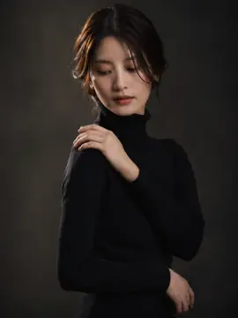 

大图：[写真照](../images/photo-poses/mood/sp081-photo.webp) · [白模](../images/photo-poses/mood/sp081-pose.webp)

<details><summary>提示词：用你的照片（附图 1 你的照片，附图 2 白模）</summary>

```text
A real professional portrait photoshoot photo: a moody studio portrait photoshoot with a single soft key light and a dark backdrop, Rembrandt light, 85mm. Subject: the person in image 1 (keep their exact face, facial features, skin tone and hairstyle; do not beautify or swap the face), wearing a black turtleneck or a simple dark outfit. Pose: half turned from the camera, one hand resting on the opposite shoulder, eyes looking down. Image 2 is a wooden artist's mannequin that shows only this body pose: copy it exactly (head, torso, arms, hands, legs, feet, which hand does what, the camera angle), but do not copy the mannequin itself: no wooden skin, no joints, no blank face. Natural, relaxed and unstiff, true skin texture. No text, no logo, no watermark. Portrait 3:4.
```

</details>

<details><summary>提示词：生成示例图（虚构模特）</summary>

```text
A real professional portrait photoshoot photo, the kind posted by a top portrait studio: a moody studio portrait photoshoot with a single soft key light and a dark backdrop, Rembrandt light, 85mm. Model: a beautiful Japanese professional fashion model in her twenties with a naturally attractive face, styled hair and natural makeup, wearing a black turtleneck or a simple dark outfit. The photographer directs the model into a natural, relaxed, unstiff pose that looks caught between moments: half turned from the camera, one hand resting on the opposite shoulder, eyes looking down. Asymmetric body, soft hands, flattering angle, true skin texture, refined but not plastic, fully clothed and modest. Waist-up framing, both arms and hands readable. No text, no logo, no watermark. Portrait 3:4.
```

</details>

## 双手捧脸（半身）

 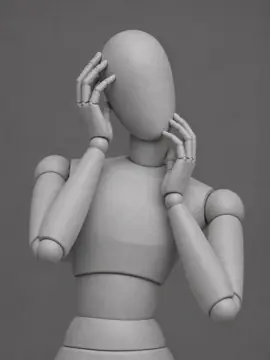

大图：[写真照](../images/photo-poses/mood/sp082-photo.webp) · [白模](../images/photo-poses/mood/sp082-pose.webp)

<details><summary>提示词：用你的照片（附图 1 你的照片，附图 2 白模）</summary>

```text
A real professional portrait photoshoot photo: a moody studio portrait photoshoot with a single soft key light and a dark backdrop, Rembrandt light, 85mm. Subject: the person in image 1 (keep their exact face, facial features, skin tone and hairstyle; do not beautify or swap the face), wearing a black turtleneck or a simple dark outfit. Pose: both hands lightly framing the face, eyes closed. Image 2 is a wooden artist's mannequin that shows only this body pose: copy it exactly (head, torso, arms, hands, legs, feet, which hand does what, the camera angle), but do not copy the mannequin itself: no wooden skin, no joints, no blank face. Natural, relaxed and unstiff, true skin texture. No text, no logo, no watermark. Portrait 3:4.
```

</details>

<details><summary>提示词：生成示例图（虚构模特）</summary>

```text
A real professional portrait photoshoot photo, the kind posted by a top portrait studio: a moody studio portrait photoshoot with a single soft key light and a dark backdrop, Rembrandt light, 85mm. Model: a handsome Middle Eastern professional male model in his twenties with a well-groomed look and styled hair, wearing a black turtleneck or a simple dark outfit. The photographer directs the model into a natural, relaxed, unstiff pose that looks caught between moments: both hands lightly framing the face, eyes closed. Asymmetric body, soft hands, flattering angle, true skin texture, refined but not plastic, fully clothed and modest. Waist-up framing, both arms and hands readable. No text, no logo, no watermark. Portrait 3:4.
```

</details>

## 坐凳侧身（坐）

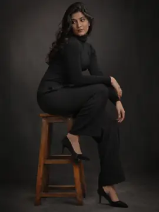 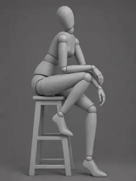

大图：[写真照](../images/photo-poses/mood/sp083-photo.webp) · [白模](../images/photo-poses/mood/sp083-pose.webp)

<details><summary>提示词：用你的照片（附图 1 你的照片，附图 2 白模）</summary>

```text
A real professional portrait photoshoot photo: a moody studio portrait photoshoot with a single soft key light and a dark backdrop, Rembrandt light, 85mm. Subject: the person in image 1 (keep their exact face, facial features, skin tone and hairstyle; do not beautify or swap the face), wearing a black turtleneck or a simple dark outfit. Pose: sitting sideways on a wooden stool, one foot on the rung, looking over the shoulder. Image 2 is a wooden artist's mannequin that shows only this body pose: copy it exactly (head, torso, arms, hands, legs, feet, which hand does what, the camera angle), but do not copy the mannequin itself: no wooden skin, no joints, no blank face. Natural, relaxed and unstiff, true skin texture. No text, no logo, no watermark. Portrait 3:4.
```

</details>

<details><summary>提示词：生成示例图（虚构模特）</summary>

```text
A real professional portrait photoshoot photo, the kind posted by a top portrait studio: a moody studio portrait photoshoot with a single soft key light and a dark backdrop, Rembrandt light, 85mm. Model: a beautiful Indian professional fashion model in her twenties with a naturally attractive face, styled hair and natural makeup, wearing a black turtleneck or a simple dark outfit. The photographer directs the model into a natural, relaxed, unstiff pose that looks caught between moments: sitting sideways on a wooden stool, one foot on the rung, looking over the shoulder. Asymmetric body, soft hands, flattering angle, true skin texture, refined but not plastic, fully clothed and modest. Full body or three-quarter body in frame, the whole pose clearly readable. No text, no logo, no watermark. Portrait 3:4.
```

</details>

## 背影回头（回眸）

 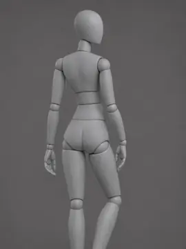

大图：[写真照](../images/photo-poses/mood/sp084-photo.webp) · [白模](../images/photo-poses/mood/sp084-pose.webp)

<details><summary>提示词：用你的照片（附图 1 你的照片，附图 2 白模）</summary>

```text
A real professional portrait photoshoot photo: a moody studio portrait photoshoot with a single soft key light and a dark backdrop, Rembrandt light, 85mm. Subject: the person in image 1 (keep their exact face, facial features, skin tone and hairstyle; do not beautify or swap the face), wearing a black turtleneck or a simple dark outfit. Pose: back to the camera, turning the head to show the profile. Image 2 is a wooden artist's mannequin that shows only this body pose: copy it exactly (head, torso, arms, hands, legs, feet, which hand does what, the camera angle), but do not copy the mannequin itself: no wooden skin, no joints, no blank face. Natural, relaxed and unstiff, true skin texture. No text, no logo, no watermark. Portrait 3:4.
```

</details>

<details><summary>提示词：生成示例图（虚构模特）</summary>

```text
A real professional portrait photoshoot photo, the kind posted by a top portrait studio: a moody studio portrait photoshoot with a single soft key light and a dark backdrop, Rembrandt light, 85mm. Model: a beautiful white European professional fashion model in her twenties with a naturally attractive face, styled hair and natural makeup, wearing a black turtleneck or a simple dark outfit. The photographer directs the model into a natural, relaxed, unstiff pose that looks caught between moments: back to the camera, turning the head to show the profile. Asymmetric body, soft hands, flattering angle, true skin texture, refined but not plastic, fully clothed and modest. Full body or three-quarter body in frame, the whole pose clearly readable. No text, no logo, no watermark. Portrait 3:4.
```

</details>

## 蹲坐抱膝（蹲跪）

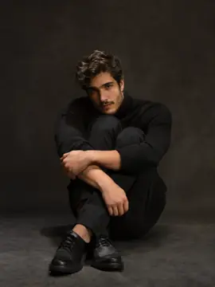 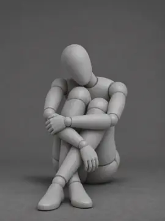

大图：[写真照](../images/photo-poses/mood/sp085-photo.webp) · [白模](../images/photo-poses/mood/sp085-pose.webp)

<details><summary>提示词：用你的照片（附图 1 你的照片，附图 2 白模）</summary>

```text
A real professional portrait photoshoot photo: a moody studio portrait photoshoot with a single soft key light and a dark backdrop, Rembrandt light, 85mm. Subject: the person in image 1 (keep their exact face, facial features, skin tone and hairstyle; do not beautify or swap the face), wearing a black turtleneck or a simple dark outfit. Pose: sitting low on the floor hugging both knees, chin on the knees, eyes to the camera. Image 2 is a wooden artist's mannequin that shows only this body pose: copy it exactly (head, torso, arms, hands, legs, feet, which hand does what, the camera angle), but do not copy the mannequin itself: no wooden skin, no joints, no blank face. Natural, relaxed and unstiff, true skin texture. No text, no logo, no watermark. Portrait 3:4.
```

</details>

<details><summary>提示词：生成示例图（虚构模特）</summary>

```text
A real professional portrait photoshoot photo, the kind posted by a top portrait studio: a moody studio portrait photoshoot with a single soft key light and a dark backdrop, Rembrandt light, 85mm. Model: a handsome Brazilian professional male model in his twenties with a well-groomed look and styled hair, wearing a black turtleneck or a simple dark outfit. The photographer directs the model into a natural, relaxed, unstiff pose that looks caught between moments: sitting low on the floor hugging both knees, chin on the knees, eyes to the camera. Asymmetric body, soft hands, flattering angle, true skin texture, refined but not plastic, fully clothed and modest. Full body or three-quarter body in frame, the whole pose clearly readable. No text, no logo, no watermark. Portrait 3:4.
```

</details>

## 手扶后颈（半身）

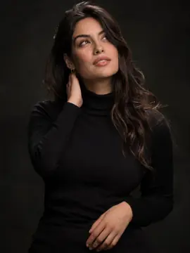 

大图：[写真照](../images/photo-poses/mood/sp086-photo.webp) · [白模](../images/photo-poses/mood/sp086-pose.webp)

<details><summary>提示词：用你的照片（附图 1 你的照片，附图 2 白模）</summary>

```text
A real professional portrait photoshoot photo: a moody studio portrait photoshoot with a single soft key light and a dark backdrop, Rembrandt light, 85mm. Subject: the person in image 1 (keep their exact face, facial features, skin tone and hairstyle; do not beautify or swap the face), wearing a black turtleneck or a simple dark outfit. Pose: one hand on the back of the neck, head tilted, eyes up. Image 2 is a wooden artist's mannequin that shows only this body pose: copy it exactly (head, torso, arms, hands, legs, feet, which hand does what, the camera angle), but do not copy the mannequin itself: no wooden skin, no joints, no blank face. Natural, relaxed and unstiff, true skin texture. No text, no logo, no watermark. Portrait 3:4.
```

</details>

<details><summary>提示词：生成示例图（虚构模特）</summary>

```text
A real professional portrait photoshoot photo, the kind posted by a top portrait studio: a moody studio portrait photoshoot with a single soft key light and a dark backdrop, Rembrandt light, 85mm. Model: a beautiful Latina professional fashion model in her twenties with a naturally attractive face, styled hair and natural makeup, wearing a black turtleneck or a simple dark outfit. The photographer directs the model into a natural, relaxed, unstiff pose that looks caught between moments: one hand on the back of the neck, head tilted, eyes up. Asymmetric body, soft hands, flattering angle, true skin texture, refined but not plastic, fully clothed and modest. Waist-up framing, both arms and hands readable. No text, no logo, no watermark. Portrait 3:4.
```

</details>

## 仰头光中（站）

 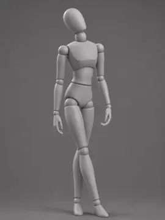

大图：[写真照](../images/photo-poses/mood/sp087-photo.webp) · [白模](../images/photo-poses/mood/sp087-pose.webp)

<details><summary>提示词：用你的照片（附图 1 你的照片，附图 2 白模）</summary>

```text
A real professional portrait photoshoot photo: a moody studio portrait photoshoot with a single soft key light and a dark backdrop, Rembrandt light, 85mm. Subject: the person in image 1 (keep their exact face, facial features, skin tone and hairstyle; do not beautify or swap the face), wearing a black turtleneck or a simple dark outfit. Pose: standing with the face turned up into the light, arms loose. Image 2 is a wooden artist's mannequin that shows only this body pose: copy it exactly (head, torso, arms, hands, legs, feet, which hand does what, the camera angle), but do not copy the mannequin itself: no wooden skin, no joints, no blank face. Natural, relaxed and unstiff, true skin texture. No text, no logo, no watermark. Portrait 3:4.
```

</details>

<details><summary>提示词：生成示例图（虚构模特）</summary>

```text
A real professional portrait photoshoot photo, the kind posted by a top portrait studio: a moody studio portrait photoshoot with a single soft key light and a dark backdrop, Rembrandt light, 85mm. Model: a beautiful Korean professional fashion model in her twenties with a naturally attractive face, styled hair and natural makeup, wearing a black turtleneck or a simple dark outfit. The photographer directs the model into a natural, relaxed, unstiff pose that looks caught between moments: standing with the face turned up into the light, arms loose. Asymmetric body, soft hands, flattering angle, true skin texture, refined but not plastic, fully clothed and modest. Full body or three-quarter body in frame, the whole pose clearly readable. No text, no logo, no watermark. Portrait 3:4.
```

</details>

## 靠墙滑坐（靠）

 

大图：[写真照](../images/photo-poses/mood/sp088-photo.webp) · [白模](../images/photo-poses/mood/sp088-pose.webp)

<details><summary>提示词：用你的照片（附图 1 你的照片，附图 2 白模）</summary>

```text
A real professional portrait photoshoot photo: a moody studio portrait photoshoot with a single soft key light and a dark backdrop, Rembrandt light, 85mm. Subject: the person in image 1 (keep their exact face, facial features, skin tone and hairstyle; do not beautify or swap the face), wearing a black turtleneck or a simple dark outfit. Pose: sliding down a dark wall into a half crouch, head back. Image 2 is a wooden artist's mannequin that shows only this body pose: copy it exactly (head, torso, arms, hands, legs, feet, which hand does what, the camera angle), but do not copy the mannequin itself: no wooden skin, no joints, no blank face. Natural, relaxed and unstiff, true skin texture. No text, no logo, no watermark. Portrait 3:4.
```

</details>

<details><summary>提示词：生成示例图（虚构模特）</summary>

```text
A real professional portrait photoshoot photo, the kind posted by a top portrait studio: a moody studio portrait photoshoot with a single soft key light and a dark backdrop, Rembrandt light, 85mm. Model: a handsome South Asian professional male model in his twenties with a well-groomed look and styled hair, wearing a black turtleneck or a simple dark outfit. The photographer directs the model into a natural, relaxed, unstiff pose that looks caught between moments: sliding down a dark wall into a half crouch, head back. Asymmetric body, soft hands, flattering angle, true skin texture, refined but not plastic, fully clothed and modest. Full body or three-quarter body in frame, the whole pose clearly readable. No text, no logo, no watermark. Portrait 3:4.
```

</details>

## 手挡半脸（半身）

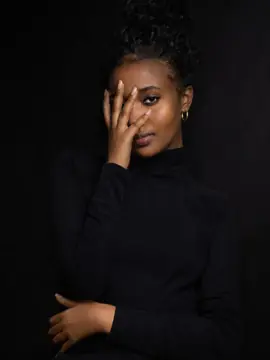 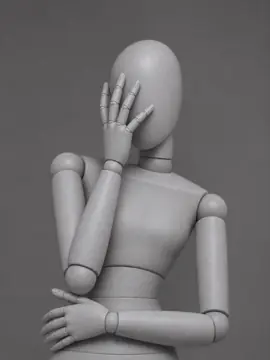

大图：[写真照](../images/photo-poses/mood/sp089-photo.webp) · [白模](../images/photo-poses/mood/sp089-pose.webp)

<details><summary>提示词：用你的照片（附图 1 你的照片，附图 2 白模）</summary>

```text
A real professional portrait photoshoot photo: a moody studio portrait photoshoot with a single soft key light and a dark backdrop, Rembrandt light, 85mm. Subject: the person in image 1 (keep their exact face, facial features, skin tone and hairstyle; do not beautify or swap the face), wearing a black turtleneck or a simple dark outfit. Pose: one hand covering half of the face, one eye looking through the fingers. Image 2 is a wooden artist's mannequin that shows only this body pose: copy it exactly (head, torso, arms, hands, legs, feet, which hand does what, the camera angle), but do not copy the mannequin itself: no wooden skin, no joints, no blank face. Natural, relaxed and unstiff, true skin texture. No text, no logo, no watermark. Portrait 3:4.
```

</details>

<details><summary>提示词：生成示例图（虚构模特）</summary>

```text
A real professional portrait photoshoot photo, the kind posted by a top portrait studio: a moody studio portrait photoshoot with a single soft key light and a dark backdrop, Rembrandt light, 85mm. Model: a beautiful East African professional fashion model in her twenties with a naturally attractive face, styled hair and natural makeup, wearing a black turtleneck or a simple dark outfit. The photographer directs the model into a natural, relaxed, unstiff pose that looks caught between moments: one hand covering half of the face, one eye looking through the fingers. Asymmetric body, soft hands, flattering angle, true skin texture, refined but not plastic, fully clothed and modest. Waist-up framing, both arms and hands readable. No text, no logo, no watermark. Portrait 3:4.
```

</details>

## 侧躺地面（躺）

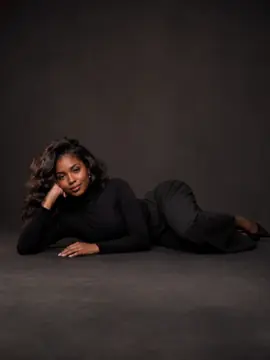 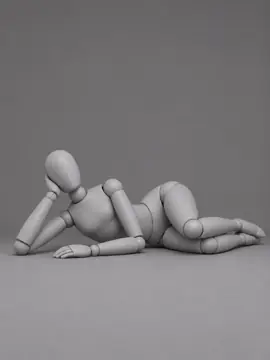

大图：[写真照](../images/photo-poses/mood/sp090-photo.webp) · [白模](../images/photo-poses/mood/sp090-pose.webp)

<details><summary>提示词：用你的照片（附图 1 你的照片，附图 2 白模）</summary>

```text
A real professional portrait photoshoot photo: a moody studio portrait photoshoot with a single soft key light and a dark backdrop, Rembrandt light, 85mm. Subject: the person in image 1 (keep their exact face, facial features, skin tone and hairstyle; do not beautify or swap the face), wearing a black turtleneck or a simple dark outfit. Pose: lying on the side on the studio floor, head on the arm, looking at the camera. Image 2 is a wooden artist's mannequin that shows only this body pose: copy it exactly (head, torso, arms, hands, legs, feet, which hand does what, the camera angle), but do not copy the mannequin itself: no wooden skin, no joints, no blank face. Natural, relaxed and unstiff, true skin texture. No text, no logo, no watermark. Portrait 3:4.
```

</details>

<details><summary>提示词：生成示例图（虚构模特）</summary>

```text
A real professional portrait photoshoot photo, the kind posted by a top portrait studio: a moody studio portrait photoshoot with a single soft key light and a dark backdrop, Rembrandt light, 85mm. Model: a beautiful Black professional fashion model in her twenties with a naturally attractive face, styled hair and natural makeup, wearing a black turtleneck or a simple dark outfit. The photographer directs the model into a natural, relaxed, unstiff pose that looks caught between moments: lying on the side on the studio floor, head on the arm, looking at the camera. Asymmetric body, soft hands, flattering angle, true skin texture, refined but not plastic, fully clothed and modest. Full body or three-quarter body in frame, the whole pose clearly readable. No text, no logo, no watermark. Portrait 3:4.
```

</details>
