# Moody studio

English · [简体中文](mood.zh-CN.md)

10 white models, each with 4 portraits shot from it in different styles. Attach your photo first and the white model second. Try them with your own photo on [Promicat](https://promicat.app/poses?utm_source=github&utm_medium=readme&utm_campaign=ai-photo-poses).

[← Back to all styles](../README.md#photo-poses)

## Half turned from the camera (Upper body)

| White model | Moody studio | Campus youth | Cosy at home | Y2K flash |
|---|---|---|---|---|
| 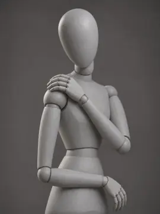 | <a href="https://promicat.app/poses/styles/sp081?utm_source=github&utm_medium=readme&utm_campaign=ai-photo-poses"></a> | <a href="https://promicat.app/poses/styles/sp081?utm_source=github&utm_medium=readme&utm_campaign=ai-photo-poses">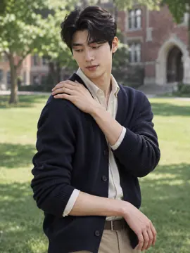</a> | <a href="https://promicat.app/poses/styles/sp081?utm_source=github&utm_medium=readme&utm_campaign=ai-photo-poses">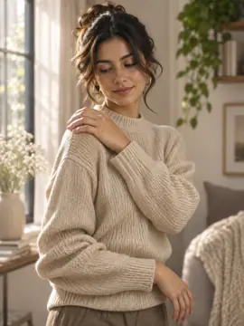</a> | <a href="https://promicat.app/poses/styles/sp081?utm_source=github&utm_medium=readme&utm_campaign=ai-photo-poses">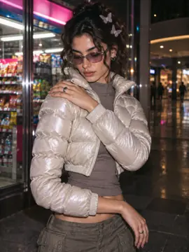</a> |

Full size: [photo](../images/photo-poses/mood/sp081-photo.webp) · [white model](../images/photo-poses/mood/sp081-pose.webp) · [try it on Promicat](https://promicat.app/poses/styles/sp081?utm_source=github&utm_medium=readme&utm_campaign=ai-photo-poses)

<details><summary>Prompt with your photo (image 1: your photo, image 2: white model)</summary>

```text
A real professional portrait photoshoot photo: a moody studio portrait photoshoot with a single soft key light and a dark backdrop, Rembrandt light, 85mm. Subject: the person in image 1 (keep their exact face, facial features, skin tone and hairstyle; do not beautify or swap the face), wearing a black turtleneck or a simple dark outfit. Pose: half turned from the camera, one hand resting on the opposite shoulder, eyes looking down. Image 2 is a wooden artist's mannequin that shows only this body pose: copy it exactly (head, torso, arms, hands, legs, feet, which hand does what, the camera angle), but do not copy the mannequin itself: no wooden skin, no joints, no blank face. Natural, relaxed and unstiff, true skin texture. No text, no logo, no watermark. Portrait 3:4.
```

</details>

<details><summary>Prompt for the sample (fictional model)</summary>

```text
A real professional portrait photoshoot photo, the kind posted by a top portrait studio: a moody studio portrait photoshoot with a single soft key light and a dark backdrop, Rembrandt light, 85mm. Model: a beautiful Japanese professional fashion model in her twenties with a naturally attractive face, styled hair and natural makeup, wearing a black turtleneck or a simple dark outfit. The photographer directs the model into a natural, relaxed, unstiff pose that looks caught between moments: half turned from the camera, one hand resting on the opposite shoulder, eyes looking down. Asymmetric body, soft hands, flattering angle, true skin texture, refined but not plastic, fully clothed and modest. Waist-up framing, both arms and hands readable. No text, no logo, no watermark. Portrait 3:4.
```

</details>

## Both hands lightly framing the face (Upper body)

| White model | Moody studio | Campus youth | Dark academia | Old money |
|---|---|---|---|---|
|  | <a href="https://promicat.app/poses/styles/sp082?utm_source=github&utm_medium=readme&utm_campaign=ai-photo-poses">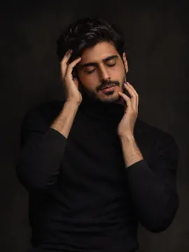</a> | <a href="https://promicat.app/poses/styles/sp082?utm_source=github&utm_medium=readme&utm_campaign=ai-photo-poses">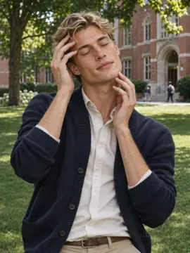</a> | <a href="https://promicat.app/poses/styles/sp082?utm_source=github&utm_medium=readme&utm_campaign=ai-photo-poses">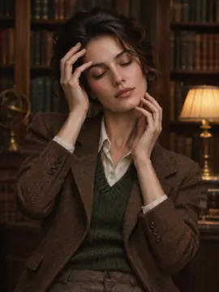</a> | <a href="https://promicat.app/poses/styles/sp082?utm_source=github&utm_medium=readme&utm_campaign=ai-photo-poses">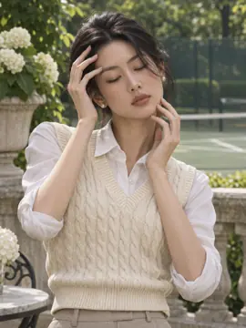</a> |

Full size: [photo](../images/photo-poses/mood/sp082-photo.webp) · [white model](../images/photo-poses/mood/sp082-pose.webp) · [try it on Promicat](https://promicat.app/poses/styles/sp082?utm_source=github&utm_medium=readme&utm_campaign=ai-photo-poses)

<details><summary>Prompt with your photo (image 1: your photo, image 2: white model)</summary>

```text
A real professional portrait photoshoot photo: a moody studio portrait photoshoot with a single soft key light and a dark backdrop, Rembrandt light, 85mm. Subject: the person in image 1 (keep their exact face, facial features, skin tone and hairstyle; do not beautify or swap the face), wearing a black turtleneck or a simple dark outfit. Pose: both hands lightly framing the face, eyes closed. Image 2 is a wooden artist's mannequin that shows only this body pose: copy it exactly (head, torso, arms, hands, legs, feet, which hand does what, the camera angle), but do not copy the mannequin itself: no wooden skin, no joints, no blank face. Natural, relaxed and unstiff, true skin texture. No text, no logo, no watermark. Portrait 3:4.
```

</details>

<details><summary>Prompt for the sample (fictional model)</summary>

```text
A real professional portrait photoshoot photo, the kind posted by a top portrait studio: a moody studio portrait photoshoot with a single soft key light and a dark backdrop, Rembrandt light, 85mm. Model: a handsome Middle Eastern professional male model in his twenties with a well-groomed look and styled hair, wearing a black turtleneck or a simple dark outfit. The photographer directs the model into a natural, relaxed, unstiff pose that looks caught between moments: both hands lightly framing the face, eyes closed. Asymmetric body, soft hands, flattering angle, true skin texture, refined but not plastic, fully clothed and modest. Waist-up framing, both arms and hands readable. No text, no logo, no watermark. Portrait 3:4.
```

</details>

## Sitting sideways on a wooden stool (Sitting)

| White model | Moody studio | Cyberpunk neon | 1950s Hollywood | Western cowboy |
|---|---|---|---|---|
|  | <a href="https://promicat.app/poses/styles/sp083?utm_source=github&utm_medium=readme&utm_campaign=ai-photo-poses"></a> | <a href="https://promicat.app/poses/styles/sp083?utm_source=github&utm_medium=readme&utm_campaign=ai-photo-poses">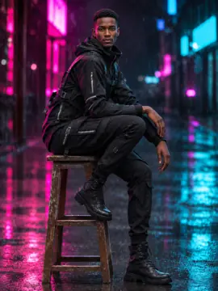</a> | <a href="https://promicat.app/poses/styles/sp083?utm_source=github&utm_medium=readme&utm_campaign=ai-photo-poses">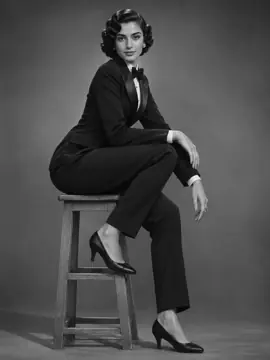</a> | <a href="https://promicat.app/poses/styles/sp083?utm_source=github&utm_medium=readme&utm_campaign=ai-photo-poses">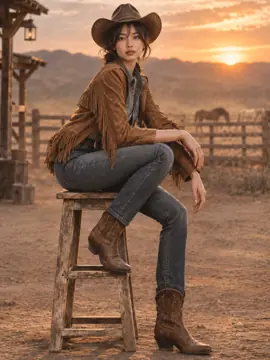</a> |

Full size: [photo](../images/photo-poses/mood/sp083-photo.webp) · [white model](../images/photo-poses/mood/sp083-pose.webp) · [try it on Promicat](https://promicat.app/poses/styles/sp083?utm_source=github&utm_medium=readme&utm_campaign=ai-photo-poses)

<details><summary>Prompt with your photo (image 1: your photo, image 2: white model)</summary>

```text
A real professional portrait photoshoot photo: a moody studio portrait photoshoot with a single soft key light and a dark backdrop, Rembrandt light, 85mm. Subject: the person in image 1 (keep their exact face, facial features, skin tone and hairstyle; do not beautify or swap the face), wearing a black turtleneck or a simple dark outfit. Pose: sitting sideways on a wooden stool, one foot on the rung, looking over the shoulder. Image 2 is a wooden artist's mannequin that shows only this body pose: copy it exactly (head, torso, arms, hands, legs, feet, which hand does what, the camera angle), but do not copy the mannequin itself: no wooden skin, no joints, no blank face. Natural, relaxed and unstiff, true skin texture. No text, no logo, no watermark. Portrait 3:4.
```

</details>

<details><summary>Prompt for the sample (fictional model)</summary>

```text
A real professional portrait photoshoot photo, the kind posted by a top portrait studio: a moody studio portrait photoshoot with a single soft key light and a dark backdrop, Rembrandt light, 85mm. Model: a beautiful Indian professional fashion model in her twenties with a naturally attractive face, styled hair and natural makeup, wearing a black turtleneck or a simple dark outfit. The photographer directs the model into a natural, relaxed, unstiff pose that looks caught between moments: sitting sideways on a wooden stool, one foot on the rung, looking over the shoulder. Asymmetric body, soft hands, flattering angle, true skin texture, refined but not plastic, fully clothed and modest. Full body or three-quarter body in frame, the whole pose clearly readable. No text, no logo, no watermark. Portrait 3:4.
```

</details>

## Back to the camera (Looking back)

| White model | Moody studio | New Chinese style | Japanese fresh film | Street punk |
|---|---|---|---|---|
|  | <a href="https://promicat.app/poses/styles/sp084?utm_source=github&utm_medium=readme&utm_campaign=ai-photo-poses">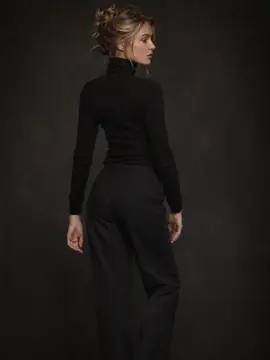</a> | <a href="https://promicat.app/poses/styles/sp084?utm_source=github&utm_medium=readme&utm_campaign=ai-photo-poses">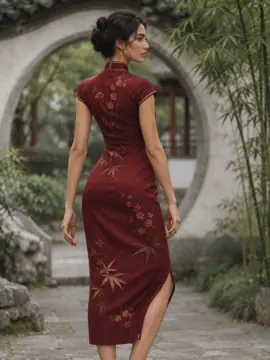</a> | <a href="https://promicat.app/poses/styles/sp084?utm_source=github&utm_medium=readme&utm_campaign=ai-photo-poses">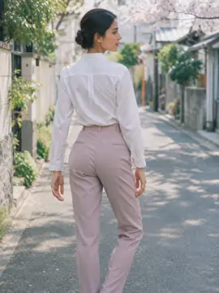</a> | <a href="https://promicat.app/poses/styles/sp084?utm_source=github&utm_medium=readme&utm_campaign=ai-photo-poses">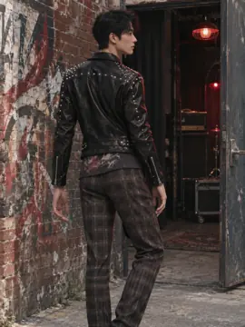</a> |

Full size: [photo](../images/photo-poses/mood/sp084-photo.webp) · [white model](../images/photo-poses/mood/sp084-pose.webp) · [try it on Promicat](https://promicat.app/poses/styles/sp084?utm_source=github&utm_medium=readme&utm_campaign=ai-photo-poses)

<details><summary>Prompt with your photo (image 1: your photo, image 2: white model)</summary>

```text
A real professional portrait photoshoot photo: a moody studio portrait photoshoot with a single soft key light and a dark backdrop, Rembrandt light, 85mm. Subject: the person in image 1 (keep their exact face, facial features, skin tone and hairstyle; do not beautify or swap the face), wearing a black turtleneck or a simple dark outfit. Pose: back to the camera, turning the head to show the profile. Image 2 is a wooden artist's mannequin that shows only this body pose: copy it exactly (head, torso, arms, hands, legs, feet, which hand does what, the camera angle), but do not copy the mannequin itself: no wooden skin, no joints, no blank face. Natural, relaxed and unstiff, true skin texture. No text, no logo, no watermark. Portrait 3:4.
```

</details>

<details><summary>Prompt for the sample (fictional model)</summary>

```text
A real professional portrait photoshoot photo, the kind posted by a top portrait studio: a moody studio portrait photoshoot with a single soft key light and a dark backdrop, Rembrandt light, 85mm. Model: a beautiful white European professional fashion model in her twenties with a naturally attractive face, styled hair and natural makeup, wearing a black turtleneck or a simple dark outfit. The photographer directs the model into a natural, relaxed, unstiff pose that looks caught between moments: back to the camera, turning the head to show the profile. Asymmetric body, soft hands, flattering angle, true skin texture, refined but not plastic, fully clothed and modest. Full body or three-quarter body in frame, the whole pose clearly readable. No text, no logo, no watermark. Portrait 3:4.
```

</details>

## Sitting low on the floor hugging both knees (Crouching)

| White model | Moody studio | Cafe & bookshop | HK retro neon | Nordic minimal |
|---|---|---|---|---|
|  | <a href="https://promicat.app/poses/styles/sp085?utm_source=github&utm_medium=readme&utm_campaign=ai-photo-poses"></a> | <a href="https://promicat.app/poses/styles/sp085?utm_source=github&utm_medium=readme&utm_campaign=ai-photo-poses">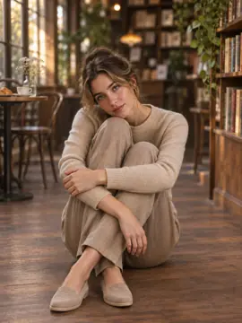</a> | <a href="https://promicat.app/poses/styles/sp085?utm_source=github&utm_medium=readme&utm_campaign=ai-photo-poses">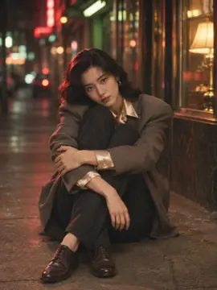</a> | <a href="https://promicat.app/poses/styles/sp085?utm_source=github&utm_medium=readme&utm_campaign=ai-photo-poses">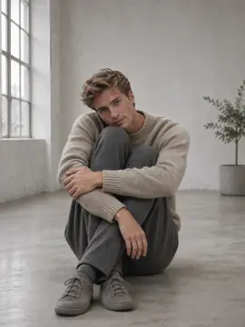</a> |

Full size: [photo](../images/photo-poses/mood/sp085-photo.webp) · [white model](../images/photo-poses/mood/sp085-pose.webp) · [try it on Promicat](https://promicat.app/poses/styles/sp085?utm_source=github&utm_medium=readme&utm_campaign=ai-photo-poses)

<details><summary>Prompt with your photo (image 1: your photo, image 2: white model)</summary>

```text
A real professional portrait photoshoot photo: a moody studio portrait photoshoot with a single soft key light and a dark backdrop, Rembrandt light, 85mm. Subject: the person in image 1 (keep their exact face, facial features, skin tone and hairstyle; do not beautify or swap the face), wearing a black turtleneck or a simple dark outfit. Pose: sitting low on the floor hugging both knees, chin on the knees, eyes to the camera. Image 2 is a wooden artist's mannequin that shows only this body pose: copy it exactly (head, torso, arms, hands, legs, feet, which hand does what, the camera angle), but do not copy the mannequin itself: no wooden skin, no joints, no blank face. Natural, relaxed and unstiff, true skin texture. No text, no logo, no watermark. Portrait 3:4.
```

</details>

<details><summary>Prompt for the sample (fictional model)</summary>

```text
A real professional portrait photoshoot photo, the kind posted by a top portrait studio: a moody studio portrait photoshoot with a single soft key light and a dark backdrop, Rembrandt light, 85mm. Model: a handsome Brazilian professional male model in his twenties with a well-groomed look and styled hair, wearing a black turtleneck or a simple dark outfit. The photographer directs the model into a natural, relaxed, unstiff pose that looks caught between moments: sitting low on the floor hugging both knees, chin on the knees, eyes to the camera. Asymmetric body, soft hands, flattering angle, true skin texture, refined but not plastic, fully clothed and modest. Full body or three-quarter body in frame, the whole pose clearly readable. No text, no logo, no watermark. Portrait 3:4.
```

</details>

## One hand on the back of the neck (Upper body)

| White model | Moody studio | Seaside holiday | Boho desert | Street fashion |
|---|---|---|---|---|
| 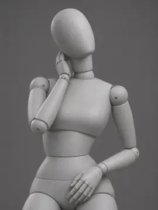 | <a href="https://promicat.app/poses/styles/sp086?utm_source=github&utm_medium=readme&utm_campaign=ai-photo-poses"></a> | <a href="https://promicat.app/poses/styles/sp086?utm_source=github&utm_medium=readme&utm_campaign=ai-photo-poses">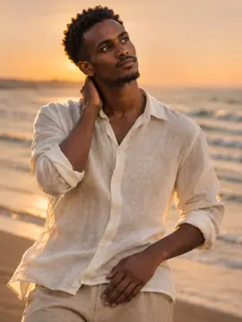</a> | <a href="https://promicat.app/poses/styles/sp086?utm_source=github&utm_medium=readme&utm_campaign=ai-photo-poses">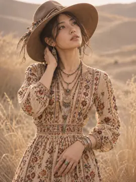</a> | <a href="https://promicat.app/poses/styles/sp086?utm_source=github&utm_medium=readme&utm_campaign=ai-photo-poses">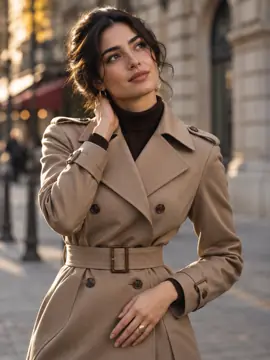</a> |

Full size: [photo](../images/photo-poses/mood/sp086-photo.webp) · [white model](../images/photo-poses/mood/sp086-pose.webp) · [try it on Promicat](https://promicat.app/poses/styles/sp086?utm_source=github&utm_medium=readme&utm_campaign=ai-photo-poses)

<details><summary>Prompt with your photo (image 1: your photo, image 2: white model)</summary>

```text
A real professional portrait photoshoot photo: a moody studio portrait photoshoot with a single soft key light and a dark backdrop, Rembrandt light, 85mm. Subject: the person in image 1 (keep their exact face, facial features, skin tone and hairstyle; do not beautify or swap the face), wearing a black turtleneck or a simple dark outfit. Pose: one hand on the back of the neck, head tilted, eyes up. Image 2 is a wooden artist's mannequin that shows only this body pose: copy it exactly (head, torso, arms, hands, legs, feet, which hand does what, the camera angle), but do not copy the mannequin itself: no wooden skin, no joints, no blank face. Natural, relaxed and unstiff, true skin texture. No text, no logo, no watermark. Portrait 3:4.
```

</details>

<details><summary>Prompt for the sample (fictional model)</summary>

```text
A real professional portrait photoshoot photo, the kind posted by a top portrait studio: a moody studio portrait photoshoot with a single soft key light and a dark backdrop, Rembrandt light, 85mm. Model: a beautiful Latina professional fashion model in her twenties with a naturally attractive face, styled hair and natural makeup, wearing a black turtleneck or a simple dark outfit. The photographer directs the model into a natural, relaxed, unstiff pose that looks caught between moments: one hand on the back of the neck, head tilted, eyes up. Asymmetric body, soft hands, flattering angle, true skin texture, refined but not plastic, fully clothed and modest. Waist-up framing, both arms and hands readable. No text, no logo, no watermark. Portrait 3:4.
```

</details>

## Standing with the face turned up into the light (Standing)

| White model | Moody studio | Forest & flower field | Nordic minimal | Western cowboy |
|---|---|---|---|---|
|  | <a href="https://promicat.app/poses/styles/sp087?utm_source=github&utm_medium=readme&utm_campaign=ai-photo-poses">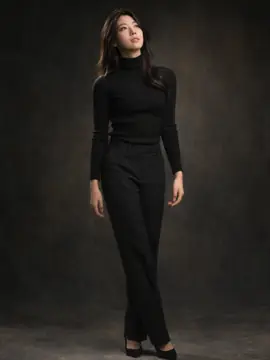</a> | <a href="https://promicat.app/poses/styles/sp087?utm_source=github&utm_medium=readme&utm_campaign=ai-photo-poses">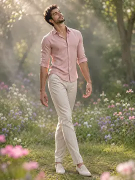</a> | <a href="https://promicat.app/poses/styles/sp087?utm_source=github&utm_medium=readme&utm_campaign=ai-photo-poses">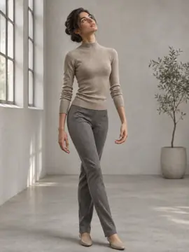</a> | <a href="https://promicat.app/poses/styles/sp087?utm_source=github&utm_medium=readme&utm_campaign=ai-photo-poses">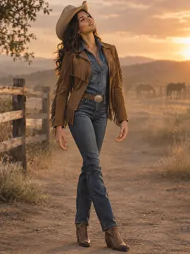</a> |

Full size: [photo](../images/photo-poses/mood/sp087-photo.webp) · [white model](../images/photo-poses/mood/sp087-pose.webp) · [try it on Promicat](https://promicat.app/poses/styles/sp087?utm_source=github&utm_medium=readme&utm_campaign=ai-photo-poses)

<details><summary>Prompt with your photo (image 1: your photo, image 2: white model)</summary>

```text
A real professional portrait photoshoot photo: a moody studio portrait photoshoot with a single soft key light and a dark backdrop, Rembrandt light, 85mm. Subject: the person in image 1 (keep their exact face, facial features, skin tone and hairstyle; do not beautify or swap the face), wearing a black turtleneck or a simple dark outfit. Pose: standing with the face turned up into the light, arms loose. Image 2 is a wooden artist's mannequin that shows only this body pose: copy it exactly (head, torso, arms, hands, legs, feet, which hand does what, the camera angle), but do not copy the mannequin itself: no wooden skin, no joints, no blank face. Natural, relaxed and unstiff, true skin texture. No text, no logo, no watermark. Portrait 3:4.
```

</details>

<details><summary>Prompt for the sample (fictional model)</summary>

```text
A real professional portrait photoshoot photo, the kind posted by a top portrait studio: a moody studio portrait photoshoot with a single soft key light and a dark backdrop, Rembrandt light, 85mm. Model: a beautiful Korean professional fashion model in her twenties with a naturally attractive face, styled hair and natural makeup, wearing a black turtleneck or a simple dark outfit. The photographer directs the model into a natural, relaxed, unstiff pose that looks caught between moments: standing with the face turned up into the light, arms loose. Asymmetric body, soft hands, flattering angle, true skin texture, refined but not plastic, fully clothed and modest. Full body or three-quarter body in frame, the whole pose clearly readable. No text, no logo, no watermark. Portrait 3:4.
```

</details>

## Sliding down a dark wall into a half crouch (Leaning)

| White model | Moody studio | Forest & flower field | HK retro neon | Street fashion |
|---|---|---|---|---|
| 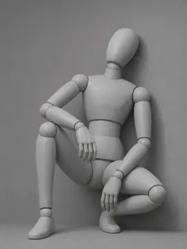 | <a href="https://promicat.app/poses/styles/sp088?utm_source=github&utm_medium=readme&utm_campaign=ai-photo-poses">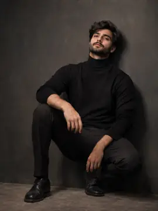</a> | <a href="https://promicat.app/poses/styles/sp088?utm_source=github&utm_medium=readme&utm_campaign=ai-photo-poses">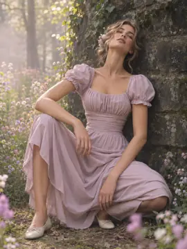</a> | <a href="https://promicat.app/poses/styles/sp088?utm_source=github&utm_medium=readme&utm_campaign=ai-photo-poses">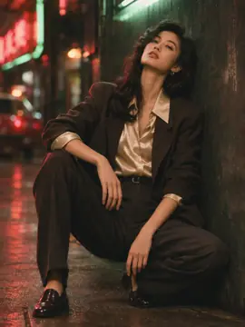</a> | <a href="https://promicat.app/poses/styles/sp088?utm_source=github&utm_medium=readme&utm_campaign=ai-photo-poses">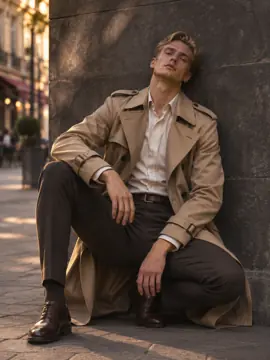</a> |

Full size: [photo](../images/photo-poses/mood/sp088-photo.webp) · [white model](../images/photo-poses/mood/sp088-pose.webp) · [try it on Promicat](https://promicat.app/poses/styles/sp088?utm_source=github&utm_medium=readme&utm_campaign=ai-photo-poses)

<details><summary>Prompt with your photo (image 1: your photo, image 2: white model)</summary>

```text
A real professional portrait photoshoot photo: a moody studio portrait photoshoot with a single soft key light and a dark backdrop, Rembrandt light, 85mm. Subject: the person in image 1 (keep their exact face, facial features, skin tone and hairstyle; do not beautify or swap the face), wearing a black turtleneck or a simple dark outfit. Pose: sliding down a dark wall into a half crouch, head back. Image 2 is a wooden artist's mannequin that shows only this body pose: copy it exactly (head, torso, arms, hands, legs, feet, which hand does what, the camera angle), but do not copy the mannequin itself: no wooden skin, no joints, no blank face. Natural, relaxed and unstiff, true skin texture. No text, no logo, no watermark. Portrait 3:4.
```

</details>

<details><summary>Prompt for the sample (fictional model)</summary>

```text
A real professional portrait photoshoot photo, the kind posted by a top portrait studio: a moody studio portrait photoshoot with a single soft key light and a dark backdrop, Rembrandt light, 85mm. Model: a handsome South Asian professional male model in his twenties with a well-groomed look and styled hair, wearing a black turtleneck or a simple dark outfit. The photographer directs the model into a natural, relaxed, unstiff pose that looks caught between moments: sliding down a dark wall into a half crouch, head back. Asymmetric body, soft hands, flattering angle, true skin texture, refined but not plastic, fully clothed and modest. Full body or three-quarter body in frame, the whole pose clearly readable. No text, no logo, no watermark. Portrait 3:4.
```

</details>

## One hand covering half of the face (Upper body)

| White model | Moody studio | Boho desert | Cosy at home | Old money |
|---|---|---|---|---|
|  | <a href="https://promicat.app/poses/styles/sp089?utm_source=github&utm_medium=readme&utm_campaign=ai-photo-poses"></a> | <a href="https://promicat.app/poses/styles/sp089?utm_source=github&utm_medium=readme&utm_campaign=ai-photo-poses">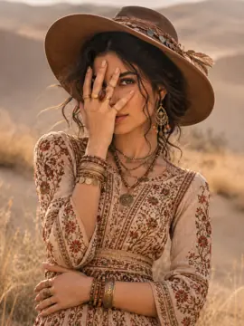</a> | <a href="https://promicat.app/poses/styles/sp089?utm_source=github&utm_medium=readme&utm_campaign=ai-photo-poses">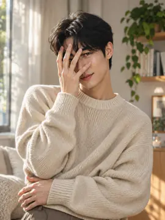</a> | <a href="https://promicat.app/poses/styles/sp089?utm_source=github&utm_medium=readme&utm_campaign=ai-photo-poses">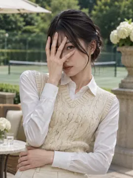</a> |

Full size: [photo](../images/photo-poses/mood/sp089-photo.webp) · [white model](../images/photo-poses/mood/sp089-pose.webp) · [try it on Promicat](https://promicat.app/poses/styles/sp089?utm_source=github&utm_medium=readme&utm_campaign=ai-photo-poses)

<details><summary>Prompt with your photo (image 1: your photo, image 2: white model)</summary>

```text
A real professional portrait photoshoot photo: a moody studio portrait photoshoot with a single soft key light and a dark backdrop, Rembrandt light, 85mm. Subject: the person in image 1 (keep their exact face, facial features, skin tone and hairstyle; do not beautify or swap the face), wearing a black turtleneck or a simple dark outfit. Pose: one hand covering half of the face, one eye looking through the fingers. Image 2 is a wooden artist's mannequin that shows only this body pose: copy it exactly (head, torso, arms, hands, legs, feet, which hand does what, the camera angle), but do not copy the mannequin itself: no wooden skin, no joints, no blank face. Natural, relaxed and unstiff, true skin texture. No text, no logo, no watermark. Portrait 3:4.
```

</details>

<details><summary>Prompt for the sample (fictional model)</summary>

```text
A real professional portrait photoshoot photo, the kind posted by a top portrait studio: a moody studio portrait photoshoot with a single soft key light and a dark backdrop, Rembrandt light, 85mm. Model: a beautiful East African professional fashion model in her twenties with a naturally attractive face, styled hair and natural makeup, wearing a black turtleneck or a simple dark outfit. The photographer directs the model into a natural, relaxed, unstiff pose that looks caught between moments: one hand covering half of the face, one eye looking through the fingers. Asymmetric body, soft hands, flattering angle, true skin texture, refined but not plastic, fully clothed and modest. Waist-up framing, both arms and hands readable. No text, no logo, no watermark. Portrait 3:4.
```

</details>

## Lying on the side on the studio floor (Lying)

| White model | Moody studio | Campus youth | New Chinese style | Y2K flash |
|---|---|---|---|---|
|  | <a href="https://promicat.app/poses/styles/sp090?utm_source=github&utm_medium=readme&utm_campaign=ai-photo-poses"></a> | <a href="https://promicat.app/poses/styles/sp090?utm_source=github&utm_medium=readme&utm_campaign=ai-photo-poses">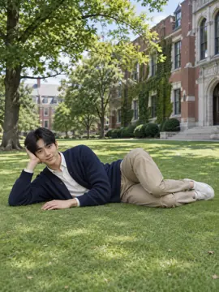</a> | <a href="https://promicat.app/poses/styles/sp090?utm_source=github&utm_medium=readme&utm_campaign=ai-photo-poses">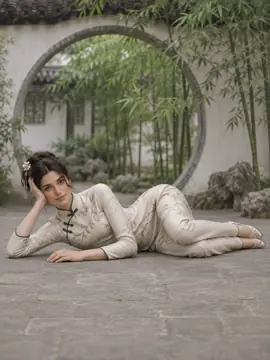</a> | <a href="https://promicat.app/poses/styles/sp090?utm_source=github&utm_medium=readme&utm_campaign=ai-photo-poses">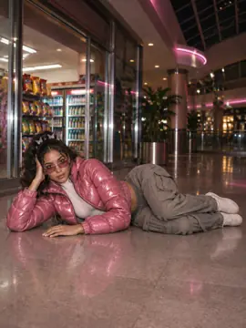</a> |

Full size: [photo](../images/photo-poses/mood/sp090-photo.webp) · [white model](../images/photo-poses/mood/sp090-pose.webp) · [try it on Promicat](https://promicat.app/poses/styles/sp090?utm_source=github&utm_medium=readme&utm_campaign=ai-photo-poses)

<details><summary>Prompt with your photo (image 1: your photo, image 2: white model)</summary>

```text
A real professional portrait photoshoot photo: a moody studio portrait photoshoot with a single soft key light and a dark backdrop, Rembrandt light, 85mm. Subject: the person in image 1 (keep their exact face, facial features, skin tone and hairstyle; do not beautify or swap the face), wearing a black turtleneck or a simple dark outfit. Pose: lying on the side on the studio floor, head on the arm, looking at the camera. Image 2 is a wooden artist's mannequin that shows only this body pose: copy it exactly (head, torso, arms, hands, legs, feet, which hand does what, the camera angle), but do not copy the mannequin itself: no wooden skin, no joints, no blank face. Natural, relaxed and unstiff, true skin texture. No text, no logo, no watermark. Portrait 3:4.
```

</details>

<details><summary>Prompt for the sample (fictional model)</summary>

```text
A real professional portrait photoshoot photo, the kind posted by a top portrait studio: a moody studio portrait photoshoot with a single soft key light and a dark backdrop, Rembrandt light, 85mm. Model: a beautiful Black professional fashion model in her twenties with a naturally attractive face, styled hair and natural makeup, wearing a black turtleneck or a simple dark outfit. The photographer directs the model into a natural, relaxed, unstiff pose that looks caught between moments: lying on the side on the studio floor, head on the arm, looking at the camera. Asymmetric body, soft hands, flattering angle, true skin texture, refined but not plastic, fully clothed and modest. Full body or three-quarter body in frame, the whole pose clearly readable. No text, no logo, no watermark. Portrait 3:4.
```

</details>
