# 北欧极简

[English](nordic.md) · 简体中文

10 组写真姿势：一张示例写真和照着它画的白模。参考图顺序是你的照片在前、白模在后。也可以在 [Promicat](https://promicat.app/zh/poses?utm_source=github&utm_medium=readme&utm_campaign=ai-photo-poses) 上传照片直接生成。

[← 返回全部风格](../README.zh-CN.md#photo-poses)

## 窗前站 (站)

<a href="https://promicat.app/zh/poses/styles/sp191?utm_source=github&utm_medium=readme&utm_campaign=ai-photo-poses">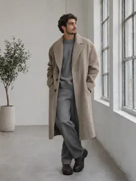</a> 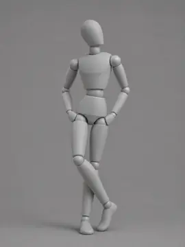

大图: [写真照](../images/photo-poses/nordic/sp191-photo.webp) · [白模](../images/photo-poses/nordic/sp191-pose.webp) · [在 Promicat 生成](https://promicat.app/zh/poses/styles/sp191?utm_source=github&utm_medium=readme&utm_campaign=ai-photo-poses)

<details><summary>提示词：用你的照片（图 1 你的照片，图 2 白模）</summary>

```text
A real professional portrait photoshoot photo: a Scandinavian minimal photoshoot in a white concrete space with big windows and one plant, soft grey daylight, muted tones, 50mm. Subject: the person in image 1 (keep their exact face, facial features, skin tone and hairstyle; do not beautify or swap the face), wearing an oversized wool coat or a minimal knit set in oatmeal and grey. Pose: standing by a big window with hands in the coat pockets, looking out. Image 2 is a wooden artist's mannequin that shows only this body pose: copy it exactly (head, torso, arms, hands, legs, feet, which hand does what, the camera angle), but do not copy the mannequin itself: no wooden skin, no joints, no blank face. Natural, relaxed and unstiff, true skin texture. No text, no logo, no watermark. Portrait 3:4.
```

</details>

<details><summary>提示词：生成示例图（虚构模特）</summary>

```text
A real professional portrait photoshoot photo, the kind posted by a top portrait studio: a Scandinavian minimal photoshoot in a white concrete space with big windows and one plant, soft grey daylight, muted tones, 50mm. Model: a handsome Mediterranean professional male model in his twenties with a well-groomed look and styled hair, wearing an oversized wool coat or a minimal knit set in oatmeal and grey. The photographer directs the model into a natural, relaxed, unstiff pose that looks caught between moments: standing by a big window with hands in the coat pockets, looking out. Asymmetric body, soft hands, flattering angle, true skin texture, refined but not plastic, fully clothed and modest. Full body or three-quarter body in frame, the whole pose clearly readable. No text, no logo, no watermark. Portrait 3:4.
```

</details>

## 坐地靠墙 (坐)

<a href="https://promicat.app/zh/poses/styles/sp192?utm_source=github&utm_medium=readme&utm_campaign=ai-photo-poses">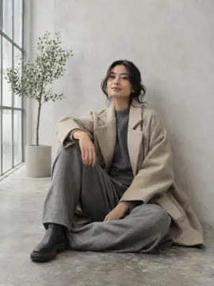</a> 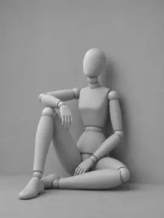

大图: [写真照](../images/photo-poses/nordic/sp192-photo.webp) · [白模](../images/photo-poses/nordic/sp192-pose.webp) · [在 Promicat 生成](https://promicat.app/zh/poses/styles/sp192?utm_source=github&utm_medium=readme&utm_campaign=ai-photo-poses)

<details><summary>提示词：用你的照片（图 1 你的照片，图 2 白模）</summary>

```text
A real professional portrait photoshoot photo: a Scandinavian minimal photoshoot in a white concrete space with big windows and one plant, soft grey daylight, muted tones, 50mm. Subject: the person in image 1 (keep their exact face, facial features, skin tone and hairstyle; do not beautify or swap the face), wearing an oversized wool coat or a minimal knit set in oatmeal and grey. Pose: sitting on the concrete floor against the wall, one knee up, the arm resting on it. Image 2 is a wooden artist's mannequin that shows only this body pose: copy it exactly (head, torso, arms, hands, legs, feet, which hand does what, the camera angle), but do not copy the mannequin itself: no wooden skin, no joints, no blank face. Natural, relaxed and unstiff, true skin texture. No text, no logo, no watermark. Portrait 3:4.
```

</details>

<details><summary>提示词：生成示例图（虚构模特）</summary>

```text
A real professional portrait photoshoot photo, the kind posted by a top portrait studio: a Scandinavian minimal photoshoot in a white concrete space with big windows and one plant, soft grey daylight, muted tones, 50mm. Model: a beautiful Southeast Asian professional fashion model in her twenties with a naturally attractive face, styled hair and natural makeup, wearing an oversized wool coat or a minimal knit set in oatmeal and grey. The photographer directs the model into a natural, relaxed, unstiff pose that looks caught between moments: sitting on the concrete floor against the wall, one knee up, the arm resting on it. Asymmetric body, soft hands, flattering angle, true skin texture, refined but not plastic, fully clothed and modest. Full body or three-quarter body in frame, the whole pose clearly readable. No text, no logo, no watermark. Portrait 3:4.
```

</details>

## 走过空间 (走)

<a href="https://promicat.app/zh/poses/styles/sp193?utm_source=github&utm_medium=readme&utm_campaign=ai-photo-poses">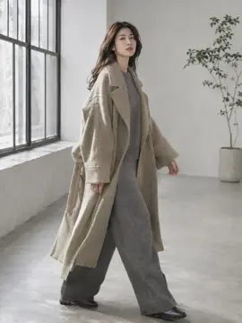</a> 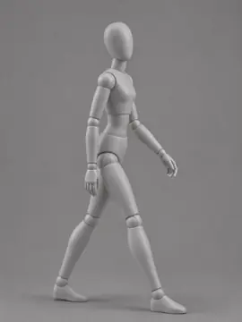

大图: [写真照](../images/photo-poses/nordic/sp193-photo.webp) · [白模](../images/photo-poses/nordic/sp193-pose.webp) · [在 Promicat 生成](https://promicat.app/zh/poses/styles/sp193?utm_source=github&utm_medium=readme&utm_campaign=ai-photo-poses)

<details><summary>提示词：用你的照片（图 1 你的照片，图 2 白模）</summary>

```text
A real professional portrait photoshoot photo: a Scandinavian minimal photoshoot in a white concrete space with big windows and one plant, soft grey daylight, muted tones, 50mm. Subject: the person in image 1 (keep their exact face, facial features, skin tone and hairstyle; do not beautify or swap the face), wearing an oversized wool coat or a minimal knit set in oatmeal and grey. Pose: walking across the empty room, the coat moving, looking ahead. Image 2 is a wooden artist's mannequin that shows only this body pose: copy it exactly (head, torso, arms, hands, legs, feet, which hand does what, the camera angle), but do not copy the mannequin itself: no wooden skin, no joints, no blank face. Natural, relaxed and unstiff, true skin texture. No text, no logo, no watermark. Portrait 3:4.
```

</details>

<details><summary>提示词：生成示例图（虚构模特）</summary>

```text
A real professional portrait photoshoot photo, the kind posted by a top portrait studio: a Scandinavian minimal photoshoot in a white concrete space with big windows and one plant, soft grey daylight, muted tones, 50mm. Model: a beautiful Japanese professional fashion model in her twenties with a naturally attractive face, styled hair and natural makeup, wearing an oversized wool coat or a minimal knit set in oatmeal and grey. The photographer directs the model into a natural, relaxed, unstiff pose that looks caught between moments: walking across the empty room, the coat moving, looking ahead. Asymmetric body, soft hands, flattering angle, true skin texture, refined but not plastic, fully clothed and modest. Full body or three-quarter body in frame, the whole pose clearly readable. No text, no logo, no watermark. Portrait 3:4.
```

</details>

## 倚窗框 (靠)

<a href="https://promicat.app/zh/poses/styles/sp194?utm_source=github&utm_medium=readme&utm_campaign=ai-photo-poses">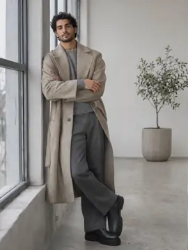</a> 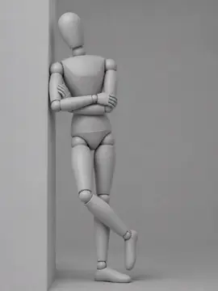

大图: [写真照](../images/photo-poses/nordic/sp194-photo.webp) · [白模](../images/photo-poses/nordic/sp194-pose.webp) · [在 Promicat 生成](https://promicat.app/zh/poses/styles/sp194?utm_source=github&utm_medium=readme&utm_campaign=ai-photo-poses)

<details><summary>提示词：用你的照片（图 1 你的照片，图 2 白模）</summary>

```text
A real professional portrait photoshoot photo: a Scandinavian minimal photoshoot in a white concrete space with big windows and one plant, soft grey daylight, muted tones, 50mm. Subject: the person in image 1 (keep their exact face, facial features, skin tone and hairstyle; do not beautify or swap the face), wearing an oversized wool coat or a minimal knit set in oatmeal and grey. Pose: leaning on the window frame with one shoulder, arms folded. Image 2 is a wooden artist's mannequin that shows only this body pose: copy it exactly (head, torso, arms, hands, legs, feet, which hand does what, the camera angle), but do not copy the mannequin itself: no wooden skin, no joints, no blank face. Natural, relaxed and unstiff, true skin texture. No text, no logo, no watermark. Portrait 3:4.
```

</details>

<details><summary>提示词：生成示例图（虚构模特）</summary>

```text
A real professional portrait photoshoot photo, the kind posted by a top portrait studio: a Scandinavian minimal photoshoot in a white concrete space with big windows and one plant, soft grey daylight, muted tones, 50mm. Model: a handsome Middle Eastern professional male model in his twenties with a well-groomed look and styled hair, wearing an oversized wool coat or a minimal knit set in oatmeal and grey. The photographer directs the model into a natural, relaxed, unstiff pose that looks caught between moments: leaning on the window frame with one shoulder, arms folded. Asymmetric body, soft hands, flattering angle, true skin texture, refined but not plastic, fully clothed and modest. Full body or three-quarter body in frame, the whole pose clearly readable. No text, no logo, no watermark. Portrait 3:4.
```

</details>

## 椅子反坐 (坐)

<a href="https://promicat.app/zh/poses/styles/sp195?utm_source=github&utm_medium=readme&utm_campaign=ai-photo-poses">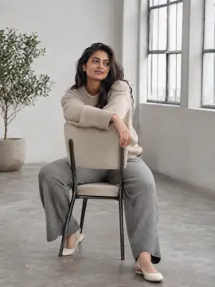</a> 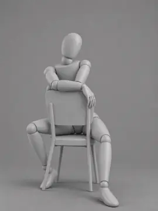

大图: [写真照](../images/photo-poses/nordic/sp195-photo.webp) · [白模](../images/photo-poses/nordic/sp195-pose.webp) · [在 Promicat 生成](https://promicat.app/zh/poses/styles/sp195?utm_source=github&utm_medium=readme&utm_campaign=ai-photo-poses)

<details><summary>提示词：用你的照片（图 1 你的照片，图 2 白模）</summary>

```text
A real professional portrait photoshoot photo: a Scandinavian minimal photoshoot in a white concrete space with big windows and one plant, soft grey daylight, muted tones, 50mm. Subject: the person in image 1 (keep their exact face, facial features, skin tone and hairstyle; do not beautify or swap the face), wearing an oversized wool coat or a minimal knit set in oatmeal and grey. Pose: sitting backwards on a minimal chair, arms on the backrest. Image 2 is a wooden artist's mannequin that shows only this body pose: copy it exactly (head, torso, arms, hands, legs, feet, which hand does what, the camera angle), but do not copy the mannequin itself: no wooden skin, no joints, no blank face. Natural, relaxed and unstiff, true skin texture. No text, no logo, no watermark. Portrait 3:4.
```

</details>

<details><summary>提示词：生成示例图（虚构模特）</summary>

```text
A real professional portrait photoshoot photo, the kind posted by a top portrait studio: a Scandinavian minimal photoshoot in a white concrete space with big windows and one plant, soft grey daylight, muted tones, 50mm. Model: a beautiful Indian professional fashion model in her twenties with a naturally attractive face, styled hair and natural makeup, wearing an oversized wool coat or a minimal knit set in oatmeal and grey. The photographer directs the model into a natural, relaxed, unstiff pose that looks caught between moments: sitting backwards on a minimal chair, arms on the backrest. Asymmetric body, soft hands, flattering angle, true skin texture, refined but not plastic, fully clothed and modest. Full body or three-quarter body in frame, the whole pose clearly readable. No text, no logo, no watermark. Portrait 3:4.
```

</details>

## 仰头闭眼 (半身)

<a href="https://promicat.app/zh/poses/styles/sp196?utm_source=github&utm_medium=readme&utm_campaign=ai-photo-poses">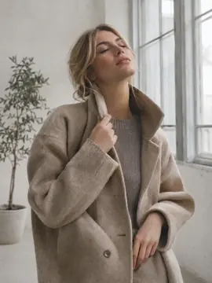</a> 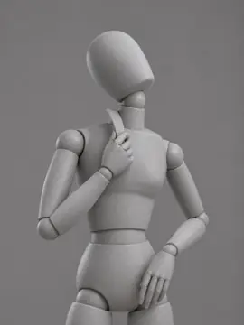

大图: [写真照](../images/photo-poses/nordic/sp196-photo.webp) · [白模](../images/photo-poses/nordic/sp196-pose.webp) · [在 Promicat 生成](https://promicat.app/zh/poses/styles/sp196?utm_source=github&utm_medium=readme&utm_campaign=ai-photo-poses)

<details><summary>提示词：用你的照片（图 1 你的照片，图 2 白模）</summary>

```text
A real professional portrait photoshoot photo: a Scandinavian minimal photoshoot in a white concrete space with big windows and one plant, soft grey daylight, muted tones, 50mm. Subject: the person in image 1 (keep their exact face, facial features, skin tone and hairstyle; do not beautify or swap the face), wearing an oversized wool coat or a minimal knit set in oatmeal and grey. Pose: head tilted back in the daylight, eyes closed, collar turned up. Image 2 is a wooden artist's mannequin that shows only this body pose: copy it exactly (head, torso, arms, hands, legs, feet, which hand does what, the camera angle), but do not copy the mannequin itself: no wooden skin, no joints, no blank face. Natural, relaxed and unstiff, true skin texture. No text, no logo, no watermark. Portrait 3:4.
```

</details>

<details><summary>提示词：生成示例图（虚构模特）</summary>

```text
A real professional portrait photoshoot photo, the kind posted by a top portrait studio: a Scandinavian minimal photoshoot in a white concrete space with big windows and one plant, soft grey daylight, muted tones, 50mm. Model: a beautiful white European professional fashion model in her twenties with a naturally attractive face, styled hair and natural makeup, wearing an oversized wool coat or a minimal knit set in oatmeal and grey. The photographer directs the model into a natural, relaxed, unstiff pose that looks caught between moments: head tilted back in the daylight, eyes closed, collar turned up. Asymmetric body, soft hands, flattering angle, true skin texture, refined but not plastic, fully clothed and modest. Waist-up framing, both arms and hands readable. No text, no logo, no watermark. Portrait 3:4.
```

</details>

## 蹲看植物 (蹲跪)

<a href="https://promicat.app/zh/poses/styles/sp197?utm_source=github&utm_medium=readme&utm_campaign=ai-photo-poses">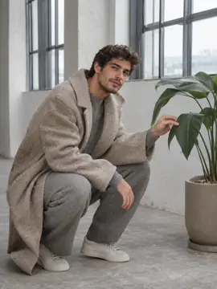</a> 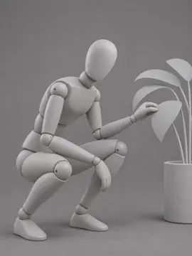

大图: [写真照](../images/photo-poses/nordic/sp197-photo.webp) · [白模](../images/photo-poses/nordic/sp197-pose.webp) · [在 Promicat 生成](https://promicat.app/zh/poses/styles/sp197?utm_source=github&utm_medium=readme&utm_campaign=ai-photo-poses)

<details><summary>提示词：用你的照片（图 1 你的照片，图 2 白模）</summary>

```text
A real professional portrait photoshoot photo: a Scandinavian minimal photoshoot in a white concrete space with big windows and one plant, soft grey daylight, muted tones, 50mm. Subject: the person in image 1 (keep their exact face, facial features, skin tone and hairstyle; do not beautify or swap the face), wearing an oversized wool coat or a minimal knit set in oatmeal and grey. Pose: crouching beside a potted plant, touching a leaf. Image 2 is a wooden artist's mannequin that shows only this body pose: copy it exactly (head, torso, arms, hands, legs, feet, which hand does what, the camera angle), but do not copy the mannequin itself: no wooden skin, no joints, no blank face. Natural, relaxed and unstiff, true skin texture. No text, no logo, no watermark. Portrait 3:4.
```

</details>

<details><summary>提示词：生成示例图（虚构模特）</summary>

```text
A real professional portrait photoshoot photo, the kind posted by a top portrait studio: a Scandinavian minimal photoshoot in a white concrete space with big windows and one plant, soft grey daylight, muted tones, 50mm. Model: a handsome Brazilian professional male model in his twenties with a well-groomed look and styled hair, wearing an oversized wool coat or a minimal knit set in oatmeal and grey. The photographer directs the model into a natural, relaxed, unstiff pose that looks caught between moments: crouching beside a potted plant, touching a leaf. Asymmetric body, soft hands, flattering angle, true skin texture, refined but not plastic, fully clothed and modest. Full body or three-quarter body in frame, the whole pose clearly readable. No text, no logo, no watermark. Portrait 3:4.
```

</details>

## 回头看 (回眸)

<a href="https://promicat.app/zh/poses/styles/sp198?utm_source=github&utm_medium=readme&utm_campaign=ai-photo-poses">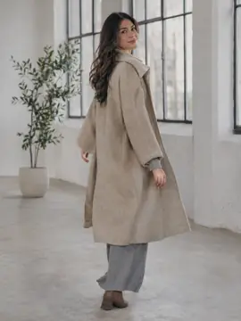</a> 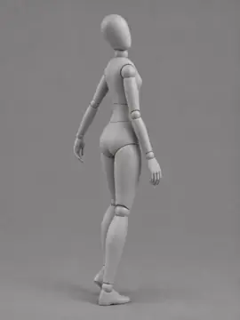

大图: [写真照](../images/photo-poses/nordic/sp198-photo.webp) · [白模](../images/photo-poses/nordic/sp198-pose.webp) · [在 Promicat 生成](https://promicat.app/zh/poses/styles/sp198?utm_source=github&utm_medium=readme&utm_campaign=ai-photo-poses)

<details><summary>提示词：用你的照片（图 1 你的照片，图 2 白模）</summary>

```text
A real professional portrait photoshoot photo: a Scandinavian minimal photoshoot in a white concrete space with big windows and one plant, soft grey daylight, muted tones, 50mm. Subject: the person in image 1 (keep their exact face, facial features, skin tone and hairstyle; do not beautify or swap the face), wearing an oversized wool coat or a minimal knit set in oatmeal and grey. Pose: walking away, turning the head back with a faint smile. Image 2 is a wooden artist's mannequin that shows only this body pose: copy it exactly (head, torso, arms, hands, legs, feet, which hand does what, the camera angle), but do not copy the mannequin itself: no wooden skin, no joints, no blank face. Natural, relaxed and unstiff, true skin texture. No text, no logo, no watermark. Portrait 3:4.
```

</details>

<details><summary>提示词：生成示例图（虚构模特）</summary>

```text
A real professional portrait photoshoot photo, the kind posted by a top portrait studio: a Scandinavian minimal photoshoot in a white concrete space with big windows and one plant, soft grey daylight, muted tones, 50mm. Model: a beautiful Latina professional fashion model in her twenties with a naturally attractive face, styled hair and natural makeup, wearing an oversized wool coat or a minimal knit set in oatmeal and grey. The photographer directs the model into a natural, relaxed, unstiff pose that looks caught between moments: walking away, turning the head back with a faint smile. Asymmetric body, soft hands, flattering angle, true skin texture, refined but not plastic, fully clothed and modest. Full body or three-quarter body in frame, the whole pose clearly readable. No text, no logo, no watermark. Portrait 3:4.
```

</details>

## 躺地面 (躺)

<a href="https://promicat.app/zh/poses/styles/sp199?utm_source=github&utm_medium=readme&utm_campaign=ai-photo-poses">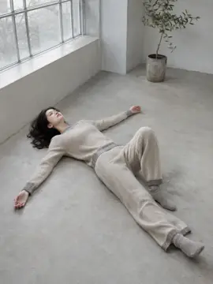</a> 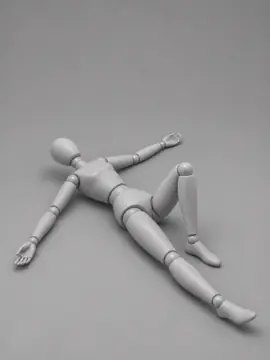

大图: [写真照](../images/photo-poses/nordic/sp199-photo.webp) · [白模](../images/photo-poses/nordic/sp199-pose.webp) · [在 Promicat 生成](https://promicat.app/zh/poses/styles/sp199?utm_source=github&utm_medium=readme&utm_campaign=ai-photo-poses)

<details><summary>提示词：用你的照片（图 1 你的照片，图 2 白模）</summary>

```text
A real professional portrait photoshoot photo: a Scandinavian minimal photoshoot in a white concrete space with big windows and one plant, soft grey daylight, muted tones, 50mm. Subject: the person in image 1 (keep their exact face, facial features, skin tone and hairstyle; do not beautify or swap the face), wearing an oversized wool coat or a minimal knit set in oatmeal and grey. Pose: lying on the floor on the back, arms out, looking at the ceiling. Image 2 is a wooden artist's mannequin that shows only this body pose: copy it exactly (head, torso, arms, hands, legs, feet, which hand does what, the camera angle), but do not copy the mannequin itself: no wooden skin, no joints, no blank face. Natural, relaxed and unstiff, true skin texture. No text, no logo, no watermark. Portrait 3:4.
```

</details>

<details><summary>提示词：生成示例图（虚构模特）</summary>

```text
A real professional portrait photoshoot photo, the kind posted by a top portrait studio: a Scandinavian minimal photoshoot in a white concrete space with big windows and one plant, soft grey daylight, muted tones, 50mm. Model: a beautiful Korean professional fashion model in her twenties with a naturally attractive face, styled hair and natural makeup, wearing an oversized wool coat or a minimal knit set in oatmeal and grey. The photographer directs the model into a natural, relaxed, unstiff pose that looks caught between moments: lying on the floor on the back, arms out, looking at the ceiling. Asymmetric body, soft hands, flattering angle, true skin texture, refined but not plastic, fully clothed and modest. Full body or three-quarter body in frame, the whole pose clearly readable. No text, no logo, no watermark. Portrait 3:4.
```

</details>

## 拉围巾 (半身)

<a href="https://promicat.app/zh/poses/styles/sp200?utm_source=github&utm_medium=readme&utm_campaign=ai-photo-poses">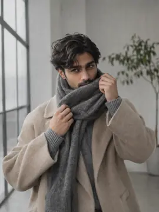</a> 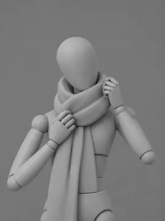

大图: [写真照](../images/photo-poses/nordic/sp200-photo.webp) · [白模](../images/photo-poses/nordic/sp200-pose.webp) · [在 Promicat 生成](https://promicat.app/zh/poses/styles/sp200?utm_source=github&utm_medium=readme&utm_campaign=ai-photo-poses)

<details><summary>提示词：用你的照片（图 1 你的照片，图 2 白模）</summary>

```text
A real professional portrait photoshoot photo: a Scandinavian minimal photoshoot in a white concrete space with big windows and one plant, soft grey daylight, muted tones, 50mm. Subject: the person in image 1 (keep their exact face, facial features, skin tone and hairstyle; do not beautify or swap the face), wearing an oversized wool coat or a minimal knit set in oatmeal and grey. Pose: pulling a big wool scarf up over the chin. Image 2 is a wooden artist's mannequin that shows only this body pose: copy it exactly (head, torso, arms, hands, legs, feet, which hand does what, the camera angle), but do not copy the mannequin itself: no wooden skin, no joints, no blank face. Natural, relaxed and unstiff, true skin texture. No text, no logo, no watermark. Portrait 3:4.
```

</details>

<details><summary>提示词：生成示例图（虚构模特）</summary>

```text
A real professional portrait photoshoot photo, the kind posted by a top portrait studio: a Scandinavian minimal photoshoot in a white concrete space with big windows and one plant, soft grey daylight, muted tones, 50mm. Model: a handsome South Asian professional male model in his twenties with a well-groomed look and styled hair, wearing an oversized wool coat or a minimal knit set in oatmeal and grey. The photographer directs the model into a natural, relaxed, unstiff pose that looks caught between moments: pulling a big wool scarf up over the chin. Asymmetric body, soft hands, flattering angle, true skin texture, refined but not plastic, fully clothed and modest. Waist-up framing, both arms and hands readable. No text, no logo, no watermark. Portrait 3:4.
```

</details>
