# 老钱风 · Old money

10 组写真姿势：左边是写真照，右边是照着它画的木头白模。白模可以当姿势参考图，和你的照片一起发给生图模型。 在线试用：[Promicat 姿势库](https://promicat.app/zh/poses?ref=github)

[← 返回目录](../README.md#写真姿势)

## 网球场扛拍（站）

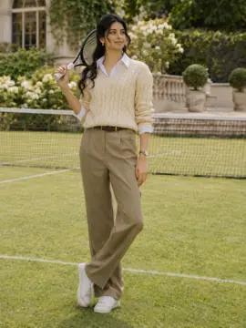 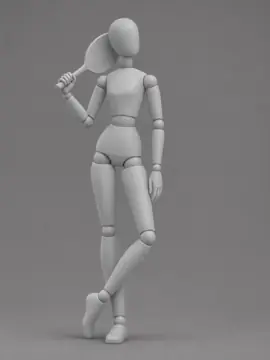

大图：[写真照](../images/photo-poses/oldmoney/sp121-photo.webp) · [白模](../images/photo-poses/oldmoney/sp121-pose.webp)

<details><summary>提示词：用你的照片（附图 1 你的照片，附图 2 白模）</summary>

```text
A real professional portrait photoshoot photo: an old-money quiet-luxury photoshoot at a country club, tennis court and garden terrace, soft summer daylight, 85mm. Subject: the person in image 1 (keep their exact face, facial features, skin tone and hairstyle; do not beautify or swap the face), wearing cream cable-knit, crisp shirt, tailored trousers or a pleated tennis skirt. Pose: standing on a grass tennis court with a racquet resting on the shoulder, looking off. Image 2 is a wooden artist's mannequin that shows only this body pose: copy it exactly (head, torso, arms, hands, legs, feet, which hand does what, the camera angle), but do not copy the mannequin itself: no wooden skin, no joints, no blank face. Natural, relaxed and unstiff, true skin texture. No text, no logo, no watermark. Portrait 3:4.
```

</details>

<details><summary>提示词：生成示例图（虚构模特）</summary>

```text
A real professional portrait photoshoot photo, the kind posted by a top portrait studio: an old-money quiet-luxury photoshoot at a country club, tennis court and garden terrace, soft summer daylight, 85mm. Model: a beautiful Indian professional fashion model in her twenties with a naturally attractive face, styled hair and natural makeup, wearing cream cable-knit, crisp shirt, tailored trousers or a pleated tennis skirt. The photographer directs the model into a natural, relaxed, unstiff pose that looks caught between moments: standing on a grass tennis court with a racquet resting on the shoulder, looking off. Asymmetric body, soft hands, flattering angle, true skin texture, refined but not plastic, fully clothed and modest. Full body or three-quarter body in frame, the whole pose clearly readable. No text, no logo, no watermark. Portrait 3:4.
```

</details>

## 露台倚栏（靠）

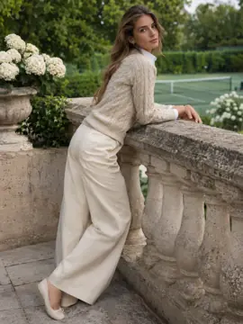 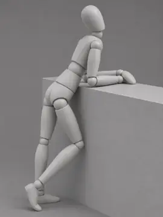

大图：[写真照](../images/photo-poses/oldmoney/sp122-photo.webp) · [白模](../images/photo-poses/oldmoney/sp122-pose.webp)

<details><summary>提示词：用你的照片（附图 1 你的照片，附图 2 白模）</summary>

```text
A real professional portrait photoshoot photo: an old-money quiet-luxury photoshoot at a country club, tennis court and garden terrace, soft summer daylight, 85mm. Subject: the person in image 1 (keep their exact face, facial features, skin tone and hairstyle; do not beautify or swap the face), wearing cream cable-knit, crisp shirt, tailored trousers or a pleated tennis skirt. Pose: leaning on a stone terrace balustrade with both forearms, glancing back. Image 2 is a wooden artist's mannequin that shows only this body pose: copy it exactly (head, torso, arms, hands, legs, feet, which hand does what, the camera angle), but do not copy the mannequin itself: no wooden skin, no joints, no blank face. Natural, relaxed and unstiff, true skin texture. No text, no logo, no watermark. Portrait 3:4.
```

</details>

<details><summary>提示词：生成示例图（虚构模特）</summary>

```text
A real professional portrait photoshoot photo, the kind posted by a top portrait studio: an old-money quiet-luxury photoshoot at a country club, tennis court and garden terrace, soft summer daylight, 85mm. Model: a beautiful white European professional fashion model in her twenties with a naturally attractive face, styled hair and natural makeup, wearing cream cable-knit, crisp shirt, tailored trousers or a pleated tennis skirt. The photographer directs the model into a natural, relaxed, unstiff pose that looks caught between moments: leaning on a stone terrace balustrade with both forearms, glancing back. Asymmetric body, soft hands, flattering angle, true skin texture, refined but not plastic, fully clothed and modest. Full body or three-quarter body in frame, the whole pose clearly readable. No text, no logo, no watermark. Portrait 3:4.
```

</details>

## 毛衣搭肩走（走）

 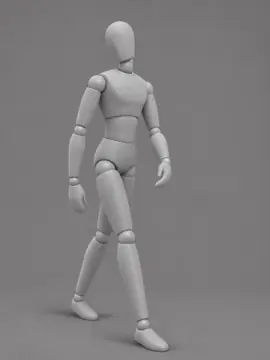

大图：[写真照](../images/photo-poses/oldmoney/sp123-photo.webp) · [白模](../images/photo-poses/oldmoney/sp123-pose.webp)

<details><summary>提示词：用你的照片（附图 1 你的照片，附图 2 白模）</summary>

```text
A real professional portrait photoshoot photo: an old-money quiet-luxury photoshoot at a country club, tennis court and garden terrace, soft summer daylight, 85mm. Subject: the person in image 1 (keep their exact face, facial features, skin tone and hairstyle; do not beautify or swap the face), wearing cream cable-knit, crisp shirt, tailored trousers or a pleated tennis skirt. Pose: walking across a lawn with a sweater draped over the shoulders, smiling. Image 2 is a wooden artist's mannequin that shows only this body pose: copy it exactly (head, torso, arms, hands, legs, feet, which hand does what, the camera angle), but do not copy the mannequin itself: no wooden skin, no joints, no blank face. Natural, relaxed and unstiff, true skin texture. No text, no logo, no watermark. Portrait 3:4.
```

</details>

<details><summary>提示词：生成示例图（虚构模特）</summary>

```text
A real professional portrait photoshoot photo, the kind posted by a top portrait studio: an old-money quiet-luxury photoshoot at a country club, tennis court and garden terrace, soft summer daylight, 85mm. Model: a handsome Brazilian professional male model in his twenties with a well-groomed look and styled hair, wearing cream cable-knit, crisp shirt, tailored trousers or a pleated tennis skirt. The photographer directs the model into a natural, relaxed, unstiff pose that looks caught between moments: walking across a lawn with a sweater draped over the shoulders, smiling. Asymmetric body, soft hands, flattering angle, true skin texture, refined but not plastic, fully clothed and modest. Full body or three-quarter body in frame, the whole pose clearly readable. No text, no logo, no watermark. Portrait 3:4.
```

</details>

## 藤椅坐（坐）

 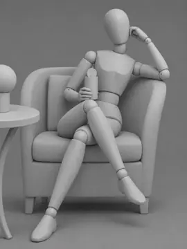

大图：[写真照](../images/photo-poses/oldmoney/sp124-photo.webp) · [白模](../images/photo-poses/oldmoney/sp124-pose.webp)

<details><summary>提示词：用你的照片（附图 1 你的照片，附图 2 白模）</summary>

```text
A real professional portrait photoshoot photo: an old-money quiet-luxury photoshoot at a country club, tennis court and garden terrace, soft summer daylight, 85mm. Subject: the person in image 1 (keep their exact face, facial features, skin tone and hairstyle; do not beautify or swap the face), wearing cream cable-knit, crisp shirt, tailored trousers or a pleated tennis skirt. Pose: sitting in a wicker chair with legs crossed, holding a glass of lemonade. Image 2 is a wooden artist's mannequin that shows only this body pose: copy it exactly (head, torso, arms, hands, legs, feet, which hand does what, the camera angle), but do not copy the mannequin itself: no wooden skin, no joints, no blank face. Natural, relaxed and unstiff, true skin texture. No text, no logo, no watermark. Portrait 3:4.
```

</details>

<details><summary>提示词：生成示例图（虚构模特）</summary>

```text
A real professional portrait photoshoot photo, the kind posted by a top portrait studio: an old-money quiet-luxury photoshoot at a country club, tennis court and garden terrace, soft summer daylight, 85mm. Model: a beautiful Latina professional fashion model in her twenties with a naturally attractive face, styled hair and natural makeup, wearing cream cable-knit, crisp shirt, tailored trousers or a pleated tennis skirt. The photographer directs the model into a natural, relaxed, unstiff pose that looks caught between moments: sitting in a wicker chair with legs crossed, holding a glass of lemonade. Asymmetric body, soft hands, flattering angle, true skin texture, refined but not plastic, fully clothed and modest. Full body or three-quarter body in frame, the whole pose clearly readable. No text, no logo, no watermark. Portrait 3:4.
```

</details>

## 戴帽回头（回眸）

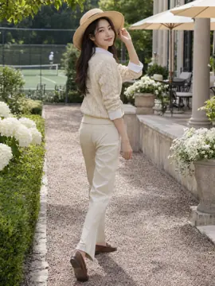 

大图：[写真照](../images/photo-poses/oldmoney/sp125-photo.webp) · [白模](../images/photo-poses/oldmoney/sp125-pose.webp)

<details><summary>提示词：用你的照片（附图 1 你的照片，附图 2 白模）</summary>

```text
A real professional portrait photoshoot photo: an old-money quiet-luxury photoshoot at a country club, tennis court and garden terrace, soft summer daylight, 85mm. Subject: the person in image 1 (keep their exact face, facial features, skin tone and hairstyle; do not beautify or swap the face), wearing cream cable-knit, crisp shirt, tailored trousers or a pleated tennis skirt. Pose: turning back on a garden path holding a straw hat on. Image 2 is a wooden artist's mannequin that shows only this body pose: copy it exactly (head, torso, arms, hands, legs, feet, which hand does what, the camera angle), but do not copy the mannequin itself: no wooden skin, no joints, no blank face. Natural, relaxed and unstiff, true skin texture. No text, no logo, no watermark. Portrait 3:4.
```

</details>

<details><summary>提示词：生成示例图（虚构模特）</summary>

```text
A real professional portrait photoshoot photo, the kind posted by a top portrait studio: an old-money quiet-luxury photoshoot at a country club, tennis court and garden terrace, soft summer daylight, 85mm. Model: a beautiful Korean professional fashion model in her twenties with a naturally attractive face, styled hair and natural makeup, wearing cream cable-knit, crisp shirt, tailored trousers or a pleated tennis skirt. The photographer directs the model into a natural, relaxed, unstiff pose that looks caught between moments: turning back on a garden path holding a straw hat on. Asymmetric body, soft hands, flattering angle, true skin texture, refined but not plastic, fully clothed and modest. Full body or three-quarter body in frame, the whole pose clearly readable. No text, no logo, no watermark. Portrait 3:4.
```

</details>

## 车门旁（靠）

 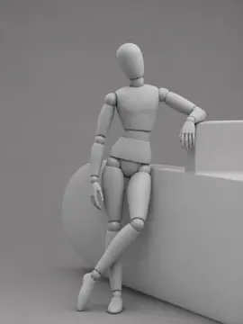

大图：[写真照](../images/photo-poses/oldmoney/sp126-photo.webp) · [白模](../images/photo-poses/oldmoney/sp126-pose.webp)

<details><summary>提示词：用你的照片（附图 1 你的照片，附图 2 白模）</summary>

```text
A real professional portrait photoshoot photo: an old-money quiet-luxury photoshoot at a country club, tennis court and garden terrace, soft summer daylight, 85mm. Subject: the person in image 1 (keep their exact face, facial features, skin tone and hairstyle; do not beautify or swap the face), wearing cream cable-knit, crisp shirt, tailored trousers or a pleated tennis skirt. Pose: leaning on a vintage convertible door, one hand on the frame. Image 2 is a wooden artist's mannequin that shows only this body pose: copy it exactly (head, torso, arms, hands, legs, feet, which hand does what, the camera angle), but do not copy the mannequin itself: no wooden skin, no joints, no blank face. Natural, relaxed and unstiff, true skin texture. No text, no logo, no watermark. Portrait 3:4.
```

</details>

<details><summary>提示词：生成示例图（虚构模特）</summary>

```text
A real professional portrait photoshoot photo, the kind posted by a top portrait studio: an old-money quiet-luxury photoshoot at a country club, tennis court and garden terrace, soft summer daylight, 85mm. Model: a handsome South Asian professional male model in his twenties with a well-groomed look and styled hair, wearing cream cable-knit, crisp shirt, tailored trousers or a pleated tennis skirt. The photographer directs the model into a natural, relaxed, unstiff pose that looks caught between moments: leaning on a vintage convertible door, one hand on the frame. Asymmetric body, soft hands, flattering angle, true skin texture, refined but not plastic, fully clothed and modest. Full body or three-quarter body in frame, the whole pose clearly readable. No text, no logo, no watermark. Portrait 3:4.
```

</details>

## 野餐坐（坐）

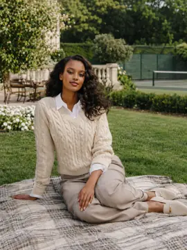 

大图：[写真照](../images/photo-poses/oldmoney/sp127-photo.webp) · [白模](../images/photo-poses/oldmoney/sp127-pose.webp)

<details><summary>提示词：用你的照片（附图 1 你的照片，附图 2 白模）</summary>

```text
A real professional portrait photoshoot photo: an old-money quiet-luxury photoshoot at a country club, tennis court and garden terrace, soft summer daylight, 85mm. Subject: the person in image 1 (keep their exact face, facial features, skin tone and hairstyle; do not beautify or swap the face), wearing cream cable-knit, crisp shirt, tailored trousers or a pleated tennis skirt. Pose: sitting on a picnic blanket legs folded to one side, leaning on one hand. Image 2 is a wooden artist's mannequin that shows only this body pose: copy it exactly (head, torso, arms, hands, legs, feet, which hand does what, the camera angle), but do not copy the mannequin itself: no wooden skin, no joints, no blank face. Natural, relaxed and unstiff, true skin texture. No text, no logo, no watermark. Portrait 3:4.
```

</details>

<details><summary>提示词：生成示例图（虚构模特）</summary>

```text
A real professional portrait photoshoot photo, the kind posted by a top portrait studio: an old-money quiet-luxury photoshoot at a country club, tennis court and garden terrace, soft summer daylight, 85mm. Model: a beautiful East African professional fashion model in her twenties with a naturally attractive face, styled hair and natural makeup, wearing cream cable-knit, crisp shirt, tailored trousers or a pleated tennis skirt. The photographer directs the model into a natural, relaxed, unstiff pose that looks caught between moments: sitting on a picnic blanket legs folded to one side, leaning on one hand. Asymmetric body, soft hands, flattering angle, true skin texture, refined but not plastic, fully clothed and modest. Full body or three-quarter body in frame, the whole pose clearly readable. No text, no logo, no watermark. Portrait 3:4.
```

</details>

## 挥拍（动态）

 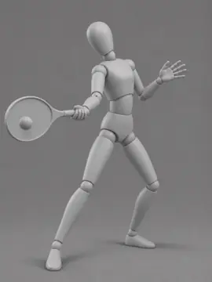

大图：[写真照](../images/photo-poses/oldmoney/sp128-photo.webp) · [白模](../images/photo-poses/oldmoney/sp128-pose.webp)

<details><summary>提示词：用你的照片（附图 1 你的照片，附图 2 白模）</summary>

```text
A real professional portrait photoshoot photo: an old-money quiet-luxury photoshoot at a country club, tennis court and garden terrace, soft summer daylight, 85mm. Subject: the person in image 1 (keep their exact face, facial features, skin tone and hairstyle; do not beautify or swap the face), wearing cream cable-knit, crisp shirt, tailored trousers or a pleated tennis skirt. Pose: mid-swing of a tennis forehand, body twisted. Image 2 is a wooden artist's mannequin that shows only this body pose: copy it exactly (head, torso, arms, hands, legs, feet, which hand does what, the camera angle), but do not copy the mannequin itself: no wooden skin, no joints, no blank face. Natural, relaxed and unstiff, true skin texture. No text, no logo, no watermark. Portrait 3:4.
```

</details>

<details><summary>提示词：生成示例图（虚构模特）</summary>

```text
A real professional portrait photoshoot photo, the kind posted by a top portrait studio: an old-money quiet-luxury photoshoot at a country club, tennis court and garden terrace, soft summer daylight, 85mm. Model: a beautiful Black professional fashion model in her twenties with a naturally attractive face, styled hair and natural makeup, wearing cream cable-knit, crisp shirt, tailored trousers or a pleated tennis skirt. The photographer directs the model into a natural, relaxed, unstiff pose that looks caught between moments: mid-swing of a tennis forehand, body twisted. Asymmetric body, soft hands, flattering angle, true skin texture, refined but not plastic, fully clothed and modest. Full body or three-quarter body in frame, the whole pose clearly readable. No text, no logo, no watermark. Portrait 3:4.
```

</details>

## 整理衣领（半身）

 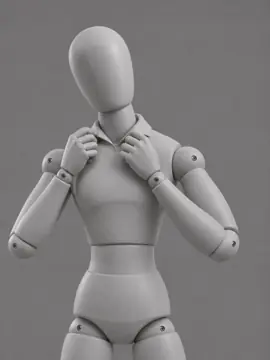

大图：[写真照](../images/photo-poses/oldmoney/sp129-photo.webp) · [白模](../images/photo-poses/oldmoney/sp129-pose.webp)

<details><summary>提示词：用你的照片（附图 1 你的照片，附图 2 白模）</summary>

```text
A real professional portrait photoshoot photo: an old-money quiet-luxury photoshoot at a country club, tennis court and garden terrace, soft summer daylight, 85mm. Subject: the person in image 1 (keep their exact face, facial features, skin tone and hairstyle; do not beautify or swap the face), wearing cream cable-knit, crisp shirt, tailored trousers or a pleated tennis skirt. Pose: straightening a crisp shirt collar with both hands. Image 2 is a wooden artist's mannequin that shows only this body pose: copy it exactly (head, torso, arms, hands, legs, feet, which hand does what, the camera angle), but do not copy the mannequin itself: no wooden skin, no joints, no blank face. Natural, relaxed and unstiff, true skin texture. No text, no logo, no watermark. Portrait 3:4.
```

</details>

<details><summary>提示词：生成示例图（虚构模特）</summary>

```text
A real professional portrait photoshoot photo, the kind posted by a top portrait studio: an old-money quiet-luxury photoshoot at a country club, tennis court and garden terrace, soft summer daylight, 85mm. Model: a handsome Scandinavian professional male model in his twenties with a well-groomed look and styled hair, wearing cream cable-knit, crisp shirt, tailored trousers or a pleated tennis skirt. The photographer directs the model into a natural, relaxed, unstiff pose that looks caught between moments: straightening a crisp shirt collar with both hands. Asymmetric body, soft hands, flattering angle, true skin texture, refined but not plastic, fully clothed and modest. Waist-up framing, both arms and hands readable. No text, no logo, no watermark. Portrait 3:4.
```

</details>

## 草地躺（躺）

 

大图：[写真照](../images/photo-poses/oldmoney/sp130-photo.webp) · [白模](../images/photo-poses/oldmoney/sp130-pose.webp)

<details><summary>提示词：用你的照片（附图 1 你的照片，附图 2 白模）</summary>

```text
A real professional portrait photoshoot photo: an old-money quiet-luxury photoshoot at a country club, tennis court and garden terrace, soft summer daylight, 85mm. Subject: the person in image 1 (keep their exact face, facial features, skin tone and hairstyle; do not beautify or swap the face), wearing cream cable-knit, crisp shirt, tailored trousers or a pleated tennis skirt. Pose: lying on the lawn on the back with sunglasses on, one knee up, fully dressed. Image 2 is a wooden artist's mannequin that shows only this body pose: copy it exactly (head, torso, arms, hands, legs, feet, which hand does what, the camera angle), but do not copy the mannequin itself: no wooden skin, no joints, no blank face. Natural, relaxed and unstiff, true skin texture. No text, no logo, no watermark. Portrait 3:4.
```

</details>

<details><summary>提示词：生成示例图（虚构模特）</summary>

```text
A real professional portrait photoshoot photo, the kind posted by a top portrait studio: an old-money quiet-luxury photoshoot at a country club, tennis court and garden terrace, soft summer daylight, 85mm. Model: a beautiful East Asian professional fashion model in her twenties with a naturally attractive face, styled hair and natural makeup, wearing cream cable-knit, crisp shirt, tailored trousers or a pleated tennis skirt. The photographer directs the model into a natural, relaxed, unstiff pose that looks caught between moments: lying on the lawn on the back with sunglasses on, one knee up, fully dressed. Asymmetric body, soft hands, flattering angle, true skin texture, refined but not plastic, fully clothed and modest. Full body or three-quarter body in frame, the whole pose clearly readable. No text, no logo, no watermark. Portrait 3:4.
```

</details>
