# Old money

English · [简体中文](oldmoney.zh-CN.md)

10 white models, each with 4 portraits shot from it in different styles. Attach your photo first and the white model second. Try them with your own photo on [Promicat](https://promicat.app/poses?utm_source=github&utm_medium=readme&utm_campaign=ai-photo-poses).

[← Back to all styles](../README.md#photo-poses)

## Standing on a grass tennis court with a racquet resting on the shoulder (Standing)

| White model | Old money | Dark academia | Street fashion | Western cowboy |
|---|---|---|---|---|
|  | <a href="https://promicat.app/poses/styles/sp121?utm_source=github&utm_medium=readme&utm_campaign=ai-photo-poses"></a> | <a href="https://promicat.app/poses/styles/sp121?utm_source=github&utm_medium=readme&utm_campaign=ai-photo-poses">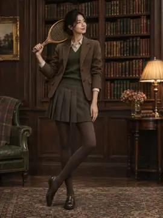</a> | <a href="https://promicat.app/poses/styles/sp121?utm_source=github&utm_medium=readme&utm_campaign=ai-photo-poses">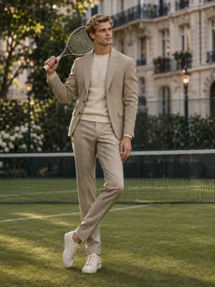</a> | <a href="https://promicat.app/poses/styles/sp121?utm_source=github&utm_medium=readme&utm_campaign=ai-photo-poses">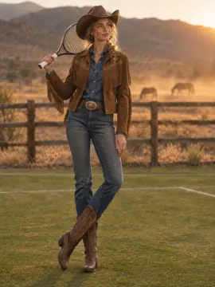</a> |

Full size: [photo](../images/photo-poses/oldmoney/sp121-photo.webp) · [white model](../images/photo-poses/oldmoney/sp121-pose.webp) · [try it on Promicat](https://promicat.app/poses/styles/sp121?utm_source=github&utm_medium=readme&utm_campaign=ai-photo-poses)

<details><summary>Prompt with your photo (image 1: your photo, image 2: white model)</summary>

```text
A real professional portrait photoshoot photo: an old-money quiet-luxury photoshoot at a country club, tennis court and garden terrace, soft summer daylight, 85mm. Subject: the person in image 1 (keep their exact face, facial features, skin tone and hairstyle; do not beautify or swap the face), wearing cream cable-knit, crisp shirt, tailored trousers or a pleated tennis skirt. Pose: standing on a grass tennis court with a racquet resting on the shoulder, looking off. Image 2 is a wooden artist's mannequin that shows only this body pose: copy it exactly (head, torso, arms, hands, legs, feet, which hand does what, the camera angle), but do not copy the mannequin itself: no wooden skin, no joints, no blank face. Natural, relaxed and unstiff, true skin texture. No text, no logo, no watermark. Portrait 3:4.
```

</details>

<details><summary>Prompt for the sample (fictional model)</summary>

```text
A real professional portrait photoshoot photo, the kind posted by a top portrait studio: an old-money quiet-luxury photoshoot at a country club, tennis court and garden terrace, soft summer daylight, 85mm. Model: a beautiful Indian professional fashion model in her twenties with a naturally attractive face, styled hair and natural makeup, wearing cream cable-knit, crisp shirt, tailored trousers or a pleated tennis skirt. The photographer directs the model into a natural, relaxed, unstiff pose that looks caught between moments: standing on a grass tennis court with a racquet resting on the shoulder, looking off. Asymmetric body, soft hands, flattering angle, true skin texture, refined but not plastic, fully clothed and modest. Full body or three-quarter body in frame, the whole pose clearly readable. No text, no logo, no watermark. Portrait 3:4.
```

</details>

## Leaning on a stone terrace balustrade with both forearms (Leaning)

| White model | Old money | New Chinese style | Dark academia | Nordic minimal |
|---|---|---|---|---|
|  | <a href="https://promicat.app/poses/styles/sp122?utm_source=github&utm_medium=readme&utm_campaign=ai-photo-poses"></a> | <a href="https://promicat.app/poses/styles/sp122?utm_source=github&utm_medium=readme&utm_campaign=ai-photo-poses">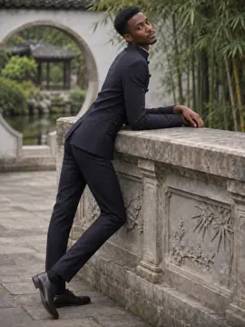</a> | <a href="https://promicat.app/poses/styles/sp122?utm_source=github&utm_medium=readme&utm_campaign=ai-photo-poses">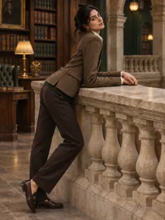</a> | <a href="https://promicat.app/poses/styles/sp122?utm_source=github&utm_medium=readme&utm_campaign=ai-photo-poses">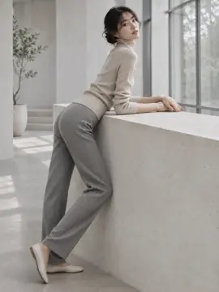</a> |

Full size: [photo](../images/photo-poses/oldmoney/sp122-photo.webp) · [white model](../images/photo-poses/oldmoney/sp122-pose.webp) · [try it on Promicat](https://promicat.app/poses/styles/sp122?utm_source=github&utm_medium=readme&utm_campaign=ai-photo-poses)

<details><summary>Prompt with your photo (image 1: your photo, image 2: white model)</summary>

```text
A real professional portrait photoshoot photo: an old-money quiet-luxury photoshoot at a country club, tennis court and garden terrace, soft summer daylight, 85mm. Subject: the person in image 1 (keep their exact face, facial features, skin tone and hairstyle; do not beautify or swap the face), wearing cream cable-knit, crisp shirt, tailored trousers or a pleated tennis skirt. Pose: leaning on a stone terrace balustrade with both forearms, glancing back. Image 2 is a wooden artist's mannequin that shows only this body pose: copy it exactly (head, torso, arms, hands, legs, feet, which hand does what, the camera angle), but do not copy the mannequin itself: no wooden skin, no joints, no blank face. Natural, relaxed and unstiff, true skin texture. No text, no logo, no watermark. Portrait 3:4.
```

</details>

<details><summary>Prompt for the sample (fictional model)</summary>

```text
A real professional portrait photoshoot photo, the kind posted by a top portrait studio: an old-money quiet-luxury photoshoot at a country club, tennis court and garden terrace, soft summer daylight, 85mm. Model: a beautiful white European professional fashion model in her twenties with a naturally attractive face, styled hair and natural makeup, wearing cream cable-knit, crisp shirt, tailored trousers or a pleated tennis skirt. The photographer directs the model into a natural, relaxed, unstiff pose that looks caught between moments: leaning on a stone terrace balustrade with both forearms, glancing back. Asymmetric body, soft hands, flattering angle, true skin texture, refined but not plastic, fully clothed and modest. Full body or three-quarter body in frame, the whole pose clearly readable. No text, no logo, no watermark. Portrait 3:4.
```

</details>

## Walking across a lawn with a sweater draped over the shoulders (Walking)

| White model | Old money | Cyberpunk neon | Gothic | Moody studio |
|---|---|---|---|---|
|  | <a href="https://promicat.app/poses/styles/sp123?utm_source=github&utm_medium=readme&utm_campaign=ai-photo-poses">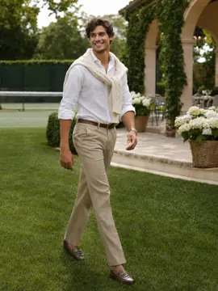</a> | <a href="https://promicat.app/poses/styles/sp123?utm_source=github&utm_medium=readme&utm_campaign=ai-photo-poses">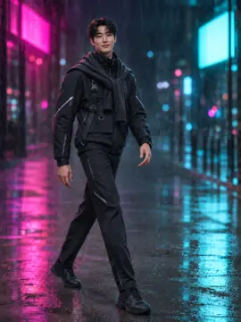</a> | <a href="https://promicat.app/poses/styles/sp123?utm_source=github&utm_medium=readme&utm_campaign=ai-photo-poses">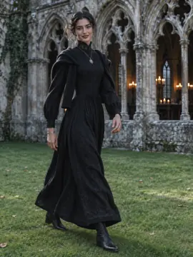</a> | <a href="https://promicat.app/poses/styles/sp123?utm_source=github&utm_medium=readme&utm_campaign=ai-photo-poses">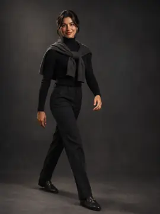</a> |

Full size: [photo](../images/photo-poses/oldmoney/sp123-photo.webp) · [white model](../images/photo-poses/oldmoney/sp123-pose.webp) · [try it on Promicat](https://promicat.app/poses/styles/sp123?utm_source=github&utm_medium=readme&utm_campaign=ai-photo-poses)

<details><summary>Prompt with your photo (image 1: your photo, image 2: white model)</summary>

```text
A real professional portrait photoshoot photo: an old-money quiet-luxury photoshoot at a country club, tennis court and garden terrace, soft summer daylight, 85mm. Subject: the person in image 1 (keep their exact face, facial features, skin tone and hairstyle; do not beautify or swap the face), wearing cream cable-knit, crisp shirt, tailored trousers or a pleated tennis skirt. Pose: walking across a lawn with a sweater draped over the shoulders, smiling. Image 2 is a wooden artist's mannequin that shows only this body pose: copy it exactly (head, torso, arms, hands, legs, feet, which hand does what, the camera angle), but do not copy the mannequin itself: no wooden skin, no joints, no blank face. Natural, relaxed and unstiff, true skin texture. No text, no logo, no watermark. Portrait 3:4.
```

</details>

<details><summary>Prompt for the sample (fictional model)</summary>

```text
A real professional portrait photoshoot photo, the kind posted by a top portrait studio: an old-money quiet-luxury photoshoot at a country club, tennis court and garden terrace, soft summer daylight, 85mm. Model: a handsome Brazilian professional male model in his twenties with a well-groomed look and styled hair, wearing cream cable-knit, crisp shirt, tailored trousers or a pleated tennis skirt. The photographer directs the model into a natural, relaxed, unstiff pose that looks caught between moments: walking across a lawn with a sweater draped over the shoulders, smiling. Asymmetric body, soft hands, flattering angle, true skin texture, refined but not plastic, fully clothed and modest. Full body or three-quarter body in frame, the whole pose clearly readable. No text, no logo, no watermark. Portrait 3:4.
```

</details>

## Sitting in a wicker chair with legs crossed (Sitting)

| White model | Old money | Seaside holiday | HK retro neon | Street punk |
|---|---|---|---|---|
|  | <a href="https://promicat.app/poses/styles/sp124?utm_source=github&utm_medium=readme&utm_campaign=ai-photo-poses">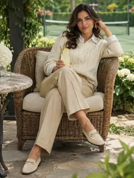</a> | <a href="https://promicat.app/poses/styles/sp124?utm_source=github&utm_medium=readme&utm_campaign=ai-photo-poses">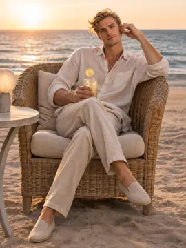</a> | <a href="https://promicat.app/poses/styles/sp124?utm_source=github&utm_medium=readme&utm_campaign=ai-photo-poses">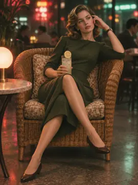</a> | <a href="https://promicat.app/poses/styles/sp124?utm_source=github&utm_medium=readme&utm_campaign=ai-photo-poses">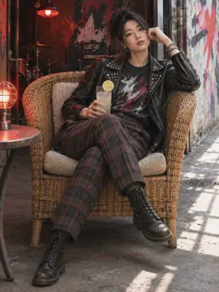</a> |

Full size: [photo](../images/photo-poses/oldmoney/sp124-photo.webp) · [white model](../images/photo-poses/oldmoney/sp124-pose.webp) · [try it on Promicat](https://promicat.app/poses/styles/sp124?utm_source=github&utm_medium=readme&utm_campaign=ai-photo-poses)

<details><summary>Prompt with your photo (image 1: your photo, image 2: white model)</summary>

```text
A real professional portrait photoshoot photo: an old-money quiet-luxury photoshoot at a country club, tennis court and garden terrace, soft summer daylight, 85mm. Subject: the person in image 1 (keep their exact face, facial features, skin tone and hairstyle; do not beautify or swap the face), wearing cream cable-knit, crisp shirt, tailored trousers or a pleated tennis skirt. Pose: sitting in a wicker chair with legs crossed, holding a glass of lemonade. Image 2 is a wooden artist's mannequin that shows only this body pose: copy it exactly (head, torso, arms, hands, legs, feet, which hand does what, the camera angle), but do not copy the mannequin itself: no wooden skin, no joints, no blank face. Natural, relaxed and unstiff, true skin texture. No text, no logo, no watermark. Portrait 3:4.
```

</details>

<details><summary>Prompt for the sample (fictional model)</summary>

```text
A real professional portrait photoshoot photo, the kind posted by a top portrait studio: an old-money quiet-luxury photoshoot at a country club, tennis court and garden terrace, soft summer daylight, 85mm. Model: a beautiful Latina professional fashion model in her twenties with a naturally attractive face, styled hair and natural makeup, wearing cream cable-knit, crisp shirt, tailored trousers or a pleated tennis skirt. The photographer directs the model into a natural, relaxed, unstiff pose that looks caught between moments: sitting in a wicker chair with legs crossed, holding a glass of lemonade. Asymmetric body, soft hands, flattering angle, true skin texture, refined but not plastic, fully clothed and modest. Full body or three-quarter body in frame, the whole pose clearly readable. No text, no logo, no watermark. Portrait 3:4.
```

</details>

## Turning back on a garden path holding a straw hat on (Looking back)

| White model | Old money | Cafe & bookshop | Campus youth | Dark academia |
|---|---|---|---|---|
| 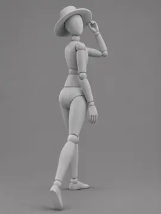 | <a href="https://promicat.app/poses/styles/sp125?utm_source=github&utm_medium=readme&utm_campaign=ai-photo-poses"></a> | <a href="https://promicat.app/poses/styles/sp125?utm_source=github&utm_medium=readme&utm_campaign=ai-photo-poses">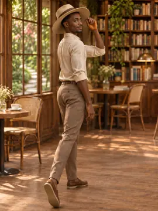</a> | <a href="https://promicat.app/poses/styles/sp125?utm_source=github&utm_medium=readme&utm_campaign=ai-photo-poses">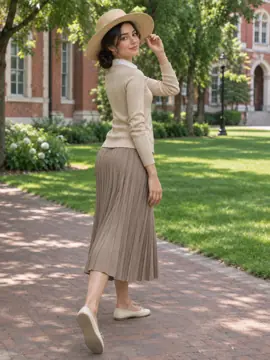</a> | <a href="https://promicat.app/poses/styles/sp125?utm_source=github&utm_medium=readme&utm_campaign=ai-photo-poses">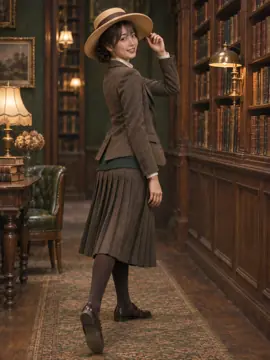</a> |

Full size: [photo](../images/photo-poses/oldmoney/sp125-photo.webp) · [white model](../images/photo-poses/oldmoney/sp125-pose.webp) · [try it on Promicat](https://promicat.app/poses/styles/sp125?utm_source=github&utm_medium=readme&utm_campaign=ai-photo-poses)

<details><summary>Prompt with your photo (image 1: your photo, image 2: white model)</summary>

```text
A real professional portrait photoshoot photo: an old-money quiet-luxury photoshoot at a country club, tennis court and garden terrace, soft summer daylight, 85mm. Subject: the person in image 1 (keep their exact face, facial features, skin tone and hairstyle; do not beautify or swap the face), wearing cream cable-knit, crisp shirt, tailored trousers or a pleated tennis skirt. Pose: turning back on a garden path holding a straw hat on. Image 2 is a wooden artist's mannequin that shows only this body pose: copy it exactly (head, torso, arms, hands, legs, feet, which hand does what, the camera angle), but do not copy the mannequin itself: no wooden skin, no joints, no blank face. Natural, relaxed and unstiff, true skin texture. No text, no logo, no watermark. Portrait 3:4.
```

</details>

<details><summary>Prompt for the sample (fictional model)</summary>

```text
A real professional portrait photoshoot photo, the kind posted by a top portrait studio: an old-money quiet-luxury photoshoot at a country club, tennis court and garden terrace, soft summer daylight, 85mm. Model: a beautiful Korean professional fashion model in her twenties with a naturally attractive face, styled hair and natural makeup, wearing cream cable-knit, crisp shirt, tailored trousers or a pleated tennis skirt. The photographer directs the model into a natural, relaxed, unstiff pose that looks caught between moments: turning back on a garden path holding a straw hat on. Asymmetric body, soft hands, flattering angle, true skin texture, refined but not plastic, fully clothed and modest. Full body or three-quarter body in frame, the whole pose clearly readable. No text, no logo, no watermark. Portrait 3:4.
```

</details>

## Leaning on a vintage convertible door (Leaning)

| White model | Old money | Boho desert | 1950s Hollywood | Cosy at home |
|---|---|---|---|---|
|  | <a href="https://promicat.app/poses/styles/sp126?utm_source=github&utm_medium=readme&utm_campaign=ai-photo-poses">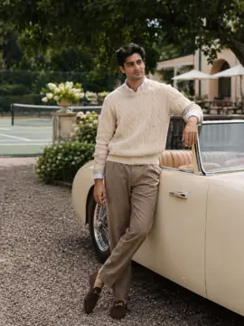</a> | <a href="https://promicat.app/poses/styles/sp126?utm_source=github&utm_medium=readme&utm_campaign=ai-photo-poses">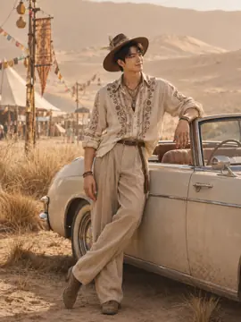</a> | <a href="https://promicat.app/poses/styles/sp126?utm_source=github&utm_medium=readme&utm_campaign=ai-photo-poses">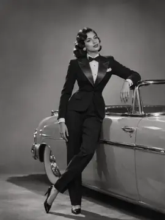</a> | <a href="https://promicat.app/poses/styles/sp126?utm_source=github&utm_medium=readme&utm_campaign=ai-photo-poses">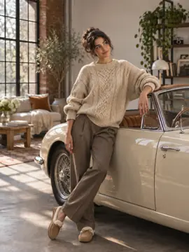</a> |

Full size: [photo](../images/photo-poses/oldmoney/sp126-photo.webp) · [white model](../images/photo-poses/oldmoney/sp126-pose.webp) · [try it on Promicat](https://promicat.app/poses/styles/sp126?utm_source=github&utm_medium=readme&utm_campaign=ai-photo-poses)

<details><summary>Prompt with your photo (image 1: your photo, image 2: white model)</summary>

```text
A real professional portrait photoshoot photo: an old-money quiet-luxury photoshoot at a country club, tennis court and garden terrace, soft summer daylight, 85mm. Subject: the person in image 1 (keep their exact face, facial features, skin tone and hairstyle; do not beautify or swap the face), wearing cream cable-knit, crisp shirt, tailored trousers or a pleated tennis skirt. Pose: leaning on a vintage convertible door, one hand on the frame. Image 2 is a wooden artist's mannequin that shows only this body pose: copy it exactly (head, torso, arms, hands, legs, feet, which hand does what, the camera angle), but do not copy the mannequin itself: no wooden skin, no joints, no blank face. Natural, relaxed and unstiff, true skin texture. No text, no logo, no watermark. Portrait 3:4.
```

</details>

<details><summary>Prompt for the sample (fictional model)</summary>

```text
A real professional portrait photoshoot photo, the kind posted by a top portrait studio: an old-money quiet-luxury photoshoot at a country club, tennis court and garden terrace, soft summer daylight, 85mm. Model: a handsome South Asian professional male model in his twenties with a well-groomed look and styled hair, wearing cream cable-knit, crisp shirt, tailored trousers or a pleated tennis skirt. The photographer directs the model into a natural, relaxed, unstiff pose that looks caught between moments: leaning on a vintage convertible door, one hand on the frame. Asymmetric body, soft hands, flattering angle, true skin texture, refined but not plastic, fully clothed and modest. Full body or three-quarter body in frame, the whole pose clearly readable. No text, no logo, no watermark. Portrait 3:4.
```

</details>

## Sitting on a picnic blanket legs folded to one side (Sitting)

| White model | Old money | Seaside holiday | Forest & flower field | Cosy at home |
|---|---|---|---|---|
| 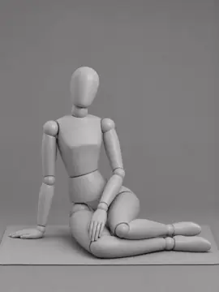 | <a href="https://promicat.app/poses/styles/sp127?utm_source=github&utm_medium=readme&utm_campaign=ai-photo-poses"></a> | <a href="https://promicat.app/poses/styles/sp127?utm_source=github&utm_medium=readme&utm_campaign=ai-photo-poses">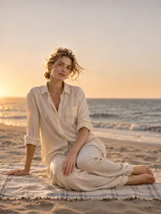</a> | <a href="https://promicat.app/poses/styles/sp127?utm_source=github&utm_medium=readme&utm_campaign=ai-photo-poses">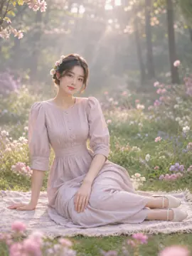</a> | <a href="https://promicat.app/poses/styles/sp127?utm_source=github&utm_medium=readme&utm_campaign=ai-photo-poses">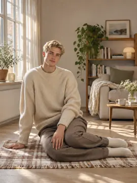</a> |

Full size: [photo](../images/photo-poses/oldmoney/sp127-photo.webp) · [white model](../images/photo-poses/oldmoney/sp127-pose.webp) · [try it on Promicat](https://promicat.app/poses/styles/sp127?utm_source=github&utm_medium=readme&utm_campaign=ai-photo-poses)

<details><summary>Prompt with your photo (image 1: your photo, image 2: white model)</summary>

```text
A real professional portrait photoshoot photo: an old-money quiet-luxury photoshoot at a country club, tennis court and garden terrace, soft summer daylight, 85mm. Subject: the person in image 1 (keep their exact face, facial features, skin tone and hairstyle; do not beautify or swap the face), wearing cream cable-knit, crisp shirt, tailored trousers or a pleated tennis skirt. Pose: sitting on a picnic blanket legs folded to one side, leaning on one hand. Image 2 is a wooden artist's mannequin that shows only this body pose: copy it exactly (head, torso, arms, hands, legs, feet, which hand does what, the camera angle), but do not copy the mannequin itself: no wooden skin, no joints, no blank face. Natural, relaxed and unstiff, true skin texture. No text, no logo, no watermark. Portrait 3:4.
```

</details>

<details><summary>Prompt for the sample (fictional model)</summary>

```text
A real professional portrait photoshoot photo, the kind posted by a top portrait studio: an old-money quiet-luxury photoshoot at a country club, tennis court and garden terrace, soft summer daylight, 85mm. Model: a beautiful East African professional fashion model in her twenties with a naturally attractive face, styled hair and natural makeup, wearing cream cable-knit, crisp shirt, tailored trousers or a pleated tennis skirt. The photographer directs the model into a natural, relaxed, unstiff pose that looks caught between moments: sitting on a picnic blanket legs folded to one side, leaning on one hand. Asymmetric body, soft hands, flattering angle, true skin texture, refined but not plastic, fully clothed and modest. Full body or three-quarter body in frame, the whole pose clearly readable. No text, no logo, no watermark. Portrait 3:4.
```

</details>

## Mid-swing of a tennis forehand (In motion)

| White model | Old money | Forest & flower field | HK retro neon | Nordic minimal |
|---|---|---|---|---|
|  | <a href="https://promicat.app/poses/styles/sp128?utm_source=github&utm_medium=readme&utm_campaign=ai-photo-poses">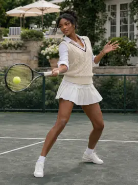</a> | <a href="https://promicat.app/poses/styles/sp128?utm_source=github&utm_medium=readme&utm_campaign=ai-photo-poses">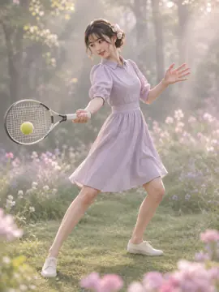</a> | <a href="https://promicat.app/poses/styles/sp128?utm_source=github&utm_medium=readme&utm_campaign=ai-photo-poses">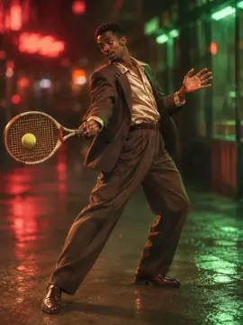</a> | <a href="https://promicat.app/poses/styles/sp128?utm_source=github&utm_medium=readme&utm_campaign=ai-photo-poses">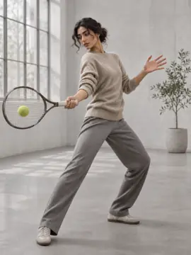</a> |

Full size: [photo](../images/photo-poses/oldmoney/sp128-photo.webp) · [white model](../images/photo-poses/oldmoney/sp128-pose.webp) · [try it on Promicat](https://promicat.app/poses/styles/sp128?utm_source=github&utm_medium=readme&utm_campaign=ai-photo-poses)

<details><summary>Prompt with your photo (image 1: your photo, image 2: white model)</summary>

```text
A real professional portrait photoshoot photo: an old-money quiet-luxury photoshoot at a country club, tennis court and garden terrace, soft summer daylight, 85mm. Subject: the person in image 1 (keep their exact face, facial features, skin tone and hairstyle; do not beautify or swap the face), wearing cream cable-knit, crisp shirt, tailored trousers or a pleated tennis skirt. Pose: mid-swing of a tennis forehand, body twisted. Image 2 is a wooden artist's mannequin that shows only this body pose: copy it exactly (head, torso, arms, hands, legs, feet, which hand does what, the camera angle), but do not copy the mannequin itself: no wooden skin, no joints, no blank face. Natural, relaxed and unstiff, true skin texture. No text, no logo, no watermark. Portrait 3:4.
```

</details>

<details><summary>Prompt for the sample (fictional model)</summary>

```text
A real professional portrait photoshoot photo, the kind posted by a top portrait studio: an old-money quiet-luxury photoshoot at a country club, tennis court and garden terrace, soft summer daylight, 85mm. Model: a beautiful Black professional fashion model in her twenties with a naturally attractive face, styled hair and natural makeup, wearing cream cable-knit, crisp shirt, tailored trousers or a pleated tennis skirt. The photographer directs the model into a natural, relaxed, unstiff pose that looks caught between moments: mid-swing of a tennis forehand, body twisted. Asymmetric body, soft hands, flattering angle, true skin texture, refined but not plastic, fully clothed and modest. Full body or three-quarter body in frame, the whole pose clearly readable. No text, no logo, no watermark. Portrait 3:4.
```

</details>

## Straightening a crisp shirt collar with both hands (Upper body)

| White model | Old money | Dark academia | Gothic | Moody studio |
|---|---|---|---|---|
|  | <a href="https://promicat.app/poses/styles/sp129?utm_source=github&utm_medium=readme&utm_campaign=ai-photo-poses">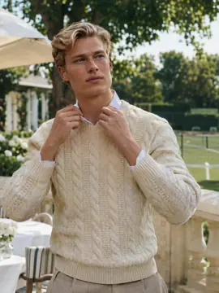</a> | <a href="https://promicat.app/poses/styles/sp129?utm_source=github&utm_medium=readme&utm_campaign=ai-photo-poses">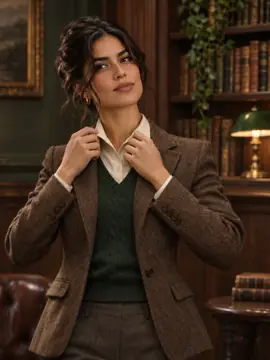</a> | <a href="https://promicat.app/poses/styles/sp129?utm_source=github&utm_medium=readme&utm_campaign=ai-photo-poses">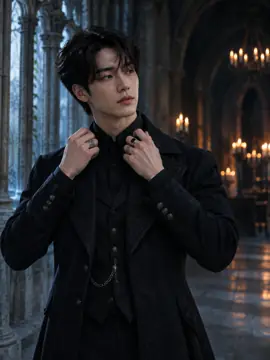</a> | <a href="https://promicat.app/poses/styles/sp129?utm_source=github&utm_medium=readme&utm_campaign=ai-photo-poses">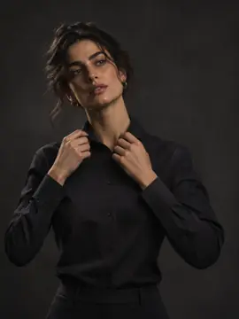</a> |

Full size: [photo](../images/photo-poses/oldmoney/sp129-photo.webp) · [white model](../images/photo-poses/oldmoney/sp129-pose.webp) · [try it on Promicat](https://promicat.app/poses/styles/sp129?utm_source=github&utm_medium=readme&utm_campaign=ai-photo-poses)

<details><summary>Prompt with your photo (image 1: your photo, image 2: white model)</summary>

```text
A real professional portrait photoshoot photo: an old-money quiet-luxury photoshoot at a country club, tennis court and garden terrace, soft summer daylight, 85mm. Subject: the person in image 1 (keep their exact face, facial features, skin tone and hairstyle; do not beautify or swap the face), wearing cream cable-knit, crisp shirt, tailored trousers or a pleated tennis skirt. Pose: straightening a crisp shirt collar with both hands. Image 2 is a wooden artist's mannequin that shows only this body pose: copy it exactly (head, torso, arms, hands, legs, feet, which hand does what, the camera angle), but do not copy the mannequin itself: no wooden skin, no joints, no blank face. Natural, relaxed and unstiff, true skin texture. No text, no logo, no watermark. Portrait 3:4.
```

</details>

<details><summary>Prompt for the sample (fictional model)</summary>

```text
A real professional portrait photoshoot photo, the kind posted by a top portrait studio: an old-money quiet-luxury photoshoot at a country club, tennis court and garden terrace, soft summer daylight, 85mm. Model: a handsome Scandinavian professional male model in his twenties with a well-groomed look and styled hair, wearing cream cable-knit, crisp shirt, tailored trousers or a pleated tennis skirt. The photographer directs the model into a natural, relaxed, unstiff pose that looks caught between moments: straightening a crisp shirt collar with both hands. Asymmetric body, soft hands, flattering angle, true skin texture, refined but not plastic, fully clothed and modest. Waist-up framing, both arms and hands readable. No text, no logo, no watermark. Portrait 3:4.
```

</details>

## Lying on the lawn on the back with sunglasses on (Lying)

| White model | Old money | Campus youth | Forest & flower field | 1950s Hollywood |
|---|---|---|---|---|
| 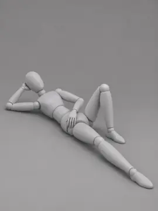 | <a href="https://promicat.app/poses/styles/sp130?utm_source=github&utm_medium=readme&utm_campaign=ai-photo-poses">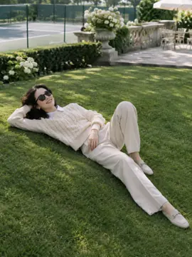</a> | <a href="https://promicat.app/poses/styles/sp130?utm_source=github&utm_medium=readme&utm_campaign=ai-photo-poses">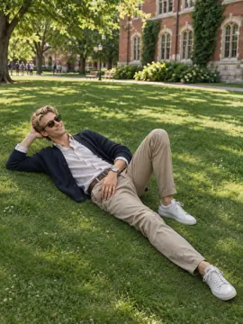</a> | <a href="https://promicat.app/poses/styles/sp130?utm_source=github&utm_medium=readme&utm_campaign=ai-photo-poses">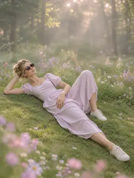</a> | <a href="https://promicat.app/poses/styles/sp130?utm_source=github&utm_medium=readme&utm_campaign=ai-photo-poses">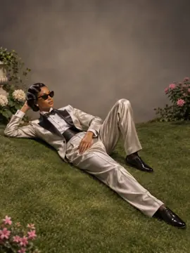</a> |

Full size: [photo](../images/photo-poses/oldmoney/sp130-photo.webp) · [white model](../images/photo-poses/oldmoney/sp130-pose.webp) · [try it on Promicat](https://promicat.app/poses/styles/sp130?utm_source=github&utm_medium=readme&utm_campaign=ai-photo-poses)

<details><summary>Prompt with your photo (image 1: your photo, image 2: white model)</summary>

```text
A real professional portrait photoshoot photo: an old-money quiet-luxury photoshoot at a country club, tennis court and garden terrace, soft summer daylight, 85mm. Subject: the person in image 1 (keep their exact face, facial features, skin tone and hairstyle; do not beautify or swap the face), wearing cream cable-knit, crisp shirt, tailored trousers or a pleated tennis skirt. Pose: lying on the lawn on the back with sunglasses on, one knee up, fully dressed. Image 2 is a wooden artist's mannequin that shows only this body pose: copy it exactly (head, torso, arms, hands, legs, feet, which hand does what, the camera angle), but do not copy the mannequin itself: no wooden skin, no joints, no blank face. Natural, relaxed and unstiff, true skin texture. No text, no logo, no watermark. Portrait 3:4.
```

</details>

<details><summary>Prompt for the sample (fictional model)</summary>

```text
A real professional portrait photoshoot photo, the kind posted by a top portrait studio: an old-money quiet-luxury photoshoot at a country club, tennis court and garden terrace, soft summer daylight, 85mm. Model: a beautiful East Asian professional fashion model in her twenties with a naturally attractive face, styled hair and natural makeup, wearing cream cable-knit, crisp shirt, tailored trousers or a pleated tennis skirt. The photographer directs the model into a natural, relaxed, unstiff pose that looks caught between moments: lying on the lawn on the back with sunglasses on, one knee up, fully dressed. Asymmetric body, soft hands, flattering angle, true skin texture, refined but not plastic, fully clothed and modest. Full body or three-quarter body in frame, the whole pose clearly readable. No text, no logo, no watermark. Portrait 3:4.
```

</details>
