# 街头朋克 · Street punk

10 组写真姿势：左边是写真照，右边是照着它画的木头白模。白模可以当姿势参考图，和你的照片一起发给生图模型。 在线试用：[Promicat 姿势库](https://promicat.app/zh/poses?ref=github)

[← 返回目录](../README.md#写真姿势)

## 涂鸦墙蹲（蹲跪）

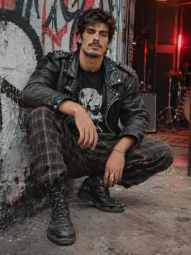 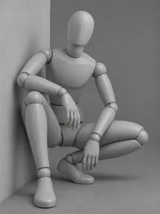

大图：[写真照](../images/photo-poses/punk/sp161-photo.webp) · [白模](../images/photo-poses/punk/sp161-pose.webp)

<details><summary>提示词：用你的照片（附图 1 你的照片，附图 2 白模）</summary>

```text
A real professional portrait photoshoot photo: a punk-grunge photoshoot in a graffiti alley and a rehearsal room, hard daylight and red practical lights, gritty grain, 35mm. Subject: the person in image 1 (keep their exact face, facial features, skin tone and hairstyle; do not beautify or swap the face), wearing a studded leather jacket, band t-shirt, plaid trousers and combat boots. Pose: squatting against a graffiti wall, forearms on knees, staring at the camera. Image 2 is a wooden artist's mannequin that shows only this body pose: copy it exactly (head, torso, arms, hands, legs, feet, which hand does what, the camera angle), but do not copy the mannequin itself: no wooden skin, no joints, no blank face. Natural, relaxed and unstiff, true skin texture. No text, no logo, no watermark. Portrait 3:4.
```

</details>

<details><summary>提示词：生成示例图（虚构模特）</summary>

```text
A real professional portrait photoshoot photo, the kind posted by a top portrait studio: a punk-grunge photoshoot in a graffiti alley and a rehearsal room, hard daylight and red practical lights, gritty grain, 35mm. Model: a handsome Brazilian professional male model in his twenties with a well-groomed look and styled hair, wearing a studded leather jacket, band t-shirt, plaid trousers and combat boots. The photographer directs the model into a natural, relaxed, unstiff pose that looks caught between moments: squatting against a graffiti wall, forearms on knees, staring at the camera. Asymmetric body, soft hands, flattering angle, true skin texture, refined but not plastic, fully clothed and modest. Full body or three-quarter body in frame, the whole pose clearly readable. No text, no logo, no watermark. Portrait 3:4.
```

</details>

## 扛吉他（站）

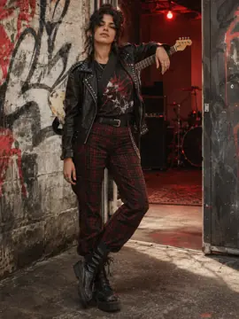 

大图：[写真照](../images/photo-poses/punk/sp162-photo.webp) · [白模](../images/photo-poses/punk/sp162-pose.webp)

<details><summary>提示词：用你的照片（附图 1 你的照片，附图 2 白模）</summary>

```text
A real professional portrait photoshoot photo: a punk-grunge photoshoot in a graffiti alley and a rehearsal room, hard daylight and red practical lights, gritty grain, 35mm. Subject: the person in image 1 (keep their exact face, facial features, skin tone and hairstyle; do not beautify or swap the face), wearing a studded leather jacket, band t-shirt, plaid trousers and combat boots. Pose: standing with an electric guitar slung on the back, hand on the neck. Image 2 is a wooden artist's mannequin that shows only this body pose: copy it exactly (head, torso, arms, hands, legs, feet, which hand does what, the camera angle), but do not copy the mannequin itself: no wooden skin, no joints, no blank face. Natural, relaxed and unstiff, true skin texture. No text, no logo, no watermark. Portrait 3:4.
```

</details>

<details><summary>提示词：生成示例图（虚构模特）</summary>

```text
A real professional portrait photoshoot photo, the kind posted by a top portrait studio: a punk-grunge photoshoot in a graffiti alley and a rehearsal room, hard daylight and red practical lights, gritty grain, 35mm. Model: a beautiful Latina professional fashion model in her twenties with a naturally attractive face, styled hair and natural makeup, wearing a studded leather jacket, band t-shirt, plaid trousers and combat boots. The photographer directs the model into a natural, relaxed, unstiff pose that looks caught between moments: standing with an electric guitar slung on the back, hand on the neck. Asymmetric body, soft hands, flattering angle, true skin texture, refined but not plastic, fully clothed and modest. Full body or three-quarter body in frame, the whole pose clearly readable. No text, no logo, no watermark. Portrait 3:4.
```

</details>

## 靠铁门（靠）

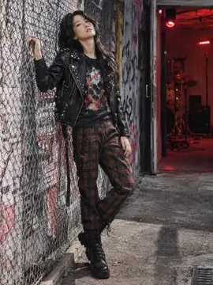 

大图：[写真照](../images/photo-poses/punk/sp163-photo.webp) · [白模](../images/photo-poses/punk/sp163-pose.webp)

<details><summary>提示词：用你的照片（附图 1 你的照片，附图 2 白模）</summary>

```text
A real professional portrait photoshoot photo: a punk-grunge photoshoot in a graffiti alley and a rehearsal room, hard daylight and red practical lights, gritty grain, 35mm. Subject: the person in image 1 (keep their exact face, facial features, skin tone and hairstyle; do not beautify or swap the face), wearing a studded leather jacket, band t-shirt, plaid trousers and combat boots. Pose: leaning back on a chain-link fence, fingers hooked in it, head back. Image 2 is a wooden artist's mannequin that shows only this body pose: copy it exactly (head, torso, arms, hands, legs, feet, which hand does what, the camera angle), but do not copy the mannequin itself: no wooden skin, no joints, no blank face. Natural, relaxed and unstiff, true skin texture. No text, no logo, no watermark. Portrait 3:4.
```

</details>

<details><summary>提示词：生成示例图（虚构模特）</summary>

```text
A real professional portrait photoshoot photo, the kind posted by a top portrait studio: a punk-grunge photoshoot in a graffiti alley and a rehearsal room, hard daylight and red practical lights, gritty grain, 35mm. Model: a beautiful Korean professional fashion model in her twenties with a naturally attractive face, styled hair and natural makeup, wearing a studded leather jacket, band t-shirt, plaid trousers and combat boots. The photographer directs the model into a natural, relaxed, unstiff pose that looks caught between moments: leaning back on a chain-link fence, fingers hooked in it, head back. Asymmetric body, soft hands, flattering angle, true skin texture, refined but not plastic, fully clothed and modest. Full body or three-quarter body in frame, the whole pose clearly readable. No text, no logo, no watermark. Portrait 3:4.
```

</details>

## 坐音箱（坐）

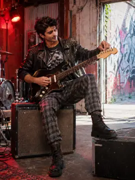 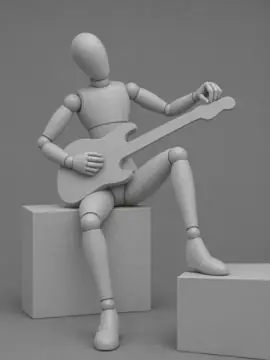

大图：[写真照](../images/photo-poses/punk/sp164-photo.webp) · [白模](../images/photo-poses/punk/sp164-pose.webp)

<details><summary>提示词：用你的照片（附图 1 你的照片，附图 2 白模）</summary>

```text
A real professional portrait photoshoot photo: a punk-grunge photoshoot in a graffiti alley and a rehearsal room, hard daylight and red practical lights, gritty grain, 35mm. Subject: the person in image 1 (keep their exact face, facial features, skin tone and hairstyle; do not beautify or swap the face), wearing a studded leather jacket, band t-shirt, plaid trousers and combat boots. Pose: sitting on an amp in a rehearsal room, one boot up, tuning a guitar. Image 2 is a wooden artist's mannequin that shows only this body pose: copy it exactly (head, torso, arms, hands, legs, feet, which hand does what, the camera angle), but do not copy the mannequin itself: no wooden skin, no joints, no blank face. Natural, relaxed and unstiff, true skin texture. No text, no logo, no watermark. Portrait 3:4.
```

</details>

<details><summary>提示词：生成示例图（虚构模特）</summary>

```text
A real professional portrait photoshoot photo, the kind posted by a top portrait studio: a punk-grunge photoshoot in a graffiti alley and a rehearsal room, hard daylight and red practical lights, gritty grain, 35mm. Model: a handsome South Asian professional male model in his twenties with a well-groomed look and styled hair, wearing a studded leather jacket, band t-shirt, plaid trousers and combat boots. The photographer directs the model into a natural, relaxed, unstiff pose that looks caught between moments: sitting on an amp in a rehearsal room, one boot up, tuning a guitar. Asymmetric body, soft hands, flattering angle, true skin texture, refined but not plastic, fully clothed and modest. Full body or three-quarter body in frame, the whole pose clearly readable. No text, no logo, no watermark. Portrait 3:4.
```

</details>

## 拉外套（半身）

 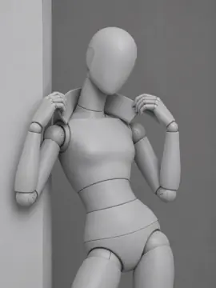

大图：[写真照](../images/photo-poses/punk/sp165-photo.webp) · [白模](../images/photo-poses/punk/sp165-pose.webp)

<details><summary>提示词：用你的照片（附图 1 你的照片，附图 2 白模）</summary>

```text
A real professional portrait photoshoot photo: a punk-grunge photoshoot in a graffiti alley and a rehearsal room, hard daylight and red practical lights, gritty grain, 35mm. Subject: the person in image 1 (keep their exact face, facial features, skin tone and hairstyle; do not beautify or swap the face), wearing a studded leather jacket, band t-shirt, plaid trousers and combat boots. Pose: pulling the leather jacket collar up with both hands, chin down. Image 2 is a wooden artist's mannequin that shows only this body pose: copy it exactly (head, torso, arms, hands, legs, feet, which hand does what, the camera angle), but do not copy the mannequin itself: no wooden skin, no joints, no blank face. Natural, relaxed and unstiff, true skin texture. No text, no logo, no watermark. Portrait 3:4.
```

</details>

<details><summary>提示词：生成示例图（虚构模特）</summary>

```text
A real professional portrait photoshoot photo, the kind posted by a top portrait studio: a punk-grunge photoshoot in a graffiti alley and a rehearsal room, hard daylight and red practical lights, gritty grain, 35mm. Model: a beautiful East African professional fashion model in her twenties with a naturally attractive face, styled hair and natural makeup, wearing a studded leather jacket, band t-shirt, plaid trousers and combat boots. The photographer directs the model into a natural, relaxed, unstiff pose that looks caught between moments: pulling the leather jacket collar up with both hands, chin down. Asymmetric body, soft hands, flattering angle, true skin texture, refined but not plastic, fully clothed and modest. Waist-up framing, both arms and hands readable. No text, no logo, no watermark. Portrait 3:4.
```

</details>

## 跳起（动态）

 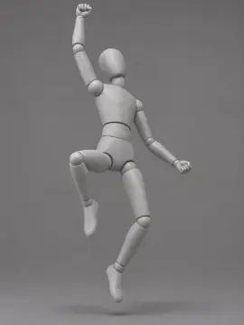

大图：[写真照](../images/photo-poses/punk/sp166-photo.webp) · [白模](../images/photo-poses/punk/sp166-pose.webp)

<details><summary>提示词：用你的照片（附图 1 你的照片，附图 2 白模）</summary>

```text
A real professional portrait photoshoot photo: a punk-grunge photoshoot in a graffiti alley and a rehearsal room, hard daylight and red practical lights, gritty grain, 35mm. Subject: the person in image 1 (keep their exact face, facial features, skin tone and hairstyle; do not beautify or swap the face), wearing a studded leather jacket, band t-shirt, plaid trousers and combat boots. Pose: jumping mid-air with one knee up, fist raised. Image 2 is a wooden artist's mannequin that shows only this body pose: copy it exactly (head, torso, arms, hands, legs, feet, which hand does what, the camera angle), but do not copy the mannequin itself: no wooden skin, no joints, no blank face. Natural, relaxed and unstiff, true skin texture. No text, no logo, no watermark. Portrait 3:4.
```

</details>

<details><summary>提示词：生成示例图（虚构模特）</summary>

```text
A real professional portrait photoshoot photo, the kind posted by a top portrait studio: a punk-grunge photoshoot in a graffiti alley and a rehearsal room, hard daylight and red practical lights, gritty grain, 35mm. Model: a beautiful Black professional fashion model in her twenties with a naturally attractive face, styled hair and natural makeup, wearing a studded leather jacket, band t-shirt, plaid trousers and combat boots. The photographer directs the model into a natural, relaxed, unstiff pose that looks caught between moments: jumping mid-air with one knee up, fist raised. Asymmetric body, soft hands, flattering angle, true skin texture, refined but not plastic, fully clothed and modest. Full body or three-quarter body in frame, the whole pose clearly readable. No text, no logo, no watermark. Portrait 3:4.
```

</details>

## 巷子走（走）

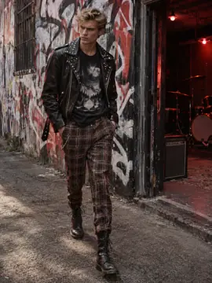 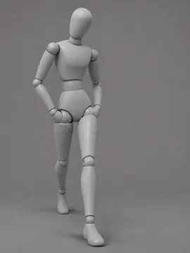

大图：[写真照](../images/photo-poses/punk/sp167-photo.webp) · [白模](../images/photo-poses/punk/sp167-pose.webp)

<details><summary>提示词：用你的照片（附图 1 你的照片，附图 2 白模）</summary>

```text
A real professional portrait photoshoot photo: a punk-grunge photoshoot in a graffiti alley and a rehearsal room, hard daylight and red practical lights, gritty grain, 35mm. Subject: the person in image 1 (keep their exact face, facial features, skin tone and hairstyle; do not beautify or swap the face), wearing a studded leather jacket, band t-shirt, plaid trousers and combat boots. Pose: walking down a graffiti alley, hands in pockets, scowling sideways. Image 2 is a wooden artist's mannequin that shows only this body pose: copy it exactly (head, torso, arms, hands, legs, feet, which hand does what, the camera angle), but do not copy the mannequin itself: no wooden skin, no joints, no blank face. Natural, relaxed and unstiff, true skin texture. No text, no logo, no watermark. Portrait 3:4.
```

</details>

<details><summary>提示词：生成示例图（虚构模特）</summary>

```text
A real professional portrait photoshoot photo, the kind posted by a top portrait studio: a punk-grunge photoshoot in a graffiti alley and a rehearsal room, hard daylight and red practical lights, gritty grain, 35mm. Model: a handsome Scandinavian professional male model in his twenties with a well-groomed look and styled hair, wearing a studded leather jacket, band t-shirt, plaid trousers and combat boots. The photographer directs the model into a natural, relaxed, unstiff pose that looks caught between moments: walking down a graffiti alley, hands in pockets, scowling sideways. Asymmetric body, soft hands, flattering angle, true skin texture, refined but not plastic, fully clothed and modest. Full body or three-quarter body in frame, the whole pose clearly readable. No text, no logo, no watermark. Portrait 3:4.
```

</details>

## 回头吐舌（回眸）

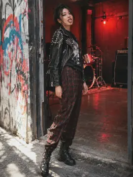 

大图：[写真照](../images/photo-poses/punk/sp168-photo.webp) · [白模](../images/photo-poses/punk/sp168-pose.webp)

<details><summary>提示词：用你的照片（附图 1 你的照片，附图 2 白模）</summary>

```text
A real professional portrait photoshoot photo: a punk-grunge photoshoot in a graffiti alley and a rehearsal room, hard daylight and red practical lights, gritty grain, 35mm. Subject: the person in image 1 (keep their exact face, facial features, skin tone and hairstyle; do not beautify or swap the face), wearing a studded leather jacket, band t-shirt, plaid trousers and combat boots. Pose: looking back over the shoulder with the tongue out. Image 2 is a wooden artist's mannequin that shows only this body pose: copy it exactly (head, torso, arms, hands, legs, feet, which hand does what, the camera angle), but do not copy the mannequin itself: no wooden skin, no joints, no blank face. Natural, relaxed and unstiff, true skin texture. No text, no logo, no watermark. Portrait 3:4.
```

</details>

<details><summary>提示词：生成示例图（虚构模特）</summary>

```text
A real professional portrait photoshoot photo, the kind posted by a top portrait studio: a punk-grunge photoshoot in a graffiti alley and a rehearsal room, hard daylight and red practical lights, gritty grain, 35mm. Model: a beautiful East Asian professional fashion model in her twenties with a naturally attractive face, styled hair and natural makeup, wearing a studded leather jacket, band t-shirt, plaid trousers and combat boots. The photographer directs the model into a natural, relaxed, unstiff pose that looks caught between moments: looking back over the shoulder with the tongue out. Asymmetric body, soft hands, flattering angle, true skin texture, refined but not plastic, fully clothed and modest. Full body or three-quarter body in frame, the whole pose clearly readable. No text, no logo, no watermark. Portrait 3:4.
```

</details>

## 地上坐靠墙（坐）

 

大图：[写真照](../images/photo-poses/punk/sp169-photo.webp) · [白模](../images/photo-poses/punk/sp169-pose.webp)

<details><summary>提示词：用你的照片（附图 1 你的照片，附图 2 白模）</summary>

```text
A real professional portrait photoshoot photo: a punk-grunge photoshoot in a graffiti alley and a rehearsal room, hard daylight and red practical lights, gritty grain, 35mm. Subject: the person in image 1 (keep their exact face, facial features, skin tone and hairstyle; do not beautify or swap the face), wearing a studded leather jacket, band t-shirt, plaid trousers and combat boots. Pose: sitting on the ground against the wall, one leg out, the other bent. Image 2 is a wooden artist's mannequin that shows only this body pose: copy it exactly (head, torso, arms, hands, legs, feet, which hand does what, the camera angle), but do not copy the mannequin itself: no wooden skin, no joints, no blank face. Natural, relaxed and unstiff, true skin texture. No text, no logo, no watermark. Portrait 3:4.
```

</details>

<details><summary>提示词：生成示例图（虚构模特）</summary>

```text
A real professional portrait photoshoot photo, the kind posted by a top portrait studio: a punk-grunge photoshoot in a graffiti alley and a rehearsal room, hard daylight and red practical lights, gritty grain, 35mm. Model: a beautiful mixed-race professional fashion model in her twenties with a naturally attractive face, styled hair and natural makeup, wearing a studded leather jacket, band t-shirt, plaid trousers and combat boots. The photographer directs the model into a natural, relaxed, unstiff pose that looks caught between moments: sitting on the ground against the wall, one leg out, the other bent. Asymmetric body, soft hands, flattering angle, true skin texture, refined but not plastic, fully clothed and modest. Full body or three-quarter body in frame, the whole pose clearly readable. No text, no logo, no watermark. Portrait 3:4.
```

</details>

## 滑板站（站）

 

大图：[写真照](../images/photo-poses/punk/sp170-photo.webp) · [白模](../images/photo-poses/punk/sp170-pose.webp)

<details><summary>提示词：用你的照片（附图 1 你的照片，附图 2 白模）</summary>

```text
A real professional portrait photoshoot photo: a punk-grunge photoshoot in a graffiti alley and a rehearsal room, hard daylight and red practical lights, gritty grain, 35mm. Subject: the person in image 1 (keep their exact face, facial features, skin tone and hairstyle; do not beautify or swap the face), wearing a studded leather jacket, band t-shirt, plaid trousers and combat boots. Pose: standing with one foot on a skateboard, arms crossed. Image 2 is a wooden artist's mannequin that shows only this body pose: copy it exactly (head, torso, arms, hands, legs, feet, which hand does what, the camera angle), but do not copy the mannequin itself: no wooden skin, no joints, no blank face. Natural, relaxed and unstiff, true skin texture. No text, no logo, no watermark. Portrait 3:4.
```

</details>

<details><summary>提示词：生成示例图（虚构模特）</summary>

```text
A real professional portrait photoshoot photo, the kind posted by a top portrait studio: a punk-grunge photoshoot in a graffiti alley and a rehearsal room, hard daylight and red practical lights, gritty grain, 35mm. Model: a handsome Mediterranean professional male model in his twenties with a well-groomed look and styled hair, wearing a studded leather jacket, band t-shirt, plaid trousers and combat boots. The photographer directs the model into a natural, relaxed, unstiff pose that looks caught between moments: standing with one foot on a skateboard, arms crossed. Asymmetric body, soft hands, flattering angle, true skin texture, refined but not plastic, fully clothed and modest. Full body or three-quarter body in frame, the whole pose clearly readable. No text, no logo, no watermark. Portrait 3:4.
```

</details>
