# 街拍时尚

[English](street.md) · 简体中文

10 组写真姿势：一张示例写真和照着它画的白模。参考图顺序是你的照片在前、白模在后。也可以在 [Promicat](https://promicat.app/zh/poses?utm_source=github&utm_medium=readme&utm_campaign=ai-photo-poses) 上传照片直接生成。

[← 返回全部风格](../README.zh-CN.md#photo-poses)

## 迎面走来提衣领 (走)

<a href="https://promicat.app/zh/poses/styles/sp001?utm_source=github&utm_medium=readme&utm_campaign=ai-photo-poses">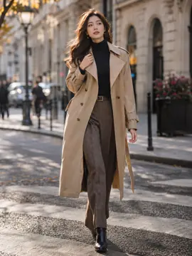</a> 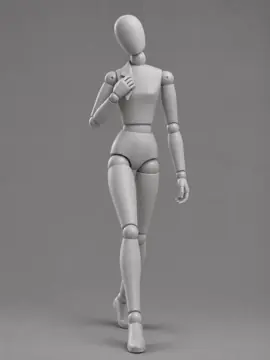

大图: [写真照](../images/photo-poses/street/sp001-photo.webp) · [白模](../images/photo-poses/street/sp001-pose.webp) · [在 Promicat 生成](https://promicat.app/zh/poses/styles/sp001?utm_source=github&utm_medium=readme&utm_campaign=ai-photo-poses)

<details><summary>提示词：用你的照片（图 1 你的照片，图 2 白模）</summary>

```text
A real professional portrait photoshoot photo: a city street fashion photoshoot on a stylish European street, late afternoon sun, 85mm f/1.8, shallow depth of field, editorial colour grading. Subject: the person in image 1 (keep their exact face, facial features, skin tone and hairstyle; do not beautify or swap the face), wearing a well-cut trench coat or tailored street-style outfit. Pose: walking across the street toward the camera, one hand lifting the coat lapel, looking slightly off camera. Image 2 is a wooden artist's mannequin that shows only this body pose: copy it exactly (head, torso, arms, hands, legs, feet, which hand does what, the camera angle), but do not copy the mannequin itself: no wooden skin, no joints, no blank face. Natural, relaxed and unstiff, true skin texture. No text, no logo, no watermark. Portrait 3:4.
```

</details>

<details><summary>提示词：生成示例图（虚构模特）</summary>

```text
A real professional portrait photoshoot photo, the kind posted by a top portrait studio: a city street fashion photoshoot on a stylish European street, late afternoon sun, 85mm f/1.8, shallow depth of field, editorial colour grading. Model: a beautiful East Asian professional fashion model in her twenties with a naturally attractive face, styled hair and natural makeup, wearing a well-cut trench coat or tailored street-style outfit. The photographer directs the model into a natural, relaxed, unstiff pose that looks caught between moments: walking across the street toward the camera, one hand lifting the coat lapel, looking slightly off camera. Asymmetric body, soft hands, flattering angle, true skin texture, refined but not plastic, fully clothed and modest. Full body or three-quarter body in frame, the whole pose clearly readable. No text, no logo, no watermark. Portrait 3:4.
```

</details>

## 靠墙低头看墨镜 (靠)

<a href="https://promicat.app/zh/poses/styles/sp002?utm_source=github&utm_medium=readme&utm_campaign=ai-photo-poses">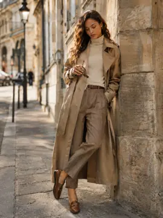</a> 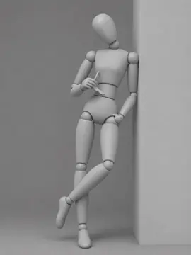

大图: [写真照](../images/photo-poses/street/sp002-photo.webp) · [白模](../images/photo-poses/street/sp002-pose.webp) · [在 Promicat 生成](https://promicat.app/zh/poses/styles/sp002?utm_source=github&utm_medium=readme&utm_campaign=ai-photo-poses)

<details><summary>提示词：用你的照片（图 1 你的照片，图 2 白模）</summary>

```text
A real professional portrait photoshoot photo: a city street fashion photoshoot on a stylish European street, late afternoon sun, 85mm f/1.8, shallow depth of field, editorial colour grading. Subject: the person in image 1 (keep their exact face, facial features, skin tone and hairstyle; do not beautify or swap the face), wearing a well-cut trench coat or tailored street-style outfit. Pose: leaning a shoulder against a stone wall, one hand in the pocket, the other holding sunglasses, looking down. Image 2 is a wooden artist's mannequin that shows only this body pose: copy it exactly (head, torso, arms, hands, legs, feet, which hand does what, the camera angle), but do not copy the mannequin itself: no wooden skin, no joints, no blank face. Natural, relaxed and unstiff, true skin texture. No text, no logo, no watermark. Portrait 3:4.
```

</details>

<details><summary>提示词：生成示例图（虚构模特）</summary>

```text
A real professional portrait photoshoot photo, the kind posted by a top portrait studio: a city street fashion photoshoot on a stylish European street, late afternoon sun, 85mm f/1.8, shallow depth of field, editorial colour grading. Model: a beautiful mixed-race professional fashion model in her twenties with a naturally attractive face, styled hair and natural makeup, wearing a well-cut trench coat or tailored street-style outfit. The photographer directs the model into a natural, relaxed, unstiff pose that looks caught between moments: leaning a shoulder against a stone wall, one hand in the pocket, the other holding sunglasses, looking down. Asymmetric body, soft hands, flattering angle, true skin texture, refined but not plastic, fully clothed and modest. Full body or three-quarter body in frame, the whole pose clearly readable. No text, no logo, no watermark. Portrait 3:4.
```

</details>

## 过马路回头 (回眸)

<a href="https://promicat.app/zh/poses/styles/sp003?utm_source=github&utm_medium=readme&utm_campaign=ai-photo-poses">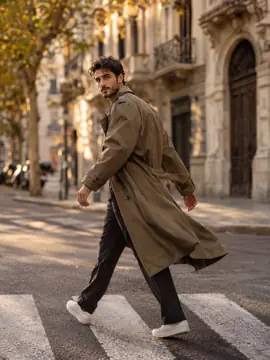</a> 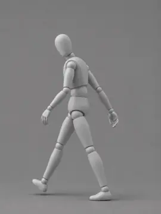

大图: [写真照](../images/photo-poses/street/sp003-photo.webp) · [白模](../images/photo-poses/street/sp003-pose.webp) · [在 Promicat 生成](https://promicat.app/zh/poses/styles/sp003?utm_source=github&utm_medium=readme&utm_campaign=ai-photo-poses)

<details><summary>提示词：用你的照片（图 1 你的照片，图 2 白模）</summary>

```text
A real professional portrait photoshoot photo: a city street fashion photoshoot on a stylish European street, late afternoon sun, 85mm f/1.8, shallow depth of field, editorial colour grading. Subject: the person in image 1 (keep their exact face, facial features, skin tone and hairstyle; do not beautify or swap the face), wearing a well-cut trench coat or tailored street-style outfit. Pose: crossing the street, turning the head back over the shoulder toward the camera, coat swinging. Image 2 is a wooden artist's mannequin that shows only this body pose: copy it exactly (head, torso, arms, hands, legs, feet, which hand does what, the camera angle), but do not copy the mannequin itself: no wooden skin, no joints, no blank face. Natural, relaxed and unstiff, true skin texture. No text, no logo, no watermark. Portrait 3:4.
```

</details>

<details><summary>提示词：生成示例图（虚构模特）</summary>

```text
A real professional portrait photoshoot photo, the kind posted by a top portrait studio: a city street fashion photoshoot on a stylish European street, late afternoon sun, 85mm f/1.8, shallow depth of field, editorial colour grading. Model: a handsome Mediterranean professional male model in his twenties with a well-groomed look and styled hair, wearing a well-cut trench coat or tailored street-style outfit. The photographer directs the model into a natural, relaxed, unstiff pose that looks caught between moments: crossing the street, turning the head back over the shoulder toward the camera, coat swinging. Asymmetric body, soft hands, flattering angle, true skin texture, refined but not plastic, fully clothed and modest. Full body or three-quarter body in frame, the whole pose clearly readable. No text, no logo, no watermark. Portrait 3:4.
```

</details>

## 坐台阶看街 (坐)

<a href="https://promicat.app/zh/poses/styles/sp004?utm_source=github&utm_medium=readme&utm_campaign=ai-photo-poses">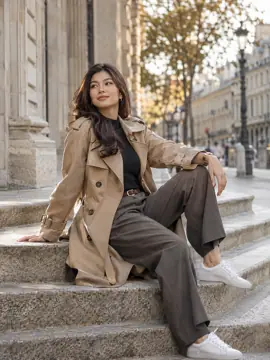</a> 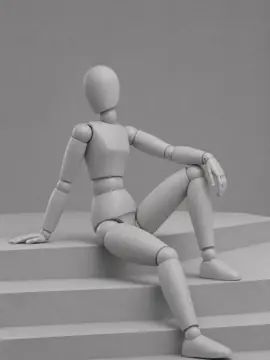

大图: [写真照](../images/photo-poses/street/sp004-photo.webp) · [白模](../images/photo-poses/street/sp004-pose.webp) · [在 Promicat 生成](https://promicat.app/zh/poses/styles/sp004?utm_source=github&utm_medium=readme&utm_campaign=ai-photo-poses)

<details><summary>提示词：用你的照片（图 1 你的照片，图 2 白模）</summary>

```text
A real professional portrait photoshoot photo: a city street fashion photoshoot on a stylish European street, late afternoon sun, 85mm f/1.8, shallow depth of field, editorial colour grading. Subject: the person in image 1 (keep their exact face, facial features, skin tone and hairstyle; do not beautify or swap the face), wearing a well-cut trench coat or tailored street-style outfit. Pose: sitting on wide stone steps leaning back on one hand, one knee up, watching the street. Image 2 is a wooden artist's mannequin that shows only this body pose: copy it exactly (head, torso, arms, hands, legs, feet, which hand does what, the camera angle), but do not copy the mannequin itself: no wooden skin, no joints, no blank face. Natural, relaxed and unstiff, true skin texture. No text, no logo, no watermark. Portrait 3:4.
```

</details>

<details><summary>提示词：生成示例图（虚构模特）</summary>

```text
A real professional portrait photoshoot photo, the kind posted by a top portrait studio: a city street fashion photoshoot on a stylish European street, late afternoon sun, 85mm f/1.8, shallow depth of field, editorial colour grading. Model: a beautiful Southeast Asian professional fashion model in her twenties with a naturally attractive face, styled hair and natural makeup, wearing a well-cut trench coat or tailored street-style outfit. The photographer directs the model into a natural, relaxed, unstiff pose that looks caught between moments: sitting on wide stone steps leaning back on one hand, one knee up, watching the street. Asymmetric body, soft hands, flattering angle, true skin texture, refined but not plastic, fully clothed and modest. Full body or three-quarter body in frame, the whole pose clearly readable. No text, no logo, no watermark. Portrait 3:4.
```

</details>

## 整理袖口 (站)

<a href="https://promicat.app/zh/poses/styles/sp005?utm_source=github&utm_medium=readme&utm_campaign=ai-photo-poses">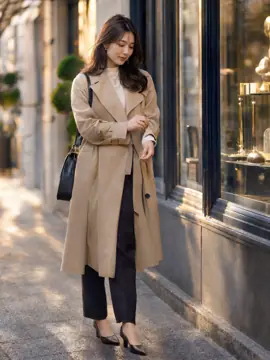</a> 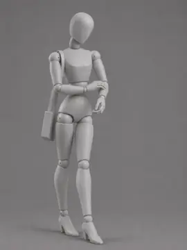

大图: [写真照](../images/photo-poses/street/sp005-photo.webp) · [白模](../images/photo-poses/street/sp005-pose.webp) · [在 Promicat 生成](https://promicat.app/zh/poses/styles/sp005?utm_source=github&utm_medium=readme&utm_campaign=ai-photo-poses)

<details><summary>提示词：用你的照片（图 1 你的照片，图 2 白模）</summary>

```text
A real professional portrait photoshoot photo: a city street fashion photoshoot on a stylish European street, late afternoon sun, 85mm f/1.8, shallow depth of field, editorial colour grading. Subject: the person in image 1 (keep their exact face, facial features, skin tone and hairstyle; do not beautify or swap the face), wearing a well-cut trench coat or tailored street-style outfit. Pose: standing by a shop window adjusting a cuff, head tilted down, weight on the back foot. Image 2 is a wooden artist's mannequin that shows only this body pose: copy it exactly (head, torso, arms, hands, legs, feet, which hand does what, the camera angle), but do not copy the mannequin itself: no wooden skin, no joints, no blank face. Natural, relaxed and unstiff, true skin texture. No text, no logo, no watermark. Portrait 3:4.
```

</details>

<details><summary>提示词：生成示例图（虚构模特）</summary>

```text
A real professional portrait photoshoot photo, the kind posted by a top portrait studio: a city street fashion photoshoot on a stylish European street, late afternoon sun, 85mm f/1.8, shallow depth of field, editorial colour grading. Model: a beautiful Japanese professional fashion model in her twenties with a naturally attractive face, styled hair and natural makeup, wearing a well-cut trench coat or tailored street-style outfit. The photographer directs the model into a natural, relaxed, unstiff pose that looks caught between moments: standing by a shop window adjusting a cuff, head tilted down, weight on the back foot. Asymmetric body, soft hands, flattering angle, true skin texture, refined but not plastic, fully clothed and modest. Full body or three-quarter body in frame, the whole pose clearly readable. No text, no logo, no watermark. Portrait 3:4.
```

</details>

## 拎包侧身 (站)

<a href="https://promicat.app/zh/poses/styles/sp006?utm_source=github&utm_medium=readme&utm_campaign=ai-photo-poses">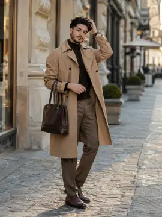</a> 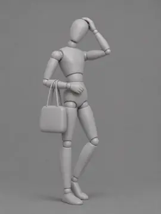

大图: [写真照](../images/photo-poses/street/sp006-photo.webp) · [白模](../images/photo-poses/street/sp006-pose.webp) · [在 Promicat 生成](https://promicat.app/zh/poses/styles/sp006?utm_source=github&utm_medium=readme&utm_campaign=ai-photo-poses)

<details><summary>提示词：用你的照片（图 1 你的照片，图 2 白模）</summary>

```text
A real professional portrait photoshoot photo: a city street fashion photoshoot on a stylish European street, late afternoon sun, 85mm f/1.8, shallow depth of field, editorial colour grading. Subject: the person in image 1 (keep their exact face, facial features, skin tone and hairstyle; do not beautify or swap the face), wearing a well-cut trench coat or tailored street-style outfit. Pose: standing three-quarters to the camera with a handbag hooked on the forearm, the other hand touching the hair. Image 2 is a wooden artist's mannequin that shows only this body pose: copy it exactly (head, torso, arms, hands, legs, feet, which hand does what, the camera angle), but do not copy the mannequin itself: no wooden skin, no joints, no blank face. Natural, relaxed and unstiff, true skin texture. No text, no logo, no watermark. Portrait 3:4.
```

</details>

<details><summary>提示词：生成示例图（虚构模特）</summary>

```text
A real professional portrait photoshoot photo, the kind posted by a top portrait studio: a city street fashion photoshoot on a stylish European street, late afternoon sun, 85mm f/1.8, shallow depth of field, editorial colour grading. Model: a handsome Middle Eastern professional male model in his twenties with a well-groomed look and styled hair, wearing a well-cut trench coat or tailored street-style outfit. The photographer directs the model into a natural, relaxed, unstiff pose that looks caught between moments: standing three-quarters to the camera with a handbag hooked on the forearm, the other hand touching the hair. Asymmetric body, soft hands, flattering angle, true skin texture, refined but not plastic, fully clothed and modest. Full body or three-quarter body in frame, the whole pose clearly readable. No text, no logo, no watermark. Portrait 3:4.
```

</details>

## 蹲地系鞋 (蹲跪)

<a href="https://promicat.app/zh/poses/styles/sp007?utm_source=github&utm_medium=readme&utm_campaign=ai-photo-poses">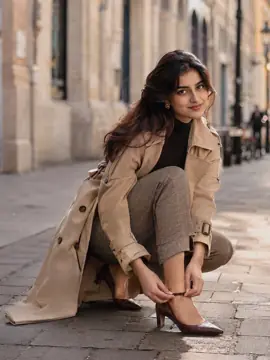</a> 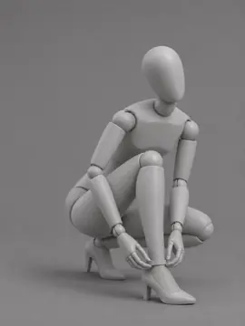

大图: [写真照](../images/photo-poses/street/sp007-photo.webp) · [白模](../images/photo-poses/street/sp007-pose.webp) · [在 Promicat 生成](https://promicat.app/zh/poses/styles/sp007?utm_source=github&utm_medium=readme&utm_campaign=ai-photo-poses)

<details><summary>提示词：用你的照片（图 1 你的照片，图 2 白模）</summary>

```text
A real professional portrait photoshoot photo: a city street fashion photoshoot on a stylish European street, late afternoon sun, 85mm f/1.8, shallow depth of field, editorial colour grading. Subject: the person in image 1 (keep their exact face, facial features, skin tone and hairstyle; do not beautify or swap the face), wearing a well-cut trench coat or tailored street-style outfit. Pose: crouching on the pavement fixing a shoe strap, looking up at the camera with a half smile. Image 2 is a wooden artist's mannequin that shows only this body pose: copy it exactly (head, torso, arms, hands, legs, feet, which hand does what, the camera angle), but do not copy the mannequin itself: no wooden skin, no joints, no blank face. Natural, relaxed and unstiff, true skin texture. No text, no logo, no watermark. Portrait 3:4.
```

</details>

<details><summary>提示词：生成示例图（虚构模特）</summary>

```text
A real professional portrait photoshoot photo, the kind posted by a top portrait studio: a city street fashion photoshoot on a stylish European street, late afternoon sun, 85mm f/1.8, shallow depth of field, editorial colour grading. Model: a beautiful Indian professional fashion model in her twenties with a naturally attractive face, styled hair and natural makeup, wearing a well-cut trench coat or tailored street-style outfit. The photographer directs the model into a natural, relaxed, unstiff pose that looks caught between moments: crouching on the pavement fixing a shoe strap, looking up at the camera with a half smile. Asymmetric body, soft hands, flattering angle, true skin texture, refined but not plastic, fully clothed and modest. Full body or three-quarter body in frame, the whole pose clearly readable. No text, no logo, no watermark. Portrait 3:4.
```

</details>

## 倚路灯 (靠)

<a href="https://promicat.app/zh/poses/styles/sp008?utm_source=github&utm_medium=readme&utm_campaign=ai-photo-poses">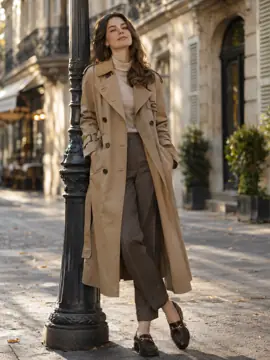</a> 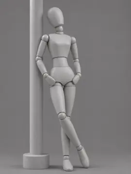

大图: [写真照](../images/photo-poses/street/sp008-photo.webp) · [白模](../images/photo-poses/street/sp008-pose.webp) · [在 Promicat 生成](https://promicat.app/zh/poses/styles/sp008?utm_source=github&utm_medium=readme&utm_campaign=ai-photo-poses)

<details><summary>提示词：用你的照片（图 1 你的照片，图 2 白模）</summary>

```text
A real professional portrait photoshoot photo: a city street fashion photoshoot on a stylish European street, late afternoon sun, 85mm f/1.8, shallow depth of field, editorial colour grading. Subject: the person in image 1 (keep their exact face, facial features, skin tone and hairstyle; do not beautify or swap the face), wearing a well-cut trench coat or tailored street-style outfit. Pose: leaning back against a lamp post with ankles crossed, hands in pockets, chin raised. Image 2 is a wooden artist's mannequin that shows only this body pose: copy it exactly (head, torso, arms, hands, legs, feet, which hand does what, the camera angle), but do not copy the mannequin itself: no wooden skin, no joints, no blank face. Natural, relaxed and unstiff, true skin texture. No text, no logo, no watermark. Portrait 3:4.
```

</details>

<details><summary>提示词：生成示例图（虚构模特）</summary>

```text
A real professional portrait photoshoot photo, the kind posted by a top portrait studio: a city street fashion photoshoot on a stylish European street, late afternoon sun, 85mm f/1.8, shallow depth of field, editorial colour grading. Model: a beautiful white European professional fashion model in her twenties with a naturally attractive face, styled hair and natural makeup, wearing a well-cut trench coat or tailored street-style outfit. The photographer directs the model into a natural, relaxed, unstiff pose that looks caught between moments: leaning back against a lamp post with ankles crossed, hands in pockets, chin raised. Asymmetric body, soft hands, flattering angle, true skin texture, refined but not plastic, fully clothed and modest. Full body or three-quarter body in frame, the whole pose clearly readable. No text, no logo, no watermark. Portrait 3:4.
```

</details>

## 边走边理头发 (走)

<a href="https://promicat.app/zh/poses/styles/sp009?utm_source=github&utm_medium=readme&utm_campaign=ai-photo-poses">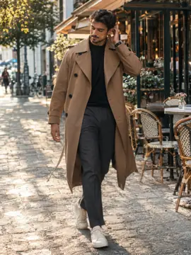</a> 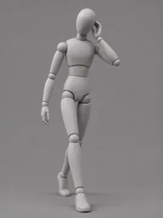

大图: [写真照](../images/photo-poses/street/sp009-photo.webp) · [白模](../images/photo-poses/street/sp009-pose.webp) · [在 Promicat 生成](https://promicat.app/zh/poses/styles/sp009?utm_source=github&utm_medium=readme&utm_campaign=ai-photo-poses)

<details><summary>提示词：用你的照片（图 1 你的照片，图 2 白模）</summary>

```text
A real professional portrait photoshoot photo: a city street fashion photoshoot on a stylish European street, late afternoon sun, 85mm f/1.8, shallow depth of field, editorial colour grading. Subject: the person in image 1 (keep their exact face, facial features, skin tone and hairstyle; do not beautify or swap the face), wearing a well-cut trench coat or tailored street-style outfit. Pose: walking past cafes tucking hair behind the ear, eyes down, mid-stride. Image 2 is a wooden artist's mannequin that shows only this body pose: copy it exactly (head, torso, arms, hands, legs, feet, which hand does what, the camera angle), but do not copy the mannequin itself: no wooden skin, no joints, no blank face. Natural, relaxed and unstiff, true skin texture. No text, no logo, no watermark. Portrait 3:4.
```

</details>

<details><summary>提示词：生成示例图（虚构模特）</summary>

```text
A real professional portrait photoshoot photo, the kind posted by a top portrait studio: a city street fashion photoshoot on a stylish European street, late afternoon sun, 85mm f/1.8, shallow depth of field, editorial colour grading. Model: a handsome Brazilian professional male model in his twenties with a well-groomed look and styled hair, wearing a well-cut trench coat or tailored street-style outfit. The photographer directs the model into a natural, relaxed, unstiff pose that looks caught between moments: walking past cafes tucking hair behind the ear, eyes down, mid-stride. Asymmetric body, soft hands, flattering angle, true skin texture, refined but not plastic, fully clothed and modest. Full body or three-quarter body in frame, the whole pose clearly readable. No text, no logo, no watermark. Portrait 3:4.
```

</details>

## 戴墨镜半身 (半身)

<a href="https://promicat.app/zh/poses/styles/sp010?utm_source=github&utm_medium=readme&utm_campaign=ai-photo-poses">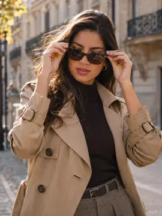</a> 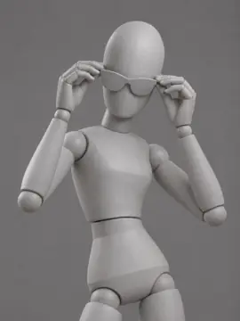

大图: [写真照](../images/photo-poses/street/sp010-photo.webp) · [白模](../images/photo-poses/street/sp010-pose.webp) · [在 Promicat 生成](https://promicat.app/zh/poses/styles/sp010?utm_source=github&utm_medium=readme&utm_campaign=ai-photo-poses)

<details><summary>提示词：用你的照片（图 1 你的照片，图 2 白模）</summary>

```text
A real professional portrait photoshoot photo: a city street fashion photoshoot on a stylish European street, late afternoon sun, 85mm f/1.8, shallow depth of field, editorial colour grading. Subject: the person in image 1 (keep their exact face, facial features, skin tone and hairstyle; do not beautify or swap the face), wearing a well-cut trench coat or tailored street-style outfit. Pose: putting on sunglasses with both hands, head slightly tilted, lips relaxed. Image 2 is a wooden artist's mannequin that shows only this body pose: copy it exactly (head, torso, arms, hands, legs, feet, which hand does what, the camera angle), but do not copy the mannequin itself: no wooden skin, no joints, no blank face. Natural, relaxed and unstiff, true skin texture. No text, no logo, no watermark. Portrait 3:4.
```

</details>

<details><summary>提示词：生成示例图（虚构模特）</summary>

```text
A real professional portrait photoshoot photo, the kind posted by a top portrait studio: a city street fashion photoshoot on a stylish European street, late afternoon sun, 85mm f/1.8, shallow depth of field, editorial colour grading. Model: a beautiful Latina professional fashion model in her twenties with a naturally attractive face, styled hair and natural makeup, wearing a well-cut trench coat or tailored street-style outfit. The photographer directs the model into a natural, relaxed, unstiff pose that looks caught between moments: putting on sunglasses with both hands, head slightly tilted, lips relaxed. Asymmetric body, soft hands, flattering angle, true skin texture, refined but not plastic, fully clothed and modest. Waist-up framing, both arms and hands readable. No text, no logo, no watermark. Portrait 3:4.
```

</details>
