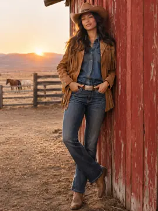
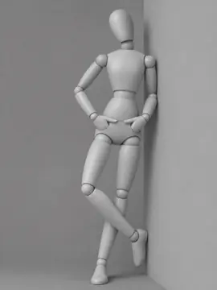
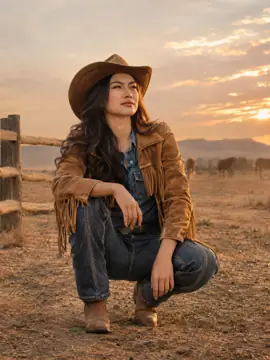
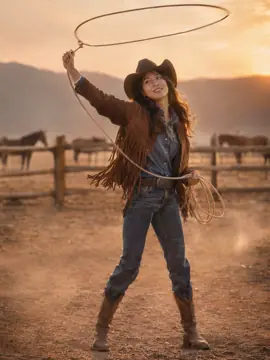
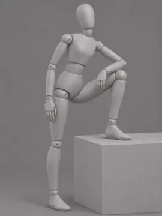

# Western cowboy

English · [简体中文](western.zh-CN.md)

10 photo poses: a sample photo and the white model drawn from it. Attach your photo first and the white model second. Try them with your own photo on [Promicat](https://promicat.app/poses?utm_source=github&utm_medium=readme&utm_campaign=ai-photo-poses).

[← Back to all styles](../README.md#photo-poses)

## Sitting on the top rail of a wooden fence (Sitting)

<a href="https://promicat.app/poses/styles/sp131?utm_source=github&utm_medium=readme&utm_campaign=ai-photo-poses"></a> 

Full size: [photo](../images/photo-poses/western/sp131-photo.webp) · [white model](../images/photo-poses/western/sp131-pose.webp) · [try it on Promicat](https://promicat.app/poses/styles/sp131?utm_source=github&utm_medium=readme&utm_campaign=ai-photo-poses)

<details><summary>Prompt with your photo (image 1: your photo, image 2: white model)</summary>

```text
A real professional portrait photoshoot photo: a western cowboy photoshoot on a desert ranch with a wooden fence and horses far away, golden dusty sunset, 85mm. Subject: the person in image 1 (keep their exact face, facial features, skin tone and hairstyle; do not beautify or swap the face), wearing a cowboy hat, denim shirt, suede fringe jacket, jeans and boots. Pose: sitting on the top rail of a wooden fence, one boot hooked on a lower rail, hat tilted. Image 2 is a wooden artist's mannequin that shows only this body pose: copy it exactly (head, torso, arms, hands, legs, feet, which hand does what, the camera angle), but do not copy the mannequin itself: no wooden skin, no joints, no blank face. Natural, relaxed and unstiff, true skin texture. No text, no logo, no watermark. Portrait 3:4.
```

</details>

<details><summary>Prompt for the sample (fictional model)</summary>

```text
A real professional portrait photoshoot photo, the kind posted by a top portrait studio: a western cowboy photoshoot on a desert ranch with a wooden fence and horses far away, golden dusty sunset, 85mm. Model: a handsome Scandinavian professional male model in his twenties with a well-groomed look and styled hair, wearing a cowboy hat, denim shirt, suede fringe jacket, jeans and boots. The photographer directs the model into a natural, relaxed, unstiff pose that looks caught between moments: sitting on the top rail of a wooden fence, one boot hooked on a lower rail, hat tilted. Asymmetric body, soft hands, flattering angle, true skin texture, refined but not plastic, fully clothed and modest. Full body or three-quarter body in frame, the whole pose clearly readable. No text, no logo, no watermark. Portrait 3:4.
```

</details>

## Pulling the hat brim down with one hand (Upper body)

<a href="https://promicat.app/poses/styles/sp132?utm_source=github&utm_medium=readme&utm_campaign=ai-photo-poses"></a> 

Full size: [photo](../images/photo-poses/western/sp132-photo.webp) · [white model](../images/photo-poses/western/sp132-pose.webp) · [try it on Promicat](https://promicat.app/poses/styles/sp132?utm_source=github&utm_medium=readme&utm_campaign=ai-photo-poses)

<details><summary>Prompt with your photo (image 1: your photo, image 2: white model)</summary>

```text
A real professional portrait photoshoot photo: a western cowboy photoshoot on a desert ranch with a wooden fence and horses far away, golden dusty sunset, 85mm. Subject: the person in image 1 (keep their exact face, facial features, skin tone and hairstyle; do not beautify or swap the face), wearing a cowboy hat, denim shirt, suede fringe jacket, jeans and boots. Pose: pulling the hat brim down with one hand, eyes up under it. Image 2 is a wooden artist's mannequin that shows only this body pose: copy it exactly (head, torso, arms, hands, legs, feet, which hand does what, the camera angle), but do not copy the mannequin itself: no wooden skin, no joints, no blank face. Natural, relaxed and unstiff, true skin texture. No text, no logo, no watermark. Portrait 3:4.
```

</details>

<details><summary>Prompt for the sample (fictional model)</summary>

```text
A real professional portrait photoshoot photo, the kind posted by a top portrait studio: a western cowboy photoshoot on a desert ranch with a wooden fence and horses far away, golden dusty sunset, 85mm. Model: a beautiful East Asian professional fashion model in her twenties with a naturally attractive face, styled hair and natural makeup, wearing a cowboy hat, denim shirt, suede fringe jacket, jeans and boots. The photographer directs the model into a natural, relaxed, unstiff pose that looks caught between moments: pulling the hat brim down with one hand, eyes up under it. Asymmetric body, soft hands, flattering angle, true skin texture, refined but not plastic, fully clothed and modest. Waist-up framing, both arms and hands readable. No text, no logo, no watermark. Portrait 3:4.
```

</details>

## Leaning against a red barn wall (Leaning)

<a href="https://promicat.app/poses/styles/sp133?utm_source=github&utm_medium=readme&utm_campaign=ai-photo-poses"></a> 

Full size: [photo](../images/photo-poses/western/sp133-photo.webp) · [white model](../images/photo-poses/western/sp133-pose.webp) · [try it on Promicat](https://promicat.app/poses/styles/sp133?utm_source=github&utm_medium=readme&utm_campaign=ai-photo-poses)

<details><summary>Prompt with your photo (image 1: your photo, image 2: white model)</summary>

```text
A real professional portrait photoshoot photo: a western cowboy photoshoot on a desert ranch with a wooden fence and horses far away, golden dusty sunset, 85mm. Subject: the person in image 1 (keep their exact face, facial features, skin tone and hairstyle; do not beautify or swap the face), wearing a cowboy hat, denim shirt, suede fringe jacket, jeans and boots. Pose: leaning against a red barn wall, thumbs in the belt, one boot crossed. Image 2 is a wooden artist's mannequin that shows only this body pose: copy it exactly (head, torso, arms, hands, legs, feet, which hand does what, the camera angle), but do not copy the mannequin itself: no wooden skin, no joints, no blank face. Natural, relaxed and unstiff, true skin texture. No text, no logo, no watermark. Portrait 3:4.
```

</details>

<details><summary>Prompt for the sample (fictional model)</summary>

```text
A real professional portrait photoshoot photo, the kind posted by a top portrait studio: a western cowboy photoshoot on a desert ranch with a wooden fence and horses far away, golden dusty sunset, 85mm. Model: a beautiful mixed-race professional fashion model in her twenties with a naturally attractive face, styled hair and natural makeup, wearing a cowboy hat, denim shirt, suede fringe jacket, jeans and boots. The photographer directs the model into a natural, relaxed, unstiff pose that looks caught between moments: leaning against a red barn wall, thumbs in the belt, one boot crossed. Asymmetric body, soft hands, flattering angle, true skin texture, refined but not plastic, fully clothed and modest. Full body or three-quarter body in frame, the whole pose clearly readable. No text, no logo, no watermark. Portrait 3:4.
```

</details>

## Walking toward the camera in the golden dust (Walking)

<a href="https://promicat.app/poses/styles/sp134?utm_source=github&utm_medium=readme&utm_campaign=ai-photo-poses"></a> 

Full size: [photo](../images/photo-poses/western/sp134-photo.webp) · [white model](../images/photo-poses/western/sp134-pose.webp) · [try it on Promicat](https://promicat.app/poses/styles/sp134?utm_source=github&utm_medium=readme&utm_campaign=ai-photo-poses)

<details><summary>Prompt with your photo (image 1: your photo, image 2: white model)</summary>

```text
A real professional portrait photoshoot photo: a western cowboy photoshoot on a desert ranch with a wooden fence and horses far away, golden dusty sunset, 85mm. Subject: the person in image 1 (keep their exact face, facial features, skin tone and hairstyle; do not beautify or swap the face), wearing a cowboy hat, denim shirt, suede fringe jacket, jeans and boots. Pose: walking toward the camera in the golden dust, swinging the hat in one hand. Image 2 is a wooden artist's mannequin that shows only this body pose: copy it exactly (head, torso, arms, hands, legs, feet, which hand does what, the camera angle), but do not copy the mannequin itself: no wooden skin, no joints, no blank face. Natural, relaxed and unstiff, true skin texture. No text, no logo, no watermark. Portrait 3:4.
```

</details>

<details><summary>Prompt for the sample (fictional model)</summary>

```text
A real professional portrait photoshoot photo, the kind posted by a top portrait studio: a western cowboy photoshoot on a desert ranch with a wooden fence and horses far away, golden dusty sunset, 85mm. Model: a handsome Mediterranean professional male model in his twenties with a well-groomed look and styled hair, wearing a cowboy hat, denim shirt, suede fringe jacket, jeans and boots. The photographer directs the model into a natural, relaxed, unstiff pose that looks caught between moments: walking toward the camera in the golden dust, swinging the hat in one hand. Asymmetric body, soft hands, flattering angle, true skin texture, refined but not plastic, fully clothed and modest. Full body or three-quarter body in frame, the whole pose clearly readable. No text, no logo, no watermark. Portrait 3:4.
```

</details>

## Crouching on one heel (Crouching)

<a href="https://promicat.app/poses/styles/sp135?utm_source=github&utm_medium=readme&utm_campaign=ai-photo-poses"></a> 

Full size: [photo](../images/photo-poses/western/sp135-photo.webp) · [white model](../images/photo-poses/western/sp135-pose.webp) · [try it on Promicat](https://promicat.app/poses/styles/sp135?utm_source=github&utm_medium=readme&utm_campaign=ai-photo-poses)

<details><summary>Prompt with your photo (image 1: your photo, image 2: white model)</summary>

```text
A real professional portrait photoshoot photo: a western cowboy photoshoot on a desert ranch with a wooden fence and horses far away, golden dusty sunset, 85mm. Subject: the person in image 1 (keep their exact face, facial features, skin tone and hairstyle; do not beautify or swap the face), wearing a cowboy hat, denim shirt, suede fringe jacket, jeans and boots. Pose: crouching on one heel, forearm on the knee, squinting at the horizon. Image 2 is a wooden artist's mannequin that shows only this body pose: copy it exactly (head, torso, arms, hands, legs, feet, which hand does what, the camera angle), but do not copy the mannequin itself: no wooden skin, no joints, no blank face. Natural, relaxed and unstiff, true skin texture. No text, no logo, no watermark. Portrait 3:4.
```

</details>

<details><summary>Prompt for the sample (fictional model)</summary>

```text
A real professional portrait photoshoot photo, the kind posted by a top portrait studio: a western cowboy photoshoot on a desert ranch with a wooden fence and horses far away, golden dusty sunset, 85mm. Model: a beautiful Southeast Asian professional fashion model in her twenties with a naturally attractive face, styled hair and natural makeup, wearing a cowboy hat, denim shirt, suede fringe jacket, jeans and boots. The photographer directs the model into a natural, relaxed, unstiff pose that looks caught between moments: crouching on one heel, forearm on the knee, squinting at the horizon. Asymmetric body, soft hands, flattering angle, true skin texture, refined but not plastic, fully clothed and modest. Full body or three-quarter body in frame, the whole pose clearly readable. No text, no logo, no watermark. Portrait 3:4.
```

</details>

## Swinging a lasso overhead (In motion)

<a href="https://promicat.app/poses/styles/sp136?utm_source=github&utm_medium=readme&utm_campaign=ai-photo-poses"></a> 

Full size: [photo](../images/photo-poses/western/sp136-photo.webp) · [white model](../images/photo-poses/western/sp136-pose.webp) · [try it on Promicat](https://promicat.app/poses/styles/sp136?utm_source=github&utm_medium=readme&utm_campaign=ai-photo-poses)

<details><summary>Prompt with your photo (image 1: your photo, image 2: white model)</summary>

```text
A real professional portrait photoshoot photo: a western cowboy photoshoot on a desert ranch with a wooden fence and horses far away, golden dusty sunset, 85mm. Subject: the person in image 1 (keep their exact face, facial features, skin tone and hairstyle; do not beautify or swap the face), wearing a cowboy hat, denim shirt, suede fringe jacket, jeans and boots. Pose: swinging a lasso overhead, body turned. Image 2 is a wooden artist's mannequin that shows only this body pose: copy it exactly (head, torso, arms, hands, legs, feet, which hand does what, the camera angle), but do not copy the mannequin itself: no wooden skin, no joints, no blank face. Natural, relaxed and unstiff, true skin texture. No text, no logo, no watermark. Portrait 3:4.
```

</details>

<details><summary>Prompt for the sample (fictional model)</summary>

```text
A real professional portrait photoshoot photo, the kind posted by a top portrait studio: a western cowboy photoshoot on a desert ranch with a wooden fence and horses far away, golden dusty sunset, 85mm. Model: a beautiful Japanese professional fashion model in her twenties with a naturally attractive face, styled hair and natural makeup, wearing a cowboy hat, denim shirt, suede fringe jacket, jeans and boots. The photographer directs the model into a natural, relaxed, unstiff pose that looks caught between moments: swinging a lasso overhead, body turned. Asymmetric body, soft hands, flattering angle, true skin texture, refined but not plastic, fully clothed and modest. Full body or three-quarter body in frame, the whole pose clearly readable. No text, no logo, no watermark. Portrait 3:4.
```

</details>

## Sitting on the open tailgate of an old pickup (Sitting)

<a href="https://promicat.app/poses/styles/sp137?utm_source=github&utm_medium=readme&utm_campaign=ai-photo-poses"></a> 

Full size: [photo](../images/photo-poses/western/sp137-photo.webp) · [white model](../images/photo-poses/western/sp137-pose.webp) · [try it on Promicat](https://promicat.app/poses/styles/sp137?utm_source=github&utm_medium=readme&utm_campaign=ai-photo-poses)

<details><summary>Prompt with your photo (image 1: your photo, image 2: white model)</summary>

```text
A real professional portrait photoshoot photo: a western cowboy photoshoot on a desert ranch with a wooden fence and horses far away, golden dusty sunset, 85mm. Subject: the person in image 1 (keep their exact face, facial features, skin tone and hairstyle; do not beautify or swap the face), wearing a cowboy hat, denim shirt, suede fringe jacket, jeans and boots. Pose: sitting on the open tailgate of an old pickup, legs dangling. Image 2 is a wooden artist's mannequin that shows only this body pose: copy it exactly (head, torso, arms, hands, legs, feet, which hand does what, the camera angle), but do not copy the mannequin itself: no wooden skin, no joints, no blank face. Natural, relaxed and unstiff, true skin texture. No text, no logo, no watermark. Portrait 3:4.
```

</details>

<details><summary>Prompt for the sample (fictional model)</summary>

```text
A real professional portrait photoshoot photo, the kind posted by a top portrait studio: a western cowboy photoshoot on a desert ranch with a wooden fence and horses far away, golden dusty sunset, 85mm. Model: a handsome Middle Eastern professional male model in his twenties with a well-groomed look and styled hair, wearing a cowboy hat, denim shirt, suede fringe jacket, jeans and boots. The photographer directs the model into a natural, relaxed, unstiff pose that looks caught between moments: sitting on the open tailgate of an old pickup, legs dangling. Asymmetric body, soft hands, flattering angle, true skin texture, refined but not plastic, fully clothed and modest. Full body or three-quarter body in frame, the whole pose clearly readable. No text, no logo, no watermark. Portrait 3:4.
```

</details>

## Walking away toward the horses (Looking back)

<a href="https://promicat.app/poses/styles/sp138?utm_source=github&utm_medium=readme&utm_campaign=ai-photo-poses"></a> 

Full size: [photo](../images/photo-poses/western/sp138-photo.webp) · [white model](../images/photo-poses/western/sp138-pose.webp) · [try it on Promicat](https://promicat.app/poses/styles/sp138?utm_source=github&utm_medium=readme&utm_campaign=ai-photo-poses)

<details><summary>Prompt with your photo (image 1: your photo, image 2: white model)</summary>

```text
A real professional portrait photoshoot photo: a western cowboy photoshoot on a desert ranch with a wooden fence and horses far away, golden dusty sunset, 85mm. Subject: the person in image 1 (keep their exact face, facial features, skin tone and hairstyle; do not beautify or swap the face), wearing a cowboy hat, denim shirt, suede fringe jacket, jeans and boots. Pose: walking away toward the horses, looking back over the shoulder. Image 2 is a wooden artist's mannequin that shows only this body pose: copy it exactly (head, torso, arms, hands, legs, feet, which hand does what, the camera angle), but do not copy the mannequin itself: no wooden skin, no joints, no blank face. Natural, relaxed and unstiff, true skin texture. No text, no logo, no watermark. Portrait 3:4.
```

</details>

<details><summary>Prompt for the sample (fictional model)</summary>

```text
A real professional portrait photoshoot photo, the kind posted by a top portrait studio: a western cowboy photoshoot on a desert ranch with a wooden fence and horses far away, golden dusty sunset, 85mm. Model: a beautiful Indian professional fashion model in her twenties with a naturally attractive face, styled hair and natural makeup, wearing a cowboy hat, denim shirt, suede fringe jacket, jeans and boots. The photographer directs the model into a natural, relaxed, unstiff pose that looks caught between moments: walking away toward the horses, looking back over the shoulder. Asymmetric body, soft hands, flattering angle, true skin texture, refined but not plastic, fully clothed and modest. Full body or three-quarter body in frame, the whole pose clearly readable. No text, no logo, no watermark. Portrait 3:4.
```

</details>

## Standing with one boot up on a hay bale (Standing)

<a href="https://promicat.app/poses/styles/sp139?utm_source=github&utm_medium=readme&utm_campaign=ai-photo-poses"></a> 

Full size: [photo](../images/photo-poses/western/sp139-photo.webp) · [white model](../images/photo-poses/western/sp139-pose.webp) · [try it on Promicat](https://promicat.app/poses/styles/sp139?utm_source=github&utm_medium=readme&utm_campaign=ai-photo-poses)

<details><summary>Prompt with your photo (image 1: your photo, image 2: white model)</summary>

```text
A real professional portrait photoshoot photo: a western cowboy photoshoot on a desert ranch with a wooden fence and horses far away, golden dusty sunset, 85mm. Subject: the person in image 1 (keep their exact face, facial features, skin tone and hairstyle; do not beautify or swap the face), wearing a cowboy hat, denim shirt, suede fringe jacket, jeans and boots. Pose: standing with one boot up on a hay bale, forearm on the knee. Image 2 is a wooden artist's mannequin that shows only this body pose: copy it exactly (head, torso, arms, hands, legs, feet, which hand does what, the camera angle), but do not copy the mannequin itself: no wooden skin, no joints, no blank face. Natural, relaxed and unstiff, true skin texture. No text, no logo, no watermark. Portrait 3:4.
```

</details>

<details><summary>Prompt for the sample (fictional model)</summary>

```text
A real professional portrait photoshoot photo, the kind posted by a top portrait studio: a western cowboy photoshoot on a desert ranch with a wooden fence and horses far away, golden dusty sunset, 85mm. Model: a beautiful white European professional fashion model in her twenties with a naturally attractive face, styled hair and natural makeup, wearing a cowboy hat, denim shirt, suede fringe jacket, jeans and boots. The photographer directs the model into a natural, relaxed, unstiff pose that looks caught between moments: standing with one boot up on a hay bale, forearm on the knee. Asymmetric body, soft hands, flattering angle, true skin texture, refined but not plastic, fully clothed and modest. Full body or three-quarter body in frame, the whole pose clearly readable. No text, no logo, no watermark. Portrait 3:4.
```

</details>

## Tilting a canteen to drink (Upper body)

<a href="https://promicat.app/poses/styles/sp140?utm_source=github&utm_medium=readme&utm_campaign=ai-photo-poses"></a> 

Full size: [photo](../images/photo-poses/western/sp140-photo.webp) · [white model](../images/photo-poses/western/sp140-pose.webp) · [try it on Promicat](https://promicat.app/poses/styles/sp140?utm_source=github&utm_medium=readme&utm_campaign=ai-photo-poses)

<details><summary>Prompt with your photo (image 1: your photo, image 2: white model)</summary>

```text
A real professional portrait photoshoot photo: a western cowboy photoshoot on a desert ranch with a wooden fence and horses far away, golden dusty sunset, 85mm. Subject: the person in image 1 (keep their exact face, facial features, skin tone and hairstyle; do not beautify or swap the face), wearing a cowboy hat, denim shirt, suede fringe jacket, jeans and boots. Pose: tilting a canteen to drink, sweat on the brow. Image 2 is a wooden artist's mannequin that shows only this body pose: copy it exactly (head, torso, arms, hands, legs, feet, which hand does what, the camera angle), but do not copy the mannequin itself: no wooden skin, no joints, no blank face. Natural, relaxed and unstiff, true skin texture. No text, no logo, no watermark. Portrait 3:4.
```

</details>

<details><summary>Prompt for the sample (fictional model)</summary>

```text
A real professional portrait photoshoot photo, the kind posted by a top portrait studio: a western cowboy photoshoot on a desert ranch with a wooden fence and horses far away, golden dusty sunset, 85mm. Model: a handsome Brazilian professional male model in his twenties with a well-groomed look and styled hair, wearing a cowboy hat, denim shirt, suede fringe jacket, jeans and boots. The photographer directs the model into a natural, relaxed, unstiff pose that looks caught between moments: tilting a canteen to drink, sweat on the brow. Asymmetric body, soft hands, flattering angle, true skin texture, refined but not plastic, fully clothed and modest. Waist-up framing, both arms and hands readable. No text, no logo, no watermark. Portrait 3:4.
```

</details>
