# Western cowboy

English · [简体中文](western.zh-CN.md)

10 white models, each with 4 portraits shot from it in different styles. Attach your photo first and the white model second. Try them with your own photo on [Promicat](https://promicat.app/poses?utm_source=github&utm_medium=readme&utm_campaign=ai-photo-poses).

[← Back to all styles](../README.md#photo-poses)

## Sitting on the top rail of a wooden fence (Sitting)

| White model | Western cowboy | Cafe & bookshop | Old money | Street punk |
|---|---|---|---|---|
| 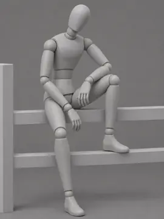 | <a href="https://promicat.app/poses/styles/sp131?utm_source=github&utm_medium=readme&utm_campaign=ai-photo-poses">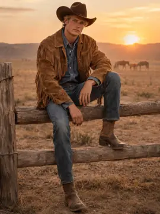</a> | <a href="https://promicat.app/poses/styles/sp131?utm_source=github&utm_medium=readme&utm_campaign=ai-photo-poses">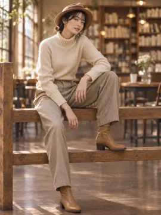</a> | <a href="https://promicat.app/poses/styles/sp131?utm_source=github&utm_medium=readme&utm_campaign=ai-photo-poses">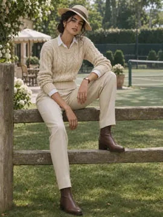</a> | <a href="https://promicat.app/poses/styles/sp131?utm_source=github&utm_medium=readme&utm_campaign=ai-photo-poses">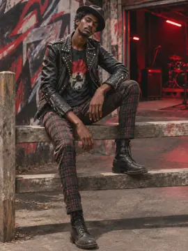</a> |

Full size: [photo](../images/photo-poses/western/sp131-photo.webp) · [white model](../images/photo-poses/western/sp131-pose.webp) · [try it on Promicat](https://promicat.app/poses/styles/sp131?utm_source=github&utm_medium=readme&utm_campaign=ai-photo-poses)

<details><summary>Prompt with your photo (image 1: your photo, image 2: white model)</summary>

```text
A real professional portrait photoshoot photo: a western cowboy photoshoot on a desert ranch with a wooden fence and horses far away, golden dusty sunset, 85mm. Subject: the person in image 1 (keep their exact face, facial features, skin tone and hairstyle; do not beautify or swap the face), wearing a cowboy hat, denim shirt, suede fringe jacket, jeans and boots. Pose: sitting on the top rail of a wooden fence, one boot hooked on a lower rail, hat tilted. Image 2 is a wooden artist's mannequin that shows only this body pose: copy it exactly (head, torso, arms, hands, legs, feet, which hand does what, the camera angle), but do not copy the mannequin itself: no wooden skin, no joints, no blank face. Natural, relaxed and unstiff, true skin texture. No text, no logo, no watermark. Portrait 3:4.
```

</details>

<details><summary>Prompt for the sample (fictional model)</summary>

```text
A real professional portrait photoshoot photo, the kind posted by a top portrait studio: a western cowboy photoshoot on a desert ranch with a wooden fence and horses far away, golden dusty sunset, 85mm. Model: a handsome Scandinavian professional male model in his twenties with a well-groomed look and styled hair, wearing a cowboy hat, denim shirt, suede fringe jacket, jeans and boots. The photographer directs the model into a natural, relaxed, unstiff pose that looks caught between moments: sitting on the top rail of a wooden fence, one boot hooked on a lower rail, hat tilted. Asymmetric body, soft hands, flattering angle, true skin texture, refined but not plastic, fully clothed and modest. Full body or three-quarter body in frame, the whole pose clearly readable. No text, no logo, no watermark. Portrait 3:4.
```

</details>

## Pulling the hat brim down with one hand (Upper body)

| White model | Western cowboy | Campus youth | Cyberpunk neon | 1950s Hollywood |
|---|---|---|---|---|
|  | <a href="https://promicat.app/poses/styles/sp132?utm_source=github&utm_medium=readme&utm_campaign=ai-photo-poses">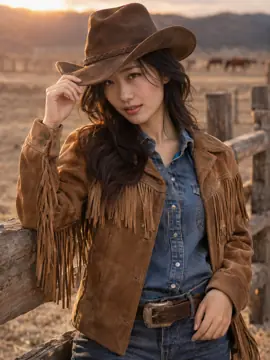</a> | <a href="https://promicat.app/poses/styles/sp132?utm_source=github&utm_medium=readme&utm_campaign=ai-photo-poses">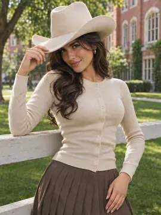</a> | <a href="https://promicat.app/poses/styles/sp132?utm_source=github&utm_medium=readme&utm_campaign=ai-photo-poses">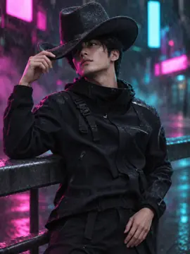</a> | <a href="https://promicat.app/poses/styles/sp132?utm_source=github&utm_medium=readme&utm_campaign=ai-photo-poses">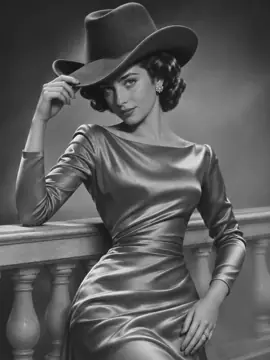</a> |

Full size: [photo](../images/photo-poses/western/sp132-photo.webp) · [white model](../images/photo-poses/western/sp132-pose.webp) · [try it on Promicat](https://promicat.app/poses/styles/sp132?utm_source=github&utm_medium=readme&utm_campaign=ai-photo-poses)

<details><summary>Prompt with your photo (image 1: your photo, image 2: white model)</summary>

```text
A real professional portrait photoshoot photo: a western cowboy photoshoot on a desert ranch with a wooden fence and horses far away, golden dusty sunset, 85mm. Subject: the person in image 1 (keep their exact face, facial features, skin tone and hairstyle; do not beautify or swap the face), wearing a cowboy hat, denim shirt, suede fringe jacket, jeans and boots. Pose: pulling the hat brim down with one hand, eyes up under it. Image 2 is a wooden artist's mannequin that shows only this body pose: copy it exactly (head, torso, arms, hands, legs, feet, which hand does what, the camera angle), but do not copy the mannequin itself: no wooden skin, no joints, no blank face. Natural, relaxed and unstiff, true skin texture. No text, no logo, no watermark. Portrait 3:4.
```

</details>

<details><summary>Prompt for the sample (fictional model)</summary>

```text
A real professional portrait photoshoot photo, the kind posted by a top portrait studio: a western cowboy photoshoot on a desert ranch with a wooden fence and horses far away, golden dusty sunset, 85mm. Model: a beautiful East Asian professional fashion model in her twenties with a naturally attractive face, styled hair and natural makeup, wearing a cowboy hat, denim shirt, suede fringe jacket, jeans and boots. The photographer directs the model into a natural, relaxed, unstiff pose that looks caught between moments: pulling the hat brim down with one hand, eyes up under it. Asymmetric body, soft hands, flattering angle, true skin texture, refined but not plastic, fully clothed and modest. Waist-up framing, both arms and hands readable. No text, no logo, no watermark. Portrait 3:4.
```

</details>

## Leaning against a red barn wall (Leaning)

| White model | Western cowboy | Old money | Street fashion | Y2K flash |
|---|---|---|---|---|
|  | <a href="https://promicat.app/poses/styles/sp133?utm_source=github&utm_medium=readme&utm_campaign=ai-photo-poses"></a> | <a href="https://promicat.app/poses/styles/sp133?utm_source=github&utm_medium=readme&utm_campaign=ai-photo-poses">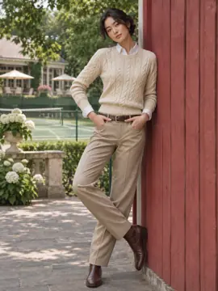</a> | <a href="https://promicat.app/poses/styles/sp133?utm_source=github&utm_medium=readme&utm_campaign=ai-photo-poses">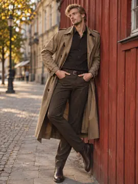</a> | <a href="https://promicat.app/poses/styles/sp133?utm_source=github&utm_medium=readme&utm_campaign=ai-photo-poses">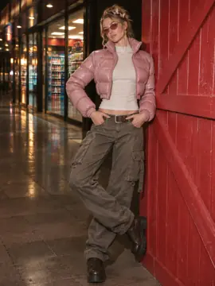</a> |

Full size: [photo](../images/photo-poses/western/sp133-photo.webp) · [white model](../images/photo-poses/western/sp133-pose.webp) · [try it on Promicat](https://promicat.app/poses/styles/sp133?utm_source=github&utm_medium=readme&utm_campaign=ai-photo-poses)

<details><summary>Prompt with your photo (image 1: your photo, image 2: white model)</summary>

```text
A real professional portrait photoshoot photo: a western cowboy photoshoot on a desert ranch with a wooden fence and horses far away, golden dusty sunset, 85mm. Subject: the person in image 1 (keep their exact face, facial features, skin tone and hairstyle; do not beautify or swap the face), wearing a cowboy hat, denim shirt, suede fringe jacket, jeans and boots. Pose: leaning against a red barn wall, thumbs in the belt, one boot crossed. Image 2 is a wooden artist's mannequin that shows only this body pose: copy it exactly (head, torso, arms, hands, legs, feet, which hand does what, the camera angle), but do not copy the mannequin itself: no wooden skin, no joints, no blank face. Natural, relaxed and unstiff, true skin texture. No text, no logo, no watermark. Portrait 3:4.
```

</details>

<details><summary>Prompt for the sample (fictional model)</summary>

```text
A real professional portrait photoshoot photo, the kind posted by a top portrait studio: a western cowboy photoshoot on a desert ranch with a wooden fence and horses far away, golden dusty sunset, 85mm. Model: a beautiful mixed-race professional fashion model in her twenties with a naturally attractive face, styled hair and natural makeup, wearing a cowboy hat, denim shirt, suede fringe jacket, jeans and boots. The photographer directs the model into a natural, relaxed, unstiff pose that looks caught between moments: leaning against a red barn wall, thumbs in the belt, one boot crossed. Asymmetric body, soft hands, flattering angle, true skin texture, refined but not plastic, fully clothed and modest. Full body or three-quarter body in frame, the whole pose clearly readable. No text, no logo, no watermark. Portrait 3:4.
```

</details>

## Walking toward the camera in the golden dust (Walking)

| White model | Western cowboy | Boho desert | Moody studio | Y2K flash |
|---|---|---|---|---|
|  | <a href="https://promicat.app/poses/styles/sp134?utm_source=github&utm_medium=readme&utm_campaign=ai-photo-poses">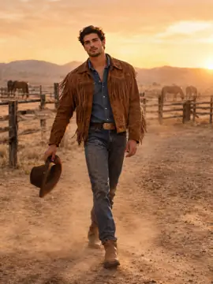</a> | <a href="https://promicat.app/poses/styles/sp134?utm_source=github&utm_medium=readme&utm_campaign=ai-photo-poses">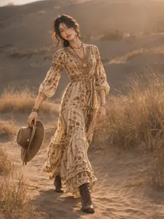</a> | <a href="https://promicat.app/poses/styles/sp134?utm_source=github&utm_medium=readme&utm_campaign=ai-photo-poses">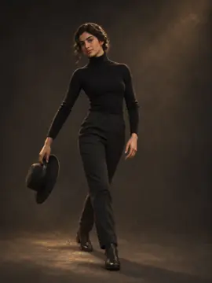</a> | <a href="https://promicat.app/poses/styles/sp134?utm_source=github&utm_medium=readme&utm_campaign=ai-photo-poses">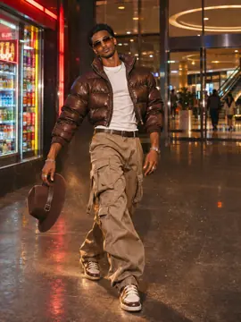</a> |

Full size: [photo](../images/photo-poses/western/sp134-photo.webp) · [white model](../images/photo-poses/western/sp134-pose.webp) · [try it on Promicat](https://promicat.app/poses/styles/sp134?utm_source=github&utm_medium=readme&utm_campaign=ai-photo-poses)

<details><summary>Prompt with your photo (image 1: your photo, image 2: white model)</summary>

```text
A real professional portrait photoshoot photo: a western cowboy photoshoot on a desert ranch with a wooden fence and horses far away, golden dusty sunset, 85mm. Subject: the person in image 1 (keep their exact face, facial features, skin tone and hairstyle; do not beautify or swap the face), wearing a cowboy hat, denim shirt, suede fringe jacket, jeans and boots. Pose: walking toward the camera in the golden dust, swinging the hat in one hand. Image 2 is a wooden artist's mannequin that shows only this body pose: copy it exactly (head, torso, arms, hands, legs, feet, which hand does what, the camera angle), but do not copy the mannequin itself: no wooden skin, no joints, no blank face. Natural, relaxed and unstiff, true skin texture. No text, no logo, no watermark. Portrait 3:4.
```

</details>

<details><summary>Prompt for the sample (fictional model)</summary>

```text
A real professional portrait photoshoot photo, the kind posted by a top portrait studio: a western cowboy photoshoot on a desert ranch with a wooden fence and horses far away, golden dusty sunset, 85mm. Model: a handsome Mediterranean professional male model in his twenties with a well-groomed look and styled hair, wearing a cowboy hat, denim shirt, suede fringe jacket, jeans and boots. The photographer directs the model into a natural, relaxed, unstiff pose that looks caught between moments: walking toward the camera in the golden dust, swinging the hat in one hand. Asymmetric body, soft hands, flattering angle, true skin texture, refined but not plastic, fully clothed and modest. Full body or three-quarter body in frame, the whole pose clearly readable. No text, no logo, no watermark. Portrait 3:4.
```

</details>

## Crouching on one heel (Crouching)

| White model | Western cowboy | Cyberpunk neon | Gothic | HK retro neon |
|---|---|---|---|---|
|  | <a href="https://promicat.app/poses/styles/sp135?utm_source=github&utm_medium=readme&utm_campaign=ai-photo-poses"></a> | <a href="https://promicat.app/poses/styles/sp135?utm_source=github&utm_medium=readme&utm_campaign=ai-photo-poses">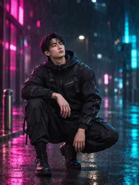</a> | <a href="https://promicat.app/poses/styles/sp135?utm_source=github&utm_medium=readme&utm_campaign=ai-photo-poses">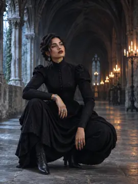</a> | <a href="https://promicat.app/poses/styles/sp135?utm_source=github&utm_medium=readme&utm_campaign=ai-photo-poses">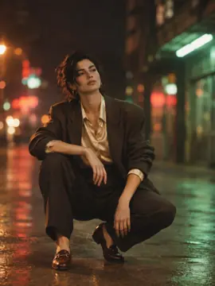</a> |

Full size: [photo](../images/photo-poses/western/sp135-photo.webp) · [white model](../images/photo-poses/western/sp135-pose.webp) · [try it on Promicat](https://promicat.app/poses/styles/sp135?utm_source=github&utm_medium=readme&utm_campaign=ai-photo-poses)

<details><summary>Prompt with your photo (image 1: your photo, image 2: white model)</summary>

```text
A real professional portrait photoshoot photo: a western cowboy photoshoot on a desert ranch with a wooden fence and horses far away, golden dusty sunset, 85mm. Subject: the person in image 1 (keep their exact face, facial features, skin tone and hairstyle; do not beautify or swap the face), wearing a cowboy hat, denim shirt, suede fringe jacket, jeans and boots. Pose: crouching on one heel, forearm on the knee, squinting at the horizon. Image 2 is a wooden artist's mannequin that shows only this body pose: copy it exactly (head, torso, arms, hands, legs, feet, which hand does what, the camera angle), but do not copy the mannequin itself: no wooden skin, no joints, no blank face. Natural, relaxed and unstiff, true skin texture. No text, no logo, no watermark. Portrait 3:4.
```

</details>

<details><summary>Prompt for the sample (fictional model)</summary>

```text
A real professional portrait photoshoot photo, the kind posted by a top portrait studio: a western cowboy photoshoot on a desert ranch with a wooden fence and horses far away, golden dusty sunset, 85mm. Model: a beautiful Southeast Asian professional fashion model in her twenties with a naturally attractive face, styled hair and natural makeup, wearing a cowboy hat, denim shirt, suede fringe jacket, jeans and boots. The photographer directs the model into a natural, relaxed, unstiff pose that looks caught between moments: crouching on one heel, forearm on the knee, squinting at the horizon. Asymmetric body, soft hands, flattering angle, true skin texture, refined but not plastic, fully clothed and modest. Full body or three-quarter body in frame, the whole pose clearly readable. No text, no logo, no watermark. Portrait 3:4.
```

</details>

## Swinging a lasso overhead (In motion)

| White model | Western cowboy | Cafe & bookshop | Campus youth | Forest & flower field |
|---|---|---|---|---|
|  | <a href="https://promicat.app/poses/styles/sp136?utm_source=github&utm_medium=readme&utm_campaign=ai-photo-poses"></a> | <a href="https://promicat.app/poses/styles/sp136?utm_source=github&utm_medium=readme&utm_campaign=ai-photo-poses">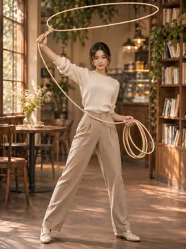</a> | <a href="https://promicat.app/poses/styles/sp136?utm_source=github&utm_medium=readme&utm_campaign=ai-photo-poses">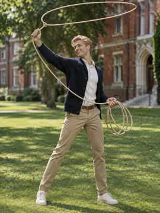</a> | <a href="https://promicat.app/poses/styles/sp136?utm_source=github&utm_medium=readme&utm_campaign=ai-photo-poses">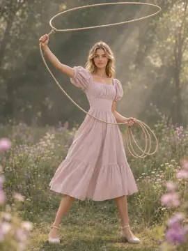</a> |

Full size: [photo](../images/photo-poses/western/sp136-photo.webp) · [white model](../images/photo-poses/western/sp136-pose.webp) · [try it on Promicat](https://promicat.app/poses/styles/sp136?utm_source=github&utm_medium=readme&utm_campaign=ai-photo-poses)

<details><summary>Prompt with your photo (image 1: your photo, image 2: white model)</summary>

```text
A real professional portrait photoshoot photo: a western cowboy photoshoot on a desert ranch with a wooden fence and horses far away, golden dusty sunset, 85mm. Subject: the person in image 1 (keep their exact face, facial features, skin tone and hairstyle; do not beautify or swap the face), wearing a cowboy hat, denim shirt, suede fringe jacket, jeans and boots. Pose: swinging a lasso overhead, body turned. Image 2 is a wooden artist's mannequin that shows only this body pose: copy it exactly (head, torso, arms, hands, legs, feet, which hand does what, the camera angle), but do not copy the mannequin itself: no wooden skin, no joints, no blank face. Natural, relaxed and unstiff, true skin texture. No text, no logo, no watermark. Portrait 3:4.
```

</details>

<details><summary>Prompt for the sample (fictional model)</summary>

```text
A real professional portrait photoshoot photo, the kind posted by a top portrait studio: a western cowboy photoshoot on a desert ranch with a wooden fence and horses far away, golden dusty sunset, 85mm. Model: a beautiful Japanese professional fashion model in her twenties with a naturally attractive face, styled hair and natural makeup, wearing a cowboy hat, denim shirt, suede fringe jacket, jeans and boots. The photographer directs the model into a natural, relaxed, unstiff pose that looks caught between moments: swinging a lasso overhead, body turned. Asymmetric body, soft hands, flattering angle, true skin texture, refined but not plastic, fully clothed and modest. Full body or three-quarter body in frame, the whole pose clearly readable. No text, no logo, no watermark. Portrait 3:4.
```

</details>

## Sitting on the open tailgate of an old pickup (Sitting)

| White model | Western cowboy | Cosy at home | Nordic minimal | Street fashion |
|---|---|---|---|---|
|  | <a href="https://promicat.app/poses/styles/sp137?utm_source=github&utm_medium=readme&utm_campaign=ai-photo-poses">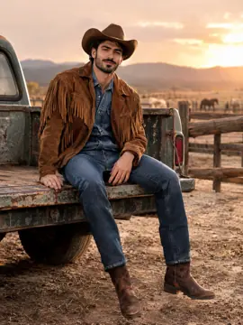</a> | <a href="https://promicat.app/poses/styles/sp137?utm_source=github&utm_medium=readme&utm_campaign=ai-photo-poses">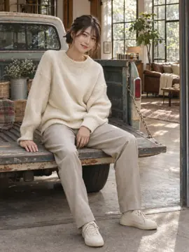</a> | <a href="https://promicat.app/poses/styles/sp137?utm_source=github&utm_medium=readme&utm_campaign=ai-photo-poses">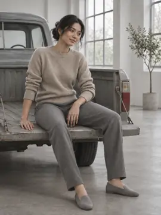</a> | <a href="https://promicat.app/poses/styles/sp137?utm_source=github&utm_medium=readme&utm_campaign=ai-photo-poses">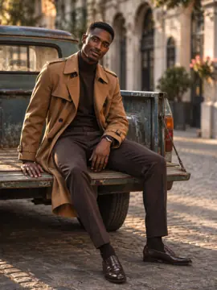</a> |

Full size: [photo](../images/photo-poses/western/sp137-photo.webp) · [white model](../images/photo-poses/western/sp137-pose.webp) · [try it on Promicat](https://promicat.app/poses/styles/sp137?utm_source=github&utm_medium=readme&utm_campaign=ai-photo-poses)

<details><summary>Prompt with your photo (image 1: your photo, image 2: white model)</summary>

```text
A real professional portrait photoshoot photo: a western cowboy photoshoot on a desert ranch with a wooden fence and horses far away, golden dusty sunset, 85mm. Subject: the person in image 1 (keep their exact face, facial features, skin tone and hairstyle; do not beautify or swap the face), wearing a cowboy hat, denim shirt, suede fringe jacket, jeans and boots. Pose: sitting on the open tailgate of an old pickup, legs dangling. Image 2 is a wooden artist's mannequin that shows only this body pose: copy it exactly (head, torso, arms, hands, legs, feet, which hand does what, the camera angle), but do not copy the mannequin itself: no wooden skin, no joints, no blank face. Natural, relaxed and unstiff, true skin texture. No text, no logo, no watermark. Portrait 3:4.
```

</details>

<details><summary>Prompt for the sample (fictional model)</summary>

```text
A real professional portrait photoshoot photo, the kind posted by a top portrait studio: a western cowboy photoshoot on a desert ranch with a wooden fence and horses far away, golden dusty sunset, 85mm. Model: a handsome Middle Eastern professional male model in his twenties with a well-groomed look and styled hair, wearing a cowboy hat, denim shirt, suede fringe jacket, jeans and boots. The photographer directs the model into a natural, relaxed, unstiff pose that looks caught between moments: sitting on the open tailgate of an old pickup, legs dangling. Asymmetric body, soft hands, flattering angle, true skin texture, refined but not plastic, fully clothed and modest. Full body or three-quarter body in frame, the whole pose clearly readable. No text, no logo, no watermark. Portrait 3:4.
```

</details>

## Walking away toward the horses (Looking back)

| White model | Western cowboy | Dark academia | 1950s Hollywood | Old money |
|---|---|---|---|---|
|  | <a href="https://promicat.app/poses/styles/sp138?utm_source=github&utm_medium=readme&utm_campaign=ai-photo-poses"></a> | <a href="https://promicat.app/poses/styles/sp138?utm_source=github&utm_medium=readme&utm_campaign=ai-photo-poses">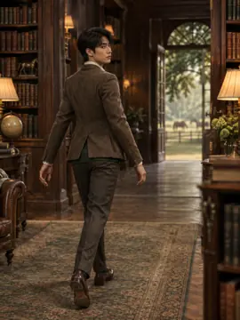</a> | <a href="https://promicat.app/poses/styles/sp138?utm_source=github&utm_medium=readme&utm_campaign=ai-photo-poses">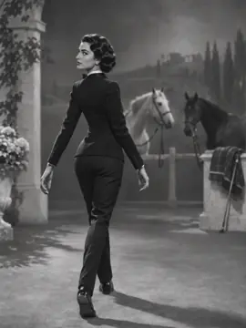</a> | <a href="https://promicat.app/poses/styles/sp138?utm_source=github&utm_medium=readme&utm_campaign=ai-photo-poses">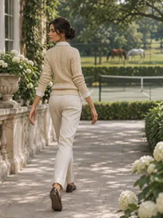</a> |

Full size: [photo](../images/photo-poses/western/sp138-photo.webp) · [white model](../images/photo-poses/western/sp138-pose.webp) · [try it on Promicat](https://promicat.app/poses/styles/sp138?utm_source=github&utm_medium=readme&utm_campaign=ai-photo-poses)

<details><summary>Prompt with your photo (image 1: your photo, image 2: white model)</summary>

```text
A real professional portrait photoshoot photo: a western cowboy photoshoot on a desert ranch with a wooden fence and horses far away, golden dusty sunset, 85mm. Subject: the person in image 1 (keep their exact face, facial features, skin tone and hairstyle; do not beautify or swap the face), wearing a cowboy hat, denim shirt, suede fringe jacket, jeans and boots. Pose: walking away toward the horses, looking back over the shoulder. Image 2 is a wooden artist's mannequin that shows only this body pose: copy it exactly (head, torso, arms, hands, legs, feet, which hand does what, the camera angle), but do not copy the mannequin itself: no wooden skin, no joints, no blank face. Natural, relaxed and unstiff, true skin texture. No text, no logo, no watermark. Portrait 3:4.
```

</details>

<details><summary>Prompt for the sample (fictional model)</summary>

```text
A real professional portrait photoshoot photo, the kind posted by a top portrait studio: a western cowboy photoshoot on a desert ranch with a wooden fence and horses far away, golden dusty sunset, 85mm. Model: a beautiful Indian professional fashion model in her twenties with a naturally attractive face, styled hair and natural makeup, wearing a cowboy hat, denim shirt, suede fringe jacket, jeans and boots. The photographer directs the model into a natural, relaxed, unstiff pose that looks caught between moments: walking away toward the horses, looking back over the shoulder. Asymmetric body, soft hands, flattering angle, true skin texture, refined but not plastic, fully clothed and modest. Full body or three-quarter body in frame, the whole pose clearly readable. No text, no logo, no watermark. Portrait 3:4.
```

</details>

## Standing with one boot up on a hay bale (Standing)

| White model | Western cowboy | Seaside holiday | Japanese fresh film | Street punk |
|---|---|---|---|---|
|  | <a href="https://promicat.app/poses/styles/sp139?utm_source=github&utm_medium=readme&utm_campaign=ai-photo-poses">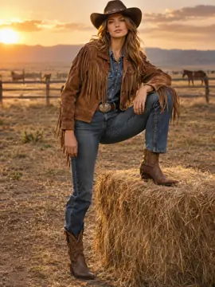</a> | <a href="https://promicat.app/poses/styles/sp139?utm_source=github&utm_medium=readme&utm_campaign=ai-photo-poses">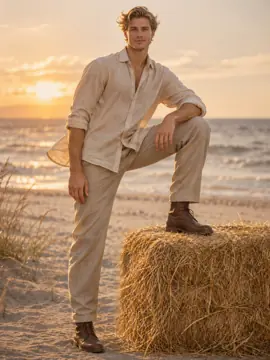</a> | <a href="https://promicat.app/poses/styles/sp139?utm_source=github&utm_medium=readme&utm_campaign=ai-photo-poses">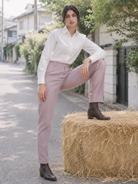</a> | <a href="https://promicat.app/poses/styles/sp139?utm_source=github&utm_medium=readme&utm_campaign=ai-photo-poses">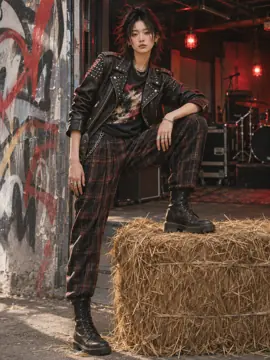</a> |

Full size: [photo](../images/photo-poses/western/sp139-photo.webp) · [white model](../images/photo-poses/western/sp139-pose.webp) · [try it on Promicat](https://promicat.app/poses/styles/sp139?utm_source=github&utm_medium=readme&utm_campaign=ai-photo-poses)

<details><summary>Prompt with your photo (image 1: your photo, image 2: white model)</summary>

```text
A real professional portrait photoshoot photo: a western cowboy photoshoot on a desert ranch with a wooden fence and horses far away, golden dusty sunset, 85mm. Subject: the person in image 1 (keep their exact face, facial features, skin tone and hairstyle; do not beautify or swap the face), wearing a cowboy hat, denim shirt, suede fringe jacket, jeans and boots. Pose: standing with one boot up on a hay bale, forearm on the knee. Image 2 is a wooden artist's mannequin that shows only this body pose: copy it exactly (head, torso, arms, hands, legs, feet, which hand does what, the camera angle), but do not copy the mannequin itself: no wooden skin, no joints, no blank face. Natural, relaxed and unstiff, true skin texture. No text, no logo, no watermark. Portrait 3:4.
```

</details>

<details><summary>Prompt for the sample (fictional model)</summary>

```text
A real professional portrait photoshoot photo, the kind posted by a top portrait studio: a western cowboy photoshoot on a desert ranch with a wooden fence and horses far away, golden dusty sunset, 85mm. Model: a beautiful white European professional fashion model in her twenties with a naturally attractive face, styled hair and natural makeup, wearing a cowboy hat, denim shirt, suede fringe jacket, jeans and boots. The photographer directs the model into a natural, relaxed, unstiff pose that looks caught between moments: standing with one boot up on a hay bale, forearm on the knee. Asymmetric body, soft hands, flattering angle, true skin texture, refined but not plastic, fully clothed and modest. Full body or three-quarter body in frame, the whole pose clearly readable. No text, no logo, no watermark. Portrait 3:4.
```

</details>

## Tilting a canteen to drink (Upper body)

| White model | Western cowboy | Cafe & bookshop | New Chinese style | Forest & flower field |
|---|---|---|---|---|
|  | <a href="https://promicat.app/poses/styles/sp140?utm_source=github&utm_medium=readme&utm_campaign=ai-photo-poses">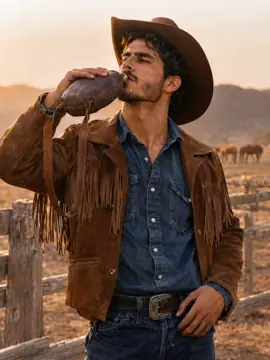</a> | <a href="https://promicat.app/poses/styles/sp140?utm_source=github&utm_medium=readme&utm_campaign=ai-photo-poses">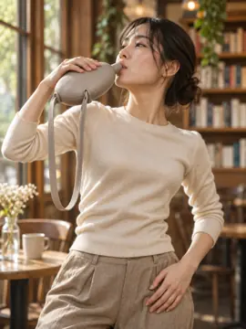</a> | <a href="https://promicat.app/poses/styles/sp140?utm_source=github&utm_medium=readme&utm_campaign=ai-photo-poses">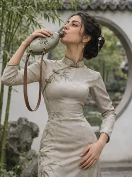</a> | <a href="https://promicat.app/poses/styles/sp140?utm_source=github&utm_medium=readme&utm_campaign=ai-photo-poses">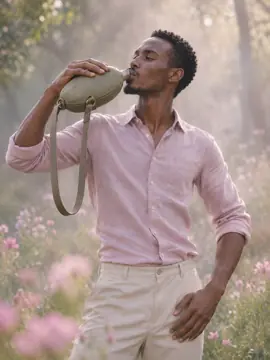</a> |

Full size: [photo](../images/photo-poses/western/sp140-photo.webp) · [white model](../images/photo-poses/western/sp140-pose.webp) · [try it on Promicat](https://promicat.app/poses/styles/sp140?utm_source=github&utm_medium=readme&utm_campaign=ai-photo-poses)

<details><summary>Prompt with your photo (image 1: your photo, image 2: white model)</summary>

```text
A real professional portrait photoshoot photo: a western cowboy photoshoot on a desert ranch with a wooden fence and horses far away, golden dusty sunset, 85mm. Subject: the person in image 1 (keep their exact face, facial features, skin tone and hairstyle; do not beautify or swap the face), wearing a cowboy hat, denim shirt, suede fringe jacket, jeans and boots. Pose: tilting a canteen to drink, sweat on the brow. Image 2 is a wooden artist's mannequin that shows only this body pose: copy it exactly (head, torso, arms, hands, legs, feet, which hand does what, the camera angle), but do not copy the mannequin itself: no wooden skin, no joints, no blank face. Natural, relaxed and unstiff, true skin texture. No text, no logo, no watermark. Portrait 3:4.
```

</details>

<details><summary>Prompt for the sample (fictional model)</summary>

```text
A real professional portrait photoshoot photo, the kind posted by a top portrait studio: a western cowboy photoshoot on a desert ranch with a wooden fence and horses far away, golden dusty sunset, 85mm. Model: a handsome Brazilian professional male model in his twenties with a well-groomed look and styled hair, wearing a cowboy hat, denim shirt, suede fringe jacket, jeans and boots. The photographer directs the model into a natural, relaxed, unstiff pose that looks caught between moments: tilting a canteen to drink, sweat on the brow. Asymmetric body, soft hands, flattering angle, true skin texture, refined but not plastic, fully clothed and modest. Waist-up framing, both arms and hands readable. No text, no logo, no watermark. Portrait 3:4.
```

</details>
