# 西部牛仔

[English](western.md) · 简体中文

10 个白模，每个配 4 张用它拍出的不同风格写真。参考图顺序是你的照片在前、白模在后。也可以在 [Promicat](https://promicat.app/zh/poses?utm_source=github&utm_medium=readme&utm_campaign=ai-photo-poses) 上传照片直接生成。

[← 返回全部风格](../README.zh-CN.md#photo-poses)

## 坐围栏 (坐)

| 白模 | 西部牛仔 | 咖啡馆文艺 | 老钱风 | 街头朋克 |
|---|---|---|---|---|
| 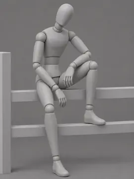 | <a href="https://promicat.app/zh/poses/styles/sp131?utm_source=github&utm_medium=readme&utm_campaign=ai-photo-poses">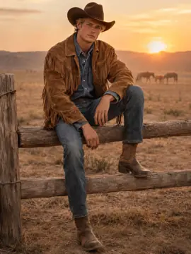</a> | <a href="https://promicat.app/zh/poses/styles/sp131?utm_source=github&utm_medium=readme&utm_campaign=ai-photo-poses">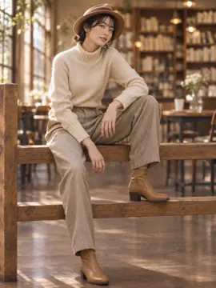</a> | <a href="https://promicat.app/zh/poses/styles/sp131?utm_source=github&utm_medium=readme&utm_campaign=ai-photo-poses">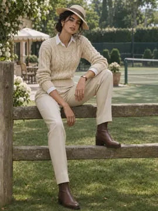</a> | <a href="https://promicat.app/zh/poses/styles/sp131?utm_source=github&utm_medium=readme&utm_campaign=ai-photo-poses">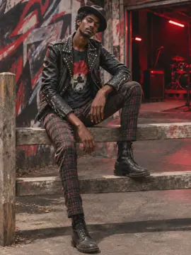</a> |

大图: [写真照](../images/photo-poses/western/sp131-photo.webp) · [白模](../images/photo-poses/western/sp131-pose.webp) · [在 Promicat 生成](https://promicat.app/zh/poses/styles/sp131?utm_source=github&utm_medium=readme&utm_campaign=ai-photo-poses)

<details><summary>提示词：用你的照片（图 1 你的照片，图 2 白模）</summary>

```text
A real professional portrait photoshoot photo: a western cowboy photoshoot on a desert ranch with a wooden fence and horses far away, golden dusty sunset, 85mm. Subject: the person in image 1 (keep their exact face, facial features, skin tone and hairstyle; do not beautify or swap the face), wearing a cowboy hat, denim shirt, suede fringe jacket, jeans and boots. Pose: sitting on the top rail of a wooden fence, one boot hooked on a lower rail, hat tilted. Image 2 is a wooden artist's mannequin that shows only this body pose: copy it exactly (head, torso, arms, hands, legs, feet, which hand does what, the camera angle), but do not copy the mannequin itself: no wooden skin, no joints, no blank face. Natural, relaxed and unstiff, true skin texture. No text, no logo, no watermark. Portrait 3:4.
```

</details>

<details><summary>提示词：生成示例图（虚构模特）</summary>

```text
A real professional portrait photoshoot photo, the kind posted by a top portrait studio: a western cowboy photoshoot on a desert ranch with a wooden fence and horses far away, golden dusty sunset, 85mm. Model: a handsome Scandinavian professional male model in his twenties with a well-groomed look and styled hair, wearing a cowboy hat, denim shirt, suede fringe jacket, jeans and boots. The photographer directs the model into a natural, relaxed, unstiff pose that looks caught between moments: sitting on the top rail of a wooden fence, one boot hooked on a lower rail, hat tilted. Asymmetric body, soft hands, flattering angle, true skin texture, refined but not plastic, fully clothed and modest. Full body or three-quarter body in frame, the whole pose clearly readable. No text, no logo, no watermark. Portrait 3:4.
```

</details>

## 压帽檐 (半身)

| 白模 | 西部牛仔 | 校园青春 | 赛博霓虹 | 好莱坞复古 |
|---|---|---|---|---|
| 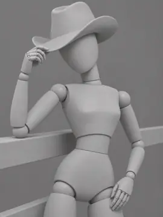 | <a href="https://promicat.app/zh/poses/styles/sp132?utm_source=github&utm_medium=readme&utm_campaign=ai-photo-poses">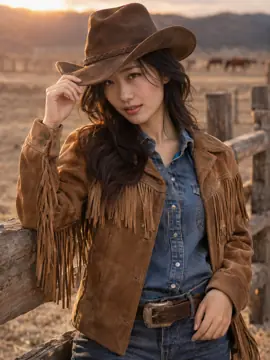</a> | <a href="https://promicat.app/zh/poses/styles/sp132?utm_source=github&utm_medium=readme&utm_campaign=ai-photo-poses">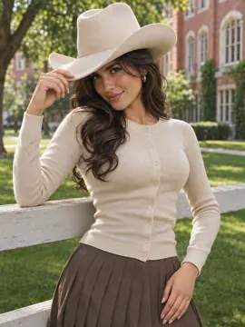</a> | <a href="https://promicat.app/zh/poses/styles/sp132?utm_source=github&utm_medium=readme&utm_campaign=ai-photo-poses">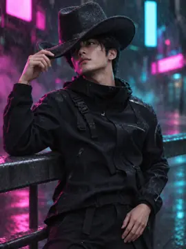</a> | <a href="https://promicat.app/zh/poses/styles/sp132?utm_source=github&utm_medium=readme&utm_campaign=ai-photo-poses">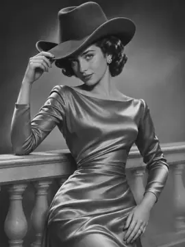</a> |

大图: [写真照](../images/photo-poses/western/sp132-photo.webp) · [白模](../images/photo-poses/western/sp132-pose.webp) · [在 Promicat 生成](https://promicat.app/zh/poses/styles/sp132?utm_source=github&utm_medium=readme&utm_campaign=ai-photo-poses)

<details><summary>提示词：用你的照片（图 1 你的照片，图 2 白模）</summary>

```text
A real professional portrait photoshoot photo: a western cowboy photoshoot on a desert ranch with a wooden fence and horses far away, golden dusty sunset, 85mm. Subject: the person in image 1 (keep their exact face, facial features, skin tone and hairstyle; do not beautify or swap the face), wearing a cowboy hat, denim shirt, suede fringe jacket, jeans and boots. Pose: pulling the hat brim down with one hand, eyes up under it. Image 2 is a wooden artist's mannequin that shows only this body pose: copy it exactly (head, torso, arms, hands, legs, feet, which hand does what, the camera angle), but do not copy the mannequin itself: no wooden skin, no joints, no blank face. Natural, relaxed and unstiff, true skin texture. No text, no logo, no watermark. Portrait 3:4.
```

</details>

<details><summary>提示词：生成示例图（虚构模特）</summary>

```text
A real professional portrait photoshoot photo, the kind posted by a top portrait studio: a western cowboy photoshoot on a desert ranch with a wooden fence and horses far away, golden dusty sunset, 85mm. Model: a beautiful East Asian professional fashion model in her twenties with a naturally attractive face, styled hair and natural makeup, wearing a cowboy hat, denim shirt, suede fringe jacket, jeans and boots. The photographer directs the model into a natural, relaxed, unstiff pose that looks caught between moments: pulling the hat brim down with one hand, eyes up under it. Asymmetric body, soft hands, flattering angle, true skin texture, refined but not plastic, fully clothed and modest. Waist-up framing, both arms and hands readable. No text, no logo, no watermark. Portrait 3:4.
```

</details>

## 靠谷仓 (靠)

| 白模 | 西部牛仔 | 老钱风 | 街拍时尚 | Y2K 千禧辣妹 |
|---|---|---|---|---|
| 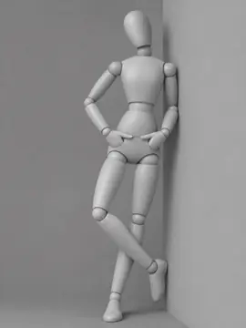 | <a href="https://promicat.app/zh/poses/styles/sp133?utm_source=github&utm_medium=readme&utm_campaign=ai-photo-poses">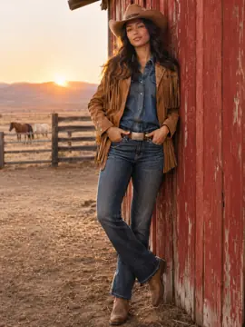</a> | <a href="https://promicat.app/zh/poses/styles/sp133?utm_source=github&utm_medium=readme&utm_campaign=ai-photo-poses">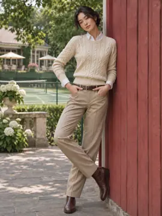</a> | <a href="https://promicat.app/zh/poses/styles/sp133?utm_source=github&utm_medium=readme&utm_campaign=ai-photo-poses">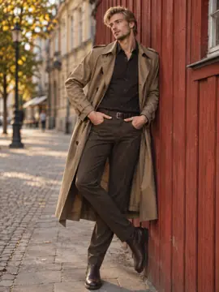</a> | <a href="https://promicat.app/zh/poses/styles/sp133?utm_source=github&utm_medium=readme&utm_campaign=ai-photo-poses">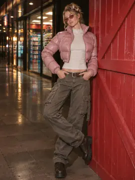</a> |

大图: [写真照](../images/photo-poses/western/sp133-photo.webp) · [白模](../images/photo-poses/western/sp133-pose.webp) · [在 Promicat 生成](https://promicat.app/zh/poses/styles/sp133?utm_source=github&utm_medium=readme&utm_campaign=ai-photo-poses)

<details><summary>提示词：用你的照片（图 1 你的照片，图 2 白模）</summary>

```text
A real professional portrait photoshoot photo: a western cowboy photoshoot on a desert ranch with a wooden fence and horses far away, golden dusty sunset, 85mm. Subject: the person in image 1 (keep their exact face, facial features, skin tone and hairstyle; do not beautify or swap the face), wearing a cowboy hat, denim shirt, suede fringe jacket, jeans and boots. Pose: leaning against a red barn wall, thumbs in the belt, one boot crossed. Image 2 is a wooden artist's mannequin that shows only this body pose: copy it exactly (head, torso, arms, hands, legs, feet, which hand does what, the camera angle), but do not copy the mannequin itself: no wooden skin, no joints, no blank face. Natural, relaxed and unstiff, true skin texture. No text, no logo, no watermark. Portrait 3:4.
```

</details>

<details><summary>提示词：生成示例图（虚构模特）</summary>

```text
A real professional portrait photoshoot photo, the kind posted by a top portrait studio: a western cowboy photoshoot on a desert ranch with a wooden fence and horses far away, golden dusty sunset, 85mm. Model: a beautiful mixed-race professional fashion model in her twenties with a naturally attractive face, styled hair and natural makeup, wearing a cowboy hat, denim shirt, suede fringe jacket, jeans and boots. The photographer directs the model into a natural, relaxed, unstiff pose that looks caught between moments: leaning against a red barn wall, thumbs in the belt, one boot crossed. Asymmetric body, soft hands, flattering angle, true skin texture, refined but not plastic, fully clothed and modest. Full body or three-quarter body in frame, the whole pose clearly readable. No text, no logo, no watermark. Portrait 3:4.
```

</details>

## 夕阳走来 (走)

| 白模 | 西部牛仔 | 波西米亚 | 情绪棚拍 | Y2K 千禧辣妹 |
|---|---|---|---|---|
| 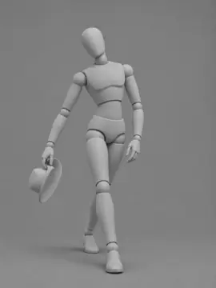 | <a href="https://promicat.app/zh/poses/styles/sp134?utm_source=github&utm_medium=readme&utm_campaign=ai-photo-poses">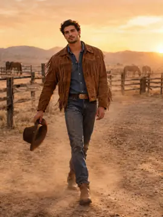</a> | <a href="https://promicat.app/zh/poses/styles/sp134?utm_source=github&utm_medium=readme&utm_campaign=ai-photo-poses">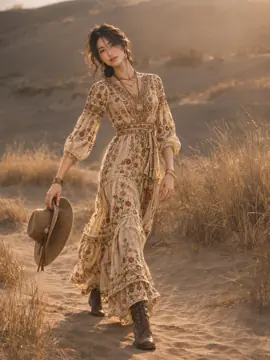</a> | <a href="https://promicat.app/zh/poses/styles/sp134?utm_source=github&utm_medium=readme&utm_campaign=ai-photo-poses">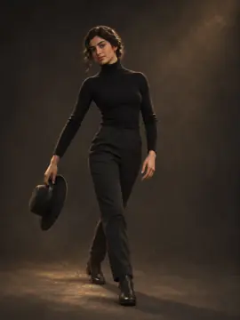</a> | <a href="https://promicat.app/zh/poses/styles/sp134?utm_source=github&utm_medium=readme&utm_campaign=ai-photo-poses">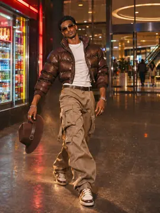</a> |

大图: [写真照](../images/photo-poses/western/sp134-photo.webp) · [白模](../images/photo-poses/western/sp134-pose.webp) · [在 Promicat 生成](https://promicat.app/zh/poses/styles/sp134?utm_source=github&utm_medium=readme&utm_campaign=ai-photo-poses)

<details><summary>提示词：用你的照片（图 1 你的照片，图 2 白模）</summary>

```text
A real professional portrait photoshoot photo: a western cowboy photoshoot on a desert ranch with a wooden fence and horses far away, golden dusty sunset, 85mm. Subject: the person in image 1 (keep their exact face, facial features, skin tone and hairstyle; do not beautify or swap the face), wearing a cowboy hat, denim shirt, suede fringe jacket, jeans and boots. Pose: walking toward the camera in the golden dust, swinging the hat in one hand. Image 2 is a wooden artist's mannequin that shows only this body pose: copy it exactly (head, torso, arms, hands, legs, feet, which hand does what, the camera angle), but do not copy the mannequin itself: no wooden skin, no joints, no blank face. Natural, relaxed and unstiff, true skin texture. No text, no logo, no watermark. Portrait 3:4.
```

</details>

<details><summary>提示词：生成示例图（虚构模特）</summary>

```text
A real professional portrait photoshoot photo, the kind posted by a top portrait studio: a western cowboy photoshoot on a desert ranch with a wooden fence and horses far away, golden dusty sunset, 85mm. Model: a handsome Mediterranean professional male model in his twenties with a well-groomed look and styled hair, wearing a cowboy hat, denim shirt, suede fringe jacket, jeans and boots. The photographer directs the model into a natural, relaxed, unstiff pose that looks caught between moments: walking toward the camera in the golden dust, swinging the hat in one hand. Asymmetric body, soft hands, flattering angle, true skin texture, refined but not plastic, fully clothed and modest. Full body or three-quarter body in frame, the whole pose clearly readable. No text, no logo, no watermark. Portrait 3:4.
```

</details>

## 蹲地看远 (蹲跪)

| 白模 | 西部牛仔 | 赛博霓虹 | 暗黑哥特 | 港风复古 |
|---|---|---|---|---|
| 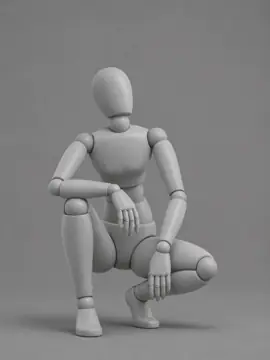 | <a href="https://promicat.app/zh/poses/styles/sp135?utm_source=github&utm_medium=readme&utm_campaign=ai-photo-poses">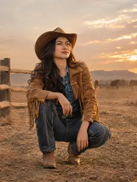</a> | <a href="https://promicat.app/zh/poses/styles/sp135?utm_source=github&utm_medium=readme&utm_campaign=ai-photo-poses">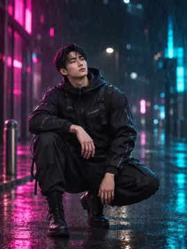</a> | <a href="https://promicat.app/zh/poses/styles/sp135?utm_source=github&utm_medium=readme&utm_campaign=ai-photo-poses">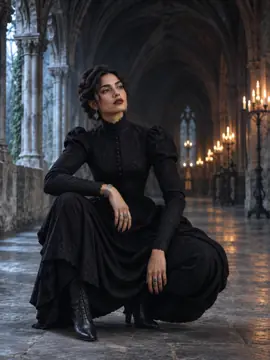</a> | <a href="https://promicat.app/zh/poses/styles/sp135?utm_source=github&utm_medium=readme&utm_campaign=ai-photo-poses">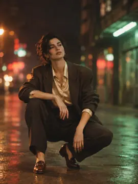</a> |

大图: [写真照](../images/photo-poses/western/sp135-photo.webp) · [白模](../images/photo-poses/western/sp135-pose.webp) · [在 Promicat 生成](https://promicat.app/zh/poses/styles/sp135?utm_source=github&utm_medium=readme&utm_campaign=ai-photo-poses)

<details><summary>提示词：用你的照片（图 1 你的照片，图 2 白模）</summary>

```text
A real professional portrait photoshoot photo: a western cowboy photoshoot on a desert ranch with a wooden fence and horses far away, golden dusty sunset, 85mm. Subject: the person in image 1 (keep their exact face, facial features, skin tone and hairstyle; do not beautify or swap the face), wearing a cowboy hat, denim shirt, suede fringe jacket, jeans and boots. Pose: crouching on one heel, forearm on the knee, squinting at the horizon. Image 2 is a wooden artist's mannequin that shows only this body pose: copy it exactly (head, torso, arms, hands, legs, feet, which hand does what, the camera angle), but do not copy the mannequin itself: no wooden skin, no joints, no blank face. Natural, relaxed and unstiff, true skin texture. No text, no logo, no watermark. Portrait 3:4.
```

</details>

<details><summary>提示词：生成示例图（虚构模特）</summary>

```text
A real professional portrait photoshoot photo, the kind posted by a top portrait studio: a western cowboy photoshoot on a desert ranch with a wooden fence and horses far away, golden dusty sunset, 85mm. Model: a beautiful Southeast Asian professional fashion model in her twenties with a naturally attractive face, styled hair and natural makeup, wearing a cowboy hat, denim shirt, suede fringe jacket, jeans and boots. The photographer directs the model into a natural, relaxed, unstiff pose that looks caught between moments: crouching on one heel, forearm on the knee, squinting at the horizon. Asymmetric body, soft hands, flattering angle, true skin texture, refined but not plastic, fully clothed and modest. Full body or three-quarter body in frame, the whole pose clearly readable. No text, no logo, no watermark. Portrait 3:4.
```

</details>

## 甩绳套 (动态)

| 白模 | 西部牛仔 | 咖啡馆文艺 | 校园青春 | 森系花田 |
|---|---|---|---|---|
| 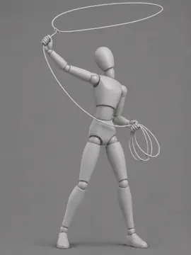 | <a href="https://promicat.app/zh/poses/styles/sp136?utm_source=github&utm_medium=readme&utm_campaign=ai-photo-poses">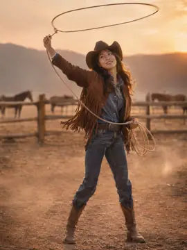</a> | <a href="https://promicat.app/zh/poses/styles/sp136?utm_source=github&utm_medium=readme&utm_campaign=ai-photo-poses">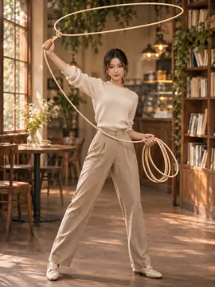</a> | <a href="https://promicat.app/zh/poses/styles/sp136?utm_source=github&utm_medium=readme&utm_campaign=ai-photo-poses">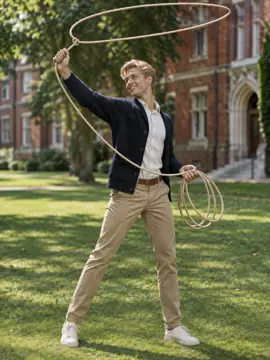</a> | <a href="https://promicat.app/zh/poses/styles/sp136?utm_source=github&utm_medium=readme&utm_campaign=ai-photo-poses">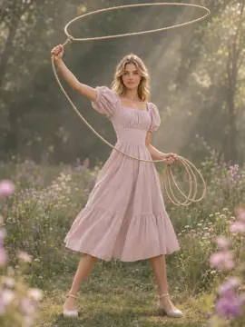</a> |

大图: [写真照](../images/photo-poses/western/sp136-photo.webp) · [白模](../images/photo-poses/western/sp136-pose.webp) · [在 Promicat 生成](https://promicat.app/zh/poses/styles/sp136?utm_source=github&utm_medium=readme&utm_campaign=ai-photo-poses)

<details><summary>提示词：用你的照片（图 1 你的照片，图 2 白模）</summary>

```text
A real professional portrait photoshoot photo: a western cowboy photoshoot on a desert ranch with a wooden fence and horses far away, golden dusty sunset, 85mm. Subject: the person in image 1 (keep their exact face, facial features, skin tone and hairstyle; do not beautify or swap the face), wearing a cowboy hat, denim shirt, suede fringe jacket, jeans and boots. Pose: swinging a lasso overhead, body turned. Image 2 is a wooden artist's mannequin that shows only this body pose: copy it exactly (head, torso, arms, hands, legs, feet, which hand does what, the camera angle), but do not copy the mannequin itself: no wooden skin, no joints, no blank face. Natural, relaxed and unstiff, true skin texture. No text, no logo, no watermark. Portrait 3:4.
```

</details>

<details><summary>提示词：生成示例图（虚构模特）</summary>

```text
A real professional portrait photoshoot photo, the kind posted by a top portrait studio: a western cowboy photoshoot on a desert ranch with a wooden fence and horses far away, golden dusty sunset, 85mm. Model: a beautiful Japanese professional fashion model in her twenties with a naturally attractive face, styled hair and natural makeup, wearing a cowboy hat, denim shirt, suede fringe jacket, jeans and boots. The photographer directs the model into a natural, relaxed, unstiff pose that looks caught between moments: swinging a lasso overhead, body turned. Asymmetric body, soft hands, flattering angle, true skin texture, refined but not plastic, fully clothed and modest. Full body or three-quarter body in frame, the whole pose clearly readable. No text, no logo, no watermark. Portrait 3:4.
```

</details>

## 坐车斗 (坐)

| 白模 | 西部牛仔 | 居家慵懒 | 北欧极简 | 街拍时尚 |
|---|---|---|---|---|
| 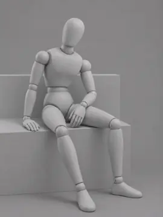 | <a href="https://promicat.app/zh/poses/styles/sp137?utm_source=github&utm_medium=readme&utm_campaign=ai-photo-poses">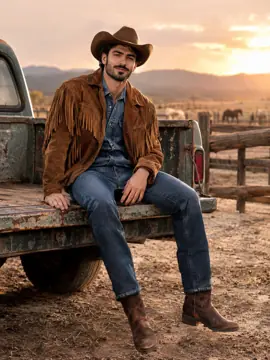</a> | <a href="https://promicat.app/zh/poses/styles/sp137?utm_source=github&utm_medium=readme&utm_campaign=ai-photo-poses">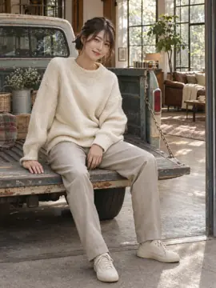</a> | <a href="https://promicat.app/zh/poses/styles/sp137?utm_source=github&utm_medium=readme&utm_campaign=ai-photo-poses">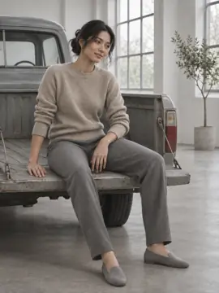</a> | <a href="https://promicat.app/zh/poses/styles/sp137?utm_source=github&utm_medium=readme&utm_campaign=ai-photo-poses">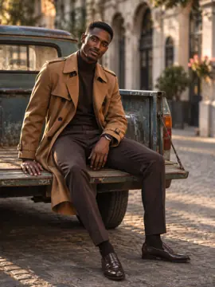</a> |

大图: [写真照](../images/photo-poses/western/sp137-photo.webp) · [白模](../images/photo-poses/western/sp137-pose.webp) · [在 Promicat 生成](https://promicat.app/zh/poses/styles/sp137?utm_source=github&utm_medium=readme&utm_campaign=ai-photo-poses)

<details><summary>提示词：用你的照片（图 1 你的照片，图 2 白模）</summary>

```text
A real professional portrait photoshoot photo: a western cowboy photoshoot on a desert ranch with a wooden fence and horses far away, golden dusty sunset, 85mm. Subject: the person in image 1 (keep their exact face, facial features, skin tone and hairstyle; do not beautify or swap the face), wearing a cowboy hat, denim shirt, suede fringe jacket, jeans and boots. Pose: sitting on the open tailgate of an old pickup, legs dangling. Image 2 is a wooden artist's mannequin that shows only this body pose: copy it exactly (head, torso, arms, hands, legs, feet, which hand does what, the camera angle), but do not copy the mannequin itself: no wooden skin, no joints, no blank face. Natural, relaxed and unstiff, true skin texture. No text, no logo, no watermark. Portrait 3:4.
```

</details>

<details><summary>提示词：生成示例图（虚构模特）</summary>

```text
A real professional portrait photoshoot photo, the kind posted by a top portrait studio: a western cowboy photoshoot on a desert ranch with a wooden fence and horses far away, golden dusty sunset, 85mm. Model: a handsome Middle Eastern professional male model in his twenties with a well-groomed look and styled hair, wearing a cowboy hat, denim shirt, suede fringe jacket, jeans and boots. The photographer directs the model into a natural, relaxed, unstiff pose that looks caught between moments: sitting on the open tailgate of an old pickup, legs dangling. Asymmetric body, soft hands, flattering angle, true skin texture, refined but not plastic, fully clothed and modest. Full body or three-quarter body in frame, the whole pose clearly readable. No text, no logo, no watermark. Portrait 3:4.
```

</details>

## 回头看马 (回眸)

| 白模 | 西部牛仔 | 学院风 | 好莱坞复古 | 老钱风 |
|---|---|---|---|---|
| 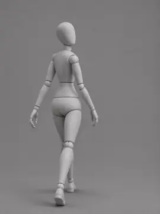 | <a href="https://promicat.app/zh/poses/styles/sp138?utm_source=github&utm_medium=readme&utm_campaign=ai-photo-poses">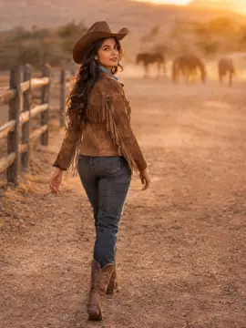</a> | <a href="https://promicat.app/zh/poses/styles/sp138?utm_source=github&utm_medium=readme&utm_campaign=ai-photo-poses">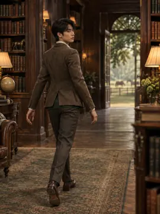</a> | <a href="https://promicat.app/zh/poses/styles/sp138?utm_source=github&utm_medium=readme&utm_campaign=ai-photo-poses">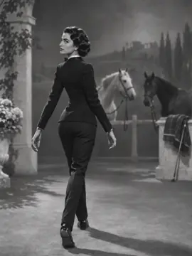</a> | <a href="https://promicat.app/zh/poses/styles/sp138?utm_source=github&utm_medium=readme&utm_campaign=ai-photo-poses">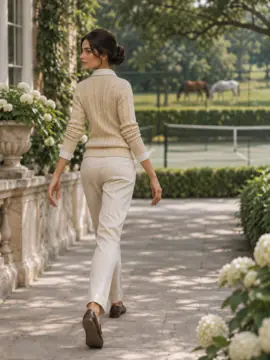</a> |

大图: [写真照](../images/photo-poses/western/sp138-photo.webp) · [白模](../images/photo-poses/western/sp138-pose.webp) · [在 Promicat 生成](https://promicat.app/zh/poses/styles/sp138?utm_source=github&utm_medium=readme&utm_campaign=ai-photo-poses)

<details><summary>提示词：用你的照片（图 1 你的照片，图 2 白模）</summary>

```text
A real professional portrait photoshoot photo: a western cowboy photoshoot on a desert ranch with a wooden fence and horses far away, golden dusty sunset, 85mm. Subject: the person in image 1 (keep their exact face, facial features, skin tone and hairstyle; do not beautify or swap the face), wearing a cowboy hat, denim shirt, suede fringe jacket, jeans and boots. Pose: walking away toward the horses, looking back over the shoulder. Image 2 is a wooden artist's mannequin that shows only this body pose: copy it exactly (head, torso, arms, hands, legs, feet, which hand does what, the camera angle), but do not copy the mannequin itself: no wooden skin, no joints, no blank face. Natural, relaxed and unstiff, true skin texture. No text, no logo, no watermark. Portrait 3:4.
```

</details>

<details><summary>提示词：生成示例图（虚构模特）</summary>

```text
A real professional portrait photoshoot photo, the kind posted by a top portrait studio: a western cowboy photoshoot on a desert ranch with a wooden fence and horses far away, golden dusty sunset, 85mm. Model: a beautiful Indian professional fashion model in her twenties with a naturally attractive face, styled hair and natural makeup, wearing a cowboy hat, denim shirt, suede fringe jacket, jeans and boots. The photographer directs the model into a natural, relaxed, unstiff pose that looks caught between moments: walking away toward the horses, looking back over the shoulder. Asymmetric body, soft hands, flattering angle, true skin texture, refined but not plastic, fully clothed and modest. Full body or three-quarter body in frame, the whole pose clearly readable. No text, no logo, no watermark. Portrait 3:4.
```

</details>

## 站干草堆 (站)

| 白模 | 西部牛仔 | 海边度假 | 日系清新 | 街头朋克 |
|---|---|---|---|---|
| 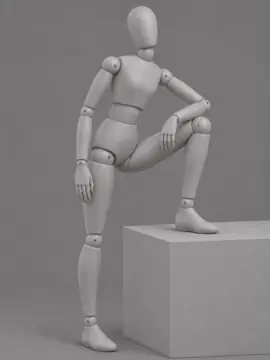 | <a href="https://promicat.app/zh/poses/styles/sp139?utm_source=github&utm_medium=readme&utm_campaign=ai-photo-poses">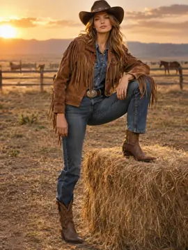</a> | <a href="https://promicat.app/zh/poses/styles/sp139?utm_source=github&utm_medium=readme&utm_campaign=ai-photo-poses">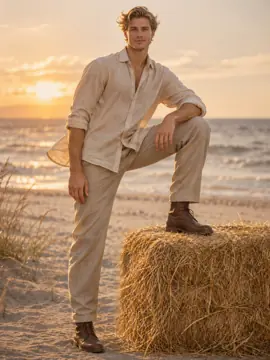</a> | <a href="https://promicat.app/zh/poses/styles/sp139?utm_source=github&utm_medium=readme&utm_campaign=ai-photo-poses">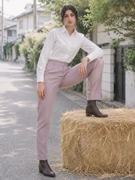</a> | <a href="https://promicat.app/zh/poses/styles/sp139?utm_source=github&utm_medium=readme&utm_campaign=ai-photo-poses">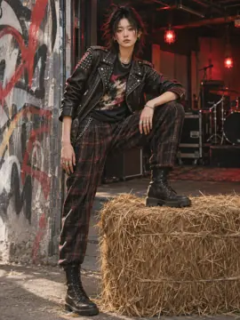</a> |

大图: [写真照](../images/photo-poses/western/sp139-photo.webp) · [白模](../images/photo-poses/western/sp139-pose.webp) · [在 Promicat 生成](https://promicat.app/zh/poses/styles/sp139?utm_source=github&utm_medium=readme&utm_campaign=ai-photo-poses)

<details><summary>提示词：用你的照片（图 1 你的照片，图 2 白模）</summary>

```text
A real professional portrait photoshoot photo: a western cowboy photoshoot on a desert ranch with a wooden fence and horses far away, golden dusty sunset, 85mm. Subject: the person in image 1 (keep their exact face, facial features, skin tone and hairstyle; do not beautify or swap the face), wearing a cowboy hat, denim shirt, suede fringe jacket, jeans and boots. Pose: standing with one boot up on a hay bale, forearm on the knee. Image 2 is a wooden artist's mannequin that shows only this body pose: copy it exactly (head, torso, arms, hands, legs, feet, which hand does what, the camera angle), but do not copy the mannequin itself: no wooden skin, no joints, no blank face. Natural, relaxed and unstiff, true skin texture. No text, no logo, no watermark. Portrait 3:4.
```

</details>

<details><summary>提示词：生成示例图（虚构模特）</summary>

```text
A real professional portrait photoshoot photo, the kind posted by a top portrait studio: a western cowboy photoshoot on a desert ranch with a wooden fence and horses far away, golden dusty sunset, 85mm. Model: a beautiful white European professional fashion model in her twenties with a naturally attractive face, styled hair and natural makeup, wearing a cowboy hat, denim shirt, suede fringe jacket, jeans and boots. The photographer directs the model into a natural, relaxed, unstiff pose that looks caught between moments: standing with one boot up on a hay bale, forearm on the knee. Asymmetric body, soft hands, flattering angle, true skin texture, refined but not plastic, fully clothed and modest. Full body or three-quarter body in frame, the whole pose clearly readable. No text, no logo, no watermark. Portrait 3:4.
```

</details>

## 仰头喝水 (半身)

| 白模 | 西部牛仔 | 咖啡馆文艺 | 新中式 | 森系花田 |
|---|---|---|---|---|
| 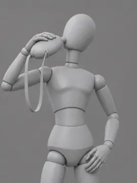 | <a href="https://promicat.app/zh/poses/styles/sp140?utm_source=github&utm_medium=readme&utm_campaign=ai-photo-poses">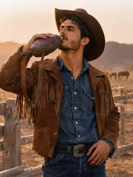</a> | <a href="https://promicat.app/zh/poses/styles/sp140?utm_source=github&utm_medium=readme&utm_campaign=ai-photo-poses">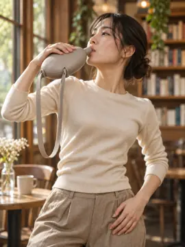</a> | <a href="https://promicat.app/zh/poses/styles/sp140?utm_source=github&utm_medium=readme&utm_campaign=ai-photo-poses">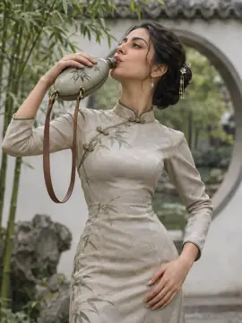</a> | <a href="https://promicat.app/zh/poses/styles/sp140?utm_source=github&utm_medium=readme&utm_campaign=ai-photo-poses">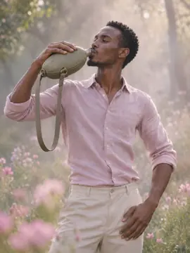</a> |

大图: [写真照](../images/photo-poses/western/sp140-photo.webp) · [白模](../images/photo-poses/western/sp140-pose.webp) · [在 Promicat 生成](https://promicat.app/zh/poses/styles/sp140?utm_source=github&utm_medium=readme&utm_campaign=ai-photo-poses)

<details><summary>提示词：用你的照片（图 1 你的照片，图 2 白模）</summary>

```text
A real professional portrait photoshoot photo: a western cowboy photoshoot on a desert ranch with a wooden fence and horses far away, golden dusty sunset, 85mm. Subject: the person in image 1 (keep their exact face, facial features, skin tone and hairstyle; do not beautify or swap the face), wearing a cowboy hat, denim shirt, suede fringe jacket, jeans and boots. Pose: tilting a canteen to drink, sweat on the brow. Image 2 is a wooden artist's mannequin that shows only this body pose: copy it exactly (head, torso, arms, hands, legs, feet, which hand does what, the camera angle), but do not copy the mannequin itself: no wooden skin, no joints, no blank face. Natural, relaxed and unstiff, true skin texture. No text, no logo, no watermark. Portrait 3:4.
```

</details>

<details><summary>提示词：生成示例图（虚构模特）</summary>

```text
A real professional portrait photoshoot photo, the kind posted by a top portrait studio: a western cowboy photoshoot on a desert ranch with a wooden fence and horses far away, golden dusty sunset, 85mm. Model: a handsome Brazilian professional male model in his twenties with a well-groomed look and styled hair, wearing a cowboy hat, denim shirt, suede fringe jacket, jeans and boots. The photographer directs the model into a natural, relaxed, unstiff pose that looks caught between moments: tilting a canteen to drink, sweat on the brow. Asymmetric body, soft hands, flattering angle, true skin texture, refined but not plastic, fully clothed and modest. Waist-up framing, both arms and hands readable. No text, no logo, no watermark. Portrait 3:4.
```

</details>
