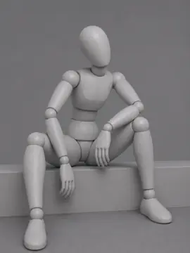
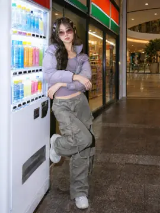
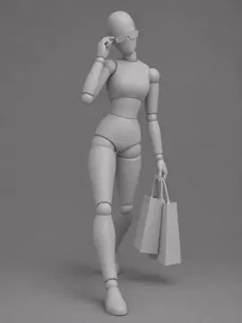
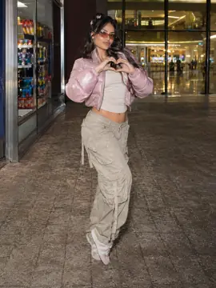

# Y2K flash

English · [简体中文](y2k.zh-CN.md)

10 photo poses: a sample photo and the white model drawn from it. Attach your photo first and the white model second. Try them with your own photo on [Promicat](https://promicat.app/poses?utm_source=github&utm_medium=readme&utm_campaign=ai-photo-poses).

[← Back to all styles](../README.md#photo-poses)

## Squatting outside a convenience store with a popsicle (Crouching)

<a href="https://promicat.app/poses/styles/sp151?utm_source=github&utm_medium=readme&utm_campaign=ai-photo-poses"></a> 

Full size: [photo](../images/photo-poses/y2k/sp151-photo.webp) · [white model](../images/photo-poses/y2k/sp151-pose.webp) · [try it on Promicat](https://promicat.app/poses/styles/sp151?utm_source=github&utm_medium=readme&utm_campaign=ai-photo-poses)

<details><summary>Prompt with your photo (image 1: your photo, image 2: white model)</summary>

```text
A real professional portrait photoshoot photo: a Y2K-style flash photoshoot at night outside a convenience store and in a mall, direct on-camera flash, glossy colours, 35mm. Subject: the person in image 1 (keep their exact face, facial features, skin tone and hairstyle; do not beautify or swap the face), wearing a cropped puffer jacket over a fitted top with low-rise cargo trousers, tinted sunglasses, butterfly clips. Pose: squatting outside a convenience store with a popsicle, peace sign, flash. Image 2 is a wooden artist's mannequin that shows only this body pose: copy it exactly (head, torso, arms, hands, legs, feet, which hand does what, the camera angle), but do not copy the mannequin itself: no wooden skin, no joints, no blank face. Natural, relaxed and unstiff, true skin texture. No text, no logo, no watermark. Portrait 3:4.
```

</details>

<details><summary>Prompt for the sample (fictional model)</summary>

```text
A real professional portrait photoshoot photo, the kind posted by a top portrait studio: a Y2K-style flash photoshoot at night outside a convenience store and in a mall, direct on-camera flash, glossy colours, 35mm. Model: a beautiful East Asian professional fashion model in her twenties with a naturally attractive face, styled hair and natural makeup, wearing a cropped puffer jacket over a fitted top with low-rise cargo trousers, tinted sunglasses, butterfly clips. The photographer directs the model into a natural, relaxed, unstiff pose that looks caught between moments: squatting outside a convenience store with a popsicle, peace sign, flash. Asymmetric body, soft hands, flattering angle, true skin texture, refined but not plastic, fully clothed and modest. Full body or three-quarter body in frame, the whole pose clearly readable. No text, no logo, no watermark. Portrait 3:4.
```

</details>

## Holding a flip phone to the ear (Upper body)

<a href="https://promicat.app/poses/styles/sp152?utm_source=github&utm_medium=readme&utm_campaign=ai-photo-poses"></a> 

Full size: [photo](../images/photo-poses/y2k/sp152-photo.webp) · [white model](../images/photo-poses/y2k/sp152-pose.webp) · [try it on Promicat](https://promicat.app/poses/styles/sp152?utm_source=github&utm_medium=readme&utm_campaign=ai-photo-poses)

<details><summary>Prompt with your photo (image 1: your photo, image 2: white model)</summary>

```text
A real professional portrait photoshoot photo: a Y2K-style flash photoshoot at night outside a convenience store and in a mall, direct on-camera flash, glossy colours, 35mm. Subject: the person in image 1 (keep their exact face, facial features, skin tone and hairstyle; do not beautify or swap the face), wearing a cropped puffer jacket over a fitted top with low-rise cargo trousers, tinted sunglasses, butterfly clips. Pose: holding a flip phone to the ear, popping gum, eyes to the camera. Image 2 is a wooden artist's mannequin that shows only this body pose: copy it exactly (head, torso, arms, hands, legs, feet, which hand does what, the camera angle), but do not copy the mannequin itself: no wooden skin, no joints, no blank face. Natural, relaxed and unstiff, true skin texture. No text, no logo, no watermark. Portrait 3:4.
```

</details>

<details><summary>Prompt for the sample (fictional model)</summary>

```text
A real professional portrait photoshoot photo, the kind posted by a top portrait studio: a Y2K-style flash photoshoot at night outside a convenience store and in a mall, direct on-camera flash, glossy colours, 35mm. Model: a beautiful mixed-race professional fashion model in her twenties with a naturally attractive face, styled hair and natural makeup, wearing a cropped puffer jacket over a fitted top with low-rise cargo trousers, tinted sunglasses, butterfly clips. The photographer directs the model into a natural, relaxed, unstiff pose that looks caught between moments: holding a flip phone to the ear, popping gum, eyes to the camera. Asymmetric body, soft hands, flattering angle, true skin texture, refined but not plastic, fully clothed and modest. Waist-up framing, both arms and hands readable. No text, no logo, no watermark. Portrait 3:4.
```

</details>

## Pushing the shop door open (Looking back)

<a href="https://promicat.app/poses/styles/sp153?utm_source=github&utm_medium=readme&utm_campaign=ai-photo-poses"></a> 

Full size: [photo](../images/photo-poses/y2k/sp153-photo.webp) · [white model](../images/photo-poses/y2k/sp153-pose.webp) · [try it on Promicat](https://promicat.app/poses/styles/sp153?utm_source=github&utm_medium=readme&utm_campaign=ai-photo-poses)

<details><summary>Prompt with your photo (image 1: your photo, image 2: white model)</summary>

```text
A real professional portrait photoshoot photo: a Y2K-style flash photoshoot at night outside a convenience store and in a mall, direct on-camera flash, glossy colours, 35mm. Subject: the person in image 1 (keep their exact face, facial features, skin tone and hairstyle; do not beautify or swap the face), wearing a cropped puffer jacket over a fitted top with low-rise cargo trousers, tinted sunglasses, butterfly clips. Pose: pushing the shop door open, looking back over the shoulder. Image 2 is a wooden artist's mannequin that shows only this body pose: copy it exactly (head, torso, arms, hands, legs, feet, which hand does what, the camera angle), but do not copy the mannequin itself: no wooden skin, no joints, no blank face. Natural, relaxed and unstiff, true skin texture. No text, no logo, no watermark. Portrait 3:4.
```

</details>

<details><summary>Prompt for the sample (fictional model)</summary>

```text
A real professional portrait photoshoot photo, the kind posted by a top portrait studio: a Y2K-style flash photoshoot at night outside a convenience store and in a mall, direct on-camera flash, glossy colours, 35mm. Model: a handsome Mediterranean professional male model in his twenties with a well-groomed look and styled hair, wearing a cropped puffer jacket over a fitted top with low-rise cargo trousers, tinted sunglasses, butterfly clips. The photographer directs the model into a natural, relaxed, unstiff pose that looks caught between moments: pushing the shop door open, looking back over the shoulder. Asymmetric body, soft hands, flattering angle, true skin texture, refined but not plastic, fully clothed and modest. Full body or three-quarter body in frame, the whole pose clearly readable. No text, no logo, no watermark. Portrait 3:4.
```

</details>

## Sitting on the kerb with knees apart and elbows on them (Sitting)

<a href="https://promicat.app/poses/styles/sp154?utm_source=github&utm_medium=readme&utm_campaign=ai-photo-poses"></a> 

Full size: [photo](../images/photo-poses/y2k/sp154-photo.webp) · [white model](../images/photo-poses/y2k/sp154-pose.webp) · [try it on Promicat](https://promicat.app/poses/styles/sp154?utm_source=github&utm_medium=readme&utm_campaign=ai-photo-poses)

<details><summary>Prompt with your photo (image 1: your photo, image 2: white model)</summary>

```text
A real professional portrait photoshoot photo: a Y2K-style flash photoshoot at night outside a convenience store and in a mall, direct on-camera flash, glossy colours, 35mm. Subject: the person in image 1 (keep their exact face, facial features, skin tone and hairstyle; do not beautify or swap the face), wearing a cropped puffer jacket over a fitted top with low-rise cargo trousers, tinted sunglasses, butterfly clips. Pose: sitting on the kerb with knees apart and elbows on them, sunglasses down the nose. Image 2 is a wooden artist's mannequin that shows only this body pose: copy it exactly (head, torso, arms, hands, legs, feet, which hand does what, the camera angle), but do not copy the mannequin itself: no wooden skin, no joints, no blank face. Natural, relaxed and unstiff, true skin texture. No text, no logo, no watermark. Portrait 3:4.
```

</details>

<details><summary>Prompt for the sample (fictional model)</summary>

```text
A real professional portrait photoshoot photo, the kind posted by a top portrait studio: a Y2K-style flash photoshoot at night outside a convenience store and in a mall, direct on-camera flash, glossy colours, 35mm. Model: a beautiful Southeast Asian professional fashion model in her twenties with a naturally attractive face, styled hair and natural makeup, wearing a cropped puffer jacket over a fitted top with low-rise cargo trousers, tinted sunglasses, butterfly clips. The photographer directs the model into a natural, relaxed, unstiff pose that looks caught between moments: sitting on the kerb with knees apart and elbows on them, sunglasses down the nose. Asymmetric body, soft hands, flattering angle, true skin texture, refined but not plastic, fully clothed and modest. Full body or three-quarter body in frame, the whole pose clearly readable. No text, no logo, no watermark. Portrait 3:4.
```

</details>

## Leaning on a lit vending machine (Leaning)

<a href="https://promicat.app/poses/styles/sp155?utm_source=github&utm_medium=readme&utm_campaign=ai-photo-poses"></a> 

Full size: [photo](../images/photo-poses/y2k/sp155-photo.webp) · [white model](../images/photo-poses/y2k/sp155-pose.webp) · [try it on Promicat](https://promicat.app/poses/styles/sp155?utm_source=github&utm_medium=readme&utm_campaign=ai-photo-poses)

<details><summary>Prompt with your photo (image 1: your photo, image 2: white model)</summary>

```text
A real professional portrait photoshoot photo: a Y2K-style flash photoshoot at night outside a convenience store and in a mall, direct on-camera flash, glossy colours, 35mm. Subject: the person in image 1 (keep their exact face, facial features, skin tone and hairstyle; do not beautify or swap the face), wearing a cropped puffer jacket over a fitted top with low-rise cargo trousers, tinted sunglasses, butterfly clips. Pose: leaning on a lit vending machine, one leg bent, arms crossed. Image 2 is a wooden artist's mannequin that shows only this body pose: copy it exactly (head, torso, arms, hands, legs, feet, which hand does what, the camera angle), but do not copy the mannequin itself: no wooden skin, no joints, no blank face. Natural, relaxed and unstiff, true skin texture. No text, no logo, no watermark. Portrait 3:4.
```

</details>

<details><summary>Prompt for the sample (fictional model)</summary>

```text
A real professional portrait photoshoot photo, the kind posted by a top portrait studio: a Y2K-style flash photoshoot at night outside a convenience store and in a mall, direct on-camera flash, glossy colours, 35mm. Model: a beautiful Japanese professional fashion model in her twenties with a naturally attractive face, styled hair and natural makeup, wearing a cropped puffer jacket over a fitted top with low-rise cargo trousers, tinted sunglasses, butterfly clips. The photographer directs the model into a natural, relaxed, unstiff pose that looks caught between moments: leaning on a lit vending machine, one leg bent, arms crossed. Asymmetric body, soft hands, flattering angle, true skin texture, refined but not plastic, fully clothed and modest. Full body or three-quarter body in frame, the whole pose clearly readable. No text, no logo, no watermark. Portrait 3:4.
```

</details>

## Flipping the hair with a hand (In motion)

<a href="https://promicat.app/poses/styles/sp156?utm_source=github&utm_medium=readme&utm_campaign=ai-photo-poses"></a> 

Full size: [photo](../images/photo-poses/y2k/sp156-photo.webp) · [white model](../images/photo-poses/y2k/sp156-pose.webp) · [try it on Promicat](https://promicat.app/poses/styles/sp156?utm_source=github&utm_medium=readme&utm_campaign=ai-photo-poses)

<details><summary>Prompt with your photo (image 1: your photo, image 2: white model)</summary>

```text
A real professional portrait photoshoot photo: a Y2K-style flash photoshoot at night outside a convenience store and in a mall, direct on-camera flash, glossy colours, 35mm. Subject: the person in image 1 (keep their exact face, facial features, skin tone and hairstyle; do not beautify or swap the face), wearing a cropped puffer jacket over a fitted top with low-rise cargo trousers, tinted sunglasses, butterfly clips. Pose: flipping the hair with a hand, mid-laugh. Image 2 is a wooden artist's mannequin that shows only this body pose: copy it exactly (head, torso, arms, hands, legs, feet, which hand does what, the camera angle), but do not copy the mannequin itself: no wooden skin, no joints, no blank face. Natural, relaxed and unstiff, true skin texture. No text, no logo, no watermark. Portrait 3:4.
```

</details>

<details><summary>Prompt for the sample (fictional model)</summary>

```text
A real professional portrait photoshoot photo, the kind posted by a top portrait studio: a Y2K-style flash photoshoot at night outside a convenience store and in a mall, direct on-camera flash, glossy colours, 35mm. Model: a handsome Middle Eastern professional male model in his twenties with a well-groomed look and styled hair, wearing a cropped puffer jacket over a fitted top with low-rise cargo trousers, tinted sunglasses, butterfly clips. The photographer directs the model into a natural, relaxed, unstiff pose that looks caught between moments: flipping the hair with a hand, mid-laugh. Asymmetric body, soft hands, flattering angle, true skin texture, refined but not plastic, fully clothed and modest. Full body or three-quarter body in frame, the whole pose clearly readable. No text, no logo, no watermark. Portrait 3:4.
```

</details>

## Walking through a mall holding shopping bags (Walking)

<a href="https://promicat.app/poses/styles/sp157?utm_source=github&utm_medium=readme&utm_campaign=ai-photo-poses"></a> 

Full size: [photo](../images/photo-poses/y2k/sp157-photo.webp) · [white model](../images/photo-poses/y2k/sp157-pose.webp) · [try it on Promicat](https://promicat.app/poses/styles/sp157?utm_source=github&utm_medium=readme&utm_campaign=ai-photo-poses)

<details><summary>Prompt with your photo (image 1: your photo, image 2: white model)</summary>

```text
A real professional portrait photoshoot photo: a Y2K-style flash photoshoot at night outside a convenience store and in a mall, direct on-camera flash, glossy colours, 35mm. Subject: the person in image 1 (keep their exact face, facial features, skin tone and hairstyle; do not beautify or swap the face), wearing a cropped puffer jacket over a fitted top with low-rise cargo trousers, tinted sunglasses, butterfly clips. Pose: walking through a mall holding shopping bags, pushing up sunglasses. Image 2 is a wooden artist's mannequin that shows only this body pose: copy it exactly (head, torso, arms, hands, legs, feet, which hand does what, the camera angle), but do not copy the mannequin itself: no wooden skin, no joints, no blank face. Natural, relaxed and unstiff, true skin texture. No text, no logo, no watermark. Portrait 3:4.
```

</details>

<details><summary>Prompt for the sample (fictional model)</summary>

```text
A real professional portrait photoshoot photo, the kind posted by a top portrait studio: a Y2K-style flash photoshoot at night outside a convenience store and in a mall, direct on-camera flash, glossy colours, 35mm. Model: a beautiful Indian professional fashion model in her twenties with a naturally attractive face, styled hair and natural makeup, wearing a cropped puffer jacket over a fitted top with low-rise cargo trousers, tinted sunglasses, butterfly clips. The photographer directs the model into a natural, relaxed, unstiff pose that looks caught between moments: walking through a mall holding shopping bags, pushing up sunglasses. Asymmetric body, soft hands, flattering angle, true skin texture, refined but not plastic, fully clothed and modest. Full body or three-quarter body in frame, the whole pose clearly readable. No text, no logo, no watermark. Portrait 3:4.
```

</details>

## Holding a small digital camera at arm length for a selfie (Upper body)

<a href="https://promicat.app/poses/styles/sp158?utm_source=github&utm_medium=readme&utm_campaign=ai-photo-poses"></a> 

Full size: [photo](../images/photo-poses/y2k/sp158-photo.webp) · [white model](../images/photo-poses/y2k/sp158-pose.webp) · [try it on Promicat](https://promicat.app/poses/styles/sp158?utm_source=github&utm_medium=readme&utm_campaign=ai-photo-poses)

<details><summary>Prompt with your photo (image 1: your photo, image 2: white model)</summary>

```text
A real professional portrait photoshoot photo: a Y2K-style flash photoshoot at night outside a convenience store and in a mall, direct on-camera flash, glossy colours, 35mm. Subject: the person in image 1 (keep their exact face, facial features, skin tone and hairstyle; do not beautify or swap the face), wearing a cropped puffer jacket over a fitted top with low-rise cargo trousers, tinted sunglasses, butterfly clips. Pose: holding a small digital camera at arm length for a selfie, pouting playfully. Image 2 is a wooden artist's mannequin that shows only this body pose: copy it exactly (head, torso, arms, hands, legs, feet, which hand does what, the camera angle), but do not copy the mannequin itself: no wooden skin, no joints, no blank face. Natural, relaxed and unstiff, true skin texture. No text, no logo, no watermark. Portrait 3:4.
```

</details>

<details><summary>Prompt for the sample (fictional model)</summary>

```text
A real professional portrait photoshoot photo, the kind posted by a top portrait studio: a Y2K-style flash photoshoot at night outside a convenience store and in a mall, direct on-camera flash, glossy colours, 35mm. Model: a beautiful white European professional fashion model in her twenties with a naturally attractive face, styled hair and natural makeup, wearing a cropped puffer jacket over a fitted top with low-rise cargo trousers, tinted sunglasses, butterfly clips. The photographer directs the model into a natural, relaxed, unstiff pose that looks caught between moments: holding a small digital camera at arm length for a selfie, pouting playfully. Asymmetric body, soft hands, flattering angle, true skin texture, refined but not plastic, fully clothed and modest. Waist-up framing, both arms and hands readable. No text, no logo, no watermark. Portrait 3:4.
```

</details>

## Leaning on an escalator rail on the forearms (Leaning)

<a href="https://promicat.app/poses/styles/sp159?utm_source=github&utm_medium=readme&utm_campaign=ai-photo-poses"></a> 

Full size: [photo](../images/photo-poses/y2k/sp159-photo.webp) · [white model](../images/photo-poses/y2k/sp159-pose.webp) · [try it on Promicat](https://promicat.app/poses/styles/sp159?utm_source=github&utm_medium=readme&utm_campaign=ai-photo-poses)

<details><summary>Prompt with your photo (image 1: your photo, image 2: white model)</summary>

```text
A real professional portrait photoshoot photo: a Y2K-style flash photoshoot at night outside a convenience store and in a mall, direct on-camera flash, glossy colours, 35mm. Subject: the person in image 1 (keep their exact face, facial features, skin tone and hairstyle; do not beautify or swap the face), wearing a cropped puffer jacket over a fitted top with low-rise cargo trousers, tinted sunglasses, butterfly clips. Pose: leaning on an escalator rail on the forearms, looking down. Image 2 is a wooden artist's mannequin that shows only this body pose: copy it exactly (head, torso, arms, hands, legs, feet, which hand does what, the camera angle), but do not copy the mannequin itself: no wooden skin, no joints, no blank face. Natural, relaxed and unstiff, true skin texture. No text, no logo, no watermark. Portrait 3:4.
```

</details>

<details><summary>Prompt for the sample (fictional model)</summary>

```text
A real professional portrait photoshoot photo, the kind posted by a top portrait studio: a Y2K-style flash photoshoot at night outside a convenience store and in a mall, direct on-camera flash, glossy colours, 35mm. Model: a handsome Brazilian professional male model in his twenties with a well-groomed look and styled hair, wearing a cropped puffer jacket over a fitted top with low-rise cargo trousers, tinted sunglasses, butterfly clips. The photographer directs the model into a natural, relaxed, unstiff pose that looks caught between moments: leaning on an escalator rail on the forearms, looking down. Asymmetric body, soft hands, flattering angle, true skin texture, refined but not plastic, fully clothed and modest. Full body or three-quarter body in frame, the whole pose clearly readable. No text, no logo, no watermark. Portrait 3:4.
```

</details>

## Standing on tiptoe making a heart with the hands (Standing)

<a href="https://promicat.app/poses/styles/sp160?utm_source=github&utm_medium=readme&utm_campaign=ai-photo-poses"></a> 

Full size: [photo](../images/photo-poses/y2k/sp160-photo.webp) · [white model](../images/photo-poses/y2k/sp160-pose.webp) · [try it on Promicat](https://promicat.app/poses/styles/sp160?utm_source=github&utm_medium=readme&utm_campaign=ai-photo-poses)

<details><summary>Prompt with your photo (image 1: your photo, image 2: white model)</summary>

```text
A real professional portrait photoshoot photo: a Y2K-style flash photoshoot at night outside a convenience store and in a mall, direct on-camera flash, glossy colours, 35mm. Subject: the person in image 1 (keep their exact face, facial features, skin tone and hairstyle; do not beautify or swap the face), wearing a cropped puffer jacket over a fitted top with low-rise cargo trousers, tinted sunglasses, butterfly clips. Pose: standing on tiptoe making a heart with the hands. Image 2 is a wooden artist's mannequin that shows only this body pose: copy it exactly (head, torso, arms, hands, legs, feet, which hand does what, the camera angle), but do not copy the mannequin itself: no wooden skin, no joints, no blank face. Natural, relaxed and unstiff, true skin texture. No text, no logo, no watermark. Portrait 3:4.
```

</details>

<details><summary>Prompt for the sample (fictional model)</summary>

```text
A real professional portrait photoshoot photo, the kind posted by a top portrait studio: a Y2K-style flash photoshoot at night outside a convenience store and in a mall, direct on-camera flash, glossy colours, 35mm. Model: a beautiful Latina professional fashion model in her twenties with a naturally attractive face, styled hair and natural makeup, wearing a cropped puffer jacket over a fitted top with low-rise cargo trousers, tinted sunglasses, butterfly clips. The photographer directs the model into a natural, relaxed, unstiff pose that looks caught between moments: standing on tiptoe making a heart with the hands. Asymmetric body, soft hands, flattering angle, true skin texture, refined but not plastic, fully clothed and modest. Full body or three-quarter body in frame, the whole pose clearly readable. No text, no logo, no watermark. Portrait 3:4.
```

</details>
