# Y2K 千禧辣妹

[English](y2k.md) · 简体中文

10 个白模，每个配 4 张用它拍出的不同风格写真。参考图顺序是你的照片在前、白模在后。也可以在 [Promicat](https://promicat.app/zh/poses?utm_source=github&utm_medium=readme&utm_campaign=ai-photo-poses) 上传照片直接生成。

[← 返回全部风格](../README.zh-CN.md#photo-poses)

## 便利店门口蹲 (蹲跪)

| 白模 | Y2K 千禧辣妹 | 波西米亚 | 暗黑哥特 | 西部牛仔 |
|---|---|---|---|---|
| 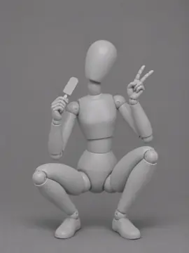 | <a href="https://promicat.app/zh/poses/styles/sp151?utm_source=github&utm_medium=readme&utm_campaign=ai-photo-poses">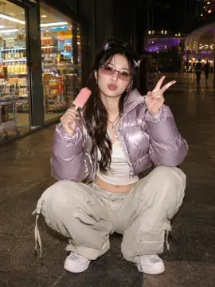</a> | <a href="https://promicat.app/zh/poses/styles/sp151?utm_source=github&utm_medium=readme&utm_campaign=ai-photo-poses">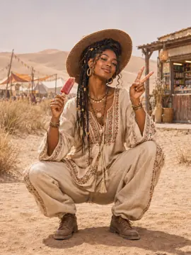</a> | <a href="https://promicat.app/zh/poses/styles/sp151?utm_source=github&utm_medium=readme&utm_campaign=ai-photo-poses">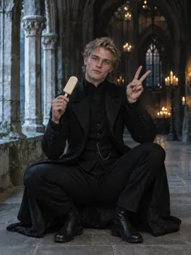</a> | <a href="https://promicat.app/zh/poses/styles/sp151?utm_source=github&utm_medium=readme&utm_campaign=ai-photo-poses">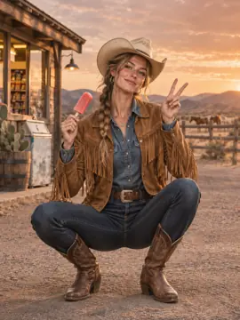</a> |

大图: [写真照](../images/photo-poses/y2k/sp151-photo.webp) · [白模](../images/photo-poses/y2k/sp151-pose.webp) · [在 Promicat 生成](https://promicat.app/zh/poses/styles/sp151?utm_source=github&utm_medium=readme&utm_campaign=ai-photo-poses)

<details><summary>提示词：用你的照片（图 1 你的照片，图 2 白模）</summary>

```text
A real professional portrait photoshoot photo: a Y2K-style flash photoshoot at night outside a convenience store and in a mall, direct on-camera flash, glossy colours, 35mm. Subject: the person in image 1 (keep their exact face, facial features, skin tone and hairstyle; do not beautify or swap the face), wearing a cropped puffer jacket over a fitted top with low-rise cargo trousers, tinted sunglasses, butterfly clips. Pose: squatting outside a convenience store with a popsicle, peace sign, flash. Image 2 is a wooden artist's mannequin that shows only this body pose: copy it exactly (head, torso, arms, hands, legs, feet, which hand does what, the camera angle), but do not copy the mannequin itself: no wooden skin, no joints, no blank face. Natural, relaxed and unstiff, true skin texture. No text, no logo, no watermark. Portrait 3:4.
```

</details>

<details><summary>提示词：生成示例图（虚构模特）</summary>

```text
A real professional portrait photoshoot photo, the kind posted by a top portrait studio: a Y2K-style flash photoshoot at night outside a convenience store and in a mall, direct on-camera flash, glossy colours, 35mm. Model: a beautiful East Asian professional fashion model in her twenties with a naturally attractive face, styled hair and natural makeup, wearing a cropped puffer jacket over a fitted top with low-rise cargo trousers, tinted sunglasses, butterfly clips. The photographer directs the model into a natural, relaxed, unstiff pose that looks caught between moments: squatting outside a convenience store with a popsicle, peace sign, flash. Asymmetric body, soft hands, flattering angle, true skin texture, refined but not plastic, fully clothed and modest. Full body or three-quarter body in frame, the whole pose clearly readable. No text, no logo, no watermark. Portrait 3:4.
```

</details>

## 翻盖手机 (半身)

| 白模 | Y2K 千禧辣妹 | 波西米亚 | 咖啡馆文艺 | 老钱风 |
|---|---|---|---|---|
| 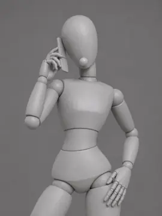 | <a href="https://promicat.app/zh/poses/styles/sp152?utm_source=github&utm_medium=readme&utm_campaign=ai-photo-poses">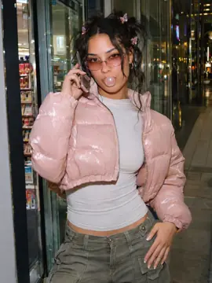</a> | <a href="https://promicat.app/zh/poses/styles/sp152?utm_source=github&utm_medium=readme&utm_campaign=ai-photo-poses">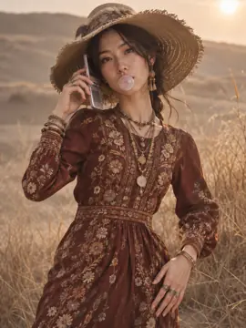</a> | <a href="https://promicat.app/zh/poses/styles/sp152?utm_source=github&utm_medium=readme&utm_campaign=ai-photo-poses"></a> | <a href="https://promicat.app/zh/poses/styles/sp152?utm_source=github&utm_medium=readme&utm_campaign=ai-photo-poses"></a> |

大图: [写真照](../images/photo-poses/y2k/sp152-photo.webp) · [白模](../images/photo-poses/y2k/sp152-pose.webp) · [在 Promicat 生成](https://promicat.app/zh/poses/styles/sp152?utm_source=github&utm_medium=readme&utm_campaign=ai-photo-poses)

<details><summary>提示词：用你的照片（图 1 你的照片，图 2 白模）</summary>

```text
A real professional portrait photoshoot photo: a Y2K-style flash photoshoot at night outside a convenience store and in a mall, direct on-camera flash, glossy colours, 35mm. Subject: the person in image 1 (keep their exact face, facial features, skin tone and hairstyle; do not beautify or swap the face), wearing a cropped puffer jacket over a fitted top with low-rise cargo trousers, tinted sunglasses, butterfly clips. Pose: holding a flip phone to the ear, popping gum, eyes to the camera. Image 2 is a wooden artist's mannequin that shows only this body pose: copy it exactly (head, torso, arms, hands, legs, feet, which hand does what, the camera angle), but do not copy the mannequin itself: no wooden skin, no joints, no blank face. Natural, relaxed and unstiff, true skin texture. No text, no logo, no watermark. Portrait 3:4.
```

</details>

<details><summary>提示词：生成示例图（虚构模特）</summary>

```text
A real professional portrait photoshoot photo, the kind posted by a top portrait studio: a Y2K-style flash photoshoot at night outside a convenience store and in a mall, direct on-camera flash, glossy colours, 35mm. Model: a beautiful mixed-race professional fashion model in her twenties with a naturally attractive face, styled hair and natural makeup, wearing a cropped puffer jacket over a fitted top with low-rise cargo trousers, tinted sunglasses, butterfly clips. The photographer directs the model into a natural, relaxed, unstiff pose that looks caught between moments: holding a flip phone to the ear, popping gum, eyes to the camera. Asymmetric body, soft hands, flattering angle, true skin texture, refined but not plastic, fully clothed and modest. Waist-up framing, both arms and hands readable. No text, no logo, no watermark. Portrait 3:4.
```

</details>

## 扶门回头 (回眸)

| 白模 | Y2K 千禧辣妹 | 海边度假 | 居家慵懒 | 北欧极简 |
|---|---|---|---|---|
| 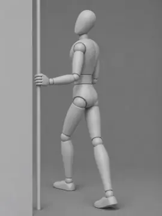 | <a href="https://promicat.app/zh/poses/styles/sp153?utm_source=github&utm_medium=readme&utm_campaign=ai-photo-poses">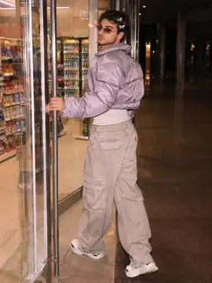</a> | <a href="https://promicat.app/zh/poses/styles/sp153?utm_source=github&utm_medium=readme&utm_campaign=ai-photo-poses">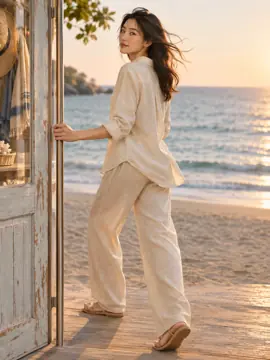</a> | <a href="https://promicat.app/zh/poses/styles/sp153?utm_source=github&utm_medium=readme&utm_campaign=ai-photo-poses">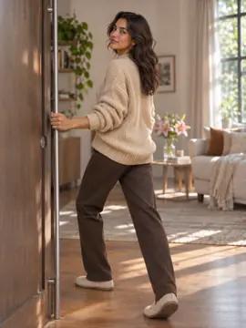</a> | <a href="https://promicat.app/zh/poses/styles/sp153?utm_source=github&utm_medium=readme&utm_campaign=ai-photo-poses">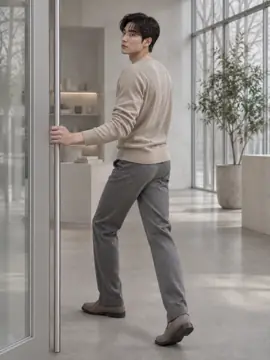</a> |

大图: [写真照](../images/photo-poses/y2k/sp153-photo.webp) · [白模](../images/photo-poses/y2k/sp153-pose.webp) · [在 Promicat 生成](https://promicat.app/zh/poses/styles/sp153?utm_source=github&utm_medium=readme&utm_campaign=ai-photo-poses)

<details><summary>提示词：用你的照片（图 1 你的照片，图 2 白模）</summary>

```text
A real professional portrait photoshoot photo: a Y2K-style flash photoshoot at night outside a convenience store and in a mall, direct on-camera flash, glossy colours, 35mm. Subject: the person in image 1 (keep their exact face, facial features, skin tone and hairstyle; do not beautify or swap the face), wearing a cropped puffer jacket over a fitted top with low-rise cargo trousers, tinted sunglasses, butterfly clips. Pose: pushing the shop door open, looking back over the shoulder. Image 2 is a wooden artist's mannequin that shows only this body pose: copy it exactly (head, torso, arms, hands, legs, feet, which hand does what, the camera angle), but do not copy the mannequin itself: no wooden skin, no joints, no blank face. Natural, relaxed and unstiff, true skin texture. No text, no logo, no watermark. Portrait 3:4.
```

</details>

<details><summary>提示词：生成示例图（虚构模特）</summary>

```text
A real professional portrait photoshoot photo, the kind posted by a top portrait studio: a Y2K-style flash photoshoot at night outside a convenience store and in a mall, direct on-camera flash, glossy colours, 35mm. Model: a handsome Mediterranean professional male model in his twenties with a well-groomed look and styled hair, wearing a cropped puffer jacket over a fitted top with low-rise cargo trousers, tinted sunglasses, butterfly clips. The photographer directs the model into a natural, relaxed, unstiff pose that looks caught between moments: pushing the shop door open, looking back over the shoulder. Asymmetric body, soft hands, flattering angle, true skin texture, refined but not plastic, fully clothed and modest. Full body or three-quarter body in frame, the whole pose clearly readable. No text, no logo, no watermark. Portrait 3:4.
```

</details>

## 坐路沿 (坐)

| 白模 | Y2K 千禧辣妹 | 新中式 | 森系花田 | 日系清新 |
|---|---|---|---|---|
| 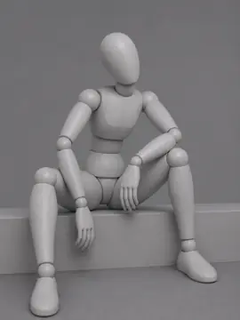 | <a href="https://promicat.app/zh/poses/styles/sp154?utm_source=github&utm_medium=readme&utm_campaign=ai-photo-poses">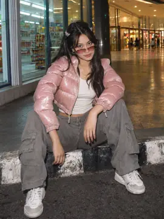</a> | <a href="https://promicat.app/zh/poses/styles/sp154?utm_source=github&utm_medium=readme&utm_campaign=ai-photo-poses">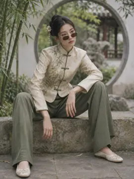</a> | <a href="https://promicat.app/zh/poses/styles/sp154?utm_source=github&utm_medium=readme&utm_campaign=ai-photo-poses">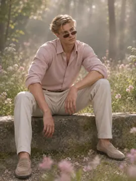</a> | <a href="https://promicat.app/zh/poses/styles/sp154?utm_source=github&utm_medium=readme&utm_campaign=ai-photo-poses">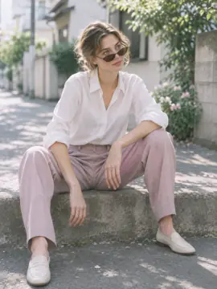</a> |

大图: [写真照](../images/photo-poses/y2k/sp154-photo.webp) · [白模](../images/photo-poses/y2k/sp154-pose.webp) · [在 Promicat 生成](https://promicat.app/zh/poses/styles/sp154?utm_source=github&utm_medium=readme&utm_campaign=ai-photo-poses)

<details><summary>提示词：用你的照片（图 1 你的照片，图 2 白模）</summary>

```text
A real professional portrait photoshoot photo: a Y2K-style flash photoshoot at night outside a convenience store and in a mall, direct on-camera flash, glossy colours, 35mm. Subject: the person in image 1 (keep their exact face, facial features, skin tone and hairstyle; do not beautify or swap the face), wearing a cropped puffer jacket over a fitted top with low-rise cargo trousers, tinted sunglasses, butterfly clips. Pose: sitting on the kerb with knees apart and elbows on them, sunglasses down the nose. Image 2 is a wooden artist's mannequin that shows only this body pose: copy it exactly (head, torso, arms, hands, legs, feet, which hand does what, the camera angle), but do not copy the mannequin itself: no wooden skin, no joints, no blank face. Natural, relaxed and unstiff, true skin texture. No text, no logo, no watermark. Portrait 3:4.
```

</details>

<details><summary>提示词：生成示例图（虚构模特）</summary>

```text
A real professional portrait photoshoot photo, the kind posted by a top portrait studio: a Y2K-style flash photoshoot at night outside a convenience store and in a mall, direct on-camera flash, glossy colours, 35mm. Model: a beautiful Southeast Asian professional fashion model in her twenties with a naturally attractive face, styled hair and natural makeup, wearing a cropped puffer jacket over a fitted top with low-rise cargo trousers, tinted sunglasses, butterfly clips. The photographer directs the model into a natural, relaxed, unstiff pose that looks caught between moments: sitting on the kerb with knees apart and elbows on them, sunglasses down the nose. Asymmetric body, soft hands, flattering angle, true skin texture, refined but not plastic, fully clothed and modest. Full body or three-quarter body in frame, the whole pose clearly readable. No text, no logo, no watermark. Portrait 3:4.
```

</details>

## 靠贩卖机 (靠)

| 白模 | Y2K 千禧辣妹 | 港风复古 | 日系清新 | 情绪棚拍 |
|---|---|---|---|---|
| 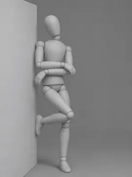 | <a href="https://promicat.app/zh/poses/styles/sp155?utm_source=github&utm_medium=readme&utm_campaign=ai-photo-poses">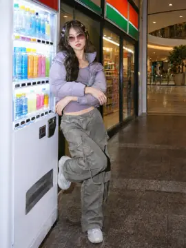</a> | <a href="https://promicat.app/zh/poses/styles/sp155?utm_source=github&utm_medium=readme&utm_campaign=ai-photo-poses">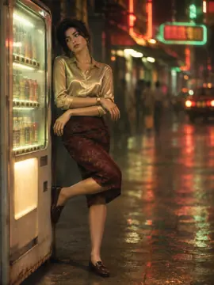</a> | <a href="https://promicat.app/zh/poses/styles/sp155?utm_source=github&utm_medium=readme&utm_campaign=ai-photo-poses">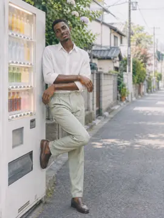</a> | <a href="https://promicat.app/zh/poses/styles/sp155?utm_source=github&utm_medium=readme&utm_campaign=ai-photo-poses">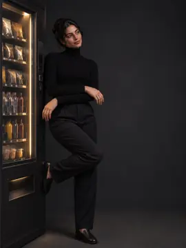</a> |

大图: [写真照](../images/photo-poses/y2k/sp155-photo.webp) · [白模](../images/photo-poses/y2k/sp155-pose.webp) · [在 Promicat 生成](https://promicat.app/zh/poses/styles/sp155?utm_source=github&utm_medium=readme&utm_campaign=ai-photo-poses)

<details><summary>提示词：用你的照片（图 1 你的照片，图 2 白模）</summary>

```text
A real professional portrait photoshoot photo: a Y2K-style flash photoshoot at night outside a convenience store and in a mall, direct on-camera flash, glossy colours, 35mm. Subject: the person in image 1 (keep their exact face, facial features, skin tone and hairstyle; do not beautify or swap the face), wearing a cropped puffer jacket over a fitted top with low-rise cargo trousers, tinted sunglasses, butterfly clips. Pose: leaning on a lit vending machine, one leg bent, arms crossed. Image 2 is a wooden artist's mannequin that shows only this body pose: copy it exactly (head, torso, arms, hands, legs, feet, which hand does what, the camera angle), but do not copy the mannequin itself: no wooden skin, no joints, no blank face. Natural, relaxed and unstiff, true skin texture. No text, no logo, no watermark. Portrait 3:4.
```

</details>

<details><summary>提示词：生成示例图（虚构模特）</summary>

```text
A real professional portrait photoshoot photo, the kind posted by a top portrait studio: a Y2K-style flash photoshoot at night outside a convenience store and in a mall, direct on-camera flash, glossy colours, 35mm. Model: a beautiful Japanese professional fashion model in her twenties with a naturally attractive face, styled hair and natural makeup, wearing a cropped puffer jacket over a fitted top with low-rise cargo trousers, tinted sunglasses, butterfly clips. The photographer directs the model into a natural, relaxed, unstiff pose that looks caught between moments: leaning on a lit vending machine, one leg bent, arms crossed. Asymmetric body, soft hands, flattering angle, true skin texture, refined but not plastic, fully clothed and modest. Full body or three-quarter body in frame, the whole pose clearly readable. No text, no logo, no watermark. Portrait 3:4.
```

</details>

## 甩发 (动态)

| 白模 | Y2K 千禧辣妹 | 咖啡馆文艺 | 赛博霓虹 | 北欧极简 |
|---|---|---|---|---|
| 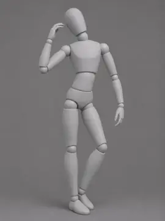 | <a href="https://promicat.app/zh/poses/styles/sp156?utm_source=github&utm_medium=readme&utm_campaign=ai-photo-poses">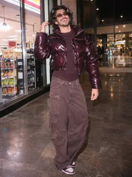</a> | <a href="https://promicat.app/zh/poses/styles/sp156?utm_source=github&utm_medium=readme&utm_campaign=ai-photo-poses">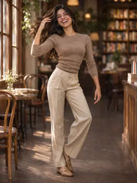</a> | <a href="https://promicat.app/zh/poses/styles/sp156?utm_source=github&utm_medium=readme&utm_campaign=ai-photo-poses">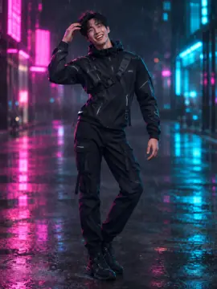</a> | <a href="https://promicat.app/zh/poses/styles/sp156?utm_source=github&utm_medium=readme&utm_campaign=ai-photo-poses">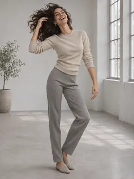</a> |

大图: [写真照](../images/photo-poses/y2k/sp156-photo.webp) · [白模](../images/photo-poses/y2k/sp156-pose.webp) · [在 Promicat 生成](https://promicat.app/zh/poses/styles/sp156?utm_source=github&utm_medium=readme&utm_campaign=ai-photo-poses)

<details><summary>提示词：用你的照片（图 1 你的照片，图 2 白模）</summary>

```text
A real professional portrait photoshoot photo: a Y2K-style flash photoshoot at night outside a convenience store and in a mall, direct on-camera flash, glossy colours, 35mm. Subject: the person in image 1 (keep their exact face, facial features, skin tone and hairstyle; do not beautify or swap the face), wearing a cropped puffer jacket over a fitted top with low-rise cargo trousers, tinted sunglasses, butterfly clips. Pose: flipping the hair with a hand, mid-laugh. Image 2 is a wooden artist's mannequin that shows only this body pose: copy it exactly (head, torso, arms, hands, legs, feet, which hand does what, the camera angle), but do not copy the mannequin itself: no wooden skin, no joints, no blank face. Natural, relaxed and unstiff, true skin texture. No text, no logo, no watermark. Portrait 3:4.
```

</details>

<details><summary>提示词：生成示例图（虚构模特）</summary>

```text
A real professional portrait photoshoot photo, the kind posted by a top portrait studio: a Y2K-style flash photoshoot at night outside a convenience store and in a mall, direct on-camera flash, glossy colours, 35mm. Model: a handsome Middle Eastern professional male model in his twenties with a well-groomed look and styled hair, wearing a cropped puffer jacket over a fitted top with low-rise cargo trousers, tinted sunglasses, butterfly clips. The photographer directs the model into a natural, relaxed, unstiff pose that looks caught between moments: flipping the hair with a hand, mid-laugh. Asymmetric body, soft hands, flattering angle, true skin texture, refined but not plastic, fully clothed and modest. Full body or three-quarter body in frame, the whole pose clearly readable. No text, no logo, no watermark. Portrait 3:4.
```

</details>

## 扶墨镜走 (走)

| 白模 | Y2K 千禧辣妹 | 暗黑哥特 | 居家慵懒 | 老钱风 |
|---|---|---|---|---|
| 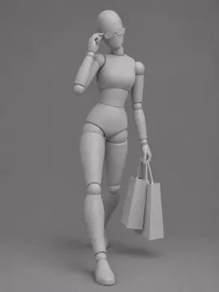 | <a href="https://promicat.app/zh/poses/styles/sp157?utm_source=github&utm_medium=readme&utm_campaign=ai-photo-poses">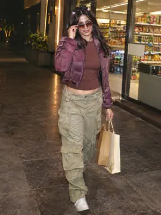</a> | <a href="https://promicat.app/zh/poses/styles/sp157?utm_source=github&utm_medium=readme&utm_campaign=ai-photo-poses">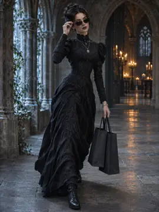</a> | <a href="https://promicat.app/zh/poses/styles/sp157?utm_source=github&utm_medium=readme&utm_campaign=ai-photo-poses"></a> | <a href="https://promicat.app/zh/poses/styles/sp157?utm_source=github&utm_medium=readme&utm_campaign=ai-photo-poses"></a> |

大图: [写真照](../images/photo-poses/y2k/sp157-photo.webp) · [白模](../images/photo-poses/y2k/sp157-pose.webp) · [在 Promicat 生成](https://promicat.app/zh/poses/styles/sp157?utm_source=github&utm_medium=readme&utm_campaign=ai-photo-poses)

<details><summary>提示词：用你的照片（图 1 你的照片，图 2 白模）</summary>

```text
A real professional portrait photoshoot photo: a Y2K-style flash photoshoot at night outside a convenience store and in a mall, direct on-camera flash, glossy colours, 35mm. Subject: the person in image 1 (keep their exact face, facial features, skin tone and hairstyle; do not beautify or swap the face), wearing a cropped puffer jacket over a fitted top with low-rise cargo trousers, tinted sunglasses, butterfly clips. Pose: walking through a mall holding shopping bags, pushing up sunglasses. Image 2 is a wooden artist's mannequin that shows only this body pose: copy it exactly (head, torso, arms, hands, legs, feet, which hand does what, the camera angle), but do not copy the mannequin itself: no wooden skin, no joints, no blank face. Natural, relaxed and unstiff, true skin texture. No text, no logo, no watermark. Portrait 3:4.
```

</details>

<details><summary>提示词：生成示例图（虚构模特）</summary>

```text
A real professional portrait photoshoot photo, the kind posted by a top portrait studio: a Y2K-style flash photoshoot at night outside a convenience store and in a mall, direct on-camera flash, glossy colours, 35mm. Model: a beautiful Indian professional fashion model in her twenties with a naturally attractive face, styled hair and natural makeup, wearing a cropped puffer jacket over a fitted top with low-rise cargo trousers, tinted sunglasses, butterfly clips. The photographer directs the model into a natural, relaxed, unstiff pose that looks caught between moments: walking through a mall holding shopping bags, pushing up sunglasses. Asymmetric body, soft hands, flattering angle, true skin texture, refined but not plastic, fully clothed and modest. Full body or three-quarter body in frame, the whole pose clearly readable. No text, no logo, no watermark. Portrait 3:4.
```

</details>

## 数码相机自拍 (半身)

| 白模 | Y2K 千禧辣妹 | 校园青春 | 街头朋克 | 街拍时尚 |
|---|---|---|---|---|
| 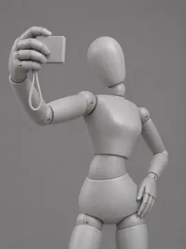 | <a href="https://promicat.app/zh/poses/styles/sp158?utm_source=github&utm_medium=readme&utm_campaign=ai-photo-poses">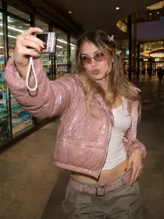</a> | <a href="https://promicat.app/zh/poses/styles/sp158?utm_source=github&utm_medium=readme&utm_campaign=ai-photo-poses">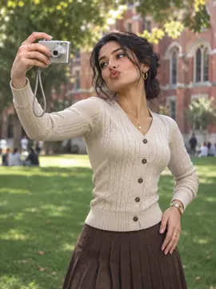</a> | <a href="https://promicat.app/zh/poses/styles/sp158?utm_source=github&utm_medium=readme&utm_campaign=ai-photo-poses">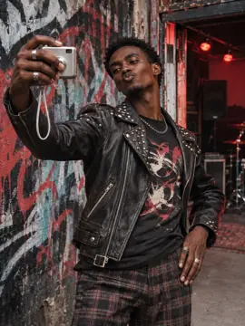</a> | <a href="https://promicat.app/zh/poses/styles/sp158?utm_source=github&utm_medium=readme&utm_campaign=ai-photo-poses">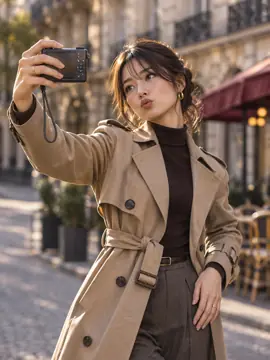</a> |

大图: [写真照](../images/photo-poses/y2k/sp158-photo.webp) · [白模](../images/photo-poses/y2k/sp158-pose.webp) · [在 Promicat 生成](https://promicat.app/zh/poses/styles/sp158?utm_source=github&utm_medium=readme&utm_campaign=ai-photo-poses)

<details><summary>提示词：用你的照片（图 1 你的照片，图 2 白模）</summary>

```text
A real professional portrait photoshoot photo: a Y2K-style flash photoshoot at night outside a convenience store and in a mall, direct on-camera flash, glossy colours, 35mm. Subject: the person in image 1 (keep their exact face, facial features, skin tone and hairstyle; do not beautify or swap the face), wearing a cropped puffer jacket over a fitted top with low-rise cargo trousers, tinted sunglasses, butterfly clips. Pose: holding a small digital camera at arm length for a selfie, pouting playfully. Image 2 is a wooden artist's mannequin that shows only this body pose: copy it exactly (head, torso, arms, hands, legs, feet, which hand does what, the camera angle), but do not copy the mannequin itself: no wooden skin, no joints, no blank face. Natural, relaxed and unstiff, true skin texture. No text, no logo, no watermark. Portrait 3:4.
```

</details>

<details><summary>提示词：生成示例图（虚构模特）</summary>

```text
A real professional portrait photoshoot photo, the kind posted by a top portrait studio: a Y2K-style flash photoshoot at night outside a convenience store and in a mall, direct on-camera flash, glossy colours, 35mm. Model: a beautiful white European professional fashion model in her twenties with a naturally attractive face, styled hair and natural makeup, wearing a cropped puffer jacket over a fitted top with low-rise cargo trousers, tinted sunglasses, butterfly clips. The photographer directs the model into a natural, relaxed, unstiff pose that looks caught between moments: holding a small digital camera at arm length for a selfie, pouting playfully. Asymmetric body, soft hands, flattering angle, true skin texture, refined but not plastic, fully clothed and modest. Waist-up framing, both arms and hands readable. No text, no logo, no watermark. Portrait 3:4.
```

</details>

## 趴扶梯 (靠)

| 白模 | Y2K 千禧辣妹 | 波西米亚 | 森系花田 | 西部牛仔 |
|---|---|---|---|---|
| 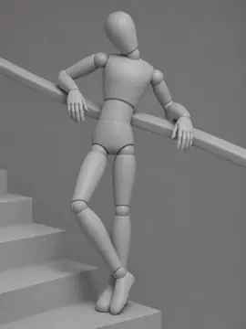 | <a href="https://promicat.app/zh/poses/styles/sp159?utm_source=github&utm_medium=readme&utm_campaign=ai-photo-poses">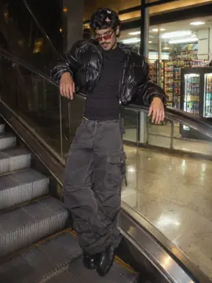</a> | <a href="https://promicat.app/zh/poses/styles/sp159?utm_source=github&utm_medium=readme&utm_campaign=ai-photo-poses">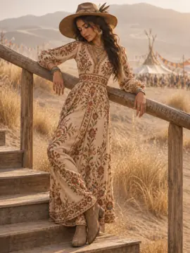</a> | <a href="https://promicat.app/zh/poses/styles/sp159?utm_source=github&utm_medium=readme&utm_campaign=ai-photo-poses">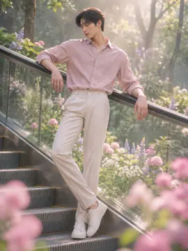</a> | <a href="https://promicat.app/zh/poses/styles/sp159?utm_source=github&utm_medium=readme&utm_campaign=ai-photo-poses">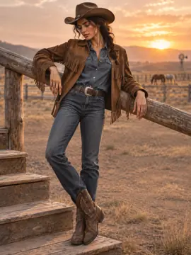</a> |

大图: [写真照](../images/photo-poses/y2k/sp159-photo.webp) · [白模](../images/photo-poses/y2k/sp159-pose.webp) · [在 Promicat 生成](https://promicat.app/zh/poses/styles/sp159?utm_source=github&utm_medium=readme&utm_campaign=ai-photo-poses)

<details><summary>提示词：用你的照片（图 1 你的照片，图 2 白模）</summary>

```text
A real professional portrait photoshoot photo: a Y2K-style flash photoshoot at night outside a convenience store and in a mall, direct on-camera flash, glossy colours, 35mm. Subject: the person in image 1 (keep their exact face, facial features, skin tone and hairstyle; do not beautify or swap the face), wearing a cropped puffer jacket over a fitted top with low-rise cargo trousers, tinted sunglasses, butterfly clips. Pose: leaning on an escalator rail on the forearms, looking down. Image 2 is a wooden artist's mannequin that shows only this body pose: copy it exactly (head, torso, arms, hands, legs, feet, which hand does what, the camera angle), but do not copy the mannequin itself: no wooden skin, no joints, no blank face. Natural, relaxed and unstiff, true skin texture. No text, no logo, no watermark. Portrait 3:4.
```

</details>

<details><summary>提示词：生成示例图（虚构模特）</summary>

```text
A real professional portrait photoshoot photo, the kind posted by a top portrait studio: a Y2K-style flash photoshoot at night outside a convenience store and in a mall, direct on-camera flash, glossy colours, 35mm. Model: a handsome Brazilian professional male model in his twenties with a well-groomed look and styled hair, wearing a cropped puffer jacket over a fitted top with low-rise cargo trousers, tinted sunglasses, butterfly clips. The photographer directs the model into a natural, relaxed, unstiff pose that looks caught between moments: leaning on an escalator rail on the forearms, looking down. Asymmetric body, soft hands, flattering angle, true skin texture, refined but not plastic, fully clothed and modest. Full body or three-quarter body in frame, the whole pose clearly readable. No text, no logo, no watermark. Portrait 3:4.
```

</details>

## 踮脚比心 (站)

| 白模 | Y2K 千禧辣妹 | 海边度假 | 赛博霓虹 | 街拍时尚 |
|---|---|---|---|---|
| 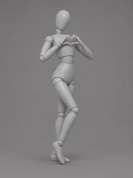 | <a href="https://promicat.app/zh/poses/styles/sp160?utm_source=github&utm_medium=readme&utm_campaign=ai-photo-poses">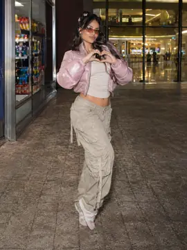</a> | <a href="https://promicat.app/zh/poses/styles/sp160?utm_source=github&utm_medium=readme&utm_campaign=ai-photo-poses">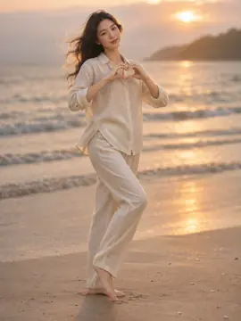</a> | <a href="https://promicat.app/zh/poses/styles/sp160?utm_source=github&utm_medium=readme&utm_campaign=ai-photo-poses">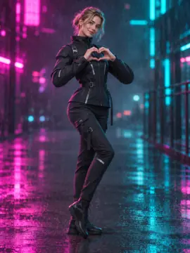</a> | <a href="https://promicat.app/zh/poses/styles/sp160?utm_source=github&utm_medium=readme&utm_campaign=ai-photo-poses">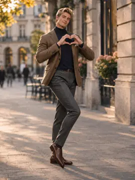</a> |

大图: [写真照](../images/photo-poses/y2k/sp160-photo.webp) · [白模](../images/photo-poses/y2k/sp160-pose.webp) · [在 Promicat 生成](https://promicat.app/zh/poses/styles/sp160?utm_source=github&utm_medium=readme&utm_campaign=ai-photo-poses)

<details><summary>提示词：用你的照片（图 1 你的照片，图 2 白模）</summary>

```text
A real professional portrait photoshoot photo: a Y2K-style flash photoshoot at night outside a convenience store and in a mall, direct on-camera flash, glossy colours, 35mm. Subject: the person in image 1 (keep their exact face, facial features, skin tone and hairstyle; do not beautify or swap the face), wearing a cropped puffer jacket over a fitted top with low-rise cargo trousers, tinted sunglasses, butterfly clips. Pose: standing on tiptoe making a heart with the hands. Image 2 is a wooden artist's mannequin that shows only this body pose: copy it exactly (head, torso, arms, hands, legs, feet, which hand does what, the camera angle), but do not copy the mannequin itself: no wooden skin, no joints, no blank face. Natural, relaxed and unstiff, true skin texture. No text, no logo, no watermark. Portrait 3:4.
```

</details>

<details><summary>提示词：生成示例图（虚构模特）</summary>

```text
A real professional portrait photoshoot photo, the kind posted by a top portrait studio: a Y2K-style flash photoshoot at night outside a convenience store and in a mall, direct on-camera flash, glossy colours, 35mm. Model: a beautiful Latina professional fashion model in her twenties with a naturally attractive face, styled hair and natural makeup, wearing a cropped puffer jacket over a fitted top with low-rise cargo trousers, tinted sunglasses, butterfly clips. The photographer directs the model into a natural, relaxed, unstiff pose that looks caught between moments: standing on tiptoe making a heart with the hands. Asymmetric body, soft hands, flattering angle, true skin texture, refined but not plastic, fully clothed and modest. Full body or three-quarter body in frame, the whole pose clearly readable. No text, no logo, no watermark. Portrait 3:4.
```

</details>
